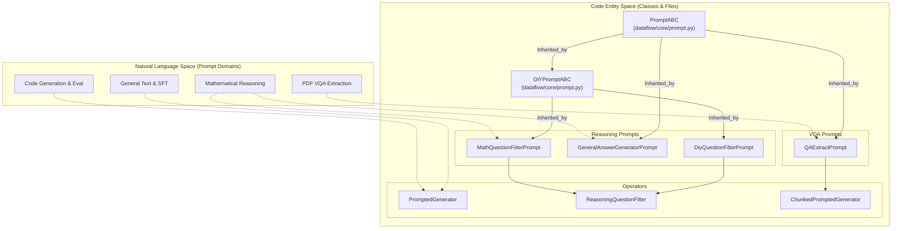
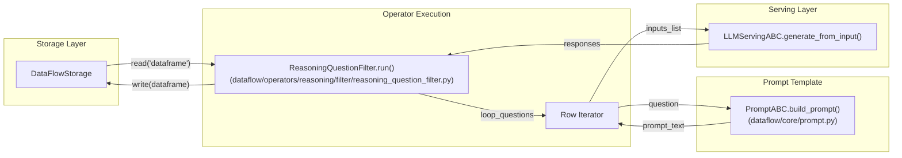

<!-- source: DeepWiki mcp.deepwiki.com · repo OpenDCAI/DataFlow · page 7 Prompt Engineering Guide · fetched 2026-11-02 -->

# Prompt Engineering Guide

<details>
<summary>Relevant source files</summary>

The following files were used as context for generating this wiki page:

- [dataflow/core/prompt.py](dataflow/core/prompt.py)
- [dataflow/operators/reasoning/filter/reasoning_question_filter.py](dataflow/operators/reasoning/filter/reasoning_question_filter.py)

</details>


This document provides a comprehensive guide to the prompt engineering system in DataFlow. It covers the `PromptABC` interface, the prompt registry architecture, built-in prompt families, and best practices for creating custom prompts that interact with LLMs effectively. This page focuses specifically on prompt templates and their design patterns.

---

## Overview of the Prompt System

DataFlow's prompt system separates prompt logic from operator logic, enabling reusable, testable, and maintainable LLM interactions. The system consists of:

- **PromptABC**: Abstract base class defining the prompt interface [dataflow/core/prompt.py:6-10]().
- **DIYPromptABC**: A specific base class for user-defined custom prompts that can bypass strict type restrictions in operators [dataflow/core/prompt.py:12-16]().
- **PROMPT_REGISTRY**: Central registry managing built-in prompts using a lazy-loading mechanism.
- **Prompt Families**: Domain-specific collections including Code, Reasoning (Math, General, DIY), Text2SQL, PDF VQA, and General Text.

### Natural Language to Code Entity Mapping

The following diagram bridges the conceptual prompt domains to their specific code implementations and the operators that utilize them.

**Prompt-Operator Entity Map**

Sources: [dataflow/core/prompt.py:6-16](), [dataflow/operators/reasoning/filter/reasoning_question_filter.py:15-21]()

---

## Prompt Template System

The core of the prompt system is built on the `PromptABC` and `DIYPromptABC` abstractions. For details, see [Prompt Template System](#7.1).

### Prompt Restriction and Type Safety
DataFlow uses the `@prompt_restrict` decorator to enforce type safety, ensuring that operators only receive compatible prompt templates [dataflow/core/prompt.py:28-32](). This decorator updates the class `__annotations__` and performs runtime checks during initialization to verify that the provided `prompt_template` is either a whitelisted class or a subclass of `DIYPromptABC` [dataflow/core/prompt.py:45-78]().

```python
@prompt_restrict(
    MathQuestionFilterPrompt, 
    GeneralQuestionFilterPrompt, 
    DiyQuestionFilterPrompt
)
@OPERATOR_REGISTRY.register()
class ReasoningQuestionFilter(OperatorABC):
    def __init__(self,
                 prompt_template: Union[MathQuestionFilterPrompt, ...] = MathQuestionFilterPrompt
                 ):
        # ...
```
Sources: [dataflow/core/prompt.py:28-78](), [dataflow/operators/reasoning/filter/reasoning_question_filter.py:15-26]()

---

## Text2SQL Prompts

These prompts specialize in generating SQL queries, validating schema correspondence, and producing Chain-of-Thought (CoT) reasoning for database tasks. For details, see [Text2SQL Prompts](#7.2).

**Key Prompts**:
- `SelectSQLGeneratorPrompt`: Generates SELECT statements.
- `Text2SQLCorrespondenceFilterPrompt`: Validates if SQL matches the natural language question.
- `Text2SQLCotGeneratorPrompt`: Produces step-by-step reasoning for SQL generation.
- `SQLVariationGeneratorPrompt`: Generates diverse variations of SQL queries for refinement.

Sources: [dataflow/operators/reasoning/filter/reasoning_question_filter.py:1-11]()

---

## Reasoning Prompts

Located in `dataflow/prompts/reasoning/`, these handle complex logic and math tasks. For details, see [Reasoning Prompts](#7.3).

### Math Reasoning
Includes `MathQuestionFilterPrompt` for validating problem solvability [dataflow/operators/reasoning/filter/reasoning_question_filter.py:16-19]() and `MathAnswerGeneratorPrompt` for step-by-step solutions with LaTeX formatting.

### DIY Reasoning
`DiyQuestionFilterPrompt` allows users to provide their own templates while still benefiting from the reasoning operator framework [dataflow/operators/reasoning/filter/reasoning_question_filter.py:18-19]().

Sources: [dataflow/operators/reasoning/filter/reasoning_question_filter.py:7-11]()

---

## General Text Prompts

This category covers SFT data generation, conversation synthesis, and quality evaluation. For details, see [General Text Prompts](#7.4).

- **SFT Generation**: `SFTGeneratorSeedPrompt` creates instruction-output pairs from seeds.
- **Multi-turn Chat**: `ConsistentChatPrompt` generates dialogues across various intent categories.
- **Quality Scoring**: `AlpagasusPrompt` and `MetaPrompt` provide multi-dimensional evaluation.
- **QA Generation**: `Phi4QAGeneratorPrompt` for high-quality synthetic QA pairs.
- **Functional Calling**: `FuncCallPrompt` for generating function-calling scenarios.

Sources: [dataflow/core/prompt.py:1-10]()

---

## PDF VQA Prompts

Specialized prompts for extracting visual question-answering pairs from documents. For details, see [PDF VQA and Knowledge Prompts](#7.5).

### QAExtractPrompt
This prompt guides the LLM to extract VQA pairs with XML-like output formatting, specifically referencing content IDs generated during the PDF parsing phase (e.g., using MinerU). It is typically used with the `ChunkedPromptedGenerator`.

Sources: [dataflow/core/prompt.py:1-10]()

---

## Custom Prompt Development

Developers can extend the system by implementing `PromptABC` or `DIYPromptABC` and registering them with the `PROMPT_REGISTRY`. For a step-by-step guide, see [Custom Prompt Development](#7.6).

### Integration Workflow
1. **Define**: Create a class inheriting from `PromptABC` or `DIYPromptABC` [dataflow/core/prompt.py:6-16]().
2. **Register**: Use `@PROMPT_REGISTRY.register()`.
3. **Implement**: Write the `build_prompt()` logic to return the final string [dataflow/core/prompt.py:9-10]().
4. **Restrict**: Add the prompt to an operator's `@prompt_restrict` list [dataflow/core/prompt.py:28-32]().

**Code Interaction Diagram**

Sources: [dataflow/operators/reasoning/filter/reasoning_question_filter.py:92-110](), [dataflow/core/prompt.py:6-16]()

---

