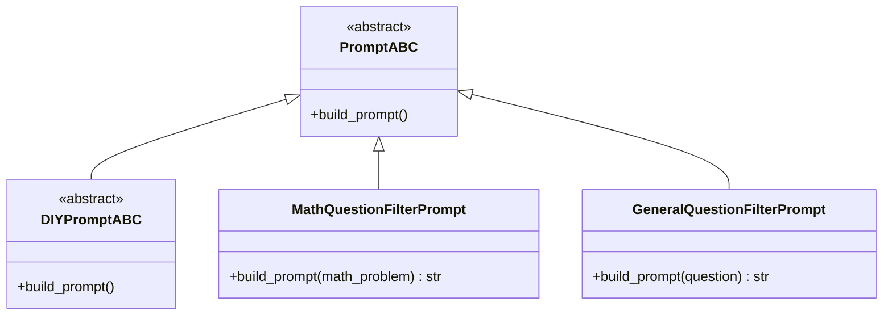
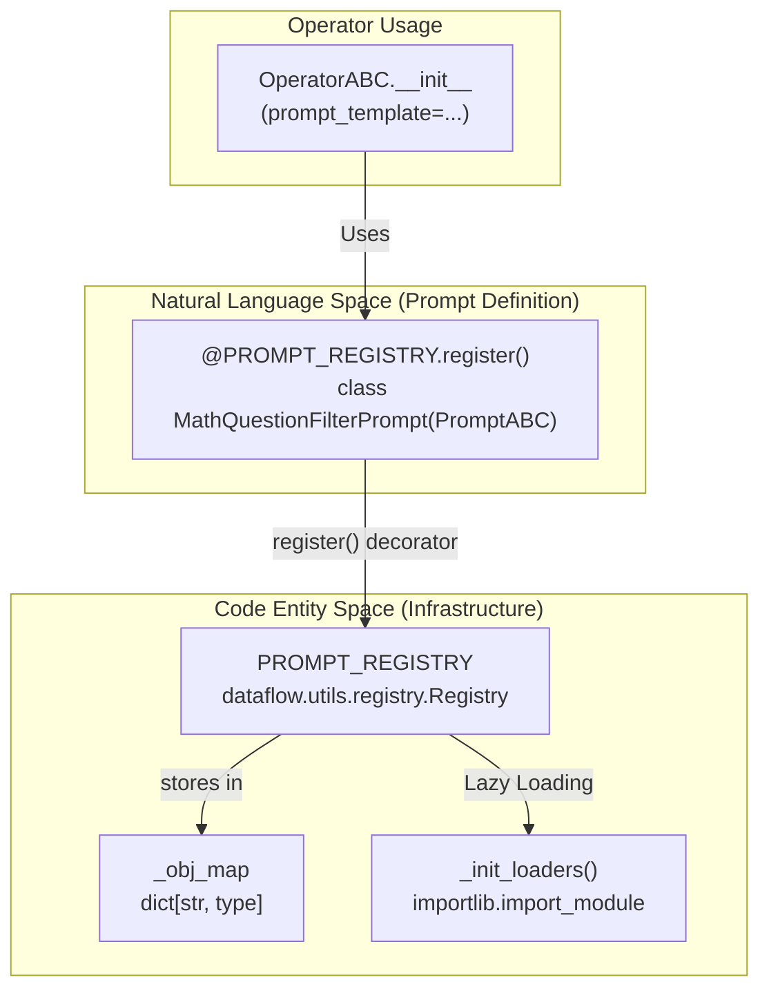
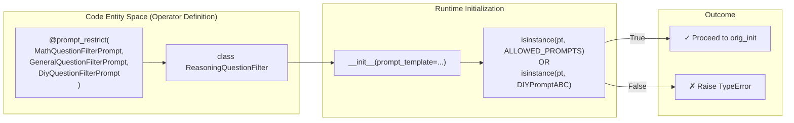

<!-- source: DeepWiki mcp.deepwiki.com · repo OpenDCAI/DataFlow · page 7.1 Prompt Template System · fetched 2026-11-02 -->

# Prompt Template System

<details>
<summary>Relevant source files</summary>

The following files were used as context for generating this wiki page:

- [dataflow/core/prompt.py](dataflow/core/prompt.py)
- [dataflow/operators/code/filter/code_autogen_filter.py](dataflow/operators/code/filter/code_autogen_filter.py)
- [dataflow/operators/reasoning/filter/reasoning_question_filter.py](dataflow/operators/reasoning/filter/reasoning_question_filter.py)
- [dataflow/utils/registry.py](dataflow/utils/registry.py)
- [test/cpu_only/test_register.py](test/cpu_only/test_register.py)
- [test/cpu_only/test_register_whitelist.py](test/cpu_only/test_register_whitelist.py)
- [test/xlsx_overview_of_dataflow/test_get_prompt_info_to_xlsx.py](test/xlsx_overview_of_dataflow/test_get_prompt_info_to_xlsx.py)

</details>


## Purpose and Scope

The Prompt Template System provides a structured framework for defining, organizing, and validating LLM prompts used throughout DataFlow pipelines. It separates prompt engineering from operator logic through a standardized interface (`PromptABC`), enabling reusable prompt templates that can be registered, discovered dynamically, and enforced for type safety. This system supports general-purpose prompts, domain-specific prompts (math, Text2SQL, code, PDF VQA), and user-defined custom prompts.

For information about using prompts in specific domains, see:
- Text2SQL prompts: [7.2 Text2SQL Prompts]()
- Reasoning prompts: [7.3 Reasoning Prompts]()
- General text prompts: [7.4 General Text Prompts]()
- PDF VQA prompts: [7.5 PDF VQA Prompts]()
- Creating custom prompts: [7.6 Custom Prompt Development]()

Sources: [dataflow/core/prompt.py:1-16](), [dataflow/utils/registry.py:34-123]()

---

## PromptABC Interface

The `PromptABC` abstract base class defines the contract that all prompt templates must implement. Prompts are objects that transform input data into formatted strings suitable for LLM consumption.

### Prompt Hierarchy and Implementation

The hierarchy includes base classes for structured prompts and flexible "Do-It-Yourself" prompts that allow for custom logic while maintaining compatibility with the framework's type-checking system.

Title: "Prompt Class Hierarchy"


**Core Methods:**

| Method | Return Type | Purpose |
|--------|-------------|---------|
| `build_prompt()` | `NotImplemented` | Abstract method that must be overridden to generate the formatted prompt string [dataflow/core/prompt.py:9-10](). |

The system also defines `DIYPromptABC` as a specialized base for user-defined templates that can bypass strict type checks in certain operators while still satisfying base class requirements [dataflow/core/prompt.py:12-16]().

Sources: [dataflow/core/prompt.py:6-16](), [dataflow/operators/reasoning/filter/reasoning_question_filter.py:7-12]()

---

## Core Prompt Infrastructure

Prompt templates encapsulate formatting logic and variable injection. Concrete prompt classes implement `build_prompt()` to ingest structured or unstructured parameters (such as questions, data rows, or schema definitions) and compile them into fully formed prompt strings.

**Execution Flow during `build_prompt`:**
1. Parameters are passed into the prompt instance method.
2. Template strings interpolate the variables using formatting routines or explicit string concatenation.
3. The resulting string is returned to the operator for downstream LLM request batching.

Sources: [dataflow/core/prompt.py:6-16](), [dataflow/operators/reasoning/filter/reasoning_question_filter.py:92-98]()

---

## Prompt Registration and Discovery

Prompts are managed via the `Registry` system, which provides name-to-object mapping and dynamic discovery (`PROMPT_REGISTRY`).

### Registry Infrastructure

The `Registry` class manages a mapping of names to objects and supports lazy loading of modules from the filesystem.

Title: "Bridge: Prompt Registration to Code Infrastructure"


**Key Registry Behaviors:**
- **`@PROMPT_REGISTRY.register()`**: Decorator used to add a prompt class to the global registry for lookup by name [dataflow/utils/registry.py:85-103]().
- **Lazy Loading**: If an object is not in the map, `Registry.get()` calls `_init_loaders()` to import sub-modules dynamically from the filesystem [dataflow/utils/registry.py:104-123]().
- **Whitelist Filtering**: The `apply_whitelist` method allows the registry to be restricted to a specific set of prompts, removing others from the internal `_obj_map` [dataflow/utils/registry.py:131-182]().

Sources: [dataflow/utils/registry.py:34-182](), [test/xlsx_overview_of_dataflow/test_get_prompt_info_to_xlsx.py:5-19]()

---

## Type Safety with @prompt_restrict Decorator

The `@prompt_restrict` decorator enforces that an operator only accepts specific prompt types during initialization. This prevents the use of incompatible templates that might lack the required logic or input fields.

### Validation Logic

Title: "Bridge: Prompt Restriction Decorator Flow"


**Implementation Details:**
- **Annotation Updates**: The decorator automatically updates the `__annotations__` of the class to reflect the allowed prompt types as a `Union`, which aids static analysis tools and schema generation [dataflow/core/prompt.py:74-75]().
- **Inheritance Check**: It allows any prompt class explicitly listed in the decorator OR any subclass of `DIYPromptABC` [dataflow/core/prompt.py:56-67]().
- **Signature Binding**: Uses `inspect.signature` to correctly identify the `prompt_template` argument regardless of whether it was passed as a positional or keyword argument [dataflow/core/prompt.py:47-54]().

Sources: [dataflow/core/prompt.py:28-78](), [dataflow/operators/reasoning/filter/reasoning_question_filter.py:15-26]()

---

## Prompt Usage in Operators

Operators utilize the `build_prompt` method to transform row-level data from storage into strings for the LLM.

### Data Flow Example: ReasoningQuestionFilter

In `ReasoningQuestionFilter`, the operator reads data from `DataFlowStorage`, calls `build_prompt` for each question, and performs batch inference [dataflow/operators/reasoning/filter/reasoning_question_filter.py:92-98]().

```python
# At dataflow/operators/reasoning/filter/reasoning_question_filter.py:94-97
dataframe = storage.read("dataframe")
questions = dataframe[input_key]
inputs = [self.prompt_template.build_prompt(question) for question in questions]
responses = self.llm_serving.generate_from_input(user_inputs=inputs, system_prompt=self.system_prompt)
```

### Prompt Lifecycle in Pipelines

1. **Initialization**: The operator is instantiated with a specific prompt template. For example, `ReasoningQuestionFilter` defaults to `MathQuestionFilterPrompt` [dataflow/operators/reasoning/filter/reasoning_question_filter.py:22-30]().
2. **Validation**: The `@prompt_restrict` decorator checks the prompt type during operator instantiation [dataflow/core/prompt.py:45-69]().
3. **Execution**: During `operator.run()`, the operator calls `prompt_template.build_prompt()` using data extracted from the `DataFlowStorage` [dataflow/operators/reasoning/filter/reasoning_question_filter.py:96]().
4. **Inference**: The generated strings are sent to `llm_serving.generate_from_input()` for processing [dataflow/operators/reasoning/filter/reasoning_question_filter.py:97]().

Sources: [dataflow/operators/reasoning/filter/reasoning_question_filter.py:21-110](), [dataflow/core/prompt.py:28-78]()

---

