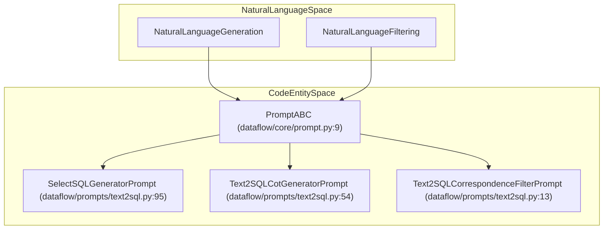
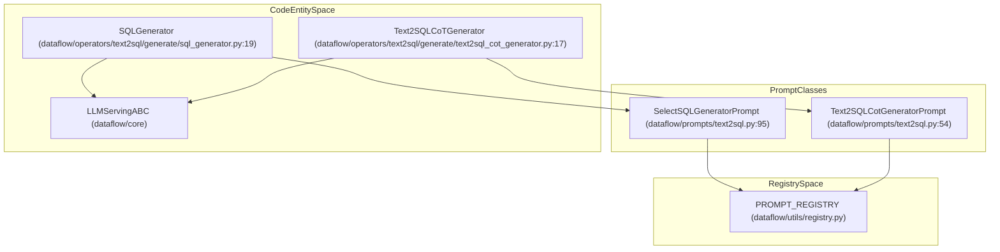
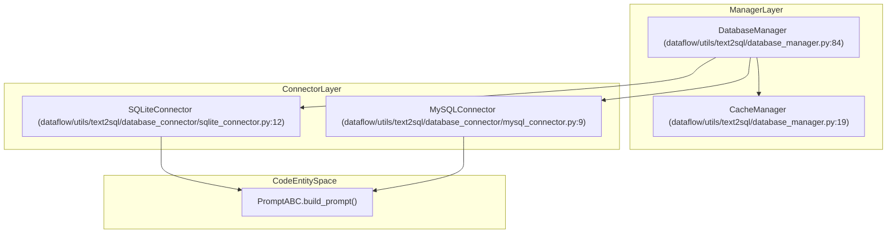

<!-- source: DeepWiki mcp.deepwiki.com · repo OpenDCAI/DataFlow · page 7.2 Text2SQL Prompts · fetched 2026-11-02 -->

# Text2SQL Prompts

<details>
<summary>Relevant source files</summary>

The following files were used as context for generating this wiki page:

- [dataflow/operators/text2sql/generate/sql_generator.py](dataflow/operators/text2sql/generate/sql_generator.py)
- [dataflow/operators/text2sql/generate/sql_variation_generator.py](dataflow/operators/text2sql/generate/sql_variation_generator.py)
- [dataflow/operators/text2sql/generate/text2sql_cot_generator.py](dataflow/operators/text2sql/generate/text2sql_cot_generator.py)
- [dataflow/operators/text2sql/generate/text2sql_prompt_generator.py](dataflow/operators/text2sql/generate/text2sql_prompt_generator.py)
- [dataflow/operators/text2sql/generate/text2sql_question_generator.py](dataflow/operators/text2sql/generate/text2sql_question_generator.py)
- [dataflow/prompts/text2sql.py](dataflow/prompts/text2sql.py)
- [dataflow/utils/text2sql/base.py](dataflow/utils/text2sql/base.py)
- [dataflow/utils/text2sql/database_connector/mysql_connector.py](dataflow/utils/text2sql/database_connector/mysql_connector.py)
- [dataflow/utils/text2sql/database_connector/sqlite_connector.py](dataflow/utils/text2sql/database_connector/sqlite_connector.py)
- [dataflow/utils/text2sql/database_manager.py](dataflow/utils/text2sql/database_manager.py)

</details>


This page details the prompt templates used throughout the Text2SQL pipeline for generating SQL queries, natural language questions, chain-of-thought (CoT) reasoning traces, prompt structures, and correspondence filtering. These prompts are registered in the `PROMPT_REGISTRY` [dataflow/prompts/text2sql.py:8-8]() and consumed by Text2SQL operators to guide LLM inference.

For related operator documentation, see [Text2SQL Generation Operators](). For general prompt infrastructure, see [Prompt Template System]().

## Overview

The Text2SQL prompt system provides specialized templates for each stage of dataset synthesis. All prompt classes inherit from `PromptABC` [dataflow/core/prompt.py:9-9]() and implement the `build_prompt()` method. The `@prompt_restrict` decorator enforces type-safe binding between prompts and operators at compile time [dataflow/core/prompt.py:16-16]().

**Diagram: Text2SQL Prompt Template Landscape (Natural Language Space to Code Entity Space)**


*Sources: [dataflow/core/prompt.py:9-16](), [dataflow/prompts/text2sql.py:13-95]()*

| Prompt Class | `build_prompt()` Signature | Primary Operator | File Location |
|-------------|---------------------------|------------------|---------------|
| `SelectSQLGeneratorPrompt` | `(insert_statements, create_statements, db_engine)` → `Tuple[str, str]` | `SQLGenerator` | [dataflow/prompts/text2sql.py:95-353]() |
| `Text2SQLCotGeneratorPrompt` | `(schema_str, question, sql, evidence)` → `str` | `Text2SQLCoTGenerator` | [dataflow/prompts/text2sql.py:54-91]() |
| `Text2SQLCorrespondenceFilterPrompt` | `(question, sql, db_details)` → `str` | `Text2SQLCorrespondenceFilter` | [dataflow/prompts/text2sql.py:13-52]() |

*Sources: [dataflow/prompts/text2sql.py:13-353]()*, [dataflow/operators/text2sql/generate/sql_generator.py:16-19]()

---

## Prompt Registration and Integration

**Diagram: Text2SQL Prompt-to-Operator Execution Pipeline**


*Sources: [dataflow/prompts/text2sql.py:8-12](), [dataflow/operators/text2sql/generate/sql_generator.py:16-25](), [dataflow/operators/text2sql/generate/text2sql_cot_generator.py:15-24]()*

The `@PROMPT_REGISTRY.register()` decorator registers prompt templates dynamically [dataflow/prompts/text2sql.py:12-12](). Operators apply the `@prompt_restrict` decorator to validate that only permitted prompt templates are accepted at runtime [dataflow/operators/text2sql/generate/sql_generator.py:16-16]().

*Sources: [dataflow/prompts/text2sql.py:8-12](), [dataflow/operators/text2sql/generate/sql_generator.py:16-16]()*

---

## SQL Generation Prompts

### SelectSQLGeneratorPrompt

The `SelectSQLGeneratorPrompt` class structures database schema information (`create_statements` and `insert_statements`) into multi-complexity prompt templates [dataflow/prompts/text2sql.py:95-151]().

**Key Attributes:**
- `self.simple_criterion`: Specifies single-table queries, basic aggregates (`COUNT`, `SUM`, `AVG`, `MIN`, `MAX`), and no joins [dataflow/prompts/text2sql.py:97-109]().
- `self.moderate_criterion`: Incorporates table joins (`JOIN`, `LEFT JOIN`), subqueries, `GROUP BY`, and `HAVING` clauses [dataflow/prompts/text2sql.py:111-129]().
- `self.complex_criterion`: Introduces nested subqueries, window functions (`ROW_NUMBER`, `RANK`), and Common Table Expressions (CTEs) [dataflow/prompts/text2sql.py:131-151]().
- `self.highly_complex_criterion`: Adds recursive CTEs and multi-table UNION operations [dataflow/prompts/text2sql.py:153-165]().

*Sources: [dataflow/prompts/text2sql.py:95-165]()*, [dataflow/operators/text2sql/generate/sql_generator.py:4-16]()

---

## Chain-of-Thought Generation Prompts

### Text2SQLCotGeneratorPrompt

The `Text2SQLCotGeneratorPrompt` class generates long-chain reasoning traces for Text2SQL tasks [dataflow/prompts/text2sql.py:54-91](). It formats database schemas, natural language questions, and optional reference solutions to guide the model step-by-step.

```python
@PROMPT_REGISTRY.register()
class Text2SQLCotGeneratorPrompt(PromptABC):
    def build_prompt(self, schema_str: str, question: str, sql: str, evidence: str) -> str:
        # Combines schema, question, reference solution, and evidence
        ...
```
*Sources: [dataflow/prompts/text2sql.py:54-91]()*, [dataflow/operators/text2sql/generate/text2sql_cot_generator.py:6-15]()

---

## Correspondence Filtering Prompts

### Text2SQLCorrespondenceFilterPrompt

The `Text2SQLCorrespondenceFilterPrompt` class validates whether a generated SQL query correctly answers a given question according to the database schema [dataflow/prompts/text2sql.py:13-52]().

**Evaluation Criteria:**
1. **Logical Alignment**: Evaluates if the SQL query logically addresses the question [dataflow/prompts/text2sql.py:32-32]().
2. **Schema Compliance**: Checks correct usage of tables, columns, and relations [dataflow/prompts/text2sql.py:33-33]().
3. **Completeness**: Verifies inclusion of all conditions and requirements [dataflow/prompts/text2sql.py:34-34]().
4. **Correctness**: Screens for logical errors [dataflow/prompts/text2sql.py:35-35]().

**Output Format Rule:**
The evaluation conclusion must be wrapped inside tags:
```xml
<Conclusion> YES/NO </Conclusion>
```
*Sources: [dataflow/prompts/text2sql.py:13-52]()*, [dataflow/operators/text2sql/filter/text2sql_correspondence_filter.py:1-25]()

---

## Database Schema and Connector Integration

**Diagram: DatabaseManager Schema Retrieval for Prompt Construction**


*Sources: [dataflow/utils/text2sql/database_manager.py:19-121](), [dataflow/utils/text2sql/database_connector/sqlite_connector.py:12-114](), [dataflow/utils/text2sql/database_connector/mysql_connector.py:9-109]()*

Prompt generators retrieve schema definitions through `DatabaseManager`, which wraps underlying connectors like `SQLiteConnector` [dataflow/utils/text2sql/database_connector/sqlite_connector.py:93-114]() and `MySQLConnector` [dataflow/utils/text2sql/database_connector/mysql_connector.py:80-109](). `CacheManager` caches schema information with a configurable Time-To-Live (TTL, default 1800s) to limit connection overhead [dataflow/utils/text2sql/database_manager.py:19-49]().

*Sources: [dataflow/utils/text2sql/database_manager.py:19-121](), [dataflow/utils/text2sql/database_connector/sqlite_connector.py:93-114](), [dataflow/utils/text2sql/database_connector/mysql_connector.py:80-109]()

---

