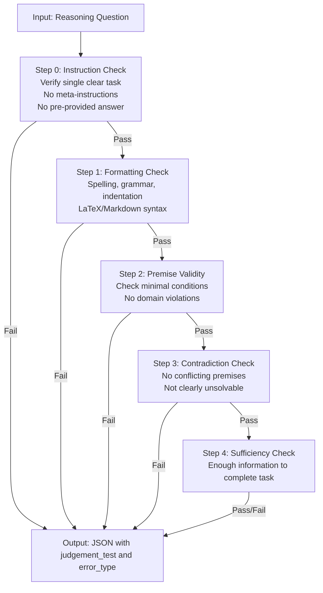
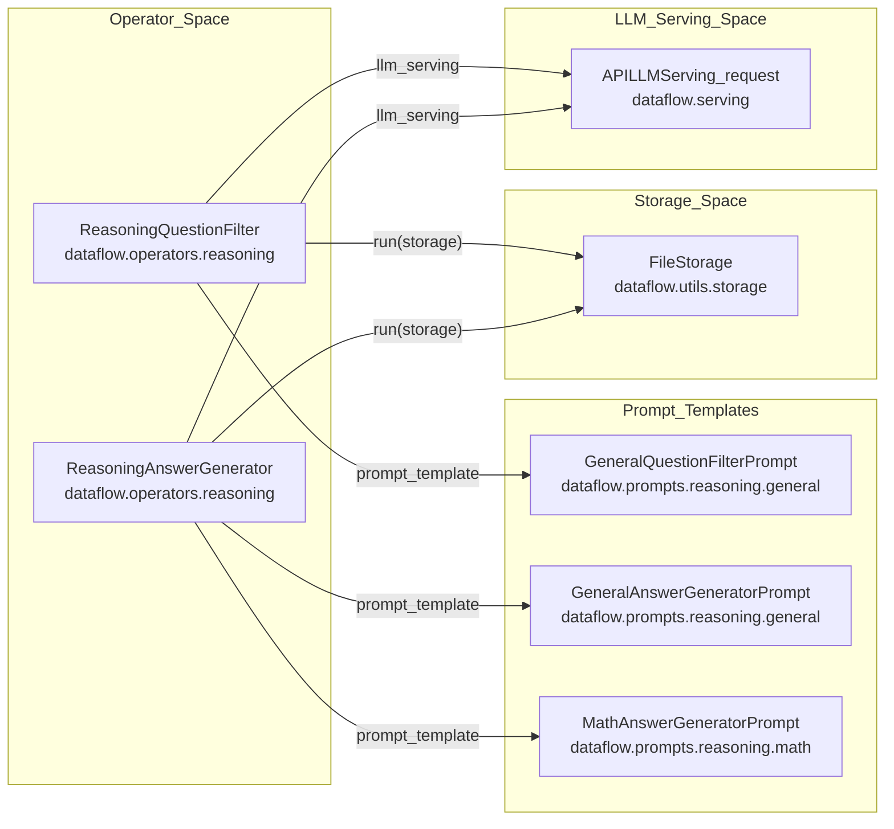

<!-- source: DeepWiki mcp.deepwiki.com · repo OpenDCAI/DataFlow · page 7.3 Reasoning Prompts · fetched 2026-11-02 -->

# Reasoning Prompts

<details>
<summary>Relevant source files</summary>

The following files were used as context for generating this wiki page:

- [dataflow/example/ReasoningPipeline/pipeline_general_short.json](dataflow/example/ReasoningPipeline/pipeline_general_short.json)
- [dataflow/prompts/reasoning/__init__.py](dataflow/prompts/reasoning/__init__.py)
- [dataflow/prompts/reasoning/diy.py](dataflow/prompts/reasoning/diy.py)
- [dataflow/prompts/reasoning/general.py](dataflow/prompts/reasoning/general.py)
- [dataflow/prompts/reasoning/math.py](dataflow/prompts/reasoning/math.py)
- [test/test_prompt_template_with_reasoning.py](test/test_prompt_template_with_reasoning.py)

</details>


This document details the reasoning-specific prompt templates available in DataFlow for generating, filtering, and evaluating complex reasoning tasks, particularly mathematical problems and chain-of-thought (CoT) solutions. These prompts are designed to work with reasoning operators that produce training datasets for models requiring multi-step logical reasoning.

For general prompt system architecture and registration mechanisms, see [Prompt Template System](). For operator implementations that use these prompts, see [Reasoning Generation Operators]() and [Reasoning Filter Operators]().

---

## Reasoning Prompt Categories

DataFlow organizes reasoning prompts into three hierarchical modules under `dataflow/prompts/reasoning/`:

| Module | Purpose | Primary Use Case |
|--------|---------|------------------|
| `general.py` | Domain-agnostic reasoning tasks | General problem-solving, logical reasoning, algorithm analysis |
| `math.py` | Mathematics-specific tasks | Mathematical problem generation, classification, difficulty assessment |
| `diy.py` | Custom template wrappers | User-provided prompt strings for reasoning tasks |

All prompts inherit from `PromptABC` [dataflow/core/prompt.py:3-3]() and are registered via the `PROMPT_REGISTRY` [dataflow/utils/registry.py:7-7]() for lazy loading and operator integration.

Sources: [dataflow/prompts/reasoning/__init__.py:1-3](), [dataflow/prompts/reasoning/general.py:1-6](), [dataflow/prompts/reasoning/math.py:1-5](), [dataflow/prompts/reasoning/diy.py:1-6]()

---

## Reasoning Prompt Architecture

Title: "Reasoning Prompt Taxonomy"

```mermaid
graph TB
    subgraph "Registry_Space"
        Registry["PROMPT_REGISTRY<br/>dataflow.utils.registry"]
    end
    
    subgraph "General_Reasoning_Prompts"
        GenAnswer["GeneralAnswerGeneratorPrompt<br/>dataflow.prompts.reasoning.general"]
        GenSynth["GeneralQuestionSynthesisPrompt<br/>dataflow.prompts.reasoning.general"]
        GenFilter["GeneralQuestionFilterPrompt<br/>dataflow.prompts.reasoning.general"]
    end
    
    subgraph "Math_Specific_Prompts"
        MathAnswer["MathAnswerGeneratorPrompt<br/>dataflow.prompts.reasoning.math"]
        MathSynth["MathQuestionSynthesisPrompt<br/>dataflow.prompts.reasoning.math"]
        MathCategory["MathQuestionCategoryPrompt<br/>dataflow.prompts.reasoning.math"]
        MathDifficulty["MathQuestionDifficultyPrompt<br/>dataflow.prompts.reasoning.math"]
    end
    
    subgraph "DIY_Custom_Prompts"
        DiyAnswer["DiyAnswerGeneratorPrompt<br/>dataflow.prompts.reasoning.diy"]
        DiyFilter["DiyQuestionFilterPrompt<br/>dataflow.prompts.reasoning.diy"]
        DiySynth["DiyQuestionSynthesisPrompt<br/>dataflow.prompts.reasoning.diy"]
    end
    
    Registry --> GenAnswer
    Registry --> GenSynth
    Registry --> GenFilter
    Registry --> MathAnswer
    Registry --> MathSynth
    Registry --> MathCategory
    Registry --> MathDifficulty
    Registry --> DiyAnswer
    Registry --> DiyFilter
    Registry --> DiySynth
```


Sources: [dataflow/prompts/reasoning/general.py:7-106](), [dataflow/prompts/reasoning/math.py:6-162](), [dataflow/prompts/reasoning/diy.py:7-41]()

---

## Answer Generation Prompts

Answer generation prompts produce structured chain-of-thought solutions following specific formatting conventions.

### GeneralAnswerGeneratorPrompt

Generates solutions for general reasoning tasks (algorithm analysis, logical proofs, code debugging) with a structured 4-step format [dataflow/prompts/reasoning/general.py:22-26]():

1. **Identify key components and premises** - Extract premises and requirements.
2. **Apply relevant principles/methods** - Use theorems with step-by-step derivation.
3. **Verification** - Perform calculations and logical checks with intermediate verification.
4. **Conclusion** - Present final answer in clear notation.

**Format Requirements:**
- Each step prefixed with "→" (actual arrow symbol) [dataflow/prompts/reasoning/general.py:29-29]().
- Special characters use appropriate markup (LaTeX for math, code formatting for snippets) [dataflow/prompts/reasoning/general.py:30-30]().
- Response starts with `"Solution:"` without preamble and ends immediately after [dataflow/prompts/reasoning/general.py:54-54]().

Sources: [dataflow/prompts/reasoning/general.py:8-55]()

### MathAnswerGeneratorPrompt

Specialized for mathematical problems with LaTeX formatting and numerical precision:

- **Mathematical symbols** - All operators rendered as LaTeX commands (e.g., `\geq`, `\div`) [dataflow/prompts/reasoning/math.py:29-29]().
- **Boxed answers** - Final result in `\boxed{}` notation [dataflow/prompts/reasoning/math.py:25-25]().
- **Verification steps** - Second derivative tests, boundary checks, domain validation [dataflow/prompts/reasoning/math.py:48-51]().

Sources: [dataflow/prompts/reasoning/math.py:6-59]()

### DiyAnswerGeneratorPrompt

Wrapper for user-provided prompt templates, allowing custom prompt design while maintaining the `"Solution:"` prefix convention for consistent parsing [dataflow/prompts/reasoning/diy.py:15-15]().

**Implementation:** [dataflow/prompts/reasoning/diy.py:8-18]()

```python
@PROMPT_REGISTRY.register()
class DiyAnswerGeneratorPrompt(PromptABC):
    def __init__(self, prompt_template):
        self.prompt_template = prompt_template
        
    def build_prompt(self, question: str) -> str:
        try:
            return self.prompt_template + question + r'''Your response must start directly with "Solution:" without any preamble. Finish your response immediately after the solution.'''
        except Exception:
            self.logger.debug(f"Please check if the symbol {{question}} in prompt is missing.")
```

Sources: [dataflow/prompts/reasoning/diy.py:7-18]()

---

## Question Synthesis Prompts

Question synthesis prompts transform existing problems into new variations while preserving complexity and solvability.

### GeneralQuestionSynthesisPrompt

Applies domain-agnostic transformations to create new reasoning tasks. Transformation strategies include altering quantitative elements, changing task types (e.g., calculation to proof), reframing scenarios (e.g., finance, robotics), and increasing complexity through interdependent steps [dataflow/prompts/reasoning/general.py:65-74]().

Sources: [dataflow/prompts/reasoning/general.py:56-80]()

### MathQuestionSynthesisPrompt

Mathematics-specific transformations including altering numerical values, modifying problem types (e.g., finding area to finding perimeter), and adding additional premises [dataflow/prompts/reasoning/math.py:69-76]().

Sources: [dataflow/prompts/reasoning/math.py:60-85]()

---

## Question Filtering and Validation

Filtering prompts implement progressive validation checks to ensure problem quality.

### Four-Step Validation Process

`GeneralQuestionFilterPrompt` [dataflow/prompts/reasoning/general.py:82-106]() follows a sequential validation pattern that stops at the first failure:

Title: "Progressive Question Validation Pipeline"


Sources: [dataflow/prompts/reasoning/general.py:87-98]()

---

## Math-Specific Specialized Prompts

### MathQuestionCategoryPrompt

Classifies problems into a 7-tier primary + 23-tier secondary taxonomy including Foundations, Algebra, Analysis, Geometry, Probability, Applied Math, and Arithmetic [dataflow/prompts/reasoning/math.py:99-141]().

Sources: [dataflow/prompts/reasoning/math.py:87-145]()

### MathQuestionDifficultyPrompt

Assesses difficulty on a 1-10 scale (0.5 increments) using olympiad problem references from AMC 8/10 to high-level competition math [dataflow/prompts/reasoning/math.py:156-162]().

Sources: [dataflow/prompts/reasoning/math.py:147-162]()

---

## Integration with Reasoning Operators

Title: "Prompt-Operator Integration Pattern"


Sources: [test/test_prompt_template_with_reasoning.py:38-44](), [test/test_prompt_template_with_reasoning.py:57-60]()

### Example Usage in Pipeline

Reasoning prompts are passed to operators during initialization in a pipeline's `__init__` method [test/test_prompt_template_with_reasoning.py:38-44]().

```python
# From test/test_prompt_template_with_reasoning.py
self.question_filter_step1 = ReasoningQuestionFilter(
    system_prompt="You are an expert in evaluating mathematical problems.",
    llm_serving=self.llm_serving,
    prompt_template=GeneralQuestionFilterPrompt()
)
```

Sources: [test/test_prompt_template_with_reasoning.py:38-44]()

---

