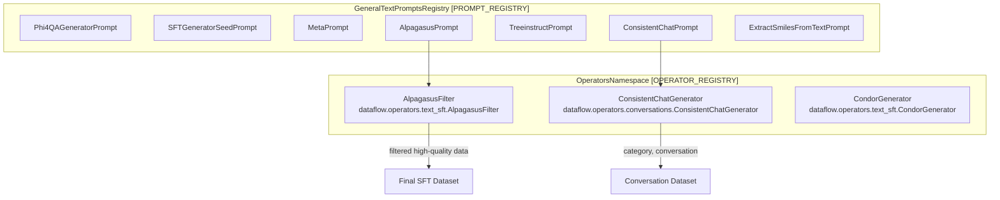

<!-- source: DeepWiki mcp.deepwiki.com · repo OpenDCAI/DataFlow · page 7.4 General Text Prompts · fetched 2026-11-02 -->

# General Text Prompts

Relevant source files

The following files were used as context for generating this wiki page:

- [dataflow/example/GeneralTextPipeline/empty.jsonl](dataflow/example/GeneralTextPipeline/empty.jsonl)
- [dataflow/example/chemistry/matched_sample_10.json](dataflow/example/chemistry/matched_sample_10.json)
- [dataflow/example/core_text_data/eval_data.json](dataflow/example/core_text_data/eval_data.json)
- [dataflow/operators/conversations/generate/consistent_chat_generator.py](dataflow/operators/conversations/generate/consistent_chat_generator.py)
- [dataflow/operators/core_text/eval/prompted_eval.py](dataflow/operators/core_text/eval/prompted_eval.py)
- [dataflow/operators/core_text/filter/prompted_filter.py](dataflow/operators/core_text/filter/prompted_filter.py)
- [dataflow/operators/core_text/generate/format_str_prompted_generator.py](dataflow/operators/core_text/generate/format_str_prompted_generator.py)
- [dataflow/operators/core_text/refine/prompted_refiner.py](dataflow/operators/core_text/refine/prompted_refiner.py)
- [dataflow/operators/text_sft/generate/condor_generator.py](dataflow/operators/text_sft/generate/condor_generator.py)
- [dataflow/operators/text_sft/refine/condor_refiner.py](dataflow/operators/text_sft/refine/condor_refiner.py)
- [dataflow/prompts/chemistry.py](dataflow/prompts/chemistry.py)
- [dataflow/prompts/core_text.py](dataflow/prompts/core_text.py)
- [dataflow/prompts/general_text.py](dataflow/prompts/general_text.py)
- [dataflow/statics/pipelines/api_pipelines/text_conversation_synthesis_pipeline.py](dataflow/statics/pipelines/api_pipelines/text_conversation_synthesis_pipeline.py)
- [dataflow/statics/pipelines/api_pipelines/text_sft_synthesis_pipeline.py](dataflow/statics/pipelines/api_pipelines/text_sft_synthesis_pipeline.py)
- [dataflow/statics/playground/playground/text_conversation_synthesis_pipeline.py](dataflow/statics/playground/playground/text_conversation_synthesis_pipeline.py)
- [dataflow/statics/playground/simple_text_pipelines/sft_from_scratch.py](dataflow/statics/playground/simple_text_pipelines/sft_from_scratch.py)
- [dataflow/statics/scaffold/{{cookiecutter.repo_name}}/{{cookiecutter.package_name}}/operators/core/my_format_str_prompted_generator.py](dataflow/statics/scaffold/{{cookiecutter.repo_name}}/{{cookiecutter.package_name}}/operators/core/my_format_str_prompted_generator.py)
- [dataflow/statics/scaffold/{{cookiecutter.repo_name}}/{{cookiecutter.package_name}}/prompts/core.py](dataflow/statics/scaffold/{{cookiecutter.repo_name}}/{{cookiecutter.package_name}}/prompts/core.py)

## Purpose and Scope

This page documents the general text prompts defined across `dataflow/prompts/general_text.py`, `dataflow/prompts/func_call.py`, and `dataflow/prompts/chemistry.py`. These prompts provide structured templates for generating supervised fine-tuning (SFT) data, multi-turn conversations, function-calling scenarios, chemistry domain information extraction, and quality evaluation tasks. They interface directly with operators for instruction-response synthesis, dialogue generation, and filtering.

For Text2SQL-specific prompts, see section 7.2. For reasoning task prompts, see section 7.3. For information on the underlying prompt abstraction system, see section 7.1.

---

## Overview of General Text Prompts

The general text prompt collection provides specialized prompt templates that support data synthesis pipelines. These prompts inherit from `PromptABC` [dataflow/core/prompt.py:4-15]() and are registered in `PROMPT_REGISTRY` [dataflow/utils/registry.py:3-3]() for dynamic discovery.

| Prompt Class | Primary Use Case | Associated Operators / Pipelines | Mode |
|--------------|------------------|---------------------|------|
| `Phi4QAGeneratorPrompt` | Convert paragraphs to conversational Q&A format | Text mining operators [dataflow/prompts/general_text.py:12-30]() | Format conversion |
| `SFTGeneratorSeedPrompt` | Generate SFT data from seed content with custom instructions | Seed-based generation [dataflow/prompts/general_text.py:32-75]() | Seed-based generation |
| `MetaPrompt` | Multi-dimensional text quality evaluation across six dimensions | Custom quality filters [dataflow/prompts/general_text.py:82-139]() | Six-dimension scoring |
| `AlpagasusPrompt` | Rate instruction-response quality on a 0-5 scale | `AlpagasusFilter` [dataflow/prompts/general_text.py:141-167]() | Quality scoring |
| `TreeinstructPrompt` | Estimate instruction complexity via tree parsing | `TreeinstructFilter` [dataflow/prompts/general_text.py:169-197]() | Complexity scoring |
| `ConsistentChatPrompt` | Generate multi-turn dialogues based on topics and intents | `ConsistentChatGenerator` [dataflow/operators/conversations/generate/consistent_chat_generator.py:9]() | Two-stage (query + response) |
| `ExtractSmilesFromTextPrompt` | Extract monomer/small molecule names and SMILES notations | Chemistry data extraction pipelines [dataflow/prompts/chemistry.py:4-38]() | Chemical extraction |

Sources: [dataflow/prompts/general_text.py:11-197](), [dataflow/prompts/chemistry.py:1-38](), [dataflow/operators/conversations/generate/consistent_chat_generator.py:9-10]()

---

## Prompt-Operator Integration Architecture

Title: "Prompt-Operator Integration in Text Pipelines"

Sources: [dataflow/prompts/general_text.py:11-197](), [dataflow/prompts/chemistry.py:1-38](), [dataflow/operators/conversations/generate/consistent_chat_generator.py:13-20]()

---

## General Text and SFT Prompts

### Phi4QAGeneratorPrompt

`Phi4QAGeneratorPrompt` converts unstructured text paragraphs into conversational Q&A pairs. It establishes a helpful assistant persona and enforces a strict output format [dataflow/prompts/general_text.py:12-30]().

- **Class Definition**: `Phi4QAGeneratorPrompt` in `dataflow/prompts/general_text.py:12`
- **Method**: `build_prompt(self, content: str) -> str` [dataflow/prompts/general_text.py:16-30]() injects the raw paragraph into the prompt template.

Sources: [dataflow/prompts/general_text.py:11-30]()

### SFTGeneratorSeedPrompt

`SFTGeneratorSeedPrompt` generates SFT instruction-response pairs from seed content provided in datasets, supporting custom instruction extensions [dataflow/prompts/general_text.py:32-75]().

- **Class Definition**: `SFTGeneratorSeedPrompt` in `dataflow/prompts/general_text.py:32`
- **Initialization**: Accepts `custom_prompt` to inject additional generation guidelines [dataflow/prompts/general_text.py:35-37]().
- **Method**: `build_prompt(self, content: str = "") -> str` [dataflow/prompts/general_text.py:39-74]() constructs a ChatML-formatted prompt combining the system instructions, custom sections, and user content.

Sources: [dataflow/prompts/general_text.py:32-75]()

---

## Evaluation and Quality Prompts

### MetaPrompt

`MetaPrompt` implements multi-dimensional text quality evaluation across six configurable dimensions [dataflow/prompts/general_text.py:82-139]().

- **Class Definition**: `MetaPrompt` in `dataflow/prompts/general_text.py:82`
- **Initialization**: Accepts `dimensions` list containing dimension names, descriptions, and scored examples [dataflow/prompts/general_text.py:84-85]().
- **Methods**: 
  - `_format_dimensions(self, dimensions)` formats dimension blocks with scored examples [dataflow/prompts/general_text.py:117-130]().
  - `build_system_prompt(self)` constructs the system evaluation rubric [dataflow/prompts/general_text.py:133-135]().
  - `build_prompt(self, text)` builds the user evaluation prompt for the target text [dataflow/prompts/general_text.py:137-138]().

Sources: [dataflow/prompts/general_text.py:82-139]()

### AlpagasusPrompt

`AlpagasusPrompt` evaluates instruction-response quality on a 0 to 5 scale. It is utilized by `AlpagasusFilter` for quality control in SFT pipelines [dataflow/prompts/general_text.py:141-167]().

- **Class Definition**: `AlpagasusPrompt` in `dataflow/prompts/general_text.py:141`
- **Methods**:
  - `build_system_prompt(self, instruction, input_text, response)` [dataflow/prompts/general_text.py:156-160]() sets up the evaluation context.
  - `build_prompt(self)` [dataflow/prompts/general_text.py:162-166]() specifies the rating scale and scoring requirements.

Sources: [dataflow/prompts/general_text.py:141-167]()

### TreeinstructPrompt

`TreeinstructPrompt` guides LLMs in estimating instruction complexity through semantic parsing into tree structures [dataflow/prompts/general_text.py:169-197]().

- **Class Definition**: `TreeinstructPrompt` in `dataflow/prompts/general_text.py:169`

Sources: [dataflow/prompts/general_text.py:169-197]()

---

## Conversation Synthesis Prompts

### ConsistentChatPrompt

`ConsistentChatPrompt` supports multi-turn dialogue generation across intent categories and topics [dataflow/operators/conversations/generate/consistent_chat_generator.py:9]().

- **Modes**: Supports query generation (`mode="query"`) and response generation (`mode="response"`) within `ConsistentChatGenerator` [dataflow/operators/conversations/generate/consistent_chat_generator.py:61-82]().

Sources: [dataflow/prompts/general_text.py:200-858](), [dataflow/operators/conversations/generate/consistent_chat_generator.py:60-84]()

---

## Domain-Specific Prompts: Chemistry

### ExtractSmilesFromTextPrompt

`ExtractSmilesFromTextPrompt` extracts monomer and small molecule information (abbreviations, full names, and SMILES notations) from unstructured text and formats it as a structured JSON object [dataflow/prompts/chemistry.py:4-38]().

- **Class Definition**: `ExtractSmilesFromTextPrompt` in `dataflow/prompts/chemistry.py:4`
- **Initialization**: Accepts an optional custom `prompt_template`, defaulting to strict JSON formatting rules for chemical monomers [dataflow/prompts/chemistry.py:5-35]().
- **Method**: `build_prompt(self, target_monomers: str) -> str` [dataflow/prompts/chemistry.py:36-38]() appends target monomer restrictions to the prompt template.

Sources: [dataflow/prompts/chemistry.py:1-38]()

---

