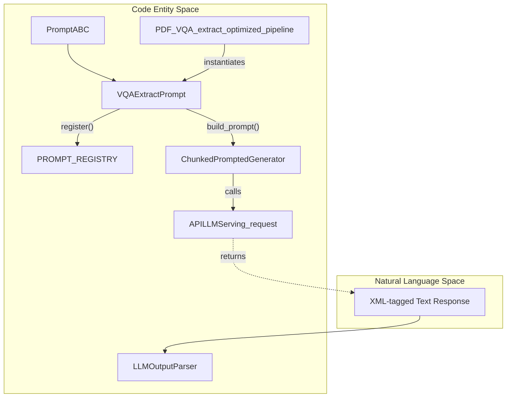
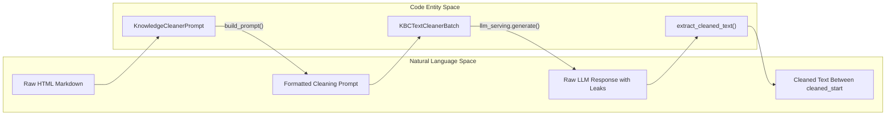

<!-- source: DeepWiki mcp.deepwiki.com · repo OpenDCAI/DataFlow · page 7.5 PDF VQA and Knowledge Prompts · fetched 2026-11-02 -->

# PDF VQA and Knowledge Prompts

<details>
<summary>Relevant source files</summary>

The following files were used as context for generating this wiki page:

- [dataflow/example/PDF2VQAPipeline/vqa_extract_test.jsonl](dataflow/example/PDF2VQAPipeline/vqa_extract_test.jsonl)
- [dataflow/operators/agentic_rag/__init__.py](dataflow/operators/agentic_rag/__init__.py)
- [dataflow/operators/agentic_rag/eval/agenticrag_qaf1_sample_evaluator.py](dataflow/operators/agentic_rag/eval/agenticrag_qaf1_sample_evaluator.py)
- [dataflow/operators/agentic_rag/generate/agenticrag_atomic_task_generator.py](dataflow/operators/agentic_rag/generate/agenticrag_atomic_task_generator.py)
- [dataflow/operators/agentic_rag/generate/agenticrag_depth_qa_generator.py](dataflow/operators/agentic_rag/generate/agenticrag_depth_qa_generator.py)
- [dataflow/operators/agentic_rag/generate/agenticrag_width_qa_generator.py](dataflow/operators/agentic_rag/generate/agenticrag_width_qa_generator.py)
- [dataflow/operators/core_text/filter/kcentergreedy_filter.py](dataflow/operators/core_text/filter/kcentergreedy_filter.py)
- [dataflow/operators/core_text/generate/text2multihopqa_generator.py](dataflow/operators/core_text/generate/text2multihopqa_generator.py)
- [dataflow/operators/knowledge_cleaning/generate/kbc_multihop_qa_generator_batch.py](dataflow/operators/knowledge_cleaning/generate/kbc_multihop_qa_generator_batch.py)
- [dataflow/operators/knowledge_cleaning/generate/kbc_text_cleaner.py](dataflow/operators/knowledge_cleaning/generate/kbc_text_cleaner.py)
- [dataflow/operators/knowledge_cleaning/generate/kbc_text_cleaner_batch.py](dataflow/operators/knowledge_cleaning/generate/kbc_text_cleaner_batch.py)
- [dataflow/operators/pdf2vqa/__init__.py](dataflow/operators/pdf2vqa/__init__.py)
- [dataflow/operators/pdf2vqa/generate/llm_output_parser.py](dataflow/operators/pdf2vqa/generate/llm_output_parser.py)
- [dataflow/operators/pdf2vqa/generate/mineru_to_llm_input_operator.py](dataflow/operators/pdf2vqa/generate/mineru_to_llm_input_operator.py)
- [dataflow/operators/pdf2vqa/generate/pdf_merger.py](dataflow/operators/pdf2vqa/generate/pdf_merger.py)
- [dataflow/operators/pdf2vqa/generate/qa_merger.py](dataflow/operators/pdf2vqa/generate/qa_merger.py)
- [dataflow/prompts/agenticrag.py](dataflow/prompts/agenticrag.py)
- [dataflow/prompts/kbcleaning.py](dataflow/prompts/kbcleaning.py)
- [dataflow/prompts/pdf2vqa.py](dataflow/prompts/pdf2vqa.py)
- [dataflow/statics/pipelines/api_pipelines/pdf_vqa_extract_pipeline.py](dataflow/statics/pipelines/api_pipelines/pdf_vqa_extract_pipeline.py)
- [dataflow/utils/pdf2vqa/format_utils.py](dataflow/utils/pdf2vqa/format_utils.py)

</details>


This document details the prompt template families used across DataFlow for advanced data preparation tasks, including visual question-answer (VQA) extraction from PDFs, knowledge base (KB) cleaning, agentic RAG task generation, and text-to-QA (`Text2QA`) synthesis. It covers implementation specifics, prompt inheritance, registry integration, and XML-like or structured JSON output formatting.

For information about the pipeline architectures utilizing these prompts, see [Ready-to-Use Pipelines]() and [Prompt Engineering Guide: Prompt Template System]().

---

## 1. Overview & Prompt Families

DataFlow organizes its prompt templates into domain-specific families inheriting from `PromptABC` [dataflow/core/prompt.py:2]() and registered via `@PROMPT_REGISTRY.register()` [dataflow/utils/registry.py:1](). 

| Prompt Family | Representative Classes | Primary Use Case | Target Operator |
|--------------|------------------------|------------------|-----------------|
| **PDF VQA** | `VQAExtractPrompt` [dataflow/prompts/pdf2vqa.py:5]() | Extracting layout-aware QA pairs & solutions from PDF pages | `ChunkedPromptedGenerator` [dataflow/statics/pipelines/api_pipelines/pdf_vqa_extract_pipeline.py:48]() |
| **KB Cleaning** | `KnowledgeCleanerPrompt`, `MathbookQuestionExtractPrompt` [dataflow/prompts/kbcleaning.py:5,204]() | Standardizing raw docs/Markdown for RAG, math exercise parsing | `KBCTextCleanerBatch` [dataflow/operators/knowledge_cleaning/generate/kbc_text_cleaner_batch.py:20]() |
| **Agentic RAG** | `AtomicTaskGeneratorGetIdentifierPrompt`, `AtomicTaskGeneratorGetConlcusionPrompt` [dataflow/prompts/agenticrag.py:9,46]() | Extracting identifiers and atomic conclusions for multi-hop RAG | `AtomicTaskGenerator` |
| **Text2QA** | `Text2QAAutoPromptGeneratorPrompt`, `Text2QASeedQuestionGeneratorPrompt`, `Text2MultiHopQAGeneratorPrompt` [dataflow/prompts/text2qa.py](), [dataflow/operators/core_text/generate/text2multihopqa_generator.py:1]() | Synthesizing seed questions, auto-prompts, and multi-hop reasoning QA pairs | `Text2QAGenerator`, `Text2MultiHopQAGenerator` [dataflow/operators/core_text/generate/text2qa_generator.py:19](), [dataflow/operators/core_text/generate/text2multihopqa_generator.py:23]() |

Sources: [dataflow/prompts/pdf2vqa.py:1-5](), [dataflow/prompts/kbcleaning.py:1-10](), [dataflow/prompts/agenticrag.py:1-10](), [dataflow/prompts/text2qa.py]()

---

## 2. PDF VQA Prompts (`QAExtractPrompt`)

The PDF VQA prompt system provides specialized templates for extracting questions, answers, and solutions from academic PDFs using MinerU layout parses. The system relies on `VQAExtractPrompt` [dataflow/prompts/pdf2vqa.py:5]() to handle layout-aware extraction.

### Initialization and Parameters

```python
def build_prompt(self, example_title, subject: str = "math", interleaved=True) -> str:
``` [dataflow/prompts/pdf2vqa.py:9]()

- `example_title` (`str`): Example chapter title format to guide the model's extraction logic [dataflow/prompts/pdf2vqa.py:43]().
- `subject` (`str`): The academic subject (e.g., `"math"`, `"physics"`) [dataflow/prompts/pdf2vqa.py:13]().
- `interleaved` (`bool`): If `True`, assumes mixed Q&A. If `False`, treats pages as purely questions or answers [dataflow/prompts/pdf2vqa.py:11-26]().

### Extraction Rules and Formatting

The prompt enforces strict rules to ensure high-quality training data:
1. **Completeness**: Omit incomplete problems that continue onto the next page [dataflow/prompts/pdf2vqa.py:15]().
2. **Continuation Detection**: Detect and skip fragments at the top of a page that belong to previous page continuations [dataflow/prompts/pdf2vqa.py:16]().
3. **Multi-column Support**: Read and output content from left-to-right, top-to-bottom [dataflow/prompts/pdf2vqa.py:28]().
4. **Visual References**: Record figures using `<pic>tagA:boxB</pic>` format based on red-colored bounding box labels [dataflow/prompts/pdf2vqa.py:51]().

Title: PDF VQA Prompt and Data Flow


Sources: [dataflow/prompts/pdf2vqa.py:1-74](), [dataflow/statics/pipelines/api_pipelines/pdf_vqa_extract_pipeline.py:23-53](), [dataflow/operators/pdf2vqa/generate/llm_output_parser.py:13-35]()

---

## 3. Knowledge Base Cleaning Prompts (`KnowledgeCleanerPrompt`)

The knowledge cleaning family standardizes raw documents, web pages, and OCR outputs for RAG ingestion. 

### `KnowledgeCleanerPrompt` Implementation

`KnowledgeCleanerPrompt` [dataflow/prompts/kbcleaning.py:5]() supports multilingual configurations (`lang="en"` or `"zh"`) and strict mode parsing [dataflow/prompts/kbcleaning.py:10](). It enforces rules across 8 dimensions:
1. **Tag Reduction**: Removes redundant HTML/XML tags while preserving semantic tags like `<table>`, `<code>`, and `<formula>` [dataflow/prompts/kbcleaning.py:20-21,99-101]().
2. **Character Normalization**: Standardizes curly quotes to straight quotes, long dashes to hyphens, and standardizes ellipses [dataflow/prompts/kbcleaning.py:24-26,103-106]().
3. **URL Handling**: Preserves footnote URLs while extracting display text [dataflow/prompts/kbcleaning.py:28-30,109-112]().
4. **Security & Privacy Masking**: Automatically masks Personally Identifiable Information (PII) such as phone numbers (`138****8000`), marks confidential fields (`〖SEC∶classified〗`), and shields illegal content (`〖ILLEGAL∶removed〗`) [dataflow/prompts/kbcleaning.py:50-55,132-138]().

Title: Knowledge Cleaner Data Flow


Sources: [dataflow/prompts/kbcleaning.py:1-202](), [dataflow/operators/knowledge_cleaning/generate/kbc_text_cleaner_batch.py:20-115]()

---

## 4. Agentic RAG Prompts (`AtomicTaskGenerator`)

Agentic RAG workflows break complex source documents into atomic tasks, identifiers, and relationship structures. The `agenticrag.py` module defines several prompt classes registered in `PROMPT_REGISTRY` [dataflow/prompts/agenticrag.py:8]().

### Key Prompt Classes
- `AtomicTaskGeneratorGetIdentifierPrompt`: Extracts main subjects, proper nouns, and technical identifiers from questions to form `content_identifier` JSON objects [dataflow/prompts/agenticrag.py:9-36]().
- `AtomicTaskGeneratorGetConlcusionPrompt`: Directs LLMs to extract indivisible basic facts with verifiability constraints (numeric values, timestamps, unique names) and generates structured relationship attributes (`R`) [dataflow/prompts/agenticrag.py:46-95]().
- `AtomicTaskGeneratorQuestionPrompt`: Guides generation of initial multi-step reasoning questions from document fragments.

Sources: [dataflow/prompts/agenticrag.py:1-196]()

---

## 5. Text2QA and Multi-Hop QA Prompts (`Text2QAGenerator`)

The `Text2QA` prompt family automates the synthesis of instruction-tuning and RAG test sets from raw text chunks.

### Core Prompt Classes
- `Text2QAAutoPromptGeneratorPrompt`: Inspects a text fragment and generates a JSON list of contextual prompt angles for QA synthesis [dataflow/operators/core_text/generate/text2qa_generator.py:68-71]().
- `Text2QASeedQuestionGeneratorPrompt`: Combines the generated prompt angle with the raw text to yield a grounded `Q:` and `A:` pair [dataflow/operators/core_text/generate/text2qa_generator.py:72-76]().
- `Text2MultiHopQAGeneratorPrompt`: Orchestrates multi-hop reasoning QA creation, requiring step-by-step reasoning chains, supporting facts, and complexity annotations [dataflow/operators/core_text/generate/text2multihopqa_generator.py:1-125]().

Sources: [dataflow/prompts/text2qa.py](), [dataflow/operators/core_text/generate/text2qa_generator.py:12-77](), [dataflow/operators/core_text/generate/text2multihopqa_generator.py:1-125]()

---

## 6. Pipeline Integration & Registry Architecture

All prompt templates integrate into DataFlow pipelines by inheriting from `PromptABC` [dataflow/core/prompt.py:2]() and being decorated with `@PROMPT_REGISTRY.register()` [dataflow/utils/registry.py:1](). Operators restrict compatible prompts using the `@prompt_restrict` decorator [dataflow/core/prompt.py]().

Sources: [dataflow/utils/registry.py:1-20](), [dataflow/core/prompt.py:1-50]()

---

