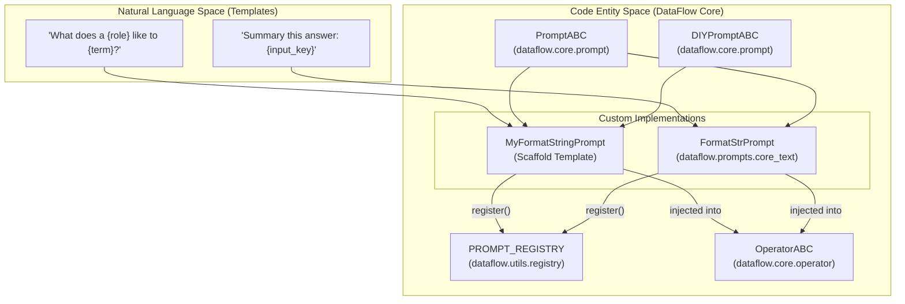
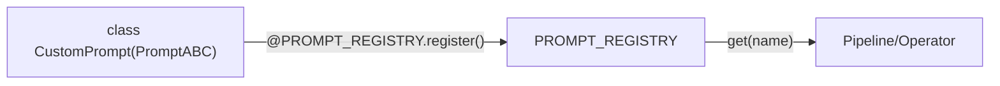
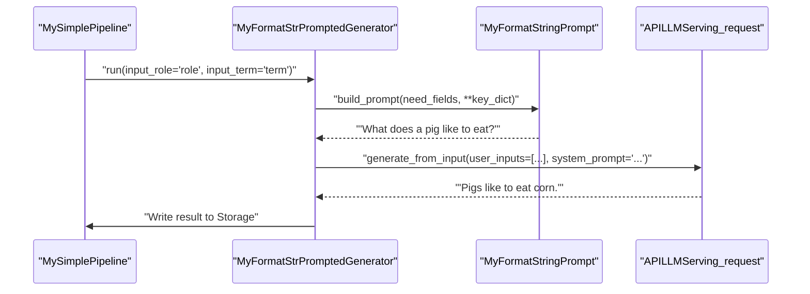

<!-- source: DeepWiki mcp.deepwiki.com · repo OpenDCAI/DataFlow · page 7.6 Custom Prompt Development · fetched 2026-11-02 -->

# Custom Prompt Development

<details>
<summary>Relevant source files</summary>

The following files were used as context for generating this wiki page:

- [dataflow/example/core_text_data/double_column_input.json](dataflow/example/core_text_data/double_column_input.json)
- [dataflow/operators/core_text/generate/format_str_prompted_generator.py](dataflow/operators/core_text/generate/format_str_prompted_generator.py)
- [dataflow/prompts/core_text.py](dataflow/prompts/core_text.py)
- [dataflow/statics/playground/playground/format_str_prompt_generator/double_column_input.py](dataflow/statics/playground/playground/format_str_prompt_generator/double_column_input.py)
- [dataflow/statics/playground/simple_text_pipelines/sft_from_scratch.py](dataflow/statics/playground/simple_text_pipelines/sft_from_scratch.py)
- [dataflow/statics/scaffold/{{cookiecutter.repo_name}}/README.md](dataflow/statics/scaffold/{{cookiecutter.repo_name}}/README.md)
- [dataflow/statics/scaffold/{{cookiecutter.repo_name}}/{{cookiecutter.package_name}}/data/example_data.json](dataflow/statics/scaffold/{{cookiecutter.repo_name}}/{{cookiecutter.package_name}}/data/example_data.json)
- [dataflow/statics/scaffold/{{cookiecutter.repo_name}}/{{cookiecutter.package_name}}/operators/core/my_format_str_prompted_generator.py](dataflow/statics/scaffold/{{cookiecutter.repo_name}}/{{cookiecutter.package_name}}/operators/core/my_format_str_prompted_generator.py)
- [dataflow/statics/scaffold/{{cookiecutter.repo_name}}/{{cookiecutter.package_name}}/pipelines/my_pipeline.py](dataflow/statics/scaffold/{{cookiecutter.repo_name}}/{{cookiecutter.package_name}}/pipelines/my_pipeline.py)
- [dataflow/statics/scaffold/{{cookiecutter.repo_name}}/{{cookiecutter.package_name}}/prompts/core.py](dataflow/statics/scaffold/{{cookiecutter.repo_name}}/{{cookiecutter.package_name}}/prompts/core.py)

</details>


## Purpose and Scope

This guide explains how to create and use custom prompts in DataFlow for specialized data generation tasks. Custom prompts allow you to override or extend the behavior of existing operators without modifying their core logic, enabling rapid iteration on prompt engineering.

The DataFlow prompt system is built around the `PromptABC` base class `[dataflow/core/prompt.py:6-10]()` and the `PROMPT_REGISTRY` (managed via the registry utilities in `[dataflow/utils/registry.py:1-65]()`) for dynamic discovery and instantiation.

Sources: `[dataflow/core/prompt.py:6-10]`, `[dataflow/utils/registry.py:1-65]()`

---

## Custom Prompt Approaches

DataFlow provides two primary approaches for customizing prompts:

| Approach | Use Case | Complexity | Flexibility |
|----------|----------|------------|-------------|
| **`FormatStrPrompt` Instance** | Quick modifications using template strings | Low | Limited to string interpolation |
| **DIY Prompt Classes** | Full control over prompt structure and logic | Medium | Complete customization |

### Prompt Implementation Flow

The following diagram bridges the "Natural Language Space" (where templates are defined) to the "Code Entity Space" (where classes and registries reside).

Title: Prompt Registration and Mapping


Sources: `[dataflow/core/prompt.py:6-16]`, `[dataflow/statics/scaffold/{{cookiecutter.repo_name}}/{{cookiecutter.package_name}}/prompts/core.py:5-7]`, `[dataflow/statics/playground/playground/format_str_prompt_generator/double_column_input.py:22-24]`, `[dataflow/prompts/core_text.py:4-5]()`

---

## Using the `FormatStrPrompt`

The `FormatStrPrompt` is the standard implementation for f-string style templates. It provides robust handling for field validation and replacement `[dataflow/prompts/core_text.py:5-31]()`.

### Implementation Details
`FormatStrPrompt` logic is utilized in operators like `FormatStrPromptedGenerator` `[dataflow/operators/core_text/generate/format_str_prompted_generator.py:12-17]()`:
1. **Placeholder Parsing**: It uses standard Python curly brace syntax (e.g., `{input_role}`).
2. **Missing Field Handling**: The `on_missing` parameter (values: `'raise'` or `'empty'`) controls behavior when required fields are absent from the input data `[dataflow/prompts/core_text.py:12-16]()`.
3. **Dynamic Binding**: The `build_prompt` method iterates through `kwargs` and performs string replacement `[dataflow/prompts/core_text.py:18-31]()`.

### Example: Multi-Variable Input
In practice, as seen in `[dataflow/statics/playground/playground/format_str_prompt_generator/double_column_input.py:22-28]()`, a custom prompt is instantiated and passed to a generator:

```python
self.prompt_template = FormatStrPrompt(
    f_str_template="What does a {input_role} like to {input_term}?"
)
self.operator = FormatStrPromptedGenerator(
    llm_serving=self.llm_serving,
    prompt_template=self.prompt_template
)
```

Sources: `[dataflow/prompts/core_text.py:5-31]`, `[dataflow/operators/core_text/generate/format_str_prompted_generator.py:12-28]`, `[dataflow/statics/playground/playground/format_str_prompt_generator/double_column_input.py:22-28]()`

---

## Creating Custom Prompt Classes

For complex logic (e.g., conditional formatting or multi-stage assembly), you should inherit from `PromptABC` or `DIYPromptABC` `[dataflow/core/prompt.py:6-16]()`.

### The Registry Pattern
To make your prompt available to the system, use the `@PROMPT_REGISTRY.register()` decorator `[dataflow/prompts/core_text.py:4-4]()`. This allows the prompt to be discovered by the framework's lazy loading and orchestration systems.

Title: Registry Lookup Mechanism


Sources: `[dataflow/core/prompt.py:6-16]`, `[dataflow/prompts/core_text.py:4-4]()`

### Type Restriction and Validation
DataFlow uses the `@prompt_restrict` decorator to ensure operators only receive compatible prompt templates. This provides runtime type checking by intercepting the `__init__` method and checking the `prompt_template` argument against a whitelist `[dataflow/core/prompt.py:28-78]()`.

For example, `MyFormatStrPromptedGenerator` restricts its `prompt_template` to specific template classes or any subclass of `DIYPromptABC` `[dataflow/statics/scaffold/{{cookiecutter.repo_name}}/{{cookiecutter.package_name}}/operators/core/my_format_str_prompted_generator.py:13-16]()`.

### Scaffold Template Example
When initializing a new project via `dataflow init`, a template prompt is provided. In the scaffolded `my_pipeline.py`, the custom prompt `MyFormatStringPrompt` is imported and instantiated `[dataflow/statics/scaffold/{{cookiecutter.repo_name}}/{{cookiecutter.package_name}}/pipelines/my_pipeline.py:7-24]()`.

Sources: `[dataflow/core/prompt.py:28-78]`, `[dataflow/statics/scaffold/{{cookiecutter.repo_name}}/{{cookiecutter.package_name}}/operators/core/my_format_str_prompted_generator.py:13-16]`, `[dataflow/statics/scaffold/{{cookiecutter.repo_name}}/{{cookiecutter.package_name}}/prompts/core.py:4-5]`, `[dataflow/prompts/core_text.py:4-4]()`

---

## Integration with Operators

Prompts are typically passed to operators during initialization. The operator then calls `prompt_template.build_prompt()` inside its `run()` logic to prepare inputs for the LLM `[dataflow/operators/core_text/generate/format_str_prompted_generator.py:53-54]()`.

### Data Flow Diagram: Prompt to Operator
This diagram shows how a prompt template interacts with an `LLMServingABC` implementation via an operator within a pipeline, linking natural language inputs to code execution entities.

Title: Operator-Prompt-LLM Interaction


Sources: `[dataflow/statics/scaffold/{{cookiecutter.repo_name}}/{{cookiecutter.package_name}}/pipelines/my_pipeline.py:34-45]`, `[dataflow/operators/core_text/generate/format_str_prompted_generator.py:53-58]`, `[dataflow/core/prompt.py:9-10]()`

---

## Best Practices

### 1. Error Handling in `build_prompt`
Ensure your custom prompt handles missing keys gracefully. While the base `PromptABC` requires implementation of `build_prompt` `[dataflow/core/prompt.py:9-10]()`, custom implementations like `FormatStrPrompt` allow configuring `on_missing='empty'` to fill missing fields with empty strings instead of crashing `[dataflow/prompts/core_text.py:24-27]()`.

### 2. Using `DIYPromptABC` for Extensibility
If you are building an operator that should support user-defined prompts, allow `DIYPromptABC` subclasses in your `@prompt_restrict` decorator. This allows users to pass custom prompt logic that bypasses strict built-in type checks while still satisfying runtime validation `[dataflow/core/prompt.py:56-67]()`.

### 3. Modular Prompt Logic
For complex prompt structures, encapsulate the rendering logic inside a dedicated class inheriting from `PromptABC` or `DIYPromptABC` rather than embedding inline strings in operator definitions.

### 4. Integration with Pipeline Storage
When calling `operator.run()`, ensure the `input_keys` provided match the placeholders in your prompt template. The `FormatStrPromptedGenerator` automatically maps dataframe column values to the prompt's `need_fields` `[dataflow/operators/core_text/generate/format_str_prompted_generator.py:50-54]()`.

Sources: `[dataflow/core/prompt.py:56-67]`, `[dataflow/prompts/core_text.py:12-27]`, `[dataflow/operators/core_text/generate/format_str_prompted_generator.py:50-54]()`

---

