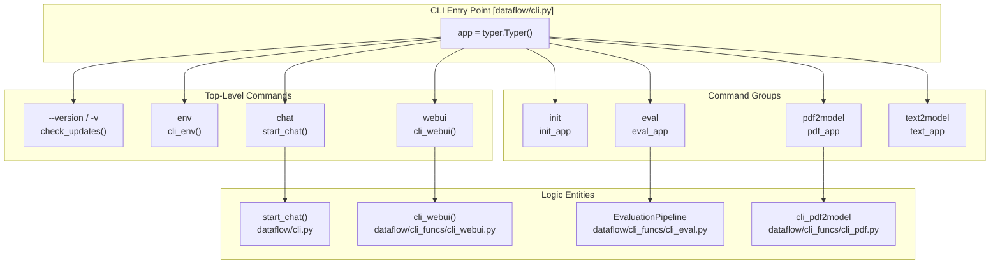
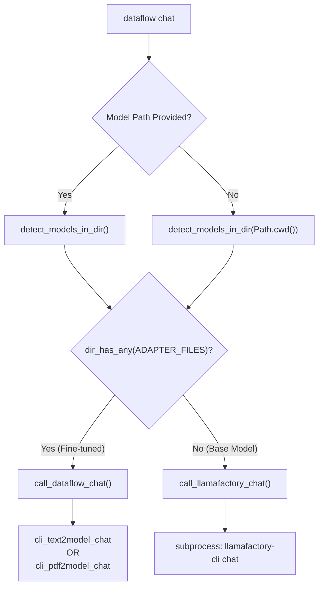

<!-- source: DeepWiki mcp.deepwiki.com · repo OpenDCAI/DataFlow · page 8 Command Line Interface · fetched 2026-11-02 -->

# Command Line Interface

Relevant source files

The following files were used as context for generating this wiki page:

- [dataflow/cli.py](dataflow/cli.py)
- [dataflow/cli_funcs/cli_eval.py](dataflow/cli_funcs/cli_eval.py)
- [dataflow/cli_funcs/cli_init.py](dataflow/cli_funcs/cli_init.py)
- [dataflow/cli_funcs/cli_webui.py](dataflow/cli_funcs/cli_webui.py)
- [dataflow/cli_funcs/copy_funcs.py](dataflow/cli_funcs/copy_funcs.py)
- [dataflow/cli_funcs/eval_pipeline/eval_api.py](dataflow/cli_funcs/eval_pipeline/eval_api.py)
- [dataflow/cli_funcs/eval_pipeline/eval_local.py](dataflow/cli_funcs/eval_pipeline/eval_local.py)
- [dataflow/cli_funcs/paths.py](dataflow/cli_funcs/paths.py)
- [dataflow/example/GeneralTextPipeline/math_100.jsonl](dataflow/example/GeneralTextPipeline/math_100.jsonl)
- [dataflow/example/GeneralTextPipeline/translation.jsonl](dataflow/example/GeneralTextPipeline/translation.jsonl)
- [dataflow/statics/pipelines/api_pipelines/README.md](dataflow/statics/pipelines/api_pipelines/README.md)
- [dataflow/statics/scaffold/{{cookiecutter.repo_name}}/{{cookiecutter.package_name}}/operators/core/__init__.py](dataflow/statics/scaffold/{{cookiecutter.repo_name}}/{{cookiecutter.package_name}}/operators/core/__init__.py)

## Purpose and Scope
The Command Line Interface (CLI) serves as the primary entry point for managing DataFlow workflows, executing model evaluations, running interactive chat sessions, launching the WebUI, and scaffolding pipelines [dataflow/cli.py:19-23](). Built with the `typer` library [dataflow/cli.py:10](), the CLI groups commands logically to streamline data preparation and model training tasks.

As a parent page, this document provides a high-level overview of the CLI architecture and available command groups. For detailed instructions on specific command groups, refer to the respective child pages:
- [Model Evaluation](#8.1) — Detailed evaluation commands and workflows.
- [Pipeline Initialization](#8.2) — Scaffolding projects, operators, and pipelines.
- [Interactive Chat](#8.3) — Model auto-detection and chat sessions.
- [Environment and Version Management](#8.4) — Version checks and environment configuration.
- [Training Commands](#8.5) — Dataset preparation and training execution (`pdf2model` and `text2model`).

Sources: [dataflow/cli.py:10](), [dataflow/cli.py:19-23]()

---

## CLI Architecture and Command Hierarchy

The CLI is orchestrated through `dataflow/cli.py`, which defines the root `typer.Typer` application instance and delegates specialized tasks to helper modules within `dataflow/cli_funcs/` [dataflow/cli.py:16]().

### CLI Component Association

Sources: [dataflow/cli.py:16](), [dataflow/cli.py:19-23](), [dataflow/cli.py:129-168](), [dataflow/cli_funcs/cli_eval.py:32](), [dataflow/cli_funcs/cli_webui.py:193-198]()

---

## Version and Environment Commands

The CLI provides built-in utilities for inspecting installed package versions, checking for updates against PyPI, and diagnosing environment configurations [dataflow/cli.py:30-52]().

- **`dataflow --version` / `dataflow -v`**: Prints the local `__version__` [dataflow/cli.py:15]() and queries PyPI via `check_updates()` [dataflow/cli.py:30-52]() to notify users if a newer release is available.
- **`dataflow env`**: Inspects runtime dependencies and environment settings using `cli_env()` [dataflow/cli.py:16](). For complete details, see [Environment and Version Management](#8.4).

Sources: [dataflow/cli.py:15-16](), [dataflow/cli.py:30-52]()

---

## Interactive Chat Command

The `chat` command automatically detects whether a target model is a fine-tuned adapter or a base model, routing execution accordingly to internal handlers or `llamafactory-cli` [dataflow/cli.py:129-168](). For deep dives, see [Interactive Chat](#8.3).

### Model Detection and Routing Logic

Sources: [dataflow/cli.py:27-28](), [dataflow/cli.py:55-66](), [dataflow/cli.py:99-128](), [dataflow/cli.py:129-168]()

---

## Evaluation Commands

The `eval` command group manages benchmark evaluations using API-backed or local GPU serving models [dataflow/cli.py:171-184](). For architecture specifics, see [Model Evaluation](#8.1).

- **`dataflow eval init`**: Initializes evaluation config files via `eval_init()` [dataflow/cli.py:171-184]().
- **`dataflow eval api` / `dataflow eval local`**: Executes `EvaluationPipeline` [dataflow/cli_funcs/cli_eval.py:32]() using configurations defined in `eval_api.py` [dataflow/cli_funcs/eval_pipeline/eval_api.py:58-154]() and `eval_local.py` [dataflow/cli_funcs/eval_pipeline/eval_local.py:54-140]().

Sources: [dataflow/cli.py:171-184](), [dataflow/cli_funcs/cli_eval.py:32](), [dataflow/cli_funcs/eval_pipeline/eval_api.py:58-154](), [dataflow/cli_funcs/eval_pipeline/eval_local.py:54-140]()

---

## Training Commands

DataFlow exposes dedicated command groups for pipeline scaffolding and training across modalities [dataflow/cli.py:102-107](). For complete workflows, see [Training Commands](#8.5).

- **`dataflow pdf2model`**: Manages document parsing and VQA/multimodal training scaffolding via `pdf_app` [dataflow/cli.py:106]().
- **`dataflow text2model`**: Handles text data processing, dataset synthesis, and training routines via `text_app` [dataflow/cli.py:102-104]().

Sources: [dataflow/cli.py:102-107]()

---

## WebUI Command

The `webui` command fetches and launches the DataFlow visual pipeline builder [dataflow/cli_funcs/cli_webui.py:193-198]().

- **`dataflow webui`**: Downloads the latest release archive from `DataFlow-WebUI` GitHub releases [dataflow/cli_funcs/cli_webui.py:15-18]() and starts the local server with asynchronous browser opening [dataflow/cli_funcs/cli_webui.py:61-96](). For details, see [Web Interface](#9).

Sources: [dataflow/cli_funcs/cli_webui.py:15-18](), [dataflow/cli_funcs/cli_webui.py:61-96](), [dataflow/cli_funcs/cli_webui.py:193-198]()

---

## Child Pages Reference

| Page | Description |
|------|-------------|
| [Model Evaluation](#8.1) | Detailed usage of `dataflow eval` for benchmarks and judge models. |
| [Pipeline Initialization](#8.2) | Scaffolding new projects and components via `dataflow init`. |
| [Interactive Chat](#8.3) | Using the `dataflow chat` interface with local or adapter models. |
| [Environment and Version Management](#8.4) | Managing the DataFlow environment and updates. |
| [Training Commands](#8.5) | Full documentation for `pdf2model` and `text2model` workflows. |

Sources: [dataflow/cli.py:19-23]()

---

