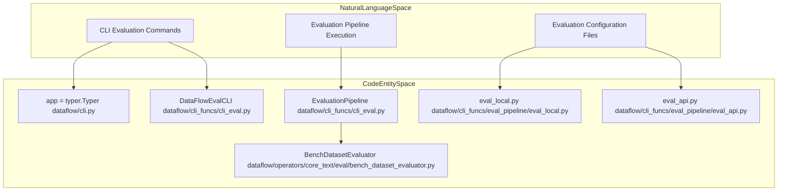
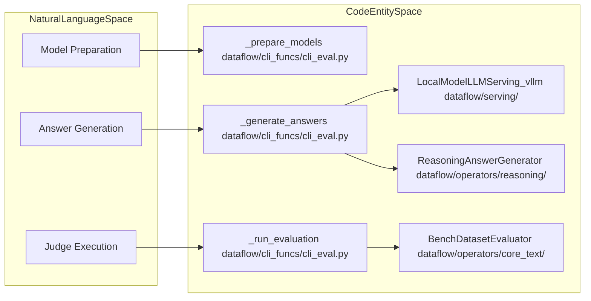

<!-- source: DeepWiki mcp.deepwiki.com · repo OpenDCAI/DataFlow · page 8.1 Model Evaluation · fetched 2026-11-02 -->

# Model Evaluation

Relevant source files

The following files were used as context for generating this wiki page:

- [dataflow/cli.py](dataflow/cli.py)
- [dataflow/cli_funcs/cli_eval.py](dataflow/cli_funcs/cli_eval.py)
- [dataflow/cli_funcs/cli_webui.py](dataflow/cli_funcs/cli_webui.py)
- [dataflow/cli_funcs/eval_pipeline/eval_api.py](dataflow/cli_funcs/eval_pipeline/eval_api.py)
- [dataflow/cli_funcs/eval_pipeline/eval_local.py](dataflow/cli_funcs/eval_pipeline/eval_local.py)
- [dataflow/statics/scaffold/{{cookiecutter.repo_name}}/{{cookiecutter.package_name}}/operators/core/__init__.py](dataflow/statics/scaffold/{{cookiecutter.repo_name}}/{{cookiecutter.package_name}}/operators/core/__init__.py)

## Purpose and Scope

This page provides a high-level overview of the DataFlow model evaluation framework, which enables automated benchmarking of LLMs on custom datasets using judge models. The evaluation system supports both API-based and local GPU deployment configurations to assess model accuracy via exact matching or semantic judgement.

For deep technical details on the pipeline mechanics, see [Evaluation Pipeline](#8.1.1). For configuration specifics and resource management between local and API setups, see [Local vs API Evaluation](#8.1.2).

Sources: [dataflow/cli.py:171-198](), [dataflow/cli_funcs/cli_eval.py:32-70]()

---

## Evaluation Architecture Overview

The DataFlow evaluation framework coordinates target model generation, judge-based verification, and metric aggregation through unified CLI commands and pipeline definitions. 

Title: "Evaluation Architecture to Code Entities"

Sources: [dataflow/cli.py:171-198](), [dataflow/cli_funcs/cli_eval.py:32-64](), [dataflow/cli_funcs/eval_pipeline/eval_local.py:1-10](), [dataflow/cli_funcs/eval_pipeline/eval_api.py:1-9]()

---

## Evaluation Pipeline

The evaluation workflow follows a structured execution path: loading target models, generating answers against benchmark questions, and executing judge operators to compute metrics.

For comprehensive details on the pipeline orchestration, model loading efficiencies, and cache cleaning mechanisms, see [Evaluation Pipeline](#8.1.1).

Title: "Pipeline Execution to Code Entities"

Sources: [dataflow/cli_funcs/cli_eval.py:32-116](), [dataflow/cli_funcs/cli_eval.py:131-259]()

---

## Local vs API Evaluation

DataFlow provides flexible deployment options for both target models and judge models. Users can configure evaluations using local GPU acceleration or external API endpoints.

For details on configuration parameters (`eval_local.py` vs `eval_api.py`), judge model setup, semantic comparison modes, and resource management, see [Local vs API Evaluation](#8.1.2).

Sources: [dataflow/cli_funcs/eval_pipeline/eval_local.py:55-103](), [dataflow/cli_funcs/eval_pipeline/eval_api.py:58-125]()

---

