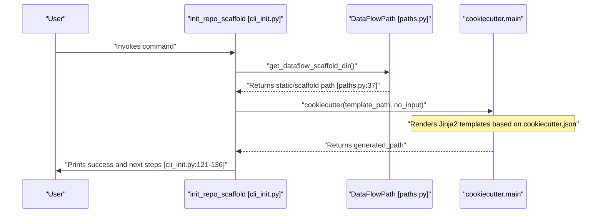

<!-- source: DeepWiki mcp.deepwiki.com · repo OpenDCAI/DataFlow · page 8.2 Pipeline Initialization · fetched 2026-11-02 -->

# Pipeline Initialization

<details>
<summary>Relevant source files</summary>

The following files were used as context for generating this wiki page:

- [dataflow/cli_funcs/cli_init.py](dataflow/cli_funcs/cli_init.py)
- [dataflow/cli_funcs/copy_funcs.py](dataflow/cli_funcs/copy_funcs.py)
- [dataflow/cli_funcs/paths.py](dataflow/cli_funcs/paths.py)
- [dataflow/cli_funcs/utils.py](dataflow/cli_funcs/utils.py)
- [dataflow/example/GeneralTextPipeline/math_100.jsonl](dataflow/example/GeneralTextPipeline/math_100.jsonl)
- [dataflow/example/GeneralTextPipeline/translation.jsonl](dataflow/example/GeneralTextPipeline/translation.jsonl)
- [dataflow/example/core_text_data/double_column_input.json](dataflow/example/core_text_data/double_column_input.json)
- [dataflow/statics/pipelines/api_pipelines/README.md](dataflow/statics/pipelines/api_pipelines/README.md)
- [dataflow/statics/playground/playground/format_str_prompt_generator/double_column_input.py](dataflow/statics/playground/playground/format_str_prompt_generator/double_column_input.py)
- [dataflow/statics/scaffold/cookiecutter.json](dataflow/statics/scaffold/cookiecutter.json)
- [dataflow/statics/scaffold/hooks/post_gen_project.py](dataflow/statics/scaffold/hooks/post_gen_project.py)
- [dataflow/statics/scaffold/{{cookiecutter.repo_name}}/.github/ISSUE_TEMPLATE/1-bug-reports.yaml](dataflow/statics/scaffold/{{cookiecutter.repo_name}}/.github/ISSUE_TEMPLATE/1-bug-reports.yaml)
- [dataflow/statics/scaffold/{{cookiecutter.repo_name}}/.github/ISSUE_TEMPLATE/2-ask-for-help.yaml](dataflow/statics/scaffold/{{cookiecutter.repo_name}}/.github/ISSUE_TEMPLATE/2-ask-for-help.yaml)
- [dataflow/statics/scaffold/{{cookiecutter.repo_name}}/.github/ISSUE_TEMPLATE/3-feature-request.yaml](dataflow/statics/scaffold/{{cookiecutter.repo_name}}/.github/ISSUE_TEMPLATE/3-feature-request.yaml)
- [dataflow/statics/scaffold/{{cookiecutter.repo_name}}/.github/workflows/python-publish.yml](dataflow/statics/scaffold/{{cookiecutter.repo_name}}/.github/workflows/python-publish.yml)
- [dataflow/statics/scaffold/{{cookiecutter.repo_name}}/README.md](dataflow/statics/scaffold/{{cookiecutter.repo_name}}/README.md)
- [dataflow/statics/scaffold/{{cookiecutter.repo_name}}/{{cookiecutter.package_name}}/data/example_data.json](dataflow/statics/scaffold/{{cookiecutter.repo_name}}/{{cookiecutter.package_name}}/data/example_data.json)
- [dataflow/statics/scaffold/{{cookiecutter.repo_name}}/{{cookiecutter.package_name}}/pipelines/my_pipeline.py](dataflow/statics/scaffold/{{cookiecutter.repo_name}}/{{cookiecutter.package_name}}/pipelines/my_pipeline.py)

</details>


## Purpose and Scope

This document explains the `dataflow init` command group, which provides **project scaffolding** utilities for creating new DataFlow repositories and initializing local environments with ready-to-use assets. These commands generate directory structures, placeholder files, and configuration templates for custom operators, pipelines, and prompts using the `cookiecutter` engine or direct recursive copying.

**Important Distinction:** This page covers *project initialization* (creating new repositories and components via CLI), not *pipeline runtime initialization* (see [3.2.1 Compilation Phase]() for pipeline compilation/execution lifecycle).

Sources: [dataflow/cli_funcs/cli_init.py:37-62](), [dataflow/cli_funcs/paths.py:5-38]()

---

## Command Group Structure

The `dataflow init` command group contains subcommands for repository scaffolding and asset initialization. It utilizes the `DataFlowPath` utility to locate templates within the package distribution.

**Diagram: Pipeline Initialization Entity Mapping**
```mermaid
graph TD
    subgraph "Natural Language Space"
        repo_cmd[""dataflow init repo""]
        base_cmd[""dataflow init base""]
        scaffold_template[""Project Template""]
    end

    subgraph "Code Entity Space [dataflow/cli_funcs/]"
        init_repo_scaffold[""init_repo_scaffold() [cli_init.py:59]""]
        cli_init[""cli_init() [cli_init.py:37]""]
        DataFlowPath[""DataFlowPath [paths.py:5]""]
        copy_funcs[""copy_files_recursively() [copy_funcs.py:54]""]
    end

    repo_cmd --> init_repo_scaffold
    base_cmd --> cli_init
    init_repo_scaffold --> DataFlowPath
    cli_init --> copy_funcs
    DataFlowPath -- "get_dataflow_scaffold_dir()" --> scaffold_template
```
Sources: [dataflow/cli_funcs/cli_init.py:37-62](), [dataflow/cli_funcs/paths.py:5-38]()

**Command Implementation Status**

| Command Syntax | Function Signature | Implementation Status | Line Reference |
|----------------|-------------------|-----------------------|----------------|
| `dataflow init repo` | `init_repo_scaffold(no_input, context)` | ✅ Functional (Scaffold) | [dataflow/cli_funcs/cli_init.py:59-62]() |
| `dataflow init base` | `cli_init("base")` | ✅ Functional (Asset Copy) | [dataflow/cli_funcs/cli_init.py:41-44]() |

Sources: [dataflow/cli_funcs/cli_init.py:37-62](), [dataflow/cli_funcs/paths.py:5-38]()

---

## Repository Scaffolding (Cookiecutter)

The `init_repo_scaffold` function creates a complete DataFlow project structure. It leverages the `cookiecutter` library to render templates located in the `statics/scaffold` directory [dataflow/cli_funcs/cli_init.py:71-117]().

### Execution Workflow

**Diagram: Scaffold Generation Logic**

Sources: [dataflow/cli_funcs/cli_init.py:59-136](), [dataflow/cli_funcs/paths.py:37-38]()

### Scaffolded Pipeline Structure
The scaffold generates a boilerplate pipeline [dataflow/statics/scaffold/{{cookiecutter.repo_name}}/{{cookiecutter.package_name}}/pipelines/my_pipeline.py:9-45]() that demonstrates the standard `PipelineABC` implementation:
- **Storage**: Initialized with `FileStorage` targeting `example_data.json` [dataflow/statics/scaffold/{{cookiecutter.repo_name}}/{{cookiecutter.package_name}}/pipelines/my_pipeline.py:12-17]().
- **Serving**: Configured for `APILLMServing_request` [dataflow/statics/scaffold/{{cookiecutter.repo_name}}/{{cookiecutter.package_name}}/pipelines/my_pipeline.py:18-21]().
- **Operators**: Includes examples like `MyFormatStrPromptedGenerator` and `MyPromptedGenerator` [dataflow/statics/scaffold/{{cookiecutter.repo_name}}/{{cookiecutter.package_name}}/pipelines/my_pipeline.py:25-32]().
- **Execution**: Implements the `forward()` method using `storage.step()` to pass data between operators [dataflow/statics/scaffold/{{cookiecutter.repo_name}}/{{cookiecutter.package_name}}/pipelines/my_pipeline.py:34-45]().

Sources: [dataflow/cli_funcs/cli_init.py:59-136](), [dataflow/statics/scaffold/{{cookiecutter.repo_name}}/{{cookiecutter.package_name}}/pipelines/my_pipeline.py:1-50]()

---

## Asset Initialization (`cli_init`)

The `cli_init` function manages the copying of static assets (pipelines, examples, and playground scripts) from the DataFlow package to the user's current working directory.

### Asset Copying Mechanism
The initialization logic uses `copy_files_recursively` to move files from the package's internal directories to the local environment.

| Asset Type | Source Method (in `DataFlowPath`) | Destination | Implementation |
|------------|-----------------------------------|-------------|----------------|
| **Pipelines** | `get_dataflow_pipelines_dir()` [dataflow/cli_funcs/paths.py:29-30]() | `./` | `_copy_pipelines()` [dataflow/cli_funcs/cli_init.py:18-22]() |
| **Playground**| `get_dataflow_playground_dir()` [dataflow/cli_funcs/paths.py:33-34]() | `./` | `_copy_playground()` [dataflow/cli_funcs/cli_init.py:25-29]() |
| **Examples**  | `get_dataflow_example_dir()` [dataflow/cli_funcs/paths.py:21-22]() | `./example_data/` | `_copy_examples()` [dataflow/cli_funcs/cli_init.py:31-35]() |

Sources: [dataflow/cli_funcs/cli_init.py:1-56](), [dataflow/cli_funcs/paths.py:21-38]()

### Playground Scripts
The `playground` assets include ready-to-run test cases like `DoubleColumnInputTestCase` [dataflow/statics/playground/playground/format_str_prompt_generator/double_column_input.py:8-36](). These scripts serve as minimal working examples for testing specific operators (e.g., `FormatStrPromptedGenerator`) against local JSON data [dataflow/example/core_text_data/double_column_input.json:1-18]().

Sources: [dataflow/statics/playground/playground/format_str_prompt_generator/double_column_input.py:1-40](), [dataflow/example/core_text_data/double_column_input.json:1-18]()

### File Conflict Handling
The `copy_files_recursively` function in `dataflow/cli_funcs/copy_funcs.py` provides interactive conflict resolution:
- **Prompting**: If a file already exists, the user is prompted to overwrite (`y/n/all/none`) [dataflow/cli_funcs/copy_funcs.py:84-94]().
- **Safety**: Uses `shutil.copy2` to preserve metadata during the copy process [dataflow/cli_funcs/copy_funcs.py:96]().

Sources: [dataflow/cli_funcs/copy_funcs.py:54-98]()

---

## Path Management (`DataFlowPath`)

The `DataFlowPath` class is the central authority for resolving internal package paths used during initialization. It uses `__file__` relative pathing to locate the core library and its associated static assets.

| Method | Implementation | Target Directory |
|--------|----------------|------------------|
| `get_dataflow_dir()` | `Path(__file__).parent.parent` | Root `dataflow/` source [dataflow/cli_funcs/paths.py:12-14]() |
| `get_dataflow_statics_dir()` | `get_dataflow_dir() / "statics"` | Internal `statics/` folder [dataflow/cli_funcs/paths.py:25-26]() |
| `get_dataflow_scaffold_dir()` | `get_dataflow_statics_dir() / "scaffold"` | Cookiecutter source [dataflow/cli_funcs/paths.py:37-38]() |
| `get_dataflow_pipelines_dir()` | `get_dataflow_statics_dir() / "pipelines"` | Pre-built pipeline scripts [dataflow/cli_funcs/paths.py:29-30]() |
| `get_dataflow_example_dir()` | `get_dataflow_dir() / "example"` | Example data and configurations [dataflow/cli_funcs/paths.py:21-22]() |

Sources: [dataflow/cli_funcs/paths.py:1-38]()

---

