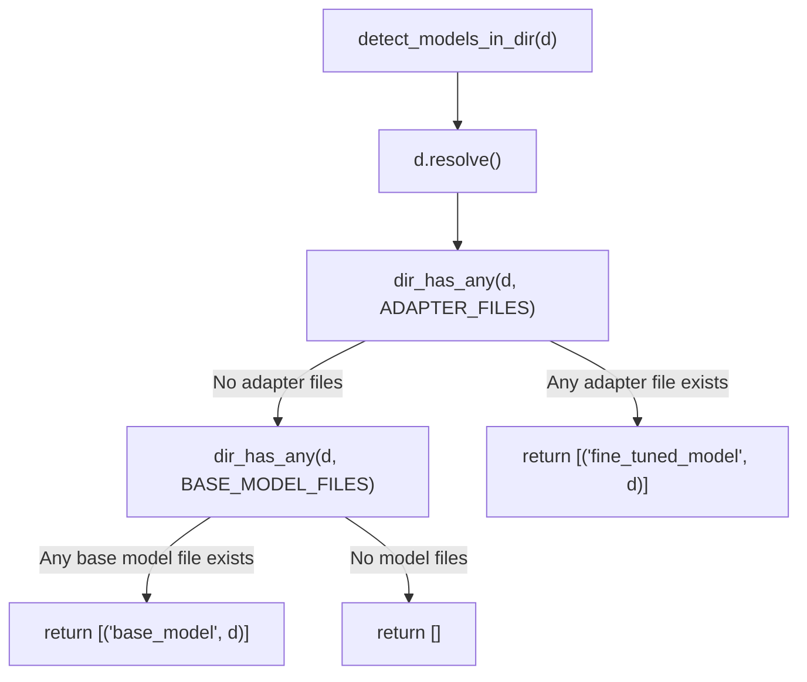
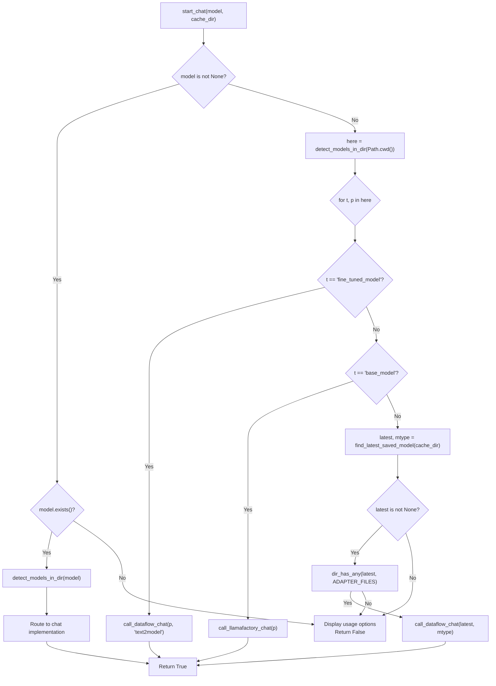
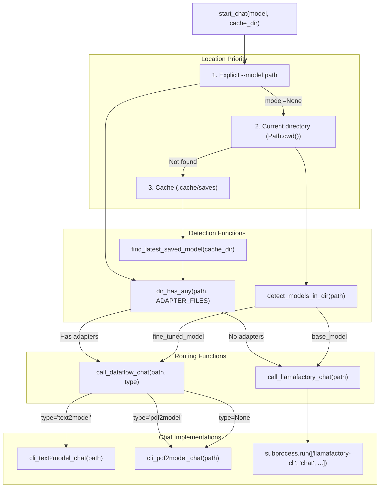
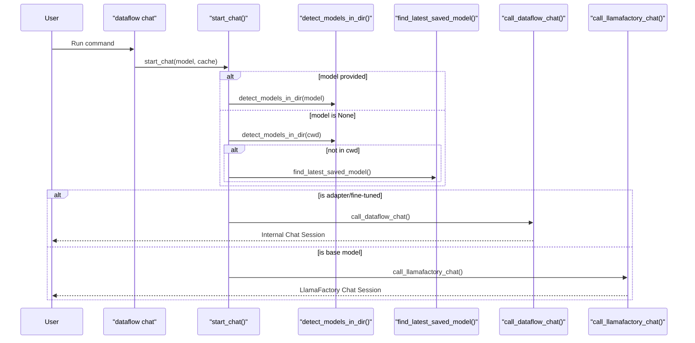

<!-- source: DeepWiki mcp.deepwiki.com · repo OpenDCAI/DataFlow · page 8.3 Interactive Chat · fetched 2026-11-02 -->

# Interactive Chat

<details>
<summary>Relevant source files</summary>

The following files were used as context for generating this wiki page:

- [dataflow/cli.py](dataflow/cli.py)
- [dataflow/cli_funcs/cli_eval.py](dataflow/cli_funcs/cli_eval.py)
- [dataflow/cli_funcs/cli_webui.py](dataflow/cli_funcs/cli_webui.py)
- [dataflow/cli_funcs/eval_pipeline/eval_api.py](dataflow/cli_funcs/eval_pipeline/eval_api.py)
- [dataflow/cli_funcs/eval_pipeline/eval_local.py](dataflow/cli_funcs/eval_pipeline/eval_local.py)
- [dataflow/statics/scaffold/{{cookiecutter.repo_name}}/{{cookiecutter.package_name}}/operators/core/__init__.py](dataflow/statics/scaffold/{{cookiecutter.repo_name}}/{{cookiecutter.package_name}}/operators/core/__init__.py)

</details>


## Purpose and Scope

This page documents the `dataflow chat` command, which provides interactive inference sessions with trained models [dataflow/cli.py:99-126](). The system implements automatic model type detection and intelligent routing between DataFlow's internal chat implementations and external LlamaFactory integration [dataflow/cli.py:99-126]().

For training workflows that produce models, see page 8.2 (Pipeline Initialization) and page 8.5 (Training Commands). For model evaluation workflows, see page 8.1 (Model Evaluation).

---

## Overview

The `dataflow chat` command is implemented in [dataflow/cli.py:19-23]() as a Typer CLI command that delegates to `start_chat()` for model detection and routing logic [dataflow/cli.py:129-168](). The system supports two model categories:

| Model Type | Detection Method | Chat Implementation | Module |
|------------|------------------|---------------------|--------|
| Fine-tuned (LoRA adapters) | Presence of `adapter_config.json`, `adapter_model.bin`, or `adapter_model.safetensors` | DataFlow internal | `dataflow.cli_funcs.cli_text` or `dataflow.cli_funcs.cli_pdf` [dataflow/cli.py:102-107]() |
| Base models | Presence of `config.json`, `pytorch_model.bin`, `model.safetensors`, tokenizer files | External LlamaFactory | `llamafactory-cli` subprocess [dataflow/cli.py:116-126]() |

The command searches three locations in priority order: explicit `--model` path, current working directory, and cache directory (`.cache/saves`) [dataflow/cli.py:129-168]().

Sources: [dataflow/cli.py:27-28](), [dataflow/cli.py:129-168]()

---

## Command Syntax

```bash
dataflow chat [OPTIONS]
```

**Options:**

| Option | Type | Default | Description |
|--------|------|---------|-------------|
| `--model` | Path | None | Explicit model path to use |
| `--cache` | Path | `.` | Cache directory to search for trained models |

Sources: [dataflow/cli.py:129-131]()

---

## Model Detection System

### File-Based Detection Constants

The model type detection system relies on constant sets defined in [dataflow/cli.py:27-28]():

```python
ADAPTER_FILES = {"adapter_config.json", "adapter_model.bin", "adapter_model.safetensors"}
BASE_MODEL_FILES = {"config.json", "pytorch_model.bin", "model.safetensors", "tokenizer.json", "tokenizer_config.json"}
```

### Detection Algorithm

Title: "Model Type Detection Flow (detect_models_in_dir)"



**Helper Function: `dir_has_any(path: Path, names: set) -> bool`**

Implemented in [dataflow/cli.py:55-56]() as:
```python
def dir_has_any(path: Path, names: set) -> bool:
    return any((path / n).exists() for n in names)
```

This function performs existence checks for any file in the provided set, enabling efficient detection without iterating all directory contents.

Sources: [dataflow/cli.py:27-28](), [dataflow/cli.py:55-56](), [dataflow/cli.py:59-66]()

---

## Model Search Strategy

### Search Priority Chain

**Function: `start_chat(model: Optional[Path], cache_dir: Path) -> bool`**

The search is implemented in [dataflow/cli.py:129-168]() with three priority levels:

Title: "Model Search Location Priority (start_chat)"



### Cache Discovery Algorithm

**Function: `find_latest_saved_model(cache_dir: Path) -> Tuple[Optional[Path], Optional[str]]`**

Implemented in [dataflow/cli.py:69-95](), this function searches `{cache_dir}/.cache/saves` using multi-strategy timestamp extraction:

| Strategy | Regex/Prefix | Training Type |
|----------|--------------|---------------|
| Prefix Match | `text2model_cache_` | `text2model` [dataflow/cli.py:81-82]() |
| Prefix Match | `pdf2model_cache_` | `pdf2model` [dataflow/cli.py:83-84]() |
| Timestamp Regex | `(\d{8}_\d{6})` | `pdf2model` [dataflow/cli.py:86-88]() |
| Fallback | `p.stat().st_mtime` | `unknown` [dataflow/cli.py:91]() |

Sources: [dataflow/cli.py:69-95](), [dataflow/cli.py:129-168]()

---

## Chat Routing Decision Tree

Title: "Code Routing Logic (start_chat to implementations)"



Sources: [dataflow/cli.py:99-126](), [dataflow/cli.py:129-168]()

---

## Chat Implementations

### DataFlow Internal Chat: `call_dataflow_chat()`

**Function Signature:** [dataflow/cli.py:99-113]()
```python
def call_dataflow_chat(model_path: Path, model_type: Optional[str] = None) -> bool
```

The function performs conditional imports based on `model_type`. If `text2model` is in the type string, it invokes `cli_text2model_chat` [dataflow/cli.py:102-104](); otherwise, it defaults to `cli_pdf2model_chat` [dataflow/cli.py:105-107]().

Sources: [dataflow/cli.py:99-113]()

### LlamaFactory External Integration: `call_llamafactory_chat()`

**Function Signature:** [dataflow/cli.py:116-126]()
```python
def call_llamafactory_chat(model_path: Path) -> bool
```

This function executes `llamafactory-cli chat --model_name_or_path <path>` as a subprocess [dataflow/cli.py:119](). It requires the `llamafactory[torch,metrics]` package to be installed [dataflow/cli.py:122]().

Sources: [dataflow/cli.py:116-126]()

---

## Complete Execution Flow

Title: "Chat Command Execution Sequence"



Sources: [dataflow/cli.py:59-168]()

---

## Technical Implementation Details

### Model Type Detection Implementation

The detection logic checks for specific file markers to determine if a directory contains a base model or a LoRA adapter:

```python
ADAPTER_FILES = {"adapter_config.json", "adapter_model.bin", "adapter_model.safetensors"}
BASE_MODEL_FILES = {"config.json", "pytorch_model.bin", "model.safetensors", "tokenizer.json", "tokenizer_config.json"}
```

The `dir_has_any` helper [dataflow/cli.py:55-56]() uses a generator expression with `any()` for efficient short-circuiting existence checks.

### Cache Directory Structure

Models trained through DataFlow pipelines are saved with specific naming patterns in `{cache}/.cache/saves/` [dataflow/cli.py:71]():

- `text2model_cache_*`: Results from `dataflow text2model train` [dataflow/cli.py:81-82]().
- `pdf2model_cache_*`: Results from `dataflow pdf2model train` [dataflow/cli.py:83-84]().

Sources: [dataflow/cli.py:27-28](), [dataflow/cli.py:55-56](), [dataflow/cli.py:69-95]()

---

