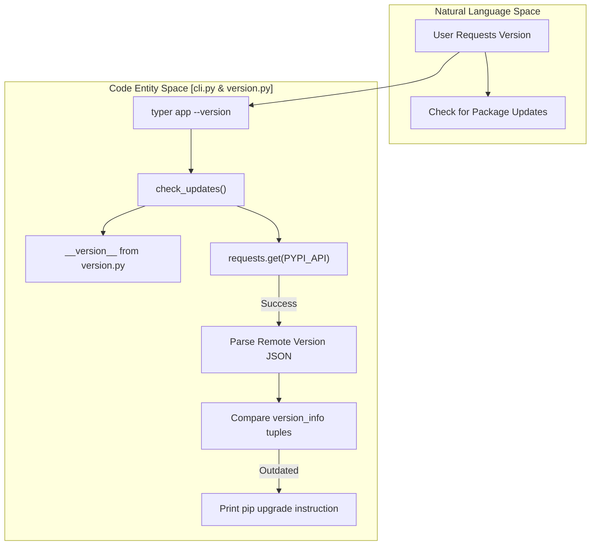
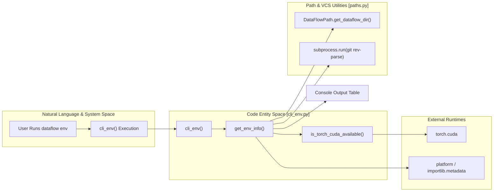

<!-- source: DeepWiki mcp.deepwiki.com · repo OpenDCAI/DataFlow · page 8.4 Environment and Version Management · fetched 2026-11-02 -->

# Environment and Version Management

Relevant source files

The following files were used as context for generating this wiki page:

- [.dockerignore](.dockerignore)
- [.github/ISSUE_TEMPLATE/1-bug-reports.yaml](.github/ISSUE_TEMPLATE/1-bug-reports.yaml)
- [.github/ISSUE_TEMPLATE/2-ask-for-help.yaml](.github/ISSUE_TEMPLATE/2-ask-for-help.yaml)
- [.github/ISSUE_TEMPLATE/3-feature-request.yaml](.github/ISSUE_TEMPLATE/3-feature-request.yaml)
- [.github/workflows/python-publish.yml](.github/workflows/python-publish.yml)
- [.gitignore](.gitignore)
- [Dockerfile](Dockerfile)
- [MANIFEST.in](MANIFEST.in)
- [README-zh.md](README-zh.md)
- [README.md](README.md)
- [dataflow/cli_funcs/cli_env.py](dataflow/cli_funcs/cli_env.py)
- [dataflow/version.py](dataflow/version.py)

This page explains DataFlow's environment and version management system. It details the underlying implementation of package versioning, update checking, environment diagnostics via `dataflow env`, GitHub issue templates integration, and the automated package publication workflow.

---

## Purpose and Scope

The environment and version management module provides core lifecycle utilities for the DataFlow framework. Its primary responsibilities include:
- Tracking and parsing package versions to ensure runtime compatibility. `[dataflow/version.py:1-28]()`
- Inspecting hardware capabilities, Python runtimes, and deep learning dependencies through `cli_env()` and `get_env_info()`. `[dataflow/cli_funcs/cli_env.py:16-83]()`
- Enforcing standardized system diagnostics in bug reports and support requests via GitHub issue templates. `[.github/ISSUE_TEMPLATE/1-bug-reports.yaml:32-42]`, `[.github/ISSUE_TEMPLATE/2-ask-for-help.yaml:21-32]()`
- Automating distribution and publishing workflows to PyPI using GitHub Actions. `[.github/workflows/python-publish.yml:1-75]()`

---

## Version Management

### Version Metadata Implementation

The package version of DataFlow is centrally defined in `dataflow/version.py`. This module supplies the core version string used by packaging tools, the CLI, and runtime diagnostics. `[dataflow/version.py:1-28]()`

| Variable/Function | Role | Code Entity |
| :--- | :--- | :--- |
| `__version__` | The primary semantic version string (e.g., `'1.0.10'`). | `[dataflow/version.py:1]()` |
| `get_version()` | Returns the version string for external callers. | `[dataflow/version.py:5-7]()` |
| `parse_version_info()` | Parses version strings into tuples for comparison (supporting `rc` tags). | `[dataflow/version.py:9-26]()` |

Sources: `[dataflow/version.py:1-28]()`

### Version Command (`dataflow --version`)

Users can inspect their current package version and check for updates via the CLI. The underlying update check queries the PyPI JSON API (`https://pypi.org/pypi/open-dataflow/json`) to compare the local version against the latest remote release.

**Title: Version check and update notification flow**

Sources: `[dataflow/version.py:1-28]`, `[dataflow/cli.py:19-53]()`

---

## Environment Inspection (`dataflow env`)

The `dataflow env` command serves as the primary diagnostic tool for the framework, implemented via `cli_env()` which invokes `get_env_info()`. `[dataflow/cli_funcs/cli_env.py:16-83]()`

### Information Gathering Process

The `get_env_info()` function aggregates system-level metrics, runtime configurations, and optional deep-learning library versions. `[dataflow/cli_funcs/cli_env.py:16-79]()`

| Category | Details Collected | Code Symbol / Method |
| :--- | :--- | :--- |
| **DataFlow Metadata** | Version and installation path | `__version__`, `DataFlowPath.get_dataflow_dir()` `[dataflow/cli_funcs/cli_env.py:18-19]()` |
| **System & Runtime** | Platform, Python version | `platform.platform()`, `platform.python_version()` `[dataflow/cli_funcs/cli_env.py:20-21]()` |
| **Hardware / GPU** | CUDA availability, device name, count, and memory | `is_torch_cuda_available()`, `torch.cuda.get_device_name()` `[dataflow/cli_funcs/cli_env.py:10-29]()` |
| **Deep Learning Stack** | PyTorch, DeepSpeed, Bitsandbytes | `torch.__version__`, dynamic imports `[dataflow/cli_funcs/cli_env.py:22-44]()` |
| **Serving Engines** | vLLM, SGLang | Try-except import checks `[dataflow/cli_funcs/cli_env.py:46-57]()` |
| **Document Processing** | MinerU extraction library | `importlib.metadata.version("mineru")` `[dataflow/cli_funcs/cli_env.py:59-63]()` |
| **VCS State** | Git commit hash | `subprocess.run(["git", "rev-parse", "HEAD"])` `[dataflow/cli_funcs/cli_env.py:65-74]()` |

Sources: `[dataflow/cli_funcs/cli_env.py:10-83]()`

### Environment Diagnostics Architecture

The following diagram maps environment collection logic to concrete code modules.

**Title: Environment information collection architecture**

Sources: `[dataflow/cli_funcs/cli_env.py:10-83]`, `[dataflow/cli_funcs/paths.py:7-8]()`

---

## GitHub Issue Templates Integration

Diagnostic output from `dataflow env` is integrated directly into GitHub issue templates to streamline troubleshooting. The repository maintains structured YAML templates that enforce the inclusion of environment metadata. `[.github/ISSUE_TEMPLATE/1-bug-reports.yaml:32-42]`, `[.github/ISSUE_TEMPLATE/2-ask-for-help.yaml:21-32]`, `[.github/ISSUE_TEMPLATE/3-feature-request.yaml:20-33]()`

- **Bug Reports (`1-bug-reports.yaml`)**: Requires users to supply `dataflow env` output along with reproduction steps and stack traces. `[.github/ISSUE_TEMPLATE/1-bug-reports.yaml:32-61]()`
- **Ask for Help (`2-ask-for-help.yaml`)**: Requests system information to isolate configuration or hardware-specific serving errors. `[.github/ISSUE_TEMPLATE/2-ask-for-help.yaml:21-32]()`
- **Feature Requests (`3-feature-request.yaml`)**: Gathers baseline environment context for proposed framework enhancements. `[.github/ISSUE_TEMPLATE/3-feature-request.yaml:20-33]()`

Sources: `[.github/ISSUE_TEMPLATE/1-bug-reports.yaml:32-61]`, `[.github/ISSUE_TEMPLATE/2-ask-for-help.yaml:21-32]`, `[.github/ISSUE_TEMPLATE/3-feature-request.yaml:20-33]()`

---

## Automated Publish Workflow

DataFlow automates package releases to PyPI using GitHub Actions. The workflow is defined in `.github/workflows/python-publish.yml` and triggers automatically upon the publication of a GitHub release. `[.github/workflows/python-publish.yml:9-14]()`

### Pipeline Stages

1. **`release-build` Job**: Runs on `ubuntu-latest` using Python 3.12. It checks out the repository, installs build requirements (`build`, `twine`), builds source distribution (`--sdist`) and binary wheel packages (`--wheel`), and verifies the distribution via `twine check`. `[.github/workflows/python-publish.yml:19-39]()`
2. **`pypi-publish` Job**: Depends on `release-build`, utilizes trusted publishing via OpenID Connect (`id-token: write`), and uploads the generated distribution artifacts to PyPI using `pypa/gh-action-pypi-publish`. `[.github/workflows/python-publish.yml:46-75]()`

Sources: `[.github/workflows/python-publish.yml:1-75]()`

---

