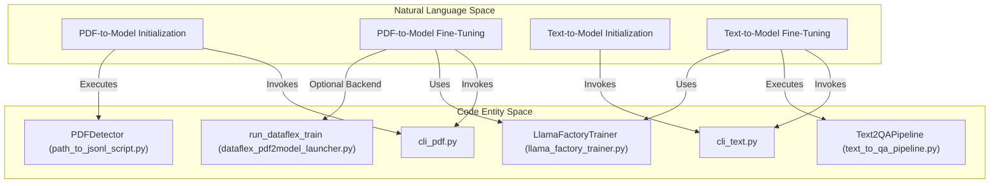
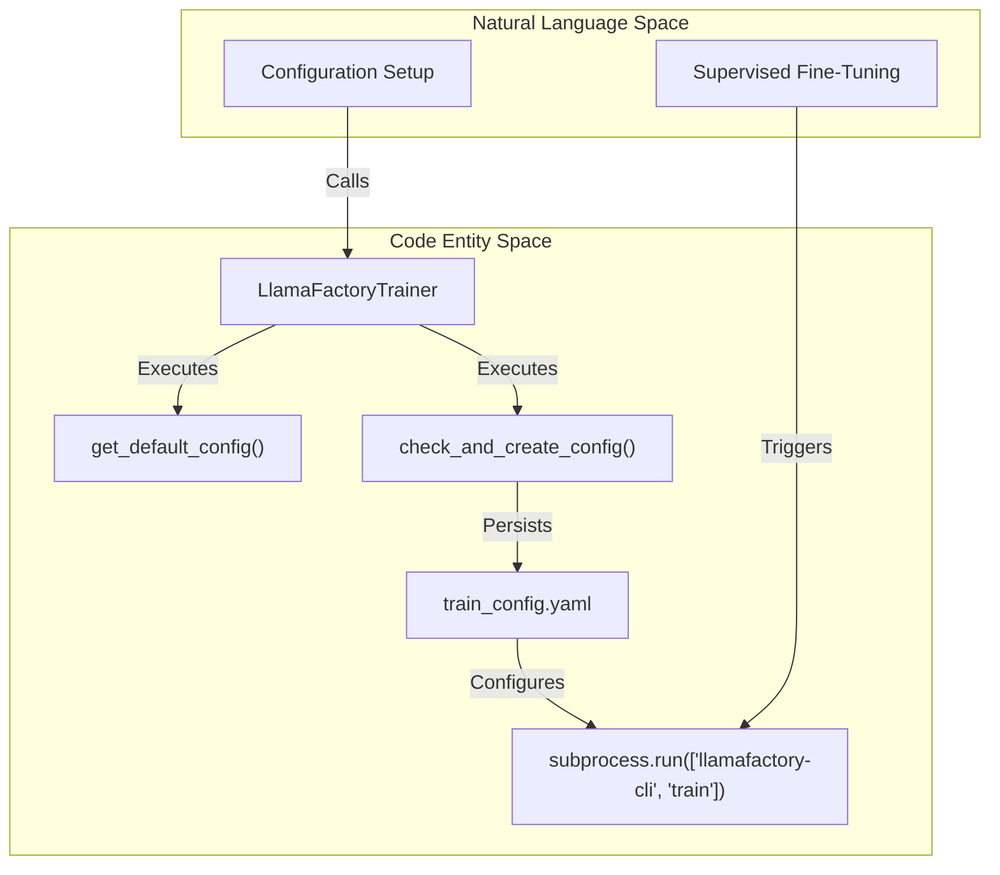

<!-- source: DeepWiki mcp.deepwiki.com · repo OpenDCAI/DataFlow · page 8.5 Training Commands · fetched 2026-11-02 -->

# Training Commands

<details>
<summary>Relevant source files</summary>

The following files were used as context for generating this wiki page:

- [dataflow/cli_funcs/cli_pdf.py](dataflow/cli_funcs/cli_pdf.py)
- [dataflow/cli_funcs/cli_text.py](dataflow/cli_funcs/cli_text.py)
- [dataflow/cli_funcs/pdf2model_pipeline/dataflex_pdf2model_launcher.py](dataflow/cli_funcs/pdf2model_pipeline/dataflex_pdf2model_launcher.py)
- [dataflow/cli_funcs/pdf2model_pipeline/llama_factory_trainer.py](dataflow/cli_funcs/pdf2model_pipeline/llama_factory_trainer.py)
- [dataflow/cli_funcs/pdf2model_pipeline/path_to_jsonl_script.py](dataflow/cli_funcs/pdf2model_pipeline/path_to_jsonl_script.py)
- [dataflow/cli_funcs/text2model_pipeline/text_to_qa_pipeline.py](dataflow/cli_funcs/text2model_pipeline/text_to_qa_pipeline.py)
- [dataflow/operators/knowledge_cleaning/generate/qa_extract.py](dataflow/operators/knowledge_cleaning/generate/qa_extract.py)
- [dataflow/operators/pdf2vqa/generate/vqa_formatter.py](dataflow/operators/pdf2vqa/generate/vqa_formatter.py)
- [dataflow/operators/reasoning/filter/reasoning_answer_groundtruth_filter.py](dataflow/operators/reasoning/filter/reasoning_answer_groundtruth_filter.py)
- [dataflow/operators/text_sft/eval/Superfiltering/data_analysis.py](dataflow/operators/text_sft/eval/Superfiltering/data_analysis.py)

</details>


## Purpose and Scope
This page details the DataFlow CLI training commands (`pdf2model` and `text2model`) that enable end-to-end model fine-tuning workflows. These commands convert DataFlow-generated datasets into fine-tuned language models by integrating with LlamaFactory's training infrastructure and providing specialized data preparation for PDF and text sources.

**Scope:** This page covers the `dataflow pdf2model` and `dataflow text2model` command groups, initialization and training subcommands, LlamaFactory integration patterns, DataFlex backend execution, and formatting operator mechanics.

---

## 1. Overview

DataFlow provides two training command groups following a consistent two-phase workflow (`init` and `train`):

| Command Group | Purpose | Data Source |
|--------------|---------|-------------|
| `pdf2model` | Train models from PDF-extracted QA pairs | PDF VQA pipelines `[dataflow/cli_funcs/cli_pdf.py:174-176]()` or KB Cleaning pipelines `[dataflow/cli_funcs/cli_pdf.py:170-172]()` |
| `text2model` | Train models from synthesized text data | Text synthesis pipelines `[dataflow/cli_funcs/cli_text.py:4-5]()` |

Both command groups provide initialization scripts that configure YAML files and execution pipelines for fine-tuning via LlamaFactory or DataFlex.

Sources: `[dataflow/cli_funcs/cli_pdf.py:4-14]()`, `[dataflow/cli_funcs/cli_text.py:3-5]()`

---

## 2. Command Architecture

The training command layer maps high-level user intents (Natural Language Space) directly to concrete Python execution modules, classes, and subprocess launchers (Code Entity Space).

Title: "Natural Language Space to Code Entity Space: Training Commands"

Sources: `[dataflow/cli_funcs/cli_pdf.py:23-40]()`, `[dataflow/cli_funcs/pdf2model_pipeline/path_to_jsonl_script.py:8-121]()`, `[dataflow/cli_funcs/pdf2model_pipeline/llama_factory_trainer.py:15-16]()`

---

## 3. pdf2model Workflow

The `pdf2model` command group trains models from PDF-derived QA datasets, supporting `kbc` (Knowledge Base Cleaning) and `vqa` (Visual Question Answering) modes. It also supports an optional `dataflex-less` backend for dynamic data selection during training `[dataflow/cli_funcs/cli_pdf.py:26-33]()`.

### Initialization Phase

The `init` command sets up the training environment, scans for PDFs, and generates configuration artifacts.

**Command:**
```bash
dataflow pdf2model init --cache ./my_project --qa kbc
```

**Key Implementation Details:**
1. **PDF Detection:** `PDFDetector` in `path_to_jsonl_script.py` scans target directories for `.pdf` files, filtering out ignored directories (`.cache`, `.git`, etc.) and generating `pdf_list.jsonl` `[dataflow/cli_funcs/pdf2model_pipeline/path_to_jsonl_script.py:8-165]()`.
2. **Backend Validation:** `_assert_pdf2model_train_backend_allowed` validates that `dataflex-` backends are only paired with `qa=kbc`, and `vqa` restricts backends to base LlamaFactory `[dataflow/cli_funcs/cli_pdf.py:40-54]()`.
3. **Configuration Generation:** `create_train_config_yaml` or `_build_pdf2model_dataflex_config_dict` creates the appropriate training YAML and component configuration files `[dataflow/cli_funcs/cli_pdf.py:78-141]()`.

Sources: `[dataflow/cli_funcs/cli_pdf.py:40-141]()`, `[dataflow/cli_funcs/pdf2model_pipeline/path_to_jsonl_script.py:8-165]()`

### Training Phase

The `train` command executes the data generation pipeline and launches the downstream training backend.

**Command:**
```bash
dataflow pdf2model train --cache ./my_project
```

**Implementation Logic:**
1. **Pipeline Execution:** Runs the generated data extraction script using `run_script_with_args` to process PDFs into structured QA records `[dataflow/cli_funcs/cli_pdf.py:144-162]()`.
2. **Backend Dispatch:** 
   - If using `dataflex-less`, execution is delegated to `run_dataflex_train` which configures `torchrun` and invokes `dataflex.launcher` `[dataflow/cli_funcs/pdf2model_pipeline/dataflex_pdf2model_launcher.py:101-131]()`.
   - Standard execution delegates to `LlamaFactoryTrainer` to run training `[dataflow/cli_funcs/pdf2model_pipeline/llama_factory_trainer.py:15-104]()`.

Sources: `[dataflow/cli_funcs/cli_pdf.py:144-162]()`, `[dataflow/cli_funcs/pdf2model_pipeline/dataflex_pdf2model_launcher.py:101-131]()`, `[dataflow/cli_funcs/pdf2model_pipeline/llama_factory_trainer.py:15-104]()`

---

## 4. text2model Workflow

The `text2model` command group automates text-to-QA dataset synthesis followed by supervised fine-tuning.

### text2model init

Initializes the environment by copying `text_to_qa_pipeline.py` and establishing default training YAML parameters `[dataflow/cli_funcs/cli_text.py:68-177]()`.

### text2model train

Executes the pipeline and initiates fine-tuning.

**Command:**
```bash
dataflow text2model train --cache ./text_project
```

**Pipeline Execution:**
The underlying `Text2QAPipeline` executes sequential batch operators `[dataflow/cli_funcs/text2model_pipeline/text_to_qa_pipeline.py:22-92]()`:
1. `KBCChunkGeneratorBatch`: Splits input text into token-bounded chunks `[dataflow/cli_funcs/text2model_pipeline/text_to_qa_pipeline.py:37-41]()`.
2. `LocalModelLLMServing_vllm`: Manages local vLLM inference server lifecycle `[dataflow/cli_funcs/text2model_pipeline/text_to_qa_pipeline.py:55-61]()`.
3. `KBCTextCleanerBatch`: Cleans text chunks via LLM `[dataflow/cli_funcs/text2model_pipeline/text_to_qa_pipeline.py:63-66]()`.
4. `KBCMultiHopQAGeneratorBatch`: Generates multi-hop QA pairs `[dataflow/cli_funcs/text2model_pipeline/text_to_qa_pipeline.py:68-71]()`.
5. `QAExtractor`: Formats records into Alpaca JSON format `[dataflow/cli_funcs/text2model_pipeline/text_to_qa_pipeline.py:43-45]()`.

Sources: `[dataflow/cli_funcs/cli_text.py:68-177]()`, `[dataflow/cli_funcs/text2model_pipeline/text_to_qa_pipeline.py:22-92]()`

---

## 5. LlamaFactory Integration

DataFlow integrates with LlamaFactory via the `LlamaFactoryTrainer` class to manage YAML configuration lifecycle and execution `[dataflow/cli_funcs/pdf2model_pipeline/llama_factory_trainer.py:15-104]()`.

Title: "Natural Language Space to Code Entity Space: LlamaFactory Trainer Workflow"

Sources: `[dataflow/cli_funcs/pdf2model_pipeline/llama_factory_trainer.py:15-120]()`, `[dataflow/cli_funcs/pdf2model_pipeline/llama_factory_trainer.py:235-255]()`

---

## 6. Data Formatting Operators

Prior to model training, records are standardized through specialized operators.

### QAExtractor
Implemented in `dataflow/operators/knowledge_cleaning/generate/qa_extract.py`, `QAExtractor` converts structured QA dicts into Alpaca format `[dataflow/operators/knowledge_cleaning/generate/qa_extract.py:14-20]()`.
- Maps questions and answers to `instruction`, `input`, and `output` keys `[dataflow/operators/knowledge_cleaning/generate/qa_extract.py:128-133]()`.

### VQAFormatter
Implemented in `dataflow/operators/pdf2vqa/generate/vqa_formatter.py`, `VQAFormatter` converts multimodal VQA data into ShareGPT format `[dataflow/operators/pdf2vqa/generate/vqa_formatter.py:16-23]()`.
- Uses `_IMAGE_PATTERN` regex to extract Markdown image tags, replacing them with `<image>` placeholders `[dataflow/operators/pdf2vqa/generate/vqa_formatter.py:25-26]()`.
- Outputs structured `messages` and an absolute `images` path array `[dataflow/operators/pdf2vqa/generate/vqa_formatter.py:178-183]()`.

Sources: `[dataflow/operators/knowledge_cleaning/generate/qa_extract.py:14-133]()`, `[dataflow/operators/pdf2vqa/generate/vqa_formatter.py:16-183]()`

---

