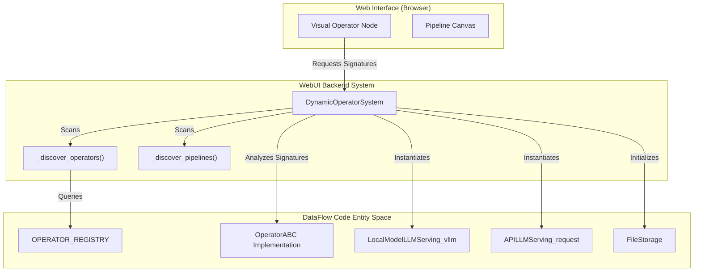
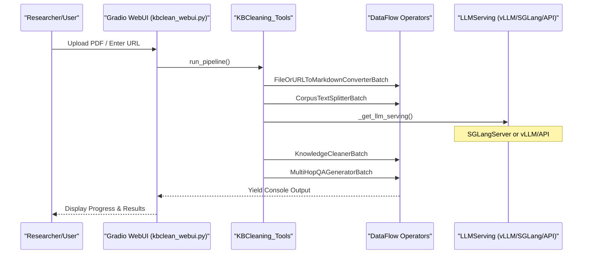

<!-- source: DeepWiki mcp.deepwiki.com · repo OpenDCAI/DataFlow · page 9 Web Interface · fetched 2026-11-02 -->

# Web Interface

Relevant source files

The following files were used as context for generating this wiki page:

- [dataflow/cli.py](dataflow/cli.py)
- [dataflow/cli_funcs/cli_eval.py](dataflow/cli_funcs/cli_eval.py)
- [dataflow/cli_funcs/cli_webui.py](dataflow/cli_funcs/cli_webui.py)
- [dataflow/cli_funcs/eval_pipeline/eval_api.py](dataflow/cli_funcs/eval_pipeline/eval_api.py)
- [dataflow/cli_funcs/eval_pipeline/eval_local.py](dataflow/cli_funcs/eval_pipeline/eval_local.py)
- [dataflow/statics/scaffold/{{cookiecutter.repo_name}}/{{cookiecutter.package_name}}/operators/core/__init__.py](dataflow/statics/scaffold/{{cookiecutter.repo_name}}/{{cookiecutter.package_name}}/operators/core/__init__.py)
- [dataflow/webui/operator_pipeline.py](dataflow/webui/operator_pipeline.py)

The DataFlow system provides multiple graphical interfaces for pipeline construction and data preparation. The primary **DataFlow WebUI** offers a visual, browser-based environment for building pipelines, while the **KBCleaning WebUI** provides a specialized Gradio interface for interactive document cleaning and QA generation.

---

## Overview

DataFlow's web interfaces bridge the gap between complex code entities and user-friendly visual interaction. The system supports two distinct web components:

1. **DataFlow WebUI**: A standalone application allowing users to visually compose operators into pipelines using backend analysis of operator signatures [dataflow/webui/operator_pipeline.py:48-67]().
2. **KBCleaning WebUI**: A built-in Gradio application specifically designed for the Knowledge Base Cleaning pipeline, supporting interactive PDF/URL processing [dataflow/webui/kbclean_webui.py:106-108]().

| Interface | Technology | Entry Point / File | Primary Use Case |
|-----------|------------|--------------------|------------------|
| **DataFlow WebUI** | FastAPI + React | `dataflow/webui/operator_pipeline.py` | General visual pipeline construction & dynamic operator discovery |
| **KBCleaning UI** | Gradio | `dataflow/webui/kbclean_webui.py` | Interactive document cleaning & multi-hop QA generation |

Sources: [dataflow/webui/operator_pipeline.py:48-67](), [dataflow/webui/kbclean_webui.py:106-108]()

---

## Visual Pipeline Construction (DataFlow WebUI)

The main WebUI facilitates the transition from natural language or visual configuration to code entities by allowing users to select registered operators and connect them into a functional graph. It relies on the `DynamicOperatorSystem` to inspect operator signatures and registries dynamically [dataflow/webui/operator_pipeline.py:48-67]().

### System Mapping: UI to Code Entities

The following diagram illustrates how the WebUI backend interacts with core DataFlow registries and serving layers.

**Key Code Components:**
- **`DynamicOperatorSystem`**: Manages operator and pipeline discovery, inspecting constructor and `run` signatures for UI parameter rendering [dataflow/webui/operator_pipeline.py:48-140]().
- **`create_serving_instance`**: Factory method supporting `API` and `vllm` serving configurations [dataflow/webui/operator_pipeline.py:153-169]().

For details on installation and setup, see [WebUI Installation and Setup](#9.1).

Sources: [dataflow/webui/operator_pipeline.py:48-169]()

---

## Knowledge Base Cleaning WebUI

The KBCleaning WebUI is a specialized tool for high-quality data preparation from unstructured sources. It leverages Gradio (`create_ui`) to provide a playground for testing extraction prompts and cleaning logic [dataflow/webui/kbclean_webui.py:106-108]().

### Interface Workflow

The interface automates the flow from raw document ingestion to structured QA pairs using the Knowledge Base Cleaning logic encapsulated in `KBCleaning_Tools` [dataflow/webui/kbcleaning_tools.py:19-129]().

**Implementation Details:**
- **File Path**: `dataflow/webui/kbclean_webui.py` [dataflow/webui/kbclean_webui.py:1-174]()
- **Backend Support**: Supports local inference via `LocalModelLLMServing_vllm` [dataflow/webui/kbcleaning_tools.py:51-59](), the specialized `SGLangServer` process manager [dataflow/webui/kb_sglang_server.py:29-80](), and remote APIs via `APILLMServing_request` [dataflow/webui/kbcleaning_tools.py:69-76]().
- **Pipeline Orchestration**: Uses `KBCleaning_Tools.run_pipeline` to execute file conversion, text splitting, knowledge cleaning, and multi-hop QA generation sequentially [dataflow/webui/kbcleaning_tools.py:79-128]().

For details on using this interface, see [KBCleaning Gradio WebUI](#9.2).

Sources: [dataflow/webui/kbclean_webui.py:1-174](), [dataflow/webui/kbcleaning_tools.py:19-128](), [dataflow/webui/kb_sglang_server.py:29-80]()

---

## Child Pages

- [WebUI Installation and Setup](#9.1) — Detailed guide on setting up and launching the DataFlow WebUI and managing dynamic operator discovery.
- [KBCleaning Gradio WebUI](#9.2) — Technical guide for the interactive document processing interface (`kbclean_webui.py` and `kbcleaning_tools.py`), including backend configuration for vLLM, SGLang, or API serving [dataflow/webui/kbclean_webui.py:1-174](), [dataflow/webui/kbcleaning_tools.py:19-128]().

Sources: [dataflow/webui/kbclean_webui.py:1-174](), [dataflow/webui/kbcleaning_tools.py:19-128]()

---

