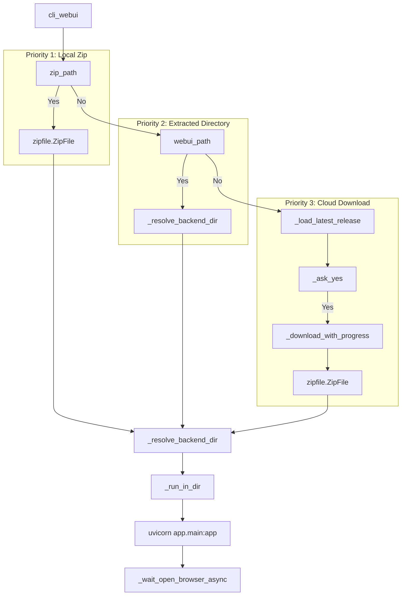
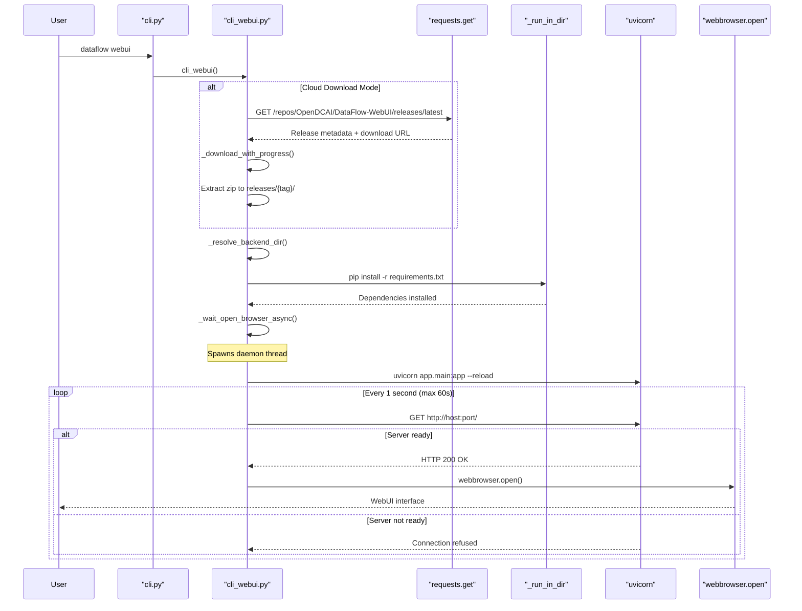
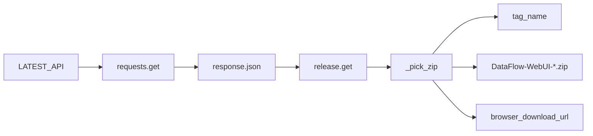
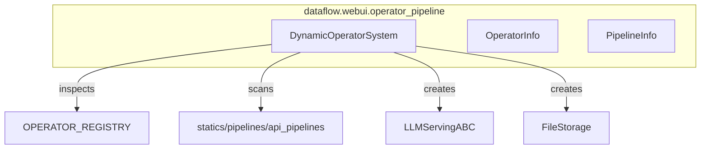

<!-- source: DeepWiki mcp.deepwiki.com · repo OpenDCAI/DataFlow · page 9.1 WebUI Installation and Setup · fetched 2026-11-02 -->

# WebUI Installation and Setup

<details>
<summary>Relevant source files</summary>

The following files were used as context for generating this wiki page:

- [dataflow/cli.py](dataflow/cli.py)
- [dataflow/cli_funcs/cli_eval.py](dataflow/cli_funcs/cli_eval.py)
- [dataflow/cli_funcs/cli_webui.py](dataflow/cli_funcs/cli_webui.py)
- [dataflow/cli_funcs/eval_pipeline/eval_api.py](dataflow/cli_funcs/eval_pipeline/eval_api.py)
- [dataflow/cli_funcs/eval_pipeline/eval_local.py](dataflow/cli_funcs/eval_pipeline/eval_local.py)
- [dataflow/statics/scaffold/{{cookiecutter.repo_name}}/{{cookiecutter.package_name}}/operators/core/__init__.py](dataflow/statics/scaffold/{{cookiecutter.repo_name}}/{{cookiecutter.package_name}}/operators/core/__init__.py)
- [dataflow/webui/operator_pipeline.py](dataflow/webui/operator_pipeline.py)

</details>


This page details the installation and setup process for DataFlow WebUI, a visual pipeline construction interface for the DataFlow framework. The WebUI provides a browser-based environment for composing operators into pipelines without writing code.

**Scope**: This document covers the `dataflow webui` command, installation methods, configuration options, and the startup process. For information about using the WebUI to build pipelines, see [Web Interface](#9). For CLI-based pipeline initialization, see [Pipeline Initialization](#8.2).

---

## Overview

The DataFlow WebUI is distributed as a separate GitHub repository (`OpenDCAI/DataFlow-WebUI`) and is launched via the `dataflow webui` command. The command handles downloading the latest release, extracting the application, installing dependencies, and starting the backend server.

The WebUI architecture consists of:
- **Frontend**: Browser-based visual editor (served by backend).
- **Backend**: FastAPI/Uvicorn server that interfaces with DataFlow core [dataflow/cli_funcs/cli_webui.py:61-71]().
- **Backend directory structure**: Contains `requirements.txt` and `app/` module [dataflow/cli_funcs/cli_webui.py:154-155]().
- **Dynamic Discovery**: The system inspects `OPERATOR_REGISTRY` and local pipeline files to populate the UI. The `DynamicOperatorSystem` class is responsible for analyzing operators and pipelines [dataflow/webui/operator_pipeline.py:48-54]().

Sources: [dataflow/cli_funcs/cli_webui.py:15-18](), [dataflow/cli_funcs/cli_webui.py:143-167](), [dataflow/webui/operator_pipeline.py:48-54]()

---

## Installation Methods

The `dataflow webui` command supports three installation modes, processed in order of priority:

### WebUI Installation Logic Flow

Sources: [dataflow/cli_funcs/cli_webui.py:193-201](), [dataflow/cli_funcs/cli_webui.py:202-324]()

### Method 1: Cloud Download (Default)

When no flags are provided, the command downloads the latest release from GitHub:

```bash
dataflow webui
```

**Process Flow:**

1. Query GitHub API at `https://api.github.com/repos/OpenDCAI/DataFlow-WebUI/releases/latest` [dataflow/cli_funcs/cli_webui.py:17-18]().
2. Display release tag and ask for download confirmation [dataflow/cli_funcs/cli_webui.py:170-191]().
3. Prompt for base directory (default: `./dataflow_webui`) [dataflow/cli_funcs/cli_webui.py:46-50]().
4. Download zip to `{base_dir}/downloads/{filename}.zip` using `requests` with stream mode [dataflow/cli_funcs/cli_webui.py:99-134]().
5. Extract to `{base_dir}/releases/{tag}/` [dataflow/cli_funcs/cli_webui.py:303-308]().
6. Proceed to backend startup.

**Interactive Prompts:**

| Prompt | Default | Purpose |
|--------|---------|---------|
| Download latest release {tag} now? | No | Confirm download |
| Download directory [{default}]: | `./dataflow_webui` | Set base directory |
| Overwrite and re-download this zip? | No | If zip exists |
| Overwrite and re-extract? | No | If extraction exists |

Sources: [dataflow/cli_funcs/cli_webui.py:250-308]()

### Method 2: Local Zip File

Use an existing local zip file:

```bash
dataflow webui --zip-path /path/to/DataFlow-WebUI-v1.0.0.zip
```

**Process Flow:**

1. Validate zip file exists [dataflow/cli_funcs/cli_webui.py:205-208]().
2. Prompt for base directory (default: `./dataflow_webui`) [dataflow/cli_funcs/cli_webui.py:211-213]().
3. Extract to `{base_dir}/releases/local/` [dataflow/cli_funcs/cli_webui.py:228-243]().
4. Proceed to backend startup.

Sources: [dataflow/cli_funcs/cli_webui.py:202-243]()

### Method 3: Pre-extracted Directory

Use an already extracted backend directory:

```bash
dataflow webui --webui-path /path/to/extracted/backend
```

The path can point to:
- Directly to the `backend/` directory [dataflow/cli_funcs/cli_webui.py:154-155]().
- To the parent directory containing `backend/` [dataflow/cli_funcs/cli_webui.py:158-160]().

**Validation**: The directory must contain `requirements.txt` and `app/` subdirectory [dataflow/cli_funcs/cli_webui.py:154-155]().

Sources: [dataflow/cli_funcs/cli_webui.py:143-167](), [dataflow/cli_funcs/cli_webui.py:245-248]()

---

## Command Reference

### Basic Command

The entry point for the WebUI is handled by the Typer application in the CLI [dataflow/cli.py:19-23]().

```bash
dataflow webui [OPTIONS]
```

### Options

| Option | Type | Default | Description |
|--------|------|---------|-------------|
| `--zip-path` | Path | None | Path to local release zip file [dataflow/cli_funcs/cli_webui.py:194]() |
| `--webui-path` | Path | None | Path to extracted backend directory [dataflow/cli_funcs/cli_webui.py:195]() |
| `--host` | String | `0.0.0.0` | Host to bind server [dataflow/cli_funcs/cli_webui.py:196]() |
| `--port` | Integer | `8000` | Port to bind server [dataflow/cli_funcs/cli_webui.py:197]() |

Sources: [dataflow/cli_funcs/cli_webui.py:193-198]()

---

## Directory Structure

### Default Layout (Cloud Download)

```
./dataflow_webui/                    # Base directory
├── downloads/                       # Downloaded zip files
│   └── DataFlow-WebUI-v1.0.0.zip
└── releases/                        # Extracted releases
    └── v1.0.0/                      # Release tag
        └── DataFlow-WebUI-v1.0.0/   # Extracted root
            ├── backend/             # Backend application
            │   ├── app/             # FastAPI application
            │   │   └── main.py      # Uvicorn entry point
            │   └── requirements.txt # Python dependencies
            └── frontend/            # Frontend assets
```

### Backend Directory Requirements

The `_resolve_backend_dir` function ensures the target directory is valid:
- `requirements.txt` - Python dependencies for pip installation [dataflow/cli_funcs/cli_webui.py:154]().
- `app/` - FastAPI application module [dataflow/cli_funcs/cli_webui.py:154]().
- `app/main.py` - Contains `app` instance for Uvicorn [dataflow/cli_funcs/cli_webui.py:321]().

Sources: [dataflow/cli_funcs/cli_webui.py:143-167](), [dataflow/cli_funcs/cli_webui.py:303-308]()

---

## Startup Process

### WebUI Execution Sequence

Sources: [dataflow/cli_funcs/cli_webui.py:61-96](), [dataflow/cli_funcs/cli_webui.py:310-323]()

### Startup Phases

#### Phase 1: Source Resolution
The command determines the WebUI source based on provided flags (priority: `zip-path` > `webui-path` > cloud download) in `cli_webui` [dataflow/cli_funcs/cli_webui.py:193-309]().

#### Phase 2: Dependency Installation
The CLI executes `pip install` within the backend directory [dataflow/cli_funcs/cli_webui.py:312-315]():
```bash
python -m pip install -r requirements.txt
```
This is performed via `_run_in_dir` which handles directory switching using `os.chdir` [dataflow/cli_funcs/cli_webui.py:136-142]().

#### Phase 3: Server Startup
The backend starts with Uvicorn in reload mode [dataflow/cli_funcs/cli_webui.py:319-322]():
```bash
python -m uvicorn app.main:app --reload --reload-dir app --host {host} --port {port}
```

#### Phase 4: Browser Launch
A daemon thread polls the server every 1 second (timeout: 60 seconds) using `_wait_open_browser_async` [dataflow/cli_funcs/cli_webui.py:61-96](). It checks for an HTTP response before calling `webbrowser.open` [dataflow/cli_funcs/cli_webui.py:81-84]().

---

## Configuration Details

### Host and Port Binding

| Host Value | Bind Behavior | Browser Access |
|------------|---------------|----------------|
| `0.0.0.0` | All interfaces | `http://127.0.0.1:{port}` |
| `127.0.0.1` | Localhost only | `http://127.0.0.1:{port}` |
| `<IP>` | Specific interface | `http://<IP>:{port}` |

**Note**: When binding to `0.0.0.0`, the browser opener uses `127.0.0.1` since `0.0.0.0` is not a valid access address for a browser client [dataflow/cli_funcs/cli_webui.py:68-72]().

### GitHub Release Discovery

### Release Discovery Process

Sources: [dataflow/cli_funcs/cli_webui.py:17](), [dataflow/cli_funcs/cli_webui.py:36-43]()

**API Endpoint**: `https://api.github.com/repos/OpenDCAI/DataFlow-WebUI/releases/latest` [dataflow/cli_funcs/cli_webui.py:17]().

**Asset Selection**: The `_pick_zip` function filters assets matching the pattern `DataFlow-WebUI-*.zip` and extracts the `browser_download_url` [dataflow/cli_funcs/cli_webui.py:36-43]().

### Download Progress Tracking

The `_download_with_progress` function displays real-time progress using `requests` streaming [dataflow/cli_funcs/cli_webui.py:99-134]().

**Output Format:**
```
Downloading: 45% (12.3/27.5 MB)
```

**Features:**
- Chunk size: 100 KB [dataflow/cli_funcs/cli_webui.py:109]().
- Progress updates on percentage change [dataflow/cli_funcs/cli_webui.py:117]().
- Automatic cleanup of partial files on failure using `dst.unlink()` [dataflow/cli_funcs/cli_webui.py:132-133]().
- Timeout: 120 seconds [dataflow/cli_funcs/cli_webui.py:102]().

---

## Integration with Core Entities

### WebUI Dynamic Component Discovery

Sources: [dataflow/webui/operator_pipeline.py:48-54](), [dataflow/webui/operator_pipeline.py:153-177]()

The WebUI backend interfaces with DataFlow core components through the `DynamicOperatorSystem` [dataflow/webui/operator_pipeline.py:48]():
1. **Operator Discovery**: Iterates through `OPERATOR_REGISTRY` to extract parameter signatures for UI generation [dataflow/webui/operator_pipeline.py:56-65]().
2. **Serving Management**: Instantiates serving classes via `create_serving_instance` which supports both `APILLMServing_request` [dataflow/webui/operator_pipeline.py:159-164]() and `LocalModelLLMServing_vllm` [dataflow/webui/operator_pipeline.py:165-172]().
3. **Storage Configuration**: Utilizes `FileStorage` for result persistence via `create_storage_instance` [dataflow/webui/operator_pipeline.py:174-177]().
4. **Evaluation Integration**: Leverages `EvaluationPipeline` [dataflow/cli_funcs/cli_eval.py:32]() and `run_evaluation` logic for benchmark tasks.

Sources: [dataflow/cli_funcs/cli_webui.py:1-324](), [dataflow/webui/operator_pipeline.py:48-177](), [dataflow/cli_funcs/cli_eval.py:32-40]()

---

## Troubleshooting

### Installation Issues

| Issue | Cause | Solution |
|-------|-------|----------|
| `RuntimeError: Download failed` | Network timeout or invalid URL | Check internet connection, retry download [dataflow/cli_funcs/cli_webui.py:134](). |
| `RuntimeError: backend/ directory not found` | Zip structure mismatch | Verify zip is from official releases [dataflow/cli_funcs/cli_webui.py:162](). |
| `pip install failed` | Dependency conflicts | Ensure `python` and `pip` are in PATH [dataflow/cli_funcs/cli_webui.py:312](). |
| `uvicorn exited with error` | Port already in use | Change `--port` to a different value [dataflow/cli_funcs/cli_webui.py:321](). |

### Server Startup Issues

**Symptom**: Browser doesn't open, timeout message appears [dataflow/cli_funcs/cli_webui.py:92-93]().

**Causes:**
1. Port already in use by another process.
2. Backend dependencies missing (failed `pip install`).
3. Firewall blocking local loopback connections.

### Path Resolution Issues

**Symptom**: `RuntimeError: Cannot locate backend directory` [dataflow/cli_funcs/cli_webui.py:162-167]().

**Validation Requirements**:
- Must contain `requirements.txt` file [dataflow/cli_funcs/cli_webui.py:154]().
- Must contain `app/` directory [dataflow/cli_funcs/cli_webui.py:154]().

**Check Function**: `_resolve_backend_dir()` [dataflow/cli_funcs/cli_webui.py:143-167]().

Sources: [dataflow/cli_funcs/cli_webui.py:143-167](), [dataflow/cli_funcs/cli_webui.py:312-315]()

---

