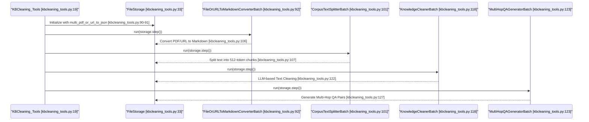

<!-- source: DeepWiki mcp.deepwiki.com · repo OpenDCAI/DataFlow · page 9.2 KBCleaning Gradio WebUI · fetched 2026-11-02 -->

# KBCleaning Gradio WebUI

<details>
<summary>Relevant source files</summary>

The following files were used as context for generating this wiki page:

- [dataflow/operators/knowledge_cleaning/__init__.py](dataflow/operators/knowledge_cleaning/__init__.py)
- [dataflow/operators/knowledge_cleaning/generate/mineru_operators.py](dataflow/operators/knowledge_cleaning/generate/mineru_operators.py)
- [dataflow/statics/pipelines/api_pipelines/kbcleaning_pipeline.py](dataflow/statics/pipelines/api_pipelines/kbcleaning_pipeline.py)
- [dataflow/statics/pipelines/cpu_pipelines/kbcleaning_pipeline_url.py](dataflow/statics/pipelines/cpu_pipelines/kbcleaning_pipeline_url.py)
- [dataflow/statics/pipelines/gpu_pipelines/kbcleaning/kbcleaning_pipeline_sglang.py](dataflow/statics/pipelines/gpu_pipelines/kbcleaning/kbcleaning_pipeline_sglang.py)
- [dataflow/statics/pipelines/gpu_pipelines/kbcleaning/kbcleaning_pipeline_vllm.py](dataflow/statics/pipelines/gpu_pipelines/kbcleaning/kbcleaning_pipeline_vllm.py)
- [dataflow/statics/playground/playground/kbcleaning_pipeline_vllm.py](dataflow/statics/playground/playground/kbcleaning_pipeline_vllm.py)
- [dataflow/webui/__init__.py](dataflow/webui/__init__.py)
- [dataflow/webui/kb_sglang_server.py](dataflow/webui/kb_sglang_server.py)
- [dataflow/webui/kbclean_webui.py](dataflow/webui/kbclean_webui.py)
- [dataflow/webui/kbcleaning_tools.py](dataflow/webui/kbcleaning_tools.py)

</details>


The **KBCleaning Gradio WebUI** provides a specialized graphical interface for the Knowledge Base Cleaning pipeline, enabling users to interactively process PDF documents and URLs into cleaned, structured markdown and multi-hop QA pairs. It is implemented in `dataflow/webui/kbclean_webui.py` [dataflow/webui/kbclean_webui.py:1-174]() and serves as a high-level wrapper for the `KBCleaning_Tools` utility class defined in `dataflow/webui/kbcleaning_tools.py` [dataflow/webui/kbcleaning_tools.py:19-130]().

## Overview

The WebUI allows users to upload PDF files, provide local file paths, or input web URLs for batch processing. It supports three distinct LLM serving backends: **vLLM**, **SGLang**, and **OpenAI-compatible APIs**. The interface abstracts the complexity of manual pipeline configuration by providing a form-based setup for model parameters, tensor parallelism, and worker counts.

### Key Capabilities
*   **Source Management**: Interactive file upload and URL list management with a persistent `gr.State` [dataflow/webui/kbclean_webui.py:15-40]().
*   **Backend Switching**: Dynamic UI updates via `update_param_visibility` to show relevant parameters for different serving engines [dataflow/webui/kbclean_webui.py:98-103]().
*   **Real-time Feedback**: Console output redirection to the Gradio interface using a background thread and `io.StringIO` buffer [dataflow/webui/kbclean_webui.py:50-95]().
*   **Automated Pipeline**: Orchestrates a 4-step cleaning and generation process using batch operators via `KBCleaning_Tools.run_pipeline` [dataflow/webui/kbcleaning_tools.py:79-129]().

Sources:
* [dataflow/webui/kbclean_webui.py:15-103]()
* [dataflow/webui/kbcleaning_tools.py:79-129]()

## System Architecture

The system is divided into the Gradio frontend (`kbclean_webui.py`) and the execution backend (`kbcleaning_tools.py`). The backend utilizes the core DataFlow `Operator` and `Serving` layers to perform the actual data processing.

### Logic to Code Mapping: UI to Pipeline
The following diagram maps natural-space UI components and user actions directly to concrete code entities, functions, and classes within the codebase.

Title: "Natural Language to Code Entity Space Mapping for KBCleaning WebUI"
```mermaid
graph TD
    UI_Input[""Drag & Drop / Textbox UI Input""] -->|Triggers| Func_Upload[""upload_files() / add_pdf_path() [kbclean_webui.py:15-32]""]
    UI_Click[""Run Pipeline Button Click""] -->|Invokes| Func_RunUI[""run_pipeline_ui() [kbclean_webui.py:42-89]""]
    
    subgraph "Gradio_Frontend_Layer"
        Func_Upload
        Func_RunUI
        Block_UI[""create_ui() [kbclean_webui.py:106-174]""]
    end

    subgraph "Tool_Controller_Layer"
        Func_RunUI -->|Calls method| Tool_Run[""KBCleaning_Tools.run_pipeline() [kbcleaning_tools.py:79-129]""]
        Tool_Run -->|Calls helper| Tool_Serve[""KBCleaning_Tools._get_llm_serving() [kbcleaning_tools.py:41-77]""]
        Tool_Run -->|Calls helper| Tool_Storage[""KBCleaning_Tools._get_storage() [kbcleaning_tools.py:32-39]""]
    end

    subgraph "DataFlow_Backend_Entities"
        Tool_Serve -->|Instantiates| Ent_VLLM[""LocalModelLLMServing_vllm [kbcleaning_tools.py:53]""]
        Tool_Serve -->|Instantiates| Ent_SGL[""SGLangServer [kbcleaning_tools.py:62]""]
        Tool_Serve -->|Instantiates| Ent_API[""APILLMServing_request [kbcleaning_tools.py:71]""]
        Tool_Storage -->|Instantiates| Ent_Storage[""FileStorage [kbcleaning_tools.py:33]""]
    end
```

Sources:
* [dataflow/webui/kbclean_webui.py:15-106]()
* [dataflow/webui/kbcleaning_tools.py:32-129]()

## Implementation Details

### LLM Serving Backend Selection
The WebUI supports three backend types, configured via the `_get_llm_serving` method [dataflow/webui/kbcleaning_tools.py:41-77]():

| Serving Type | Implementation Class | Key Parameters |
| :--- | :--- | :--- |
| **vLLM** | `LocalModelLLMServing_vllm` | `vllm_tensor_parallel_size`, `vllm_gpu_memory_utilization` (fixed at 0.6) [dataflow/webui/kbcleaning_tools.py:53-59](). |
| **SGLang** | `SGLangServer` | `tp`, `max_total_tokens`, `max_workers`, `temperature` [dataflow/webui/kbcleaning_tools.py:62-68](). |
| **API** | `APILLMServing_request` | `api_url`, `key_name_of_api_key` ("DF_API_KEY"), `max_workers` [dataflow/webui/kbcleaning_tools.py:71-76](). |

### SGLang Integration
For SGLang, the system uses a custom `SGLangServer` manager [dataflow/webui/kb_sglang_server.py:29-33]() that performs the following steps:
1.  Finds a free system port using `socket.socket` [dataflow/webui/kb_sglang_server.py:62-66]().
2.  Launches the `sglang.launch_server` process via `launch_server_cmd` [dataflow/webui/kb_sglang_server.py:73-75]().
3.  Waits for the server to become healthy via `wait_for_server` [dataflow/webui/kb_sglang_server.py:77]().
4.  Executes parallel requests using a `ThreadPoolExecutor` and the `requests` library [dataflow/webui/kb_sglang_server.py:128-132]().

Sources:
* [dataflow/webui/kbcleaning_tools.py:41-77]()
* [dataflow/webui/kb_sglang_server.py:29-133]()

## Data Flow in KBCleaning Pipeline

When the pipeline is executed via `KBCleaning_Tools.run_pipeline` [dataflow/webui/kbcleaning_tools.py:79-129](), it processes data through four sequential batch operators using the underlying `FileStorage` step mechanism.

### Pipeline Execution Flow

Title: "KBCleaning Pipeline Execution and Operator Interaction"


### Batch Operator Configuration
1.  **Extraction**: Uses `FileOrURLToMarkdownConverterBatch` with `mineru_backend` set to `vlm-sglang-engine` for PDF parsing [dataflow/webui/kbcleaning_tools.py:92-96]().
2.  **Splitting**: Uses `CorpusTextSplitterBatch` with a token-based split method and a chunk size of 512 [dataflow/webui/kbcleaning_tools.py:101-104](). If using an API backend, it defaults to the `Qwen/Qwen2.5-7B-Instruct` tokenizer [dataflow/webui/kbcleaning_tools.py:97-100]().
3.  **Cleaning**: Invokes `KnowledgeCleanerBatch` using the selected `llm_serving` instance [dataflow/webui/kbcleaning_tools.py:118-122]().
4.  **QA Generation**: Invokes `MultiHopQAGeneratorBatch` to produce the final dataset [dataflow/webui/kbcleaning_tools.py:123-127]().

Sources:
* [dataflow/webui/kbcleaning_tools.py:32-129]()
* [dataflow/webui/kbclean_webui.py:42-95]()

## UI State Management

The Gradio interface manages input lists (PDFs and URLs) using `gr.State` instances [dataflow/webui/kbclean_webui.py:118-119](). 
*   **File Uploads**: Files are copied to a local `./.cache` directory and their paths are stored [dataflow/webui/kbclean_webui.py:15-24]().
*   **Console Logging**: The UI uses `contextlib.redirect_stdout` and `redirect_stderr` within a separate worker thread (`threading.Thread`) to capture logs from the pipeline and yield updates to a `gr.Textbox` for real-time monitoring [dataflow/webui/kbclean_webui.py:50-95]().

Sources:
* [dataflow/webui/kbclean_webui.py:15-40]()
* [dataflow/webui/kbclean_webui.py:50-95]()

---

