# Page: Overview

# Overview

<details>
<summary>Relevant source files</summary>

The following files were used as context for generating this wiki page:

- [.dockerignore](.dockerignore)
- [.gitignore](.gitignore)
- [Dockerfile](Dockerfile)
- [MANIFEST.in](MANIFEST.in)
- [README-zh.md](README-zh.md)
- [README.md](README.md)
- [dataflow/serving/api_google_vertexai_serving.py](dataflow/serving/api_google_vertexai_serving.py)
- [dataflow/version.py](dataflow/version.py)
- [pyproject.toml](pyproject.toml)
- [requirements.txt](requirements.txt)
- [static/logo/CAS.png](static/logo/CAS.png)
- [static/logo/ant_group.png](static/logo/ant_group.png)
- [static/logo/baichuan.png](static/logo/baichuan.png)
- [static/logo/hkust.png](static/logo/hkust.png)
- [static/logo/pku.png](static/logo/pku.png)
- [static/logo/shanghai_ailab.png](static/logo/shanghai_ailab.png)
- [test/test_general_text.py](test/test_general_text.py)

</details>


## Purpose and Scope

DataFlow is a comprehensive data preparation and training system designed to **generate, refine, evaluate, and filter** high-quality data for AI from noisy sources such as PDFs, plain text, and low-quality question-answer pairs [README.md:95-97](). By improving data quality, DataFlow enhances the performance of Large Language Models (LLMs) in specific domains (healthcare, finance, legal, academic) through targeted training (Pre-training, SFT, RL) or RAG systems [README-zh.md:70-72]().

The framework employs an **operator-based** design, transforming data cleaning workflows into reproducible, reusable, and shareable **pipelines** [README.md:98-99](). It serves as core infrastructure for the Data-Centric AI community, supplemented by an intelligent `DataFlow-agent` for dynamic pipeline assembly [README-zh.md:73-74]().

**For specific topics, see:**
- Installation, basic setup, and quick-start guides: [Getting Started](#1.1)
- DataFlow Suite components, ecosystem, versioning (`dataflow/version.py`), and logging: [DataFlow Suite and Ecosystem](#1.2)
- Deep dive into operators, pipelines, and storage: [Core Architecture](#3)
- Pre-built data preparation workflows: [Ready-to-Use Pipelines](#5)
- Reference documentation for all operators: [Operator Reference](#6)
- Command-line tools: [Command Line Interface](#8)
- Deployment options: [Deployment Options](#11)

Sources: [README.md:90-101](), [README-zh.md:70-76](), [dataflow/version.py:1-28]()

---

## The DataFlow Suite: Four-Layer Architecture

The DataFlow suite provides the essential infrastructure to automate and scale LLM data preparation through four tightly integrated layers [README-zh.md:109-111]().

| Layer | Component | Purpose |
|-------|-----------|---------|
| **Visual Interface** | `DataFlow-WebUI` | An intuitive interface for building complex pipelines via drag-and-drop workflows and natural language interaction [README-zh.md:113](). |
| **AI Assistant** | `DataFlow-Skills` | A collection of tutorials and skills covering operator development and best practices [README-zh.md:112](). |
| **Modular Distribution** | DataFlow-Ecosystem | A standardized distribution layer for domain-specific modules (e.g., `DataFlow-MM`, `DataFlow-AI4S`) under a unified abstraction [README-zh.md:114](). |
| **Orchestration** | `RayOrch` | A high-performance orchestration layer built on Ray for distributed computing and resource management [README-zh.md:115](). |

For detailed documentation on suite components, versioning (`dataflow/version.py`), and ecosystem mapping, see [DataFlow Suite and Ecosystem](#1.2). For initial installation and setup, see [Getting Started](#1.1).

Sources: [README-zh.md:109-117](), [dataflow/version.py:1-28]()

---

## Core Design Principles

DataFlow distinguishes itself through three foundational principles [README-zh.md:121-128]():

### 1. Operator-Based Workflow Composition
Data transformations are encapsulated as **operators** that define interaction modes and design principles [README-zh.md:99](). Over 100 domain-specific operators are available for reuse, covering generation, evaluation, filtering, and refinement [README-zh.md:100-126]().

### 2. PyTorch-like Hierarchical Management
The system follows a clear **Pipeline → Operator → Prompt** hierarchy [README-zh.md:125](). This structure allows for modular workflow control where complex logic is decomposed into discrete, manageable entities, mirroring the design of modern deep learning frameworks.

### 3. Reproducibility and Scientific Comparison
By encapsulating data governance algorithms into operator pipelines, DataFlow enables fair comparison between different strategies [README-zh.md:105](). Users can easily swap underlying LLMs while reusing the same pipeline to analyze the relationship between model performance and data quality [README-zh.md:106]().

Sources: [README-zh.md:97-107](), [README-zh.md:119-128]()

---

## System Architecture: Code-Level View

The following diagram bridges the conceptual framework to specific code entities within the repository, showing how core classes interact.

**Diagram: Code Entity Mapping**
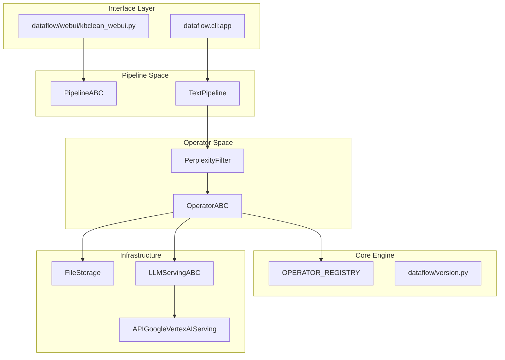
Sources: [pyproject.toml:42](), [dataflow/version.py:1-7](), [test/test_general_text.py:1-12](), [dataflow/serving/api_google_vertexai_serving.py:173-180](), [dataflow/serving/api_google_vertexai_serving.py:14]()

---

## Data Flow: From Raw Input to Training Data

DataFlow manages the transformation of raw, noisy data into model-ready intelligence. The following diagram illustrates the execution flow using specific code components from a typical text processing pipeline.

**Diagram: Natural Language to Code Entity Flow**
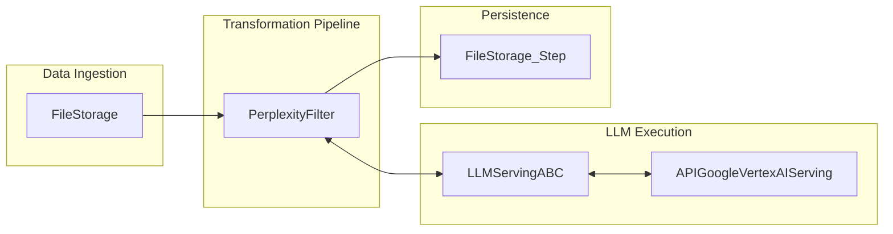
Sources: [test/test_general_text.py:3-18](), [dataflow/serving/api_google_vertexai_serving.py:173-185](), [dataflow/utils/storage.py:2]()

---

## Key Components Reference

| Component | Code Reference | Description |
| :--- | :--- | :--- |
| **CLI Entry** | `dataflow.cli:app` | Main entry point for the command-line interface [pyproject.toml:42](). |
| **Storage Engine** | `FileStorage` | Handles file-based persistence and cache management for pipeline steps [test/test_general_text.py:5-10](). |
| **Filtering** | `PerplexityFilter` | A quality filter that scores text based on perplexity using a language model [test/test_general_text.py:12](). |
| **Vertex Serving** | `APIGoogleVertexAIServing` | Integration for Google Gemini models via Vertex AI with batch processing support [dataflow/serving/api_google_vertexai_serving.py:173-180](). |
| **Dependencies** | `requirements.txt` | Core library requirements including `torch`, `transformers`, and `fasttext` [requirements.txt:1-40](). |

Sources: [pyproject.toml:41-42](), [test/test_general_text.py:1-18](), [requirements.txt:1-40]()

---

## Deployment and Distribution

DataFlow is designed for flexibility across different environments:

*   **PyPI Package:** Distributed as `open-dataflow` [pyproject.toml:6]().
*   **Docker:** Official images (e.g., `molyheci/dataflow:cu124`) provide ready-to-use environments with CUDA 12.4 and vLLM [Dockerfile:1-36]().
*   **Source Management:** The `MANIFEST.in` ensures all necessary `.py`, `.json`, `.yaml`, and `.sh` files are included in distributions while excluding cache files like `__pycache__` [MANIFEST.in:1-25]().
*   **Version Control:** Versions are tracked via `__version__` in `dataflow/version.py` [dataflow/version.py:1-28]().
*   **Optional Features:** Extensive support for specialized workloads like `vllm`, `sglang`, `pdf2model`, and `vectorsql` via optional dependencies [pyproject.toml:54-97]().

Sources: [pyproject.toml:5-14](), [Dockerfile:1-39](), [MANIFEST.in:1-25](), [dataflow/version.py:1-28](), [pyproject.toml:54-97]()

---

# Page: Getting Started

# Getting Started

<details>
<summary>Relevant source files</summary>

The following files were used as context for generating this wiki page:

- [.dockerignore](.dockerignore)
- [.gitignore](.gitignore)
- [Dockerfile](Dockerfile)
- [MANIFEST.in](MANIFEST.in)
- [README-zh.md](README-zh.md)
- [README.md](README.md)
- [dataflow/serving/api_google_vertexai_serving.py](dataflow/serving/api_google_vertexai_serving.py)
- [dataflow/statics/playground/simple_text_pipelines/pt_simple_filter.py](dataflow/statics/playground/simple_text_pipelines/pt_simple_filter.py)
- [dataflow/version.py](dataflow/version.py)
- [pyproject.toml](pyproject.toml)
- [requirements.txt](requirements.txt)
- [test/test_general_text.py](test/test_general_text.py)

</details>


This page guides you through installing DataFlow, verifying the installation, and running your first data processing pipeline. It covers multiple installation methods (pip, uv, Docker), version management, optional dependencies, and initial setup commands including the WebUI and PDF-to-Model workflows.

---

## Prerequisites

DataFlow requires:
- **Python**: `>= 3.7, < 4` (Recommended `>= 3.10`) [pyproject.toml:13-28]()
- **Operating System**: Linux, macOS, or Windows (with WSL2 for Docker)
- **GPU** (optional): NVIDIA GPU with CUDA 12.4+ for local inference with backends like `vLLM` or `SGLang` [pyproject.toml:56-63]()

For API-based serving (OpenAI, DeepSeek, Google Vertex AI), no GPU is required.

Sources: [pyproject.toml:13-28]()

---

## Installation

### Method 1: pip/uv Installation

#### Recommended: Installation with uv
DataFlow recommends using [uv](https://docs.astral.sh/uv/) for faster package installation and better dependency resolution:

**Basic Installation** (API-based LLM serving only):
```bash
pip install uv
uv pip install open-dataflow
```

**Installation with Local GPU Inference** (includes vLLM):
```bash
uv pip install "open-dataflow[vllm]"
```

#### Alternative: Standard pip Installation
**Basic Installation:**
```bash
pip install open-dataflow
```

**With Local GPU Inference:**
```bash
pip install "open-dataflow[vllm]"
```

### Optional Dependencies
DataFlow uses optional extras to manage heavy dependencies for specific workflows. These are defined in the `[project.optional-dependencies]` section of `pyproject.toml` [pyproject.toml:54-97]() and supported by `requirements.txt` [requirements.txt:1-90]().

| Extra | Purpose | Key Dependencies |
|-------|---------|------------------|
| `[vllm]` | Local GPU inference | `vllm>=0.7.0`, `numpy<2.0.0` [pyproject.toml:56]() |
| `[sglang]` | Alternative GPU backend | `sglang[all]` [pyproject.toml:63]() |
| `[mineru]` | PDF parsing/VQA | `mineru[all]`, `sglang>=0.4.8`, `pypdf` [pyproject.toml:61]() |
| `[vectorsql]` | Vector DB support | `sqlite-vec`, `sqlite-lembed`, `sentence_transformers` [pyproject.toml:66]() |
| `[pdf2model]` | PDF training pipeline | `llamafactory`, `vllm`, `flash-mineru` [pyproject.toml:68-75]() |
| `[rag]` | Agentic RAG | `lightrag-hku`, `asyncio` [pyproject.toml:93]() |
| `[kbc]` | Knowledge Base Cleaning | `vllm==0.6.3`, `mineru[pipeline]==2.0.6` [pyproject.toml:60]() |
| `[litellm]` | Multi-provider API support | `litellm>=1.70.0` [pyproject.toml:64]() |
| `[pdf2vqa]` | PDF Visual QA Extraction | `mineru[vlm]>=2.5.0` [pyproject.toml:94]() |

Sources: [pyproject.toml:54-97](), [requirements.txt:1-90]()

---

## Verifying Installation

Check the installed version and system environment using the CLI. The `dataflow` entry point is mapped to the `app` object in `dataflow.cli` [pyproject.toml:42](), while version details are retrieved from `dataflow.version` [dataflow/version.py:1-7]().

```bash
dataflow --version
dataflow env
```

Title: "Environment Discovery Flow"
```mermaid
graph TD
    subgraph "Natural_Language_Space"
        UserCmd[""dataflow env" Command"]
        VerCmd[""dataflow --version" Command"]
    end

    subgraph "Code_Entity_Space"
        CLI_App["dataflow.cli:app"]
        CLI_Init_Func["dataflow.cli_funcs.cli_init:cli_init"]
        DF_Ver_Const["dataflow.version:__version__"]
    end

    UserCmd --> CLI_App
    VerCmd --> CLI_App
    CLI_App --> CLI_Init_Func
    CLI_App --> DF_Ver_Const
```

Sources: [pyproject.toml:41-42](), [dataflow/version.py:1-7]()

---

## Initial Setup

### Initialization Commands
DataFlow provides scaffolding for new projects and pipelines via the `init` command group. This uses `cookiecutter` to generate standardized directory structures from templates [dataflow/cli_funcs/cli_init.py:59-136]().

```bash
# Initialize a new repository structure
dataflow init repo
```

The scaffolding logic handles the creation of the project structure, including directory layout and guidance for post-initialization steps [dataflow/cli_funcs/cli_init.py:59-136]().

Title: "Repository Scaffolding Logic"
```mermaid
graph TD
    subgraph "Natural_Language_Space"
        ScaffoldReq[""init repo" Request"]
        ProjectTemplate["Scaffold Template"]
    end

    subgraph "Code_Entity_Space"
        CLI_Init_Func["dataflow.cli_funcs.cli_init:init_repo_scaffold"]
        Cookiecutter["cookiecutter.main:cookiecutter"]
        ScaffoldDir["dataflow.cli_funcs.paths:DataFlowPath.get_dataflow_scaffold_dir"]
        ManifestFile["MANIFEST.in"]
    end

    ScaffoldReq --> CLI_Init_Func
    CLI_Init_Func --> ScaffoldDir
    CLI_Init_Func --> Cookiecutter
    Cookiecutter -.-> ProjectTemplate
    ProjectTemplate -.-> ManifestFile
```

Sources: [dataflow/cli_funcs/cli_init.py:59-136](), [MANIFEST.in:1-25]()

---

## Running Your First Pipeline

### Example 1: Visual WebUI
The easiest way to start is the visual WebUI. Launch it with:

```bash
dataflow webui
```
This command triggers the Gradio-based interface for interactive pipeline construction [requirements.txt:24]().

### Example 2: Programmatic Pipeline (Python)
You can define a pipeline by composing operators and using `FileStorage` to manage data flow between steps. The `storage.step()` method is critical for advancing the pipeline state [test/test_general_text.py:5-18]().

```python
from dataflow.operators.text_pt import PerplexityFilter
from dataflow.utils.storage import FileStorage

class TextPipeline():
    def __init__(self):
        # Initialize storage with an input file and cache settings
        self.storage = FileStorage(
            first_entry_file_name="./dataflow/example/GeneralTextPipeline/pt_input.jsonl",
            cache_path="./cache",
            file_name_prefix="dataflow_cache_step",
            cache_type="jsonl",
        )
        # Initialize an operator (e.g., PerplexityFilter)
        self.processor = PerplexityFilter(min_score=20, model_name='gpt2')

    def forward(self):
        # Run the operator; storage.step() advances the pipeline state
        self.processor.run(
            storage=self.storage.step(),
            input_key='raw_content'
        )
```
Sources: [test/test_general_text.py:1-26]()

### Example 3: Vertex AI Serving Setup
For Google Vertex AI workflows, configure the environment variables required by `GeminiVertexAIClient` [dataflow/serving/api_google_vertexai_serving.py:52-63]().

```bash
export GOOGLE_APPLICATION_CREDENTIALS="/path/to/your/key.json"
export GOOGLE_CLOUD_PROJECT="your-project-id"
export GOOGLE_CLOUD_LOCATION="us-central1"
```
The `APIGoogleVertexAIServing` class implements the `LLMServingABC` interface to provide standardized access to Gemini models [dataflow/serving/api_google_vertexai_serving.py:14-170]().

Sources: [dataflow/serving/api_google_vertexai_serving.py:48-180]()

---

## CLI Summary

| Command | Purpose | Key Module |
|---------------|---------|--------------|
| `dataflow webui` | Launch visual pipeline builder | `dataflow.cli` [pyproject.toml:42]() |
| `dataflow pdf2model` | PDF data extraction to SFT training | `dataflow.cli` [pyproject.toml:42]() |
| `dataflow init` | Scaffold repos, operators, or prompts | `dataflow.cli_funcs.cli_init` [dataflow/cli_funcs/cli_init.py:37]() |
| `dataflow env` | Inspect environment and versions | `dataflow.cli_funcs.cli_init` [dataflow/cli_funcs/cli_init.py:38]() |
| `dataflow chat` | Interactive chat with trained models | `dataflow.cli` [pyproject.toml:42]() |

Sources: [pyproject.toml:41-42](), [dataflow/cli_funcs/cli_init.py:37-56]()

---

# Page: DataFlow Suite and Ecosystem

# DataFlow Suite and Ecosystem

<details>
<summary>Relevant source files</summary>

The following files were used as context for generating this wiki page:

- [.dockerignore](.dockerignore)
- [.gitignore](.gitignore)
- [Dockerfile](Dockerfile)
- [MANIFEST.in](MANIFEST.in)
- [README-zh.md](README-zh.md)
- [README.md](README.md)
- [dataflow/logger.py](dataflow/logger.py)
- [dataflow/rayorch/__init__.py](dataflow/rayorch/__init__.py)
- [dataflow/rayorch/_test_ops.py](dataflow/rayorch/_test_ops.py)
- [dataflow/rayorch/accelerated_op.py](dataflow/rayorch/accelerated_op.py)
- [dataflow/rayorch/memory_storage.py](dataflow/rayorch/memory_storage.py)
- [dataflow/version.py](dataflow/version.py)
- [test/rayorch/.gitignore](test/rayorch/.gitignore)
- [test/rayorch/README-zh.md](test/rayorch/README-zh.md)
- [test/rayorch/README.md](test/rayorch/README.md)
- [test/rayorch/test_accelerated_op.py](test/rayorch/test_accelerated_op.py)

</details>


This page details the multi-layered architecture of the DataFlow Suite and Ecosystem, mapping high-level system components (DataFlow-WebUI, DataFlow-Skills, DataFlow-Ecosystem, and RayOrch) to their underlying code entities. It also documents core repository infrastructure including package versioning (`dataflow/version.py`) and the centralized logging subsystem (`dataflow/logger.py`).

---

## 1. Architectural Layers of the DataFlow Suite

The DataFlow Suite organizes data preparation, pipeline orchestration, and execution scaling into four primary layers built around the core codebase:

1. **DataFlow-Skills**: A collection of tutorials, reference guides, and best-practice examples designed to assist developers with operator construction and pipeline composition `[README-zh.md:116-116]()`.
2. **DataFlow-WebUI**: An interactive workspace and visual pipeline builder that combines drag-and-drop orchestration with a Gradio interface and CLI launching capabilities via `dataflow webui` `[README.md:75-76]()`.
3. **DataFlow-Ecosystem**: A modular distribution layer that standardizes operator registration and enables domain-specific extensions under a unified execution interface `[README-zh.md:118-118]()`.
4. **RayOrch**: A high-performance compute acceleration layer built on Ray. It provides transparent data-parallel execution for row-independent operators using `RayAcceleratedOperator` and `InMemoryStorage` `[dataflow/rayorch/accelerated_op.py:56-110](), [dataflow/rayorch/memory_storage.py:10-26]()`.

### Diagram 1: Natural Language Space to Code Entity Space — Suite Architecture

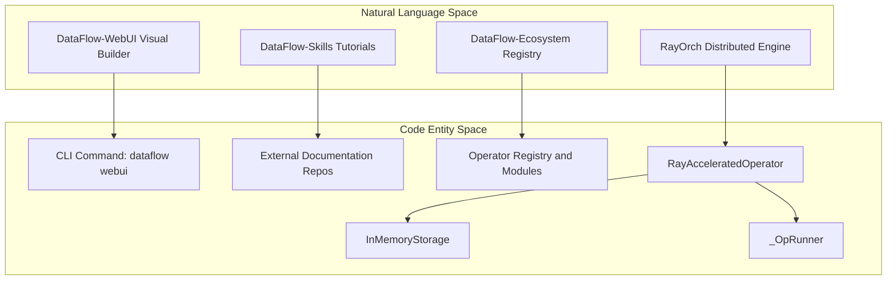

Sources: `[README.md:71-78](), [README-zh.md:116-119](), [dataflow/rayorch/accelerated_op.py:36-110](), [dataflow/rayorch/memory_storage.py:10-26]()`

---

## 2. Repository Structure and Suite Mapping

The repository layout is structured to support both standalone Python library execution and integration with the wider DataFlow Ecosystem. Source distributions are governed by `MANIFEST.in`, which explicitly declares included Python modules, JSON configuration templates, YAML files, and static assets.

### Diagram 2: Natural Language Space to Code Entity Space — Repository Mapping

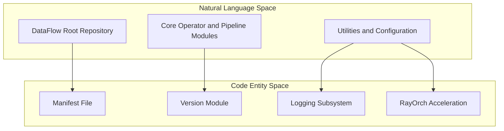

Sources: `[MANIFEST.in:1-25](), [dataflow/version.py:1-28](), [dataflow/logger.py:1-113](), [dataflow/rayorch/__init__.py:1-20]()`

---

## 3. Versioning Subsystem (`dataflow/version.py`)

The versioning subsystem manages package identification and parses version strings into structured comparison tuples for the DataFlow package.

### Core Functions and Variables

* `__version__`: Defines the active package version string (e.g., `'1.0.10'`) `[dataflow/version.py:1-1]()`.
* `get_version()`: Returns the active version string `[dataflow/version.py:5-7]()`.
* `parse_version_info(version_str)`: Splits version strings into integers and release candidate tags (e.g., parsing `"2.0.0rc1"` into `(2, 0, 0, 'rc1')`) `[dataflow/version.py:9-26]()`.

Sources: `[dataflow/version.py:1-28]()`

---

## 4. Logging Subsystem (`dataflow/logger.py`)

DataFlow implements a centralized logging configuration modeled after `loguru` behaviors, utilizing custom log levels, standard output stream splitting, and colored formatting via `colorlog` `[dataflow/logger.py:1-113]()`.

### Key Components

* **Custom SUCCESS Level**: Adds a custom `SUCCESS` logging level (numeric value `25`) with a bound `success()` method on `logging.Logger` `[dataflow/logger.py:7-14]()`.
* **Stream Splitting Filters**:
  * `MaxLevelFilter`: Restricts logs strictly below `ERROR` level to `sys.stdout` `[dataflow/logger.py:17-24]()`.
  * `MinLevelFilter`: Restricts logs at or above `ERROR` level to `sys.stderr` `[dataflow/logger.py:25-32]()`.
* **Colored Formatting**: `_make_colored_formatter()` configures a secondary color mapping for timestamps, levels, filenames, and line numbers `[dataflow/logger.py:34-77]()`.
* **Logger Initialization**: `get_logger(level)` retrieves or instantiates the singleton `"DataFlow"` logger, preventing duplicate handlers and respecting the `DF_LOGGING_LEVEL` environment variable `[dataflow/logger.py:80-113]()`.

| Filter Class | Target Stream | Condition |
| :--- | :--- | :--- |
| `MaxLevelFilter(logging.ERROR)` | `sys.stdout` | `record.levelno < 40` |
| `MinLevelFilter(logging.ERROR)` | `sys.stderr` | `record.levelno >= 40` |

Sources: `[dataflow/logger.py:1-113]()`

---

# Page: Core Architecture

# Core Architecture

<details>
<summary>Relevant source files</summary>

The following files were used as context for generating this wiki page:

- [dataflow/core/__init__.py](dataflow/core/__init__.py)
- [dataflow/operators/__init__.py](dataflow/operators/__init__.py)
- [dataflow/pipeline/Pipeline.py](dataflow/pipeline/Pipeline.py)
- [dataflow/pipeline/__init__.py](dataflow/pipeline/__init__.py)
- [dataflow/pipeline/nodes.py](dataflow/pipeline/nodes.py)
- [dataflow/utils/storage.py](dataflow/utils/storage.py)
- [dataflow/wrapper/auto_op.py](dataflow/wrapper/auto_op.py)
- [test/cpu_only/test_lazy_file_storage_flush.py](test/cpu_only/test_lazy_file_storage_flush.py)
- [test/cpu_only/test_remote_batch_slicing.py](test/cpu_only/test_remote_batch_slicing.py)
- [test/test_autoop.py](test/test_autoop.py)
- [test/test_batched_pipeline.py](test/test_batched_pipeline.py)
- [test/test_batched_stream_pipeline.py](test/test_batched_stream_pipeline.py)
- [test/test_copy.py](test/test_copy.py)
- [test/test_copy_weak_ref.py](test/test_copy_weak_ref.py)
- [test/test_dataframe_col.py](test/test_dataframe_col.py)
- [test/test_read_xlsx.py](test/test_read_xlsx.py)

</details>


This page provides a high-level overview of DataFlow's fundamental architecture, covering the core abstractions that enable composable, reproducible data preparation pipelines. It explains how operators, pipelines, storage systems, LLM serving backends, registries, and acceleration layers interact to transform raw data into high-quality LLM training datasets.

For detailed information about specific subsystems, refer to the following child pages:
- [Operators Framework](#3.1) — Detail the `OperatorABC` base class, operator design principles, and lifecycles [dataflow/core/__init__.py:1-18]().
- [Pipeline System](#3.2) — Explain the `PipelineABC` abstraction, pipeline composition, and the compile-execute pattern [dataflow/pipeline/Pipeline.py:18-42]().
- [Registry and Lazy Loading](#3.3) — Explain `OPERATOR_REGISTRY`, `PROMPT_REGISTRY`, and whitelist filtering for dynamic component discovery [dataflow/core/__init__.py:1-18]().
- [LLM Serving Architecture](#3.4) — Overview of `LLMServingABC` and available model serving backends [dataflow/core/__init__.py:1-18]().
- [Storage Systems](#3.5) — Explain `DataFlowStorage` implementations including file-based and database storage [dataflow/utils/storage.py:14-36]().
- [Database Management](#3.6) — Explain `DatabaseManager` for SQL database interactions, connection pooling, and batch operations [dataflow/utils/storage.py:14-36]().
- [Prompt System](#3.7) — Explain `PromptABC` base class and prompt template registration [dataflow/core/__init__.py:1-18]().
- [RayOrch Acceleration](#3.8) — Explain `RayAcceleratedOperator` for Ray-based data-parallel execution [dataflow/wrapper/auto_op.py:38-55]().

Sources: [dataflow/core/__init__.py:1-18](), [dataflow/pipeline/Pipeline.py:18-42](), [dataflow/utils/storage.py:14-36]()

---

## Architectural Overview

DataFlow implements a modular architecture separating data flow logic (operators and pipelines) from infrastructure concerns (storage, database management, and LLM serving). 

### Diagram: Component to Code Entity Mapping

The following diagram bridges the natural language concepts of the architecture to their concrete code entities within the repository.

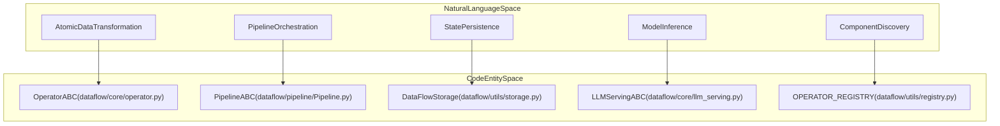

Sources: [dataflow/core/__init__.py:1-18](), [dataflow/core/operator.py:1-28](), [dataflow/pipeline/Pipeline.py:18-42](), [dataflow/utils/storage.py:14-36]()

---

## Core Abstractions Overview

DataFlow relies on several core classes that establish standard contracts across the framework.

| Subsystem | Base Class / Manager | Primary Code Entity | Role |
|-----------|----------------------|---------------------|------|
| **Operators** | `OperatorABC` | `dataflow.core.operator.OperatorABC` | Encapsulates atomic dataset transformations via `run()` |
| **Pipelines** | `PipelineABC` | `dataflow.pipeline.Pipeline.PipelineABC` | Compiles and executes directed operator graphs |
| **Storage** | `DataFlowStorage` | `dataflow.utils.storage.DataFlowStorage` | Manages step-based state reads/writes |
| **LLM Serving** | `LLMServingABC` | `dataflow.core.llm_serving.LLMServingABC` | Handles prompt dispatch and model backends |
| **Registry** | `Registry` | `dataflow.utils.registry.Registry` | Lazy loads operators and prompts |

Sources: [dataflow/core/__init__.py:1-18](), [dataflow/pipeline/Pipeline.py:18-42](), [dataflow/utils/storage.py:14-36]()

### 3.1 Operators Framework
Operators represent atomic units of work in DataFlow. Subclasses extend `OperatorABC` and implement custom transformation logic inside their execution methods, relying on key-based data access. For details, see [Operators Framework](#3.1).
Sources: [dataflow/core/operator.py:1-28]()

### 3.2 Pipeline System
Pipelines orchestrate execution sequences through `PipelineABC` and `BatchedPipelineABC` [dataflow/pipeline/Pipeline.py:18-42](). They employ a compile-execute pattern where `AutoOP` intercepts calls during a symbolic forward pass to validate key lineage and build an `OperatorNode` graph [dataflow/pipeline/nodes.py:36-95](). For details, see [Pipeline System](#3.2).
Sources: [dataflow/pipeline/Pipeline.py:18-42](), [dataflow/wrapper/auto_op.py:38-55](), [dataflow/pipeline/nodes.py:36-95]()

### 3.3 Registry and Lazy Loading
To optimize startup times and memory overhead, DataFlow uses registries coupled with a `LazyLoader` pattern. Components are dynamically discovered and can be filtered using whitelists. For details, see [Registry and Lazy Loading](#3.3).
Sources: [dataflow/core/__init__.py:1-18]()

### 3.4 LLM Serving Architecture
The LLM serving layer abstracts inference via `LLMServingABC` [dataflow/core/__init__.py:1-2](). It supports external APIs (OpenAI, DeepSeek, Google Vertex), local inference engines (vLLM, SGLang), vision-language models, and embedding services. For details, see [LLM Serving Architecture](#3.4).
Sources: [dataflow/core/__init__.py:1-18]()

### 3.5 Storage Systems
Data persistence between pipeline steps is managed by `DataFlowStorage` [dataflow/utils/storage.py:14-36](). Implementations include standard file storage, `LazyFileStorage` with atomic buffering [dataflow/utils/storage.py:70-164](), and database-backed stores. For details, see [Storage Systems](#3.5).
Sources: [dataflow/utils/storage.py:14-164]()

### 3.6 Database Management
The database subsystem manages SQL interactions, connection pooling, and batch operations via database managers and connectors like `SQLiteConnector` and `SQLiteVecConnector`. For details, see [Database Management](#3.6).
Sources: [dataflow/utils/storage.py:14-36]()

### 3.7 Prompt System
Prompt templates inherit from `PromptABC` and are registered in prompt registries. The standard `build_prompt()` interface is used across generation operators. For details, see [Prompt System](#3.7).
Sources: [dataflow/core/__init__.py:1-18]()

### 3.8 RayOrch Acceleration
Data-parallel scaling across multiple GPUs or nodes is handled by the `RayAcceleratedOperator` wrapper, which integrates Ray actors with storage layers. For details, see [RayOrch Acceleration](#3.8).
Sources: [dataflow/wrapper/auto_op.py:38-55]()

---

## Subsystem Interaction Flow

### Diagram: Execution Flow Architecture

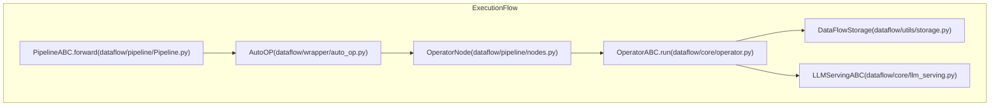

Sources: [dataflow/pipeline/Pipeline.py:18-42](), [dataflow/wrapper/auto_op.py:38-55](), [dataflow/pipeline/nodes.py:36-50](), [dataflow/core/operator.py:1-28](), [dataflow/utils/storage.py:14-36](), [dataflow/core/__init__.py:1-3]()

---

# Page: Operators Framework

# Operators Framework

<details>
<summary>Relevant source files</summary>

The following files were used as context for generating this wiki page:

- [dataflow/core/__init__.py](dataflow/core/__init__.py)
- [dataflow/operators/__init__.py](dataflow/operators/__init__.py)
- [dataflow/operators/core_text/refine/pandas_operator.py](dataflow/operators/core_text/refine/pandas_operator.py)
- [dataflow/wrapper/auto_op.py](dataflow/wrapper/auto_op.py)
- [test/test_autoop.py](test/test_autoop.py)
- [test/test_copy.py](test/test_copy.py)
- [test/test_copy_weak_ref.py](test/test_copy_weak_ref.py)
- [test/test_dataframe_col.py](test/test_dataframe_col.py)

</details>


## Purpose and Scope

The Operators Framework establishes the foundational abstraction for all data transformation, generation, filtering, and refinement tasks in DataFlow. Operators are modular, composable units that encapsulate specific processing logic, inheriting from the abstract base class `OperatorABC` [dataflow/core/__init__.py:1-14]() and communicating via a standardized key-based data flow pattern [dataflow/operators/core_text/generate/prompted_generator.py:58-90](). 

This page details:
- The `OperatorABC` core interface and class hierarchy [dataflow/core/__init__.py:1-14]().
- Operator design patterns, including key-based data access and functional categorization [dataflow/operators/core_text/__init__.py:1-30]().
- Non-LLM and custom transformation operators such as `PandasOperator` [dataflow/operators/core_text/refine/pandas_operator.py:8-52]().
- The two-stage operator lifecycle managed by the `AutoOP` and `OPRuntime` compilation-execution wrappers [dataflow/wrapper/auto_op.py:20-57]().
- Advanced implementation patterns such as recursive chunking for long-context generation [dataflow/operators/core_text/generate/chunked_prompted_generator.py:74-87]().

Sources: [dataflow/core/__init__.py:1-14](), [dataflow/wrapper/auto_op.py:20-57](), [dataflow/operators/core_text/generate/prompted_generator.py:58-90](), [dataflow/operators/core_text/refine/pandas_operator.py:8-52]()

---

## OperatorABC Base Class and Hierarchy

All data transformations in DataFlow are encapsulated by operator classes that descend from `OperatorABC` [dataflow/core/__init__.py:1-14](). Subclasses implement domain-specific logic inside the `run()` method [dataflow/operators/core_text/generate/prompted_generator.py:58](), which interacts with storage backends and LLM serving layers or directly manipulates tabular data structures.

```mermaid
classDiagram
    class "OperatorABC" {
        <<abstract>>
        +run(storage: DataFlowStorage, **kwargs) Any
        +get_desc(lang: str) str$
    }
    
    class "PromptedGenerator" {
        -llm_serving: LLMServingABC
        -system_prompt: str
        -user_prompt: str
        +run(storage, input_key, output_key)
    }
    
    class "PandasOperator" {
        -process_fn: list
        +run(storage, output_key)
    }

    "OperatorABC" <|-- "PromptedGenerator"
    "OperatorABC" <|-- "PandasOperator"
```
**Figure 1: Operator Class Hierarchy bridging Natural Language processing concepts to `OperatorABC` sub-classes (`PromptedGenerator`, `PandasOperator`)**

Sources: [dataflow/core/__init__.py:1-14](), [dataflow/operators/core_text/generate/prompted_generator.py:11-20](), [dataflow/operators/core_text/refine/pandas_operator.py:8-14]()

---

## Operator Design Patterns and Key-Based Data Access

Operators operate on tabular dataframes managed by `DataFlowStorage` instances. Rather than passing raw data frames explicitly through positional arguments in pipeline definitions, operators rely on **key-based data access** via parameter naming conventions (`input_` and `output_`) or storage read/write operations (e.g., `storage.read("dataframe")` [dataflow/operators/core_text/refine/pandas_operator.py:43]()).

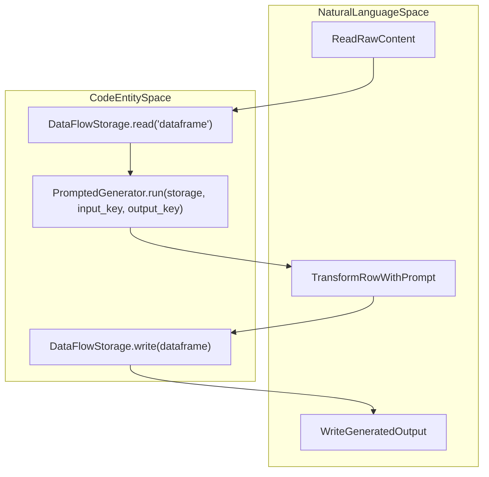
**Figure 2: Mapping from Natural Language processing steps to `DataFlowStorage` and `PromptedGenerator` code entities**

### Key Parameter Conventions

During pipeline compilation and execution, keys passed to `run()` resolve columns or paths in active datasets:

| Parameter Pattern | Purpose | Code Reference Example |
|------------------|---------|------------------------|
| `input_key` | Identifies the source text column for generation or filtering | `"raw_content"` [dataflow/operators/core_text/generate/prompted_generator.py:58]() |
| `output_key` | Identifies the target column for storing operator results | `"generated_content"` [dataflow/operators/core_text/generate/prompted_generator.py:58]() |
| `input_path_key` | File path key for file-based generators | `"input_path"` [dataflow/operators/core_text/generate/chunked_prompted_generator.py:91]() |
| `output_path_key`| File path key for writing transformed file outputs | `"output_path"` [dataflow/operators/core_text/generate/chunked_prompted_generator.py:92]() |

Sources: [dataflow/operators/core_text/generate/prompted_generator.py:58-90](), [dataflow/operators/core_text/refine/pandas_operator.py:42-52]()

---

## Operator Lifecycle and AutoOP Wrapping

The execution of an operator is bifurcated into a **Compilation Phase** (symbolic recording) and an **Execution Phase** (actual processing). This is managed by the `AutoOP` wrapper and `OPRuntime` container [dataflow/wrapper/auto_op.py:20-57]().

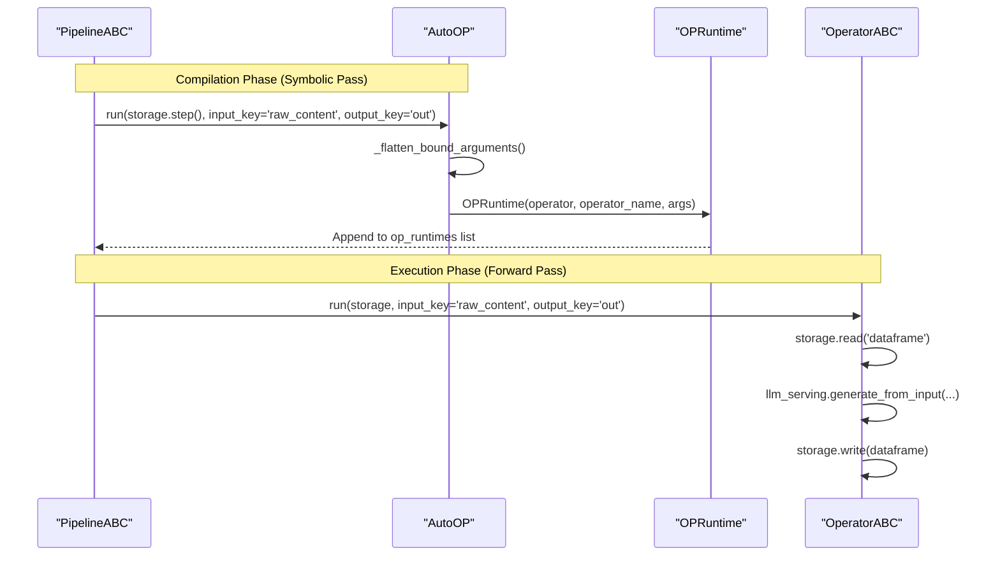
**Figure 3: Sequence of operations through `AutoOP`, `OPRuntime`, and `OperatorABC` during compilation and execution**

### Key Runtime Components

- `AutoOP`: Intercepts method calls on operators during pipeline definition, capturing argument bindings via `_flatten_bound_arguments()` [dataflow/wrapper/auto_op.py:38-82]().
- `OPRuntime`: Records the target operator instance, operator name, and flattened keyword arguments into the pipeline's execution queue [dataflow/wrapper/auto_op.py:20-36]().

Sources: [dataflow/wrapper/auto_op.py:20-105](), [test/test_autoop.py:35-50]()

---

## Advanced Operator Implementation: Recursive Chunking and DataFrame Transformations

For operators dealing with long contexts—such as `ChunkedPromptedGenerator`—input texts are automatically decomposed into chunks if they exceed token limits [dataflow/operators/core_text/generate/chunked_prompted_generator.py:78-86](). Conversely, structural tabular cleaning is handled by operators like `PandasOperator` [dataflow/operators/core_text/refine/pandas_operator.py:8-52]().

1. **Token Counting**: Uses an encoder (e.g., `tiktoken` or a HuggingFace tokenizer) via `_count_tokens()` [dataflow/operators/core_text/generate/chunked_prompted_generator.py:74-75]().
2. **Recursive Bisection**: If text exceeds `max_chunk_len`, `_split_recursive()` halves the text recursively until all segments satisfy the threshold [dataflow/operators/core_text/generate/chunked_prompted_generator.py:78-86]().
3. **DataFrame Process Pipelines**: `PandasOperator` applies a sequence of callable functions (e.g., lambda expressions) to transform DataFrames in place before writing back to storage [dataflow/operators/core_text/refine/pandas_operator.py:44-51]().

Sources: [dataflow/operators/core_text/generate/chunked_prompted_generator.py:74-147](), [dataflow/operators/core_text/refine/pandas_operator.py:42-52]()

---

## Summary of Key Classes and Methods

| Class / Method Name | File Location | Role |
|---|---|---|
| `OperatorABC` | `dataflow/core/__init__.py` | Abstract base class enforcing the `run()` interface. |
| `AutoOP` | `dataflow/wrapper/auto_op.py` | Wrapper capturing operator invocations during compilation. |
| `OPRuntime` | `dataflow/wrapper/auto_op.py` | Metadata container storing operator execution arguments. |
| `PromptedGenerator` | `dataflow/operators/core_text/generate/prompted_generator.py` | Standard LLM text generation operator using prompt templates. |
| `PandasOperator` | `dataflow/operators/core_text/refine/pandas_operator.py` | Applies custom lambda functions and dataframe transforms. |

Sources: [dataflow/core/__init__.py:1-14](), [dataflow/wrapper/auto_op.py:20-57](), [dataflow/operators/core_text/generate/prompted_generator.py:11-20](), [dataflow/operators/core_text/refine/pandas_operator.py:8-52]()

---

# Page: Pipeline System

# Pipeline System

<details>
<summary>Relevant source files</summary>

The following files were used as context for generating this wiki page:

- [dataflow/pipeline/Pipeline.py](dataflow/pipeline/Pipeline.py)
- [dataflow/pipeline/__init__.py](dataflow/pipeline/__init__.py)
- [dataflow/pipeline/nodes.py](dataflow/pipeline/nodes.py)
- [dataflow/utils/storage.py](dataflow/utils/storage.py)
- [dataflow/wrapper/__init__.py](dataflow/wrapper/__init__.py)
- [dataflow/wrapper/batch_wrapper.py](dataflow/wrapper/batch_wrapper.py)
- [test/cpu_only/test_lazy_file_storage_flush.py](test/cpu_only/test_lazy_file_storage_flush.py)
- [test/cpu_only/test_remote_batch_slicing.py](test/cpu_only/test_remote_batch_slicing.py)
- [test/test_batched_pipeline.py](test/test_batched_pipeline.py)
- [test/test_batched_stream_pipeline.py](test/test_batched_stream_pipeline.py)
- [test/test_batchify.py](test/test_batchify.py)
- [test/test_read_xlsx.py](test/test_read_xlsx.py)

</details>


This document provides a high-level overview of the pipeline system in DataFlow, which composes individual operators into cohesive, executable workflows using the `PipelineABC` abstraction [dataflow/pipeline/Pipeline.py:18-42](). Pipelines coordinate data flow, manage LLM serving resources, and govern execution through a distinct compile-execute pattern.

For detailed technical explanations, refer to the child pages:
- **Compilation Phase**: [Compilation Phase](#3.2.1)
- **Execution Phase**: [Execution Phase](#3.2.2)
- **Batched and Streaming Pipelines**: [Batched and Streaming Pipelines](#3.2.3)

---

## Overview and Core Abstraction

The foundation of the pipeline architecture is `PipelineABC`, located in `dataflow/pipeline/Pipeline.py` [dataflow/pipeline/Pipeline.py:18-42](). Subclasses implement the `forward()` method to define the sequence of operator invocations [dataflow/pipeline/Pipeline.py:36-41](). DataFlow provides standard and specialized pipeline variants, including `BatchedPipelineABC` and `StreamBatchedPipelineABC` [dataflow/pipeline/Pipeline.py:1-6](), designed to handle datasets ranging from small in-memory tables to massive distributed streams.

Title: Pipeline System Architecture
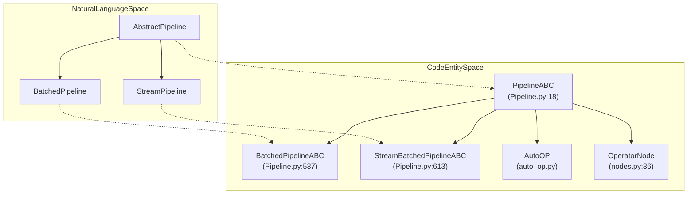
Sources: [dataflow/pipeline/Pipeline.py:18-35](), [dataflow/pipeline/Pipeline.py:537](), [dataflow/pipeline/Pipeline.py:613]()

---

## The Compile-Execute Pattern

DataFlow pipelines operate via a two-phase lifecycle: **Compilation** and **Execution** [dataflow/pipeline/Pipeline.py:43-58](). 

During compilation, operators are wrapped with `AutoOP` [dataflow/pipeline/Pipeline.py:10](), and calling `forward()` records operator calls into `op_runtimes` [dataflow/pipeline/Pipeline.py:21]() without running them. The pipeline builds an `OperatorNode` graph [dataflow/pipeline/Pipeline.py:60]() and validates that input keys match available output keys across all steps [dataflow/pipeline/Pipeline.py:105-135](). Once compiled, `forward()` is replaced with `_compiled_forward()` [dataflow/pipeline/Pipeline.py:51]().

For detailed information on AutoOP wrapping, runtime recording, graph construction, and key validation, see [Compilation Phase](#3.2.1).

During execution, `_compiled_forward()` iterates through the validated operator nodes, advancing storage states via `storage.step()` [dataflow/utils/storage.py:153](), managing LLM serving lifecycle reference counts [dataflow/pipeline/Pipeline.py:34](), and invoking each operator's `run()` method [dataflow/pipeline/Pipeline.py:522]().

For detailed information on operator execution order, key validation during runtime, LLM serving lifecycle management, and the `storage.step()` mechanism, see [Execution Phase](#3.2.2).

Title: Compile and Execute Flow
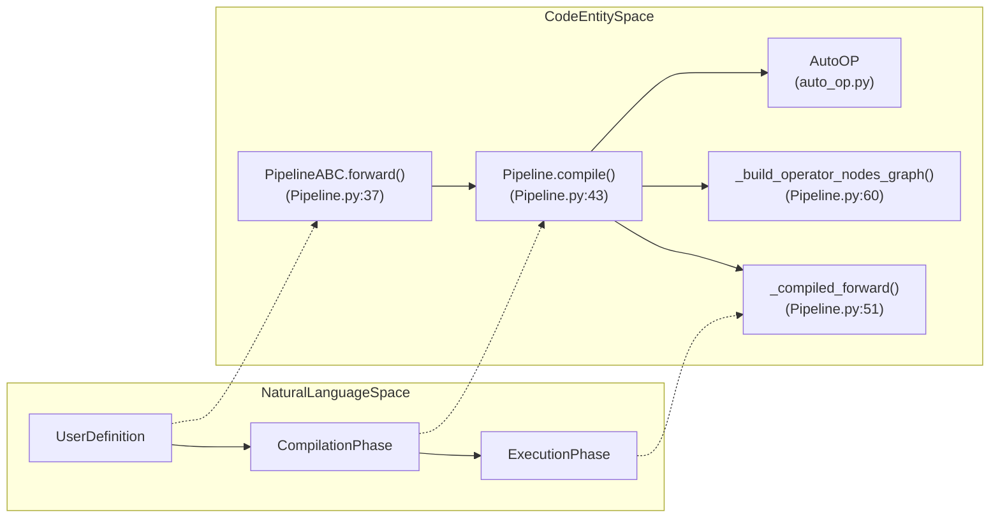
Sources: [dataflow/pipeline/Pipeline.py:37-60](), [dataflow/pipeline/Pipeline.py:10]()

---

## Batched and Streaming Pipelines

For large-scale datasets, standard in-memory pipelines can exhaust available system memory. DataFlow provides `BatchedPipelineABC` and `StreamBatchedPipelineABC` to process data in manageable chunks [dataflow/pipeline/Pipeline.py:1-6](). These variants integrate with `BatchedFileStorage` and `StreamBatchedFileStorage` [dataflow/utils/storage.py:70-164]() to support batch-wise iteration, progress checkpointing via progress tracking files, and automatic resume mechanisms.

For detailed documentation on batch wrappers, streaming storage implementations, and large-scale dataset resume logic, see [Batched and Streaming Pipelines](#3.2.3).

Sources: [dataflow/pipeline/Pipeline.py:1-6](), [dataflow/utils/storage.py:70-164]()

---

# Page: Compilation Phase

# Compilation Phase

<details>
<summary>Relevant source files</summary>

The following files were used as context for generating this wiki page:

- [dataflow/core/__init__.py](dataflow/core/__init__.py)
- [dataflow/pipeline/Pipeline.py](dataflow/pipeline/Pipeline.py)
- [dataflow/pipeline/__init__.py](dataflow/pipeline/__init__.py)
- [dataflow/pipeline/nodes.py](dataflow/pipeline/nodes.py)
- [dataflow/utils/storage.py](dataflow/utils/storage.py)
- [dataflow/wrapper/auto_op.py](dataflow/wrapper/auto_op.py)
- [test/cpu_only/test_lazy_file_storage_flush.py](test/cpu_only/test_lazy_file_storage_flush.py)
- [test/cpu_only/test_remote_batch_slicing.py](test/cpu_only/test_remote_batch_slicing.py)
- [test/test_autoop.py](test/test_autoop.py)
- [test/test_batched_pipeline.py](test/test_batched_pipeline.py)
- [test/test_batched_stream_pipeline.py](test/test_batched_stream_pipeline.py)
- [test/test_copy.py](test/test_copy.py)
- [test/test_copy_weak_ref.py](test/test_copy_weak_ref.py)
- [test/test_dataframe_col.py](test/test_dataframe_col.py)
- [test/test_read_xlsx.py](test/test_read_xlsx.py)

</details>


## Purpose and Scope

The **Compilation Phase** is the first stage of DataFlow's two-phase execution model, occurring when `pipeline.compile()` is called [dataflow/pipeline/Pipeline.py:43-59](). During compilation, the pipeline captures the structure and configuration of all operators without executing them, builds a directed acyclic graph (DAG) representing data dependencies, and validates that all data keys are correctly aligned across operator boundaries [dataflow/pipeline/Pipeline.py:105-135]().

Sources: [dataflow/pipeline/Pipeline.py:43-135]()

---

## Compilation Workflow Overview

The compilation process transforms a pipeline from a collection of operator attributes into an executable graph with validated data flows. This happens through four distinct stages.

### Pipeline Compilation Sequence

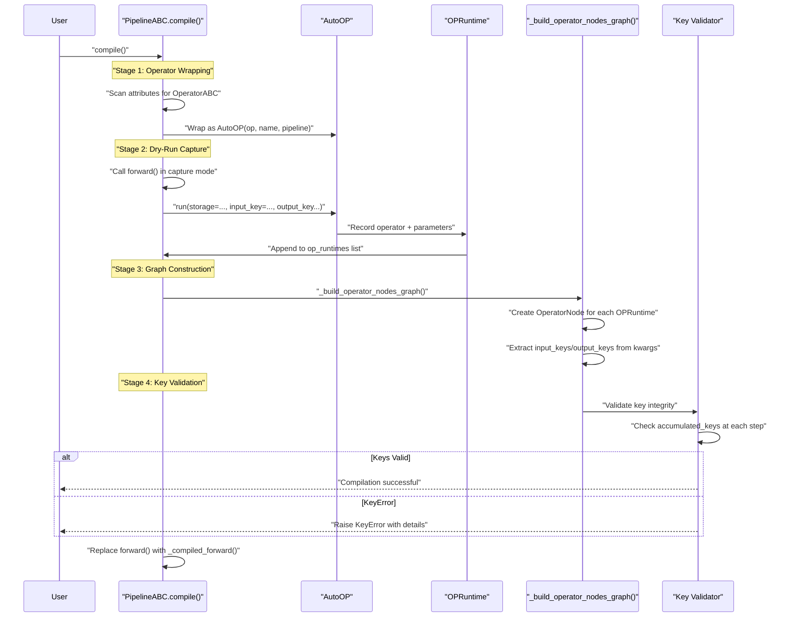

Sources: [dataflow/pipeline/Pipeline.py:43-59](), [dataflow/wrapper/auto_op.py:38-105]()

---

## Stage 1: Operator Wrapping with AutoOP

The compilation begins by scanning all pipeline attributes and wrapping any `OperatorABC` instances with the `AutoOP` wrapper class [dataflow/pipeline/Pipeline.py:45-47](). This wrapper intercepts `run()` calls during the dry-run phase.

### AutoOP Wrapper Mechanism

The `AutoOP` class ([dataflow/wrapper/auto_op.py:38-105]()) is a generic wrapper that preserves the type signature of the wrapped operator's `run()` method while adding capture functionality. It dynamically copies the `__doc__` and `inspect.signature` from the original operator's `run` method [dataflow/wrapper/auto_op.py:53-56]().

### Compilation Entity Relationships

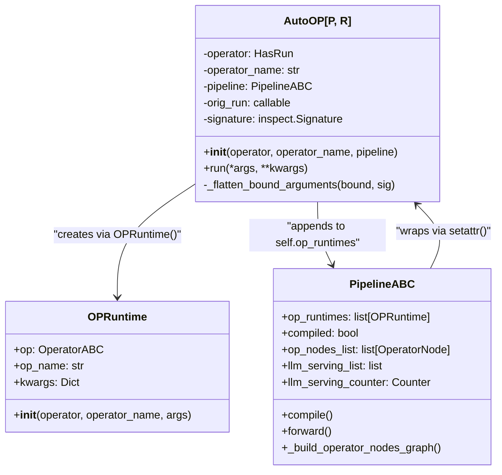

**Wrapping Process Details** ([dataflow/pipeline/Pipeline.py:43-48]()):

| Step | Code Entity | Action | Line Reference |
|------|-------------|--------|----------------|
| 1 | `self.compiled` | Set to `True` | [dataflow/pipeline/Pipeline.py:44]() |
| 2 | `vars(self)` | Iterate over instance attributes | [dataflow/pipeline/Pipeline.py:45]() |
| 3 | `OperatorABC` | Check if attribute is an operator | [dataflow/pipeline/Pipeline.py:46]() |
| 4 | `AutoOP` | Wrap and replace attribute | [dataflow/pipeline/Pipeline.py:47]() |
| 5 | `self.forward()` | Trigger recording pass | [dataflow/pipeline/Pipeline.py:48]() |

Sources: [dataflow/pipeline/Pipeline.py:43-48](), [dataflow/wrapper/auto_op.py:20-56]()

---

## Stage 2: Dry-Run Capture

After wrapping operators, the pipeline calls `self.forward()` in capture mode [dataflow/pipeline/Pipeline.py:48](). Since operators are now `AutoOP` instances, their `run()` calls are intercepted and recorded without executing the actual operator logic.

### Parameter Capture Process

When `AutoOP.run()` is invoked ([dataflow/wrapper/auto_op.py:84-105]()), it uses Python's `inspect.signature()` to bind arguments and capture the complete parameter set.

### Argument Binding Flow

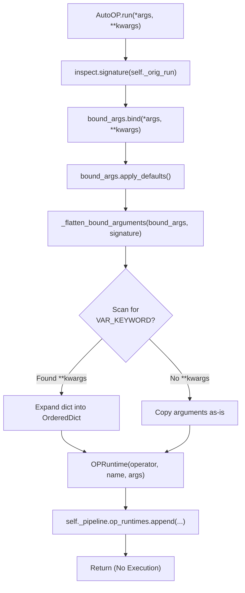

The `_flatten_bound_arguments()` method ([dataflow/wrapper/auto_op.py:58-82]()) ensures that all parameters, including those passed as `**kwargs`, are captured in their original call order and flattened into a single `OrderedDict` [dataflow/wrapper/auto_op.py:71-82]().

Sources: [dataflow/wrapper/auto_op.py:20-105]()

---

## Stage 3: Graph Construction

The `_build_operator_nodes_graph()` method ([dataflow/pipeline/Pipeline.py:60-197]()) transforms the linear `op_runtimes` list into a structured graph of `OperatorNode` and `KeyNode` objects.

### OperatorNode Creation

For each `OPRuntime`, the builder creates an `OperatorNode` ([dataflow/pipeline/nodes.py:36-78]()) that encapsulates the operator instance, its storage, and its serving backend.

**Key Extraction Algorithm** ([dataflow/pipeline/nodes.py:59-68]()):

| Parameter Pattern | Action | Example |
|------------------|--------|---------|
| `input_*` (str) | Add to `input_keys`, create `KeyNode` | `input_key='raw_content'` |
| `output_*` (str) | Add to `output_keys`, create `KeyNode` | `output_key='content_cn1'` |
| Other | Log warning if string | `max_workers=100` |

### Storage and LLM Serving Extraction

During node creation ([dataflow/pipeline/Pipeline.py:64-88]()), the builder extracts special objects from the captured parameters:

1. **LLM Serving**: Scans the operator instance's attributes (`vars(op_runtime.op)`) for objects of type `LLM_SERVING_CLASSES` ([dataflow/pipeline/Pipeline.py:67-69]()).
2. **Storage**: Pops the `storage` argument from the captured `kwargs` ([dataflow/pipeline/Pipeline.py:71]()) and validates it against `DataFlowStorage` ([dataflow/pipeline/Pipeline.py:73]()).

Sources: [dataflow/pipeline/Pipeline.py:60-89](), [dataflow/pipeline/nodes.py:36-78](), [dataflow/core/__init__.py:8-9]()

### KeyNode Linking and DAG Construction

The builder establishes bidirectional pointer relationships between `KeyNode` objects to form the data flow graph ([dataflow/pipeline/Pipeline.py:164-191]()).

### Data Flow Graph Visualization

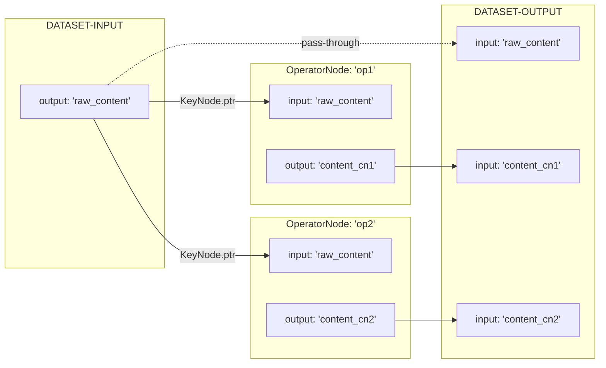

Sources: [dataflow/pipeline/Pipeline.py:164-191](), [dataflow/pipeline/nodes.py:8-33]()

---

## Stage 4: Key Validation

The final compilation stage validates that all operator input keys can be satisfied by previous operators or the initial dataset [dataflow/pipeline/Pipeline.py:105-135]().

### Accumulated Keys Tracking

The validator maintains `accumulated_keys`, a list of lists where `accumulated_keys[i]` contains all available keys before operator `i` ([dataflow/pipeline/Pipeline.py:24]()).

**Validation Algorithm** ([dataflow/pipeline/Pipeline.py:98-135]()):

1. **Initial Keys**: Fetches keys from the first operator's storage via `storage.get_keys_from_dataframe()` ([dataflow/pipeline/Pipeline.py:94]()).
2. **Key Check**: For each operator, it verifies every `input_key` exists in the `accumulated_keys[-1]` list ([dataflow/pipeline/Pipeline.py:108-117]()).
3. **Key Propagation**: Adds `output_keys` to the running set of available keys for the next operator ([dataflow/pipeline/Pipeline.py:120-123]()).
4. **Error Reporting**: If a key is missing, it raises a `KeyError` with detailed context including the parameter name in the `run()` function ([dataflow/pipeline/Pipeline.py:124-135]()).

Sources: [dataflow/pipeline/Pipeline.py:24-135](), [dataflow/utils/storage.py:18-24]()

---

## Compilation Completion

After successful validation, the compilation phase finalizes by swapping the `forward` method to point to `_compiled_forward` [dataflow/pipeline/Pipeline.py:51]().

### Summary of Compiled Structures

| Attribute | File:Line | Description |
|-----------|-----------|-------------|
| `op_runtimes` | [dataflow/pipeline/Pipeline.py:21]() | Sequential record of `OPRuntime` objects captured during the symbolic pass. |
| `op_nodes_list` | [dataflow/pipeline/Pipeline.py:32]() | The ordered list of `OperatorNode` objects (the DAG). |
| `llm_serving_counter` | [dataflow/pipeline/Pipeline.py:34]() | Reference count for managing `LLMServing` lifecycles. |
| `accumulated_keys` | [dataflow/pipeline/Pipeline.py:24]() | Snapshot of available data keys at every operator step. |

Sources: [dataflow/pipeline/Pipeline.py:20-59]()

---

# Page: Execution Phase

# Execution Phase

<details>
<summary>Relevant source files</summary>

The following files were used as context for generating this wiki page:

- [dataflow/pipeline/Pipeline.py](dataflow/pipeline/Pipeline.py)
- [dataflow/pipeline/__init__.py](dataflow/pipeline/__init__.py)
- [dataflow/pipeline/nodes.py](dataflow/pipeline/nodes.py)
- [dataflow/statics/playground/playground/mathbook_extract.py](dataflow/statics/playground/playground/mathbook_extract.py)
- [dataflow/statics/playground/playground/quick_evaluate.py](dataflow/statics/playground/playground/quick_evaluate.py)
- [dataflow/statics/playground/playground/vqa.py](dataflow/statics/playground/playground/vqa.py)
- [dataflow/utils/storage.py](dataflow/utils/storage.py)
- [test/cpu_only/test_lazy_file_storage_flush.py](test/cpu_only/test_lazy_file_storage_flush.py)
- [test/cpu_only/test_remote_batch_slicing.py](test/cpu_only/test_remote_batch_slicing.py)
- [test/test_autoop_graph.py](test/test_autoop_graph.py)
- [test/test_batched_pipeline.py](test/test_batched_pipeline.py)
- [test/test_batched_stream_pipeline.py](test/test_batched_stream_pipeline.py)
- [test/test_read_xlsx.py](test/test_read_xlsx.py)

</details>


## Overview

The Execution Phase occurs after the [Compilation Phase](3.2.1) and is responsible for executing operators within a compiled pipeline. During execution, the pipeline iterates sequentially through operator nodes, manages storage state transitions via `storage.step()`, handles the LLM serving lifecycle (loading and cleanup), and coordinates data flow across operators.

This page covers the standard `PipelineABC` execution model. For batch-aware processing over large datasets, see [Batched and Streaming Pipelines](3.2.3). For details on file and database storage backends, see [Storage Systems](3.5).

Sources: [dataflow/pipeline/Pipeline.py:43-59](), [dataflow/pipeline/Pipeline.py:507-535]()

## The `_compiled_forward` Method

Once `pipeline.compile()` is invoked [dataflow/pipeline/Pipeline.py:43-59](), the pipeline instance replaces its `forward` method with `_compiled_forward`, which implements the core runtime loop over `op_nodes_list`.

**Method Signature:**
```python
def _compiled_forward(self, resume_step: int=0):
```

**Parameters:**
- `resume_step` (int): Allows resuming execution from a specified operator step index, supporting recovery after execution failures [dataflow/pipeline/Pipeline.py:507-515]().

The execution flow processes each `OperatorNode` sequentially, handling three main responsibilities:
1. **Storage state management**: advancing the step counter prior to operator execution.
2. **LLM lifecycle management**: instantiating or releasing LLM serving objects via `LLMServingABC` [dataflow/pipeline/Pipeline.py:517-535]().
3. **Operator execution**: calling `OperatorABC.run()` with the appropriate storage and parameters.

Sources: [dataflow/pipeline/Pipeline.py:43-59](), [dataflow/pipeline/Pipeline.py:507-535]()

## Execution Loop Architecture

The runtime loop operates on `op_nodes_list` containing operators wrapped as `OperatorNode` objects [dataflow/pipeline/nodes.py:36-44](). This list includes two special bounds:
- `DATASET-INPUT` at index 0 (representing the initial dataset) [dataflow/pipeline/Pipeline.py:145-153]().
- `DATASET-OUTPUT` at the final index (representing terminal output) [dataflow/pipeline/Pipeline.py:155-162]().

### Pipeline Execution Logic
Title: "Pipeline Execution Logic in PipelineABC._compiled_forward"
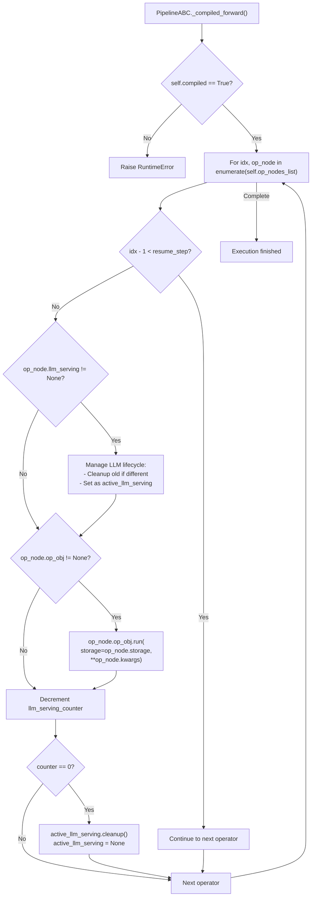

**Key Data Structures:**
- `self.op_nodes_list`: List of `OperatorNode` objects containing operator instances, storage, LLM serving objects, and keyword arguments [dataflow/pipeline/Pipeline.py:32]().
- `self.active_llm_serving`: Reference to the currently active LLM serving backend [dataflow/pipeline/Pipeline.py:28]().
- `self.llm_serving_counter`: A `Counter` tracking remaining usage references for each `LLMServingABC` instance [dataflow/pipeline/Pipeline.py:34]().

Sources: [dataflow/pipeline/Pipeline.py:18-35](), [dataflow/pipeline/Pipeline.py:507-535](), [dataflow/pipeline/nodes.py:36-95]()

## Operator Node Structure

Each step's operator is wrapped in an `OperatorNode` instance (`dataflow.pipeline.nodes.OperatorNode`) which encapsulates all runtime requirements:

| Field | Type | Description |
|-------|------|-------------|
| `op_obj` | `OperatorABC` | The underlying operator instance [dataflow/pipeline/nodes.py:45]() |
| `op_name` | `str` | Attribute name defined in the pipeline class [dataflow/pipeline/nodes.py:46]() |
| `storage` | `DataFlowStorage` | Storage backend instance bound to this step [dataflow/pipeline/nodes.py:47]() |
| `llm_serving` | `LLMServingABC` | Associated LLM serving backend (if applicable) [dataflow/pipeline/nodes.py:48]() |
| `kwargs` | `dict` | Execution parameters including `input_key` and `output_key` mappings [dataflow/pipeline/nodes.py:49]() |

### Code Entity Association: Compilation to Execution
Title: "Mapping OPRuntime to OperatorNode"
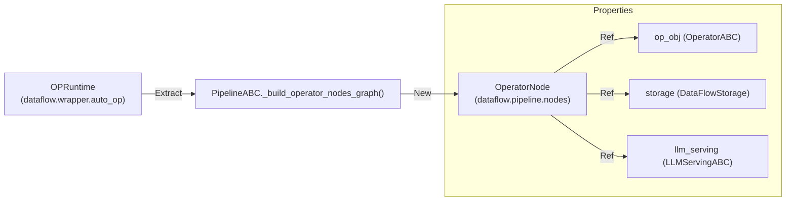

Sources: [dataflow/pipeline/Pipeline.py:60-89](), [dataflow/pipeline/nodes.py:36-95](), [dataflow/wrapper/auto_op.py:20-37]()

## Storage Step Management

DataFlow storage subclasses (such as `FileStorage` and `LazyFileStorage`) implement a step-based access pattern where each operator reads from step $N$ and writes its output to step $N+1$. The `storage.step()` method increments the internal `operator_step` counter [dataflow/utils/storage.py:156]().

### Step Mechanism Sequence
Title: "Storage Step Advancement in Execution"
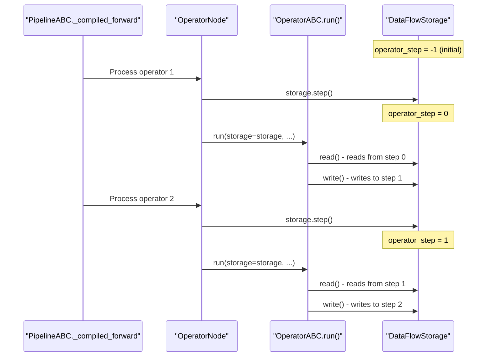

**Implementation Details:**
- Storage stepping is driven by the user inside the pipeline's `forward()` implementation when invoking operator `.run()` methods [test/test_batched_pipeline.py:36-37]().
- Each call to `storage.step()` increments `self.operator_step` [dataflow/utils/storage.py:156]().
- This produces a sequential file cache chain (e.g., `step_0.jsonl` → `step_1.jsonl` → `step_2.jsonl`).
- `LazyFileStorage` buffers intermediate DataFrames in memory (`self._buffers`) and defers disk persistence until an explicit `flush()` or process exit via `atexit` hooks [dataflow/utils/storage.py:157-164]().

Sources: [dataflow/utils/storage.py:153-171](), [test/test_batched_pipeline.py:35-50]()

## LLM Lifecycle Management

The execution phase handles LLM serving instances to optimize GPU and API resource usage. LLMs are initialized upon first reference and cleaned up once their reference count drops to zero.

### Reference Counting Strategy
During `PipelineABC.compile()`, the pipeline scans all operator runtimes to build a reference count for each LLM serving instance [dataflow/pipeline/Pipeline.py:64-89]().

Title: "LLM Serving Reference Counting"
```mermaid
flowchart TD
    Compile["PipelineABC._build_operator_nodes_graph()"] --> Scan["Scan each OPRuntime"]
    Scan --> FindLLM{"op has<br/>LLM_SERVING_CLASSES?"}
    FindLLM -->|Yes| Increment["self.llm_serving_counter[llm_serving_obj] += 1"]
    FindLLM -->|No| Next
    Increment --> Next["Next operator"]
    Next --> Scan
```

### Execution-Time Management
During `_compiled_forward`, LLM serving instances follow these lifecycle rules [dataflow/pipeline/Pipeline.py:517-535]():
1. **Activation Check**: When encountering an operator requiring an LLM serving backend, verify if it differs from `self.active_llm_serving`.
2. **Cleanup Old**: If a different LLM serving instance is currently active, invoke `.cleanup()` on it.
3. **Activate New**: Set the new LLM serving backend as `self.active_llm_serving`.
4. **Reference Decrement**: After the operator finishes execution, decrement its entry in `self.llm_serving_counter`.
5. **Final Cleanup**: When the counter reaches zero, invoke `.cleanup()` on the serving backend and reset `self.active_llm_serving = None`.

Sources: [dataflow/pipeline/Pipeline.py:64-89](), [dataflow/pipeline/Pipeline.py:517-535]()

## Key Validation during Execution

While key integrity is validated statically during the [Compilation Phase](3.2.1) [dataflow/pipeline/Pipeline.py:105-135](), the runtime execution relies on these validated structures:
1. **Input Key Mapping**: Each `OperatorNode` extracts input and output parameter names during initialization [dataflow/pipeline/nodes.py:59-69]().
2. **KeyNode Lineage**: `KeyNode` objects trace data field lineage across operators [dataflow/pipeline/nodes.py:8-17]().
3. **Runtime Safety**: Because compilation guarantees that all required keys exist in `accumulated_keys`, runtime `KeyError` exceptions are prevented before execution begins [dataflow/pipeline/Pipeline.py:103-135]().

Sources: [dataflow/pipeline/Pipeline.py:103-135](), [dataflow/pipeline/nodes.py:8-69]()

## Resume Capabilities

The execution phase supports resuming pipeline execution from a specified operator index via the `resume_step` parameter [dataflow/pipeline/Pipeline.py:507-515]().

**Key Considerations:**
- The check uses `idx - 1 < resume_step` to account for the `DATASET-INPUT` pseudo-operator at index 0 [dataflow/pipeline/Pipeline.py:514]().
- Cached storage files must exist on disk for all skipped steps to ensure subsequent operators receive valid inputs.
- For batch-aware pipelines (`BatchedPipelineABC`), resumption can also be driven automatically via `resume_from_last=True` by tracking state records [test/test_batched_pipeline.py:55-60]().

Sources: [dataflow/pipeline/Pipeline.py:507-535](), [test/test_batched_pipeline.py:52-60]()

## Comparison: Compilation vs Execution

| Aspect | Compilation Phase | Execution Phase |
|--------|------------------|-----------------|
| **Method** | `PipelineABC.compile()` | `PipelineABC._compiled_forward()` |
| **Execution Timing** | Invoked once prior to processing | Invoked each time `forward()` is called |
| **Core Purpose** | Build DAG graph, validate key integrity | Execute operators sequentially, process dataset |
| **Storage Role** | Extract starting keys from initial data source | Perform active read/write cache operations |
| **LLM Serving** | Build reference count map (`llm_serving_counter`) | Manage dynamic load, activation, and cleanup |
| **Output Artifacts** | `op_nodes_list`, `final_keys` | Processed cache files on disk or database records |

Sources: [dataflow/pipeline/Pipeline.py:43-59](), [dataflow/pipeline/Pipeline.py:507-535]()

---

# Page: Batched and Streaming Pipelines

# Batched and Streaming Pipelines

<details>
<summary>Relevant source files</summary>

The following files were used as context for generating this wiki page:

- [dataflow/operators/knowledge_cleaning/generate/kbc_chunk_generator.py](dataflow/operators/knowledge_cleaning/generate/kbc_chunk_generator.py)
- [dataflow/operators/knowledge_cleaning/generate/kbc_chunk_generator_batch.py](dataflow/operators/knowledge_cleaning/generate/kbc_chunk_generator_batch.py)
- [dataflow/pipeline/Pipeline.py](dataflow/pipeline/Pipeline.py)
- [dataflow/pipeline/__init__.py](dataflow/pipeline/__init__.py)
- [dataflow/pipeline/nodes.py](dataflow/pipeline/nodes.py)
- [dataflow/utils/storage.py](dataflow/utils/storage.py)
- [dataflow/wrapper/__init__.py](dataflow/wrapper/__init__.py)
- [dataflow/wrapper/batch_wrapper.py](dataflow/wrapper/batch_wrapper.py)
- [test/cpu_only/test_lazy_file_storage_flush.py](test/cpu_only/test_lazy_file_storage_flush.py)
- [test/cpu_only/test_remote_batch_slicing.py](test/cpu_only/test_remote_batch_slicing.py)
- [test/test_batched_pipeline.py](test/test_batched_pipeline.py)
- [test/test_batched_stream_pipeline.py](test/test_batched_stream_pipeline.py)
- [test/test_batchify.py](test/test_batchify.py)
- [test/test_read_xlsx.py](test/test_read_xlsx.py)

</details>


## Purpose and Scope

This document describes the batch processing and streaming capabilities of the DataFlow system, focusing on `BatchedPipelineABC` and `StreamBatchedPipelineABC` [dataflow/pipeline/Pipeline.py:1](). These classes leverage specialized storage implementations—`BatchedFileStorage` and `StreamBatchedFileStorage` [dataflow/utils/storage.py:14]()—to enable large-scale data processing with automatic checkpointing and resume mechanisms. For core pipeline architecture, refer to [3.2. Pipeline System]().

Sources: [dataflow/pipeline/Pipeline.py:1](), [dataflow/utils/storage.py:14-164]()

---

## Overview of Batching Architectures

DataFlow provides two primary abstractions for handling datasets that exceed typical memory limits or require resilient execution over long durations.

| Pipeline Class | Associated Storage | Data Handling Strategy |
| :--- | :--- | :--- |
| `BatchedPipelineABC` | `BatchedFileStorage` | Loads full dataset into memory, then slices it into batches for operator processing. |
| `StreamBatchedPipelineABC` | `StreamBatchedFileStorage` | Uses a generator-based streaming approach to load only one batch into memory at a time. |

Sources: [dataflow/pipeline/Pipeline.py:1](), [dataflow/pipeline/__init__.py:1-7]()

---

## BatchedPipelineABC and BatchedFileStorage

`BatchedPipelineABC` inherits from `PipelineABC` [dataflow/pipeline/Pipeline.py:1]() and overrides the `_compiled_forward` method to implement a nested loop: the outer loop iterates through operator nodes, while the inner loop iterates through data batches.

### Data Flow and Checkpointing

The pipeline tracks progress using a local checkpoint file (typically named with the suffix `_last_success_step.txt`). This file stores the current operator index and the current batch index.

Title: Batched Pipeline Execution Flow
```mermaid
graph TD
    subgraph "Code Entity: BatchedPipelineABC"
        Forward["_compiled_forward(batch_size, resume_from_last, ...)"]
        OpLoop["Loop: for idx, op_node in enumerate(op_nodes_list)"]
        BatchLoop["Loop: for _ in range(RUN_TIMES)"]
    end

    subgraph "Code Entity: BatchedFileStorage"
        BStorage["BatchedFileStorage Instance"]
        BStep["storage.batch_step"]
        BSize["storage.batch_size"]
    end

    Forward --> OpLoop
    OpLoop --> BStorage
    BStorage --> BatchLoop
    BatchLoop --> RunOp["op_node.op_obj.run(storage=op_node.storage, ...)"]
    RunOp --> UpdateCheck["Write to last_success_step.txt"]
```

Sources: [dataflow/pipeline/Pipeline.py:1](), [test/test_batched_pipeline.py:7-16]()

### Key Functions and Logic

1. **Resume Logic**: Upon calling `forward()`, the pipeline checks `resume_from_last`. If true, it reads the checkpoint file to initialize `resume_step` and `resume_batch` [dataflow/pipeline/Pipeline.py:1]().
2. **Batch Calculation**: The number of iterations (`RUN_TIMES`) is calculated by dividing the total record count by the `batch_size` [dataflow/pipeline/Pipeline.py:1]().
3. **Operator Execution**: For each batch, the pipeline calls the operator's `run` method. The `BatchedFileStorage` ensures that when the operator calls `storage.read()`, it only receives the slice corresponding to the current `batch_step` [dataflow/pipeline/Pipeline.py:1](), [dataflow/utils/storage.py:14-35]().

Sources: [dataflow/pipeline/Pipeline.py:1](), [dataflow/utils/storage.py:14-35](), [test/test_batched_pipeline.py:1-60]()

---

## StreamBatchedPipelineABC and Streaming Logic

`StreamBatchedPipelineABC` is designed for datasets where even the initial full load into a pandas DataFrame is impossible due to memory constraints.

### The Streaming Mechanism

Instead of slicing an in-memory DataFrame, `StreamBatchedPipelineABC` utilizes `StreamBatchedFileStorage.iter_chunks()`, which returns a generator.

Title: Streaming Pipeline Sequence
```mermaid
sequenceDiagram
    participant P as "StreamBatchedPipelineABC"
    participant S as "StreamBatchedFileStorage"
    participant O as "OperatorABC"

    P->>S: "iter_chunks()"
    S-->>P: "returns generator"
    loop for each batch
        P->>S: "next(generator)"
        S-->>P: "DataFrame (one batch)"
        P->>S: "Set _current_streaming_chunk"
        P->>O: "run(storage=S)"
        O->>S: "read() -> returns _current_streaming_chunk"
        P->>S: "Clear _current_streaming_chunk"
        P->>P: "Update checkpoint file"
    end
```

Sources: [dataflow/pipeline/Pipeline.py:1](), [test/test_batched_stream_pipeline.py:11-20]()

### Implementation Details

* **Memory Efficiency**: The pipeline explicitly sets `op_node.storage._current_streaming_chunk` before calling the operator [dataflow/pipeline/Pipeline.py:1]().
* **Storage Interception**: The `StreamBatchedFileStorage.read()` method is implemented to return this temporary chunk rather than reading from a global buffer, ensuring O(batch_size) memory complexity [dataflow/pipeline/Pipeline.py:1](), [dataflow/utils/storage.py:70-123]().
* **Skipping Batches**: During a resume operation, the pipeline calls `next(data_stream)` repeatedly to advance the generator to the correct `batch_step` without processing the data [dataflow/pipeline/Pipeline.py:1]().

Sources: [dataflow/pipeline/Pipeline.py:1](), [dataflow/utils/storage.py:70-123]()

---

## Resume Mechanisms and Checkpoints

DataFlow implements a robust resume system to handle process interruptions (e.g., OOM, network failure, or manual stop).

### Checkpoint File Format
The checkpoint is a simple text file located in the `cache_path`. It contains a single line with two integers:
`{operator_index},{batch_index}`

### Resume Modes

| Mode | Trigger | Behavior |
| :--- | :--- | :--- |
| **Manual Step** | `resume_step > 0` | Skips all operators before the specified index. Reprocesses all batches for the starting operator [dataflow/pipeline/Pipeline.py:1](). |
| **Auto Resume** | `resume_from_last=True` | Reads the checkpoint file. Skips completed operators and skips completed batches within the current operator [dataflow/pipeline/Pipeline.py:1](). |

Sources: [dataflow/pipeline/Pipeline.py:1](), [test/test_batched_pipeline.py:55-60]()

---

## Storage Class Summary

### LazyFileStorage
While not strictly a batching class, `LazyFileStorage` provides the foundation for persistence [dataflow/utils/storage.py:70-78](). It buffers data in memory and only flushes to disk on process exit (`atexit`) or when `flush()` is called [dataflow/utils/storage.py:74-78](). It supports multiple formats including `json`, `jsonl`, `csv`, `parquet`, and `pickle` [dataflow/utils/storage.py:80-123](). It uses atomic `os.replace` via a temporary file to prevent file corruption [dataflow/utils/storage.py:98-99]().

### Batched and Stream Variants
These classes extend the base storage to manage `batch_size` and `batch_step` state. They are typically initialized within the pipeline's `__init__` method [test/test_batched_pipeline.py:11-16]().

Title: Storage Class Hierarchy and Lifecycle
```mermaid
classDiagram
    class DataFlowStorage {
        <<abstract>>
        +read(output_type)
        +write(data)
        +get_keys_from_dataframe()
    }
    class LazyFileStorage {
        -_buffers: Dict
        -_dirty_steps: set
        +step()
        +flush()
    }
    class BatchedFileStorage {
        +batch_size: int
        +batch_step: int
    }
    class StreamBatchedFileStorage {
        -_current_streaming_chunk: DataFrame
        +iter_chunks()
    }

    DataFlowStorage <|-- LazyFileStorage
    LazyFileStorage <|-- BatchedFileStorage
    LazyFileStorage <|-- StreamBatchedFileStorage
```

Sources: [dataflow/utils/storage.py:14-162](), [dataflow/pipeline/Pipeline.py:1-15](), [test/test_batched_stream_pipeline.py:9-15]()

---

## BatchWrapper Utility

For granular control over specific operators within a standard pipeline, DataFlow provides `BatchWrapper` [dataflow/wrapper/batch_wrapper.py:1]().

* **Functionality**: It wraps an operator's `run` method to split input data into smaller chunks before execution [dataflow/wrapper/batch_wrapper.py:1]().
* **Caching**: If `batch_cache` is enabled, it uses `DummyStorage` to cache intermediate batch results [dataflow/wrapper/batch_wrapper.py:1]().
* **Data Reintegration**: After processing a batch, it merges new columns or updated values back into the primary `whole_dataframe` [dataflow/wrapper/batch_wrapper.py:1]().

Title: BatchWrapper Logic Flow
```mermaid
graph TD
    subgraph "Code Entity: BatchWrapper"
        BW_Run["BatchWrapper.run(storage, ...)"]
        ChunkLoop["Loop: for batch_num in tqdm(num_batches)"]
        Merge["Merge res back to whole_dataframe"]
    end

    subgraph "Code Entity: DummyStorage"
        DS_Set["set_data(batch_df)"]
        DS_Read["read() -> batch results"]
    end

    BW_Run --> ChunkLoop
    ChunkLoop --> DS_Set
    DS_Set --> OpRun["operator.run(dummy_storage, ...)"]
    OpRun --> DS_Read
    DS_Read --> Merge
    Merge -->|Next Batch| ChunkLoop
    Merge -->|Finish| FinalWrite["storage.write(whole_dataframe)"]
```

Sources: [dataflow/wrapper/batch_wrapper.py:1](), [dataflow/utils/storage.py:14-35]()

---

# Page: Registry and Lazy Loading

# Registry and Lazy Loading

<details>
<summary>Relevant source files</summary>

The following files were used as context for generating this wiki page:

- [dataflow/operators/code/filter/code_autogen_filter.py](dataflow/operators/code/filter/code_autogen_filter.py)
- [dataflow/utils/registry.py](dataflow/utils/registry.py)
- [test/cpu_only/test_register.py](test/cpu_only/test_register.py)
- [test/cpu_only/test_register_whitelist.py](test/cpu_only/test_register_whitelist.py)
- [test/xlsx_overview_of_dataflow/test_get_prompt_info_to_xlsx.py](test/xlsx_overview_of_dataflow/test_get_prompt_info_to_xlsx.py)

</details>


## Purpose and Scope

This page documents the Registry system and Lazy Loading mechanism in DataFlow. The `Registry` class provides dynamic name-to-object mapping through the `get()` method, enabling extensibility and plugin-like architecture. Two global instances—`OPERATOR_REGISTRY` and `PROMPT_REGISTRY`—manage the extensive collection of operators and prompt templates `[dataflow/utils/registry.py:34-129]()`. The `LazyLoader` pattern defers module imports until components are accessed, reducing startup time by avoiding the immediate loading of all components `[dataflow/utils/registry.py:34-129]()`.

Key components documented:
- `Registry` class with `register()` and `get()` methods `[dataflow/utils/registry.py:34-129]()`.
- Lazy module loading and attribute interception `[dataflow/utils/registry.py:34-129]()`.
- `apply_whitelist()` for production deployment optimization `[dataflow/utils/registry.py:131-195]()`.
- Integration with dynamic component discovery during pipeline compilation.

Sources: `[dataflow/utils/registry.py:34-129]()`

## Registry System Architecture

The Registry system uses the `Registry` class to manage component collections through global instances defined in the utility module `[dataflow/utils/registry.py:34-60]()`.

### Architecture Overview

The following diagram bridges the **Natural Language Space** (Registry concepts) to the **Code Entity Space** (specific classes and attributes).

Title: Registry and Lazy Loading Architecture
```mermaid
graph TB
    subgraph "GlobalRegistryInstances"
        OPERATOR_REGISTRY["OPERATOR_REGISTRY<br/>Registry(name='operators')"]
        PROMPT_REGISTRY["PROMPT_REGISTRY<br/>Registry(name='prompts')"]
    end
    
    subgraph "RegistryClassState"
        _name["_name: str<br/>Registry identifier"]
        _obj_map["_obj_map: dict<br/>str -> class object"]
        loader_map["loader_map: dict<br/>str -> module"]
        _base_folder["_base_folder: Path<br/>Path(__file__).parents[1]"]
        _sub_modules["_sub_modules: list<br/>os.listdir(_base_folder/name)"]
    end
    
    subgraph "PhysicalDirectories"
        operators["dataflow/operators/<br/>generate/, filter/, eval/, refine/"]
        prompts["dataflow/prompts/<br/>text2sql/, reasoning/, general_text/"]
    end
    
    OPERATOR_REGISTRY --> _name
    OPERATOR_REGISTRY --> _obj_map
    OPERATOR_REGISTRY --> loader_map
    PROMPT_REGISTRY --> _name
    PROMPT_REGISTRY --> _obj_map
    PROMPT_REGISTRY --> loader_map
    
    _obj_map --> _base_folder
    _obj_map --> _sub_modules
    
    loader_map -.imports from.-> operators
    loader_map -.imports from.-> prompts
```

Sources: `[dataflow/utils/registry.py:34-75]()`

## Registry Class Implementation

The `Registry` class provides the core registration and lookup functionality `[dataflow/utils/registry.py:34-129]()`. It is initialized with a name that corresponds to a directory under `dataflow/` (e.g., `"operators"` or `"prompts"`).

### Registry Initialization Process

The `Registry.__init__()` method executes the initialization sequence `[dataflow/utils/registry.py:60-75]`:

```python
def __init__(self, name):
    self._name = name                                      # Line 65
    self._obj_map = {}                                     # Line 66
    self._base_folder = Path(__file__).resolve().parents[1]  # Line 67 (dataflow/)
    self._sub_modules = list(os.listdir(self._base_folder / name))  # Line 68
    # Remove __init__.py and __pycache__ from list           # Lines 69-72
    if len(self._sub_modules) > 0:
        self.loader_map = dict(zip(self._sub_modules, [None] * len(self._sub_modules)))  # Line 74
```

**Initialization State After Construction:**

| Attribute | Initial Value | Example for `OPERATOR_REGISTRY` |
|-----------|---------------|--------------------------------|
| `_name` | Constructor argument | `"operators"` |
| `_obj_map` | `{}` | Empty dict, populated on registration or lazy load |
| `_base_folder` | `Path(__file__).parents[1]` | `.../DataFlow/dataflow/` |
| `_sub_modules` | Directory listing | `["generate", "filter", "eval", "refine", ...]` |
| `loader_map` | `{"module": None, ...}` | `{"generate": None, "filter": None, ...}` |

Sources: `[dataflow/utils/registry.py:60-75]()`

### Registration Methods

The `register()` method supports two usage patterns `[dataflow/utils/registry.py:85-103]()`:

1.  **Decorator Pattern:**
    ```python
    @OPERATOR_REGISTRY.register()
    class CodeAutoGeneratedFilter(OperatorABC):
        pass
    ```
2.  **Direct Call Pattern:**
    ```python
    OPERATOR_REGISTRY.register(CodeAutoGeneratedFilter)
    ```

Both patterns invoke `_do_register(name, obj)` `[dataflow/utils/registry.py:81-83]()`, which maps the class name to the object in `_obj_map`.

Sources: `[dataflow/utils/registry.py:81-103]()`, `[dataflow/operators/code/filter/code_autogen_filter.py:11-12]()`

## Lazy Loading Mechanism

The Lazy Loading system defers module imports until components are accessed via `Registry.get()` `[dataflow/utils/registry.py:104-129]()`.

### Lazy Loading Sequence

Title: Lazy Loading Component Discovery Flow
```mermaid
sequenceDiagram
    participant User
    participant Registry_get as "Registry.get()"
    participant _init_loaders as "Registry._init_loaders()"
    participant importlib
    
    User->>Registry_get: get("SQLGenerator")
    Registry_get->>Registry_get: Check self._obj_map
    
    alt Object in _obj_map (line 105)
        Registry_get-->>User: Return cached object
    else Not in _obj_map (line 107)
        Registry_get->>Registry_get: Check if None in loader_map.values() (line 108)
        
        alt Loaders not initialized
            Registry_get->>_init_loaders: _init_loaders() (line 109)
            loop For each module_name in loader_map (lines 77-79)
                _init_loaders->>importlib: import_module(f"dataflow.{name}.{module_name}")
                importlib-->>_init_loaders: Module instance
            end
        end
        
        loop For each module_lib in loader_map.values() (line 110)
            Registry_get->>importlib: getattr(module_lib, "SQLGenerator") (line 114)
            importlib-->>Registry_get: Return class object
        end
        
        Registry_get->>Registry_get: Cache in self._obj_map[name] (line 115)
        Registry_get-->>User: Return class (line 116)
    end
```

Sources: `[dataflow/utils/registry.py:76-129]()`

## Whitelist Filtering for Deployment Optimization

The `apply_whitelist()` method filters the registry to retain only specified operators, significantly reducing memory overhead in production environments `[dataflow/utils/registry.py:131-195]()`.

### Whitelist Application Algorithm

1.  **Normalization:** Converts input names into a `keep_set` `[dataflow/utils/registry.py:154]()`.
2.  **Set Operations:** Identifies keys to keep (intersection of `_obj_map` and `keep_set`) and keys to remove (difference) `[dataflow/utils/registry.py:162-163]()`.
3.  **Trimming:** Invokes `self._obj_map.pop(k, None)` for all keys not in the whitelist `[dataflow/utils/registry.py:166-167]()`.
4.  **Reporting:** Generates a detailed dictionary containing `total_before`, `total_after`, and `missing_in_registry` `[dataflow/utils/registry.py:174-182]()`.

Sources: `[dataflow/utils/registry.py:131-195]()`, `[test/cpu_only/test_register_whitelist.py:1-15]()`

## Import Structure Generation

The `generate_import_structure_from_type_checking()` function uses AST parsing to extract import mappings from `TYPE_CHECKING` blocks `[dataflow/utils/registry.py:15-31]()`.

```python
def generate_import_structure_from_type_checking(source_file: str, base_path: str) -> dict:
    source = Path(source_file).read_text(encoding="utf-8")
    tree = ast.parse(source)
    # ... iterates through AST to find TYPE_CHECKING blocks ...
    # ... maps class name to (module_file, name) ...
    return import_structure
```

This allows the lazy loading subsystem to identify module dependencies without executing module code during initial registry setup.

Sources: `[dataflow/utils/registry.py:15-31]()`

## Performance and Memory Characteristics

The combination of lazy loading and registry management optimizes the framework for large-scale collections.

| Feature | Implementation | Benefit |
|---------|----------------|---------|
| **Deferred Imports** | `Registry._init_loaders` | Reduces startup time by deferring heavy module imports. |
| **Caching** | `_obj_map` | Subsequent access to a loaded operator is $O(1)$. |
| **Selective Loading** | `Registry.get()` | Only modules required for the current pipeline are loaded into memory. |
| **Production Trimming** | `apply_whitelist()` | Removes unused operator references to free memory. |

Sources: `[dataflow/utils/registry.py:60-129]()`, `[dataflow/utils/registry.py:131-195]()`

---

# Page: LLM Serving Architecture

# LLM Serving Architecture

<details>
<summary>Relevant source files</summary>

The following files were used as context for generating this wiki page:

- [.github/workflows/test.yml](.github/workflows/test.yml)
- [dataflow/operators/code/filter/code_score_filter.py](dataflow/operators/code/filter/code_score_filter.py)
- [dataflow/operators/core_text/eval/bench_dataset_evaluator_question.py](dataflow/operators/core_text/eval/bench_dataset_evaluator_question.py)
- [dataflow/serving/__init__.py](dataflow/serving/__init__.py)
- [dataflow/serving/api_llm_serving_request.py](dataflow/serving/api_llm_serving_request.py)
- [dataflow/serving/api_vlm_serving_openai.py](dataflow/serving/api_vlm_serving_openai.py)
- [dataflow/serving/local_model_vlm_serving.py](dataflow/serving/local_model_vlm_serving.py)
- [dataflow/serving/localhost_llm_api_serving.py](dataflow/serving/localhost_llm_api_serving.py)
- [dataflow/serving/localmodel_lalm_serving.py](dataflow/serving/localmodel_lalm_serving.py)
- [test/cpu_only/test_undefined_name_crashes.py](test/cpu_only/test_undefined_name_crashes.py)

</details>


## Purpose and Scope

This document provides an overview of DataFlow's LLM serving architecture, explaining the `LLMServingABC` abstraction layer [dataflow/core/__init__.py:6-6]() and the diverse serving implementations that enable infrastructure-agnostic pipeline execution. The architecture supports four primary categories of serving:

1.  **API-Based Serving** ([API-Based Serving](#3.4.1)): Cloud services via HTTP/HTTPS APIs (OpenAI, DeepSeek, Gemini).
2.  **Local GPU Serving** ([Local GPU Serving](#3.4.2)): On-premises inference with vLLM/SGLang for high-performance local execution.
3.  **Vision-Language and Audio Model Serving** ([Vision-Language and Audio Model Serving](#3.4.3)): Multimodal image+text processing for document extraction and VQA.
4.  **Embedding and Specialized Services** ([Embedding and Specialized Services](#3.4.4)): Sentence embeddings, provider wrappers (LiteLLM), and RAG-specific serving.

This unified abstraction allows pipelines to run on any infrastructure—from personal laptops to enterprise clusters—without modifying operator code.

**Related Pages:**
*   Pipeline orchestration of LLM lifecycle: see [Execution Phase](#3.2.2)
*   Operator integration with serving: see [Operators Framework](#3.1)

Sources: [dataflow/core/__init__.py:6-6]()

---

## Architecture Overview

DataFlow's LLM serving layer abstracts away the differences between various model serving backends through a common interface (`LLMServingABC`). This design allows operators and pipelines to remain infrastructure-agnostic.

### LLM Serving Class Hierarchy

The following diagram maps the logical serving categories to the specific code entities in the `dataflow/serving/` directory, bridging high-level architectural concepts with the codebase structure.

```mermaid
graph TB
    subgraph "Code Entity Space"
        ABC["LLMServingABC<br/>dataflow/core/__init__.py<br/>start_serving()<br/>generate_from_input()<br/>cleanup()"]
        
        subgraph APIBased["APIBasedServing"]
            APIRequest["APILLMServing_request<br/>api_llm_serving_request.py<br/>requests.Session<br/>ThreadPoolExecutor"]
            VertexAI["APIGoogleVertexAIServing<br/>api_google_vertexai_serving.py<br/>GeminiVertexAIClient<br/>BigQuery_batch_mode"]
            APIVLM["APIVLMServing_openai<br/>api_vlm_serving_openai.py<br/>OpenAI_client<br/>_encode_image_to_base64"]
            LiteLLM["LiteLLMServing<br/>lite_llm_serving.py<br/>litellm.completion()"]
        end
        
        subgraph LocalGPU["LocalGPUServing"]
            VLLM["LocalModelLLMServing_vllm<br/>local_model_llm_serving.py<br/>vllm.LLM<br/>SamplingParams"]
            SGLANG["LocalModelLLMServing_sglang<br/>local_model_llm_serving.py<br/>sglang.Engine"]
            LocalVLM["LocalVLMServing_vllm<br/>local_model_vlm_serving.py<br/>vllm.LLM<br/>vllm_limit_mm_per_prompt"]
            LocalHost["LocalHostLLMAPIServing_vllm<br/>localhost_llm_api_serving.py<br/>HTTP_to_localhost"]
            LocalAudio["LocalModelLALMServing_vllm<br/>localmodel_lalm_serving.py<br/>process_audio_info"]
        end
        
        subgraph Specialized["SpecializedServices"]
            Embed["LocalEmbeddingServing<br/>LocalSentenceLLMServing.py<br/>SentenceTransformer<br/>Multi_device_encode"]
            Perspective["PerspectiveAPIServing<br/>google_api_serving.py<br/>Google_API_client"]
            LightRAG["LightRAGServing<br/>light_rag_serving.py<br/>RAG_queries"]
        end
    end
    
    ABC --> APIRequest
    ABC --> VertexAI
    ABC --> APIVLM
    ABC --> VLLM
    ABC --> SGLANG
    ABC --> LocalVLM
    ABC --> LocalHost
    ABC --> LocalAudio
    ABC --> Embed
    ABC --> LiteLLM
    ABC --> Perspective
    ABC --> LightRAG
```

Sources: [dataflow/serving/__init__.py:1-29](), [dataflow/serving/api_vlm_serving_openai.py:13-23](), [dataflow/serving/local_model_vlm_serving.py:13-35](), [dataflow/serving/localmodel_lalm_serving.py:96-129](), [dataflow/serving/localhost_llm_api_serving.py:14-48]()

---

## The LLMServingABC Interface

The `LLMServingABC` abstract base class defines the contract that all serving implementations must follow. This ensures that any operator requiring an LLM can interact with any backend via a standard set of methods.

| Method | Signature | Purpose | When Called |
| :--- | :--- | :--- | :--- |
| `start_serving()` | `def start_serving(self) -> None` | Initialize/start the serving backend (e.g., load weights or setup sessions) | Before pipeline execution begins |
| `generate_from_input()` | `def generate_from_input(...) -> List[str]` | Generate responses for a batch of inputs | During operator `run()` execution |
| `cleanup()` | `def cleanup(self) -> None` | Release resources (GPUs) or close connections | After pipeline completion |

### Key Design Principles

1.  **Stateless Generation**: The `generate_from_input()` method is the primary interface. It accepts a list of user inputs and returns a list of generated responses, enabling batch parallelization regardless of whether the backend is a local GPU or a remote API.
2.  **Lifecycle Management**: Pipelines manage the serving lifecycle. Services start when the first operator needs them via `start_serving()` [dataflow/serving/local_model_vlm_serving.py:102-102]() and shut down after the last operator completes.
3.  **Backend Agnostic**: Operators receive a `LLMServingABC` instance [dataflow/operators/core_text/eval/bench_dataset_evaluator_question.py:30-30](). The pipeline configuration determines which implementation (API vs. Local) is injected.
4.  **Structured Output Support**: Implementations like `APILLMServing_request` [dataflow/serving/api_llm_serving_request.py:139-165]() and `APIVLMServing_openai` [dataflow/serving/api_vlm_serving_openai.py:114-123]() support `json_schema` for constrained generation.

Sources: [dataflow/serving/api_llm_serving_request.py:16-21](), [dataflow/serving/api_vlm_serving_openai.py:20-22](), [dataflow/serving/local_model_vlm_serving.py:102-156](), [dataflow/serving/localhost_llm_api_serving.py:96-147]()

---

## Serving Categories

### Implementation Comparison

The following diagram maps natural language serving categories and protocols directly to codebase implementations and function/method names:

```mermaid
graph TB
    subgraph "Natural Language & Infrastructure Space"
        ExtAPI["External Cloud APIs<br/>(OpenAI, DeepSeek)"]
        GoogleCloud["Google Cloud<br/>Vertex AI Platform"]
        GPU["Local CUDA Devices<br/>PagedAttention Memory"]
        CPUorGPU["CPU or GPU Device<br/>Sentence Embeddings"]
    end

    subgraph "Code Entity Space"
        subgraph APIMode["APIBasedServing"]
            APIText["APILLMServing_request<br/>api_llm_serving_request.py<br/>_api_chat_with_id()<br/>max_workers"]
            APIVLM["APIVLMServing_openai<br/>api_vlm_serving_openai.py<br/>chat_with_one_image()<br/>generate_from_input_one_image()"]
            VertexAI["APIGoogleVertexAIServing<br/>api_google_vertexai_serving.py<br/>GeminiVertexAIClient.generate()"]
        end
        
        subgraph LocalMode["LocalGPUServing"]
            VLLM["LocalModelLLMServing_vllm<br/>local_model_llm_serving.py<br/>vllm.LLM.generate()<br/>vllm_tensor_parallel_size"]
            LocalVLM["LocalVLMServing_vllm<br/>local_model_vlm_serving.py<br/>vllm_limit_mm_per_prompt"]
            LocalHost["LocalHostLLMAPIServing_vllm<br/>localhost_llm_api_serving.py<br/>subprocess.Popen"]
            LocalAudio["LocalModelLALMServing_vllm<br/>localmodel_lalm_serving.py<br/>process_audio_info()"]
        end
        
        subgraph SpecializedMode["SpecializedServices"]
            Embed["LocalEmbeddingServing<br/>LocalSentenceLLMServing.py<br/>SentenceTransformer.encode()<br/>device"]
        end
    end
    
    APIText -->|"requests.Session<br/>HTTPAdapter_pool"| ExtAPI
    APIVLM -->|"OpenAI_client<br/>base64_images"| ExtAPI
    VertexAI -->|"google.genai<br/>CreateBatchJobConfig"| GoogleCloud
    
    VLLM -->|"GPU_allocation<br/>PagedAttention"| GPU
    LocalVLM -->|"vLLM_engine<br/>image_tensors"| GPU
    LocalHost -->|"localhost:port/v1<br/>entrypoints.openai.api_server"| GPU
    LocalAudio -->|"librosa.load<br/>base64_audio"| GPU
    
    Embed -->|"parallel_encode<br/>batch_size"| CPUorGPU
```

Sources: [dataflow/serving/api_llm_serving_request.py:28-28](), [dataflow/serving/local_model_vlm_serving.py:89-98](), [dataflow/serving/localmodel_lalm_serving.py:37-44](), [dataflow/serving/LocalSentenceLLMServing.py:11-11]()

| Category | Implementations | Parallelism Strategy |
| :--- | :--- | :--- |
| **API-Based** | `APILLMServing_request`, `APIGoogleVertexAIServing`, `LiteLLMServing` | `ThreadPoolExecutor` with configurable `max_workers`. [dataflow/serving/api_llm_serving_request.py:28-28]() |
| **Local GPU** | `LocalModelLLMServing_vllm`, `LocalModelLLMServing_sglang`, `LocalHostLLMAPIServing_vllm` | Tensor parallelism (`vllm_tensor_parallel_size`) and PagedAttention via vLLM backend. [dataflow/serving/local_model_vlm_serving.py:89-98]() |
| **VLM/Audio** | `APIVLMServing_openai`, `LocalVLMServing_vllm`, `LocalModelLALMServing_vllm` | Multimodal inference with `vllm_limit_mm_per_prompt` [dataflow/serving/local_model_vlm_serving.py:31-31]() or `process_audio_info` [dataflow/serving/localmodel_lalm_serving.py:37-44](). |
| **Specialized** | `LocalEmbeddingServing`, `LightRAGServing` | Multi-device encoding via `SentenceTransformer` or graph-based retrieval. [dataflow/serving/LocalSentenceLLMServing.py:11-11]() |

Sources: [dataflow/serving/api_llm_serving_request.py:28-28](), [dataflow/serving/local_model_vlm_serving.py:89-98](), [dataflow/serving/localmodel_lalm_serving.py:37-44](), [dataflow/serving/LocalSentenceLLMServing.py:11-11]()

---

## Detailed Serving Documentation

For in-depth configuration, implementation details, and advanced usage of each serving backend, refer to the following child pages:

*   **[API-Based Serving](#3.4.1)**: Detail `APILLMServing_request` for OpenAI/DeepSeek APIs, including `requests.Session` management [dataflow/serving/api_llm_serving_request.py:61-75](), `reasoning_content` extraction [dataflow/serving/api_llm_serving_request.py:87-103](), and retry mechanisms.
*   **[Local GPU Serving](#3.4.2)**: Explain `LocalModelLLMServing_vllm` and `LocalModelLLMServing_sglang` for local inference with tensor parallelism and GPU memory management. Includes `LocalHostLLMAPIServing_vllm` for serving via subprocess [dataflow/serving/localhost_llm_api_serving.py:101-126]().
*   **[Vision-Language and Audio Model Serving](#3.4.3)**: Describe VLM support through `APIVLMServing_openai` and `LocalVLMServing_vllm`, including base64 image encoding [dataflow/serving/api_vlm_serving_openai.py:56-78]() and `vLLM` integration for multimodal prompts [dataflow/serving/local_model_vlm_serving.py:139-146]().
*   **[Embedding and Specialized Services](#3.4.4)**: Detail `LocalEmbeddingServing` with `sentence-transformers`, multi-GPU/CPU parallelization strategies, and specialized RAG serving components like `LightRAGServing`. Includes audio processing via `LocalModelLALMServing_vllm` [dataflow/serving/localmodel_lalm_serving.py:96-129]().

Sources: [dataflow/serving/__init__.py:1-29](), [dataflow/serving/api_llm_serving_request.py:16-103](), [dataflow/serving/api_vlm_serving_openai.py:13-184](), [dataflow/serving/local_model_vlm_serving.py:13-156](), [dataflow/serving/localhost_llm_api_serving.py:14-162](), [dataflow/serving/localmodel_lalm_serving.py:96-129]()

---

# Page: API-Based Serving

# API-Based Serving

<details>
<summary>Relevant source files</summary>

The following files were used as context for generating this wiki page:

- [.github/workflows/test.yml](.github/workflows/test.yml)
- [dataflow/operators/code/filter/code_score_filter.py](dataflow/operators/code/filter/code_score_filter.py)
- [dataflow/operators/core_text/eval/bench_dataset_evaluator_question.py](dataflow/operators/core_text/eval/bench_dataset_evaluator_question.py)
- [dataflow/serving/api_google_vertexai_serving.py](dataflow/serving/api_google_vertexai_serving.py)
- [dataflow/serving/api_llm_serving_request.py](dataflow/serving/api_llm_serving_request.py)
- [dataflow/serving/google_api_serving.py](dataflow/serving/google_api_serving.py)
- [dataflow/serving/lite_llm_serving.py](dataflow/serving/lite_llm_serving.py)
- [dataflow/serving/localhost_llm_api_serving.py](dataflow/serving/localhost_llm_api_serving.py)
- [dataflow/serving/localmodel_lalm_serving.py](dataflow/serving/localmodel_lalm_serving.py)
- [dataflow/statics/playground/playground/prompted_generator/translation_litellm.py](dataflow/statics/playground/playground/prompted_generator/translation_litellm.py)
- [dataflow/statics/playground/playground/prompted_generator/translation_litellm_json_schema.py](dataflow/statics/playground/playground/prompted_generator/translation_litellm_json_schema.py)
- [pyproject.toml](pyproject.toml)
- [requirements.txt](requirements.txt)
- [test/cpu_only/test_undefined_name_crashes.py](test/cpu_only/test_undefined_name_crashes.py)
- [test/test_general_text.py](test/test_general_text.py)
- [test/test_litellm.py](test/test_litellm.py)

</details>


## Purpose and Scope

This document details the API-based LLM serving implementations in DataFlow, which enable operators to interact with cloud-based LLM services. API-based serving provides an abstraction layer for external LLM APIs, handling connection management, request batching, retry logic, and structured output parsing. This contrasts with local GPU serving (covered in 3.4.2) and specialized serving modes like embedding generation (see 3.4.4).

The primary API-based serving implementations are:
- **`APILLMServing_request`**: OpenAI-compatible API client supporting any OpenAI-format endpoint, including DeepSeek [dataflow/serving/api_llm_serving_request.py:16-16]().
- **`APIGoogleVertexAIServing`**: Google Vertex AI/Gemini-specific client with batch processing and multimodal capabilities [dataflow/serving/api_google_vertexai_serving.py:48-50]().
- **`LiteLLMServing`**: A unified interface supporting 100+ LLM providers (Anthropic, Azure, AWS Bedrock, etc.) via the LiteLLM library [dataflow/serving/lite_llm_serving.py:10-20]().

All classes implement the `LLMServingABC` interface, ensuring operators can switch between serving backends without code changes [dataflow/serving/api_llm_serving_request.py:16-16](), [dataflow/serving/lite_llm_serving.py:10-10]().

Sources: [dataflow/serving/api_llm_serving_request.py:16-16](), [dataflow/serving/api_google_vertexai_serving.py:48-50](), [dataflow/serving/lite_llm_serving.py:10-20]()

---

## Architecture Overview

API-based serving classes provide a unified interface for external LLM services while implementing sophisticated features like connection pooling, concurrent request handling, and automatic retry mechanisms.

### Natural Language Space to Code Entity Space Mapping

The following diagram bridges high-level serving concepts to specific code entities within the `dataflow.serving` module.

**Code Entity Association Diagram**
```mermaid
graph TB
    subgraph "NaturalLanguageConcept"
        A["OpenAI/DeepSeek API"]
        B["Gemini / Google Cloud"]
        C["Multi-Provider Proxy"]
    end

    subgraph "CodeEntitySpace"
        E["APILLMServing_request"]
        F["APIGoogleVertexAIServing"]
        G["LiteLLMServing"]
    end

    subgraph "CoreInterface"
        I["LLMServingABC"]
    end

    A --- E
    B --- F
    C --- G
    E -.-> I
    F -.-> I
    G -.-> I
```
Sources: [dataflow/serving/api_llm_serving_request.py:16-16](), [dataflow/serving/api_google_vertexai_serving.py:48-50](), [dataflow/serving/lite_llm_serving.py:10-20](), [dataflow/core/__init__.py]()

---

## APILLMServing_request: OpenAI-Compatible Serving

The `APILLMServing_request` class provides a production-grade client for any OpenAI-compatible API endpoint. It implements robust connection management and intelligent retry logic.

### Internal Logic and Data Flow

**APILLMServing_request Internal Architecture**
```mermaid
graph LR
    subgraph "RequestLifecycle"
        Start["generate_from_input"] --> Pool["ThreadPoolExecutor"]
        Pool --> Retry["_api_chat_with_id"]
        Retry --> Req["requests.Session.post"]
    end

    subgraph "ConnectionManagement"
        Session["requests.Session"]
        Adapter["HTTPAdapter"]
        Session --- Adapter
    end

    subgraph "ResponseProcessing"
        Raw["JSON Response"] --> Format["format_response"]
        Format --> Think["Extract reasoning_content"]
        Format --> Ans["Extract content"]
    end

    Req --> Raw
    Adapter -.-> Req
```
Sources: [dataflow/serving/api_llm_serving_request.py:61-75](), [dataflow/serving/api_llm_serving_request.py:78-103](), [dataflow/serving/api_llm_serving_request.py:133-170]()

### Key Features, Retry, and Timeout Mechanisms

| Feature | Description | Configuration Parameter |
|---------|-------------|------------------------|
| **Connection Pooling** | Reuses HTTP connections via `HTTPAdapter` [dataflow/serving/api_llm_serving_request.py:61-69]() | `max_workers` (default: 10) |
| **Concurrent Requests** | `ThreadPoolExecutor` for parallel API calls [dataflow/serving/api_llm_serving_request.py:8-8]() | `max_workers` |
| **Retry Logic** | Custom retry loop for failed requests [dataflow/serving/api_llm_serving_request.py:39-39]() | `max_retries` (default: 5) |
| **Timeout Handling** | Separate connect/read timeouts tuple `(connect_timeout, read_timeout)` [dataflow/serving/api_llm_serving_request.py:41-45]() | `connect_timeout`, `read_timeout` |
| **Structured Output** | JSON schema support via `response_format` [dataflow/serving/api_llm_serving_request.py:157-165]() | `json_schema` parameter |

Sources: [dataflow/serving/api_llm_serving_request.py:38-69](), [dataflow/serving/api_llm_serving_request.py:157-165]()

### Response Formatting and Reasoning Content

The `format_response()` method handles multiple response formats, including reasoning models (like DeepSeek R1) that provide separate thinking and answer content. It wraps reasoning content in `<think>` tags and the final response in `<answer>` tags if the `reasoning_content` field is present in the API response [dataflow/serving/api_llm_serving_request.py:78-103](). 

Key handling for null content with reasoning:
- If `content` is `None` but `reasoning_content` exists, it returns a formatted string wrapping the reasoning [dataflow/serving/api_llm_serving_request.py:89-101]().
- If the response only contains tool calls without content, it returns `None` to mark a failure in standard chat mode [test/cpu_only/test_undefined_name_crashes.py:83-96]().
- It also supports embedding mode by extracting the vector from the `data` array [dataflow/serving/api_llm_serving_request.py:82-83]().

Sources: [dataflow/serving/api_llm_serving_request.py:78-103](), [test/cpu_only/test_undefined_name_crashes.py:83-108]()

---

## APIGoogleVertexAIServing: Google Vertex AI Integration

The `APIGoogleVertexAIServing` class provides access to Google's Gemini models via Vertex AI, with support for batch processing and multimodal inputs [dataflow/serving/api_google_vertexai_serving.py:48-50]().

### GeminiVertexAIClient and Model Initialization

The internal `GeminiVertexAIClient` class wraps the Vertex AI SDK. A critical detail is that `system_instruction` must be provided during model initialization rather than during the content generation call [dataflow/serving/api_google_vertexai_serving.py:121-127]().

```python
# From dataflow/serving/api_google_vertexai_serving.py:124-127
model_instance = GenerativeModel(
    model_name,
    system_instruction=system_prompt
)
```

### Batch Processing Workflow

The implementation supports Google GenAI batch processing using `google.genai` types like `CreateBatchJobConfig` [dataflow/serving/api_google_vertexai_serving.py:39-40](). This allows for high-throughput processing of data stored in Google Cloud Storage or BigQuery, using `fsspec` for file handling [dataflow/serving/api_google_vertexai_serving.py:15-15]().

Sources: [dataflow/serving/api_google_vertexai_serving.py:39-46](), [dataflow/serving/api_google_vertexai_serving.py:121-170](), [dataflow/serving/api_google_vertexai_serving.py:15-15]()

---

## LiteLLMServing: Unified Provider Interface

The `LiteLLMServing` class acts as a proxy to multiple LLM providers (Anthropic, Azure, etc.) without global state pollution by passing parameters directly to each `completion()` call [dataflow/serving/lite_llm_serving.py:10-20](). It supports both `chat` and `embedding` serving types [dataflow/serving/lite_llm_serving.py:29-29]().

### Dynamic Model Switching

LiteLLMServing supports dynamic model switching via `switch_model()` which updates the instance configuration (API keys, URLs, and versions) and re-validates the setup [dataflow/serving/lite_llm_serving.py:113-156]().

```python
# From dataflow/serving/lite_llm_serving.py:113-118
def switch_model(self, 
                 model_name: str,
                 key_name_of_api_key: Optional[str] = None,
                 api_url: Optional[str] = None,
                 api_version: Optional[str] = None,
                 **kwargs: Any):
```

### Thread Safety and Validation

The implementation avoids global state pollution by passing configuration parameters directly to LiteLLM calls, ensuring thread safety during batch processing via `ThreadPoolExecutor` [dataflow/serving/lite_llm_serving.py:10-17](). It also includes a `_validate_setup()` call during initialization to verify API credentials and model availability [dataflow/serving/lite_llm_serving.py:108-109]().

Sources: [dataflow/serving/lite_llm_serving.py:10-156](), [dataflow/serving/lite_llm_serving.py:29-29]()

---

## Summary Comparison

| Feature | APILLMServing_request | APIGoogleVertexAIServing | LiteLLMServing |
|---------|----------------------|-------------------------|----------------|
| **Backend** | OpenAI/DeepSeek/Custom | Google Vertex AI | 100+ Providers |
| **Concurrency** | `ThreadPoolExecutor` | `ThreadPoolExecutor` | `ThreadPoolExecutor` |
| **Batch Mode** | Threading-based | Native SDK Batch | Threading-based |
| **Multimodal** | Text Only | Text + Images/Files | Provider Dependent |
| **Reasoning** | `reasoning_content` support | Standard Text | Unified `think` format |
| **Dependencies** | `requests`, `openai` | `google-cloud-aiplatform` | `litellm` |

Sources: [dataflow/serving/api_llm_serving_request.py](), [dataflow/serving/api_google_vertexai_serving.py](), [dataflow/serving/lite_llm_serving.py](), [requirements.txt:41-48](), [requirements.txt:81-89](), [pyproject.toml:64-64]()

---

# Page: Local GPU Serving

# Local GPU Serving

<details>
<summary>Relevant source files</summary>

The following files were used as context for generating this wiki page:

- [.github/workflows/test.yml](.github/workflows/test.yml)
- [dataflow/operators/code/filter/code_score_filter.py](dataflow/operators/code/filter/code_score_filter.py)
- [dataflow/operators/core_text/eval/bench_dataset_evaluator_question.py](dataflow/operators/core_text/eval/bench_dataset_evaluator_question.py)
- [dataflow/serving/api_llm_serving_request.py](dataflow/serving/api_llm_serving_request.py)
- [dataflow/serving/local_model_llm_serving.py](dataflow/serving/local_model_llm_serving.py)
- [dataflow/serving/localhost_llm_api_serving.py](dataflow/serving/localhost_llm_api_serving.py)
- [dataflow/serving/localmodel_lalm_serving.py](dataflow/serving/localmodel_lalm_serving.py)
- [dataflow/statics/playground/playground/prompted_generator/translation_local_json_schema.py](dataflow/statics/playground/playground/prompted_generator/translation_local_json_schema.py)
- [test/cpu_only/test_undefined_name_crashes.py](test/cpu_only/test_undefined_name_crashes.py)

</details>


## Purpose and Scope

This document details the local GPU inference serving implementations in DataFlow: `LocalModelLLMServing_vllm` and `LocalModelLLMServing_sglang` [dataflow/serving/local_model_llm_serving.py:11-282](). These classes provide high-throughput local inference using vLLM and SGLang engines respectively, implementing the `LLMServingABC` [dataflow/core/llm_serving_abc.py]() interface for seamless integration with DataFlow operators. These backends support advanced features like tensor parallelism, prefix caching, guided decoding, and GPU memory management.

Sources: `[dataflow/serving/local_model_llm_serving.py:11-28]`, `[dataflow/serving/local_model_llm_serving.py:192-210]()`

---

## Architecture Overview

Both local GPU serving implementations inherit from `LLMServingABC` [dataflow/serving/local_model_llm_serving.py:11-15]() and provide optimized inference for language models deployed on local GPUs. They manage the model lifecycle, including downloading from HuggingFace via `snapshot_download` [dataflow/serving/local_model_llm_serving.py:84-88](), engine initialization, and batch generation.

**Comparison of Local GPU Serving Implementations**

| Feature | `LocalModelLLMServing_vllm` | `LocalModelLLMServing_sglang` |
|---------|---------------------------|----------------------------|
| **Engine Class / Module** | `vllm.LLM` [dataflow/serving/local_model_llm_serving.py:122-127]() | `sglang.Engine` [dataflow/serving/local_model_llm_serving.py:236-241]() |
| **Parallelism** | Tensor Parallelism (TP) [dataflow/serving/local_model_llm_serving.py:19-19]() | Data Parallelism (DP) + Tensor Parallelism (TP) [dataflow/serving/local_model_llm_serving.py:192-205]() |
| **Primary Use Case** | Single-node inference with TP | Distributed inference with DP+TP |
| **Memory Management** | `vllm_gpu_memory_utilization` [dataflow/serving/local_model_llm_serving.py:27-27]() | Implicit through parallelism config |
| **Guided Decoding** | JSON Schema via `vllm.sampling_params` | Supported via SGLang engine |

**Local GPU Serving Code Entity Mapping**

```mermaid
graph TB
    subgraph "Natural Language & Code Entity Mapping"
        A["Abstract Interface<br/>LLMServingABC<br/>(dataflow.core.LLMServingABC)"] --> B["vLLM Direct Engine<br/>LocalModelLLMServing_vllm<br/>(dataflow.serving.local_model_llm_serving)"]
        A --> C["SGLang Direct Engine<br/>LocalModelLLMServing_sglang<br/>(dataflow.serving.local_model_llm_serving)"]
        A --> D["Audio-Language Serving<br/>LocalModelLALMServing_vllm<br/>(dataflow.serving.localmodel_lalm_serving)"]
        A --> E["Subprocess API Server<br/>LocalHostLLMAPIServing_vllm<br/>(dataflow.serving.localhost_llm_api_serving)"]
    end
    
    subgraph "Execution Backends"
        B --> F["vllm.LLM<br/>(PagedAttention)"]
        C --> G["sglang.Engine<br/>(RadixAttention)"]
        D --> F
        E --> H["vllm.entrypoints.openai.api_server<br/>(Subprocess HTTP)"]
    end
```

Sources: `[dataflow/serving/local_model_llm_serving.py:11-282]`, `[dataflow/serving/localmodel_lalm_serving.py:96-169]`, `[dataflow/serving/localhost_llm_api_serving.py:14-48]()`

---

## LocalModelLLMServing_vllm

The vLLM-based serving implementation uses the vLLM engine for high-throughput inference with tensor parallelism support. It handles model acquisition via `snapshot_download` [dataflow/serving/local_model_llm_serving.py:84-88]() and manages the `vllm.LLM` instance [dataflow/serving/local_model_llm_serving.py:122-127]().

### Initialization and Configuration

The class is initialized with parameters that map directly to vLLM's `SamplingParams` and `LLM` engine configuration.

| Parameter | Default | Description |
|-----------|---------|-------------|
| `hf_model_name_or_path` | `None` | HuggingFace repo ID or local directory path [dataflow/serving/local_model_llm_serving.py:61-61](). |
| `vllm_tensor_parallel_size` | `1` | Number of GPUs to shard the model across [dataflow/serving/local_model_llm_serving.py:64-64](). |
| `vllm_gpu_memory_utilization`| `0.9` | Fraction of GPU VRAM to reserve for the KV cache [dataflow/serving/local_model_llm_serving.py:72-72](). |
| `vllm_max_model_len` | `None` | Overrides the model's default maximum sequence length [dataflow/serving/local_model_llm_serving.py:71-71](). |

### Generation Logic and Data Flow

The `generate_from_input` method [dataflow/serving/local_model_llm_serving.py:131-150]() performs the following steps:
1. **Template Application**: Converts `user_inputs` into chat messages and applies the model's chat template using `tokenizer.apply_chat_template` [dataflow/serving/local_model_llm_serving.py:145-150]().
2. **Guided Decoding**: If `json_schema` is provided, it configures `GuidedDecodingParams` to enforce structured output [dataflow/serving/local_model_llm_serving.py:158-160]().
3. **Inference**: Calls `self.llm.generate` with the formatted prompts and `SamplingParams` [dataflow/serving/local_model_llm_serving.py:186-187]().

**vLLM Internal Data Flow**

```mermaid
graph LR
    Input["user_inputs: list[str]"] --> Template["tokenizer.apply_chat_template<br/>(System + User)"]
    Template --> Sampling["vllm.SamplingParams<br/>(temp, top_p, max_tokens)"]
    Sampling --> Schema["vllm.sampling_params.GuidedDecodingParams<br/>(optional json_schema)"]
    Schema --> Engine["vllm.LLM.generate"]
    Engine --> Output["list[str]<br/>(Generated Text)"]
```

Sources: `[dataflow/serving/local_model_llm_serving.py:11-190]()`

---

## LocalModelLLMServing_sglang

The SGLang-based serving implementation provides an alternative inference engine with support for both data parallelism and tensor parallelism. SGLang is particularly efficient for tasks with shared prefixes due to its RadixAttention mechanism.

### Multi-Dimensional Parallelism

SGLang allows configuring two dimensions of parallelism [dataflow/serving/local_model_llm_serving.py:192-205]():
- **Data Parallelism (`sgl_dp_size`)**: Number of model replicas.
- **Tensor Parallelism (`sgl_tp_size`)**: Number of GPUs per replica.

**SGLang DP+TP Parallelism Strategy**

```mermaid
graph TB
    subgraph "SGLang_Engine_Cluster"
        subgraph "Replica_1_(DP_Index_0)"
            GPU0["GPU 0 (TP Shard 1/2)"]
            GPU1["GPU 1 (TP Shard 2/2)"]
            GPU0 <--> GPU1
        end
        subgraph "Replica_2_(DP_Index_1)"
            GPU2["GPU 2 (TP Shard 1/2)"]
            GPU3["GPU 3 (TP Shard 2/2)"]
            GPU2 <--> GPU3
        end
    end
    
    RequestQueue["Request Batch"] --> Replica1["Replica 1"]
    RequestQueue --> Replica2["Replica 2"]
```

### Initialization and Execution

The class initializes an `sgl.Engine` [dataflow/serving/local_model_llm_serving.py:236-241](). Generation is handled by creating a list of prompt strings and passing them to `self.engine.get_tokenizer().apply_chat_template` before calling `self.engine.generate` [dataflow/serving/local_model_llm_serving.py:254-269]().

Sources: `[dataflow/serving/local_model_llm_serving.py:192-282]()`

---

## LocalHostLLMAPIServing_vllm

In addition to direct library integration, DataFlow supports serving vLLM as a standalone OpenAI-compatible API server via `LocalHostLLMAPIServing_vllm` [dataflow/serving/localhost_llm_api_serving.py:14-14]().

### Subprocess Management
This class launches the `vllm.entrypoints.openai.api_server` module as a subprocess using `subprocess.Popen` [dataflow/serving/localhost_llm_api_serving.py:115-121](). It monitors the server's health by polling the `/v1/models` endpoint [dataflow/serving/localhost_llm_api_serving.py:131-137]() and captures logs in background threads to avoid blocking [dataflow/serving/localhost_llm_api_serving.py:123-125]().

### Request Handling
Once the server is initialized, requests are dispatched using the `requests` library to the local endpoint [dataflow/serving/localhost_llm_api_serving.py:175-180](). This allows for a decoupled architecture where the inference engine runs in a separate process from the DataFlow pipeline.

Sources: `[dataflow/serving/localhost_llm_api_serving.py:14-180]()`

---

## Specialized Local Serving: Audio and LALM

DataFlow provides `LocalModelLALMServing_vllm` [dataflow/serving/localmodel_lalm_serving.py:96-96]() for Large Audio-Language Models (LALMs). This implementation extends the vLLM backend to handle audio inputs by processing them through specialized utilities.

### Audio Input Processing
The utility `process_audio_info` [dataflow/serving/localmodel_lalm_serving.py:37-54]() extracts audio data from conversation messages. It supports:
- **Remote/Local Paths**: Handled via `_read_audio_remote` [dataflow/serving/localmodel_lalm_serving.py:18-24]() and `_read_audio_local` [dataflow/serving/localmodel_lalm_serving.py:26-27]().
- **Base64 Data**: Handled via `_read_audio_base64` [dataflow/serving/localmodel_lalm_serving.py:32-35]().
- **Direct Bytes**: Handled via `_read_audio_bytes` [dataflow/serving/localmodel_lalm_serving.py:29-30]().

Sources: `[dataflow/serving/localmodel_lalm_serving.py:18-94]()`

---

## Pipeline Integration Patterns

Local GPU serving is typically used in high-performance pipelines or complex data synthesis tasks where structured output is required.

### Case Study: JSON Schema Generation

In the example `Qwen_generator` [dataflow/statics/playground/playground/prompted_generator/translation_local_json_schema.py:5-30](), `LocalModelLLMServing_vllm` is used to drive a `PromptedGenerator` with a strict JSON schema.

```python
# Serving instantiation
self.llm_serving = LocalModelLLMServing_vllm(
    hf_model_name_or_path="Qwen2.5-7B-Instruct",
    vllm_tensor_parallel_size=1,
    vllm_max_tokens=8192,
)

# Operator integration
self.prompt_generator = PromptedGenerator(
    llm_serving = self.llm_serving, 
    system_prompt = "Please translate to Chinese.",
    json_schema={
        "type": "object",
        "properties": {
            "original": {"type": "string"},
            "translation": {"type": "string"}
        },
        "required": ["original", "translation"],
    },
)
```

Sources: `[dataflow/statics/playground/playground/prompted_generator/translation_local_json_schema.py:14-30]()`

---

## Memory Management and Performance

### GPU Memory Utilization Strategy

The `vllm_gpu_memory_utilization` parameter [dataflow/serving/local_model_llm_serving.py:72-72]() is critical for local serving. It defines the fraction of GPU memory the vLLM engine is allowed to take.
- **Default (0.9)**: Maximizes throughput by providing a large KV cache.
- **Lower Values**: Useful when running multiple models on the same GPU or when the system requires significant headroom for other operations.

### Multiprocessing and Environment

vLLM requires the multiprocessing start method to be set to `spawn` [dataflow/serving/local_model_llm_serving.py:111-111](). The implementation handles this automatically by setting the `VLLM_WORKER_MULTIPROC_METHOD` environment variable before initializing the engine [dataflow/serving/local_model_llm_serving.py:111-111], [dataflow/serving/local_model_llm_serving.py:122-127]().

Sources: `[dataflow/serving/local_model_llm_serving.py:109-127]()`

---

# Page: Vision-Language and Audio Model Serving

# Vision-Language and Audio Model Serving

<details>
<summary>Relevant source files</summary>

The following files were used as context for generating this wiki page:

- [dataflow/example/SpeechTranscription/audio/test.wav](dataflow/example/SpeechTranscription/audio/test.wav)
- [dataflow/example/SpeechTranscription/pipeline_speechtranscription.jsonl](dataflow/example/SpeechTranscription/pipeline_speechtranscription.jsonl)
- [dataflow/serving/__init__.py](dataflow/serving/__init__.py)
- [dataflow/serving/api_vlm_serving_openai.py](dataflow/serving/api_vlm_serving_openai.py)
- [dataflow/serving/local_model_vlm_serving.py](dataflow/serving/local_model_vlm_serving.py)
- [dataflow/statics/pipelines/gpu_pipelines/speechtranscription_pipeline.py](dataflow/statics/pipelines/gpu_pipelines/speechtranscription_pipeline.py)

</details>


This page describes Vision-Language Model (VLM) and Large Audio-Language Model (LALM) serving capabilities in DataFlow, focusing on multimodal inference for document parsing, visual question-answering (VQA), and audio processing tasks. Multimodal serving enables the framework to process complex visual and auditory assets alongside text, converting unstructured media into structured data.

For general LLM serving concepts, see [3.4](). For text-only API and local GPU serving, see [3.4.1]() and [3.4.2]() respectively.

---

## 1. Overview

DataFlow implements multimodal serving through specialized client abstractions and backend integrations:

1. **MinerU Backends & Document Converters**: Integrated via parsing tools to handle document layout conversion, markdown transformation, and ID mapping [dataflow/serving/__init__.py:4-15]().
2. **Multimodal API Serving (`APIVLMServing_openai`)**: Cloud-based VLM inference through OpenAI and compatible endpoints [dataflow/serving/api_vlm_serving_openai.py:13-29]().
3. **Local VLM Serving (`LocalVLMServing_vllm`)**: High-throughput local inference using vLLM, optimized for multimodal engines like Qwen-VL [dataflow/serving/local_model_vlm_serving.py:13-47]().
4. **Local LALM Serving (`LocalModelLALMServing_vllm`)**: Audio-language model inference handling diverse audio representations (base64, remote URLs, bytes, local paths) via `librosa` and vLLM [dataflow/serving/localmodel_lalm_serving.py:18-96]().

Sources: [dataflow/serving/__init__.py:1-29](), [dataflow/serving/api_vlm_serving_openai.py:13-29](), [dataflow/serving/local_model_vlm_serving.py:13-47](), [dataflow/serving/localmodel_lalm_serving.py:18-96]()

---

## 2. VLM Serving Implementation

### 2.1 API-Based VLM Serving (`APIVLMServing_openai`)

The `APIVLMServing_openai` class acts as a client for remote VLM endpoints [dataflow/serving/api_vlm_serving_openai.py:13-19](). It manages base64 image encoding, structured JSON schema outputs, and concurrent thread-pool dispatching.

* **Base64 Conversion**: Converts input images (JPG, JPEG, PNG) into base64 payloads with explicit MIME format detection via `_encode_image_to_base64()` [dataflow/serving/api_vlm_serving_openai.py:56-78]().
* **Structured Output**: Forces adherence to custom schemas via `response_format` JSON schemas in `_send_chat_request()` [dataflow/serving/api_vlm_serving_openai.py:114-122]().
* **Concurrency**: Utilizes `ThreadPoolExecutor` to handle batch image queries concurrently via `generate_from_input_one_image()` [dataflow/serving/api_vlm_serving_openai.py:186-210]().

Sources: [dataflow/serving/api_vlm_serving_openai.py:13-152](), [dataflow/serving/api_vlm_serving_openai.py:186-210]()

### 2.2 Local VLM Serving (`LocalVLMServing_vllm`)

For localized high-performance inference, `LocalVLMServing_vllm` integrates directly with the `vllm` engine [dataflow/serving/local_model_vlm_serving.py:13-17]().

* **Multi-Modal Limits**: Sets prompt-level constraints using `limit_mm_per_prompt` within the engine initialization [dataflow/serving/local_model_vlm_serving.py:144]().
* **Chat Templating**: Applies model-specific formatting using `AutoTokenizer` configured with appropriate remote code and thinking modes [dataflow/serving/local_model_vlm_serving.py:149-154]().
* **Image Loading**: Directly processes `PIL.Image` objects through `_load_image()` to match vLLM input expectations [dataflow/serving/local_model_vlm_serving.py:157-164]().

Sources: [dataflow/serving/local_model_vlm_serving.py:13-164]()

---

## 3. Large Audio-Language Model (LALM) Serving Implementation

### 3.1 Local LALM Serving (`LocalModelLALMServing_vllm`) and Audio Processing

The `LocalModelLALMServing_vllm` class provides inference support for audio-language models [dataflow/serving/localmodel_lalm_serving.py:96-129](). It is paired with audio extraction utilities that parse conversation lists for audio tokens.

* **Audio Resolvers**: Supports remote URLs, local file paths, raw `bytes`, and `base64` data URIs via `_read_audio_remote()`, `_read_audio_local()`, `_read_audio_bytes()`, and `_read_audio_base64()` [dataflow/serving/localmodel_lalm_serving.py:18-36]().
* **Audio Information Extraction**: The `process_audio_info()` helper scans message arrays, decodes audio files using `librosa.load`, and aggregates waveforms and sample rates [dataflow/serving/localmodel_lalm_serving.py:37-94]().

Sources: [dataflow/serving/localmodel_lalm_serving.py:18-129]()

---

## 4. Multimodal Inference & MinerU Integration Data Flow

The following diagram bridges the **Natural Language Space** and **Code Entity Space** by mapping system components to actual operators and serving classes involved in multimodal pipelines (such as PDF VQA extraction).

**Multimodal Extraction and Code Entity Mapping**
```mermaid
graph TD
    PDF["PDF Documents"] --> FM["FileOrURLToMarkdownConverter"]
    FM -->|"Markdown & Layout Files"| M2L["MinerU2LLMInputOperator"]
    M2L -->|"Converted JSON Layout"| GEN["ChunkedPromptedGenerator"]
    PROMPT["QAExtractPrompt"] -->|"build_prompt()"| GEN
    
    subgraph "Serving_Space_Code_Entities"
        API["APIVLMServing_openai"]
        VLM["LocalVLMServing_vllm"]
        LALM["LocalModelLALMServing_vllm"]
    end
    
    GEN -.->|"chat_with_one_image()"| API
    GEN -.->|"Inference Call"| VLM
    GEN -.->|"process_audio_info()"| LALM
    
    GEN -->|"XML Output"| PARSER["LLMOutputParser"]
    PARSER -->|"Structured JSONL"| MERGER["QA_Merger"]
    MERGER -->|"Final Dataset"| FORMAT["VQAFormatter"]
```
Sources: [dataflow/serving/api_vlm_serving_openai.py:127-152](), [dataflow/serving/local_model_vlm_serving.py:13-47](), [dataflow/serving/localmodel_lalm_serving.py:37-94](), [dataflow/serving/__init__.py:1-29]()

The following diagram details the internal audio decoding flow for LALM inputs:

**Audio Processing Pipeline Code Entities**
```mermaid
graph TD
    CONV["conversations: List[dict]"] --> PAI["process_audio_info()"]
    PAI -->|"Base64 Data"| B64["_read_audio_base64()"]
    PAI -->|"HTTP URL"| REM["_read_audio_remote()"]
    PAI -->|"Local Path"| LOC["_read_audio_local()"]
    PAI -->|"Raw Bytes"| BYT["_read_audio_bytes()"]
    
    B64 --> LIB["librosa.load()"]
    REM --> LIB
    LOC --> LIB
    BYT --> LIB
    
    LIB --> OUT["Waveform Arrays & Sample Rates"]
    OUT --> LALM["LocalModelLALMServing_vllm"]
```
Sources: [dataflow/serving/localmodel_lalm_serving.py:18-94]()

---

## 5. VLM Inference Sequence

The interaction sequence between generator pipelines and VLM serving clients is illustrated below:

**VLM Inference Request Sequence**
```mermaid
sequenceDiagram
    participant P as "Pipeline / Generator"
    participant S as "APIVLMServing_openai"
    participant V as "VLM_Model_Endpoint"
    
    P->>S: "chat_with_one_image(image_path, text_prompt)"
    S->>S: "_encode_image_to_base64()"
    S->>V: "POST /v1/chat/completions (Base64 + Text)"
    V-->>S: "<chapter><qa_pair>...</qa_pair></chapter>"
    S-->>P: "Model Output (XML String)"
```
Sources: [dataflow/serving/api_vlm_serving_openai.py:127-152](), [dataflow/serving/local_model_vlm_serving.py:18-35]()

---

## 6. Summary of Serving Backends

| Class | Backend | Primary Use Case |
| :--- | :--- | :--- |
| `APIVLMServing_openai` | OpenAI API | Cloud-based VQA and image analysis using models like GPT-4o [dataflow/serving/api_vlm_serving_openai.py:13]() |
| `LocalVLMServing_vllm` | vLLM (Local) | High-performance local VLM inference, optimized for Qwen-VL [dataflow/serving/local_model_vlm_serving.py:13]() |
| `LocalModelLALMServing_vllm` | vLLM (Local) | Local serving for Large Audio-Language Models with audio decoding [dataflow/serving/localmodel_lalm_serving.py:96]() |
| `APIGoogleVertexAIServing` | Google Vertex AI | Enterprise-grade multimodal serving for Gemini models [dataflow/serving/__init__.py:13]() |

Sources: [dataflow/serving/__init__.py:1-29](), [dataflow/serving/api_vlm_serving_openai.py:13-32](), [dataflow/serving/local_model_vlm_serving.py:13-35](), [dataflow/serving/localmodel_lalm_serving.py:96-129]()

---

# Page: Embedding and Specialized Services

# Embedding and Specialized Services

<details>
<summary>Relevant source files</summary>

The following files were used as context for generating this wiki page:

- [dataflow/example/AgenticRAGPipeline/multihop_pipeline_data.jsonl](dataflow/example/AgenticRAGPipeline/multihop_pipeline_data.jsonl)
- [dataflow/operators/core_text/generate/random_domain_knowledge_row_generator.py](dataflow/operators/core_text/generate/random_domain_knowledge_row_generator.py)
- [dataflow/operators/core_text/generate/retrieval_generator.py](dataflow/operators/core_text/generate/retrieval_generator.py)
- [dataflow/operators/text2sql/__init__.py](dataflow/operators/text2sql/__init__.py)
- [dataflow/operators/text2sql/generate/sql_by_column_generator.py](dataflow/operators/text2sql/generate/sql_by_column_generator.py)
- [dataflow/serving/LocalSentenceLLMServing.py](dataflow/serving/LocalSentenceLLMServing.py)
- [dataflow/serving/flash_rag_serving.py](dataflow/serving/flash_rag_serving.py)
- [dataflow/serving/light_rag_serving.py](dataflow/serving/light_rag_serving.py)
- [dataflow/statics/pipelines/api_pipelines/agentic_rag_multihop_core_pipeline.py](dataflow/statics/pipelines/api_pipelines/agentic_rag_multihop_core_pipeline.py)
- [dataflow/statics/playground/playground/prompted_generator/retrieval_api.py](dataflow/statics/playground/playground/prompted_generator/retrieval_api.py)

</details>


## Purpose and Scope

This document details the embedding generation services and specialized RAG (Retrieval-Augmented Generation) serving components in DataFlow's infrastructure layer. These services enable vector-based operations such as semantic search, similarity matching, graph-based knowledge retrieval, and multi-hop retrieval-augmented generation.

**Coverage:**
- `LocalEmbeddingServing`: Local embedding generation with `sentence-transformers` and multi-GPU/CPU parallelization strategies [`dataflow/serving/LocalSentenceLLMServing.py:8-158`]().
- `FlashRAGServing`: Integration with the FlashRAG framework for efficient sparse/dense document retrieval [`dataflow/serving/flash_rag_serving.py:20-126`]().
- `LightRAGServing`: Graph-based RAG integration for complex knowledge extraction and retrieval [`dataflow/serving/light_rag_serving.py:48-146`]().
- `RetrievalGenerator`: Operator integration for RAG-based answer generation [`dataflow/operators/core_text/generate/retrieval_generator.py:11-85`]().

Sources: [`dataflow/serving/LocalSentenceLLMServing.py:8-158`](), [`dataflow/serving/flash_rag_serving.py:20-126`](), [`dataflow/serving/light_rag_serving.py:48-146`](), [`dataflow/operators/core_text/generate/retrieval_generator.py:11-85`]().

---

## Architecture Overview

DataFlow provides specialized serving implementations beyond standard text generation to support vector operations and retrieval-augmented workflows.

### Specialized Serving Components

```mermaid
graph TB
    subgraph "Embedding & Retrieval Services"
        LocalEmbeddingServing["LocalEmbeddingServing<br/>(LocalSentenceLLMServing.py)<br/>Method: generate_embedding_from_input()"]
        LightRAGServing["LightRAGServing<br/>(light_rag_serving.py)<br/>Method: generate_from_input()"]
        FlashRAGServing["FlashRAGServing<br/>(flash_rag_serving.py)<br/>Method: generate_from_input()"]
    end
    
    subgraph "External Libraries"
        sentence_transformers["sentence_transformers.SentenceTransformer"]
        lightrag_lib["lightrag.LightRAG"]
        flashrag_lib["flashrag.utils.get_retriever"]
    end
    
    subgraph "Pipeline Integration"
        SQLByColumnGenerator["SQLByColumnGenerator<br/>(sql_by_column_generator.py)"]
        RetrievalGenerator["RetrievalGenerator<br/>(retrieval_generator.py)"]
        RAG_Playground["RAG Class<br/>(retrieval_api.py)"]
    end
    
    LocalEmbeddingServing --> sentence_transformers
    LightRAGServing --> lightrag_lib
    FlashRAGServing --> flashrag_lib
    
    SQLByColumnGenerator --> LocalEmbeddingServing
    
    RetrievalGenerator --> LightRAGServing
    RAG_Playground --> LightRAGServing
    RAG_Playground --> RetrievalGenerator
```

Sources: [`dataflow/serving/LocalSentenceLLMServing.py:8-12`](), [`dataflow/serving/light_rag_serving.py:48-58`](), [`dataflow/serving/flash_rag_serving.py:20-66`](), [`dataflow/operators/core_text/generate/retrieval_generator.py:11-18`](), [`dataflow/statics/playground/playground/prompted_generator/retrieval_api.py:7-26`]().

---

## LocalEmbeddingServing: Sentence-Transformers Integration

The `LocalEmbeddingServing` class (defined in `LocalSentenceLLMServing.py`) provides local embedding generation using `sentence-transformers` with automatic hardware-based parallelization [`dataflow/serving/LocalSentenceLLMServing.py:8-12`]().

### Class Architecture and Lazy Initialization

The service uses a lazy initialization pattern to defer model loading and dependency imports until the first embedding request is made.

```mermaid
graph TD
    INIT["LocalEmbeddingServing.__init__(model_name, device, max_workers)<br/>(LocalSentenceLLMServing.py:13-18)"] --> STORE["Store Configuration<br/>_initialized = False"]
    
    CALL["generate_embedding_from_input()<br/>(LocalSentenceLLMServing.py:118-121)"] --> CHECK{"_initialized?"}
    CHECK -- "No" --> DEPS["_ensure_dependencies_available()<br/>(LocalSentenceLLMServing.py:44-57)<br/>Import torch, SentenceTransformer"]
    DEPS --> STRAT["_initialize_model()<br/>(LocalSentenceLLMServing.py:59-107)<br/>Detect Execution Strategy"]
    STRAT --> LOAD["Load SentenceTransformer<br/>to primary_device"]
    LOAD --> SET["_initialized = True"]
    SET --> EXEC["Execute Embedding Generation"]
    CHECK -- "Yes" --> EXEC
```

**Key Implementation Details:**
- **Dependency Check**: Imports `torch` and `SentenceTransformer` inside `_ensure_dependencies_available` to prevent mandatory overhead for non-embedding pipelines [`dataflow/serving/LocalSentenceLLMServing.py:44-57`]().
- **Execution Strategies**: Automatically selects between `single_device`, `cpu_parallel`, and `gpu_parallel` based on `max_workers` and available hardware [`dataflow/serving/LocalSentenceLLMServing.py:65-97`]().
- **Retry Logic**: Implements an exponential backoff retry mechanism for embedding generation [`dataflow/serving/LocalSentenceLLMServing.py:129-158`]().

Sources: [`dataflow/serving/LocalSentenceLLMServing.py:8-158`]().

### Parallelization Strategies

`LocalEmbeddingServing` supports three execution modes controlled by the `max_workers` parameter:

| Strategy | Condition | Behavior |
| :--- | :--- | :--- |
| **single_device** | `max_workers=1` or single core/GPU | Uses standard `model.encode()` on the primary device [`dataflow/serving/LocalSentenceLLMServing.py:143-144`](). |
| **cpu_parallel** | `max_workers > 1` on CPU | Starts a multi-process pool using `model.start_multi_process_pool()` [`dataflow/serving/LocalSentenceLLMServing.py:138-141`](). |
| **gpu_parallel** | `max_workers > 1` on multi-GPU | Distributes computation across `min(max_workers, gpu_count)` GPUs using `encode_multi_process` [`dataflow/serving/LocalSentenceLLMServing.py:133-136`](). |

Sources: [`dataflow/serving/LocalSentenceLLMServing.py:72-101`](), [`dataflow/serving/LocalSentenceLLMServing.py:133-144`]().

---

## FlashRAG Serving

The `FlashRAGServing` class integrates FlashRAG document retrieval capabilities into DataFlow's serving abstraction [`dataflow/serving/flash_rag_serving.py:20-21`]().

### Configuration and Execution Flow

```mermaid
graph TD
    INIT["FlashRAGServing.__init__(retrieval_method, retrieval_model_path, index_path, corpus_path, faiss_gpu, max_workers, topk)<br/>(flash_rag_serving.py:21-32)"] --> STORE["Store Configuration in rag_config_dict"]
    
    GEN["generate_from_input(user_inputs, system_prompt)<br/>(flash_rag_serving.py:97)"] --> CHECK{"retriever is None?"}
    CHECK -- "Yes" --> LOAD["load_model() -> Config(rag_config_dict) -> get_retriever()<br/>(flash_rag_serving.py:67-85)"]
    LOAD --> SEARCH["Run batch_search() in ThreadPoolExecutor"]
    CHECK -- "No" --> SEARCH
    SEARCH --> FORMAT["Extract doc contents into List[List[str]]"]
```

**Key Implementation Details:**
- **Lazy Loading**: If the retriever is not loaded explicitly before inference, `generate_from_input` triggers `load_model()` inside an executor thread [`dataflow/serving/flash_rag_serving.py:98-101`]().
- **Batch Search**: Executes synchronous batch retrieval (`retriever.batch_search`) across worker threads and structures results as a nested list of strings [`dataflow/serving/flash_rag_serving.py:106-122`]().

Sources: [`dataflow/serving/flash_rag_serving.py:20-126`]().

---

## LightRAG Serving

The `LightRAGServing` class enables graph-based retrieval and generation by wrapping the `LightRAG` library [`dataflow/serving/light_rag_serving.py:48-49`]().
- **Initialization**: Configures `llm_model_func` and `embedding_func` (typically using `ollama_embed`) to interface with the LightRAG core [`dataflow/serving/light_rag_serving.py:14-42`]().
- **Storage Management**: Calls `rag.initialize_storages()` to prepare the graph and vector indices [`dataflow/serving/light_rag_serving.py:44`]().
- **Async Interface**: Provides an asynchronous `generate_from_input` method to handle retrieval queries [`dataflow/serving/light_rag_serving.py:101-103`]().

Sources: [`dataflow/serving/light_rag_serving.py:14-146`]().

---

## Specialized Operator Integration

### RetrievalGenerator
The `RetrievalGenerator` is a specialized generation operator that utilizes a `LightRAGServing` instance to generate answers based on indexed knowledge [`dataflow/operators/core_text/generate/retrieval_generator.py:11-18`]().
- **Process**: Calls `await self.llm_serving.generate_from_input(llm_inputs, self.system_prompt)` to fetch context-aware responses [`dataflow/operators/core_text/generate/retrieval_generator.py:76`]().
- **Data Flow**: Reads from `storage.read('dataframe')`, processes the `input_key` (e.g., `raw_content`), and writes results to `output_key` (e.g., `generated_content`) [`dataflow/operators/core_text/generate/retrieval_generator.py:64-85`]().

Sources: [`dataflow/operators/core_text/generate/retrieval_generator.py:11-85`](), [`dataflow/statics/playground/playground/prompted_generator/retrieval_api.py:21-31`]().

---

# Page: Storage Systems

# Storage Systems

<details>
<summary>Relevant source files</summary>

The following files were used as context for generating this wiki page:

- [dataflow/pipeline/Pipeline.py](dataflow/pipeline/Pipeline.py)
- [dataflow/pipeline/__init__.py](dataflow/pipeline/__init__.py)
- [dataflow/pipeline/nodes.py](dataflow/pipeline/nodes.py)
- [dataflow/utils/storage.py](dataflow/utils/storage.py)
- [test/cpu_only/test_lazy_file_storage_flush.py](test/cpu_only/test_lazy_file_storage_flush.py)
- [test/cpu_only/test_remote_batch_slicing.py](test/cpu_only/test_remote_batch_slicing.py)
- [test/test_batched_pipeline.py](test/test_batched_pipeline.py)
- [test/test_batched_stream_pipeline.py](test/test_batched_stream_pipeline.py)
- [test/test_read_xlsx.py](test/test_read_xlsx.py)

</details>


## Purpose and Scope

This document explains the storage abstraction layer in DataFlow, which manages data persistence and state transitions between operators in a pipeline. Storage implementations handle reading input data, writing output data, and maintaining checkpoints for resumable execution.

As a parent page, this section provides a high-level overview of the `DataFlowStorage` architecture and its variants [dataflow/utils/storage.py:14-36](). For comprehensive technical details on file buffering, atomic writes, remote dataset loading, and file formats, see [File-Based Storage](#3.5.1). For details on database integrations and connection pooling, see [Database Storage](#3.5.2).

---

## The DataFlowStorage Abstraction

DataFlow defines a unified interface for data persistence through the `DataFlowStorage` abstract base class [dataflow/utils/storage.py:14-36](). All storage implementations must provide core operations to interact with dataframes and manage state.

| Method | Purpose | Returns |
|--------|---------|---------|
| `read(output_type)` | Retrieve data for the current step | `Any` (e.g., `pd.DataFrame` or `List[dict]`) [dataflow/utils/storage.py:26-31]() |
| `write(data)` | Persist data for the next step | `Any` (File path or identifier) [dataflow/utils/storage.py:33-35]() |
| `get_keys_from_dataframe()` | Extract column names from stored data | `list[str]` [dataflow/utils/storage.py:18-24]() |

The storage abstraction decouples operators from the underlying persistence mechanism, allowing pipelines to switch between file-based and database-based storage without modifying operator code. The base class also includes a robust `__repr__` for inspecting large objects like DataFrames without flooding the console by displaying shape and size instead of raw content [dataflow/utils/storage.py:38-68]().

Sources: [dataflow/utils/storage.py:14-69]()

---

## Storage Step Mechanism

Storage instances maintain an internal `operator_step` counter that tracks the current position in the pipeline execution [dataflow/utils/storage.py:156](). The `step()` method is typically called within the pipeline's `forward()` pass to increment this counter and prepare the storage for the next operator [test/test_batched_pipeline.py:36-50]().

### Storage Step Lifecycle and Operator Association

The following diagram bridges the conceptual requirement for data persistence with the specific code entities that manage state transitions during pipeline execution.

```mermaid
graph TB
    subgraph "Natural Language Space"
        S1[""Initialize Storage""]
        S2[""Start Step 0 (Input)""]
        S3[""Execute Operator 1""]
        S4[""Start Step 1 (Output 1)""]
    end

    subgraph "Code Entity Space"
        C1[""DataFlowStorage subclass init<br/>operator_step = -1""]
        C2[""DataFlowStorage.step()<br/>Increments operator_step""]
        C3[""OperatorABC.run(storage, ...)<br/>Calls storage.read()""]
        C4[""DataFlowStorage.write(data)<br/>Buffers/Writes for next step""]
    end

    S1 <--> C1
    S2 <--> C2
    S3 <--> C3
    S4 <--> C4
```

Sources: [dataflow/utils/storage.py:153-154](), [dataflow/pipeline/Pipeline.py:60-138](), [dataflow/pipeline/nodes.py:36-57](), [test/test_batched_pipeline.py:36-50]()

---

## Storage Type Hierarchy and Implementation Overview

DataFlow provides multiple storage implementations optimized for different use cases, ranging from simple local files to distributed databases and streaming buffers.

```mermaid
classDiagram
    class DataFlowStorage {
        <<abstract>>
        +read(output_type) Any
        +write(data) Any
        +get_keys_from_dataframe() list~str~
        +__repr__() str
    }
    
    class FileStorage {
        +first_entry_file_name str
        +cache_path str
        +file_name_prefix str
        +cache_type str
        +operator_step int
        +step() FileStorage
        +reset() FileStorage
    }
    
    class LazyFileStorage {
        - _buffers dict~int, DataFrame~
        - _dirty_steps set~int~
        - _lock RLock
        - _save_on_exit bool
        +flush_all() void
        - _register_exit_hooks() void
    }
    
    class BatchedFileStorage {
        +batch_size int
        +batch_step int
    }
    
    class StreamBatchedFileStorage {
        - _current_streaming_chunk DataFrame
    }
    
    DataFlowStorage <|-- FileStorage
    DataFlowStorage <|-- LazyFileStorage
    FileStorage <|-- BatchedFileStorage
    BatchedFileStorage <|-- StreamBatchedFileStorage
```

Sources: [dataflow/utils/storage.py:14-148](), [test/test_batched_pipeline.py:5-16](), [test/test_batched_stream_pipeline.py:9-20]()

---

## Remote Dataset Loading Mapping

`LazyFileStorage` and other file-based storages support loading initial datasets from remote sources (`hf:` or `ms:`) or local paths [dataflow/utils/storage.py:102-109](). 

### Remote Data Loading Flow

The following diagram bridges natural language source identifiers to their corresponding class methods and execution entities.

```mermaid
graph LR
    subgraph "Natural Language Space"
        HF[""HuggingFace Dataset Identifier hf:""]
        MS[""ModelScope Dataset Identifier ms:""]
        LOCAL[""Local File Path (jsonl/csv/parquet)""]
    end

    subgraph "Code Entity Space"
        L1[""LazyFileStorage.__init__()<br/>load_dataset()""]
        L2[""LazyFileStorage.__init__()<br/>MsDataset.load()""]
        L3[""FileStorage / LazyFileStorage<br/>Pandas/Python Parsers""]
    end

    subgraph "Unified Output Space"
        DF[""pd.DataFrame""]
    end

    HF --> L1
    MS --> L2
    LOCAL --> L3
    L1 --> DF
    L2 --> DF
    L3 --> DF
```

Sources: [dataflow/utils/storage.py:102-109]()

---

## Child Page Overview

- **[File-Based Storage](#3.5.1)**: Explores `FileStorage`, `LazyFileStorage` with buffering, atomic writes via `os.replace`, remote `hf:`/`ms:` integrations, and caching across formats (`json`, `jsonl`, `csv`, `parquet`, `xlsx`) [dataflow/utils/storage.py:70-164]().
- **[Database Storage](#3.5.2)**: Details `MyScaleDBStorage` for ClickHouse and MyScale integration, tracking pipeline states, and connection pooling through `db_pool`.

Sources: [dataflow/utils/storage.py:14-164]()

---

# Page: File-Based Storage

# File-Based Storage

<details>
<summary>Relevant source files</summary>

The following files were used as context for generating this wiki page:

- [dataflow/pipeline/Pipeline.py](dataflow/pipeline/Pipeline.py)
- [dataflow/pipeline/__init__.py](dataflow/pipeline/__init__.py)
- [dataflow/pipeline/nodes.py](dataflow/pipeline/nodes.py)
- [dataflow/utils/storage.py](dataflow/utils/storage.py)
- [test/cpu_only/test_lazy_file_storage_flush.py](test/cpu_only/test_lazy_file_storage_flush.py)
- [test/cpu_only/test_remote_batch_slicing.py](test/cpu_only/test_remote_batch_slicing.py)
- [test/test_batched_pipeline.py](test/test_batched_pipeline.py)
- [test/test_batched_stream_pipeline.py](test/test_batched_stream_pipeline.py)
- [test/test_read_xlsx.py](test/test_read_xlsx.py)

</details>


## Purpose and Scope

This document details the file-based storage implementations in DataFlow that persist pipeline intermediate results to disk. These implementations allow pipelines to cache operator outputs, resume from failures, and process datasets that exceed available memory. For database-backed storage using ClickHouse/MyScale, see [Database Storage](3.5.2). For the overall storage architecture, see [Core Architecture](3).

All file-based storage classes implement the `DataFlowStorage` abstract interface and support step-based versioning, multiple serialization formats, and integration with remote dataset repositories.

---

## Storage Class Hierarchy

The following diagram shows the inheritance structure of file-based storage implementations and their relationship to the abstract interface, bridging natural language concepts to code entities.

```mermaid
graph TB
    subgraph "Interface Space"
        ABC["DataFlowStorage<br/>dataflow/utils/storage.py:14"]
    end

    subgraph "Implementation Space"
        LazyFile["LazyFileStorage<br/>dataflow/utils/storage.py:70"]
        ImmFile["FileStorage<br/>dataflow/utils/storage.py:444"]
        BatchFile["BatchedFileStorage<br/>dataflow/utils/storage.py:700"]
        StreamFile["StreamBatchedFileStorage<br/>dataflow/utils/storage.py:793"]
        Dummy["DummyStorage<br/>dataflow/utils/storage.py:399"]
    end
    
    ABC --> LazyFile
    ABC --> ImmFile
    ABC --> Dummy
    ImmFile --> BatchFile
    BatchFile --> StreamFile
    
    LazyFile -.implements.-> read["read(output_type)<br/>dataflow/utils/storage.py:26"]
    LazyFile -.implements.-> write["write(data)<br/>dataflow/utils/storage.py:34"]
    LazyFile -.implements.-> step["step()<br/>dataflow/utils/storage.py"]
    LazyFile -.implements.-> get_keys["get_keys_from_dataframe()<br/>dataflow/utils/storage.py:19"]
```

**Sources:** `[dataflow/utils/storage.py:14-36]`, `[dataflow/utils/storage.py:70]`, `[dataflow/utils/storage.py:399]`, `[dataflow/utils/storage.py:444]`, `[dataflow/utils/storage.py:700]`, `[dataflow/utils/storage.py:793]`

---

## DataFlowStorage Abstract Interface

The `DataFlowStorage` class defines the contract that all storage implementations must fulfill:

| Method | Signature | Purpose | Code Pointer |
|--------|-----------|---------|--------------|
| `get_keys_from_dataframe()` | `() -> list[str]` | Extract column names from stored DataFrame | `[dataflow/utils/storage.py:19-24]()` |
| `read(output_type)` | `(output_type: Any) -> Any` | Read data from file/buffer | `[dataflow/utils/storage.py:26-31]()` |
| `write(data)` | `(data: Any) -> Any` | Write data to file/buffer | `[dataflow/utils/storage.py:34-35]()` |
| `__repr__()` | `() -> str` | Return string representation of storage state | `[dataflow/utils/storage.py:38-68]()` |

All storage implementations maintain an internal `operator_step` counter (initialized to `-1`) that tracks the current pipeline step `[dataflow/utils/storage.py:156-156]()`. The `step()` method increments this counter and returns a copy of the storage object, enabling chained method calls in pipeline definitions.

**Sources:** `[dataflow/utils/storage.py:14-68]`, `[dataflow/utils/storage.py:156]`

---

## LazyFileStorage: Buffered Persistence

`LazyFileStorage` optimizes development workflows by maintaining data in memory and deferring disk writes until explicitly flushed or when the process exits.

### Architecture and Data Flow

The following diagram maps natural language concepts (Memory, Lifecycle, Disk) to specific code entities within `LazyFileStorage`.

```mermaid
graph LR
    subgraph "Memory Layer"
        Buffers["self._buffers<br/>Dict[int, pd.DataFrame]"]
        DirtySteps["self._dirty_steps<br/>set[int]"]
        Lock["self._lock<br/>threading.RLock"]
    end
    
    subgraph "Lifecycle Management"
        AtExit["atexit.register()"]
        SIGINT["signal.SIGINT"]
        SIGTERM["signal.SIGTERM"]
    end
    
    subgraph "Persistence Layer"
        TempFile["tempfile.mkstemp()"]
        Replace["os.replace()"]
        CacheFiles["cache_path/prefix_stepN.type"]
    end
    
    write["write(data)"] --> Buffers
    write --> DirtySteps
    read["read()"] --> Buffers
    
    flush["flush_step(step)"] --> TempFile
    TempFile --> Replace
    Replace --> CacheFiles
    
    AtExit --> flush_if_dirty["_flush_if_dirty()"]
    SIGINT --> flush_if_dirty
    SIGTERM --> flush_if_dirty
    flush_if_dirty --> flush_all["flush_all()"]
    flush_all --> flush
    
    Lock -.protects.-> Buffers
    Lock -.protects.-> DirtySteps
```

**Sources:** `[dataflow/utils/storage.py:70-164]`, `[test/cpu_only/test_lazy_file_storage_flush.py:1-168]`

### Key Features

**In-Memory Buffering:** Data written via `write()` is stored in `self._buffers` (a dictionary mapping step index to `pd.DataFrame`) and only persists to disk during explicit `flush_step()` or `flush_all()` calls `[dataflow/utils/storage.py:159-161]()`.

**Atomic Writes:** Disk persistence uses a two-phase commit: data is first written to a temporary file created with `tempfile.mkstemp()`, then atomically moved to the final location using `os.replace()` `[dataflow/utils/storage.py:98-99]()`. This prevents partial file corruption on interruption.

**Thread Safety:** A `threading.RLock` protects concurrent access to `_buffers` and `_dirty_steps`, allowing multiple threads to read/write safely `[dataflow/utils/storage.py:162-162]()`.

**Automatic Flushing:** When `save_on_exit=True` (default), the constructor registers handlers for process exit via `atexit.register()` and interrupt signals (`SIGINT`, `SIGTERM`) via `signal.signal()` `[dataflow/utils/storage.py:124-126]()`. These handlers invoke `_flush_if_dirty()`, which persists any buffered steps before termination.

**Flush Modes:** The `flush_all_steps` parameter controls `flush_all()` behavior:
- `False` (default): Only the most recent buffered step is persisted `[dataflow/utils/storage.py:131-131]()`
- `True`: All buffered steps are persisted `[dataflow/utils/storage.py:130-130]()`

### Remote Dataset Support

The `first_entry_file_name` parameter accepts local file paths as well as remote dataset identifiers prefixed with `"hf:"` (HuggingFace datasets: `dataset[:config][:split]`) or `"ms:"` (ModelScope datasets: `dataset[:split]`) `[dataflow/utils/storage.py:104-107]()`.

**Sources:** `[dataflow/utils/storage.py:70-164]`, `[test/cpu_only/test_remote_batch_slicing.py:11-76]`

---

## FileStorage: Immediate Persistence

`FileStorage` provides a simpler implementation that writes data immediately to disk on every `write()` call, with no in-memory buffering.

### Execution Sequence

```mermaid
sequenceDiagram
    participant OP as "OperatorNode.run()"
    participant FS as "FileStorage"
    participant Disk as "File System"
    
    OP->>FS: step()
    Note over FS: self.operator_step += 1
    
    OP->>FS: read("dataframe")
    FS->>Disk: pd.read_format(file_path)
    Disk-->>FS: pd.DataFrame
    FS-->>OP: pd.DataFrame
    
    OP->>FS: write(data)
    Note over FS: clean_surrogates()
    Note over FS: Convert to pd.DataFrame
    FS->>Disk: pd.to_format(temp_path)
    Note over FS: os.replace(temp, final)
    Disk-->>FS: final_file_path
    FS-->>OP: final_file_path
```

**Sources:** `[dataflow/utils/storage.py:444-698]`

### Unicode Handling

Both `FileStorage` and `LazyFileStorage` include a `clean_surrogates()` helper function that recursively sanitizes data by replacing invalid Unicode surrogate characters (e.g., `\udc00`) with valid UTF-8 sequences using `str.encode('utf-8', 'replace').decode('utf-8')` `[dataflow/utils/storage.py:636-654]()`. This prevents serialization errors when writing to JSON/JSONL formats.

**Sources:** `[dataflow/utils/storage.py:444-698]`, `[dataflow/utils/storage.py:636-654]`

---

## Batched and Streaming Storage

### BatchedFileStorage
`BatchedFileStorage` extends `FileStorage` to enable processing large datasets in fixed-size batches. It supports pagination and resumption from failures by tracking `batch_step` and `batch_size` `[dataflow/utils/storage.py:700-705]()`. Resumption support utilizes cache files like `cache_path/file_name_prefix_last_success_step.txt` `[test/test_batched_pipeline.py:55-60]()`.

### StreamBatchedFileStorage
`StreamBatchedFileStorage` provides memory-efficient iteration without loading the entire dataset into memory. It implements chunked reading using pandas for formats like JSONL and CSV `[dataflow/utils/storage.py:793-800]()`.

**Sources:** `[dataflow/utils/storage.py:700-845]`, `[test/test_batched_pipeline.py:7-60]`, `[test/test_batched_stream_pipeline.py:9-59]`

---

## Step Versioning and Cache Organization

All file-based storage implementations use a step-based versioning scheme to track pipeline progress.

### Step Counter Mechanism

```mermaid
stateDiagram-v2
    [*] --> Init: operator_step = -1
    Init --> Step0: .step() increments to 0
    Step0 --> Step1: .step() increments to 1
    Step1 --> Step2: .step() increments to 2
    
    note right of Init
        Initialization
    end note
    
    note right of Step0
        Data Source: first_entry_file_name
    end note
    
    note right of Step1
        Read from step 0
        Write to step 1
    end note
```

**Sources:** `[dataflow/utils/storage.py:153-156]`, `[dataflow/utils/storage.py:203-221]`

### File Path Generation

The path generation logic maps steps to specific filenames under the designated `cache_path` `[dataflow/utils/storage.py:203-221]()`:
- **Step -1**: Invalid / uninitialized.
- **Step 0**: Uses `first_entry_file_name` (local path or remote `hf:` / `ms:` source).
- **Step $\ge 1$**: `{cache_path}/{file_name_prefix}_step{step}.{cache_type}`.

**Sources:** `[dataflow/utils/storage.py:203-221]`, `[dataflow/utils/storage.py:512-528]`

---

## Supported File Formats

All file-based storage implementations support multiple serialization formats via the `cache_type` parameter:

| Format | Extension | Read Method | Write Method | Notes | Code Pointer |
|--------|-----------|-------------|--------------|-------|--------------|
| JSON | `.json` | `pd.read_json()` | `to_json(orient="records", indent=2)` | Full array format | `[dataflow/utils/storage.py:118-118]()` |
| JSONL | `.jsonl` | `pd.read_json(lines=True)` | `to_json(orient="records", lines=True)` | One record per line | `[dataflow/utils/storage.py:119-119]()` |
| CSV | `.csv` | `pd.read_csv()` | `to_csv(index=False)` | Comma-separated values | `[dataflow/utils/storage.py:120-120]()` |
| Parquet | `.parquet` | `pd.read_parquet()` | `to_parquet()` | Columnar binary format | `[dataflow/utils/storage.py:121-121]()` |
| Pickle | `.pickle` | `pd.read_pickle()` | `to_pickle()` | Python-specific binary | `[dataflow/utils/storage.py:122-122]()` |
| Excel | `.xlsx` | `pd.read_excel()` | `to_excel(index=False)` | Supported in `FileStorage` | `[test/test_read_xlsx.py:18-32]()` |

**Sources:** `[dataflow/utils/storage.py:118-122]`, `[dataflow/utils/storage.py:227-244]`, `[test/test_read_xlsx.py:14-52]`

---

## DummyStorage: Testing Utility

`DummyStorage` provides a minimal in-memory storage implementation for unit testing operators without file I/O overhead `[dataflow/utils/storage.py:399-401]()`.

### Interface

| Method | Purpose | Code Pointer |
|--------|---------|--------------|
| `set_data(data)` | Manually inject test data into the internal buffer | `[dataflow/utils/storage.py:416-417]()` |
| `read(output_type)` | Return stored data from memory | `[dataflow/utils/storage.py:419-425]()` |
| `write(data)` | Store data in memory; optionally persist if `cache_type` is set | `[dataflow/utils/storage.py:427-442]()` |

**Sources:** `[dataflow/utils/storage.py:399-442]`

---

# Page: Database Storage

# Database Storage

<details>
<summary>Relevant source files</summary>

The following files were used as context for generating this wiki page:

- [dataflow/pipeline/Pipeline.py](dataflow/pipeline/Pipeline.py)
- [dataflow/pipeline/__init__.py](dataflow/pipeline/__init__.py)
- [dataflow/pipeline/nodes.py](dataflow/pipeline/nodes.py)
- [dataflow/utils/db_pool/__init__.py](dataflow/utils/db_pool/__init__.py)
- [dataflow/utils/db_pool/myscale_pool.py](dataflow/utils/db_pool/myscale_pool.py)
- [dataflow/utils/storage.py](dataflow/utils/storage.py)
- [test/cpu_only/test_lazy_file_storage_flush.py](test/cpu_only/test_lazy_file_storage_flush.py)
- [test/cpu_only/test_remote_batch_slicing.py](test/cpu_only/test_remote_batch_slicing.py)
- [test/test_batched_pipeline.py](test/test_batched_pipeline.py)
- [test/test_batched_stream_pipeline.py](test/test_batched_stream_pipeline.py)
- [test/test_read_xlsx.py](test/test_read_xlsx.py)

</details>


This page documents `MyScaleDBStorage`, a ClickHouse/MyScale-backed storage implementation for DataFlow pipelines. Unlike file-based storage which writes to local disk, `MyScaleDBStorage` persists pipeline data and metadata to a database with explicit pipeline lineage tracking using connection pooling via `ClickHouseConnectionPool`.

For file-based storage implementations (`FileStorage`, `LazyFileStorage`, `BatchedFileStorage`), see page 3.5.1.

---

## Overview and Class Architecture

`MyScaleDBStorage` stores pipeline data in ClickHouse or MyScale databases, tracking pipeline provenance through `pipeline_id`, `task_id`, and `parent_pipeline_id` fields. User data is stored in a JSON `data` column, while system metadata occupies dedicated columns.

**Key Characteristics**:
- Implements the `DataFlowStorage` abstract base class [dataflow/utils/storage.py:14-36]().
- Connection pooling managed via global pool singletons and `get_myscale_pool()` [dataflow/utils/storage.py:704-719]().
- Page-based data retrieval utilizing `page_size` and `page_num` parameters [dataflow/utils/storage.py:832-833]().
- System field extraction using the `sys:` prefix convention [dataflow/utils/storage.py:721-727]().
- Automatic merging of non-system columns into the `data` JSON field [dataflow/utils/storage.py:880-884]().

**Diagram: System-to-Code Mapping for Storage and Connection Classes**
```mermaid
graph TB
    DataFlowStorageABC["DataFlowStorage"]
    MyScaleDBStorageImpl["MyScaleDBStorage"]
    ClickHousePoolImpl["ClickHouseConnectionPool"]
    ClientDriver["clickhouse_driver.Client"]

    DataFlowStorageABC -->|"Inherited by"| MyScaleDBStorageImpl
    MyScaleDBStorageImpl -->|"Manages connections via"| ClickHousePoolImpl
    ClickHousePoolImpl -->|"Instantiates"| ClientDriver
```
Sources: [dataflow/utils/storage.py:14-36](), [dataflow/utils/storage.py:704-719](), [dataflow/utils/db_pool/myscale_pool.py:11-37]()

---

## Connection Management and Pool Lifecycle

### Connection Pool Implementation
The `ClickHouseConnectionPool` manages a thread-safe pool of `clickhouse_driver.Client` instances [dataflow/utils/db_pool/myscale_pool.py:1-62](). It supports dynamic scaling between `min_connections` and `max_connections` [dataflow/utils/db_pool/myscale_pool.py:26-27]() and features a health check mechanism using `SELECT 1` via `_is_connection_alive()` to drop stale connections [dataflow/utils/db_pool/myscale_pool.py:76-81]().

**Diagram: Connection Acquisition and Lifecycle Flow**
```mermaid
graph TB
    PipelineInit["PipelineABC.__init__"]
    StorageInit["MyScaleDBStorage.__init__"]
    FirstRead["MyScaleDBStorage.read"]
    GetPool["get_myscale_pool"]
    CheckGlobal{"Global myscale_pool is None"}
    CreatePool["ClickHouseConnectionPool.__init__"]
    SetGlobal["Set global myscale_pool"]
    ReturnPool["Return ClickHouseConnectionPool"]
    GetConnection["ClickHouseConnectionPool.get_connection"]
    ExecuteSQL["Client.execute"]

    PipelineInit --> StorageInit
    StorageInit --> FirstRead
    FirstRead --> GetPool
    GetPool --> CheckGlobal
    CheckGlobal -->|"Yes"| CreatePool
    CheckGlobal -->|"No"| ReturnPool
    CreatePool --> SetGlobal
    SetGlobal --> ReturnPool
    ReturnPool --> GetConnection
    GetConnection --> ExecuteSQL
```

**Global Singleton Pattern**: The module-level variable `myscale_pool` [dataflow/utils/storage.py:705]() is initialized as `None`. The `get_myscale_pool(db_config)` function checks this variable and instantiates a `ClickHouseConnectionPool` only on first access [dataflow/utils/storage.py:707-719](), ensuring all `MyScaleDBStorage` instances sharing identical database configurations leverage the same connection pool.

**Validation Gate**: Before executing database interactions, operators invoke `storage.validate_required_params()` [dataflow/utils/storage.py:757-776](), which asserts that `pipeline_id`, `input_task_id`, and `output_task_id` are populated, while assigning default values for `page_size` (10000) and `page_num` (0) if unassigned.

Sources: [dataflow/utils/storage.py:704-719](), [dataflow/utils/storage.py:757-776](), [dataflow/utils/db_pool/myscale_pool.py:11-31](), [dataflow/utils/db_pool/myscale_pool.py:83-104](), [dataflow/pipeline/Pipeline.py:18-35]()

---

## Data Model and Field Organization

### Database Schema

`MyScaleDBStorage` relies on a denormalized database schema utilizing a JSON `data` column alongside dedicated metadata columns [dataflow/utils/storage.py:860-897]():

| Column | Type | Populated From | Default |
|--------|------|----------------|---------|
| `pipeline_id` | String | `self.pipeline_id` | Required (validated) |
| `task_id` | String | `self.output_task_id` | Required (validated) |
| `raw_data_id` | Integer | `data['sys:raw_data_id']` | 0 |
| `parent_pipeline_id` | String | `data['sys:parent_pipeline_id']` or `self.parent_pipeline_id` | Empty string |
| `file_id` | String | `data['sys:file_id']` | Empty string |
| `filename` | String | `data['sys:filename']` | Empty string |
| `min_hashes` | Array[Int] | `_default_min_hashes(data)` | `[0]` |
| `data` | JSON/String | All user fields merged | Required |

### Field Prefix Convention

Module-level constants define field categorizations [dataflow/utils/storage.py:721-727]():

```python
SYS_FIELD_PREFIX = 'sys:'       # System metadata fields
USER_FIELD_PREFIX = 'user:'     # User data fields (reserved)

RESERVED_SYS_FIELD_LIST = ["raw_data_id"]
RESERVED_USER_FIELD_LIST = []
```

**System Field Extraction**: During `write()`, dictionary fields prefixed with `sys:` within the `data` payload are extracted into designated table columns:
- `data['sys:raw_data_id']` maps to `raw_data_id` [dataflow/utils/storage.py:888]().
- `data['sys:file_id']` maps to `file_id` [dataflow/utils/storage.py:891]().
- `data['sys:filename']` maps to `filename` [dataflow/utils/storage.py:892]().
- `data['sys:parent_pipeline_id']` maps to `parent_pipeline_id` [dataflow/utils/storage.py:893]().

Sources: [dataflow/utils/storage.py:721-727](), [dataflow/utils/storage.py:860-897]()

---

## Read Operations

### SQL Query Construction

The `read(output_type)` method [dataflow/utils/storage.py:815-858]() constructs parameterized SQL queries dynamically:

**Diagram: Read Query Flow**
```mermaid
graph TB
    ReadCall["MyScaleDBStorage.read"]
    GetPool["get_myscale_pool"]
    InitWhere["Init where_clauses and params"]
    AddPID["Filter pipeline_id"]
    AddITI["Filter task_id"]
    AddPPID["Filter parent_pipeline_id"]
    BuildSQL["Build SELECT SQL"]
    Execute["Client.execute"]
    BuildDF["pd.DataFrame conversion"]
    ParseData["safe_json_loads on data column"]
    CheckType{"Check output_type"}
    ReturnDF["Return DataFrame with expanded columns"]
    ReturnDict["Return record dict list"]

    ReadCall --> GetPool
    GetPool --> InitWhere
    InitWhere --> AddPID
    AddPID --> AddITI
    AddITI --> AddPPID
    AddPPID --> BuildSQL
    BuildSQL --> Execute
    Execute --> BuildDF
    BuildDF --> ParseData
    ParseData --> CheckType
    CheckType -->|"dataframe"| ReturnDF
    CheckType -->|"dict"| ReturnDict
```

**Pagination**: The database offset is computed as `(page_num - 1) * page_size` [dataflow/utils/storage.py:832-833](), treating `page_num` as 1-indexed.

**Data Column Parsing**: `safe_json_loads()` [dataflow/utils/storage.py:730-740]() handles JSON string deserialization, dictionaries, and null/NaN values safely.

**DataFrame Expansion**: For `output_type='dataframe'`, if the deserialized `data` entries are dictionaries, they are expanded into columns using `data_series.apply(pd.Series)` [dataflow/utils/storage.py:850]() and concatenated back into the main DataFrame [dataflow/utils/storage.py:852]().

Sources: [dataflow/utils/storage.py:815-858](), [dataflow/utils/storage.py:730-740]()

---

## Write Operations

### Data Normalization and Column Merging

The `write(data)` method [dataflow/utils/storage.py:860-897]() processes records through normalization pipelines:

**Diagram: Write Data Flow**
```mermaid
graph TB
    WriteCall["MyScaleDBStorage.write"]
    GetPool["get_myscale_pool"]
    ConvertDF["Convert input to DataFrame"]
    CheckDataCol{"data in df.columns"}
    CreateDataCol["Create data from row.to_dict"]
    NormalizeData["Ensure data is dict"]
    DefineSystemCols["Define system_cols set"]
    MergeLoop["safe_merge non-system cols"]
    PopulateSys["Set pipeline_id and task_id"]
    ExtractSys["Extract sys prefixes"]
    CalcMinHash["_default_min_hashes"]
    BatchInsert["Client.execute INSERT"]

    WriteCall --> GetPool
    GetPool --> ConvertDF
    ConvertDF --> CheckDataCol
    CheckDataCol -->|"No"| CreateDataCol
    CheckDataCol -->|"Yes"| NormalizeData
    CreateDataCol --> NormalizeData
    NormalizeData --> DefineSystemCols
    DefineSystemCols --> MergeLoop
    MergeLoop --> PopulateSys
    PopulateSys --> ExtractSys
    ExtractSys --> CalcMinHash
    CalcMinHash --> BatchInsert
```

**safe_merge Helper**: Merges arbitrary non-system columns into the central `data` dictionary [dataflow/utils/storage.py:743-747]() while preventing overwrites if column values evaluate to `NaN`.

**_default_min_hashes**: A placeholder utility function returning `[0]` across records [dataflow/utils/storage.py:750-751]().

Sources: [dataflow/utils/storage.py:860-897](), [dataflow/utils/storage.py:743-747](), [dataflow/utils/storage.py:750-751]()

---

## Integration with Pipeline System

### Task-Based Data Flow

Unlike file-based storage which relies on an incrementing `operator_step` counter [dataflow/utils/storage.py:70-153](), `MyScaleDBStorage` relies on explicit `task_id` strings to track lineage.

**Comparison**:

| Storage Type | Lineage Tracking | Data Access Pattern |
|--------------|------------------|---------------------|
| `FileStorage` | `operator_step` [dataflow/utils/storage.py:70]() | Sequential file reads: `step_0.jsonl`, `step_1.jsonl` |
| `MyScaleDBStorage` | `task_id` [dataflow/utils/storage.py:782]() | Query-based reads: `WHERE task_id = input_task_id` |

**Diagram: Pipeline Task Lineage Routing**
```mermaid
graph LR
    Op1["Operator1 output_task_id task_1"]
    DB1["Database Table task_id task_1"]
    Op2A["Operator2A input_task_id task_1 output_task_id task_2a"]
    Op2B["Operator2B input_task_id task_1 output_task_id task_2b"]
    DB2A["Database Table task_id task_2a"]
    DB2B["Database Table task_id task_2b"]

    Op1 -->|"write"| DB1
    DB1 -->|"read WHERE task_id task_1"| Op2A
    DB1 -->|"read WHERE task_id task_1"| Op2B
    Op2A -->|"write"| DB2A
    Op2B -->|"write"| DB2B
```

This database architecture enables branching pipelines where multiple downstream operators can concurrently read from a shared source `task_id` without requiring linear step increments.

Sources: [dataflow/utils/storage.py:815-897](), [dataflow/utils/db_pool/myscale_pool.py:11-31](), [dataflow/utils/storage.py:70-153]()

---

# Page: Database Management

# Database Management

<details>
<summary>Relevant source files</summary>

The following files were used as context for generating this wiki page:

- [dataflow/operators/text2sql/generate/sql_generator.py](dataflow/operators/text2sql/generate/sql_generator.py)
- [dataflow/operators/text2sql/generate/sql_variation_generator.py](dataflow/operators/text2sql/generate/sql_variation_generator.py)
- [dataflow/operators/text2sql/generate/text2sql_cot_generator.py](dataflow/operators/text2sql/generate/text2sql_cot_generator.py)
- [dataflow/operators/text2sql/generate/text2sql_prompt_generator.py](dataflow/operators/text2sql/generate/text2sql_prompt_generator.py)
- [dataflow/operators/text2sql/generate/text2sql_question_generator.py](dataflow/operators/text2sql/generate/text2sql_question_generator.py)
- [dataflow/prompts/text2sql.py](dataflow/prompts/text2sql.py)
- [dataflow/utils/text2sql/base.py](dataflow/utils/text2sql/base.py)
- [dataflow/utils/text2sql/database_connector/mysql_connector.py](dataflow/utils/text2sql/database_connector/mysql_connector.py)
- [dataflow/utils/text2sql/database_connector/sqlite_connector.py](dataflow/utils/text2sql/database_connector/sqlite_connector.py)
- [dataflow/utils/text2sql/database_manager.py](dataflow/utils/text2sql/database_manager.py)

</details>


The Database Management system provides a unified interface for interacting with SQL databases across DataFlow pipelines. It acts as the core orchestration layer for Text2SQL and database-backed tasks, managing database discovery, connection pooling, batch query execution, schema extraction, and result comparison.

This is a parent page. For deep technical details on specific connectors, see [Database Connectors](#3.6.1). For query execution patterns, comparison algorithms, schema formatting, and TTL caching, see [Query Execution and Comparison](#3.6.2).

---

## Architecture Overview

The database management architecture centers around the `DatabaseManager` facade [dataflow/utils/text2sql/database_manager.py:84](), which delegates database-specific operations to pluggable connector implementations registered in `CONNECTORS` [dataflow/utils/text2sql/database_manager.py:92-98](). Operators such as `SQLGenerator` [dataflow/operators/text2sql/generate/sql_generator.py:19](), `Text2SQLQuestionGenerator` [dataflow/operators/text2sql/generate/text2sql_question_generator.py:19](), and `Text2SQLPromptGenerator` [dataflow/operators/text2sql/generate/text2sql_prompt_generator.py:17]() interact directly with `DatabaseManager` to retrieve schemas and execute validation queries.

Title: Database Management Architecture
```mermaid
graph TB
    subgraph "Code Entity Space: Pipeline Operators"
        SQLGenerator["SQLGenerator"]
        Text2SQLQuestionGenerator["Text2SQLQuestionGenerator"]
        Text2SQLPromptGenerator["Text2SQLPromptGenerator"]
    end
    
    subgraph "Code Entity Space: DatabaseManager"
        DatabaseManager["DatabaseManager"]
        CacheManager["CacheManager"]
        ConnectionPool["Connection Pool"]
    end
    
    subgraph "Code Entity Space: Connectors"
        CONNECTORS["CONNECTORS registry"]
        SQLiteConnector["SQLiteConnector"]
        MySQLConnector["MySQLConnector"]
        SQLiteVecConnector["SQLiteVecConnector"]
    end
    
    SQLGenerator --> DatabaseManager
    Text2SQLQuestionGenerator --> DatabaseManager
    Text2SQLPromptGenerator --> DatabaseManager
    
    DatabaseManager --> CacheManager
    DatabaseManager --> ConnectionPool
    DatabaseManager --> CONNECTORS
    
    CONNECTORS --> SQLiteConnector
    CONNECTORS --> MySQLConnector
    CONNECTORS --> SQLiteVecConnector
```
Sources: [dataflow/utils/text2sql/database_manager.py:84-121](), [dataflow/utils/text2sql/database_manager.py:92-98](), [dataflow/operators/text2sql/generate/sql_generator.py:19-28](), [dataflow/operators/text2sql/generate/text2sql_question_generator.py:19-30](), [dataflow/operators/text2sql/generate/text2sql_prompt_generator.py:17-28]()

---

## DatabaseManager Facade and Connection Management

The `DatabaseManager` class initializes with a specified database type, configuration dictionary, and an optional embedding service for vector operations [dataflow/utils/text2sql/database_manager.py:100-104](). It automatically discovers available databases upon instantiation via `_discover_databases()` [dataflow/utils/text2sql/database_manager.py:120-127]().

To prevent resource exhaustion during parallel processing, `DatabaseManager` implements thread-safe connection management using context managers (`get_connection`) and per-database connection tracking [dataflow/utils/text2sql/database_manager.py:132-150]().

Title: Connection Management Flow
```mermaid
graph LR
    GetConnection["DatabaseManager.get_connection"] --> Verify["Verify db_id in self.databases"]
    Verify --> Connect["connector.connect()"]
    Connect --> Yield["Yield sqlite3.Connection / pymysql.Connection"]
    Yield --> Close["connector.close()"]
```
Sources: [dataflow/utils/text2sql/database_manager.py:132-150]()

---

## Caching and Schema Management

`DatabaseManager` integrates a thread-safe `CacheManager` to cache database schemas and query results with Time-To-Live (TTL) expiration [dataflow/utils/text2sql/database_manager.py:19-81](). Schema information is extracted through connectors like `SQLiteConnector` [dataflow/utils/text2sql/database_connector/sqlite_connector.py:93-113]() and `MySQLConnector` [dataflow/utils/text2sql/database_connector/mysql_connector.py:80-110]() and formatted into structured representations.

For detailed information on schema extraction, M-Schema generation, and TTL caching, see [Query Execution and Comparison](#3.6.2).

Sources: [dataflow/utils/text2sql/database_manager.py:19-81](), [dataflow/utils/text2sql/database_connector/sqlite_connector.py:93-113](), [dataflow/utils/text2sql/database_connector/mysql_connector.py:80-110]()

---

## Child Pages

- [Database Connectors](#3.6.1) — Details `DatabaseConnectorABC`, `SQLiteConnector`, `MySQLConnector`, and `SQLiteVecConnector` with vector extension and `lembed()` support.
- [Query Execution and Comparison](#3.6.2) — Covers batch query execution, result comparison logic, schema extraction, M-Schema formatting, and `CacheManager` TTL caching.

---

# Page: Database Connectors

# Database Connectors

<details>
<summary>Relevant source files</summary>

The following files were used as context for generating this wiki page:

- [dataflow/operators/text2sql/eval/sql_execution_classifier.py](dataflow/operators/text2sql/eval/sql_execution_classifier.py)
- [dataflow/operators/text2sql/filter/sql_execution_filter.py](dataflow/operators/text2sql/filter/sql_execution_filter.py)
- [dataflow/operators/text2sql/generate/sql_generator.py](dataflow/operators/text2sql/generate/sql_generator.py)
- [dataflow/operators/text2sql/generate/sql_variation_generator.py](dataflow/operators/text2sql/generate/sql_variation_generator.py)
- [dataflow/operators/text2sql/generate/text2sql_cot_generator.py](dataflow/operators/text2sql/generate/text2sql_cot_generator.py)
- [dataflow/operators/text2sql/generate/text2sql_prompt_generator.py](dataflow/operators/text2sql/generate/text2sql_prompt_generator.py)
- [dataflow/operators/text2sql/generate/text2sql_question_generator.py](dataflow/operators/text2sql/generate/text2sql_question_generator.py)
- [dataflow/prompts/text2sql.py](dataflow/prompts/text2sql.py)
- [dataflow/statics/pipelines/api_pipelines/text2vecsql_pipeline_gen.py](dataflow/statics/pipelines/api_pipelines/text2vecsql_pipeline_gen.py)
- [dataflow/utils/text2sql/base.py](dataflow/utils/text2sql/base.py)
- [dataflow/utils/text2sql/database_connector/mysql_connector.py](dataflow/utils/text2sql/database_connector/mysql_connector.py)
- [dataflow/utils/text2sql/database_connector/sqlite_connector.py](dataflow/utils/text2sql/database_connector/sqlite_connector.py)
- [dataflow/utils/text2sql/database_connector/sqlite_vec_connector.py](dataflow/utils/text2sql/database_connector/sqlite_vec_connector.py)
- [dataflow/utils/text2sql/database_manager.py](dataflow/utils/text2sql/database_manager.py)

</details>


Database Connectors provide a unified abstraction layer for interacting with different database systems in DataFlow's Text2SQL workflows [dataflow/utils/text2sql/base.py:26-76](). Each connector implements a common interface for connection management, query execution, and schema extraction, enabling operators like `SQLGenerator` [dataflow/operators/text2sql/generate/sql_generator.py:19-25]() and `SQLExecutionFilter` [dataflow/operators/text2sql/filter/sql_execution_filter.py:13-15]() to work seamlessly across SQLite, SQLite-Vec (with vector embeddings and `lembed()` support) [dataflow/utils/text2sql/database_connector/sqlite_vec_connector.py:14-47](), and MySQL databases [dataflow/utils/text2sql/database_manager.py:92-98]().

For information about how these connectors are used by the `DatabaseManager` for parallel query execution and result comparison, see [3.6.2 Query Execution and Comparison](). For the overall database management architecture, see [3.6 Database Management]().

---

## Connector Architecture

All database connectors inherit from `DatabaseConnectorABC` defined in [dataflow/utils/text2sql/base.py:26-76](), which enforces a standard interface for database operations. The concrete implementations are registered in the `DatabaseManager.CONNECTORS` dictionary [dataflow/utils/text2sql/database_manager.py:92-98]().

**Connector Class Hierarchy and Registration**

Title: Database Connector Class Structure
```mermaid
classDiagram
    class DatabaseConnectorABC {
        <<abstract>>
        +connect(connection_info Dict) Any*
        +execute_query(connection, sql str, params Tuple) QueryResult*
        +explain_query(connection, sql str, params Tuple) QueryResult*
        +get_schema_info(connection, db_id str) Dict*
        +discover_databases(config Dict) Dict*
        +get_number_of_special_column(connection) int*
        +validate_connection(connection) bool
        +close(connection) void
        +logger Logger
    }
    
    class SQLiteConnector {
        +connect(connection_info) sqlite3.Connection
        +execute_query(connection, sql, params) QueryResult
        +explain_query(connection, sql, params) QueryResult
        +get_schema_info(connection, db_id) Dict
        +discover_databases(config) Dict
        +get_number_of_special_column(connection) int
        -_get_table_info(connection, table_name) Dict
        -_get_db_details(schema, db_id) str
    }
    
    class SQLiteVecConnector {
        -_thread_local threading.local
        -_class_lock threading.Lock
        -_db_init_locks Dict[str, Lock]
        -_initialized_dbs set
        -_sqlite_vec module
        -_sqlite_lembed module
        +connect(connection_info) sqlite3.Connection
        +close(connection) void
        +execute_query(connection, sql, params) QueryResult
        +explain_query(connection, sql, params) QueryResult
        +get_schema_info(connection, db_id) Dict
        +discover_databases(config) Dict
        +get_number_of_special_column(connection) int
        -_ensure_vec_available() void
        -_ensure_lembed_available() void
        -_initialize_database_disk_state(connection_info) void
        -_ensure_trusted_schema_enabled(connection) void
    }
    
    class MySQLConnector {
        +logger Logger
        +connect(connection_info) pymysql.Connection
        +execute_query(connection, sql, params) QueryResult
        +explain_query(connection, sql, params) QueryResult
        +get_schema_info(connection, db_id) Dict
        +discover_databases(config) Dict
        +get_number_of_special_column(connection) int
    }
    
    class DatabaseManager {
        +CONNECTORS Dict[str, Type]
        +db_type str
        +connector DatabaseConnectorABC
        +databases Dict[str, DatabaseInfo]
        +cache CacheManager
        +embedding_serving LLMServingABC
        +get_connection(db_id) ContextManager
        +batch_execute_queries(queries) List[QueryResult]
        -_discover_databases() void
    }
    
    DatabaseConnectorABC <|-- SQLiteConnector : "implements"
    DatabaseConnectorABC <|-- SQLiteVecConnector : "implements"
    DatabaseConnectorABC <|-- MySQLConnector : "implements"
    DatabaseManager --> DatabaseConnectorABC : "instantiates via CONNECTORS registry"
```
Sources: [dataflow/utils/text2sql/base.py:26-76](), [dataflow/utils/text2sql/database_connector/sqlite_connector.py:12-113](), [dataflow/utils/text2sql/database_connector/sqlite_vec_connector.py:14-163](), [dataflow/utils/text2sql/database_manager.py:84-128]()

---

## Abstract Connector Interface

The `DatabaseConnectorABC` class defines six abstract methods that all concrete connectors must implement:

| Method | Purpose | Return Type |
|--------|---------|-------------|
| `connect()` | Establish connection to database [dataflow/utils/text2sql/base.py:33-35]() | Database-specific connection object |
| `execute_query()` | Execute SQL and return results [dataflow/utils/text2sql/base.py:37-41]() | `QueryResult` |
| `explain_query()` | Get query execution plan [dataflow/utils/text2sql/base.py:43-47]() | `QueryResult` |
| `get_schema_info()` | Extract complete schema information [dataflow/utils/text2sql/base.py:49-53]() | `Dict[str, Any]` |
| `discover_databases()` | Find available databases [dataflow/utils/text2sql/base.py:55-59]() | `Dict[str, DatabaseInfo]` |
| `get_number_of_special_column()` | Count columns with special semantics (e.g., embeddings) [dataflow/utils/text2sql/base.py:76]() | `int` |

Two additional non-abstract methods provide shared functionality:

- `validate_connection()`: Tests if a connection is still active by executing `SELECT 1` [dataflow/utils/text2sql/base.py:61-68]().
- `close()`: Safely closes a connection with error handling [dataflow/utils/text2sql/base.py:70-76]().

Sources: [dataflow/utils/text2sql/base.py:26-76]()

---

## Data Structures

### DatabaseInfo

Stores connection metadata for discovered databases:

```python
@dataclass
class DatabaseInfo:
    db_id: str                      # Unique identifier
    db_type: str                    # 'sqlite', 'sqlite-vec', or 'mysql'
    connection_info: Dict[str, Any] # Connector-specific parameters
    metadata: Dict[str, Any]        # Additional information (file path, size, etc.)
```
Sources: [dataflow/utils/text2sql/base.py:8-14]()

### QueryResult

Standardized format for all query results across all database connectors:

```python
@dataclass
class QueryResult:
    success: bool                    # Whether execution succeeded
    data: List[Dict[str, Any]]       # Result rows as dictionaries
    columns: List[str]               # Column names
    error: Optional[str]             # Error message if failed
    row_count: int                   # Number of rows returned
```
This structure enables uniform error handling and result processing across `DatabaseManager` batch execution methods [dataflow/utils/text2sql/base.py:17-23]().

Sources: [dataflow/utils/text2sql/base.py:17-23]()

---

## SQLite Connector

The `SQLiteConnector` provides standard SQLite database access with read-only enforcement and M-Schema generation.

### Connection Management

Connections are established with safety constraints:
- **Timeout**: 30-second connection timeout to prevent locking [dataflow/utils/text2sql/database_connector/sqlite_connector.py:16]().
- **Row Factory**: `sqlite3.Row` for dict-like access to query results [dataflow/utils/text2sql/database_connector/sqlite_connector.py:17]().
- **Read-Only Mode**: `PRAGMA query_only = ON` prevents unintended write operations during analysis [dataflow/utils/text2sql/database_connector/sqlite_connector.py:18]().

### Query Execution

The `execute_query()` method handles parameterized queries with defensive tuple wrapping and exception logging [dataflow/utils/text2sql/database_connector/sqlite_connector.py:21-58](). Results are converted into dictionaries using column metadata extracted from `cursor.description` [dataflow/utils/text2sql/database_connector/sqlite_connector.py:37-46]().

### Schema Extraction Formats

The connector generates schema information in multiple formats:
1. **DDL Format**: Retrieved directly from `sqlite_master` [dataflow/utils/text2sql/database_connector/sqlite_connector.py:97-108]().
2. **M-Schema Format**: Generated by `_get_db_details()` to structure table columns, types, nullability, primary keys, foreign keys, and sample rows for LLM prompt consumption [dataflow/utils/text2sql/database_connector/sqlite_connector.py:115-172]().

Sources: [dataflow/utils/text2sql/database_connector/sqlite_connector.py:12-181]()

---

## SQLiteVec Connector & Vector Databases with `lembed()` Support

The `SQLiteVecConnector` extends SQLite with vector similarity search capabilities via the `sqlite-vec` and `sqlite-lembed` extensions, supporting in-database model-based vector embedding generation through `lembed()` [dataflow/utils/text2sql/database_connector/sqlite_vec_connector.py:14-47]().

### Thread-Local Connection Architecture

Title: "SQLiteVecThreadSafeConnectionLifecycle"
```mermaid
graph TB
    subgraph "Connection Request Flow"
        A["connect(connection_info)"] --> B{"Connection exists<br/>in thread_local?"}
        B -->|Yes| C["Return existing<br/>connection"]
        B -->|No| D{"DB initialized<br/>in _initialized_dbs?"}
    end
    
    subgraph "One-Time Initialization (Class-Level Lock)"
        D -->|No| E["Acquire _class_lock"]
        E --> F["_initialize_database_disk_state(connection_info)"]
        F --> G["Load sqlite-vec extension"]
        G --> H["Load sqlite-lembed extension"]
        H --> I["Register model in<br/>main.lembed_models"]
        I --> J["Add to _initialized_dbs"]
        J --> K["Release _class_lock"]
    end
    
    subgraph "Per-Thread Setup (File Lock)"
        D -->|Yes| L["Create new sqlite3.Connection"]
        K --> L
        L --> M["Acquire FileLock"]
        M --> N["Enable load_extension"]
        N --> O["Load sqlite-vec"]
        O --> P["Load sqlite-lembed"]
        P --> Q["Enable trusted_schema"]
        Q --> R["Insert into temp.lembed_models<br/>OR<br/>Insert into main.lembed_models"]
        R --> S["Release FileLock"]
        S --> T["Store in _thread_local.connections"]
        T --> U["Return connection"]
    end
    
    C --> U
```
Sources: [dataflow/utils/text2sql/database_connector/sqlite_vec_connector.py:48-163]()

**Key Components:**
1. **Thread-Local Storage**: Each thread maintains its own connection dictionary via `self._thread_local.connections` [dataflow/utils/text2sql/database_connector/sqlite_vec_connector.py:21, 60-63]().
2. **Class-Level Tracking**: `_initialized_dbs` tracks databases that have completed disk-level setup [dataflow/utils/text2sql/database_connector/sqlite_vec_connector.py:17, 68-72]().
3. **File Locking**: `FileLock` ensures process-safe access during extension loading [dataflow/utils/text2sql/database_connector/sqlite_vec_connector.py:90-94]().

### Extension Loading and `lembed()` Support

The connector lazy-loads `sqlite_vec` and `sqlite_lembed` [dataflow/utils/text2sql/database_connector/sqlite_vec_connector.py:24-46](). When enabled via configuration (`enable_lembed`), it integrates model files (such as GGUF embedding models) directly into SQLite via `lembed_model_from_file()`, registering them into `main.lembed_models` or `temp.lembed_models` [dataflow/utils/text2sql/database_connector/sqlite_vec_connector.py:105-112, 151-159](). This allows executing SQL queries containing `lembed('model_name', 'text')` expressions to dynamically calculate embeddings in-database.

### Schema Extraction with Vector Tables

The `SQLiteVecConnector.get_schema_info()` method detects virtual vector tables by checking for `USING vec0` in CREATE statements [dataflow/utils/text2sql/database_connector/sqlite_vec_connector.py:472, 488]().

Title: "SQLiteVecVectorTableSchemaDetection"
```mermaid
graph TD
    A["get_schema_info(connection, db_id)"] --> B["Query sqlite_master for tables"]
    B --> C{"For each table"}
    C --> D["Get CREATE statement"]
    D --> E{"Is 'USING vec0' in<br/>create_statement?"}
    E -->|Yes| F["Set is_vec_table = True"]
    E -->|No| G["Set is_vec_table = False"]
    F --> H["_get_table_info(connection, table_name, create_statement)"]
    G --> H
    H --> I["Get PRAGMA table_info()"]
    I --> J{"is_vec_table?"}
    J -->|Yes| K["Skip sample data retrieval<br/>Skip foreign keys<br/>Return original CREATE VIRTUAL TABLE"]
    J -->|No| L["Get foreign keys from PRAGMA"]
    L --> M["Build columns_to_select list<br/>excluding '*_embedding' columns"]
    M --> N["SELECT columns FROM table LIMIT 3"]
    N --> O["Generate INSERT statements"]
    O --> P["Return table_info with samples"]
    K --> Q["Return table_info without samples"]
    P --> R["Aggregate all tables into schema"]
    Q --> R
    R --> S["Call _get_db_details(schema)"]
    S --> T["Return complete schema Dict"]
```
Sources: [dataflow/utils/text2sql/database_connector/sqlite_vec_connector.py:426-545]()

---

## MySQL Connector

The `MySQLConnector` provides enterprise MySQL connectivity with transaction safety. It enforces read-only access via `SET SESSION TRANSACTION READ ONLY` [dataflow/utils/text2sql/database_connector/mysql_connector.py:30]() and uses `pymysql.cursors.DictCursor` for dictionary results [dataflow/utils/text2sql/database_connector/mysql_connector.py:22](). It extracts schema details from `information_schema.columns` and `information_schema.key_column_usage` [dataflow/utils/text2sql/database_connector/mysql_connector.py:123-168]().

Sources: [dataflow/utils/text2sql/database_connector/mysql_connector.py:9-168]()

---

## Schema Information Flow

**Schema Extraction and Caching Architecture:**

Title: "DatabaseSchemaCachingFlow"
```mermaid
graph TB
    subgraph "Operator Layer"
        OpA["SQLByColumnGenerator.run()"]
        OpB["Text2SQLQuestionGenerator.run()"]
        OpC["Text2SQLPromptGenerator.run()"]
    end
    
    subgraph "DatabaseManager API"
        API1["get_create_statements_and_insert_statements(db_id)"]
        API2["get_db_details(db_id)"]
        PRIV["_get_schema(db_id)"]
    end
    
    subgraph "CacheManager"
        CG["cache.get('schema', db_id)"]
        CS["cache.set(schema, 'schema', db_id)"]
        CL["_cache Dict[str, Any]"]
    end
    
    subgraph "Connector Layer"
        CONN["connector.get_schema_info(conn, db_id)"]
        GTI["_get_table_info(connection, table_name)"]
    end
    
    subgraph "Database Queries"
        Q1["PRAGMA table_info(table_name)"]
        Q2["PRAGMA foreign_key_list(table_name)"]
        Q3["SELECT * FROM table LIMIT 2/3"]
    end
    
    OpA --> API1
    OpB --> API1
    OpC --> API2
    
    API1 --> PRIV
    API2 --> PRIV
    
    PRIV --> CG
    CG -->|Hit| PRIV
    CG -->|Miss| CONN
    
    CONN --> GTI
    GTI --> Q1
    GTI --> Q2
    GTI --> Q3
    
    CONN --> CS
    CS --> CL
```
Sources: [dataflow/utils/text2sql/database_manager.py:19-80, 315-355](), [dataflow/utils/text2sql/database_connector/sqlite_connector.py:93-187]()

**Cache Behavior:**

| Component | Class | TTL | Max Size |
|-----------|-------|-----|----------|
| `CacheManager` | `CacheManager` [dataflow/utils/text2sql/database_manager.py:19-27]() | 1800s | 100 entries |

Sources: [dataflow/utils/text2sql/database_manager.py:19-81]()

---

## Usage in Pipelines

The `Text2VecSQLGeneration_APIPipeline` demonstrates connector configuration within end-to-end vector SQL generation pipelines [dataflow/statics/pipelines/api_pipelines/text2vecsql_pipeline_gen.py:61-127]():

```python
database_manager = DatabaseManager(
    db_type="sqlite-vec",
    config={
        "root_path": self.db_root_path,
        "model_name": "all-MiniLM-L6-v2",
        "model_path": "./hf_cache/all-MiniLM-L6-v2.e4ce9877.q8_0.gguf",
        "enable_lembed": False
    },
    embedding_serving=embedding_serving
)
```

**Configuration Parameter Mapping:**

| Parameter | Purpose | Used By |
|-----------|---------|---------|
| `root_path` | Directory to search for database files | `DatabaseManager._discover_databases()` [dataflow/utils/text2sql/database_manager.py:125-127]() |
| `model_name` | Identifier for embedding model | `SQLiteVecConnector.connect()` [dataflow/utils/text2sql/database_connector/sqlite_vec_connector.py:84, 105-112]() |
| `enable_lembed` | Toggle in-database embedding via `lembed()` | `SQLiteVecConnector.connect()` [dataflow/utils/text2sql/database_connector/sqlite_vec_connector.py:86, 98-101]() |

Sources: [dataflow/statics/pipelines/api_pipelines/text2vecsql_pipeline_gen.py:118-127](), [dataflow/utils/text2sql/database_connector/sqlite_vec_connector.py:48-163](), [dataflow/utils/text2sql/database_manager.py:100-127]()

---

# Page: Query Execution and Comparison

# Query Execution and Comparison

<details>
<summary>Relevant source files</summary>

The following files were used as context for generating this wiki page:

- [dataflow/operators/text2sql/eval/sql_execution_classifier.py](dataflow/operators/text2sql/eval/sql_execution_classifier.py)
- [dataflow/operators/text2sql/filter/sql_execution_filter.py](dataflow/operators/text2sql/filter/sql_execution_filter.py)
- [dataflow/operators/text2sql/generate/sql_generator.py](dataflow/operators/text2sql/generate/sql_generator.py)
- [dataflow/operators/text2sql/generate/sql_variation_generator.py](dataflow/operators/text2sql/generate/sql_variation_generator.py)
- [dataflow/operators/text2sql/generate/text2sql_cot_generator.py](dataflow/operators/text2sql/generate/text2sql_cot_generator.py)
- [dataflow/operators/text2sql/generate/text2sql_prompt_generator.py](dataflow/operators/text2sql/generate/text2sql_prompt_generator.py)
- [dataflow/operators/text2sql/generate/text2sql_question_generator.py](dataflow/operators/text2sql/generate/text2sql_question_generator.py)
- [dataflow/prompts/text2sql.py](dataflow/prompts/text2sql.py)
- [dataflow/statics/pipelines/api_pipelines/text2vecsql_pipeline_gen.py](dataflow/statics/pipelines/api_pipelines/text2vecsql_pipeline_gen.py)
- [dataflow/utils/text2sql/base.py](dataflow/utils/text2sql/base.py)
- [dataflow/utils/text2sql/database_connector/mysql_connector.py](dataflow/utils/text2sql/database_connector/mysql_connector.py)
- [dataflow/utils/text2sql/database_connector/sqlite_connector.py](dataflow/utils/text2sql/database_connector/sqlite_connector.py)
- [dataflow/utils/text2sql/database_connector/sqlite_vec_connector.py](dataflow/utils/text2sql/database_connector/sqlite_vec_connector.py)
- [dataflow/utils/text2sql/database_manager.py](dataflow/utils/text2sql/database_manager.py)

</details>


This page provides full technical details on query execution, result comparison, database schema extraction, M-Schema format generation, and TTL caching within DataFlow's database management layer. These mechanisms power downstream Text2SQL operators by enabling efficient, parallelized interaction with heterogeneous database backends.

For related database architecture and connection handling, see [Database Management]() and [Database Connectors]().

---

## Overview

Database interactions in DataFlow are centrally coordinated by the `DatabaseManager` class defined in `dataflow/utils/text2sql/database_manager.py` [dataflow/utils/text2sql/database_manager.py:84](). Its primary responsibilities include:

1. **Batch Query Execution**: Executing concurrent SQL queries across multiple database instances using thread pools and per-database connection semaphores [dataflow/utils/text2sql/database_manager.py:181-215]().
2. **Query Result Comparison**: Comparing gold-standard and predicted SQL query execution outputs for semantic correctness validation [dataflow/utils/text2sql/database_manager.py:152-179]().
3. **Schema Extraction**: Extracting structural database metadata via `DatabaseConnectorABC` implementations [dataflow/utils/text2sql/database_connector/sqlite_connector.py:93-113]() and serializing it into standardized formats.
4. **M-Schema Generation**: Converting extracted schema dictionaries into compact text blocks (`_get_db_details`) tailored for LLM prompt context [dataflow/utils/text2sql/database_connector/sqlite_connector.py:189-254]().
5. **TTL Caching**: Managing query results, schema details, and embedding lookups through the thread-safe `CacheManager` class [dataflow/utils/text2sql/database_manager.py:19-81]().

Sources: [dataflow/utils/text2sql/database_manager.py:84-121](), [dataflow/utils/text2sql/database_connector/sqlite_connector.py:93-113]()

---

## Batch Query Execution

### Execution Architecture and Concurrency

The `DatabaseManager.batch_execute_queries()` method handles parallel processing of multiple `(db_id, sql)` pairs [dataflow/utils/text2sql/database_manager.py:181](). To prevent resource exhaustion when handling large datasets, execution is governed by a thread pool executor (`ThreadPoolExecutor`) [dataflow/utils/text2sql/database_manager.py:184]() combined with thread synchronization safeguards.

**Diagram: Natural Language to Code Entity Space: Parallel Query Execution**
```mermaid
graph TB
    subgraph "NaturalLanguageSpace"
        A["Batch Query Task Request"] --> B["Parallel Database Execution"]
    end
    subgraph "CodeEntitySpace"
        B --> C["DatabaseManager.batch_execute_queries()"]
        C --> D["ThreadPoolExecutor(max_workers=20)"]
        D --> E["DatabaseManager.get_connection(db_id)"]
        E --> F["SQLiteConnector.execute_query()"]
        F --> G["QueryResult dataclass"]
    end
```
Sources: [dataflow/utils/text2sql/database_manager.py:181-215]()

The execution flow enforces robust error handling, query timeouts (`query_timeout = 5`) [dataflow/utils/text2sql/database_manager.py:111](), and preprocessing for vector extensions [dataflow/utils/text2sql/database_manager.py:376-400]().

| Feature | Code Entity / Implementation | Purpose |
|---------|------------------------------|---------|
| **Thread Pool** | `ThreadPoolExecutor(max_workers=20)` [dataflow/utils/text2sql/database_manager.py:184]() | Concurrently dispatches SQL execution tasks |
| **Connection Limits** | `self.max_connections_per_db = 3` [dataflow/utils/text2sql/database_manager.py:109]() | Prevents flooding individual database files/servers |
| **Timeout Handling** | `as_completed(futures, timeout=...)` [dataflow/utils/text2sql/database_manager.py:211]() | Guards against hanging queries or deadlocks |
| **Error Isolation** | Per-task `try...except` blocks [dataflow/utils/text2sql/database_manager.py:190-198]() | Ensures individual failing queries do not abort the batch |

Sources: [dataflow/utils/text2sql/database_manager.py:108-111](), [dataflow/utils/text2sql/database_manager.py:181-215]()

### QueryResult Specification

Each execution returns a standardized `QueryResult` dataclass defined in `dataflow/utils/text2sql/base.py` [dataflow/utils/text2sql/base.py:17]():

```python
@dataclass
class QueryResult:
    success: bool
    data: List[Dict[str, Any]] = field(default_factory=list)
    columns: List[str] = field(default_factory=list)
    error: Optional[str] = None
    row_count: int = 0
```
Sources: [dataflow/utils/text2sql/base.py:17-23]()

---

## Query Result Comparison

### Comparison Pipeline

Validation pipelines frequently require checking whether a generated (predicted) SQL query yields identical results to a gold-standard query. The `DatabaseManager.batch_compare_queries()` method accepts query triples `(db_id, gold_sql, pred_sql)` and evaluates them [dataflow/utils/text2sql/database_manager.py:152-179]().

**Diagram: Natural Language to Code Entity Space: Query Comparison Flow**
```mermaid
graph TB
    subgraph "NaturalLanguageSpace"
        NL1["Query Equivalence Evaluation"] --> NL2["Gold vs Predicted Result Matching"]
    end
    subgraph "CodeEntitySpace"
        NL2 --> CE1["DatabaseManager.batch_compare_queries()"]
        CE1 --> CE2["DatabaseManager.batch_execute_queries()"]
        CE2 --> CE3["DatabaseManager.compare_results()"]
        CE3 --> CE4["Dict Comparison Output"]
    end
```
Sources: [dataflow/utils/text2sql/database_manager.py:152-179]()

The comparison workflow flattens input triples into individual execution tasks, invokes batch execution, and delegates result evaluation to `compare_results()` [dataflow/utils/text2sql/database_manager.py:170-177]().

Sources: [dataflow/utils/text2sql/database_manager.py:152-179]()

### Result Comparison Logic

The `compare_results` function performs verification through sequential validation stages:
1. **Execution Success Validation**: Both `QueryResult` objects must have `success == True` [dataflow/utils/text2sql/database_manager.py:265-271]().
2. **Row Count Check**: The number of returned rows (`row_count`) must match [dataflow/utils/text2sql/database_manager.py:273-277]().
3. **Column Matching**: Column sets must be identical regardless of retrieval order [dataflow/utils/text2sql/database_manager.py:279-283]().
4. **Data Normalization & Sorting**: Rows are sorted and null values are normalized to ensure deterministic comparison despite unordered database returns [dataflow/utils/text2sql/database_manager.py:285-307]().

Sources: [dataflow/utils/text2sql/database_manager.py:259-312]()

---

## Schema Extraction and M-Schema Format Generation

### Schema Information Structure

Connectors such as `SQLiteConnector` implement schema extraction via `get_schema_info()` [dataflow/utils/text2sql/database_connector/sqlite_connector.py:93]() to introspect tables, columns, primary keys, foreign keys, and sample rows [dataflow/utils/text2sql/database_connector/sqlite_connector.py:115-176]().

**Diagram: Schema Introspection and Serialization**
```mermaid
graph LR
    A["SQLiteConnector.get_schema_info()"] --> B["sqlite_master Table Query"]
    B --> C["SQLiteConnector._get_table_info()"]
    C --> D["PRAGMA table_info"]
    C --> E["PRAGMA foreign_key_list"]
    C --> F["SELECT * LIMIT 2 (Sample Data)"]
    D & E & F --> G["SQLiteConnector._get_db_details()"]
    G --> H["M-Schema Format String"]
```
Sources: [dataflow/utils/text2sql/database_connector/sqlite_connector.py:93-180]()

### M-Schema Format Generation

To provide LLMs with concise, token-efficient database contexts, `_get_db_details()` formats structural metadata into **M-Schema format** [dataflow/utils/text2sql/database_connector/sqlite_connector.py:189-254]().

An example of the generated M-Schema layout:
```text
【DB_ID】 sample_db
【Schema】
# Table: users
[
(user_id:INTEGER, Primary Key),
(username:TEXT, Examples: [alice, bob]),
(status:TEXT, Nullable)
]
【Foreign keys】
orders.user_id=users.user_id
```
Sources: [dataflow/utils/text2sql/database_connector/sqlite_connector.py:189-254]()

---

## Vector SQL Query Preprocessing

When operating on vector-enhanced SQLite databases (`sqlite-vec`), SQL queries may include custom embedding functions such as `lembed('model_name', 'text')`. The method `_preprocess_sql_for_execution()` resolves these expressions prior to database execution [dataflow/utils/text2sql/database_manager.py:376-400]().

The preprocessing routine uses the compiled regex pattern `_LEMBED_PATTERN` [dataflow/utils/text2sql/database_manager.py:85-88]() to locate `lembed()` clauses, computes or retrieves embeddings via the configured `embedding_serving` backend, and substitutes the vector literal into the SQL statement [dataflow/utils/text2sql/database_manager.py:104]().

Sources: [dataflow/utils/text2sql/database_manager.py:85-88](), [dataflow/utils/text2sql/database_manager.py:376-400]()

---

## Cache Management with TTL

The `CacheManager` class provides a thread-safe caching mechanism for database queries, schema lookups, and embedding operations [dataflow/utils/text2sql/database_manager.py:19-81]().

| Attribute / Method | Implementation Detail | Purpose |
|--------------------|-----------------------|---------|
| **Storage Structure** | `self._cache` and `self._timestamps` [dataflow/utils/text2sql/database_manager.py:24-25]() | Tracks cached payloads and insertion timestamps |
| **Thread Synchronization** | `threading.RLock()` [dataflow/utils/text2sql/database_manager.py:26]() | Ensures thread safety across concurrent worker threads |
| **Time-To-Live (TTL)** | Default `ttl = 1800` seconds [dataflow/utils/text2sql/database_manager.py:21]() | Automatically invalidates stale query and schema entries |
| **Periodic Cleanup** | `_cleanup_expired()` triggered every 300s [dataflow/utils/text2sql/database_manager.py:39-41]() | Reclaims memory by pruning expired cache keys |
| **Size Eviction** | LRU-style eviction on `max_size` limit [dataflow/utils/text2sql/database_manager.py:55-60]() | Prevents unbounded memory consumption |

Sources: [dataflow/utils/text2sql/database_manager.py:19-81]()

---

# Page: Prompt System

# Prompt System

<details>
<summary>Relevant source files</summary>

The following files were used as context for generating this wiki page:

- [dataflow/core/prompt.py](dataflow/core/prompt.py)
- [dataflow/operators/reasoning/filter/reasoning_question_filter.py](dataflow/operators/reasoning/filter/reasoning_question_filter.py)
- [dataflow/utils/registry.py](dataflow/utils/registry.py)
- [test/cpu_only/test_register_whitelist.py](test/cpu_only/test_register_whitelist.py)

</details>


The Prompt System provides a standardized framework for creating, registering, and managing LLM prompt templates in DataFlow. It defines the `PromptABC` base class, a registry mechanism for dynamic prompt discovery, type-safety enforcement via decorators, and integration patterns for operators to consume prompts across various pipelines (e.g., Code, Reasoning, and Text2SQL).

For information about operators that consume prompts, see **3.1 Operators Framework**. For LLM serving that executes the generated prompts, see **3.4 LLM Serving Architecture**.

---

## Architecture Overview

The Prompt System follows a template pattern where prompt classes transform structured inputs into formatted LLM prompts, enforced by runtime type checking and managed via registries.

**Prompt System Architecture: Natural Language to Code Entity Mapping**

```mermaid
graph TB
    subgraph "Prompt Definition (Code Space)"
        PromptABC["PromptABC<br/>(dataflow.core.prompt)"]
        ReasoningPrompts["Reasoning Prompts<br/>MathQuestionFilterPrompt<br/>GeneralQuestionFilterPrompt"]
        DIYPromptABC["DIYPromptABC<br/>(Base for custom prompts)"]
    end
    
    subgraph "Registration and Discovery"
        PROMPT_REGISTRY["PROMPT_REGISTRY<br/>(dataflow.utils.registry)"]
        RegisterDecorator["@PROMPT_REGISTRY.register()"]
    end
    
    subgraph "Type Safety Layer"
        PromptRestrict["@prompt_restrict()<br/>(dataflow.core.prompt)"]
        TypeValidation["Runtime Type Check<br/>(new_init wrapper)"]
    end
    
    subgraph "Operator Integration"
        ReasoningFilter["ReasoningQuestionFilter<br/>(dataflow.operators.reasoning)"]
        OperatorABC["OperatorABC<br/>(dataflow.core)"]
    end
    
    subgraph "Execution Flow"
        BuildPrompt["build_prompt()<br/>(Interface Method)"]
        LLMServing["LLMServingABC.generate_from_input()"]
    end
    
    PromptABC --> ReasoningPrompts
    PromptABC --> DIYPromptABC
    
    ReasoningPrompts --> RegisterDecorator
    RegisterDecorator --> PROMPT_REGISTRY
    
    PromptRestrict --> ReasoningFilter
    
    PROMPT_REGISTRY --> ReasoningFilter
    
    ReasoningFilter --> BuildPrompt
    OperatorABC <|-- ReasoningFilter
    
    BuildPrompt --> LLMServing
```

Sources: [dataflow/core/prompt.py:6-32](), [dataflow/operators/reasoning/filter/reasoning_question_filter.py:15-21](), [dataflow/utils/registry.py:34-60]()

---

## PromptABC Base Class

All prompt templates inherit from `PromptABC`, which defines the core interface for prompt generation `[dataflow/core/prompt.py:6-10]()`. The base class enforces a contract that every prompt must implement a `build_prompt` method `[dataflow/core/prompt.py:9-10]()`.

**Key Characteristics:**

| Aspect | Description |
|--------|-------------|
| **Abstract Method** | `build_prompt(*args, **kwargs) -> str` [dataflow/core/prompt.py:9-10]() |
| **Return Type** | Always returns a formatted string ready for LLM consumption |
| **Flexibility** | Accepts arbitrary arguments to support different prompt structures |
| **DIY Support** | `DIYPromptABC` provides a base for user-defined custom templates [dataflow/core/prompt.py:12-16]() |

**Prompt Class Hierarchy**

```mermaid
classDiagram
    class PromptABC {
        <<abstract>>
        +build_prompt(*args, **kwargs) str
    }
    
    class DIYPromptABC {
        <<abstract>>
        +build_prompt(*args, **kwargs) str
    }
    
    class MathQuestionFilterPrompt {
        +build_prompt(question) str
    }
    
    class GeneralQuestionFilterPrompt {
        +build_prompt(question) str
    }
    
    PromptABC <|-- DIYPromptABC
    PromptABC <|-- MathQuestionFilterPrompt
    PromptABC <|-- GeneralQuestionFilterPrompt
```

Sources: [dataflow/core/prompt.py:6-16](), [dataflow/operators/reasoning/filter/reasoning_question_filter.py:8-10]()

---

## Prompt Registration and Discovery

The `PROMPT_REGISTRY` (an instance of the `Registry` class) enables dynamic discovery and loading of prompt templates.

### Registry Mechanism
The `Registry` class manages a name-to-object mapping `[dataflow/utils/registry.py:66]()`. It supports lazy loading of modules within a specific directory and provides a whitelist mechanism to filter available components.

*   **Lazy Loading**: The registry only imports modules when `get()` is called if the object isn't already mapped `[dataflow/utils/registry.py:104-129]()`. It uses an internal `loader_map` to track sub-modules within the registry's base folder `[dataflow/utils/registry.py:68-79]()`.
*   **Whitelist Filtering**: The `apply_whitelist` method allows the system to restrict available prompts or operators to a specific subset `[dataflow/utils/registry.py:131-150]()`.

**Example Whitelist Application:**
```python
# Restricting registry to specific operators for a pipeline
OPERATOR_REGISTRY.apply_whitelist(["PromptedGenerator"])
```
Sources: [dataflow/utils/registry.py:34-150](), [test/cpu_only/test_register_whitelist.py:11-12]()

---

## Prompt Restriction with @prompt_restrict

The `@prompt_restrict` decorator enforces type safety at runtime `[dataflow/core/prompt.py:28-32]()`. It ensures that an operator's `prompt_template` argument matches one of the allowed classes or inherits from `DIYPromptABC` `[dataflow/core/prompt.py:56-67]()`.

**How it Works:**
1.  **Annotation Update**: It modifies the class's `__annotations__` to include a `Union` of allowed types, `DIYPromptABC`, and `None` `[dataflow/core/prompt.py:74-75]()`.
2.  **Runtime Validation**: It wraps the operator's `__init__` method `[dataflow/core/prompt.py:44-45]()`. Using `inspect.signature`, it binds incoming arguments and checks if the `prompt_template` provided by the user is valid `[dataflow/core/prompt.py:48-69]()`. If the type is invalid and not a subclass of `DIYPromptABC`, it raises a `TypeError` `[dataflow/core/prompt.py:62-67]()`.

**Example in Reasoning Operator:**
```python
@prompt_restrict(
    MathQuestionFilterPrompt, 
    GeneralQuestionFilterPrompt, 
    DiyQuestionFilterPrompt
)
@OPERATOR_REGISTRY.register()
class ReasoningQuestionFilter(OperatorABC):
    def __init__(self, ..., prompt_template: Union[...] = MathQuestionFilterPrompt):
        ...
```
Sources: [dataflow/core/prompt.py:28-78](), [dataflow/operators/reasoning/filter/reasoning_question_filter.py:15-21]()

---

## The build_prompt Interface

The `build_prompt` method is the core interface that transforms structured data into formatted LLM prompts `[dataflow/core/prompt.py:9-10]()`.

**Common build_prompt Usage:**
In the `ReasoningQuestionFilter.run` method, the operator iterates over input questions and calls `build_prompt` on its assigned template to prepare inputs for the LLM `[dataflow/operators/reasoning/filter/reasoning_question_filter.py:92-97]()`.

```python
def run(self, storage: DataFlowStorage, input_key: str = "math_problem") -> list:
    ...
    questions = dataframe[input_key]
    # Build prompts using the registered template
    inputs = [self.prompt_template.build_prompt(question) for question in questions]
    # Execute via LLM serving
    responses = self.llm_serving.generate_from_input(user_inputs=inputs, system_prompt=self.system_prompt)
    ...
```

Sources: [dataflow/core/prompt.py:9-10](), [dataflow/operators/reasoning/filter/reasoning_question_filter.py:92-97]()

---

## Custom Prompt Development

Users can extend the system by creating custom prompt classes.

1.  **Inherit from DIYPromptABC**: This ensures the prompt passes the `@prompt_restrict` validation in standard operators `[dataflow/core/prompt.py:57-67]()`.
2.  **Implement build_prompt**: Define the logic for string formatting `[dataflow/core/prompt.py:15-16]()`.
3.  **Register (Optional)**: Use `@PROMPT_REGISTRY.register()` if the prompt needs to be discoverable by name in configuration files.

**Implementation Example:**
```python
from dataflow.core.prompt import DIYPromptABC

class MyCustomFilterPrompt(DIYPromptABC):
    def build_prompt(self, question: str) -> str:
        return f"Please evaluate if this question is valid: {question}"
```

Sources: [dataflow/core/prompt.py:12-16](), [dataflow/operators/reasoning/filter/reasoning_question_filter.py:22-32]()

---

# Page: RayOrch Acceleration

# RayOrch Acceleration

<details>
<summary>Relevant source files</summary>

The following files were used as context for generating this wiki page:

- [dataflow/rayorch/__init__.py](dataflow/rayorch/__init__.py)
- [dataflow/rayorch/_test_ops.py](dataflow/rayorch/_test_ops.py)
- [dataflow/rayorch/accelerated_op.py](dataflow/rayorch/accelerated_op.py)
- [dataflow/rayorch/memory_storage.py](dataflow/rayorch/memory_storage.py)
- [test/rayorch/.gitignore](test/rayorch/.gitignore)
- [test/rayorch/README-zh.md](test/rayorch/README-zh.md)
- [test/rayorch/README.md](test/rayorch/README.md)
- [test/rayorch/test_accelerated_op.py](test/rayorch/test_accelerated_op.py)
- [test/rayorch/test_pipeline_compile.py](test/rayorch/test_pipeline_compile.py)
- [test/rayorch/test_real_operators.py](test/rayorch/test_real_operators.py)

</details>


RayOrch acceleration provides transparent data-parallel execution for row-independent (map-style) operators in the DataFlow framework. By wrapping existing operators with `RayAcceleratedOperator`, developers can distribute inference and heavy computation across multiple Ray actors, utilizing fractional GPU allocations without modifying the original operator logic or pipeline storage interfaces.

Sources: [dataflow/rayorch/accelerated_op.py:56-70](), [test/rayorch/README.md:1-7]()

## 1. Core Architecture

The RayOrch integration consists of a wrapper that manages the lifecycle of Ray actors and a specialized in-memory storage class for worker-side data handling.

### RayAcceleratedOperator
`RayAcceleratedOperator` acts as a drop-in replacement for any class inheriting from `OperatorABC` [dataflow/rayorch/accelerated_op.py:56-70](). From the perspective of a `PipelineABC`, it behaves like a standard sequential operator, but internally it shards data across multiple worker replicas [dataflow/rayorch/accelerated_op.py:60-63]().

### Actor-Side Execution (_OpRunner)
The `_OpRunner` class serves as the worker-side actor [dataflow/rayorch/accelerated_op.py:36-42](). Each replica maintains its own instance of the wrapped operator [dataflow/rayorch/accelerated_op.py:44-45](). When a chunk of data is received, the runner:
1. Converts the record list into a `pandas.DataFrame` [dataflow/rayorch/accelerated_op.py:50]().
2. Wraps the chunk in an `InMemoryStorage` instance [dataflow/rayorch/accelerated_op.py:51]().
3. Executes the inner operator's `run` method [dataflow/rayorch/accelerated_op.py:52]().
4. Returns the processed records to the driver [dataflow/rayorch/accelerated_op.py:53]().

### Memory Storage (InMemoryStorage)
`InMemoryStorage` is a lightweight implementation of `DataFlowStorage` designed specifically for use within Ray actors [dataflow/rayorch/memory_storage.py:10-26](). It avoids filesystem I/O by mutating a single `DataFrame` in-place, allowing replicas to process chunks independently of the main pipeline's `FileStorage` [dataflow/rayorch/memory_storage.py:24-26]().

### System Architecture Diagram

Title: RayOrch Data Flow and Component Mapping
```mermaid
graph TD
    subgraph "DriverProcess"
        PipelineABC["PipelineABC"] -- "calls run()" --> RayAcceleratedOperator["RayAcceleratedOperator"]
        RayAcceleratedOperator -- "shards data" --> RayDispatcher["RayDispatcher"]
        RayAcceleratedOperator -- "collects & merges" --> DataFlowStorage["DataFlowStorage (FileStorage)"]
    end

    subgraph "RayCluster"
        RayDispatcher -- "List[dict]" --> OpRunner1["_OpRunner (Replica 1)"]
        RayDispatcher -- "List[dict]" --> OpRunnerN["_OpRunner (Replica N)"]
        
        OpRunner1 -- "wraps in" --> InMemoryStorage1["InMemoryStorage"]
        InMemoryStorage1 -- "run()" --> OperatorABC1["OperatorABC Instance"]
        
        OpRunnerN -- "wraps in" --> InMemoryStorageN["InMemoryStorage"]
        InMemoryStorageN -- "run()" --> OperatorABC2["OperatorABC Instance"]
    end

    OperatorABC1 -- "write()" --> InMemoryStorage1
    OperatorABC2 -- "write()" --> InMemoryStorageN
    InMemoryStorage1 -- "to_dict()" --> RayAcceleratedOperator
    InMemoryStorageN -- "to_dict()" --> RayAcceleratedOperator
```
Sources: [dataflow/rayorch/accelerated_op.py:36-54](), [dataflow/rayorch/accelerated_op.py:56-82](), [dataflow/rayorch/memory_storage.py:10-26]()

## 2. Key Implementation Details

### Lazy Initialization
Actors are created **lazily** during the first call to `run()` [dataflow/rayorch/accelerated_op.py:64-65](). This ensures that heavy model loading (e.g., loading a 7B LLM into GPU memory) does not occur during the `PipelineABC.compile()` phase [dataflow/rayorch/accelerated_op.py:142-159]().

### Signature Propagation
To maintain compatibility with `PipelineABC.compile()` and the `AutoOP` wrapping mechanism, `RayAcceleratedOperator` dynamically installs the inner operator's named parameters onto its own `run` method [dataflow/rayorch/accelerated_op.py:162-178](). This prevents positional-overflow arguments from being incorrectly serialized into a generic `*args` bucket during the symbolic forward pass [dataflow/rayorch/accelerated_op.py:173-178]().

### Resource Management
The wrapper supports fractional GPU allocation through `num_gpus_per_replica` [dataflow/rayorch/accelerated_op.py:80-82](). For example, setting `num_gpus_per_replica=0.25` allows four actors to share a single physical GPU [dataflow/rayorch/accelerated_op.py:81-82]().

### Entity Association Table
| Code Entity | System Role | File Reference |
|:---|:---|:---|
| `RayAcceleratedOperator` | Driver-side proxy for parallel execution | [dataflow/rayorch/accelerated_op.py:56]() |
| `_OpRunner` | Actor-side worker managing the operator instance | [dataflow/rayorch/accelerated_op.py:36]() |
| `InMemoryStorage` | Internal storage for actor-local data chunks | [dataflow/rayorch/memory_storage.py:10]() |
| `op_cls_init()` | Configures inner operator `__init__` parameters | [dataflow/rayorch/accelerated_op.py:128]() |
| `shutdown()` | Explicitly releases Ray actor and GPU resources | [dataflow/rayorch/accelerated_op.py:204]() |

Sources: [dataflow/rayorch/accelerated_op.py:56-140](), [dataflow/rayorch/accelerated_op.py:162-191](), [dataflow/rayorch/memory_storage.py:10-26]()

## 3. Usage and Lifecycle

### Basic Implementation
To parallelize an operator, wrap it during pipeline initialization and provide the desired replica count and GPU resources.

```python
from dataflow.rayorch import RayAcceleratedOperator
from dataflow.operators.text_pt.eval import FineWebEduSampleEvaluator

# 1. Wrap and initialize the operator
scorer = RayAcceleratedOperator(
    FineWebEduSampleEvaluator,
    replicas=4,
    num_gpus_per_replica=0.25
).op_cls_init(device="cuda")

# 2. Execute as a normal operator
scorer.run(storage, input_key="text", output_key="edu_score")
```
Sources: [dataflow/rayorch/__init__.py:5-12](), [dataflow/rayorch/accelerated_op.py:90-99]()

### Shutdown Requirements
Manual resource management is critical when multiple accelerated operators are used in a sequence.
*   **Automatic:** When using `PipelineABC.compile()`, the `_compiled_forward` method automatically calls `shutdown()` after each stage completes [test/rayorch/README.md:52]().
*   **Manual:** If running operators outside of a compiled pipeline, `shutdown()` must be called to release GPU reservations. Failure to do so may cause subsequent stages to hang indefinitely while waiting for resources [test/rayorch/README.md:48-50]().

### Performance Characteristics
Benchmark results on A800 GPUs demonstrate that while scheduling overhead exists, significant speedups are achieved as data volume increases:
*   **Superfiltering (GPT-2):** ~6.1x speedup with 8 GPUs for 4096 rows [test/rayorch/README.md:134]().
*   **Scaling:** Heavier models (e.g., Llama-based Deita 7B) show more linear scaling because computation time dominates Ray's serialization overhead [test/rayorch/README.md:138-139]().

Sources: [test/rayorch/README.md:44-52](), [test/rayorch/README.md:125-139]()

---

# Page: Ready-to-Use Pipelines

# Ready-to-Use Pipelines

<details>
<summary>Relevant source files</summary>

The following files were used as context for generating this wiki page:

- [dataflow/cli_funcs/cli_init.py](dataflow/cli_funcs/cli_init.py)
- [dataflow/cli_funcs/copy_funcs.py](dataflow/cli_funcs/copy_funcs.py)
- [dataflow/cli_funcs/paths.py](dataflow/cli_funcs/paths.py)
- [dataflow/example/GeneralTextPipeline/math_100.jsonl](dataflow/example/GeneralTextPipeline/math_100.jsonl)
- [dataflow/example/GeneralTextPipeline/translation.jsonl](dataflow/example/GeneralTextPipeline/translation.jsonl)
- [dataflow/statics/pipelines/api_pipelines/README.md](dataflow/statics/pipelines/api_pipelines/README.md)
- [dataflow/statics/pipelines/core_text/prompted_eval.py](dataflow/statics/pipelines/core_text/prompted_eval.py)
- [dataflow/statics/pipelines/core_text/prompted_filter.py](dataflow/statics/pipelines/core_text/prompted_filter.py)
- [dataflow/statics/pipelines/core_text/prompted_refine.py](dataflow/statics/pipelines/core_text/prompted_refine.py)

</details>


DataFlow provides a comprehensive suite of pre-built pipeline families that compose operators into complete data preparation workflows for common LLM training tasks. These pipelines handle specific data transformation scenarios, from mining QA pairs from raw text to extracting visual questions from PDFs and generating complex reasoning datasets.

**Purpose**: This page provides a high-level overview of the pipeline domains available, their input/output characteristics, and common architectural patterns. For detailed implementation guides of individual pipelines, see the child pages listed below.

**Related Pages**: For information about the pipeline execution system, see [Pipeline System](#3.2). For pipeline compilation mechanics, see [Compilation Phase](#3.2.1). For creating custom pipelines, see [Creating Custom Pipelines](#10.5).

---

## Pipeline Categories

DataFlow pipelines are organized by their primary data transformation objective. Each pipeline type has multiple implementation variants optimized for different serving backends (API, GPU, CPU).

| Pipeline Domain | Key Components | Input Format | Output Format | Primary Use Case |
|:---|:---|:---|:---|:---|
| **Text Pipeline** | `CondorGenerator`, `AlpagasusFilter` | `.jsonl` (text), `.txt` | `.jsonl` (SFT/Conv) | SFT/RL training data synthesis |
| **Reasoning Pipeline** | `ReasoningQuestionGenerator`, `ReasoningAnswerGenerator` | `.jsonl` (seed QA) | `.jsonl` (CoT, scores) | Math/Logic dataset enhancement |
| **Text2SQL Pipeline** | `SQLGenerator`, `SQLVariationGenerator` | `.db` (SQLite/MySQL) | `.jsonl` (SQL, CoT) | Text-to-SQL model training |
| **Knowledge Base** | `KBCChunkGenerator`, `KBCTextCleaner` | `.pdf`, `.docx`, `.url` | `.jsonl` (cleaned text) | RAG knowledge base construction |
| **Agentic RAG** | `MultiHopQAGenerator` | `.jsonl` (QA pairs) | `.jsonl` (multihop QA) | Agentic RAG system training |
| **PDF VQA** | `MinerU`, `QA_Merger` | `.pdf` files | `.jsonl` (Image+QA) | Multimodal VQA training |
| **Code Pipeline** | `CodeInstructionToCodeGenerator` | Seed code/instructions | `.jsonl` (verified code) | Code generation training |
| **Function Call** | `ScenarioExtractGenerator` | API docs/scenarios | `.jsonl` (multi-turn) | Tool-use/Agent training |

Sources: [dataflow/statics/pipelines/api_pipelines/text2sql_pipeline_gen.py:6-21](), [dataflow/statics/pipelines/api_pipelines/text_sft_synthesis_pipeline.py:2-7](), [dataflow/statics/pipelines/api_pipelines/text_conversation_synthesis_pipeline.py:1-4]()

---

## Architecture Overview

**Title**: "PipelineClassHierarchyAndComponentIntegration"

All pipelines follow a common execution pattern with automatic operator interception and storage management. They are typically instantiated with specific `LLMServing` backends like `APILLMServing_request` or `LocalModelLLMServing_vllm`.

```mermaid
graph TB
    subgraph "Ready-to-Use Pipelines"
        TextSFT["TextSFTSynthesis_APIPipeline"]
        TextConv["TextConversationSynthesis_APIPipeline"]
        SQLGen["Text2SQLGeneration_APIPipeline"]
        SQLRefine["Text2SQLRefine_GPUPipeline"]
        SQLCPU["Text2SQL_CPUPipeline"]
    end
    
    subgraph "Pipeline Framework"
        PipelineABC["PipelineABC"]
        DataFlowStorage["DataFlowStorage"]
    end
    
    subgraph "Domain Operators"
        CondorGen["CondorGenerator"]
        SQLGenOp["SQLGenerator"]
        SQLVarGen["SQLVariationGenerator"]
        SQLCompClass["SQLComponentClassifier"]
        ChatGen["ConsistentChatGenerator"]
    end
    
    subgraph "Infrastructure Entities"
        FileStorage["FileStorage"]
        APILLM["APILLMServing_request"]
        LocalVLLM["LocalModelLLMServing_vllm"]
        SGLang["LocalModelLLMServing_sglang"]
        DBManager["DatabaseManager"]
    end
    
    TextSFT --> PipelineABC
    TextConv --> PipelineABC
    SQLGen --> PipelineABC
    SQLRefine --> PipelineABC
    
    PipelineABC --> FileStorage
    FileStorage --> DataFlowStorage
    
    TextSFT --> CondorGen
    TextConv --> ChatGen
    SQLGen --> SQLGenOp
    SQLRefine --> SQLVarGen
    SQLRefine --> SQLCompClass
    
    SQLGenOp --> DBManager
    CondorGen --> APILLM
    SQLGenOp --> APILLM
    SQLRefine --> LocalVLLM
    SQLCPU --> DBManager
```

Sources: [dataflow/statics/pipelines/api_pipelines/text2sql_pipeline_gen.py:68-178](), [dataflow/statics/pipelines/api_pipelines/text_sft_synthesis_pipeline.py:9-43](), [dataflow/statics/pipelines/cpu_pipelines/text2sql_pipeline.py:53-117]()

**Key Code Components**:

- **`PipelineABC`**: The base abstraction defining the compile-execute pattern.
- **`FileStorage`**: Manages step-based caching, creating files like `dataflow_cache_step_N.jsonl` [dataflow/statics/pipelines/api_pipelines/text_sft_synthesis_pipeline.py:11-16]().
- **`DatabaseManager`**: Orchestrates database connections for Text2SQL pipelines, supporting `sqlite` and `mysql` [dataflow/statics/pipelines/api_pipelines/text2sql_pipeline_gen.py:120-125]().
- **`Text2SQLGeneration_APIPipeline`**: A specialized pipeline for SQL synthesis using API backends [dataflow/statics/pipelines/api_pipelines/text2sql_pipeline_gen.py:68-97]().
- **`TextSFTSynthesis_APIPipeline`**: A specialized pipeline for SFT data synthesis using `CondorGenerator` [dataflow/statics/pipelines/api_pipelines/text_sft_synthesis_pipeline.py:9-26]().

Sources: [dataflow/statics/pipelines/api_pipelines/text2sql_pipeline_gen.py:68-178](), [dataflow/statics/pipelines/api_pipelines/text_sft_synthesis_pipeline.py:9-43](), [dataflow/statics/pipelines/cpu_pipelines/text2sql_pipeline.py:53-117]()

---

## Pipeline Execution Lifecycle

**Title**: "TwoPhaseExecutionModelWithStepBasedCaching"

Pipelines separate logic definition (Compilation) from data processing (Execution), enabling automatic optimization and resumption.

```mermaid
graph LR
    subgraph "Phase 1: Compilation"
        Init["Pipeline__init__"]
        Compile["pipeline.compile()"]
        Record["OPRuntime recording"]
    end
    
    subgraph "Phase 2: Execution"
        Forward["pipeline.forward()"]
        Step1["operator_1.run(storage.step())"]
        Step2["operator_2.run(storage.step())"]
        StepN["operator_n.run(storage.step())"]
    end
    
    Init --> Compile
    Compile --> Record
    Record --> Forward
    Forward --> Step1
    Step1 --> Step2
    Step2 --> StepN
```

Sources: [dataflow/statics/pipelines/api_pipelines/text_sft_synthesis_pipeline.py:28-42](), [dataflow/statics/pipelines/api_pipelines/text2sql_pipeline_gen.py:180-210]()

**Resume Support**: Pipelines support resumption via the `storage.step()` mechanism. When a pipeline is executed, each operator's output is saved to a unique step file (e.g., `dataflow_cache_step_1.jsonl`). If execution is interrupted, the pipeline can skip completed steps by detecting existing cache files [dataflow/statics/pipelines/api_pipelines/text2sql_pipeline_gen.py:187-188]().

Sources: [dataflow/statics/pipelines/api_pipelines/text_sft_synthesis_pipeline.py:28-42](), [dataflow/statics/pipelines/api_pipelines/text2sql_pipeline_gen.py:180-210]()

---

## Ready-to-Use Pipeline Domains

For detailed documentation on each pipeline type, refer to the following child pages:

### [Text Pipeline](#5.1)
Focuses on mining high-quality SFT and RL training data from raw text. It includes variants for single-turn synthesis (`TextSFTSynthesis_APIPipeline`) using `CondorGenerator` and `CondorRefiner`, and multi-turn conversation generation (`TextConversationSynthesis_APIPipeline`) using `ConsistentChatGenerator`. For details, see [Text Pipeline](#5.1).

Sources: [dataflow/statics/pipelines/api_pipelines/text_sft_synthesis_pipeline.py:9-43](), [dataflow/statics/pipelines/api_pipelines/text_conversation_synthesis_pipeline.py:6-25]()

### [Reasoning Pipeline](#5.2)
Designed for generating mathematical and logical reasoning problems. It uses Chain-of-Thought (CoT) generation and includes rigorous quality filtering. For details, see [Reasoning Pipeline](#5.2).

Sources: [dataflow/statics/pipelines/api_pipelines/text2sql_pipeline_gen.py:6-21]()

### [Text2SQL Pipeline](#5.3)
A complete workflow for Text-to-SQL tasks, covering database schema extraction, SQL generation, and refinement. Supports API-based (`Text2SQLGeneration_APIPipeline`), GPU-based (`Text2SQLGeneration_GPUPipeline`), and CPU-based execution (`Text2SQL_CPUPipeline`). For details, see [Text2SQL Pipeline](#5.3).

Sources: [dataflow/statics/pipelines/api_pipelines/text2sql_pipeline_gen.py:68-178](), [dataflow/statics/pipelines/gpu_pipelines/text2sql_pipeline_gen.py:59-179](), [dataflow/statics/pipelines/cpu_pipelines/text2sql_pipeline.py:53-117]()

### [Knowledge Base Cleaning Pipeline](#5.4)
Converts unstructured documents (PDFs, URLs) into cleaned, structured text and generates multi-hop QA pairs. Variants support API, vLLM, and SGLang backends. For details, see [Knowledge Base Cleaning Pipeline](#5.4).

Sources: [dataflow/statics/pipelines/api_pipelines/text2sql_pipeline_gen.py:6-21]()

### [Agentic RAG Pipeline](#5.5)
Identifies and generates QA pairs that specifically require external knowledge or multi-step tool usage, targeting the training of Agentic RAG models. For details, see [Agentic RAG Pipeline](#5.5).

Sources: [dataflow/statics/pipelines/api_pipelines/text2sql_pipeline_gen.py:6-21]()

### [PDF VQA Extraction Pipeline](#5.6)
An optimized pipeline for extracting visual question-answering pairs from PDF documents. It integrates layout analysis and LLM-based extraction. For details, see [PDF VQA Extraction Pipeline](#5.6).

Sources: [dataflow/statics/pipelines/api_pipelines/text2sql_pipeline_gen.py:6-21]()

### [Code Pipeline](#5.7)
Generates code datasets using instruction enhancement and verifies them through sandbox execution and quality evaluation operators. For details, see [Code Pipeline](#5.7).

Sources: [dataflow/statics/pipelines/api_pipelines/text2sql_pipeline_gen.py:6-21]()

### [Function Call Pipeline](#5.8)
Generates multi-turn function-calling conversations. It uses `ScenarioExtractGenerator` to identify potential tool-use cases and `FunctionGenerator` to synthesize API definitions. For details, see [Function Call Pipeline](#5.8).

Sources: [dataflow/statics/pipelines/api_pipelines/text2sql_pipeline_gen.py:6-21]()

### [Specialized Domain Pipelines](#5.9)
Includes pipelines for niche domains such as Chemistry (SMILES extraction), Speech Transcription, and the RARE retrieval-augmented reasoning workflow. For details, see [Specialized Domain Pipelines](#5.9).

Sources: [dataflow/statics/pipelines/api_pipelines/text2sql_pipeline_gen.py:6-21](), [dataflow/statics/pipelines/api_pipelines/text_sft_synthesis_pipeline.py:2-7](), [dataflow/statics/pipelines/gpu_pipelines/text2sql_pipeline_refine.py:6-26]()

---

# Page: Text Pipeline

# Text Pipeline

<details>
<summary>Relevant source files</summary>

The following files were used as context for generating this wiki page:

- [dataflow/example/GeneralTextPipeline/empty.jsonl](dataflow/example/GeneralTextPipeline/empty.jsonl)
- [dataflow/operators/conversations/generate/consistent_chat_generator.py](dataflow/operators/conversations/generate/consistent_chat_generator.py)
- [dataflow/operators/text_sft/filter/superfiltering_filter.py](dataflow/operators/text_sft/filter/superfiltering_filter.py)
- [dataflow/operators/text_sft/generate/condor_generator.py](dataflow/operators/text_sft/generate/condor_generator.py)
- [dataflow/operators/text_sft/refine/condor_refiner.py](dataflow/operators/text_sft/refine/condor_refiner.py)
- [dataflow/prompts/general_text.py](dataflow/prompts/general_text.py)
- [dataflow/statics/pipelines/api_pipelines/text_conversation_synthesis_pipeline.py](dataflow/statics/pipelines/api_pipelines/text_conversation_synthesis_pipeline.py)
- [dataflow/statics/pipelines/api_pipelines/text_sft_synthesis_pipeline.py](dataflow/statics/pipelines/api_pipelines/text_sft_synthesis_pipeline.py)
- [dataflow/statics/pipelines/cpu_pipelines/text_pt_filter.py](dataflow/statics/pipelines/cpu_pipelines/text_pt_filter.py)
- [dataflow/statics/pipelines/cpu_pipelines/text_sft_filter.py](dataflow/statics/pipelines/cpu_pipelines/text_sft_filter.py)
- [dataflow/statics/pipelines/gpu_pipelines/text_pt_filter.py](dataflow/statics/pipelines/gpu_pipelines/text_pt_filter.py)
- [dataflow/statics/pipelines/gpu_pipelines/text_pt_synthetic.py](dataflow/statics/pipelines/gpu_pipelines/text_pt_synthetic.py)
- [dataflow/statics/pipelines/gpu_pipelines/text_sft_filter.py](dataflow/statics/pipelines/gpu_pipelines/text_sft_filter.py)
- [dataflow/statics/pipelines/gpu_pipelines/text_sft_synthetic.py](dataflow/statics/pipelines/gpu_pipelines/text_sft_synthetic.py)
- [dataflow/statics/playground/playground/text_conversation_synthesis_pipeline.py](dataflow/statics/playground/playground/text_conversation_synthesis_pipeline.py)

</details>


## Purpose and Scope

The Text Pipeline mines question-answer pairs and instruction-response data from plain text for supervised fine-tuning (SFT) and reinforcement learning (RL) training. It processes noisy, unstructured text and applies a series of operators to synthesize, refine, and filter high-quality training data.

This page explains the core Text Pipeline architecture, including three primary workflows:

1.  **Pre-training (PT) Filtering**: Uses statistical and heuristic filters (e.g., `WordNumberFilter`, `MinHashDeduplicateFilter`, `LanguageFilter`) to select coherent text from raw corpora. [dataflow/statics/pipelines/cpu_pipelines/text_pt_filter.py:32-156]()
2.  **SFT Data Synthesis**: Uses `CondorGenerator` → `CondorRefiner` → `AlpagasusFilter` to create instruction-response pairs from scratch using predefined knowledge tags. [dataflow/statics/pipelines/api_pipelines/text_sft_synthesis_pipeline.py:9-43]()
3.  **Conversation Synthesis**: Uses `ConsistentChatGenerator` to generate multi-turn dialogues based on intent categories and topics to ensure thematic consistency. [dataflow/statics/pipelines/api_pipelines/text_conversation_synthesis_pipeline.py:6-25]()

This is a **PARENT page**. For detailed coverage of specific sub-pipelines and filtering implementations, refer to the child pages:
*   [SFT Data Synthesis](#5.1.1) — Detail `TextSFTSynthesis_APIPipeline` with `CondorGenerator`, `CondorRefiner`, `SFTGeneratorFromSeed`, and `AlpagasusFilter` for quality control.
*   [Conversation Synthesis](#5.1.2) — Explain `TextConversationSynthesis_APIPipeline` with `ConsistentChatGenerator` for multi-turn dialogue creation using intent categories and topics.
*   [Text Quality Filtering](#5.1.3) — Detail `PerplexityFilter`, `AlpagasusFilter`, `SuperfilteringFilter`, `DeitaQualityFilter`, ngram and rule-based filters for SFT and PT data.

Sources: [dataflow/statics/pipelines/api_pipelines/text_sft_synthesis_pipeline.py:9-43](), [dataflow/statics/pipelines/api_pipelines/text_conversation_synthesis_pipeline.py:6-25](), [dataflow/statics/pipelines/gpu_pipelines/text_sft_synthetic.py:38-104]()

---

## Overview

The Text Pipeline implements workflows that transform plain text or empty seeds into structured training data. It supports both API-based and local GPU-based (vLLM/SGLang) execution variants.

| Workflow | Implementation | Core Operators | Input | Output |
| :--- | :--- | :--- | :--- | :--- |
| **SFT Synthesis** | `TextSFTSynthesis_APIPipeline` | `CondorGenerator`, `CondorRefiner` | `empty.jsonl` | Instruction-Response pairs |
| **Conversation** | `TextConversationSynthesis_APIPipeline` | `ConsistentChatGenerator` | `empty.jsonl` | Multi-turn dialogues |
| **GPU SFT Filter** | `SFTTextFilter_GPUPipeline` | `SuperfilteringFilter`, `DeitaQualityFilter` | SFT JSONL | High-quality SFT data |
| **PT Filtering** | `PTTextFilter_CPUPipeline` | `WordNumberFilter`, `MinHashDeduplicateFilter` | Raw JSONL | Cleaned pre-train text |
| **PT Synthetic** | `PTTextSynthetic_GPUPipeline` | `Phi4QAGenerator`, `QuratingFilter` | Raw JSONL | SFT pairs from PT content |

### Key Implementation Files
*   **Pipeline Classes**: [dataflow/statics/pipelines/api_pipelines/text_sft_synthesis_pipeline.py:9-43](), [dataflow/statics/pipelines/gpu_pipelines/text_sft_synthetic.py:38-104](), [dataflow/statics/pipelines/gpu_pipelines/text_pt_synthetic.py:37-94]()
*   **SFT Operators**: `dataflow/operators/text_sft/`
*   **PT Operators**: `dataflow/operators/text_pt/`
*   **Conversation Operators**: `dataflow/operators/conversations/`
*   **Prompts**: [dataflow/prompts/general_text.py:1-171]()

Sources: [dataflow/statics/pipelines/api_pipelines/text_sft_synthesis_pipeline.py:1-46](), [dataflow/statics/pipelines/gpu_pipelines/text_sft_filter.py:11-58](), [dataflow/statics/pipelines/cpu_pipelines/text_pt_filter.py:32-156](), [dataflow/statics/pipelines/gpu_pipelines/text_pt_synthetic.py:37-94]()

---

## Architecture

### Text Pipeline Execution Flow

The following diagram bridges natural language processing intents with the specific code entities used in the execution flow.

Title: "Text Pipeline Execution Flow"
```mermaid
graph TB
    subgraph "InputDataSpace"
        EmptyFile["empty.jsonl"]
        RawPT["pt_input.jsonl"]
    end
    
    subgraph "StorageLayer"
        FileStorage["FileStorage instance<br/>.step() increments operator_step"]
    end
    
    subgraph "SFTSynthesisFlow"
        direction TB
        CondorGen["CondorGenerator<br/>.run(storage.step())"]
        CondorRef["CondorRefiner<br/>.run(storage.step())"]
        Alpagasus["AlpagasusFilter<br/>.run(storage.step())"]
        
        CondorGen --> CondorRef --> Alpagasus
    end

    subgraph "PTFilteringFlow"
        direction TB
        EmojiRefiner["RemoveEmojiRefiner<br/>.run()"]
        HTMLRefiner["HtmlUrlRemoverRefiner<br/>.run()"]
        MinHash["MinHashDeduplicateFilter<br/>.run()"]
        
        EmojiRefiner --> HTMLRefiner --> MinHash
    end

    subgraph "LLMServing"
        APIReq["APILLMServing_request"]
        VLLM["LocalModelLLMServing_vllm"]
    end

    EmptyFile --> FileStorage
    RawPT --> FileStorage
    
    FileStorage --> CondorGen
    FileStorage --> EmojiRefiner
    
    CondorGen -.-> APIReq
    CondorRef -.-> APIReq
    Alpagasus -.-> APIReq
    
    EmojiRefiner -.-> VLLM
```

Sources: [dataflow/statics/pipelines/api_pipelines/text_sft_synthesis_pipeline.py:9-43](), [dataflow/statics/pipelines/cpu_pipelines/text_pt_filter.py:32-156](), [dataflow/statics/pipelines/gpu_pipelines/text_sft_synthetic.py:48-60]()

---

## Core Components and Child Pages

### 5.1.1 SFT Data Synthesis
The SFT Data Synthesis sub-pipeline creates instruction-following data from scratch or seeds. It relies on operators such as `CondorGenerator` for structured multi-difficulty question generation, `CondorRefiner` for critique-based answer improvement, and `AlpagasusFilter` for quality thresholding [dataflow/statics/pipelines/api_pipelines/text_sft_synthesis_pipeline.py:9-43](), [dataflow/operators/text_sft/generate/condor_generator.py:18-158](), [dataflow/operators/text_sft/refine/condor_refiner.py:18-87](). 

For full architectural details, code examples, and prompt configurations, see [SFT Data Synthesis](#5.1.1).

Sources: [dataflow/statics/pipelines/api_pipelines/text_sft_synthesis_pipeline.py:9-43](), [dataflow/operators/text_sft/generate/condor_generator.py:18-158]()

### 5.1.2 Conversation Synthesis
Conversation synthesis handles multi-turn dialogue generation. Using `ConsistentChatGenerator`, the pipeline maps user intents and topic hierarchies into coherent conversational turns [dataflow/statics/pipelines/api_pipelines/text_conversation_synthesis_pipeline.py:6-25]().

Title: "Conversation Synthesis Flow"
```mermaid
graph LR
    subgraph "IntentSpace"
        Intent["query_intent_categories"]
        Topic["query_topic_dict"]
    end
    
    subgraph "Generator"
        Stage1["ConsistentChatGenerator<br/>(mode='query')"]
        Stage2["ConsistentChatGenerator<br/>(mode='response')"]
    end
    
    Intent --> Topic
    Topic --> Stage1
    Stage1 --> Stage2
```

For detailed multi-turn generation parameters and execution flows, see [Conversation Synthesis](#5.1.2).

Sources: [dataflow/statics/pipelines/api_pipelines/text_conversation_synthesis_pipeline.py:1-25](), [dataflow/operators/conversations/generate/consistent_chat_generator.py:1-20]()

### 5.1.3 Text Quality Filtering
Text quality filtering encompasses both rule-based heuristic filters (e.g., `WordNumberFilter`, `MinHashDeduplicateFilter`) and model-based scoring filters (`SuperfilteringFilter`, `DeitaQualityFilter`, `AlpagasusFilter`) [dataflow/statics/pipelines/gpu_pipelines/text_sft_synthetic.py:38-104](), [dataflow/statics/pipelines/gpu_pipelines/text_sft_filter.py:11-58]().

For comprehensive documentation on filter thresholds, model scoring backends, and pipeline integration, see [Text Quality Filtering](#5.1.3).

Sources: [dataflow/statics/pipelines/gpu_pipelines/text_sft_synthetic.py:38-104](), [dataflow/statics/pipelines/gpu_pipelines/text_sft_filter.py:11-58]()

---

## Usage Example: SFT from Scratch

Below is an outline of an SFT synthesis workflow combining `CondorGenerator`, `CondorRefiner`, and `AlpagasusFilter`:

```python
class SFT_From_Scratch():
    def __init__(self):
        self.storage = FileStorage(first_entry_file_name="empty.jsonl")
        self.llm_serving = APILLMServing_request(api_url="...", model_name="gpt-4o")
        
        self.instruction_generator = CondorGenerator(
            llm_serving=self.llm_serving, 
            prompt_template=CondorQuestionPrompt()
        )
        self.refiner = CondorRefiner(
            llm_serving=self.llm_serving, 
            prompt_template=CondorRefinePrompt()
        )
        self.filter = AlpagasusFilter(
            min_score=3, 
            llm_serving=self.llm_serving
        )

    def forward(self):
        self.instruction_generator.run(storage=self.storage.step())
        self.refiner.run(storage=self.storage.step(), input_instruction_key='instruction', input_output_key='output')
        self.filter.run(storage=self.storage.step(), input_instruction_key='instruction', input_output_key='output')
```

Sources: [dataflow/statics/pipelines/api_pipelines/text_sft_synthesis_pipeline.py:9-43](), [dataflow/operators/text_sft/generate/condor_generator.py:18-158](), [dataflow/operators/text_sft/refine/condor_refiner.py:18-87]()

---

# Page: SFT Data Synthesis

# SFT Data Synthesis

<details>
<summary>Relevant source files</summary>

The following files were used as context for generating this wiki page:

- [dataflow/example/GeneralTextPipeline/empty.jsonl](dataflow/example/GeneralTextPipeline/empty.jsonl)
- [dataflow/example/GeneralTextPipeline/pt_input.jsonl](dataflow/example/GeneralTextPipeline/pt_input.jsonl)
- [dataflow/example/GeneralTextPipeline/sft_input.jsonl](dataflow/example/GeneralTextPipeline/sft_input.jsonl)
- [dataflow/operators/conversations/generate/consistent_chat_generator.py](dataflow/operators/conversations/generate/consistent_chat_generator.py)
- [dataflow/operators/general_text/filter/llm_language_filter.py](dataflow/operators/general_text/filter/llm_language_filter.py)
- [dataflow/operators/text_pt/eval/meta_sample_evaluator.py](dataflow/operators/text_pt/eval/meta_sample_evaluator.py)
- [dataflow/operators/text_pt/generate/phi4qa_generator.py](dataflow/operators/text_pt/generate/phi4qa_generator.py)
- [dataflow/operators/text_sft/eval/alpagasus_sample_evaluator.py](dataflow/operators/text_sft/eval/alpagasus_sample_evaluator.py)
- [dataflow/operators/text_sft/eval/treeinstruct_sample_evaluator.py](dataflow/operators/text_sft/eval/treeinstruct_sample_evaluator.py)
- [dataflow/operators/text_sft/generate/condor_generator.py](dataflow/operators/text_sft/generate/condor_generator.py)
- [dataflow/operators/text_sft/generate/sft_generator_from_seed.py](dataflow/operators/text_sft/generate/sft_generator_from_seed.py)
- [dataflow/operators/text_sft/refine/condor_refiner.py](dataflow/operators/text_sft/refine/condor_refiner.py)
- [dataflow/prompts/general_text.py](dataflow/prompts/general_text.py)
- [dataflow/statics/pipelines/api_pipelines/text_conversation_synthesis_pipeline.py](dataflow/statics/pipelines/api_pipelines/text_conversation_synthesis_pipeline.py)
- [dataflow/statics/pipelines/api_pipelines/text_sft_synthesis_pipeline.py](dataflow/statics/pipelines/api_pipelines/text_sft_synthesis_pipeline.py)
- [dataflow/statics/playground/playground/text_conversation_synthesis_pipeline.py](dataflow/statics/playground/playground/text_conversation_synthesis_pipeline.py)
- [dataflow/statics/playground/playground/text_sft_synthesis_from_scratch.py](dataflow/statics/playground/playground/text_sft_synthesis_from_scratch.py)
- [dataflow/statics/playground/playground/text_sft_synthesis_from_seed.py](dataflow/statics/playground/playground/text_sft_synthesis_from_seed.py)

</details>


This page documents the SFT (Supervised Fine-Tuning) Data Synthesis pipeline, which generates instruction-output pairs from scratch for training language models or builds fine-tuning sets from seed texts. The pipeline uses a multi-stage architecture comprising generation, refinement, and evaluation filtering. For multi-turn conversation synthesis, see [Conversation Synthesis](5.1.2). For general text quality filtering techniques, see [Text Quality Filtering](5.1.3).

Sources: `[dataflow/statics/pipelines/api_pipelines/text_sft_synthesis_pipeline.py:1-46]()`

## Overview

The SFT Data Synthesis pipeline creates high-quality question-answer pairs without requiring extensive human-annotated seed data. It implements a zero-shot synthesis approach via `TextSFTSynthesis_APIPipeline` that leverages structured knowledge trees, critique-based iterative refinement, and model-graded quality control filters.

Sources: `[dataflow/statics/pipelines/api_pipelines/text_sft_synthesis_pipeline.py:9-42]()`

## Pipeline Architecture

### TextSFTSynthesis_APIPipeline

The `TextSFTSynthesis_APIPipeline` class (`[dataflow/statics/pipelines/api_pipelines/text_sft_synthesis_pipeline.py:9]()`) orchestrates the end-to-end synthesis workflow. It links `FileStorage` (`[dataflow/utils/storage/file_storage.py]()`), `APILLMServing_request` (`[dataflow/serving/api_llm_serving.py]()`), `CondorGenerator`, `CondorRefiner`, and `AlpagasusSampleEvaluator`.

```mermaid
graph TB
    subgraph "PipelineEntrySpace"
        Pipeline["TextSFTSynthesis_APIPipeline"]
    end
    
    subgraph "StorageInfrastructure"
        Storage["FileStorage<br/>cache_path: ./cache<br/>first_entry: empty.jsonl"]
    end
    
    subgraph "ServingLayer"
        LLMServing["APILLMServing_request<br/>model: gpt-4o<br/>max_workers: 100"]
    end
    
    subgraph "GenerationStage"
        Generator["CondorGenerator<br/>num_samples: 3<br/>prompt: CondorQuestionPrompt"]
        Step1["cache/step_1.jsonl<br/>difficulty, instruction, output"]
    end
    
    subgraph "RefinementStage"
        Refiner["CondorRefiner<br/>prompt: CondorRefinePrompt"]
        Step2["cache/step_2.jsonl<br/>improved output"]
    end
    
    subgraph "FilteringStage"
        Filter["AlpagasusSampleEvaluator<br/>min_score: 3<br/>max_score: 5"]
        Step3["cache/step_3.jsonl<br/>filtered results"]
    end
    
    Pipeline --> Storage
    Pipeline --> LLMServing
    Storage --> Generator
    LLMServing --> Generator
    Generator --> Step1
    Step1 --> Refiner
    LLMServing --> Refiner
    Refiner --> Step2
    Step2 --> Filter
    LLMServing --> Filter
    Filter --> Step3
```

**Diagram: SFT Data Synthesis Pipeline Architecture with Storage and LLM Serving Components**

Sources: `[dataflow/statics/pipelines/api_pipelines/text_sft_synthesis_pipeline.py:9-42]()`

### Execution Flow

The `forward()` method steps through each transformation using `storage.step()`, ensuring intermediate states are checkpointed to disk `[dataflow/statics/pipelines/api_pipelines/text_sft_synthesis_pipeline.py:28-42]`.

```python
def forward(self):
    self.generator.run(storage=self.storage.step())
    self.refiner.run(
        storage=self.storage.step(),
        input_instruction_key='instruction',
        input_output_key='output'
    )
    self.alpagasus_filter.run(
        storage=self.storage.step(),
        input_instruction_key='instruction',
        input_input_key="input",
        input_output_key='output'
    )
```

Sources: `[dataflow/statics/pipelines/api_pipelines/text_sft_synthesis_pipeline.py:28-42]()`

## Stage 1: Generation with CondorGenerator

### Architecture and Mapping

`CondorGenerator` (`[dataflow/operators/text_sft/generate/condor_generator.py:18]()`) maps natural language themes to structured SFT records via a two-phase generation pipeline.

```mermaid
graph LR
    subgraph "NaturalLanguageSpace"
        Topics["KnowledgeTreeTopics<br/>(Math, Science, etc.)"]
        Themes["ThemesAndDomains<br/>(Algebra, Physics)"]
    end
    
    subgraph "CodeEntitySpace"
        PromptClass["CondorQuestionPrompt<br/>tag dictionary"]
        GenOp["CondorGenerator.run()<br/>num_questions = num_samples / 3"]
        ParseFunc["CondorGenerator.parse_generated_responses()<br/>Extract Easy, Medium, Hard"]
        LLMCall["APILLMServing_request.generate_from_input()"]
    end
    
    Topics --> PromptClass
    PromptClass --> GenOp
    GenOp --> LLMCall
    LLMCall --> ParseFunc
```

**Diagram: Bridging Natural Language Knowledge Trees to CondorGenerator Code Entities**

Sources: `[dataflow/operators/text_sft/generate/condor_generator.py:18-150]()`, `[dataflow/prompts/general_text.py:1-40]()`

### Two-Phase Generation Logic

1. **Phase 1 (Question Generation)**: Randomly samples topics, domains, and themes from `CondorQuestionPrompt`. Constructs prompts specifying task scenarios (`use_task_diversity`) and invokes `llm_serving.generate_from_input()` to generate questions across `[Easy]`, `[Medium]`, and `[Hard]` tiers `[dataflow/operators/text_sft/generate/condor_generator.py:88-126]`.
2. **Phase 2 (Answer Generation)**: Parses responses via `parse_generated_responses()` `[dataflow/operators/text_sft/generate/condor_generator.py:60-85]`, builds truthful answer prompts for each difficulty tier, and executes batch generation `[dataflow/operators/text_sft/generate/condor_generator.py:131-150]`.

Sources: `[dataflow/operators/text_sft/generate/condor_generator.py:60-150]()`

## Stage 2: Refinement with CondorRefiner

### Architecture

`CondorRefiner` (`[dataflow/operators/text_sft/refine/condor_refiner.py:18]()`) executes a critique-and-rewrite workflow to enhance output quality.

```mermaid
graph TB
    subgraph "InputDataFrame"
        DFInput["storage.read('dataframe')<br/>instruction, output"]
    end
    
    subgraph "CritiquePhase"
        CritiquePrompt["CondorRefinePrompt<br/>mode='critique'"]
        CritiqueGen["CondorRefiner.generate_critique()"]
        CritiqueLLM["APILLMServing_request.generate_from_input()"]
    end
    
    subgraph "RefinementPhase"
        RefinePrompt["CondorRefinePrompt<br/>mode='refine'"]
        RefineGen["CondorRefiner.generate_refined_answer()"]
        RefineLLM["APILLMServing_request.generate_from_input()"]
    end
    
    subgraph "StorageWrite"
        DFOutput["storage.write(df)<br/>Updated output field"]
    end
    
    DFInput --> CritiquePrompt
    CritiquePrompt --> CritiqueGen
    CritiqueGen --> CritiqueLLM
    CritiqueLLM --> CritiqueGen
    CritiqueGen --> RefinePrompt
    RefinePrompt --> RefineGen
    RefineGen --> RefineLLM
    RefineLLM --> RefineGen
    RefineGen --> DFOutput
```

**Diagram: CondorRefiner Two-Phase Critique and Refinement Workflow**

Sources: `[dataflow/operators/text_sft/refine/condor_refiner.py:18-87]()`

### Execution Methods

* `generate_critique()`: Builds prompts using `CondorRefinePrompt` in critique mode and invokes LLM serving `[dataflow/operators/text_sft/refine/condor_refiner.py:58-62]`.
* `generate_refined_answer()`: Appends critiques to the prompt context, cleans tag delimiters (`[Improved Answer Start]`), and updates the DataFrame `[dataflow/operators/text_sft/refine/condor_refiner.py:64-87]`.

Sources: `[dataflow/operators/text_sft/refine/condor_refiner.py:58-87]()`

## Stage 3: Quality Control with AlpagasusFilter

### Evaluation and Filtering

`AlpagasusSampleEvaluator` (`[dataflow/operators/text_sft/eval/alpagasus_sample_evaluator.py:14()`, aliased in pipelines as `alpagasus_filter`) assesses instruction-output pairs on a 0–5 scale using `AlpagasusPrompt` (`[dataflow/prompts/general_text.py:141-167]()`).

```mermaid
graph LR
    subgraph "NaturalLanguageSpace"
        NaturalText["RawInstructionAndResponse<br/>Quality Dimension (0-5)"]
        EvalCriteria["EvaluationRubrics<br/>Scoring Guidance"]
    end
    
    subgraph "CodeEntitySpace"
        PromptBuilder["AlpagasusPrompt<br/>build_system_prompt() & build_prompt()"]
        Evaluator["AlpagasusSampleEvaluator.eval()<br/>get_score()"]
        LLMExecute["APILLMServing_request.generate_from_input()"]
    end
    
    NaturalText --> PromptBuilder
    EvalCriteria --> PromptBuilder
    PromptBuilder --> Evaluator
    Evaluator --> LLMExecute
    LLMExecute --> Evaluator
```

**Diagram: Bridging Natural Language Quality Criteria to AlpagasusSampleEvaluator Code Entities**

Sources: `[dataflow/operators/text_sft/eval/alpagasus_sample_evaluator.py:14-90]()`, `[dataflow/prompts/general_text.py:141-167]()`

## Seed-Based SFT Generation

### SFTGeneratorFromSeed

When raw text or unstructured pretraining data (`pt_input.jsonl`, `[dataflow/example/GeneralTextPipeline/pt_input.jsonl:1-10]()`) is available, `SFTGeneratorSeed` (`[dataflow/operators/text_sft/generate/sft_generator_from_seed.py]()`) transforms raw text into instruction-output pairs using `SFTGeneratorSeedPrompt` (`[dataflow/prompts/general_text.py:33-75]()`).

```python
from dataflow.operators.text_sft import SFTGeneratorSeed
from dataflow.utils.storage import FileStorage
from dataflow.serving import APILLMServing_request

generator = SFTGeneratorSeed(
    llm_serving=llm_serving,
    custom_prompt="Try to make the question suitable for middle school students."
)
generator.run(storage=storage.step())
```

Sources: `[dataflow/statics/playground/playground/text_sft_synthesis_from_seed.py:1-28]()`, `[dataflow/prompts/general_text.py:33-75]()`, `[dataflow/example/GeneralTextPipeline/pt_input.jsonl:1-10]()`

---

# Page: Conversation Synthesis

# Conversation Synthesis

<details>
<summary>Relevant source files</summary>

The following files were used as context for generating this wiki page:

- [dataflow/example/FuncCallPipeline/chat_data.jsonl](dataflow/example/FuncCallPipeline/chat_data.jsonl)
- [dataflow/example/GeneralTextPipeline/empty.jsonl](dataflow/example/GeneralTextPipeline/empty.jsonl)
- [dataflow/operators/conversations/__init__.py](dataflow/operators/conversations/__init__.py)
- [dataflow/operators/conversations/eval/func_call_conversation_sample_evaluator.py](dataflow/operators/conversations/eval/func_call_conversation_sample_evaluator.py)
- [dataflow/operators/conversations/filter/composition_task_filter.py](dataflow/operators/conversations/filter/composition_task_filter.py)
- [dataflow/operators/conversations/generate/consistent_chat_generator.py](dataflow/operators/conversations/generate/consistent_chat_generator.py)
- [dataflow/operators/conversations/generate/func_call_generators.py](dataflow/operators/conversations/generate/func_call_generators.py)
- [dataflow/operators/text_sft/generate/condor_generator.py](dataflow/operators/text_sft/generate/condor_generator.py)
- [dataflow/operators/text_sft/refine/condor_refiner.py](dataflow/operators/text_sft/refine/condor_refiner.py)
- [dataflow/prompts/func_call.py](dataflow/prompts/func_call.py)
- [dataflow/prompts/general_text.py](dataflow/prompts/general_text.py)
- [dataflow/statics/pipelines/__init__.py](dataflow/statics/pipelines/__init__.py)
- [dataflow/statics/pipelines/api_pipelines/func_call_synthesis.py](dataflow/statics/pipelines/api_pipelines/func_call_synthesis.py)
- [dataflow/statics/pipelines/api_pipelines/text_conversation_synthesis_pipeline.py](dataflow/statics/pipelines/api_pipelines/text_conversation_synthesis_pipeline.py)
- [dataflow/statics/pipelines/api_pipelines/text_sft_synthesis_pipeline.py](dataflow/statics/pipelines/api_pipelines/text_sft_synthesis_pipeline.py)
- [dataflow/statics/playground/playground/text_conversation_synthesis_pipeline.py](dataflow/statics/playground/playground/text_conversation_synthesis_pipeline.py)
- [test/test_API_conversations.py](test/test_API_conversations.py)

</details>


## Purpose and Scope

This page documents the conversation synthesis capabilities in DataFlow, specifically the `TextConversationSynthesis_APIPipeline` and its core component, the `ConsistentChatGenerator` [dataflow/operators/conversations/generate/consistent_chat_generator.py:18-18](). This system generates multi-turn dialogue data from scratch using predefined intent categories and topics, producing realistic conversational exchanges suitable for training chat models and dialogue systems.

For generating single-turn instruction-response pairs, see SFT Data Synthesis (5.1.1). For filtering and evaluating text quality, see Text Quality Filtering (5.1.3). For specialized function-calling multi-turn data, see Function Call Pipeline (5.8).

Sources: [dataflow/statics/pipelines/api_pipelines/text_conversation_synthesis_pipeline.py:6-25](), [dataflow/operators/conversations/generate/consistent_chat_generator.py:18-18]()

---

## Pipeline Overview

The conversation synthesis pipeline is implemented in `TextConversationSynthesis_APIPipeline`, which orchestrates a two-stage generation process [dataflow/statics/pipelines/api_pipelines/text_conversation_synthesis_pipeline.py:6-25](). Unlike SFT synthesis that focuses on individual instruction-response pairs, conversation synthesis creates coherent multi-turn dialogues that maintain topic consistency and simulate realistic user interaction patterns.

The pipeline generates conversations across predefined intent categories, each with associated topics that guide the conversation generation [dataflow/prompts/general_text.py:12-30](), [dataflow/operators/conversations/generate/consistent_chat_generator.py:58-84]().

**Pipeline Architecture (Natural Language to Code Entity Mapping)**

```mermaid
graph TB
    subgraph "Code Entity Space"
        Pipeline["TextConversationSynthesis_APIPipeline"]
        Storage["FileStorage"]
        LLM["APILLMServing_request"]
        Generator["ConsistentChatGenerator"]
        Prompt["ConsistentChatPrompt"]
    end

    subgraph "Natural Language Space"
        Empty["Empty Input / Seed Data"]
        QueryGen["Stage 1: Intent & Query Generation"]
        RespGen["Stage 2: Assistant Response Generation"]
        Output["Output Dataset: DataFrame[category, conversation]"]
    end

    Empty --> Storage
    Storage --> Generator
    Generator --> LLM
    Prompt --> Generator
    
    Generator -- "run()" --> QueryGen
    QueryGen --> RespGen
    RespGen --> Output
```

Sources: [dataflow/statics/pipelines/api_pipelines/text_conversation_synthesis_pipeline.py:6-25](), [dataflow/operators/conversations/generate/consistent_chat_generator.py:18-58]()

---

## Two-Stage Generation Process

The `ConsistentChatGenerator` operator implements a two-stage approach to ensure conversation quality and consistency [dataflow/operators/conversations/generate/consistent_chat_generator.py:18-18](). This separation allows the model to focus on different aspects of conversation creation independently.

### Stage 1: Query Generation
The first stage generates user queries (conversation turns) based on randomly selected intent categories and topics [dataflow/operators/conversations/generate/consistent_chat_generator.py:60-64](). The operator constructs prompts using `ConsistentChatPrompt.build_prompt(mode="query", num_dialogs_per_intent=N)` to generate JSON-formatted query sequences [dataflow/operators/conversations/generate/consistent_chat_generator.py:61-73]().

### Stage 2: Response Generation
The second stage takes the generated queries and produces corresponding assistant responses [dataflow/operators/conversations/generate/consistent_chat_generator.py:78-84](). Using `ConsistentChatPrompt.build_prompt(mode="response", topic=category, queries=turns)`, the LLM generates contextually appropriate responses that maintain conversation flow [dataflow/operators/conversations/generate/consistent_chat_generator.py:82-84]().

**Execution Flow and Component Interactions**

```mermaid
sequenceDiagram
    participant Pipeline as TextConversationSynthesis_APIPipeline
    participant Storage as FileStorage
    participant Gen as ConsistentChatGenerator
    participant Prompt as ConsistentChatPrompt
    participant LLM as APILLMServing_request
    
    Pipeline->>Storage: step()
    Pipeline->>Gen: run(storage)
    
    Note over Gen,LLM: Stage 1 - Query Generation
    Gen->>Prompt: build_prompt(mode="query", num_dialogs_per_intent)
    Prompt-->>Gen: List of query prompts
    Gen->>LLM: generate_from_input(all_query_prompts)
    LLM-->>Gen: JSON responses with category + turns
    Gen->>Gen: Parse JSON, validate queries
    
    Note over Gen,LLM: Stage 2 - Response Generation
    loop For each valid query set
        Gen->>Prompt: build_prompt(mode="response", topic, queries)
    end
    Gen->>LLM: generate_from_input(all_response_prompts)
    LLM-->>Gen: JSON responses with assistant turns
    Gen->>Gen: Parse JSON, match queries to responses
    
    Note over Gen,Storage: Format and Write
    Gen->>Gen: Build conversation list (role/value pairs)
    Gen->>Storage: write(DataFrame)
```

Sources: [dataflow/operators/conversations/generate/consistent_chat_generator.py:58-143](), [dataflow/statics/pipelines/api_pipelines/text_conversation_synthesis_pipeline.py:6-25]()

---

## Intent Categories and Topics

The `ConsistentChatPrompt` class defines distinct intent categories, each mapped to specific conversation progression patterns and topical domains to ensure diverse and realistic conversation generation [dataflow/prompts/general_text.py:12-30]().

### Intent Category Mapping

| Intent Category | Progression Patterns | Description |
|----------------|---------------------|-------------|
| **Problem Solving Interaction** | Problem Diagnosis → Solution Optimization | Technical support, home repair, troubleshooting |
| **Educational Interaction** | Broad Theory → Specific Scenarios<br/>Basic Concepts → Cross-Domain Connections | Language learning, physics, programming |
| **Health Consultation Interaction** | Problem Diagnosis → Solution Optimization<br/>Hypothesis Testing → Substantive Discussion | Diet tips, symptom analysis, mental health |
| **Exploratory Interaction** | Time Sequence Expansion<br/>Hypothesis Testing → Discussion | Time travel, space exploration, mysteries |
| **Entertainment Interaction** | Single Perspective → Multiple Perspectives<br/>Hypothesis Testing → Discussion | Game design, writing novels, film production |
| **Simulation Interaction** | User Needs → Solutions<br/>Broad Theory → Specific Scenarios | Business negotiations, flight training, emergency response |
| **Emotional Support Interaction** | Single Perspective → Multiple Perspectives<br/>User Needs → Solutions | Grief counseling, stress management, relationship support |
| **Information Retrieval Interaction** | Basic Concepts → Cross-Domain Connections<br/>Time Sequence Expansion | Tech reviews, research, data lookup |
| **Transaction Interaction** | User Needs → Solutions<br/>Problem Diagnosis → Optimization | Online booking, purchasing, scheduling |

Sources: [dataflow/prompts/general_text.py:12-30]()

### Topic Distribution

Each intent category contains predefined topics stored in the prompt registry structures. The total topic pool enables generation of unique conversations when `num_dialogs_per_intent` is scaled appropriately [dataflow/operators/conversations/generate/consistent_chat_generator.py:23-23]().

Sources: [dataflow/operators/conversations/generate/consistent_chat_generator.py:23-23](), [dataflow/prompts/general_text.py:12-30]()

---

## ConsistentChatGenerator Operator

The `ConsistentChatGenerator` class is the core operator responsible for orchestrating the two-stage generation process and formatting the output [dataflow/operators/conversations/generate/consistent_chat_generator.py:18-27]().

### Class Structure

```mermaid
classDiagram
    class ConsistentChatGenerator {
        -LLMServingABC llm_serving
        -int num_dialogs_per_intent
        -int num_turns_per_dialog
        -float temperature
        -ConsistentChatPrompt prompt_template
        +run(storage: DataFlowStorage) DataFrame
        +get_desc(lang: str) str
    }
    
    class OperatorABC {
        <<abstract>>
        +run(storage, **kwargs)*
    }
    
    class LLMServingABC {
        <<abstract>>
        +generate_from_input(user_inputs)*
    }
    
    class ConsistentChatPrompt {
        +build_prompt(mode, **kwargs) str
    }
    
    ConsistentChatGenerator --|> OperatorABC
    ConsistentChatGenerator --> LLMServingABC
    ConsistentChatGenerator --> ConsistentChatPrompt
```

Sources: [dataflow/operators/conversations/generate/consistent_chat_generator.py:18-27](), [dataflow/core/operator.py:1-20]()

### Configuration Parameters

| Parameter | Type | Default | Description |
|-----------|------|---------|-------------|
| `llm_serving` | `LLMServingABC` | Required | LLM serving backend for generation |
| `num_dialogs_per_intent` | `int` | 20 | Number of conversations per intent category [dataflow/operators/conversations/generate/consistent_chat_generator.py:19](). |
| `num_turns_per_dialog` | `int` | 6 | Number of user-assistant turn pairs per conversation [dataflow/operators/conversations/generate/consistent_chat_generator.py:19](). |
| `temperature` | `float` | 0.9 | Sampling temperature for generation randomness [dataflow/operators/conversations/generate/consistent_chat_generator.py:19](). |
| `prompt_template` | `ConsistentChatPrompt` | Required | Prompt template with intent/topic definitions [dataflow/operators/conversations/generate/consistent_chat_generator.py:19](). |

Sources: [dataflow/operators/conversations/generate/consistent_chat_generator.py:19-26]()

### Generation Logic

The `run()` method implements the complete generation workflow [dataflow/operators/conversations/generate/consistent_chat_generator.py:58-143]():

1. **Query Prompt Construction** — Calls `prompt_template.build_prompt(mode="query", num_dialogs_per_intent=N)` to generate prompts for intent categories [dataflow/operators/conversations/generate/consistent_chat_generator.py:61]().
2. **Query Generation** — Invokes `llm_serving.generate_from_input()` with all query prompts [dataflow/operators/conversations/generate/consistent_chat_generator.py:64]().
3. **JSON Parsing and Validation** — Parses JSON responses, extracts `category` and `turns` fields, discards malformed outputs [dataflow/operators/conversations/generate/consistent_chat_generator.py:67-77]().
4. **Response Prompt Construction** — For each valid query set, builds response prompts with `build_prompt(mode="response", topic=category, queries=turns)` [dataflow/operators/conversations/generate/consistent_chat_generator.py:79-82]().
5. **Response Generation** — Generates assistant responses for all conversations [dataflow/operators/conversations/generate/consistent_chat_generator.py:84]().
6. **Conversation Formatting** — Combines queries and responses into structured conversation lists with `role` and `value` fields [dataflow/operators/conversations/generate/consistent_chat_generator.py:102-122]().
7. **Quality Control** — Ensures conversations do not end with user messages and turn counts match [dataflow/operators/conversations/generate/consistent_chat_generator.py:124-129]().

Sources: [dataflow/operators/conversations/generate/consistent_chat_generator.py:58-143]()

---

## Output Format

The `ConsistentChatGenerator` produces structured conversation data containing intent category metadata and conversational turns.

### Conversation Structure

Each conversation is represented as a list of dictionaries following standard dialogue formats:

```json
[
  {"role": "user", "value": "User query text"},
  {"role": "assistant", "value": "Assistant response text"}
]
```

The output DataFrame contains:
- `category`: The intent category string [dataflow/operators/conversations/generate/consistent_chat_generator.py:132]()
- `conversation`: The list of alternating user/assistant message dictionaries [dataflow/operators/conversations/generate/consistent_chat_generator.py:133]()

Sources: [dataflow/operators/conversations/generate/consistent_chat_generator.py:131-134]()

---

## Usage Example

The typical usage pattern instantiates the pipeline with an API serving backend and executes the forward pass [dataflow/statics/pipelines/api_pipelines/text_conversation_synthesis_pipeline.py:6-25]().

### Basic Pipeline Instantiation

```python
from dataflow.operators.conversations import ConsistentChatGenerator
from dataflow.prompts.general_text import ConsistentChatPrompt
from dataflow.utils.storage import FileStorage
from dataflow.serving import APILLMServing_request

class TextConversationSynthesis_APIPipeline():
    def __init__(self):
        self.storage = FileStorage(
            first_entry_file_name="../example_data/GeneralTextPipeline/empty.jsonl",
            cache_path="./cache",
            file_name_prefix="dataflow_cache_step",
            cache_type="jsonl",
        )
        self.llm_serving = APILLMServing_request(
            api_url="https://api.openai.com/v1/chat/completions",
            model_name="gpt-4o",
            max_workers=100
        )
        self.processor = ConsistentChatGenerator(
            llm_serving=self.llm_serving, 
            num_dialogs_per_intent=5, 
            prompt_template=ConsistentChatPrompt()
        )
    
    def forward(self):
        self.processor.run(storage=self.storage.step())
```

Sources: [dataflow/statics/pipelines/api_pipelines/text_conversation_synthesis_pipeline.py:6-25]()

---

## Integration with DataFlow Core

### Operator Registration and Restrictions
- **Registry**: `ConsistentChatGenerator` is registered via `@OPERATOR_REGISTRY.register()` [dataflow/operators/conversations/generate/consistent_chat_generator.py:17-18]().
- **Prompt Restriction**: Uses `@prompt_restrict(ConsistentChatPrompt)` to ensure template compatibility [dataflow/operators/conversations/generate/consistent_chat_generator.py:13-15]().

Sources: [dataflow/operators/conversations/generate/consistent_chat_generator.py:13-18]()

---

# Page: Text Quality Filtering

# Text Quality Filtering

<details>
<summary>Relevant source files</summary>

The following files were used as context for generating this wiki page:

- [dataflow/__init__.py](dataflow/__init__.py)
- [dataflow/operators/general_text/eval/ngram_sample_evaluator.py](dataflow/operators/general_text/eval/ngram_sample_evaluator.py)
- [dataflow/operators/general_text/filter/blocklist_filter.py](dataflow/operators/general_text/filter/blocklist_filter.py)
- [dataflow/operators/general_text/filter/ngram_filter.py](dataflow/operators/general_text/filter/ngram_filter.py)
- [dataflow/operators/general_text/filter/rule_based_filter.py](dataflow/operators/general_text/filter/rule_based_filter.py)
- [dataflow/operators/general_text/refine/remove_stopwords_refiner.py](dataflow/operators/general_text/refine/remove_stopwords_refiner.py)
- [dataflow/operators/text_pt/eval/perplexity_sample_evaluator.py](dataflow/operators/text_pt/eval/perplexity_sample_evaluator.py)
- [dataflow/operators/text_pt/filter/perplexity_filter.py](dataflow/operators/text_pt/filter/perplexity_filter.py)
- [dataflow/operators/text_sft/filter/superfiltering_filter.py](dataflow/operators/text_sft/filter/superfiltering_filter.py)
- [dataflow/statics/pipelines/cpu_pipelines/text_pt_filter.py](dataflow/statics/pipelines/cpu_pipelines/text_pt_filter.py)
- [dataflow/statics/pipelines/cpu_pipelines/text_sft_filter.py](dataflow/statics/pipelines/cpu_pipelines/text_sft_filter.py)
- [dataflow/statics/pipelines/gpu_pipelines/text_pt_filter.py](dataflow/statics/pipelines/gpu_pipelines/text_pt_filter.py)
- [dataflow/statics/pipelines/gpu_pipelines/text_pt_synthetic.py](dataflow/statics/pipelines/gpu_pipelines/text_pt_synthetic.py)
- [dataflow/statics/pipelines/gpu_pipelines/text_sft_filter.py](dataflow/statics/pipelines/gpu_pipelines/text_sft_filter.py)
- [dataflow/statics/pipelines/gpu_pipelines/text_sft_synthetic.py](dataflow/statics/pipelines/gpu_pipelines/text_sft_synthetic.py)
- [dataflow/utils/__init__.py](dataflow/utils/__init__.py)
- [dataflow/utils/utils.py](dataflow/utils/utils.py)
- [test/cpu_only/test_ngram_sample_evaluator.py](test/cpu_only/test_ngram_sample_evaluator.py)

</details>


## Purpose and Scope

This page documents the text quality filtering operators in `dataflow`, which assess and filter text data based on various quality metrics. Text quality filtering removes low-quality samples from datasets to ensure only high-quality text is used for Supervised Fine-Tuning (SFT) or Pre-Training (PT) data preparation.

The framework provides specialized text quality filtering operators:
- **PerplexityFilter**: Language model-based fluency scoring for pre-training data [dataflow/operators/text_pt/filter/perplexity_filter.py:1-1]().
- **AlpagasusFilter**: LLM-based quality scoring using critique models for SFT data, implemented via `AlpagasusSampleEvaluator` [dataflow/operators/text_sft/eval/alpagasus_sample_evaluator.py:14-15]().
- **SuperfilteringFilter**: Cross-entropy based filtering for instruction data, implemented in `SuperfilteringFilter` [dataflow/operators/text_sft/filter/superfiltering_filter.py:5-6]().
- **DeitaQualityFilter**: Scoring based on the DEITA framework for data selection [dataflow/statics/pipelines/gpu_pipelines/text_sft_filter.py:32-37]().
- **NgramFilter**: Evaluates text redundancy via n-gram repetition ratios using `NgramSampleEvaluator` [dataflow/operators/general_text/filter/ngram_filter.py:9-17](), [dataflow/operators/general_text/eval/ngram_sample_evaluator.py:16-16]().
- **Rule-based Filters**: A suite of heuristic filters (e.g., `ColonEndFilter`, `SentenceNumberFilter`, `BlocklistFilter`) for structural and content quality [dataflow/operators/general_text/filter/rule_based_filter.py:12-66](), [dataflow/operators/general_text/filter/blocklist_filter.py:13-13]().

Sources: [dataflow/operators/general_text/filter/rule_based_filter.py:12-66](), [dataflow/statics/pipelines/gpu_pipelines/text_sft_filter.py:32-37](), [dataflow/operators/text_sft/eval/alpagasus_sample_evaluator.py:14-15](), [dataflow/operators/general_text/filter/blocklist_filter.py:13-13](), [dataflow/operators/general_text/filter/ngram_filter.py:9-17](), [dataflow/operators/general_text/eval/ngram_sample_evaluator.py:16-16]()

---

## Overview

Text quality filtering in DataFlow uses operators inheriting from `OperatorABC` [dataflow/core/operator_abc.py:1-1] (referenced via [dataflow/operators/general_text/filter/rule_based_filter.py:1-1]()). Each operator computes quality metrics and filters samples below configurable thresholds. The filtering system integrates with storage via `storage.step()`, enabling incremental processing and automatic caching [dataflow/statics/pipelines/gpu_pipelines/text_sft_synthetic.py:106-118]().

### Natural Language Space to Code Entity Mapping: Quality Filtering Suite

```mermaid
graph TB
    subgraph "NaturalLanguageSpace"
        NL_Perplexity[""Perplexity Fluency Scoring""]
        NL_Redundancy[""N-gram Redundancy Filtering""]
        NL_Blocklist[""Prohibited Word Removal""]
        NL_Structural[""Sentence & Rule Heuristics""]
    end

    subgraph "CodeEntitySpace"
        PerplexityFilter[""PerplexityFilter<br/>dataflow.operators.text_pt.filter""]
        NgramFilter[""NgramFilter<br/>dataflow.operators.general_text.filter.ngram_filter.py""]
        BlocklistFilter[""BlocklistFilter<br/>dataflow.operators.general_text.filter.blocklist_filter.py""]
        ColonEndFilter[""ColonEndFilter<br/>dataflow.operators.general_text.filter.rule_based_filter.py""]
    end

    NL_Perplexity --> PerplexityFilter
    NL_Redundancy --> NgramFilter
    NL_Blocklist --> BlocklistFilter
    NL_Structural --> ColonEndFilter
```

**Diagram: Bridging Natural Language Filtering Concepts to Code Entities**

Sources: [dataflow/operators/general_text/filter/ngram_filter.py:9-17](), [dataflow/operators/general_text/filter/blocklist_filter.py:13-20](), [dataflow/operators/general_text/filter/rule_based_filter.py:12-47]()

---

## Common Filtering Patterns

Filtering operators follow consistent execution patterns. The standard approach initializes a storage backend and an operator, then invokes `run()` inside a pipeline's `forward()` method [dataflow/statics/pipelines/cpu_pipelines/text_pt_filter.py:32-68](), [dataflow/statics/pipelines/gpu_pipelines/text_pt_filter.py:1-1]().

### Natural Language Space to Code Entity Mapping: Evaluation Execution

```mermaid
graph TB
    subgraph "NaturalLanguageSpace"
        NL_Pipeline[""Pipeline Execution Step""]
        NL_Evaluation[""Sample Scoring & Filtering""]
        NL_Persistence[""Cache Storage Write""]
    end

    subgraph "CodeEntitySpace"
        PipelineClass[""PTTextFilter_CPUPipeline.forward()<br/>dataflow.statics.pipelines.cpu_pipelines.text_pt_filter""]
        EvaluatorClass[""NgramSampleEvaluator._score_func()<br/>dataflow.operators.general_text.eval.ngram_sample_evaluator.py""]
        StorageClass[""FileStorage.write()<br/>dataflow.utils.storage""]
    end

    NL_Pipeline --> PipelineClass
    NL_Evaluation --> EvaluatorClass
    NL_Persistence --> StorageClass
```

**Diagram: Pipeline Execution Mapping to Code Entities**

Sources: [dataflow/statics/pipelines/cpu_pipelines/text_pt_filter.py:64-160](), [dataflow/operators/general_text/eval/ngram_sample_evaluator.py:52-85]()

### Storage-Based Execution Flow

```mermaid
sequenceDiagram
    participant P as "PTTextFilter_CPUPipeline"
    participant S as "FileStorage"
    participant O as "BlocklistFilter"
    
    P->>S: "step()"
    S-->>P: "Returns Storage instance for current step"
    
    P->>O: "run(storage, input_key='raw_content')"
    O->>S: "Reads 'raw_content' via storage.read('dataframe')"
    
    loop "Per Sample Processing"
        O->>O: "Tokenize text (word_tokenize)"
        O->>O: "Check against language blocklist"
        O->>O: "Filter if count > threshold"
    end
    
    O->>S: "Writes filtered data via storage.write(dataframe)"
    S-->>P: "Execution Complete"
```

**Diagram: Data Flow from Storage to Model Evaluation**

Sources: [dataflow/statics/pipelines/cpu_pipelines/text_pt_filter.py:32-40](), [dataflow/operators/general_text/filter/blocklist_filter.py:76-97]()

Sources: [dataflow/statics/pipelines/cpu_pipelines/text_pt_filter.py:32-160](), [dataflow/operators/general_text/filter/blocklist_filter.py:76-97]()

---

## PerplexityFilter

The `PerplexityFilter` evaluates text fluency using language model perplexity via `PerplexitySampleEvaluator` [dataflow/operators/text_pt/filter/perplexity_filter.py:1-1](), [dataflow/operators/text_pt/eval/perplexity_sample_evaluator.py:1-1](). It is primarily used for filtering Pre-Training (PT) data to remove noisy or non-linguistic content.

Sources: [dataflow/operators/text_pt/filter/perplexity_filter.py:1-1](), [dataflow/operators/text_pt/eval/perplexity_sample_evaluator.py:1-1]()

---

## SFT Quality Filters

SFT data requires instruction-specific quality evaluation beyond simple fluency.

### AlpagasusFilter
The `AlpagasusSampleEvaluator` uses an `LLMServingABC` instance to score the quality of instruction-response pairs [dataflow/operators/text_sft/eval/alpagasus_sample_evaluator.py:14-22](). It constructs system prompts using `AlpagasusPrompt` to evaluate dimensions like response quality via LLM critique.

### SuperfilteringFilter
The `SuperfilteringFilter` selects informative instruction-tuning data based on cross-entropy metrics [dataflow/operators/text_sft/filter/superfiltering_filter.py:5-6](). In pipelines, it processes instruction and output keys [dataflow/statics/pipelines/gpu_pipelines/text_sft_filter.py:46-51]().

### DeitaQualityFilter
This filter scores data based on the DEITA framework, evaluating instruction-following quality [dataflow/statics/pipelines/gpu_pipelines/text_sft_filter.py:32-37](). It is configured with parameters such as `min_score`, `max_score`, and `max_length` [dataflow/statics/pipelines/gpu_pipelines/text_sft_filter.py:32-37]().

Sources: [dataflow/operators/text_sft/eval/alpagasus_sample_evaluator.py:14-22](), [dataflow/statics/pipelines/gpu_pipelines/text_sft_filter.py:27-57](), [dataflow/operators/text_sft/filter/superfiltering_filter.py:5-6]()

---

## Ngram Redundancy Filtering

The `NgramFilter` evaluates text redundancy and repetition ratios by leveraging `NgramSampleEvaluator` [dataflow/operators/general_text/filter/ngram_filter.py:9-17](). It calculates n-gram repetition scores ranging from 0 to 1 (where higher scores represent less repetition and lower redundancy) and filters out samples falling outside the specified `min_score` and `max_score` bounds [dataflow/operators/general_text/filter/ngram_filter.py:11-54]().

Key configuration options in `NgramSampleEvaluator`:
- `ngrams`: Integer specifying the n-gram window size (default is `5`) [dataflow/operators/general_text/eval/ngram_sample_evaluator.py:18-18]().
- `language`: Mode selection (`'zh'` for character-level splitting, `'en'` for whitespace word-level splitting, or `'auto'` for automatic Han character detection via `_HAN_CHARACTER_PATTERN`) [dataflow/operators/general_text/eval/ngram_sample_evaluator.py:10-24]().

Sources: [dataflow/operators/general_text/filter/ngram_filter.py:9-57](), [dataflow/operators/general_text/eval/ngram_sample_evaluator.py:10-91]()

---

## Rule-Based Heuristic Filters

DataFlow includes a comprehensive set of rule-based filters in `dataflow.operators.general_text.filter` for initial text cleaning:

- **ColonEndFilter**: Checks if text ends with a colon, identifying incomplete segments [dataflow/operators/general_text/filter/rule_based_filter.py:12-45]().
- **SentenceNumberFilter**: Filters based on sentence counts identified using regular expression matching `\b[^.!?\n]+[.!?]*` [dataflow/operators/general_text/filter/rule_based_filter.py:66-116]().
- **BlocklistFilter**: Removes samples containing forbidden words loaded from language-specific blocklist files (e.g., `en.txt`) [dataflow/operators/general_text/filter/blocklist_filter.py:13-74](). It supports `word_tokenize` or simple space splitting [dataflow/operators/general_text/filter/blocklist_filter.py:84-87]().
- **WordNumberFilter**: Ensures text length falls within a specific word count range [dataflow/statics/pipelines/cpu_pipelines/text_pt_filter.py:45-45]().
- **QuratingFilter**: Used in PT pipelines to filter based on dimensions like `writing_style`, `required_expertise`, `facts_and_trivia`, or `educational_value` [dataflow/statics/pipelines/gpu_pipelines/text_pt_synthetic.py:92-92]().
- **LanguageFilter**: Filters text based on language detection, allowing specific labels like `__label__eng_Latn` [dataflow/statics/pipelines/gpu_pipelines/text_sft_synthetic.py:62-62]().

Sources: [dataflow/operators/general_text/filter/rule_based_filter.py:12-128](), [dataflow/operators/general_text/filter/blocklist_filter.py:13-97](), [dataflow/statics/pipelines/gpu_pipelines/text_pt_synthetic.py:92-92](), [dataflow/statics/pipelines/gpu_pipelines/text_sft_synthetic.py:62-62]()

---

## Refiners for Quality Improvement

In addition to filtering, DataFlow provides Refiners that modify text to improve its quality before or during the filtering process.

| Refiner Class | Purpose | Code Reference |
|---------------|---------|----------------|
| `RemoveEmojiRefiner` | Removes emoji characters from the text. | [dataflow/statics/pipelines/cpu_pipelines/text_pt_filter.py:23-23]() |
| `HtmlUrlRemoverRefiner` | Strips HTML tags and URLs from the content. | [dataflow/statics/pipelines/cpu_pipelines/text_pt_filter.py:22-22]() |
| `RemoveExtraSpacesRefiner` | Normalizes whitespace by removing redundant spaces. | [dataflow/statics/pipelines/cpu_pipelines/text_pt_filter.py:24-24]() |
| `RemoveStopwordsRefiner` | Removes high-frequency English stopwords using NLTK's `stopwords` corpus. | [dataflow/operators/general_text/refine/remove_stopwords_refiner.py:11-30]() |

Sources: [dataflow/statics/pipelines/cpu_pipelines/text_pt_filter.py:22-24](), [dataflow/operators/general_text/refine/remove_stopwords_refiner.py:11-30]()

---

## Usage in Pipelines

Filtering tasks are organized into CPU-intensive (rule-based) and GPU-intensive (model-based) stages.

### Pipeline Initialization

The `FileStorage` object manages the lifecycle of data as it moves through various filters, using `step()` to increment the cache file index [dataflow/statics/pipelines/cpu_pipelines/text_pt_filter.py:34-39](), [dataflow/statics/pipelines/gpu_pipelines/text_sft_synthetic.py:40-45]().

```python
# From dataflow/statics/pipelines/cpu_pipelines/text_pt_filter.py
self.storage = FileStorage(
    first_entry_file_name="../example_data/GeneralTextPipeline/pt_input.jsonl",
    cache_path="./cache",
    file_name_prefix="dataflow_cache_step",
    cache_type="jsonl",
)
```

### Execution Flow

When `run()` is invoked, the operator reads from the current storage step and writes filtered results to a new cache file [dataflow/statics/pipelines/cpu_pipelines/text_pt_filter.py:64-156]().

1. **Refiners**: Remove emojis, HTML tags, and extra spaces via refiner classes [dataflow/statics/pipelines/cpu_pipelines/text_pt_filter.py:65-76]().
2. **Heuristic Filters**: Apply rule-based filters such as `BlocklistFilter`, `WordNumberFilter`, and `SentenceNumberFilter` [dataflow/statics/pipelines/cpu_pipelines/text_pt_filter.py:77-96]().
3. **Model Filters (GPU)**: Execute deep semantic quality checks via `SuperfilteringFilter` or `DeitaQualityFilter` in GPU pipelines [dataflow/statics/pipelines/gpu_pipelines/text_sft_filter.py:46-57]().

Sources: [dataflow/statics/pipelines/cpu_pipelines/text_pt_filter.py:32-160](), [dataflow/statics/pipelines/gpu_pipelines/text_sft_filter.py:11-62](), [dataflow/statics/pipelines/gpu_pipelines/text_sft_synthetic.py:106-190]()

---

# Page: Reasoning Pipeline

# Reasoning Pipeline

<details>
<summary>Relevant source files</summary>

The following files were used as context for generating this wiki page:

- [dataflow/example/ReasoningPipeline/pipeline_math_short.json](dataflow/example/ReasoningPipeline/pipeline_math_short.json)
- [dataflow/statics/pipelines/api_pipelines/reasoning_diy_pipeline.py](dataflow/statics/pipelines/api_pipelines/reasoning_diy_pipeline.py)
- [dataflow/statics/pipelines/api_pipelines/reasoning_general_pipeline.py](dataflow/statics/pipelines/api_pipelines/reasoning_general_pipeline.py)
- [dataflow/statics/pipelines/api_pipelines/reasoning_math_pipeline.py](dataflow/statics/pipelines/api_pipelines/reasoning_math_pipeline.py)
- [dataflow/statics/pipelines/api_pipelines/reasoning_pretrain_pipeline.py](dataflow/statics/pipelines/api_pipelines/reasoning_pretrain_pipeline.py)
- [dataflow/statics/pipelines/cpu_pipelines/reasoning_pipeline.py](dataflow/statics/pipelines/cpu_pipelines/reasoning_pipeline.py)
- [dataflow/statics/pipelines/gpu_pipelines/reasoning_math_pipeline.py](dataflow/statics/pipelines/gpu_pipelines/reasoning_math_pipeline.py)
- [dataflow/statics/playground/playground/reasoning_general_pipeline.py](dataflow/statics/playground/playground/reasoning_general_pipeline.py)
- [test/cpu_only/test_remote_load.py](test/cpu_only/test_remote_load.py)

</details>


## Overview

The Reasoning Pipeline is a specialized pipeline family for generating training datasets focused on mathematical and logical problem-solving. It supports multiple reasoning domains through specialized prompt templates and operators:

- **Mathematical Reasoning**: Calculus, algebra, geometry, combinatorics, and number theory [dataflow/statics/pipelines/api_pipelines/reasoning_math_pipeline.py:16-20]().
- **General Reasoning**: Algorithm analysis, code debugging, logic puzzles, and proof construction [dataflow/statics/pipelines/api_pipelines/reasoning_general_pipeline.py:9-13]().
- **DIY Reasoning**: Customizable reasoning tasks (e.g., medical or sports-specific) using user-defined prompts [dataflow/statics/pipelines/api_pipelines/reasoning_diy_pipeline.py:10-14]().
- **Pretrain Reasoning**: Pipelines optimized for generating raw text data in pretraining formats from SFT-style reasoning pairs [dataflow/statics/pipelines/api_pipelines/reasoning_pretrain_pipeline.py:67-104]().

The pipeline orchestrates three main phases: **question generation and classification** ([Question Generation and Classification](#5.2.1)), **answer generation with chain-of-thought** ([Answer Generation with CoT](#5.2.2)), and **quality filtering** ([Quality Filtering](#5.2.3)).

Sources: [dataflow/statics/pipelines/api_pipelines/reasoning_math_pipeline.py:1-20](), [dataflow/statics/pipelines/api_pipelines/reasoning_general_pipeline.py:1-14](), [dataflow/statics/pipelines/api_pipelines/reasoning_diy_pipeline.py:1-14]()

---

## Architecture and Components

The Reasoning Pipeline follows a modular architecture where specialized reasoning operators are composed to form complex data synthesis workflows.

### Pipeline Execution Flow

```mermaid
graph TD
    subgraph "Storage_Layer"
        FS["FileStorage"]
    end

    subgraph "Phase_1_Question_Processing"
        QFilter["ReasoningQuestionFilter"]
        QGen["ReasoningQuestionGenerator"]
        QClass["ReasoningQuestionCategorySampleEvaluator"]
        QDiff["ReasoningQuestionDifficultySampleEvaluator"]
    end

    subgraph "Phase_2_Answer_Synthesis"
        AGen["ReasoningAnswerGenerator"]
        PreGen["ReasoningPretrainFormatConvertGenerator"]
    end

    subgraph "Phase_3_Quality_Control"
        AFormat["ReasoningAnswerFormatterFilter"]
        AGT["ReasoningAnswerGroundTruthFilter"]
        ANgram["ReasoningAnswerNgramFilter"]
        AJudge["ReasoningAnswerModelJudgeFilter"]
    end

    FS -->|"storage.step()"| QFilter
    QFilter -->|"storage.step()"| QGen
    QGen -->|"storage.step()"| QClass
    QClass -->|"storage.step()"| AGen
    AGen -->|"storage.step()"| AJudge
    AJudge -->|"storage.step()"| ANgram
    AGen -->|"storage.step()"| PreGen
```

**Diagram: Standard reasoning pipeline flow across generation and filtering phases.**

Sources: [dataflow/statics/pipelines/api_pipelines/reasoning_math_pipeline.py:54-96](), [dataflow/statics/pipelines/api_pipelines/reasoning_general_pipeline.py:33-58](), [dataflow/statics/pipelines/api_pipelines/reasoning_pretrain_pipeline.py:72-104]()

### Mapping Natural Language Space to Code Entity Space

The pipeline bridges high-level reasoning tasks to specific code entities in the `dataflow.operators.reasoning` and `dataflow.prompts.reasoning` modules.

```mermaid
graph LR
    subgraph "Natural_Language_Space"
        NL_Q["Question Synthesis"]
        NL_A["Chain-of-Thought Answer"]
        NL_F["Quality & Ground Truth Filter"]
    end

    subgraph "Code_Entity_Space"
        CE_Q["ReasoningQuestionGenerator"]
        CE_A["ReasoningAnswerGenerator"]
        CE_F["ReasoningAnswerGroundTruthFilter"]
    end

    NL_Q --> CE_Q
    NL_A --> CE_A
    NL_F --> CE_F
```

**Diagram: Mapping reasoning tasks to operator classes.**

| Reasoning Task | Code Operator (Entity) | Prompt Template (Entity) |
| :--- | :--- | :--- |
| **Question Synthesis** | `ReasoningQuestionGenerator` [dataflow/statics/pipelines/api_pipelines/reasoning_math_pipeline.py:4]() | `MathQuestionSynthesisPrompt` [dataflow/prompts/reasoning/math.py:19](), `GeneralQuestionSynthesisPrompt` [dataflow/prompts/reasoning/general.py:12]() |
| **Answer Generation** | `ReasoningAnswerGenerator` [dataflow/statics/pipelines/api_pipelines/reasoning_math_pipeline.py:5]() | `MathAnswerGeneratorPrompt` [dataflow/prompts/reasoning/math.py:18](), `GeneralAnswerGeneratorPrompt` [dataflow/prompts/reasoning/general.py:11]() |
| **Content Filtering** | `ReasoningQuestionFilter` [dataflow/statics/pipelines/api_pipelines/reasoning_math_pipeline.py:9]() | `MathQuestionFilterPrompt` [dataflow/prompts/reasoning/math.py:17](), `GeneralQuestionFilterPrompt` [dataflow/prompts/reasoning/general.py:10]() |
| **N-gram Overlap** | `ReasoningAnswerNgramFilter` [dataflow/statics/pipelines/api_pipelines/reasoning_math_pipeline.py:13]() | N/A (Algorithmic) |
| **Model Judging** | `ReasoningAnswerModelJudgeFilter` [dataflow/statics/pipelines/api_pipelines/reasoning_general_pipeline.py:5]() | `AnswerJudgePrompt` [dataflow/statics/pipelines/api_pipelines/reasoning_general_pipeline.py:14]() |

Sources: [dataflow/statics/pipelines/api_pipelines/reasoning_math_pipeline.py:1-20](), [dataflow/statics/pipelines/api_pipelines/reasoning_general_pipeline.py:1-14]()

---

## Pipeline Variants

### Mathematical Reasoning Pipeline
Available in API, GPU, and CPU flavors. It focuses on math-specific validation and difficulty assessment.
- **Key Operator**: `ReasoningAnswerGroundTruthFilter` for verifying generated answers against `golden_answer` [dataflow/statics/pipelines/api_pipelines/reasoning_math_pipeline.py:90-96]().
- **Difficulty & Category**: Uses `ReasoningQuestionDifficultySampleEvaluator` and `ReasoningQuestionCategorySampleEvaluator` for fine-grained classification [dataflow/statics/pipelines/api_pipelines/reasoning_math_pipeline.py:69-74]().
- **CPU Variant**: The `Reasoning_CPUPipeline` provides a lightweight path for formatting and ground truth filtering without LLM dependencies [dataflow/statics/pipelines/cpu_pipelines/reasoning_pipeline.py:8-26]().
- **Details**: For details, see [Question Generation and Classification](#5.2.1).

Sources: [dataflow/statics/pipelines/api_pipelines/reasoning_math_pipeline.py:54-96](), [dataflow/statics/pipelines/cpu_pipelines/reasoning_pipeline.py:8-44]()

### General Reasoning Pipeline
Designed for logic and algorithmic problems where a strict ground truth may not exist.
- **Key Operator**: `ReasoningAnswerModelJudgeFilter` to evaluate the quality of the Chain-of-Thought (CoT) using a judge model [dataflow/statics/pipelines/api_pipelines/reasoning_general_pipeline.py:49-53]().
- **Details**: For details, see [Answer Generation with CoT](#5.2.2).

Sources: [dataflow/statics/pipelines/api_pipelines/reasoning_general_pipeline.py:33-58]()

### DIY Reasoning Pipeline
Allows users to inject custom logic into the reasoning pipeline by passing raw strings to DIY prompt templates.
- **Example**: `DiyQuestionFilterPrompt(DIY_PROMPT_QUESTION)` where `DIY_PROMPT_QUESTION` is a user-defined string for domain-specific filtering (e.g., medical data) [dataflow/statics/pipelines/api_pipelines/reasoning_diy_pipeline.py:20-32, 63-67]().
- **Customization**: Supports `DiyQuestionSynthesisPrompt` and `DiyAnswerGeneratorPrompt` for specialized task creation [dataflow/statics/pipelines/api_pipelines/reasoning_diy_pipeline.py:69-78]().

Sources: [dataflow/statics/pipelines/api_pipelines/reasoning_diy_pipeline.py:20-78]()

### Pretrain Reasoning Pipeline
Converts instruction-response pairs into a unified text format suitable for pretraining.
- **Key Operator**: `ReasoningPretrainFormatConvertGenerator` which maps `instruction` and `generated_cot` to a single `text` field [dataflow/statics/pipelines/api_pipelines/reasoning_pretrain_pipeline.py:67-104]().

Sources: [dataflow/statics/pipelines/api_pipelines/reasoning_pretrain_pipeline.py:67-104]()

---

## Data Model and Storage

Reasoning pipelines primarily operate on JSON/JSONL records managed via `FileStorage` [dataflow/statics/pipelines/api_pipelines/reasoning_math_pipeline.py:30-35]().

```mermaid
graph LR
    subgraph "Data_Record_Evolution"
        R1["{instruction, golden_answer}"]
        R2["{..., question_difficulty, question_category}"]
        R3["{..., generated_cot}"]
        R4["{..., text (Pretrain Format)}"]
    end
    
    R1 -->|"Classification"| R2
    R2 -->|"Generation"| R3
    R3 -->|"Conversion"| R4
```

**Diagram: Evolution of data records through pipeline steps.**

Sources: [dataflow/statics/pipelines/api_pipelines/reasoning_math_pipeline.py:116-156](), [dataflow/statics/pipelines/api_pipelines/reasoning_pretrain_pipeline.py:99-104]()

---

## Integration with LLM Serving

Reasoning pipelines require an LLM backend for generation and classification. They support:
- **API Serving**: `APILLMServing_request` for OpenAI-compatible endpoints [dataflow/statics/pipelines/api_pipelines/reasoning_math_pipeline.py:38-42]().
- **Local GPU Serving**: `LocalModelLLMServing_vllm` or `LocalModelLLMServing_sglang` for high-throughput local inference [dataflow/statics/pipelines/gpu_pipelines/reasoning_math_pipeline.py:36-48]().

For detailed serving configuration, see [LLM Serving Architecture](#3.4).

Sources: [dataflow/statics/pipelines/api_pipelines/reasoning_math_pipeline.py:38-42](), [dataflow/statics/pipelines/gpu_pipelines/reasoning_math_pipeline.py:36-48]()

---

## Child Pages

- [Question Generation and Classification](#5.2.1) — Detail reasoning question generation operators, category classification, difficulty assessment, and question fusion.
- [Answer Generation with CoT](#5.2.2) — Explain answer generation with chain-of-thought, pseudo-answers, QwenMathEval extraction, and pretrain format conversion.
- [Quality Filtering](#5.2.3) — Detail question and answer filtering based on token length, ngram overlap, ground truth matching, model judging, and math verification.

---

# Page: Question Generation and Classification

# Question Generation and Classification

<details>
<summary>Relevant source files</summary>

The following files were used as context for generating this wiki page:

- [dataflow/operators/core_text/generate/embedding_generator.py](dataflow/operators/core_text/generate/embedding_generator.py)
- [dataflow/operators/reasoning/__init__.py](dataflow/operators/reasoning/__init__.py)
- [dataflow/operators/reasoning/eval/reasoning_question_category_sample_evaluator.py](dataflow/operators/reasoning/eval/reasoning_question_category_sample_evaluator.py)
- [dataflow/operators/reasoning/eval/reasoning_question_difficulty_sample_evaluator.py](dataflow/operators/reasoning/eval/reasoning_question_difficulty_sample_evaluator.py)
- [dataflow/operators/reasoning/eval/reasoning_question_solvable_sample_evaluator.py](dataflow/operators/reasoning/eval/reasoning_question_solvable_sample_evaluator.py)
- [dataflow/operators/reasoning/eval/reasoning_token_dataset_evaluator.py](dataflow/operators/reasoning/eval/reasoning_token_dataset_evaluator.py)
- [dataflow/operators/reasoning/generate/reasoning_answer_extraction_qwenmatheval_generator.py](dataflow/operators/reasoning/generate/reasoning_answer_extraction_qwenmatheval_generator.py)
- [dataflow/operators/reasoning/generate/reasoning_answer_generator.py](dataflow/operators/reasoning/generate/reasoning_answer_generator.py)
- [dataflow/operators/reasoning/generate/reasoning_pseudo_answer_generator.py](dataflow/operators/reasoning/generate/reasoning_pseudo_answer_generator.py)
- [dataflow/operators/reasoning/generate/reasoning_question_fusion_generator.py](dataflow/operators/reasoning/generate/reasoning_question_fusion_generator.py)
- [dataflow/operators/reasoning/generate/reasoning_question_generator.py](dataflow/operators/reasoning/generate/reasoning_question_generator.py)
- [dataflow/statics/pipelines/api_pipelines/reasoning_math_pipeline_mathfusion.py](dataflow/statics/pipelines/api_pipelines/reasoning_math_pipeline_mathfusion.py)

</details>


## Purpose and Scope

This page documents the operators responsible for question generation, category classification, and difficulty assessment within the Reasoning Pipeline. These operators are primarily located under the `dataflow/operators/reasoning/` module and are designed to transform raw data into high-quality, annotated reasoning tasks. These components are critical for creating datasets for Supervised Fine-Tuning (SFT) and Reinforcement Learning (RL) by providing domain labels, complexity metrics, and synthetic variations.

For information about answer generation with chain-of-thought reasoning, see [Answer Generation with CoT](). For quality filtering mechanisms, see [Quality Filtering]().

Sources: [dataflow/operators/reasoning/generate/reasoning_question_generator.py:44-77](), [dataflow/operators/reasoning/__init__.py:1-36]()

---

## Overview

The reasoning subsystem utilizes a specialized set of operators to evolve data from simple seeds or existing problems into complex, categorized reasoning tasks. The core workflow involves:

1.  **`ReasoningQuestionGenerator`**: Synthesizes new questions from existing ones using various transformation strategies [dataflow/operators/reasoning/generate/reasoning_question_generator.py:23]().
2.  **`ReasoningQuestionFusionGenerator`**: Fuses multiple existing problems into a single complex problem using parallel, sequential, or condition-based fusion strategies [dataflow/operators/reasoning/generate/reasoning_question_fusion_generator.py:20]().
3.  **`ReasoningPseudoAnswerGenerator`**: Generates multiple candidate answers and selects the optimal solution through statistical analysis (e.g., majority voting) [dataflow/operators/reasoning/generate/reasoning_pseudo_answer_generator.py:18]().
4.  **`ReasoningQuestionCategorySampleEvaluator`**: Classifies questions into a hierarchical taxonomy (e.g., Algebra, Calculus, Logic) [dataflow/operators/reasoning/eval/reasoning_question_category_sample_evaluator.py:19]().
5.  **`ReasoningQuestionDifficultySampleEvaluator`**: Estimates the cognitive load and complexity on a scale of 1-10 [dataflow/operators/reasoning/eval/reasoning_question_difficulty_sample_evaluator.py:17]().
6.  **`ReasoningAnswerExtractionQwenMathEvalGenerator`**: Extracts and normalizes mathematical expressions from raw LLM responses for standardized evaluation [dataflow/operators/reasoning/generate/reasoning_answer_extraction_qwenmatheval_generator.py:15]().
7.  **`ReasoningTokenDatasetEvaluator`**: Analyzes the token length distribution of questions and answers using `AutoTokenizer` to ensure dataset balance [dataflow/operators/reasoning/eval/reasoning_token_dataset_evaluator.py:9-15]().
8.  **`ReasoningAnswerGenerator`**: Generates reasoning-based answers (CoT) for input questions using specified LLM serving and prompt templates [dataflow/operators/reasoning/generate/reasoning_answer_generator.py:21]().

Sources: [dataflow/operators/reasoning/generate/reasoning_question_generator.py:23-28](), [dataflow/operators/reasoning/eval/reasoning_token_dataset_evaluator.py:48-82](), [dataflow/operators/reasoning/generate/reasoning_question_fusion_generator.py:20-25](), [dataflow/operators/reasoning/generate/reasoning_answer_generator.py:21-35]()

---

## Reasoning Question Generation and Fusion

### `ReasoningQuestionGenerator`
The `ReasoningQuestionGenerator` creates 1-5 new questions based on a single input question [dataflow/operators/reasoning/generate/reasoning_question_generator.py:40-55](). It supports different prompt templates for Math, General Reasoning, and DIY (custom) tasks [dataflow/operators/reasoning/generate/reasoning_question_generator.py:16-20]().

**Implementation Details:**
- **Diversity Modes**: The operator uses a set of transformation indices (e.g., `"1, 2, 3"`, `"1, 2, 5"`) to vary the style of generated questions [dataflow/operators/reasoning/generate/reasoning_question_generator.py:96-102]().
- **Response Parsing**: Includes a specialized `_parse_response` method for reasoning LLMs (like DeepSeek) that extracts content from `<answer>` tags while stripping `<think>` blocks [dataflow/operators/reasoning/generate/reasoning_question_generator.py:125-132]().
- **Output Schema**: Adds a `Synth_or_Input` flag to distinguish original questions (`input`) from generated ones (`synth`) [dataflow/operators/reasoning/generate/reasoning_question_generator.py:153-154]().

### `ReasoningQuestionFusionGenerator`
The `ReasoningQuestionFusionGenerator` is designed to increase problem complexity by merging two existing problems [dataflow/operators/reasoning/generate/reasoning_question_fusion_generator.py:90-93](). It supports three specialized prompt templates:
- `MathQuestionParallelFusionGeneratorPrompt`: Merges problems that can be solved in parallel.
- `MathQuestionSequentialFusionGeneratorPrompt`: Merges problems where the output of one is the input of another.
- `MathQuestionConditionFusionGeneratorPrompt`: Merges problems by adding conditional constraints.

The operator processes pairs of problems (`input_problem_1` and `input_problem_2`) and generates multiple fused variations based on `num_prompts` [dataflow/operators/reasoning/generate/reasoning_question_fusion_generator.py:97-108]().

Sources: [dataflow/operators/reasoning/generate/reasoning_question_generator.py:23-163](), [dataflow/operators/reasoning/generate/reasoning_question_fusion_generator.py:6-25](), [dataflow/operators/reasoning/generate/reasoning_question_fusion_generator.py:97-111]()

---

## Category and Difficulty Classification

### Hierarchical Classification
The system uses LLM-based evaluators to map questions to a detailed taxonomy. The `ReasoningQuestionCategorySampleEvaluator` utilizes specialized reasoning prompts to output structured classification results [dataflow/operators/reasoning/eval/reasoning_question_category_sample_evaluator.py:19](). It processes responses to extract `primary_category` and `secondary_category` and normalizes them using `CategoryUtils().normalize_categories` [dataflow/operators/reasoning/eval/reasoning_question_category_sample_evaluator.py:100-108]().

### Difficulty Assessment
The `ReasoningQuestionDifficultySampleEvaluator` assesses difficulty using LLM semantic analysis [dataflow/operators/reasoning/eval/reasoning_question_difficulty_sample_evaluator.py:17-43](). It parses LLM responses using regex to extract a numerical `difficulty_score` from a `"Rating: X"` format [dataflow/operators/reasoning/eval/reasoning_question_difficulty_sample_evaluator.py:94-105]().

### Solvability Evaluation
The `ReasoningQuestionSolvableSampleEvaluator` uses `MathQuestionEvaluatorPrompt` to determine if a generated or fused question is logically sound and solvable before proceeding to answer generation [dataflow/operators/reasoning/eval/reasoning_question_solvable_sample_evaluator.py:19-28](). It takes an `input_key` (question) and writes the LLM's assessment to the `output_key` [dataflow/operators/reasoning/eval/reasoning_question_solvable_sample_evaluator.py:76-90]().

### Token Statistics
The `ReasoningTokenDatasetEvaluator` provides dataset-level analysis by calculating token counts for both questions and answers [dataflow/operators/reasoning/eval/reasoning_token_dataset_evaluator.py:48-54](). It returns metrics including zero-count, min, max, mean, and median [dataflow/operators/reasoning/eval/reasoning_token_dataset_evaluator.py:69-80](). It uses `AutoTokenizer.from_pretrained` to load the tokenizer specified by `model_name_or_path` [dataflow/operators/reasoning/eval/reasoning_token_dataset_evaluator.py:49]().

Sources: [dataflow/operators/reasoning/eval/reasoning_question_solvable_sample_evaluator.py:14-28](), [dataflow/operators/reasoning/eval/reasoning_question_category_sample_evaluator.py:100-119](), [dataflow/operators/reasoning/eval/reasoning_question_difficulty_sample_evaluator.py:94-110](), [dataflow/operators/reasoning/eval/reasoning_token_dataset_evaluator.py:48-82]()

---

## Answer Extraction and Pseudo-Answers

### `ReasoningAnswerExtractionQwenMathEvalGenerator`
This operator is designed to extract standardized mathematical expressions from free-form LLM responses [dataflow/operators/reasoning/generate/reasoning_answer_extraction_qwenmatheval_generator.py:15-30](). It uses internal utilities `StringCleaner`, `UnitTextManager`, and `AnswerExtractor` to perform normalization, unit processing, and format standardization [dataflow/operators/reasoning/generate/reasoning_answer_extraction_qwenmatheval_generator.py:27-29]().

### `ReasoningPseudoAnswerGenerator`
The `ReasoningPseudoAnswerGenerator` generates multiple candidate answers for a single question (defined by `max_times`) and selects the most frequent answer as the "pseudo-correct" solution [dataflow/operators/reasoning/generate/reasoning_pseudo_answer_generator.py:18-26](). 
- It uses `AnswerExtractor` to parse each candidate [dataflow/operators/reasoning/generate/reasoning_pseudo_answer_generator.py:119]().
- It tracks both the final answer and a list of correct solution examples that lead to that answer [dataflow/operators/reasoning/generate/reasoning_pseudo_answer_generator.py:127-136]().

Sources: [dataflow/operators/reasoning/generate/reasoning_answer_extraction_qwenmatheval_generator.py:15-79](), [dataflow/operators/reasoning/generate/reasoning_pseudo_answer_generator.py:18-144]()

---

## Operator Architecture and Data Flow

The following diagrams illustrate the transition from Natural Language concepts to the specific Code Entities used in the Reasoning module.

### Diagram: Question Generation Flow
```mermaid
graph TD
    subgraph NaturalLanguageSpace
        UserQuery["Original Math Problem"]
        Transform["Transformation Strategy (Alter numbers, change domain)"]
    end

    subgraph CodeEntitySpace
        RQG["ReasoningQuestionGenerator"]
        MSP["MathQuestionSynthesisPrompt"]
        LLM["LLMServingABC"]
        Storage["DataFlowStorage"]
    end

    UserQuery --> Storage
    Storage -- "dataframe[input_key]" --> RQG
    Transform -- "diversity_mode" --> RQG
    MSP -- "build_prompt()" --> RQG
    RQG -- "formatted_prompts" --> LLM
    LLM -- "responses" --> RQG
    RQG -- "dataframe + synth rows" --> Storage
```
Sources: [dataflow/operators/reasoning/generate/reasoning_question_generator.py:22-38]()

### Diagram: Fusion Pipeline Code Architecture
```mermaid
graph LR
    subgraph NaturalLanguageSpace
        P1["Problem A"]
        P2["Problem B (Similar)"]
        Fused["Fused Complex Problem"]
    end

    subgraph CodeEntitySpace
        EMB["EmbeddingGenerator"]
        SIM["PandasOperator"]
        FUS["ReasoningQuestionFusionGenerator"]
        SOL["ReasoningQuestionSolvableSampleEvaluator"]
        FILE["FileStorage"]
    end

    P1 --> EMB
    EMB -- "embeddings" --> SIM
    SIM -- "most_similar_problem" --> FUS
    P1 --> FUS
    FUS -- "fusion_question_i" --> SOL
    SOL -- "question_solvability" --> Fused
    EMB -.-> FILE
    FUS -.-> FILE
```
Sources: [dataflow/statics/pipelines/api_pipelines/reasoning_math_pipeline_mathfusion.py:26-184](), [dataflow/operators/core_text/generate/embedding_generator.py:9-15]()

---

## Prompt Template System

The reasoning operators utilize a specialized prompt registry to manage complex multi-step instructions.

| Prompt Class | Purpose | Key Method |
| :--- | :--- | :--- |
| `MathQuestionSynthesisPrompt` | Logic for math problem variation | `build_prompt(items, question)` |
| `MathQuestionParallelFusionGeneratorPrompt` | Parallel logic fusion | `build_prompt(p1, p2)` |
| `MathQuestionSequentialFusionGeneratorPrompt` | Sequential logic fusion | `build_prompt(p1, p2)` |
| `MathQuestionConditionFusionGeneratorPrompt` | Conditional constraint fusion | `build_prompt(p1, p2)` |
| `DiyQuestionSynthesisPrompt` | User-defined custom reasoning prompts | `build_prompt(question)` |
| `MathQuestionEvaluatorPrompt` | Solvability and logic check | `build_prompt(question)` |
| `MathAnswerGeneratorPrompt` | Standardized CoT answer generation | `build_prompt(question)` |
| `MathQuestionCategoryPrompt` | Hierarchical math categorization | `build_prompt(text)` |
| `MathQuestionDifficultyPrompt` | Numerical difficulty rating | `build_prompt(text)` |

Sources: [dataflow/operators/reasoning/generate/reasoning_question_generator.py:16-20](), [dataflow/operators/reasoning/generate/reasoning_question_fusion_generator.py:13-17](), [dataflow/operators/reasoning/eval/reasoning_question_solvable_sample_evaluator.py:14-16](), [dataflow/statics/pipelines/api_pipelines/reasoning_math_pipeline_mathfusion.py:10-15](), [dataflow/operators/reasoning/generate/reasoning_answer_generator.py:15-19](), [dataflow/operators/reasoning/eval/reasoning_question_category_sample_evaluator.py:14-16](), [dataflow/operators/reasoning/eval/reasoning_question_difficulty_sample_evaluator.py:12-14]()

---

# Page: Answer Generation with CoT

# Answer Generation with CoT

<details>
<summary>Relevant source files</summary>

The following files were used as context for generating this wiki page:

- [dataflow/operators/reasoning/eval/reasoning_question_category_sample_evaluator.py](dataflow/operators/reasoning/eval/reasoning_question_category_sample_evaluator.py)
- [dataflow/operators/reasoning/eval/reasoning_question_difficulty_sample_evaluator.py](dataflow/operators/reasoning/eval/reasoning_question_difficulty_sample_evaluator.py)
- [dataflow/operators/reasoning/generate/reasoning_answer_extraction_qwenmatheval_generator.py](dataflow/operators/reasoning/generate/reasoning_answer_extraction_qwenmatheval_generator.py)
- [dataflow/operators/reasoning/generate/reasoning_answer_generator.py](dataflow/operators/reasoning/generate/reasoning_answer_generator.py)
- [dataflow/operators/reasoning/generate/reasoning_pseudo_answer_generator.py](dataflow/operators/reasoning/generate/reasoning_pseudo_answer_generator.py)
- [dataflow/operators/reasoning/generate/reasoning_question_generator.py](dataflow/operators/reasoning/generate/reasoning_question_generator.py)
- [dataflow/utils/reasoning/AnswerExtraction.py](dataflow/utils/reasoning/AnswerExtraction.py)
- [dataflow/utils/reasoning/CategoryFuzz.py](dataflow/utils/reasoning/CategoryFuzz.py)

</details>


## Purpose and Scope

This page documents the answer generation system for reasoning tasks using Chain-of-Thought (CoT) prompting in DataFlow. It covers operator implementations, prompt templates, structured output formats, pseudo-answer consensus generation, QwenMathEval extraction, and pretrain format conversion used to generate step-by-step solutions for mathematical and general reasoning problems.

The answer generation system supports three primary domains:
- **Mathematical reasoning**: Rigorous LaTeX-formatted solutions with `\boxed{}` final answers [dataflow/prompts/reasoning/math.py:7-58]().
- **General reasoning**: Logical, algorithmic, and analytical problems across diverse fields [dataflow/prompts/reasoning/general.py:8-54]().
- **DIY (custom)**: User-defined reasoning prompts for specialized domains [dataflow/prompts/reasoning/diy.py:8-18]().

Sources: [dataflow/prompts/reasoning/general.py:8-54](), [dataflow/prompts/reasoning/math.py:7-58](), [dataflow/prompts/reasoning/diy.py:8-18]()

## Chain-of-Thought Answer Format

All answer generation operators produce structured solutions following a strict four-stage progressive format:

| Stage | Purpose | Format Requirement |
|-------|---------|-------------------|
| 1. Identify Components | Extract key elements, premises, and constraints | Each step prefixed with "→" |
| 2. Apply Principles | Show theorem/formula application with derivation | Step-by-step with "→" prefix |
| 3. Perform Calculations | Execute calculations with intermediate verification | Show work with "→" prefix |
| 4. Present Final Answer | State conclusion in unambiguous notation | Math: `\boxed{}`, General: clear statement |

**Format Constraints**:
- **Prefix**: Every logical step must start with the arrow symbol "→" [dataflow/prompts/reasoning/math.py:28-29]().
- **Notation**: Mathematical symbols must use LaTeX commands (e.g., `\geq`, `\div`) [dataflow/prompts/reasoning/math.py:29-30]().
- **Preamble**: Responses must start with "Solution:" and contain no conversational filler [dataflow/prompts/reasoning/general.py:54-54]().
- **Termination**: The generation must finish immediately after the solution/boxed answer [dataflow/prompts/reasoning/math.py:58-58]().
- **Thinking Tags**: For reasoning-heavy models (like DeepSeek-R1), the system supports parsing `<answer>...</answer>` blocks via `_parse_response` [dataflow/operators/reasoning/generate/reasoning_question_generator.py:125-132]().

Sources: [dataflow/prompts/reasoning/general.py:19-54](), [dataflow/prompts/reasoning/math.py:18-58](), [dataflow/prompts/reasoning/diy.py:15-15](), [dataflow/operators/reasoning/generate/reasoning_question_generator.py:125-132]()

## Natural Language Space to Code Entity Space Mapping

```mermaid
graph TB
    subgraph NaturalLanguageSpace ["Natural Language Space"]
        NL_Question["Math/General Question"]
        NL_CoT["Chain-of-Thought Solution"]
        NL_Pseudo["Consensus Pseudo-Answers"]
        NL_Extracted["Normalized Math Expression"]
    end

    subgraph CodeEntitySpace ["Code Entity Space"]
        ArgGen["ReasoningAnswerGenerator<br/>dataflow/operators/reasoning/generate/reasoning_answer_generator.py"]
        PseudoGen["ReasoningPseudoAnswerGenerator<br/>dataflow/operators/reasoning/generate/reasoning_pseudo_answer_generator.py"]
        QwenExt["ReasoningAnswerExtractionQwenMathEvalGenerator<br/>dataflow/operators/reasoning/generate/reasoning_answer_extraction_qwenmatheval_generator.py"]
        Extractor["AnswerExtractor & StringCleaner<br/>dataflow/utils/reasoning/AnswerExtraction.py"]
    end

    NL_Question --> ArgGen
    NL_Question --> PseudoGen
    ArgGen --> NL_CoT
    PseudoGen --> NL_Pseudo
    NL_Pseudo --> QwenExt
    QwenExt --> Extractor
    Extractor --> NL_Extracted
```

**Diagram: Natural Language to Code Entity Bridge for Answer Generation** - Relates high-level reasoning concepts and outputs to their corresponding classes across operators and utilities.

Sources: [dataflow/operators/reasoning/generate/reasoning_answer_generator.py:21-28](), [dataflow/operators/reasoning/generate/reasoning_pseudo_answer_generator.py:18-26](), [dataflow/operators/reasoning/generate/reasoning_answer_extraction_qwenmatheval_generator.py:15-29](), [dataflow/utils/reasoning/AnswerExtraction.py:103-157]()

## Answer Generation Architecture

```mermaid
graph TB
    Q["Question instruction field"] --> A[ReasoningAnswerGenerator]
    Q --> P[ReasoningPseudoAnswerGenerator]
    
    subgraph PromptTemplateLayer ["Prompt Template Layer"]
        M[MathAnswerGeneratorPrompt]
        G[GeneralAnswerGeneratorPrompt]
        D[DiyAnswerGeneratorPrompt]
    end
    
    subgraph OperatorLayer ["Operator Layer"]
        A
        P
        C[ReasoningAnswerExtractionQwenMathEvalGenerator]
    end
    
    subgraph LLMServingLayer ["LLM Serving Layer"]
        L[LLMServingABC]
    end
    
    M -. "build_prompt()" .-> A
    G -. "build_prompt()" .-> A
    D -. "build_prompt()" .-> A
    
    A -- "generate_from_input()" --> L
    P -- "generate_from_input()" --> L
    
    L --> C
```

**Diagram: Answer Generation Data Flow** - Illustrates the transformation from raw questions to structured CoT answers via serving backends.

Sources: [dataflow/prompts/reasoning/math.py:7-15](), [dataflow/operators/reasoning/generate/reasoning_answer_generator.py:21-28](), [dataflow/operators/reasoning/generate/reasoning_pseudo_answer_generator.py:18-26](), [dataflow/operators/reasoning/generate/reasoning_answer_extraction_qwenmatheval_generator.py:15-29]()

## Core Operators

### ReasoningAnswerGenerator
The primary operator for generating CoT responses. It uses the `@prompt_restrict` decorator to ensure only valid reasoning prompts are used [dataflow/operators/reasoning/generate/reasoning_answer_generator.py:15-20](). It reformats dataframe inputs into LLM prompts using `_reformat_prompt` which calls `build_prompt()` on the selected template [dataflow/operators/reasoning/generate/reasoning_answer_generator.py:72-79](). Results are stored in the `generated_cot` field [dataflow/operators/reasoning/generate/reasoning_answer_generator.py:85-85]().

Sources: [dataflow/operators/reasoning/generate/reasoning_answer_generator.py:15-20](), [dataflow/operators/reasoning/generate/reasoning_answer_generator.py:72-79](), [dataflow/operators/reasoning/generate/reasoning_answer_generator.py:85-85]()

### ReasoningPseudoAnswerGenerator
Implements a "self-consistency" approach by generating multiple solutions (defined by `max_times`) for the same question [dataflow/operators/reasoning/generate/reasoning_pseudo_answer_generator.py:22-26](). It uses an `AnswerExtractor` to parse the final answer from each CoT path [dataflow/operators/reasoning/generate/reasoning_pseudo_answer_generator.py:119-119]() and selects the most frequent one using `Counter.most_common(1)` [dataflow/operators/reasoning/generate/reasoning_pseudo_answer_generator.py:128-129](). It outputs the selected `pseudo_answer_value` and a `pseudo_correct_solution_example` [dataflow/operators/reasoning/generate/reasoning_pseudo_answer_generator.py:134-136]().

Sources: [dataflow/operators/reasoning/generate/reasoning_pseudo_answer_generator.py:22-26](), [dataflow/operators/reasoning/generate/reasoning_pseudo_answer_generator.py:119-119](), [dataflow/operators/reasoning/generate/reasoning_pseudo_answer_generator.py:128-129](), [dataflow/operators/reasoning/generate/reasoning_pseudo_answer_generator.py:134-136]()

### ReasoningAnswerExtractionQwenMathEvalGenerator
A specialized post-processor that utilizes `AnswerExtractor` to normalize mathematical expressions from model outputs [dataflow/operators/reasoning/generate/reasoning_answer_extraction_qwenmatheval_generator.py:15-29](). It performs string cleaning and unit processing via `UnitTextManager` and `StringCleaner` to ensure mathematical consistency [dataflow/operators/reasoning/generate/reasoning_answer_extraction_qwenmatheval_generator.py:27-30](). The `run` method reads the input dataframe, applies `answer_extractor.extract_answer` to the specified `input_key` column, and stores results in the `output_key` column [dataflow/operators/reasoning/generate/reasoning_answer_extraction_qwenmatheval_generator.py:59-79]().

Sources: [dataflow/operators/reasoning/generate/reasoning_answer_extraction_qwenmatheval_generator.py:15-29](), [dataflow/operators/reasoning/generate/reasoning_answer_extraction_qwenmatheval_generator.py:27-30](), [dataflow/operators/reasoning/generate/reasoning_answer_extraction_qwenmatheval_generator.py:59-79](), [dataflow/utils/reasoning/AnswerExtraction.py:142-157]()

## Metadata and Classification Operators

After answer generation, classification and metadata evaluation operators enrich the dataset:

| Operator | Function | Key Code Entities |
|----------|----------|-------------------|
| **Category Classifier** | Hierarchical classification into primary/secondary categories | `ReasoningQuestionCategorySampleEvaluator` [dataflow/operators/reasoning/eval/reasoning_question_category_sample_evaluator.py:19-19]() |
| **Difficulty Classifier** | Assigns a complexity score (1-10) via LLM analysis | `ReasoningQuestionDifficultySampleEvaluator` [dataflow/operators/reasoning/eval/reasoning_question_difficulty_sample_evaluator.py:17-17]() |

The `ReasoningQuestionCategorySampleEvaluator` uses `MathQuestionCategoryPrompt` to output a JSON object containing `primary_category` and `secondary_category` [dataflow/operators/reasoning/eval/reasoning_question_category_sample_evaluator.py:19-26](). It leverages `CategoryUtils().normalize_categories` to standardize extracted categories against known taxonomies [dataflow/operators/reasoning/eval/reasoning_question_category_sample_evaluator.py:105-106](). The `ReasoningQuestionDifficultySampleEvaluator` uses `MathQuestionDifficultyPrompt` to extract a numerical rating from model responses via regular expressions [dataflow/operators/reasoning/eval/reasoning_question_difficulty_sample_evaluator.py:93-104]().

Sources: [dataflow/operators/reasoning/eval/reasoning_question_category_sample_evaluator.py:19-26](), [dataflow/operators/reasoning/eval/reasoning_question_category_sample_evaluator.py:105-106](), [dataflow/operators/reasoning/eval/reasoning_question_difficulty_sample_evaluator.py:17-24](), [dataflow/operators/reasoning/eval/reasoning_question_difficulty_sample_evaluator.py:93-104]()

## Operator Execution and Storage Integration

```mermaid
graph LR
    subgraph StorageLayer ["Storage Layer"]
        DFStorage["DataFlowStorage<br/>dataflow/utils/storage/storage.py"]
    end

    subgraph ExecutionSpace ["Execution Space"]
        ReadData["storage.read('dataframe')"]
        RefPrompt["_reformat_prompt()"]
        GenLLM["llm_serving.generate_from_input()"]
        ExtractAns["extractor.extract_answer()"]
        WriteData["storage.write(dataframe)"]
    end

    DFStorage --> ReadData
    ReadData --> RefPrompt
    RefPrompt --> GenLLM
    GenLLM --> ExtractAns
    ExtractAns --> WriteData
    WriteData --> DFStorage
```

**Diagram: Execution Flow Bridge** - Associates runtime pipeline operations with storage interfaces and generation methods.

Sources: [dataflow/operators/reasoning/generate/reasoning_answer_generator.py:81-100](), [dataflow/operators/reasoning/generate/reasoning_pseudo_answer_generator.py:95-144]()

## CoT Output Examples

### Mathematical Problem Format
**Prompt Logic**: Defined in `MathAnswerGeneratorPrompt.build_prompt`.
**Format Requirement**: Must use `\boxed{}` for the final answer and "→" for steps [dataflow/prompts/reasoning/math.py:21-30]().
**Example Structure**:
```text
Solution:
1. Find critical points:
→ f'(x) = 3x² - 6x
→ 3x(x-2) = 0 ⇒ x=0, x=2
...
\boxed{0}
```

Sources: [dataflow/prompts/reasoning/math.py:31-58](), [dataflow/prompts/reasoning/math.py:21-30]()

### DIY (Custom) Format
The `DiyAnswerGeneratorPrompt` allows users to inject custom string templates into the generation process [dataflow/prompts/reasoning/diy.py:8-18](). It appends the question to the provided template and ensures the response starts with "Solution:" [dataflow/prompts/reasoning/diy.py:15-15]().

Sources: [dataflow/prompts/reasoning/diy.py:8-18](), [dataflow/prompts/reasoning/diy.py:15-15]()

---

# Page: Quality Filtering

# Quality Filtering

<details>
<summary>Relevant source files</summary>

The following files were used as context for generating this wiki page:

- [dataflow/cli_funcs/cli_text.py](dataflow/cli_funcs/cli_text.py)
- [dataflow/cli_funcs/text2model_pipeline/text_to_qa_pipeline.py](dataflow/cli_funcs/text2model_pipeline/text_to_qa_pipeline.py)
- [dataflow/operators/knowledge_cleaning/generate/qa_extract.py](dataflow/operators/knowledge_cleaning/generate/qa_extract.py)
- [dataflow/operators/reasoning/filter/reasoning_answer_groundtruth_filter.py](dataflow/operators/reasoning/filter/reasoning_answer_groundtruth_filter.py)
- [dataflow/operators/reasoning/filter/reasoning_answer_ngram_filter.py](dataflow/operators/reasoning/filter/reasoning_answer_ngram_filter.py)
- [dataflow/operators/reasoning/filter/reasoning_answer_pipeline_root_filter.py](dataflow/operators/reasoning/filter/reasoning_answer_pipeline_root_filter.py)
- [dataflow/operators/text_sft/eval/Superfiltering/data_analysis.py](dataflow/operators/text_sft/eval/Superfiltering/data_analysis.py)
- [test/cpu_only/test_reasoning_answer_pipeline_root_filter.py](test/cpu_only/test_reasoning_answer_pipeline_root_filter.py)

</details>


## Purpose and Scope

This document details the quality filtering operators used in the Reasoning and Core Text pipelines to ensure high-quality training and evaluation data [dataflow/operators/reasoning/filter/reasoning_answer_pipeline_root_filter.py:10](), [dataflow/operators/reasoning/filter/reasoning_answer_ngram_filter.py:13](), [dataflow/operators/reasoning/filter/reasoning_answer_groundtruth_filter.py:11-37](). Quality filtering removes low-quality questions and answers based on token length, n-gram overlap, ground truth matching, model judging, and math verification. These operators are critical for refining synthesized data before it is used for Supervised Fine-Tuning (SFT) or Reinforcement Learning (RL) training, and for validating model performance in evaluation pipelines.

For information about generation, see [5.2.1 Question Generation and Classification]() and [5.2.2 Answer Generation with CoT](). For a broader overview, see [5.2 Reasoning Pipeline]().

Sources: [dataflow/operators/reasoning/filter/reasoning_answer_pipeline_root_filter.py:10](), [dataflow/operators/reasoning/filter/reasoning_answer_ngram_filter.py:13](), [dataflow/operators/reasoning/filter/reasoning_answer_groundtruth_filter.py:11-37]().

---

## Overview

Quality filtering is the final validation stage in reasoning workflows. After questions have been generated and paired with chain-of-thought (CoT) answers, the filtering operators remove entries that fail semantic, structural, or mathematical correctness checks [dataflow/operators/reasoning/filter/reasoning_answer_pipeline_root_filter.py:10](), [dataflow/operators/reasoning/filter/reasoning_answer_ngram_filter.py:13](), [dataflow/operators/reasoning/filter/reasoning_answer_groundtruth_filter.py:11-37](). 

The system utilizes a variety of specialized filters and evaluators:
- **Routing and Extraction**: `ReasoningAnswerPipelineRootFilter` [dataflow/operators/reasoning/filter/reasoning_answer_pipeline_root_filter.py:10]() for identifying ground truth availability.
- **Structural Filters**: `ReasoningAnswerNgramFilter` [dataflow/operators/reasoning/filter/reasoning_answer_ngram_filter.py:13]() for repetition detection.
- **Ground Truth & Math Verification**: `ReasoningAnswerGroundTruthFilter` [dataflow/operators/reasoning/filter/reasoning_answer_groundtruth_filter.py:11]() supporting `exact` and `math_verify` comparisons [dataflow/operators/reasoning/filter/reasoning_answer_groundtruth_filter.py:12-37]().

Sources: [dataflow/operators/reasoning/filter/reasoning_answer_pipeline_root_filter.py:10](), [dataflow/operators/reasoning/filter/reasoning_answer_ngram_filter.py:13](), [dataflow/operators/reasoning/filter/reasoning_answer_groundtruth_filter.py:11-37]().

---

## Filter Operators Architecture

### System Components and Data Flow

The following diagram bridges the "Natural Language Space" (questions/answers) to the "Code Entity Space" (specific filter and evaluation classes) using concrete codebase identifiers.

Title: "Quality Filtering Component Bridge"
```mermaid
graph TB
    subgraph "NaturalLanguageSpace"
        NLQ["Raw Questions & CoT Answers"]
    end

    subgraph "CodeEntitySpace"
        RAPRF["ReasoningAnswerPipelineRootFilter<br/>dataflow/operators/reasoning/filter/reasoning_answer_pipeline_root_filter.py"]
        RAGTF["ReasoningAnswerGroundTruthFilter<br/>dataflow/operators/reasoning/filter/reasoning_answer_groundtruth_filter.py"]
        RANF["ReasoningAnswerNgramFilter<br/>dataflow/operators/reasoning/filter/reasoning_answer_ngram_filter.py"]
        AE["AnswerExtractor<br/>dataflow/utils/reasoning/AnswerExtraction.py"]
        MV["math_verify.verify<br/>math_verify"]
        STORAGE["DataFlowStorage<br/>dataflow/utils/storage/DataFlowStorage"]
    end
    
    NLQ --> STORAGE
    STORAGE --> RAPRF
    RAPRF --> AE
    STORAGE --> RAGTF
    STORAGE --> RANF
    RAGTF --> AE
    RAGTF --> MV
    
    AE --> UTM["UnitTextManager<br/>dataflow/utils/reasoning/AnswerExtraction.py"]
```

Sources: [dataflow/operators/reasoning/filter/reasoning_answer_pipeline_root_filter.py:10](), [dataflow/operators/reasoning/filter/reasoning_answer_ngram_filter.py:13](), [dataflow/operators/reasoning/filter/reasoning_answer_groundtruth_filter.py:11-37]().

---

## Ground Truth Management and Routing

### ReasoningAnswerPipelineRootFilter
The `ReasoningAnswerPipelineRootFilter` acts as a routing and extraction gateway for reasoning pipelines [dataflow/operators/reasoning/filter/reasoning_answer_pipeline_root_filter.py:10]().

- **Ground Truth Extraction**: If a ground truth (GT) value is missing in the provided `input_gt_key`, the operator uses `AnswerExtractor` to attempt to parse a GT value directly from the `input_answer_key` (the model output) [dataflow/operators/reasoning/filter/reasoning_answer_pipeline_root_filter.py:75-102]().
- **Branch Labeling**: It does not drop samples but instead labels them in an `output_branch_key` (defaulting to `answer_branch`) as either `with_gt` or `without_gt` [dataflow/operators/reasoning/filter/reasoning_answer_pipeline_root_filter.py:110-116]().
- **Linear Storage Pattern**: It follows the DataFlow linear storage contract, performing exactly one storage write for all samples while recording the routing metadata in the dataframe [dataflow/operators/reasoning/filter/reasoning_answer_pipeline_root_filter.py:54-59, 118]().

Sources: [dataflow/operators/reasoning/filter/reasoning_answer_pipeline_root_filter.py:10-130](), [test/cpu_only/test_reasoning_answer_pipeline_root_filter.py:32-139]().

---

## Ground Truth Matching and Math Verification

### ReasoningAnswerGroundTruthFilter
The `ReasoningAnswerGroundTruthFilter` compares predicted answers against ground truth using exact string matching or mathematical verification [dataflow/operators/reasoning/filter/reasoning_answer_groundtruth_filter.py:11-59]().

- **Comparison Methods (`compare_method`)**:
    - `exact`: Performs strict string equality check via `str(answer) == str(ground_truth)` [dataflow/operators/reasoning/filter/reasoning_answer_groundtruth_filter.py:26-27]().
    - `math_verify`: Uses the `math_verify` library (`parse` and `verify`) to handle symbolic mathematical expressions and equivalent forms [dataflow/operators/reasoning/filter/reasoning_answer_groundtruth_filter.py:29-37]().
- **Extraction & Filtering**: Utilizes `AnswerExtractor` to isolate the answer from generated CoT texts before applying the comparison function, appending matching samples to the filtered output [dataflow/operators/reasoning/filter/reasoning_answer_groundtruth_filter.py:20-22, 77-81]().

Sources: [dataflow/operators/reasoning/filter/reasoning_answer_groundtruth_filter.py:11-86]().

---

## Structural and Repetition Filtering

### ReasoningAnswerNgramFilter
This operator detects and filters out repetitive content (e.g., decoding loops) that degrades data quality [dataflow/operators/reasoning/filter/reasoning_answer_ngram_filter.py:13-20]().

- **Multi-lingual Logic**:
    - **Chinese**: Detects Chinese characters via regex `[\u4e00-\u9fff]` and applies character-level n-grams [dataflow/operators/reasoning/filter/reasoning_answer_ngram_filter.py:94-98, 100-125]().
    - **English**: Applies word-level n-grams by splitting text into tokens [dataflow/operators/reasoning/filter/reasoning_answer_ngram_filter.py:127-152]().
- **Scoring**: Computes a `repetition_score = unique_ngrams_count / total_ngrams`. Samples outside the user-defined `[min_score, max_score]` (default 0.1 to 1.0) are discarded [dataflow/operators/reasoning/filter/reasoning_answer_ngram_filter.py:24-26, 174-176]().

Sources: [dataflow/operators/reasoning/filter/reasoning_answer_ngram_filter.py:13-176]().

---

## Integration in Evaluation Pipelines

Quality filtering steps integrate into evaluation and execution pipelines as demonstrated below.

Title: "Pipeline Execution Storage Flow"
```mermaid
graph LR
    subgraph "PipelineExecution"
        FS["FileStorage<br/>dataflow/utils/storage/FileStorage"]
        RAPRF["ReasoningAnswerPipelineRootFilter<br/>dataflow/operators/reasoning/filter/reasoning_answer_pipeline_root_filter.py"]
        RAGTF["ReasoningAnswerGroundTruthFilter<br/>dataflow/operators/reasoning/filter/reasoning_answer_groundtruth_filter.py"]
    end

    FS --> RAPRF
    RAPRF --> RAGTF
    RAGTF --> OUTPUT["DataFlowStorage.write<br/>Filtered Data Output"]
```

- **Execution Flow**: Data is read via `DataFlowStorage`, routed by `ReasoningAnswerPipelineRootFilter`, and validated by `ReasoningAnswerGroundTruthFilter` before writing out the final filtered dataset [dataflow/operators/reasoning/filter/reasoning_answer_pipeline_root_filter.py:47-59](), [dataflow/operators/reasoning/filter/reasoning_answer_groundtruth_filter.py:63-86]().

Sources: [dataflow/operators/reasoning/filter/reasoning_answer_pipeline_root_filter.py:47-59](), [dataflow/operators/reasoning/filter/reasoning_answer_groundtruth_filter.py:63-86]().

---

# Page: Text2SQL Pipeline

# Text2SQL Pipeline

<details>
<summary>Relevant source files</summary>

The following files were used as context for generating this wiki page:

- [dataflow/example/Text2SQLPipeline/empty.jsonl](dataflow/example/Text2SQLPipeline/empty.jsonl)
- [dataflow/operators/text2sql/eval/sql_component_classifier.py](dataflow/operators/text2sql/eval/sql_component_classifier.py)
- [dataflow/statics/pipelines/api_pipelines/text2sql_pipeline_gen.py](dataflow/statics/pipelines/api_pipelines/text2sql_pipeline_gen.py)
- [dataflow/statics/pipelines/api_pipelines/text2sql_pipeline_refine.py](dataflow/statics/pipelines/api_pipelines/text2sql_pipeline_refine.py)
- [dataflow/statics/pipelines/cpu_pipelines/text2sql_pipeline.py](dataflow/statics/pipelines/cpu_pipelines/text2sql_pipeline.py)
- [dataflow/statics/pipelines/gpu_pipelines/text2sql_pipeline_gen.py](dataflow/statics/pipelines/gpu_pipelines/text2sql_pipeline_gen.py)
- [dataflow/statics/pipelines/gpu_pipelines/text2sql_pipeline_refine.py](dataflow/statics/pipelines/gpu_pipelines/text2sql_pipeline_refine.py)

</details>


The Text2SQL pipeline system provides a comprehensive framework for generating, refining, and validating SQL training data from relational databases. This system synthesizes natural language questions from SQL queries, generates chain-of-thought (CoT) reasoning traces, classifies difficulty levels, and supports API, local GPU, and CPU execution variants.

**Scope**: This page provides a high-level overview of the Text2SQL pipeline variants, database management infrastructure, and evaluation operators. For granular details, see the child pages:
- [SQL Generation Pipeline](#5.3.1) — Detailed text-to-SQL generation, question generation, and CoT workflows.
- [SQL Refinement Pipeline](#5.3.2) — SQL variation generation and executability/consistency filtering.
- [Vector SQL (Text2VecSQL)](#5.3.3) — Vector-enhanced queries using `sqlite_vec` and `sqlite_lembed`.

---

## Architecture Overview

The Text2SQL system coordinates natural language inputs, database schema extraction, LLM serving backends, and database managers across multiple pipeline execution modes.

### Text2SQL Pipeline Architecture
```mermaid
graph TB
    subgraph "NaturalLanguageSpace"
        NLQuestion["question"]
        NLEvidence["evidence"]
        NLSchema["schema"]
    end

    subgraph "CodeEntitySpace"
        subgraph "Pipelines"
            GenAPI["Text2SQLGeneration_APIPipeline"]
            RefAPI["Text2SQLRefine_APIPipeline"]
            GenGPU["Text2SQLGeneration_GPUPipeline"]
            CPU["Text2SQL_CPUPipeline"]
        end
        subgraph "CoreOperators"
            SQLGen["SQLGenerator"]
            SQLVar["SQLVariationGenerator"]
            ExecFilter["SQLExecutabilityFilter"]
            QGen["Text2SQLQuestionGenerator"]
        end
        DatabaseManager["DatabaseManager"]
    end

    NLSchema --> GenAPI
    NLQuestion --> QGen
    NLEvidence --> SQLGen
    GenAPI --> SQLGen
    RefAPI --> SQLVar
    SQLGen --> DatabaseManager
    SQLVar --> DatabaseManager
    DatabaseManager --> ExecFilter
```

Sources: [dataflow/statics/pipelines/api_pipelines/text2sql_pipeline_gen.py:68-180](), [dataflow/statics/pipelines/api_pipelines/text2sql_pipeline_refine.py:68-182](), [dataflow/statics/pipelines/cpu_pipelines/text2sql_pipeline.py:53-117]()

---

## Pipeline Variants

The DataFlow codebase implements Text2SQL pipelines across several deployment profiles:

- **Generation Pipeline**: Starts from database schemas to synthesize SQL-question pairs. For full details, see [SQL Generation Pipeline](#5.3.1). Key operators include `SQLGenerator` [dataflow/statics/pipelines/api_pipelines/text2sql_pipeline_gen.py:127-132](), `Text2SQLQuestionGenerator` [dataflow/statics/pipelines/api_pipelines/text2sql_pipeline_gen.py:138-144](), and `Text2SQLCoTGenerator` [dataflow/statics/pipelines/api_pipelines/text2sql_pipeline_gen.py:157-161]().
- **Refinement Pipeline**: Starts from existing SQL queries and generates variations to improve dataset diversity and robustness. For details, see [SQL Refinement Pipeline](#5.3.2). Key operators include `SQLVariationGenerator` [dataflow/statics/pipelines/api_pipelines/text2sql_pipeline_refine.py:131-136]() and `SQLConsistencyFilter` [dataflow/statics/pipelines/gpu_pipelines/text2sql_pipeline_refine.py:133-137]().
- **Vector SQL (Text2VecSQL)**: Enhances query execution and retrieval using vector database extensions. For details, see [Vector SQL (Text2VecSQL)](#5.3.3).
- **Execution Hardware Profiles**:
  - **API-based**: Uses `APILLMServing_request` with remote endpoints like OpenAI or DeepSeek [dataflow/statics/pipelines/api_pipelines/text2sql_pipeline_gen.py:93-97]().
  - **GPU-based**: Uses `LocalModelLLMServing_vllm` or `LocalModelLLMServing_sglang` for local accelerated inference [dataflow/statics/pipelines/gpu_pipelines/text2sql_pipeline_gen.py:84-97]().
  - **CPU-based**: Executes lightweight validation, parsing, and rule-based classification without active LLM generation using `SQLExecutionFilter` and `SQLComponentClassifier` [dataflow/statics/pipelines/cpu_pipelines/text2sql_pipeline.py:53-117]().

Sources: [dataflow/statics/pipelines/api_pipelines/text2sql_pipeline_gen.py:68-180](), [dataflow/statics/pipelines/api_pipelines/text2sql_pipeline_refine.py:68-182](), [dataflow/statics/pipelines/gpu_pipelines/text2sql_pipeline_gen.py:59-181](), [dataflow/statics/pipelines/cpu_pipelines/text2sql_pipeline.py:53-117]()

---

## Database Management System

The `DatabaseManager` class provides a unified interface for interacting with SQLite and MySQL backends, handling connection pooling, timeouts, and automated dataset downloading from HuggingFace via `download_and_extract_database` [dataflow/statics/pipelines/api_pipelines/text2sql_pipeline_gen.py:34-125]().

### Database and Execution Mapping
```mermaid
graph LR
    subgraph "NaturalLanguageSpace"
        RawQuery["question_key"]
        RawDB["db_id_key"]
    end

    subgraph "CodeEntitySpace"
        DM["DatabaseManager"]
        SeqExec["SQLExecutionFilter"]
        CompClass["SQLComponentClassifier"]
        ExecClass["SQLExecutionClassifier"]
        EvalH["EvalHardness"]
    end

    RawQuery --> SeqExec
    RawDB --> DM
    DM --> SeqExec
    SeqExec --> CompClass
    CompClass --> EvalH
    SeqExec --> ExecClass
```

Sources: [dataflow/statics/pipelines/api_pipelines/text2sql_pipeline_gen.py:34-125](), [dataflow/operators/text2sql/eval/sql_component_classifier.py:42-95]()

---

## Evaluation and Classification

DataFlow includes specialized evaluators to categorize SQL query difficulty and verify correctness:

- `SQLComponentClassifier`: Uses the `EvalHardness` helper class to tokenize queries, inspect clause keywords (`select`, `from`, `where`, `group`, `order`, `limit`, `intersect`, `union`, `except`), join keywords, and aggregate operations to assign difficulty tiers (`easy`, `medium`, `hard`, `extra`) [dataflow/operators/text2sql/eval/sql_component_classifier.py:42-95]().
- `SQLExecutionClassifier`: Measures runtime success rates and execution consistency across multiple generation attempts (`num_generations=10`) to assign empirical difficulty scores [dataflow/statics/pipelines/api_pipelines/text2sql_pipeline_gen.py:172-178]().

Sources: [dataflow/operators/text2sql/eval/sql_component_classifier.py:42-190](), [dataflow/statics/pipelines/api_pipelines/text2sql_pipeline_gen.py:167-178]()

---

# Page: SQL Generation Pipeline

# SQL Generation Pipeline

<details>
<summary>Relevant source files</summary>

The following files were used as context for generating this wiki page:

- [dataflow/example/Text2SQLPipeline/empty.jsonl](dataflow/example/Text2SQLPipeline/empty.jsonl)
- [dataflow/operators/text2sql/eval/sql_component_classifier.py](dataflow/operators/text2sql/eval/sql_component_classifier.py)
- [dataflow/operators/text2sql/generate/sql_generator.py](dataflow/operators/text2sql/generate/sql_generator.py)
- [dataflow/operators/text2sql/generate/sql_variation_generator.py](dataflow/operators/text2sql/generate/sql_variation_generator.py)
- [dataflow/operators/text2sql/generate/text2sql_cot_generator.py](dataflow/operators/text2sql/generate/text2sql_cot_generator.py)
- [dataflow/operators/text2sql/generate/text2sql_prompt_generator.py](dataflow/operators/text2sql/generate/text2sql_prompt_generator.py)
- [dataflow/operators/text2sql/generate/text2sql_question_generator.py](dataflow/operators/text2sql/generate/text2sql_question_generator.py)
- [dataflow/prompts/text2sql.py](dataflow/prompts/text2sql.py)
- [dataflow/statics/pipelines/api_pipelines/text2sql_pipeline_gen.py](dataflow/statics/pipelines/api_pipelines/text2sql_pipeline_gen.py)
- [dataflow/statics/pipelines/api_pipelines/text2sql_pipeline_refine.py](dataflow/statics/pipelines/api_pipelines/text2sql_pipeline_refine.py)
- [dataflow/statics/pipelines/cpu_pipelines/text2sql_pipeline.py](dataflow/statics/pipelines/cpu_pipelines/text2sql_pipeline.py)
- [dataflow/statics/pipelines/gpu_pipelines/text2sql_pipeline_gen.py](dataflow/statics/pipelines/gpu_pipelines/text2sql_pipeline_gen.py)
- [dataflow/statics/pipelines/gpu_pipelines/text2sql_pipeline_refine.py](dataflow/statics/pipelines/gpu_pipelines/text2sql_pipeline_refine.py)
- [dataflow/utils/text2sql/base.py](dataflow/utils/text2sql/base.py)
- [dataflow/utils/text2sql/database_connector/mysql_connector.py](dataflow/utils/text2sql/database_connector/mysql_connector.py)
- [dataflow/utils/text2sql/database_connector/sqlite_connector.py](dataflow/utils/text2sql/database_connector/sqlite_connector.py)
- [dataflow/utils/text2sql/database_manager.py](dataflow/utils/text2sql/database_manager.py)

</details>


## Purpose and Scope

The SQL Generation Pipeline creates Text2SQL training datasets from relational databases by synthesizing SQL queries, generating corresponding natural language questions, building rich model prompts, producing Chain-of-Thought (CoT) reasoning paths, voting on valid trajectories, and classifying query difficulty. This pipeline operates from an empty dataset seed and leverages LLMs and database introspection.

For refining existing SQL queries with variations and quality improvements, see [SQL Refinement Pipeline](5.3.2) `[dataflow/statics/pipelines/api_pipelines/text2sql_pipeline_refine.py:68-271]()`. For vector database integration with `sqlite-vec`, see [Vector SQL (Text2VecSQL)](5.3.3).

Sources: `[dataflow/statics/pipelines/api_pipelines/text2sql_pipeline_gen.py:68-180]()`

## Pipeline Variants

DataFlow provides three primary variants of the SQL Generation Pipeline optimized for different deployment hardware and operational models:

| Variant | File Path | Operators | LLM Requirement | Use Case |
|---------|-----------|-----------|-----------------|----------|
| **API Pipeline** | `[dataflow/statics/pipelines/api_pipelines/text2sql_pipeline_gen.py:68-261]()` | 9 | External API (OpenAI, etc.) | Cloud-based generation with high-quality proprietary models |
| **GPU Pipeline** | `[dataflow/statics/pipelines/gpu_pipelines/text2sql_pipeline_gen.py:59-242]()` | 7 | Local GPU (vLLM/SGLang) | On-premise generation with local open-weights models |
| **CPU Pipeline** | `[dataflow/statics/pipelines/cpu_pipelines/text2sql_pipeline.py:53-150]()` | 3 | None (filtering/classification only) | Post-processing, validation, and classification without inference |

All variants share a common core architecture but differ in operator chaining and backend LLM serving configurations.

Sources: `[dataflow/statics/pipelines/api_pipelines/text2sql_pipeline_gen.py:68-98]()`, `[dataflow/statics/pipelines/gpu_pipelines/text2sql_pipeline_gen.py:59-89]()`, `[dataflow/statics/pipelines/cpu_pipelines/text2sql_pipeline.py:53-76]()`

## Architecture Overview

### System Data Flow and Code Entity Mapping

This diagram illustrates the transition from Natural Language requirements and Database schemas into Code-ready SQL entities and training data across the API, GPU, and CPU execution pipelines, bridging the conceptual space to concrete code symbols.

```mermaid
graph TB
    subgraph "NaturalLanguageSpace"
        EmptyDataset["EmptyJSONLSeed"]
        DatabaseFiles["RelationalDatabaseFiles"]
    end
    
    subgraph "CodeEntitySpace"
        API_Pipeline["Text2SQLGeneration_APIPipeline<br/>dataflow.statics.pipelines.api_pipelines.text2sql_pipeline_gen.py"]
        GPU_Pipeline["Text2SQLGeneration_GPUPipeline<br/>dataflow.statics.pipelines.gpu_pipelines.text2sql_pipeline_gen.py"]
        CPU_Pipeline["Text2SQL_CPUPipeline<br/>dataflow.statics.pipelines.cpu_pipelines.text2sql_pipeline.py"]
        
        Op_SQLGen["SQLGenerator<br/>dataflow.operators.text2sql.SQLGenerator"]
        Op_QGen["Text2SQLQuestionGenerator<br/>dataflow.operators.text2sql.Text2SQLQuestionGenerator"]
        Op_PromptGen["Text2SQLPromptGenerator<br/>dataflow.operators.text2sql.Text2SQLPromptGenerator"]
        Op_CoTGen["Text2SQLCoTGenerator<br/>dataflow.operators.text2sql.Text2SQLCoTGenerator"]
        Op_Filter["SQLExecutionFilter<br/>dataflow.operators.text2sql.SQLExecutionFilter"]
        Op_Classifier["SQLComponentClassifier<br/>dataflow.operators.text2sql.SQLComponentClassifier"]
    end
    
    subgraph "OutputStorageSpace"
        TrainingData["JSONLTrainingDataset<br/>FileStorage"]
    end
    
    EmptyDataset --> API_Pipeline
    EmptyDataset --> GPU_Pipeline
    DatabaseFiles --> API_Pipeline
    DatabaseFiles --> GPU_Pipeline
    
    API_Pipeline --> Op_SQLGen
    GPU_Pipeline --> Op_SQLGen
    
    Op_SQLGen --> Op_Filter
    Op_Filter --> Op_QGen
    Op_QGen --> Op_PromptGen
    Op_PromptGen --> Op_CoTGen
    Op_CoTGen --> Op_Classifier
    CPU_Pipeline --> Op_PromptGen
    Op_PromptGen --> Op_Classifier
    
    Op_Classifier --> TrainingData
```

Sources: `[dataflow/statics/pipelines/api_pipelines/text2sql_pipeline_gen.py:127-178]()`, `[dataflow/statics/pipelines/gpu_pipelines/text2sql_pipeline_gen.py:136-179]()`, `[dataflow/statics/pipelines/cpu_pipelines/text2sql_pipeline.py:104-142]()`

## Core Components

### Database Management and Caching

All pipeline variants employ the `DatabaseManager` abstraction (`[dataflow/utils/text2sql/database_manager.py:84]()`) to interface with database instances. The manager handles SQLite and MySQL engines, connection pooling, schema extraction (`get_create_statements_and_insert_statements`), and query execution caching via `CacheManager` (`[dataflow/utils/text2sql/database_manager.py:19]()`).

### Code-to-Entity Mapping: Database Connectors

```mermaid
graph LR
    subgraph "ControlPlane"
        DBManager["DatabaseManager<br/>dataflow.utils.text2sql.database_manager.DatabaseManager"]
        CacheMgr["CacheManager<br/>dataflow.utils.text2sql.database_manager.CacheManager"]
    end
    
    subgraph "ConnectorCodeSpace"
        SqliteConn["SQLiteConnector<br/>dataflow.utils.text2sql.database_connector.sqlite_connector.SQLiteConnector"]
        MysqlConn["MySQLConnector<br/>dataflow.utils.text2sql.database_connector.mysql_connector.MySQLConnector"]
        VectorConn["SQLiteVecConnector<br/>dataflow.utils.text2sql.database_connector.sqlite_vec_connector.SQLiteVecConnector"]
    end
    
    subgraph "PhysicalDataSpace"
        SQLiteFiles["SQLiteFiles<br/>*.db"]
        MySQLInstance["MySQLDatabaseServer"]
    end
    
    DBManager -->|Delegates| SqliteConn
    DBManager -->|Delegates| MysqlConn
    DBManager -->|Delegates| VectorConn
    SqliteConn --> SQLiteFiles
    MysqlConn --> MySQLInstance
    DBManager --> CacheMgr
```

Sources: `[dataflow/utils/text2sql/database_manager.py:19-121]()`, `[dataflow/utils/text2sql/database_connector/sqlite_connector.py:12-19]()`, `[dataflow/statics/pipelines/api_pipelines/text2sql_pipeline_gen.py:120-125]()`

### LLM Serving Configuration

#### API Pipeline Serving
The API pipeline utilizes `APILLMServing_request` (`[dataflow/serving/__init__.py]()`) configured with endpoint URLs and API keys for both text generation (`gpt-4o`) and embedding generation (`text-embedding-ada-002`) `[dataflow/statics/pipelines/api_pipelines/text2sql_pipeline_gen.py:93-103]()`.

Sources: `[dataflow/statics/pipelines/api_pipelines/text2sql_pipeline_gen.py:93-103]()`

#### GPU Pipeline Serving
The GPU pipeline relies on `LocalModelLLMServing_vllm` or `LocalModelLLMServing_sglang` for high-throughput tensor-parallel inference on local GPUs `[dataflow/statics/pipelines/gpu_pipelines/text2sql_pipeline_gen.py:84-109]()`. Advanced steps like Chain-of-Thought generation often target larger or specialized instruct models.

Sources: `[dataflow/statics/pipelines/gpu_pipelines/text2sql_pipeline_gen.py:84-109]()`

### Storage System

Pipelines manage execution step artifacts using `FileStorage` with JSONL serialization (`[dataflow/utils/storage/file_storage.py]()`).

| Pipeline Variant | Initial Entry File | Purpose |
|------------------|--------------------|---------|
| API / GPU Pipeline | `empty.jsonl` `[dataflow/statics/pipelines/api_pipelines/text2sql_pipeline_gen.py:87]()` | Bootstrap generation from scratch |
| CPU Pipeline | `pipeline_refine.jsonl` `[dataflow/statics/pipelines/cpu_pipelines/text2sql_pipeline.py:72]()` | Process pre-existing dataset entries |

Sources: `[dataflow/statics/pipelines/api_pipelines/text2sql_pipeline_gen.py:86-91]()`, `[dataflow/statics/pipelines/gpu_pipelines/text2sql_pipeline_gen.py:77-82]()`, `[dataflow/statics/pipelines/cpu_pipelines/text2sql_pipeline.py:71-76]()`

## Pipeline Stages and Operators

### SQL Generation
The generation stage synthesizes raw SQL statements using database schema introspection.

* **`SQLGenerator`** (`[dataflow/operators/text2sql/generate/sql_generator.py:19]()`): Introspects DDL create and insert statements via `DatabaseManager` and prompts the LLM to generate diverse SQL statements covering different complexities and functions `[dataflow/operators/text2sql/generate/sql_generator.py:81-90]()`.
* **`SQLByColumnGenerator`** (`[dataflow/operators/text2sql/generate/sql_by_column_generator.py:20]()`): Generates SQL focused on special columns or specific schema attributes.
* **`SQLVariationGenerator`** (`[dataflow/operators/text2sql/generate/sql_variation_generator.py:20]()`): Mutates existing queries into semantic variations through data replacement and function transformation `[dataflow/operators/text2sql/generate/sql_variation_generator.py:96-103]()`.

Sources: `[dataflow/operators/text2sql/generate/sql_generator.py:19-117]()`, `[dataflow/operators/text2sql/generate/sql_by_column_generator.py:20-118]()`, `[dataflow/operators/text2sql/generate/sql_variation_generator.py:20-143]()`

### Question and Prompt Generation
This stage establishes the natural language problem statement corresponding to generated queries.

* **`Text2SQLQuestionGenerator`** (`[dataflow/operators/text2sql/generate/text2sql_question_generator.py:19]()`): Synthesizes natural language questions from database schemas and SQL. It generates multiple candidates (`question_candidates_num`) and computes embedding distances via `scipy.spatial.distance.cdist` to select the most representative candidate `[dataflow/operators/text2sql/generate/text2sql_question_generator.py:101-114]()`.
* **`Text2SQLPromptGenerator`** (`[dataflow/operators/text2sql/generate/text2sql_prompt_generator.py:17]()`): Formats the final training prompt by unifying the generated question, schema definitions, and evidence `[dataflow/operators/text2sql/generate/text2sql_prompt_generator.py:87-94]()`.

Sources: `[dataflow/operators/text2sql/generate/text2sql_question_generator.py:19-153]()`, `[dataflow/operators/text2sql/generate/text2sql_prompt_generator.py:17-111]()`

### Reasoning and CoT Generation
Produces multi-step reasoning traces and validates consistency.

* **`Text2SQLCoTGenerator`** (`[dataflow/operators/text2sql/generate/text2sql_cot_generator.py:17]()`): Generates long-chain Chain-of-Thought (CoT) reasoning trajectories explaining how to derive the SQL from the question and database schema.
* **`Text2SQLCoTVotingGenerator`** (`[dataflow/operators/text2sql/text2sql_cot_voting_generator.py]()`): Executes and votes across multiple generated CoT reasoning paths to retain the most robust execution trace.

Sources: `[dataflow/operators/text2sql/generate/text2sql_cot_generator.py:17-141]()`, `[dataflow/statics/pipelines/api_pipelines/text2sql_pipeline_gen.py:163-165]()`

### Difficulty Classification
Assigns complexity labels to enable curriculum learning strategies.

* **`SQLComponentClassifier`** (`[dataflow/operators/text2sql/eval/sql_component_classifier.py]()`): Evaluates structural SQL components (JOINs, aggregations, nesting depth) using `EvalHardness` to categorize queries into labels such as `easy`, `medium`, `hard`, and `extra` `[dataflow/statics/pipelines/api_pipelines/text2sql_pipeline_gen.py:167-170]()`.
* **`SQLExecutionClassifier`** (`[dataflow/operators/text2sql/eval/sql_execution_classifier.py]()`): Empirically measures execution success rate over multiple trial generations to establish empirical difficulty.

Sources: `[dataflow/statics/pipelines/api_pipelines/text2sql_pipeline_gen.py:167-178]()`

## Database Download and Setup

Pipelines incorporate automated downloading and extraction helpers (`download_and_extract_database`) that retrieve example databases (e.g., `Open-Dataflow/dataflow-Text2SQL-database-example`) via Hugging Face `snapshot_download` when a local root path is omitted.

Sources: `[dataflow/statics/pipelines/api_pipelines/text2sql_pipeline_gen.py:34-66]()`, `[dataflow/statics/pipelines/gpu_pipelines/text2sql_pipeline_gen.py:30-57]()`

## Performance Characteristics

### Pipeline Comparison

| Aspect | API Pipeline | GPU Pipeline | CPU Pipeline |
|--------|--------------|--------------|--------------|
| **Operator Count** | 9 Steps | 7 Steps | 3 Steps |
| **Quality Control** | High (Correspondence filter + Voting) | Medium (Execution filter) | Low (Syntax/Execution check only) |
| **Throughput & Speed** | Limited by API rate limits | High with local vLLM/SGLang acceleration | Fast (no generation phase) |

Sources: `[dataflow/statics/pipelines/api_pipelines/text2sql_pipeline_gen.py:127-178]()`, `[dataflow/statics/pipelines/gpu_pipelines/text2sql_pipeline_gen.py:136-179]()`, `[dataflow/statics/pipelines/cpu_pipelines/text2sql_pipeline.py:104-142]()`

---

# Page: SQL Refinement Pipeline

# SQL Refinement Pipeline

<details>
<summary>Relevant source files</summary>

The following files were used as context for generating this wiki page:

- [dataflow/example/Text2SQLPipeline/empty.jsonl](dataflow/example/Text2SQLPipeline/empty.jsonl)
- [dataflow/example/Text2SQLPipeline/pipeline_refine.jsonl](dataflow/example/Text2SQLPipeline/pipeline_refine.jsonl)
- [dataflow/operators/text2sql/eval/sql_component_classifier.py](dataflow/operators/text2sql/eval/sql_component_classifier.py)
- [dataflow/operators/text2sql/filter/sql_executability_filter.py](dataflow/operators/text2sql/filter/sql_executability_filter.py)
- [dataflow/operators/text2sql/filter/text2sql_correspondence_filter.py](dataflow/operators/text2sql/filter/text2sql_correspondence_filter.py)
- [dataflow/operators/text2sql/generate/text2sql_cot_voting_generator.py](dataflow/operators/text2sql/generate/text2sql_cot_voting_generator.py)
- [dataflow/statics/pipelines/api_pipelines/text2sql_pipeline_gen.py](dataflow/statics/pipelines/api_pipelines/text2sql_pipeline_gen.py)
- [dataflow/statics/pipelines/api_pipelines/text2sql_pipeline_refine.py](dataflow/statics/pipelines/api_pipelines/text2sql_pipeline_refine.py)
- [dataflow/statics/pipelines/cpu_pipelines/text2sql_pipeline.py](dataflow/statics/pipelines/cpu_pipelines/text2sql_pipeline.py)
- [dataflow/statics/pipelines/gpu_pipelines/text2sql_pipeline_gen.py](dataflow/statics/pipelines/gpu_pipelines/text2sql_pipeline_gen.py)
- [dataflow/statics/pipelines/gpu_pipelines/text2sql_pipeline_refine.py](dataflow/statics/pipelines/gpu_pipelines/text2sql_pipeline_refine.py)

</details>


## Purpose and Scope

The SQL Refinement Pipeline improves existing Text2SQL datasets by validating, augmenting, and enriching SQL-question pairs. Unlike the SQL Generation Pipeline ([5.3.1]()), which synthesizes new SQL queries from database schemas, the refinement pipeline (`Text2SQLRefine_APIPipeline` and `Text2SQLRefine_GPUPipeline`) takes existing SQL-question pairs and performs rigorous quality checks, generates SQL variations for data augmentation, checks consistency and correspondence, and adds chain-of-thought (CoT) reasoning annotations and difficulty classifiers.

This pipeline is designed for scenarios where you have:
- Existing Text2SQL datasets requiring quality validation and execution filtering.
- SQL queries that need natural language question regeneration and alignment checking.
- Training data requiring augmentation through LLM-guided SQL variations.
- Datasets missing chain-of-thought (CoT) reasoning traces or difficulty classifications.

For vector-enhanced SQL operations, see [5.3.3]().

Sources: `[dataflow/statics/pipelines/api_pipelines/text2sql_pipeline_refine.py:68-183]()`, `[dataflow/statics/pipelines/gpu_pipelines/text2sql_pipeline_refine.py:60-181]()`

## Pipeline Overview and Workflow

The refinement pipeline implements a sequence of operators that filter invalid data, generate semantic variations, validate executability, regenerate questions, and enrich the dataset with reasoning traces.

### Pipeline Architecture & Code Entity Mapping

```mermaid
graph TB
    subgraph "Natural Language Space"
        Input["Raw Text2SQL Dataset<br/>(SQL, question, db_id)"]
        Output["Enriched Dataset<br/>(CoT, difficulty, variations)"]
    end

    subgraph "Code Entity Space"
        Storage["FileStorage<br/>(dataflow.utils.storage.FileStorage)"]
        Filter1["SQLExecutionFilter<br/>(dataflow.operators.text2sql.filter.sql_executability_filter)"]
        Filter2["SQLConsistencyFilter / Text2SQLCorrespondenceFilter<br/>(dataflow.operators.text2sql.filter)"]
        VarGen["SQLVariationGenerator<br/>(dataflow.operators.text2sql.generate)"]
        Filter3["SQLExecutabilityFilter<br/>(dataflow.operators.text2sql.filter.sql_executability_filter)"]
        QGen["Text2SQLQuestionGenerator<br/>(dataflow.operators.text2sql.generate)"]
        PromptGen["Text2SQLPromptGenerator<br/>(dataflow.operators.text2sql.generate)"]
        CoTGen["Text2SQLCoTGenerator<br/>(dataflow.operators.text2sql.generate)"]
        VoteGen["Text2SQLCoTVotingGenerator<br/>(dataflow.operators.text2sql.generate.text2sql_cot_voting_generator)"]
        Classifier["SQLComponentClassifier & SQLExecutionClassifier<br/>(dataflow.operators.text2sql.eval)"]
    end

    Input --> Storage
    Storage --> Filter1
    Filter1 --> Filter2
    Filter2 --> VarGen
    VarGen --> Filter3
    Filter3 --> QGen
    QGen --> PromptGen
    PromptGen --> CoTGen
    CoTGen --> VoteGen
    VoteGen --> Classifier
    Classifier --> Output
```

Sources: `[dataflow/statics/pipelines/api_pipelines/text2sql_pipeline_refine.py:127-182]()`, `[dataflow/statics/pipelines/gpu_pipelines/text2sql_pipeline_refine.py:129-181]()`

## Input Requirements and Storage Setup

The refinement pipeline initializes data persistence using `FileStorage` with `.jsonl` cache support and connects to SQLite or MySQL instances via `DatabaseManager` `[dataflow/statics/pipelines/api_pipelines/text2sql_pipeline_refine.py:86-125]()`.

| Field Name | Data Type | Description | Required |
|------------|-----------|-------------|----------|
| `SQL` | `str` | The target SQL query string to refine | Yes |
| `db_id` | `str` | Database identifier mapping to the schema | Yes |
| `question` | `str` | Natural language question describing the query | Yes |
| `evidence` | `str` | Optional external knowledge context | No |

Sources: `[dataflow/statics/pipelines/api_pipelines/text2sql_pipeline_refine.py:86-125]()`, `[dataflow/statics/pipelines/gpu_pipelines/text2sql_pipeline_refine.py:78-127]()`

## Deployment Variants & Serving Architecture

The refinement pipeline supports both API-based models (`APILLMServing_request`) and local GPU models (`LocalModelLLMServing_vllm`, `LocalModelLLMServing_sglang`).

```mermaid
graph LR
    subgraph "Pipeline Variants"
        RefineAPI["Text2SQLRefine_APIPipeline<br/>(api_pipelines/text2sql_pipeline_refine.py)"]
        RefineGPU["Text2SQLRefine_GPUPipeline<br/>(gpu_pipelines/text2sql_pipeline_refine.py)"]
    end

    subgraph "Serving & Database Infrastructure"
        DBMgr["DatabaseManager<br/>(dataflow.utils.text2sql.database_manager.DatabaseManager)"]
        APIModel["APILLMServing_request<br/>(dataflow.serving.api_llm_serving)"]
        GPUModel["LocalModelLLMServing_vllm<br/>(dataflow.serving.local_model_vllm_serving)"]
    end

    RefineAPI --> DBMgr
    RefineAPI --> APIModel
    RefineGPU --> DBMgr
    RefineGPU --> GPUModel
```

Sources: `[dataflow/statics/pipelines/api_pipelines/text2sql_pipeline_refine.py:93-125]()`, `[dataflow/statics/pipelines/gpu_pipelines/text2sql_pipeline_refine.py:85-127]()`

## Detailed Operator Walkthrough

### Step 1: Initial Executability & Execution Filtering
Input SQL queries are filtered to verify syntax and execution validity against target database schemas.
- `SQLExecutionFilter`: Executes queries directly using `database_manager.batch_execute_queries`.
- `SQLExecutabilityFilter`: Performs quick `EXPLAIN` analysis via `database_manager.batch_explain_queries` `[dataflow/operators/text2sql/filter/sql_executability_filter.py:74]()`. Both restrict operations to `SELECT` or `WITH` blocks `[dataflow/operators/text2sql/filter/sql_executability_filter.py:27-30]()`.

Sources: `[dataflow/operators/text2sql/filter/sql_executability_filter.py:14-84]()`, `[dataflow/statics/pipelines/api_pipelines/text2sql_pipeline_refine.py:127-129]()`

### Step 2: Consistency & Correspondence Checking
- `Text2SQLCorrespondenceFilter`: Evaluates semantic correspondence between natural language questions and SQL statements using LLM-as-judge prompts (`Text2SQLCorrespondenceFilterPrompt`) `[dataflow/operators/text2sql/filter/text2sql_correspondence_filter.py:17-100]()`. Responses are parsed for confirmation blocks `[dataflow/operators/text2sql/filter/text2sql_correspondence_filter.py:51-61]()`.
- `SQLConsistencyFilter`: Validates logical consistency across generated variations `[dataflow/statics/pipelines/gpu_pipelines/text2sql_pipeline_refine.py:133-137]()`.

Sources: `[dataflow/operators/text2sql/filter/text2sql_correspondence_filter.py:1-123]()`, `[dataflow/statics/pipelines/gpu_pipelines/text2sql_pipeline_refine.py:133-137]()`

### Step 3: SQL Variation Generator
- `SQLVariationGenerator`: Generates syntactic and semantic variations (e.g., `num_variations=3` or `5`) for each SQL entry using `SQLVariationGeneratorPrompt` to augment training data diversity `[dataflow/statics/pipelines/api_pipelines/text2sql_pipeline_refine.py:131-136]()`, `[dataflow/statics/pipelines/gpu_pipelines/text2sql_pipeline_refine.py:139-144]()`.

Sources: `[dataflow/statics/pipelines/api_pipelines/text2sql_pipeline_refine.py:131-136]()`, `[dataflow/statics/pipelines/gpu_pipelines/text2sql_pipeline_refine.py:139-144]()`

### Step 4: Variation Validation
- Secondary execution filtering ensures newly generated SQL variations remain executable before downstream prompt generation `[dataflow/statics/pipelines/api_pipelines/text2sql_pipeline_refine.py:138-140]()`, `[dataflow/statics/pipelines/gpu_pipelines/text2sql_pipeline_refine.py:146-148]()`.

Sources: `[dataflow/statics/pipelines/api_pipelines/text2sql_pipeline_refine.py:138-140]()`, `[dataflow/statics/pipelines/gpu_pipelines/text2sql_pipeline_refine.py:146-148]()`

### Steps 5-6: Question and Prompt Generation
- `Text2SQLQuestionGenerator`: Synthesizes or aligns natural language questions with the refined SQL structures, optionally leveraging `embedding_serving` `[dataflow/statics/pipelines/api_pipelines/text2sql_pipeline_refine.py:142-148]()`.
- `Text2SQLPromptGenerator`: Assembles final model prompts combining database DDL schemas and questions `[dataflow/statics/pipelines/api_pipelines/text2sql_pipeline_refine.py:156-159]()`.

Sources: `[dataflow/statics/pipelines/api_pipelines/text2sql_pipeline_refine.py:142-159]()`, `[dataflow/statics/pipelines/gpu_pipelines/text2sql_pipeline_refine.py:150-161]()`

### Steps 7-8: CoT Generation and Execution-Consistency Voting
- `Text2SQLCoTGenerator`: Produces chain-of-thought reasoning steps for queries `[dataflow/statics/pipelines/api_pipelines/text2sql_pipeline_refine.py:161-165]()`.
- `Text2SQLCoTVotingGenerator`: Executes candidate CoT responses against databases, hashes execution outputs into `frozenset` signatures (`_result_to_signature`), and performs majority voting (`_vote_select`) with tie-breaking (`shortest_sql`) `[dataflow/operators/text2sql/generate/text2sql_cot_voting_generator.py:37-82]()`, `[dataflow/operators/text2sql/generate/text2sql_cot_voting_generator.py:86-91]()`.

Sources: `[dataflow/operators/text2sql/generate/text2sql_cot_voting_generator.py:1-194]()`, `[dataflow/statics/pipelines/api_pipelines/text2sql_pipeline_refine.py:161-169]()`

### Step 9: Difficulty Classification
- `SQLComponentClassifier`: Evaluates query complexity statically via `EvalHardness` parsing keyword counts, joins, and aggregations `[dataflow/operators/text2sql/eval/sql_component_classifier.py:42-57]()`.
- `SQLExecutionClassifier`: Evaluates empirical execution hardness using repeated LLM trials `[dataflow/statics/pipelines/api_pipelines/text2sql_pipeline_refine.py:176-182]()`.

Sources: `[dataflow/operators/text2sql/eval/sql_component_classifier.py:1-210]()`, `[dataflow/statics/pipelines/api_pipelines/text2sql_pipeline_refine.py:171-182]()`

---

# Page: Vector SQL (Text2VecSQL)

# Vector SQL (Text2VecSQL)

<details>
<summary>Relevant source files</summary>

The following files were used as context for generating this wiki page:

- [dataflow/operators/text2sql/__init__.py](dataflow/operators/text2sql/__init__.py)
- [dataflow/operators/text2sql/eval/sql_execution_classifier.py](dataflow/operators/text2sql/eval/sql_execution_classifier.py)
- [dataflow/operators/text2sql/filter/sql_execution_filter.py](dataflow/operators/text2sql/filter/sql_execution_filter.py)
- [dataflow/operators/text2sql/generate/sql_by_column_generator.py](dataflow/operators/text2sql/generate/sql_by_column_generator.py)
- [dataflow/serving/LocalSentenceLLMServing.py](dataflow/serving/LocalSentenceLLMServing.py)
- [dataflow/statics/pipelines/api_pipelines/text2vecsql_pipeline_gen.py](dataflow/statics/pipelines/api_pipelines/text2vecsql_pipeline_gen.py)
- [dataflow/utils/text2sql/database_connector/sqlite_vec_connector.py](dataflow/utils/text2sql/database_connector/sqlite_vec_connector.py)

</details>


The Vector SQL (`Text2VecSQL`) pipeline extends the standard Text2SQL system to support vector embeddings and similarity search operations within SQL queries. This specialized pipeline uses SQLite with the `sqlite-vec` and `sqlite_lembed` extensions to enable semantic search capabilities in generated SQL training data.

For standard Text2SQL without vector operations, see [SQL Generation Pipeline]() and [SQL Refinement Pipeline](). For general database management concepts, see [Database Management]().

## Architecture Overview

The `Text2VecSQL` system adds a vector embedding layer on top of the standard Text2SQL pipeline, enabling SQL queries to perform semantic similarity searches using embedding vectors stored in database columns.

Title: Text2VecSQL Pipeline Architecture
```mermaid
graph TB
    subgraph "Text2VecSQL Pipeline"
        Pipeline["Text2VecSQLGeneration_APIPipeline"]
        
        subgraph "Core Components"
            DBMgr["DatabaseManager"]
            EmbedServ["LocalEmbeddingServing"]
            LLMServ["APILLMServing_request"]
        end
        
        subgraph "Operators"
            SQLGen["SQLByColumnGenerator"]
            ExecFilter["SQLExecutionFilter"]
            QGen["Text2SQLQuestionGenerator"]
            PromptGen["Text2SQLPromptGenerator"]
            CompClass["SQLComponentClassifier"]
            ExecClass["SQLExecutionClassifier"]
        end
    end
    
    subgraph "Database Layer"
        Connector["SQLiteVecConnector"]
        VecDB["Vector-Enabled SQLite DB"]
        ModelStorage["lembed_models table"]
    end
    
    subgraph "Extensions"
        SqliteVec["sqlite_vec"]
        SqliteLembed["sqlite_lembed"]
    end
    
    Pipeline --> DBMgr
    Pipeline --> EmbedServ
    Pipeline --> LLMServ
    
    Pipeline --> SQLGen
    SQLGen --> ExecFilter
    ExecFilter --> QGen
    QGen --> PromptGen
    PromptGen --> CompClass
    CompClass --> ExecClass
    
    DBMgr --> Connector
    Connector --> VecDB
    Connector --> SqliteVec
    Connector --> SqliteLembed
    VecDB --> ModelStorage
```
Sources: [dataflow/statics/pipelines/api_pipelines/text2vecsql_pipeline_gen.py:61-165](), [dataflow/utils/text2sql/database_connector/sqlite_vec_connector.py:14-23]()

## SQLite-Vec Connector

The `SQLiteVecConnector` class [dataflow/utils/text2sql/database_connector/sqlite_vec_connector.py:14-23]() manages connections to SQLite databases with vector extensions enabled. It implements thread-safe model loading and connection pooling to support concurrent vector operations.

### Connection Management

Title: SQLiteVecConnector Lifecycle and Synchronization
```mermaid
graph TB
    subgraph "Connection Lifecycle"
        Connect["SQLiteVecConnector.connect()"]
        ThreadLocal["_thread_local.connections"]
        
        subgraph "Per-Connection Setup"
            EnableExt["conn.enable_load_extension()"]
            LoadVec["sqlite_vec.load()"]
            LoadLembed["sqlite_lembed.load()"]
            RegisterModel["INSERT INTO lembed_models"]
        end
        
        subgraph "Synchronization"
            ClassLock["_class_lock"]
            FileLock["FileLock"]
            InitSet["_initialized_dbs"]
        end
    end
    
    subgraph "Model Storage"
        MainSchema["main.lembed_models"]
        TempSchema["temp.lembed_models"]
    end
    
    Connect --> ClassLock
    ClassLock --> InitSet
    InitSet --> FileLock
    FileLock --> MainSchema
    
    Connect --> ThreadLocal
    ThreadLocal --> EnableExt
    EnableExt --> LoadVec
    LoadVec --> LoadLembed
    LoadLembed --> RegisterModel
    
    RegisterModel --> MainSchema
    RegisterModel --> TempSchema
```

The connector uses a multi-tiered synchronization strategy:

| Synchronization Level | Mechanism | Purpose |
|----------------------|-----------|---------|
| **Class-level** | `_class_lock` + `_initialized_dbs` set | Ensures one-time disk initialization per database per process [dataflow/utils/text2sql/database_connector/sqlite_vec_connector.py:15-18](), [dataflow/utils/text2sql/database_connector/sqlite_vec_connector.py:68-73]() |
| **File-level** | `FileLock` with `.lock` files | Prevents concurrent writes across processes [dataflow/utils/text2sql/database_connector/sqlite_vec_connector.py:90-93]() |
| **Thread-level** | `_thread_local.connections` dict | Isolates connections per thread [dataflow/utils/text2sql/database_connector/sqlite_vec_connector.py:21](), [dataflow/utils/text2sql/database_connector/sqlite_vec_connector.py:60-63]() |

Sources: [dataflow/utils/text2sql/database_connector/sqlite_vec_connector.py:14-156]()

### Model Registration

The connector attempts to register embedding models in two phases:

1. **Persistent Registration**: Insert into `main.lembed_models` table for permanent storage [dataflow/utils/text2sql/database_connector/sqlite_vec_connector.py:105-108]().
2. **Runtime Registration**: Insert into `temp.lembed_models` if persistent storage fails [dataflow/utils/text2sql/database_connector/sqlite_vec_connector.py:109-112]().

The registration includes retry logic with exponential backoff (3 attempts) to handle transient filesystem or locking issues [dataflow/utils/text2sql/database_connector/sqlite_vec_connector.py:113-149]().

Sources: [dataflow/utils/text2sql/database_connector/sqlite_vec_connector.py:103-156]()

## Vector SQL Execution

The system executes queries via `DatabaseManager` backed by `SQLiteVecConnector`, leveraging `LocalEmbeddingServing` for local inference and vector representations [dataflow/statics/pipelines/api_pipelines/text2vecsql_pipeline_gen.py:99-127]().

### Preprocessing and Embedding Serving

Title: Vector Embedding Integration via LocalEmbeddingServing
```mermaid
sequenceDiagram
    participant Pipeline as "Text2VecSQLGeneration_APIPipeline"
    participant DBMgr as "DatabaseManager"
    participant EmbedServ as "LocalEmbeddingServing"
    participant Connector as "SQLiteVecConnector"
    
    Pipeline->>DBMgr: batch_execute_queries()
    DBMgr->>Connector: connect()
    Connector->>EmbedServ: generate_embedding_from_input()
    EmbedServ-->>Connector: embedding vectors
    Connector-->>DBMgr: query results
    DBMgr-->>Pipeline: execution output
```

Sources: [dataflow/statics/pipelines/api_pipelines/text2vecsql_pipeline_gen.py:99-127](), [dataflow/serving/LocalSentenceLLMServing.py:8-121]()

## Pipeline Components

### Text2VecSQLGeneration_APIPipeline

The main pipeline class orchestrates vector SQL generation through sequential operator steps [dataflow/statics/pipelines/api_pipelines/text2vecsql_pipeline_gen.py:61-165]().

Title: Text2VecSQLGeneration_APIPipeline Execution Flow
```mermaid
graph LR
    subgraph "Pipeline Execution Flow"
        Step1["SQLByColumnGenerator"]
        Step2["SQLExecutionFilter"]
        Step3["Text2SQLQuestionGenerator"]
        Step4["Text2SQLPromptGenerator"]
        Step5["SQLComponentClassifier"]
        Step6["SQLExecutionClassifier"]
    end
    
    Step1 --> Step2
    Step2 --> Step3
    Step3 --> Step4
    Step4 --> Step5
    Step5 --> Step6
```

Sources: [dataflow/statics/pipelines/api_pipelines/text2vecsql_pipeline_gen.py:61-165]()

### Configuration Parameters

The pipeline initialization requires specific configuration for vector operations [dataflow/statics/pipelines/api_pipelines/text2vecsql_pipeline_gen.py:118-127]().

| Parameter | Type | Purpose |
|-----------|------|---------|
| `db_type` | str | Must be `"sqlite-vec"` to use vector connector [dataflow/statics/pipelines/api_pipelines/text2vecsql_pipeline_gen.py:119]() |
| `model_name` | str | Identifier for embedding model in database [dataflow/statics/pipelines/api_pipelines/text2vecsql_pipeline_gen.py:122]() |
| `model_path` | str | Path to `.gguf` model file for `sqlite_lembed` [dataflow/statics/pipelines/api_pipelines/text2vecsql_pipeline_gen.py:123]() |
| `enable_lembed` | bool | Whether to use `sqlite_lembed` extension [dataflow/utils/text2sql/database_connector/sqlite_vec_connector.py:86](), [dataflow/statics/pipelines/api_pipelines/text2vecsql_pipeline_gen.py:124]() |
| `embedding_serving` | `LocalEmbeddingServing` | Embedding service for local vector tasks [dataflow/statics/pipelines/api_pipelines/text2vecsql_pipeline_gen.py:99-126]() |

Sources: [dataflow/statics/pipelines/api_pipelines/text2vecsql_pipeline_gen.py:99-127](), [dataflow/utils/text2sql/database_connector/sqlite_vec_connector.py:86]()

## Storage and Caching

The pipeline uses `FileStorage` for persistence [dataflow/statics/pipelines/api_pipelines/text2vecsql_pipeline_gen.py:79-84](). Each operator step creates a cache file enabling pipeline resumption.

Sources: [dataflow/statics/pipelines/api_pipelines/text2vecsql_pipeline_gen.py:79-84]()

## Limitations and Considerations

1. **Extension Dependencies**: Requires `sqlite-vec` and `sqlite_lembed` packages [dataflow/utils/text2sql/database_connector/sqlite_vec_connector.py:24-46]().
2. **Model File Format**: Embedding models must be in `.gguf` format for `sqlite_lembed` extension [dataflow/utils/text2sql/database_connector/sqlite_vec_connector.py:84-88]().
3. **Trusted Schema Requirement**: The `sqlite_lembed` extension requires `PRAGMA trusted_schema=ON` [dataflow/utils/text2sql/database_connector/sqlite_vec_connector.py:101]().

Sources: [dataflow/utils/text2sql/database_connector/sqlite_vec_connector.py:24-101]()

---

# Page: Knowledge Base Cleaning Pipeline

# Knowledge Base Cleaning Pipeline

<details>
<summary>Relevant source files</summary>

The following files were used as context for generating this wiki page:

- [dataflow/example/KBCleaningPipeline/kbc_test.jsonl](dataflow/example/KBCleaningPipeline/kbc_test.jsonl)
- [dataflow/example/KBCleaningPipeline/kbc_test_1.jsonl](dataflow/example/KBCleaningPipeline/kbc_test_1.jsonl)
- [dataflow/operators/core_text/generate/text2multihopqa_generator.py](dataflow/operators/core_text/generate/text2multihopqa_generator.py)
- [dataflow/operators/knowledge_cleaning/__init__.py](dataflow/operators/knowledge_cleaning/__init__.py)
- [dataflow/operators/knowledge_cleaning/generate/kbc_multihop_qa_generator_batch.py](dataflow/operators/knowledge_cleaning/generate/kbc_multihop_qa_generator_batch.py)
- [dataflow/operators/knowledge_cleaning/generate/kbc_text_cleaner.py](dataflow/operators/knowledge_cleaning/generate/kbc_text_cleaner.py)
- [dataflow/operators/knowledge_cleaning/generate/kbc_text_cleaner_batch.py](dataflow/operators/knowledge_cleaning/generate/kbc_text_cleaner_batch.py)
- [dataflow/operators/knowledge_cleaning/generate/mineru_operators.py](dataflow/operators/knowledge_cleaning/generate/mineru_operators.py)
- [dataflow/prompts/kbcleaning.py](dataflow/prompts/kbcleaning.py)
- [dataflow/statics/pipelines/api_pipelines/kbcleaning_pipeline.py](dataflow/statics/pipelines/api_pipelines/kbcleaning_pipeline.py)
- [dataflow/statics/pipelines/cpu_pipelines/kbcleaning_pipeline_url.py](dataflow/statics/pipelines/cpu_pipelines/kbcleaning_pipeline_url.py)
- [dataflow/statics/pipelines/gpu_pipelines/kbcleaning/kbcleaning_pipeline_sglang.py](dataflow/statics/pipelines/gpu_pipelines/kbcleaning/kbcleaning_pipeline_sglang.py)
- [dataflow/statics/pipelines/gpu_pipelines/kbcleaning/kbcleaning_pipeline_vllm.py](dataflow/statics/pipelines/gpu_pipelines/kbcleaning/kbcleaning_pipeline_vllm.py)
- [dataflow/statics/playground/playground/kbcleaning_pipeline_vllm.py](dataflow/statics/playground/playground/kbcleaning_pipeline_vllm.py)

</details>


## Purpose and Scope

The Knowledge Base Cleaning (KBC) Pipeline is a multi-stage data preparation framework designed to convert raw unstructured data—including PDFs, URLs, and local documents—into high-quality, cleaned text and multi-hop question-answer pairs `[dataflow/statics/pipelines/api_pipelines/kbcleaning_pipeline.py:1-13]()`. This pipeline prepares specialized knowledge bases for Retrieval-Augmented Generation (RAG) and fine-tuning language models `[dataflow/operators/knowledge_cleaning/generate/kbc_text_cleaner.py:90-92]()`. It manages the entire lifecycle from document parsing via `MinerUABC` `[dataflow/operators/knowledge_cleaning/generate/mineru_operators.py:57-60]()` to LLM-based refinement via `KBCTextCleaner` `[dataflow/operators/knowledge_cleaning/generate/kbc_text_cleaner.py:89-92]()` and structured QA synthesis via `Text2MultiHopQAGenerator` `[dataflow/operators/core_text/generate/text2multihopqa_generator.py:23-30]`.

This page details the KBC pipeline architecture, the specialized operators involved, and the different deployment variants (`API`, `vLLM`, and `SGLang`) `[dataflow/statics/pipelines/api_pipelines/kbcleaning_pipeline.py:1-101]`, `[dataflow/statics/pipelines/gpu_pipelines/kbcleaning/kbcleaning_pipeline_vllm.py:1-96]`, `[dataflow/statics/pipelines/gpu_pipelines/kbcleaning/kbcleaning_pipeline_sglang.py:1-93]()`.

Sources: `[dataflow/statics/pipelines/api_pipelines/kbcleaning_pipeline.py:1-13]`, `[dataflow/operators/knowledge_cleaning/generate/kbc_text_cleaner.py:90-92]`, `[dataflow/operators/core_text/generate/text2multihopqa_generator.py:23-30]`

---

## Pipeline Architecture

The KBC pipeline follows a modular design where each step is encapsulated in an operator inheriting from `OperatorABC`. The execution flow is orchestrated through a `forward()` method utilizing `storage.step()` for intermediate data persistence `[dataflow/statics/pipelines/gpu_pipelines/kbcleaning/kbcleaning_pipeline_vllm.py:12-92]()`.

### Knowledge Base Data Flow & Code Mapping

```mermaid
graph TB
    Input["Input: PDF/URL/LocalDoc<br/>file: kbc_test.jsonl"]
    
    subgraph Content_Extraction_Space
        MinerU["FileOrURLToMarkdownConverter<br/>class: FileOrURLToMarkdownConverterFlash<br/>class: FileOrURLToMarkdownConverterAPI"]
        MinerU_Output["Output: text_path<br/>format: Markdown (.md)"]
    end
    
    subgraph Text_Chunking_Space
        Chunker["KBCChunkGenerator<br/>class: KBCChunkGenerator<br/>split_method: token"]
        Chunker_Output["Output: raw_chunk<br/>format: JSON Chunks"]
    end
    
    subgraph Text_Cleaning_Space
        Cleaner["KBCTextCleaner<br/>class: KBCTextCleaner<br/>prompt: KnowledgeCleanerPrompt"]
        Cleaner_Output["Output: cleaned_chunk<br/>format: Standardized Text"]
    end
    
    subgraph QA_Generation_Space
        QAGen["Text2MultiHopQAGenerator<br/>class: Text2MultiHopQAGenerator<br/>prompt: Text2MultiHopQAGeneratorPrompt"]
        QAGen_Output["Output: QA_pairs<br/>format: Multi-hop JSON"]
    end
    
    subgraph Format_Extraction_Space
        Extractor["QAExtractor<br/>class: QAExtractor<br/>file: qa.json"]
        Final_Output["Final: instruction, input, output<br/>format: SFT Dataset"]
    end
    
    Input --> MinerU
    MinerU --> MinerU_Output
    MinerU_Output --> Chunker
    Chunker --> Chunker_Output
    Chunker_Output --> Cleaner
    Cleaner --> Cleaner_Output
    Cleaner_Output --> QAGen
    QAGen --> QAGen_Output
    QAGen_Output --> Extractor
    Extractor --> Final_Output
    
    Storage["FileStorage<br/>class: FileStorage<br/>path: ./.cache/gpu"]
    
    MinerU -.-> Storage
    Chunker -.-> Storage
    Cleaner -.-> Storage
    QAGen -.-> Storage
    Extractor -.-> Storage
```

Sources: `[dataflow/statics/pipelines/gpu_pipelines/kbcleaning/kbcleaning_pipeline_vllm.py:15-92]`, `[dataflow/operators/knowledge_cleaning/generate/kbc_text_cleaner_batch.py:110-150]`

### Storage Step Chaining

The pipeline relies on `FileStorage.step()` to create isolated execution contexts, enabling resume capabilities and clear data lineage:

| Step | Input Key | Output Key | Implementation Class | File Location |
|------|-----------|------------|----------------------|---------------|
| 1 | `source` | `text_path` | `FileOrURLToMarkdownConverterFlash` | `[dataflow/statics/pipelines/gpu_pipelines/kbcleaning/kbcleaning_pipeline_vllm.py:23-31]()` |
| 2 | `text_path` | `raw_chunk` / `chunk_path` | `KBCChunkGenerator` | `[dataflow/statics/pipelines/gpu_pipelines/kbcleaning/kbcleaning_pipeline_vllm.py:33-37]()` |
| 3 | `raw_chunk` / `chunk_path` | `cleaned_chunk` | `KBCTextCleaner` | `[dataflow/statics/pipelines/gpu_pipelines/kbcleaning/kbcleaning_pipeline_vllm.py:64-67]()` |
| 4 | `cleaned_chunk` | `QA_pairs` | `Text2MultiHopQAGenerator` | `[dataflow/statics/pipelines/gpu_pipelines/kbcleaning/kbcleaning_pipeline_vllm.py:69-73]()` |
| 5 | `QA_pairs` | `instruction`, `input`, `output` | `QAExtractor` | `[dataflow/statics/pipelines/gpu_pipelines/kbcleaning/kbcleaning_pipeline_vllm.py:86-92]()` |

Sources: `[dataflow/statics/pipelines/gpu_pipelines/kbcleaning/kbcleaning_pipeline_vllm.py:15-92]`, `[dataflow/statics/pipelines/api_pipelines/kbcleaning_pipeline.py:75-97]`

---

## MinerU Integration

MinerU is the primary engine for document-to-markdown conversion. The `MinerUABC` base class provides shared logic for file classification, downloading, and backend routing.

### MinerU Operator Hierarchy & Code Mapping

```mermaid
classDiagram
    class OperatorABC {
        <<abstract>>
        +run(storage, input_key, output_key)*
    }
    class MinerUABC {
        <<abstract>>
        +intermediate_dir: str
        +mineru_backend: str
        #_classify_raw_files(storage, df, input_key)
        #_batch_parse_pdf_with_mineru(pdf_files)*
    }
    class FileOrURLToMarkdownConverterAPI {
        +api_key: str
        #_batch_parse_pdf_with_mineru()
    }
    class FileOrURLToMarkdownConverterLocal {
        +mineru_model_path: str
        #_batch_parse_pdf_with_mineru()
    }
    class FileOrURLToMarkdownConverterFlash {
        +mineru_model_path: str
        +replicas: int
        #_batch_parse_pdf_with_mineru()
    }
    
    OperatorABC <|-- MinerUABC
    MinerUABC <|-- FileOrURLToMarkdownConverterAPI
    MinerUABC <|-- FileOrURLToMarkdownConverterLocal
    MinerUABC <|-- FileOrURLToMarkdownConverterFlash
```

Sources: `[dataflow/operators/knowledge_cleaning/__init__.py:8-10]`, `[dataflow/statics/pipelines/api_pipelines/kbcleaning_pipeline.py:32-55]`

### Input Classification and Routing

The `MinerUABC._classify_raw_files()` method handles asset detection:
1. **URL Detection**: Identifies remote web pages or files using URL regex patterns.
2. **PDF Caching**: Downloads remote PDFs to local temporary storage.
3. **Format Routing**:
   - PDFs/Images → MinerU parsing engines (`pipeline`, `vlm`, or `Flash-MinerU`).
   - HTML/XML → Trafilatura markdown parser via `_parse_xml_to_md()` `[dataflow/operators/knowledge_cleaning/generate/mineru_operators.py:66-90]()`.
   - Text/Markdown → Direct pass-through.

Sources: `[dataflow/operators/knowledge_cleaning/generate/mineru_operators.py:57-170]`

---

## Core Operators

### KBCChunkGenerator and KBCChunkGeneratorBatch
These operators split large documents into manageable segments. `KBCChunkGenerator` supports token-based chunking `[dataflow/statics/pipelines/api_pipelines/kbcleaning_pipeline.py:57-61]()` using `AutoTokenizer` to respect model-specific token constraints `[dataflow/operators/knowledge_cleaning/generate/kbc_chunk_generator_batch.py:35-36]()`. The batch variant `KBCChunkGeneratorBatch` supports `token`, `sentence`, `semantic`, and `recursive` splitting strategies `[dataflow/operators/knowledge_cleaning/generate/kbc_chunk_generator_batch.py:57-76]()`.

Sources: `[dataflow/statics/pipelines/api_pipelines/kbcleaning_pipeline.py:57-61]`, `[dataflow/operators/knowledge_cleaning/generate/kbc_chunk_generator_batch.py:20-76]`

### KBCTextCleaner and KBCTextCleanerBatch
These LLM-driven operators utilize `KnowledgeCleanerPrompt` to standardize raw text `[dataflow/prompts/kbcleaning.py:5-94]()`, `[dataflow/operators/knowledge_cleaning/generate/kbc_text_cleaner.py:89-92]()`.
- **Cleaning Rules**: Removes redundant HTML tags while preserving semantic elements (`<table>`, `<code>`), normalizes quotes and dashes, preserves footnote URLs, and masks PII (e.g., phone numbers, email addresses) `[dataflow/prompts/kbcleaning.py:18-55]()`.
- **Leakage Prevention**: The helper function `extract_cleaned_text()` uses regex (`_CLEANED_BLOCK_RE`) to strip internal model "thinking" and processing steps, extracting strictly what lies between `<cleaned_start>` and `<cleaned_end>` `[dataflow/operators/knowledge_cleaning/generate/kbc_text_cleaner.py:16-81]()`.
- **Batch Processing**: `KBCTextCleanerBatch` iterates over chunk paths, sends prompts to `llm_serving`, extracts cleaned text, and updates JSON files `[dataflow/operators/knowledge_cleaning/generate/kbc_text_cleaner_batch.py:124-144]()`.

Sources: `[dataflow/prompts/kbcleaning.py:5-94]`, `[dataflow/operators/knowledge_cleaning/generate/kbc_text_cleaner.py:16-92]`, `[dataflow/operators/knowledge_cleaning/generate/kbc_text_cleaner_batch.py:110-150]`

### Text2MultiHopQAGenerator and KBCMultiHopQAGeneratorBatch
These operators generate multi-hop question-answer pairs requiring cross-sentence inference `[dataflow/operators/core_text/generate/text2multihopqa_generator.py:23-30]()`.
- **Structure**: Outputs a dictionary containing `question`, `reasoning_steps`, `answer`, `supporting_facts`, and `metadata` `[dataflow/operators/core_text/generate/text2multihopqa_generator.py:104-124]()`.
- **Configurability**: Accepts `num_q` to control the number of generated QA pairs per text unit `[dataflow/operators/core_text/generate/text2multihopqa_generator.py:32-38]()`.

Sources: `[dataflow/operators/core_text/generate/text2multihopqa_generator.py:23-124]`

### QAExtractor and MathBookQuestionExtract
- `QAExtractor`: Flattens nested QA dictionary structures into flat JSON fields (`instruction`, `input`, `output`) suitable for training frameworks `[dataflow/statics/pipelines/gpu_pipelines/kbcleaning/kbcleaning_pipeline_vllm.py:39-41]`, `[86-92]()`.
- `MathBookQuestionExtract`: A specialized vision operator for math textbooks that extracts multi-page exercises and resolves figure references using `MathbookQuestionExtractPrompt` `[dataflow/prompts/kbcleaning.py:205-228]()`.

Sources: `[dataflow/prompts/kbcleaning.py:205-228]`, `[dataflow/statics/pipelines/gpu_pipelines/kbcleaning/kbcleaning_pipeline_vllm.py:39-41]`, `[86-92]`

---

## Pipeline Variants

The KBC framework provides distinct execution pipelines tailored to different inference backends:

### vLLM GPU Pipeline
Optimized for high-throughput local GPU inference using `LocalModelLLMServing_vllm` with tensor parallelism (`vllm_tensor_parallel_size`) and `FileOrURLToMarkdownConverterFlash` for GPU-accelerated PDF parsing `[dataflow/statics/pipelines/gpu_pipelines/kbcleaning/kbcleaning_pipeline_vllm.py:23-62]()`.

Sources: `[dataflow/statics/pipelines/gpu_pipelines/kbcleaning/kbcleaning_pipeline_vllm.py:12-96]`

### SGLang GPU Pipeline
Alternative local GPU pipeline utilizing `LocalModelLLMServing_sglang` with configurable data parallelism (`sgl_dp_size`) and tensor parallelism (`sgl_tp_size`) `[dataflow/statics/pipelines/gpu_pipelines/kbcleaning/kbcleaning_pipeline_sglang.py:54-59]()`.

Sources: `[dataflow/statics/pipelines/gpu_pipelines/kbcleaning/kbcleaning_pipeline_sglang.py:12-93]`

### API-Based Pipeline
Designed for cloud-native setups or environments without local accelerators, using `APILLMServing_request` (e.g., OpenAI or DeepSeek) and `FileOrURLToMarkdownConverterAPI` `[dataflow/statics/pipelines/api_pipelines/kbcleaning_pipeline.py:23-36]()`.

Sources: `[dataflow/statics/pipelines/api_pipelines/kbcleaning_pipeline.py:13-101]`

### CPU-Based Pipeline
A lightweight pipeline for URL/document conversion and token chunking without resource-intensive LLM cleaning steps `[dataflow/statics/pipelines/cpu_pipelines/kbcleaning_pipeline_url.py:6-38]()`.

Sources: `[dataflow/statics/pipelines/cpu_pipelines/kbcleaning_pipeline_url.py:6-42]`

---

## Implementation Comparison

| Feature | vLLM Pipeline | SGLang Pipeline | API Pipeline | CPU Pipeline |
| :--- | :--- | :--- | :--- | :--- |
| **MinerU Class** | `ConverterFlash` `[dataflow/statics/pipelines/gpu_pipelines/kbcleaning/kbcleaning_pipeline_vllm.py:23]()` | `ConverterFlash` `[dataflow/statics/pipelines/gpu_pipelines/kbcleaning/kbcleaning_pipeline_sglang.py:22]()` | `ConverterAPI` `[dataflow/statics/pipelines/api_pipelines/kbcleaning_pipeline.py:32]()` | `ConverterAPI` `[dataflow/statics/pipelines/cpu_pipelines/kbcleaning_pipeline_url.py:16]()` |
| **Serving Class** | `LocalModelLLMServing_vllm` `[dataflow/statics/pipelines/gpu_pipelines/kbcleaning/kbcleaning_pipeline_vllm.py:56]()` | `LocalModelLLMServing_sglang` `[dataflow/statics/pipelines/gpu_pipelines/kbcleaning/kbcleaning_pipeline_sglang.py:54]()` | `APILLMServing_request` `[dataflow/statics/pipelines/api_pipelines/kbcleaning_pipeline.py:23]()` | None (CPU Only) |
| **Cleaning Class** | `KBCTextCleaner` `[dataflow/statics/pipelines/gpu_pipelines/kbcleaning/kbcleaning_pipeline_vllm.py:64]()` | `KBCTextCleaner` `[dataflow/statics/pipelines/gpu_pipelines/kbcleaning/kbcleaning_pipeline_sglang.py:61]()` | `KBCTextCleaner` `[dataflow/statics/pipelines/api_pipelines/kbcleaning_pipeline.py:63]()` | None |
| **QA Gen Class** | `Text2MultiHopQAGenerator` `[dataflow/statics/pipelines/gpu_pipelines/kbcleaning/kbcleaning_pipeline_vllm.py:69]()` | `Text2MultiHopQAGenerator` `[dataflow/statics/pipelines/gpu_pipelines/kbcleaning/kbcleaning_pipeline_sglang.py:66]()` | `Text2MultiHopQAGenerator` `[dataflow/statics/pipelines/api_pipelines/kbcleaning_pipeline.py:68]()` | None |

Sources: `[dataflow/statics/pipelines/gpu_pipelines/kbcleaning/kbcleaning_pipeline_vllm.py:1-96]`, `[dataflow/statics/pipelines/gpu_pipelines/kbcleaning/kbcleaning_pipeline_sglang.py:1-93]`, `[dataflow/statics/pipelines/api_pipelines/kbcleaning_pipeline.py:1-101]`, `[dataflow/statics/pipelines/cpu_pipelines/kbcleaning_pipeline_url.py:1-42]`

---

# Page: Agentic RAG Pipeline

# Agentic RAG Pipeline

<details>
<summary>Relevant source files</summary>

The following files were used as context for generating this wiki page:

- [dataflow/example/AgenticRAGPipeline/multihop_pipeline_data.jsonl](dataflow/example/AgenticRAGPipeline/multihop_pipeline_data.jsonl)
- [dataflow/operators/agentic_rag/__init__.py](dataflow/operators/agentic_rag/__init__.py)
- [dataflow/operators/agentic_rag/eval/agenticrag_qaf1_sample_evaluator.py](dataflow/operators/agentic_rag/eval/agenticrag_qaf1_sample_evaluator.py)
- [dataflow/operators/agentic_rag/generate/agenticrag_atomic_task_generator.py](dataflow/operators/agentic_rag/generate/agenticrag_atomic_task_generator.py)
- [dataflow/operators/agentic_rag/generate/agenticrag_depth_qa_generator.py](dataflow/operators/agentic_rag/generate/agenticrag_depth_qa_generator.py)
- [dataflow/operators/agentic_rag/generate/agenticrag_width_qa_generator.py](dataflow/operators/agentic_rag/generate/agenticrag_width_qa_generator.py)
- [dataflow/operators/core_text/filter/kcentergreedy_filter.py](dataflow/operators/core_text/filter/kcentergreedy_filter.py)
- [dataflow/prompts/agenticrag.py](dataflow/prompts/agenticrag.py)
- [dataflow/serving/flash_rag_serving.py](dataflow/serving/flash_rag_serving.py)
- [dataflow/statics/pipelines/api_pipelines/agentic_rag_multihop_core_pipeline.py](dataflow/statics/pipelines/api_pipelines/agentic_rag_multihop_core_pipeline.py)
- [dataflow/statics/pipelines/api_pipelines/agentic_rag_pipeline.py](dataflow/statics/pipelines/api_pipelines/agentic_rag_pipeline.py)

</details>


The Agentic RAG Pipeline is a specialized data preparation pipeline designed to identify and extract question-answer (QA) pairs from existing datasets or knowledge bases that require external knowledge retrieval to answer correctly. These curated QA pairs are used for training large language models to perform Agentic Retrieval-Augmented Generation (RAG) tasks, where the model must recognize when it needs to fetch external information and formulate appropriate retrieval queries.

**Scope**: This page covers the Agentic RAG Pipeline's architecture, workflow, and implementation details, specifically focusing on the Multi-hop Core Pipeline, Width/Depth expansion strategies, and evaluation mechanisms.

---

## Purpose and Motivation

Traditional RAG systems retrieve documents based on simple similarity matching. **Agentic RAG** extends this by enabling models to:
- **Recognize knowledge gaps**: Determine when a question cannot be answered with parametric knowledge alone.
- **Formulate retrieval queries**: Generate effective search queries to find missing information.
- **Synthesize multi-source answers**: Integrate retrieved information with existing knowledge through multi-hop reasoning.

The Agentic RAG Pipeline in DataFlow automates the generation of these complex training examples by decomposing documents into atomic facts and synthesizing multi-hop questions through both horizontal (width) and vertical (depth) expansion.

**Sources**: [dataflow/prompts/agenticrag.py:4-6](), [dataflow/statics/pipelines/api_pipelines/agentic_rag_multihop_core_pipeline.py:193-198]()

---

## Core Pipeline Architecture

The pipeline bridges the "Natural Language Space" (raw text/questions) to the "Code Entity Space" by utilizing specific operators and serving backends.

### System Entity Mapping

```mermaid
graph TD
    subgraph "Natural_Language_Space"
        DOC["Document Fragment"]
        FACTS["Atomic Facts"]
        Q_INIT["Initial Question"]
        Q_WIDTH["Width Expanded Question"]
        Q_DEPTH["Depth Expanded Question"]
    end

    subgraph "Code_Entity_Space"
        AT_GEN["AgenticRAGAtomicTaskGenerator"]
        WD_GEN["AgenticRAGWidthQAGenerator"]
        DP_GEN["AgenticRAGDepthQAGenerator"]
        F1_EVAL["AgenticRAGQAF1SampleEvaluator"]
    end

    subgraph "Serving_Layer"
        API_LLM["APILLMServing_request"]
        FLASH_RAG["FlashRAGServing"]
    end

    DOC --> AT_GEN
    AT_GEN --> API_LLM
    API_LLM --> FACTS
    FACTS --> WD_GEN
    FACTS --> DP_GEN
    WD_GEN --> Q_WIDTH
    DP_GEN --> Q_DEPTH
    Q_WIDTH --> F1_EVAL
    Q_DEPTH --> F1_EVAL
```

**Diagram: Mapping Pipeline Logic to Code Entities**

**Sources**: [dataflow/operators/agentic_rag/__init__.py:7-11](), [dataflow/serving/flash_rag_serving.py:20-25](), [dataflow/statics/pipelines/api_pipelines/agentic_rag_multihop_core_pipeline.py:11-12]()

---

## Implementation Details

### 1. Atomic Task Generation
The pipeline begins by breaking down information into "Atomic Tasks". This is driven by prompts that enforce strict rules on fact extraction. The `AgenticRAGAtomicTaskGenerator` orchestrates this process [dataflow/operators/agentic_rag/generate/agenticrag_atomic_task_generator.py:36-43]().

*   **Identifier Extraction**: The `AtomicTaskGeneratorGetIdentifierPrompt` identifies the main subject or noun phrase (e.g., "Avatar series") [dataflow/prompts/agenticrag.py:9-36]().
*   **Conclusion Extraction**: The `AtomicTaskGeneratorGetConlcusionPrompt` ensures facts are indivisible and verifiable (e.g., "Humpback65B achieved 59.0% accuracy") [dataflow/prompts/agenticrag.py:46-180]().

| Class | Purpose | File |
|-------|---------|------|
| `AtomicTaskGeneratorGetIdentifierPrompt` | Extracts subjects/proper nouns from questions. | [dataflow/prompts/agenticrag.py:9-13]() |
| `AtomicTaskGeneratorGetConlcusionPrompt` | Extracts atomic, verifiable facts from documents. | [dataflow/prompts/agenticrag.py:46-51]() |

**Sources**: [dataflow/prompts/agenticrag.py:9-180](), [dataflow/operators/agentic_rag/generate/agenticrag_atomic_task_generator.py:36-43]()

### 2. Width and Depth Expansion
To create complex Agentic RAG scenarios, the pipeline expands simple QA pairs:

*   **Width Expansion (`AgenticRAGWidthQAGenerator`)**: Combines two distinct QA pairs to generate a new, more complex question. It uses `WidthQAGeneratorMergePrompt` to synthesize tasks and `WidthQAGeneratorRecallScorePrompt` for validation [dataflow/operators/agentic_rag/generate/agenticrag_width_qa_generator.py:26-55](), [dataflow/operators/agentic_rag/generate/agenticrag_width_qa_generator.py:102-109]().
*   **Depth Expansion (`AgenticRAGDepthQAGenerator`)**: Generates deeper questions based on an existing pair over multiple rounds. It uses `DepthQAGeneratorBackwardTaskPrompt` and `DepthQAGeneratorSupersetCheckPrompt` to drive the iterative logic [dataflow/operators/agentic_rag/generate/agenticrag_depth_qa_generator.py:28-55](), [dataflow/operators/agentic_rag/generate/agenticrag_depth_qa_generator.py:78-89]().

**Sources**: [dataflow/operators/agentic_rag/generate/agenticrag_width_qa_generator.py:26-109](), [dataflow/operators/agentic_rag/generate/agenticrag_depth_qa_generator.py:28-89]()

### 3. Multi-hop Synthesis Logic
The `MultiHopRAGPipeline` facilitates the creation of multi-step reasoning chains by iterating through "hops" and retrieving context [dataflow/statics/pipelines/api_pipelines/agentic_rag_multihop_core_pipeline.py:193-198]().

```mermaid
sequenceDiagram
    participant P as "MultiHopRAGPipeline"
    participant S as "FileStorage"
    participant O as "FormatStrPromptedGenerator"
    participant R as "RetrievalGenerator"
    participant F as "FlashRAGServing"

    Note over P, F: "Iteration for Hop N"
    P->>S: "storage.step()"
    P->>O: "run()"
    Note right of O: "Generate Next Question"
    O->>R: "run()"
    R->>F: "batch_search(queries, topk)"
    Note right of F: "Retrieve Supporting Doc via FlashRAG"
    F-->>R: "Return doc contents"
    R->>P: "Return Document + Question"
    P->>S: "storage.step()"
```

**Diagram: Multi-hop Execution Flow with FlashRAG**

**Key Functions**:
*   `prepare_retrieval_query`: Extracts the answer from the previous hop to use as a search query for the next [dataflow/statics/pipelines/api_pipelines/agentic_rag_multihop_core_pipeline.py:71-73]().
*   `format_history_string`: Aggregates questions, answers, and documents from previous hops into a single context string [dataflow/statics/pipelines/api_pipelines/agentic_rag_multihop_core_pipeline.py:75-85]().
*   `build_multihop_prompt_str`: Constructs the prompt for the current hop by concatenating previous QA pairs and supporting documents [dataflow/statics/pipelines/api_pipelines/agentic_rag_multihop_core_pipeline.py:164-187]().

**Sources**: [dataflow/statics/pipelines/api_pipelines/agentic_rag_multihop_core_pipeline.py:71-187](), [dataflow/serving/flash_rag_serving.py:106-121]()

---

## Evaluation and Filtering

### F1 Score Evaluation
The `AgenticRAGQAF1SampleEvaluator` computes the token-based F1 score between predicted answers and ground truth [dataflow/operators/agentic_rag/eval/agenticrag_qaf1_sample_evaluator.py:13-18](). It includes a `normalize_answer` method to handle punctuation, articles, and case sensitivity [dataflow/operators/agentic_rag/eval/agenticrag_qaf1_sample_evaluator.py:54-68]().

**Sources**: [dataflow/operators/agentic_rag/eval/agenticrag_qaf1_sample_evaluator.py:13-68]()

### Representative Sampling
The `KCenterGreedyFilter` uses the K-Center Greedy algorithm to select a representative "coreset" of document fragments [dataflow/operators/core_text/filter/kcentergreedy_filter.py:140-170](). This ensures that the generated QA pairs cover a diverse range of topics within the knowledge base.

**Sources**: [dataflow/operators/core_text/filter/kcentergreedy_filter.py:140-170]()

### Retrieval Serving
The pipeline integrates `FlashRAGServing` for document retrieval [dataflow/serving/flash_rag_serving.py:20-32](). It supports multiple methods including `e5` and `bm25`.

*   **Initialization**: Configures paths for the model, index, and corpus in `rag_config_dict` [dataflow/serving/flash_rag_serving.py:47-58]().
*   **Batch Search**: Uses `retriever.batch_search` to find relevant documents for generated queries [dataflow/serving/flash_rag_serving.py:106-110]().

**Sources**: [dataflow/serving/flash_rag_serving.py:20-110]()

---

## Example Data Structure

The output of the pipeline is typically stored in JSONL format, representing a structured multi-hop retrieval chain.

```json
{
  "hop_1": {
    "question": "Where did Emily M. Danforth earn her Ph.D.?",
    "answer": "University of Nebraska–Lincoln",
    "doc": "\"Emily M. Danforth\"...received a Master of Fine Arts degree...earned her Ph.D. at the University of Nebraska–Lincoln.",
    "final_question": "Where did Emily M. Danforth earn her Ph.D.?",
    "final_answer": "University of Nebraska–Lincoln",
    "refined_answer": "University of Nebraska–Lincoln"
  }
}
```

**Sources**: [dataflow/example/AgenticRAGPipeline/multihop_pipeline_data.jsonl:1]()

---

## Summary of Prompts

The pipeline relies on a comprehensive set of prompts registered in the `PROMPT_REGISTRY`:

| Prompt Class | Purpose | File |
|--------------|---------|------|
| `AtomicTaskGeneratorQuestionPrompt` | Generates a single-hop QA pair from a document. | [dataflow/prompts/agenticrag.py:189]() |
| `WidthQAGeneratorMergePrompt` | Merges two questions for width expansion. | [dataflow/operators/agentic_rag/generate/agenticrag_width_qa_generator.py:19]() |
| `DepthQAGeneratorBackwardTaskPrompt` | Generates a backward task for depth expansion. | [dataflow/operators/agentic_rag/generate/agenticrag_depth_qa_generator.py:21]() |
| `DepthQAGeneratorSupersetCheckPrompt` | Checks if a new identifier is a superset of the original. | [dataflow/operators/agentic_rag/generate/agenticrag_depth_qa_generator.py:22]() |
| `InferenceCheckPrompt` | Validates if a question can be logically derived from previous hops. | [dataflow/statics/pipelines/api_pipelines/agentic_rag_multihop_core_pipeline.py:30]() |

**Sources**: [dataflow/prompts/agenticrag.py:189-191](), [dataflow/operators/agentic_rag/generate/agenticrag_width_qa_generator.py:18-24](), [dataflow/operators/agentic_rag/generate/agenticrag_depth_qa_generator.py:19-26](), [dataflow/statics/pipelines/api_pipelines/agentic_rag_multihop_core_pipeline.py:24-38]()

---

# Page: PDF VQA Extraction Pipeline

# PDF VQA Extraction Pipeline

<details>
<summary>Relevant source files</summary>

The following files were used as context for generating this wiki page:

- [dataflow/example/PDF2VQAPipeline/vqa_extract_test.jsonl](dataflow/example/PDF2VQAPipeline/vqa_extract_test.jsonl)
- [dataflow/example/VQA/pdfimages/page_0.jpg](dataflow/example/VQA/pdfimages/page_0.jpg)
- [dataflow/example/VQA/pdfimages/page_1.jpg](dataflow/example/VQA/pdfimages/page_1.jpg)
- [dataflow/example/VQA/pdfimages/page_2.jpg](dataflow/example/VQA/pdfimages/page_2.jpg)
- [dataflow/example/VQA/pic_path.json](dataflow/example/VQA/pic_path.json)
- [dataflow/operators/pdf2vqa/__init__.py](dataflow/operators/pdf2vqa/__init__.py)
- [dataflow/operators/pdf2vqa/generate/llm_output_parser.py](dataflow/operators/pdf2vqa/generate/llm_output_parser.py)
- [dataflow/operators/pdf2vqa/generate/mineru_to_llm_input_operator.py](dataflow/operators/pdf2vqa/generate/mineru_to_llm_input_operator.py)
- [dataflow/operators/pdf2vqa/generate/pdf_merger.py](dataflow/operators/pdf2vqa/generate/pdf_merger.py)
- [dataflow/operators/pdf2vqa/generate/qa_merger.py](dataflow/operators/pdf2vqa/generate/qa_merger.py)
- [dataflow/prompts/pdf2vqa.py](dataflow/prompts/pdf2vqa.py)
- [dataflow/statics/pipelines/api_pipelines/pdf_vqa_extract_pipeline.py](dataflow/statics/pipelines/api_pipelines/pdf_vqa_extract_pipeline.py)
- [dataflow/utils/pdf2vqa/format_utils.py](dataflow/utils/pdf2vqa/format_utils.py)

</details>


The PDF VQA Extraction Pipeline extracts structured visual question-answering (VQA) pairs from PDF documents such as textbooks, problem sets, and educational materials. The pipeline handles both interleaved PDFs (questions and answers in the same document) and separate PDFs (questions in one file, answers in another). It utilizes **MinerU** for high-quality PDF-to-markdown conversion, Large Language Models (LLMs) for content extraction with layout awareness, and custom parsing logic to merge and format the results into training-ready datasets.

For general text-based QA extraction from plain text, see [Text Pipeline](#5.1). For knowledge extraction from PDFs for RAG systems, see [Knowledge Base Cleaning Pipeline](#5.4).

## Pipeline Architecture

The `PDF_VQA_extract_optimized_pipeline` [dataflow/statics/pipelines/api_pipelines/pdf_vqa_extract_pipeline.py:13-101]() implements a multi-stage sequential workflow that processes PDFs through merging, conversion, layout transformation, extraction, parsing, and final formatting.

### System Flow Diagram
The following diagram bridges natural language functional concepts to code entities within the codebase.

```mermaid
graph TB
    subgraph "NaturalLanguageSpace"
        Input["PDFInputDataset"]
        Merging["PDFMergingStage"]
        Conversion["LayoutConversionStage"]
        Extraction["VQAExtractionStage"]
        Parsing["OutputParsingStage"]
        MergingQA["QAMergingStage"]
        Formatting["ShareGPTFormattingStage"]
    end

    subgraph "CodeEntitySpace"
        Storage["FileStorage\n[dataflow/utils/storage.py]"]
        PMerge["PDF_Merger\n[dataflow/operators/pdf2vqa/generate/pdf_merger.py:8]"]
        MConv["FileOrURLToMarkdownConverterFlash\n[dataflow/statics/pipelines/api_pipelines/pdf_vqa_extract_pipeline.py:37]"]
        IFormat["MinerU2LLMInputOperator\n[dataflow/operators/pdf2vqa/generate/mineru_to_llm_input_operator.py:9]"]
        VExtract["ChunkedPromptedGenerator\n[dataflow/statics/pipelines/api_pipelines/pdf_vqa_extract_pipeline.py:48]"]
        Prompt["QAExtractPrompt\n[dataflow/prompts/pdf2vqa.py:5]"]
        OParse["LLMOutputParser\n[dataflow/operators/pdf2vqa/generate/llm_output_parser.py:13]"]
        QAMerge["QA_Merger\n[dataflow/operators/pdf2vqa/generate/qa_merger.py:11]"]
        VFormat["VQAFormatter\n[dataflow/statics/pipelines/api_pipelines/pdf_vqa_extract_pipeline.py:56]"]
    end

    Input --> Storage
    Merging --> PMerge
    Conversion --> MConv
    Conversion --> IFormat
    Extraction --> VExtract
    Extraction -.-> Prompt
    Parsing --> OParse
    MergingQA --> QAMerge
    Formatting --> VFormat
```
Sources: [dataflow/statics/pipelines/api_pipelines/pdf_vqa_extract_pipeline.py:13-100](), [dataflow/operators/pdf2vqa/__init__.py:4-8]()

### Data Transformation Flow Diagram
The following diagram illustrates the sequence of state transformations across operators.

```mermaid
graph LR
    Start["vqa_extract_test.jsonl\n[dataflow/example/PDF2VQAPipeline/vqa_extract_test.jsonl]"] --> Step1["input_pdf_paths"]
    Step1 --> Op1["PDF_Merger\n[dataflow/operators/pdf2vqa/generate/pdf_merger.py:8]"]
    Op1 --> Step2["merged_pdf_path"]
    Step2 --> Op2["FileOrURLToMarkdownConverterFlash\n[dataflow/statics/pipelines/api_pipelines/pdf_vqa_extract_pipeline.py:37]"]
    Op2 --> Step3["vqa_markdown_path"]
    Step3 --> Op3["MinerU2LLMInputOperator\n[dataflow/operators/pdf2vqa/generate/mineru_to_llm_input_operator.py:9]"]
    Op3 --> Step4["converted_vqa_layout_path"]
    Step4 --> Op4["ChunkedPromptedGenerator\n[dataflow/statics/pipelines/api_pipelines/pdf_vqa_extract_pipeline.py:48]"]
    Op4 --> Step5["extracted_llm_vqa_path"]
    Step5 --> Op5["LLMOutputParser\n[dataflow/operators/pdf2vqa/generate/llm_output_parser.py:13]"]
    Op5 --> Step6["extracted_vqa_path"]
    Step6 --> Op6["QA_Merger\n[dataflow/operators/pdf2vqa/generate/qa_merger.py:11]"]
    Op6 --> Step7["vqa_pair"]
    Step7 --> Op7["VQAFormatter\n[dataflow/statics/pipelines/api_pipelines/pdf_vqa_extract_pipeline.py:56]"]
    Op7 --> End["messages & images"]
```
Sources: [dataflow/statics/pipelines/api_pipelines/pdf_vqa_extract_pipeline.py:58-100](), [dataflow/operators/pdf2vqa/generate/pdf_merger.py:34-46]()

## Core Components

### MinerU Integration and Layout Conversion
The pipeline begins by normalizing input PDFs. If multiple files are provided (e.g., a question PDF and an answer PDF as seen in `math2` example [dataflow/example/PDF2VQAPipeline/vqa_extract_test.jsonl:2]()), the `PDF_Merger` [dataflow/operators/pdf2vqa/generate/pdf_merger.py:8-15]() combines them using `pypdf.PdfWriter` [dataflow/operators/pdf2vqa/generate/pdf_merger.py:61-72](). 

The conversion stage uses `FileOrURLToMarkdownConverterFlash` [dataflow/statics/pipelines/api_pipelines/pdf_vqa_extract_pipeline.py:37-45]() to parse the PDF into Markdown and a structured layout JSON (`_content_list.json`). The `MinerU2LLMInputOperator` [dataflow/operators/pdf2vqa/generate/mineru_to_llm_input_operator.py:9-11]() then transforms this into a format where text blocks and images are assigned unique IDs [dataflow/operators/pdf2vqa/generate/mineru_to_llm_input_operator.py:33-50](), allowing the LLM to refer to specific layout elements precisely.

For details, see [MinerU Integration and Layout Conversion](#5.6.1).

Sources: [dataflow/statics/pipelines/api_pipelines/pdf_vqa_extract_pipeline.py:32-47](), [dataflow/operators/pdf2vqa/generate/pdf_merger.py:8-72](), [dataflow/operators/pdf2vqa/generate/mineru_to_llm_input_operator.py:9-50]()

### VQA Extraction and Parsing
Extraction is performed by the `ChunkedPromptedGenerator` [dataflow/statics/pipelines/api_pipelines/pdf_vqa_extract_pipeline.py:48-52](), which utilizes the `QAExtractPrompt` [dataflow/prompts/pdf2vqa.py:5-9](). This prompt instructs the LLM to output XML-tagged structures containing question labels, text, and image references using the IDs generated in the previous step [dataflow/prompts/pdf2vqa.py:57-67]().

The `LLMOutputParser` [dataflow/operators/pdf2vqa/generate/llm_output_parser.py:13-15]() then processes the LLM's raw response. It resolves the layout IDs back into actual text and image markdown syntax [dataflow/operators/pdf2vqa/generate/llm_output_parser.py:37-68]() and physically copies referenced images to the output directory [dataflow/operators/pdf2vqa/generate/llm_output_parser.py:130-143]().

For details, see [VQA Extraction and Parsing](#5.6.2).

Sources: [dataflow/statics/pipelines/api_pipelines/pdf_vqa_extract_pipeline.py:48-53](), [dataflow/prompts/pdf2vqa.py:5-67](), [dataflow/operators/pdf2vqa/generate/llm_output_parser.py:13-143]()

### QA Merging and Output Formatting
Since questions and answers may be extracted from different parts of a document (or different files), the `QA_Merger` [dataflow/operators/pdf2vqa/generate/qa_merger.py:11-12]() aligns them. It uses `merge_qa_pair` [dataflow/utils/pdf2vqa/format_utils.py:21-24]() to match pairs based on chapter titles and labels, employing a `refine_title` logic [dataflow/utils/pdf2vqa/format_utils.py:4-19]() to handle variations in section naming.

Finally, the `VQAFormatter` [dataflow/statics/pipelines/api_pipelines/pdf_vqa_extract_pipeline.py:56]() converts the merged pairs into a standard format (e.g., ShareGPT) for model training. The `QA_Merger` includes logic to fix image paths by prepending the document `name` to the markdown image links [dataflow/operators/pdf2vqa/generate/qa_merger.py:67-82]().

For details, see [QA Merging and Output Formatting](#5.6.3).

Sources: [dataflow/statics/pipelines/api_pipelines/pdf_vqa_extract_pipeline.py:54-56](), [dataflow/operators/pdf2vqa/generate/qa_merger.py:11-84](), [dataflow/utils/pdf2vqa/format_utils.py:4-24]()

## Data Entity Mapping
The following table maps pipeline logical stages to the specific code classes and the data keys they manipulate within the `DataFlowStorage`.

| Stage | Code Entity | Primary Input Key | Primary Output Key |
| :--- | :--- | :--- | :--- |
| **PDF Merging** | `PDF_Merger` [dataflow/operators/pdf2vqa/generate/pdf_merger.py:8]() | `input_pdf_paths` | `merged_pdf_path` |
| **PDF Parsing** | `FileOrURLToMarkdownConverterFlash` [dataflow/statics/pipelines/api_pipelines/pdf_vqa_extract_pipeline.py:37]() | `merged_pdf_path` | `vqa_markdown_path` |
| **ID Assignment** | `MinerU2LLMInputOperator` [dataflow/operators/pdf2vqa/generate/mineru_to_llm_input_operator.py:9]() | `vqa_markdown_path` | `converted_vqa_layout_path` |
| **VQA Extraction** | `ChunkedPromptedGenerator` [dataflow/statics/pipelines/api_pipelines/pdf_vqa_extract_pipeline.py:48]() | `converted_vqa_layout_path` | `extracted_llm_vqa_path` |
| **ID Resolution** | `LLMOutputParser` [dataflow/operators/pdf2vqa/generate/llm_output_parser.py:13]() | `extracted_llm_vqa_path` | `extracted_vqa_path` |
| **QA Alignment** | `QA_Merger` [dataflow/operators/pdf2vqa/generate/qa_merger.py:11]() | `extracted_vqa_path` | `output_merged_vqalist_path` |
| **Final Format** | `VQAFormatter` [dataflow/operators/pdf2vqa/__init__.py:8]() | `vqa_pair` | `messages`, `images` |

Sources: [dataflow/statics/pipelines/api_pipelines/pdf_vqa_extract_pipeline.py:58-100](), [dataflow/operators/pdf2vqa/generate/pdf_merger.py:34-46]()

## Execution and Resumption
The pipeline is executed via the `forward()` method [dataflow/statics/pipelines/api_pipelines/pdf_vqa_extract_pipeline.py:58](). It utilizes `self.storage.step()` [dataflow/statics/pipelines/api_pipelines/pdf_vqa_extract_pipeline.py:60]() to maintain state between operators. This allows the pipeline to resume from the last successful operator if an error occurs, as intermediate results are cached in JSONL format [dataflow/statics/pipelines/api_pipelines/pdf_vqa_extract_pipeline.py:16-21]().

Sources: [dataflow/statics/pipelines/api_pipelines/pdf_vqa_extract_pipeline.py:13-101]()

---

# Page: MinerU Integration and Layout Conversion

# MinerU Integration and Layout Conversion

<details>
<summary>Relevant source files</summary>

The following files were used as context for generating this wiki page:

- [dataflow/example/PDF2VQAPipeline/vqa_extract_test.jsonl](dataflow/example/PDF2VQAPipeline/vqa_extract_test.jsonl)
- [dataflow/operators/pdf2vqa/__init__.py](dataflow/operators/pdf2vqa/__init__.py)
- [dataflow/operators/pdf2vqa/generate/llm_output_parser.py](dataflow/operators/pdf2vqa/generate/llm_output_parser.py)
- [dataflow/operators/pdf2vqa/generate/mineru_to_llm_input_operator.py](dataflow/operators/pdf2vqa/generate/mineru_to_llm_input_operator.py)
- [dataflow/operators/pdf2vqa/generate/pdf_merger.py](dataflow/operators/pdf2vqa/generate/pdf_merger.py)
- [dataflow/operators/pdf2vqa/generate/qa_merger.py](dataflow/operators/pdf2vqa/generate/qa_merger.py)
- [dataflow/prompts/pdf2vqa.py](dataflow/prompts/pdf2vqa.py)
- [dataflow/statics/pipelines/api_pipelines/pdf_vqa_extract_pipeline.py](dataflow/statics/pipelines/api_pipelines/pdf_vqa_extract_pipeline.py)
- [dataflow/utils/kbc/mineru_api_caller.py](dataflow/utils/kbc/mineru_api_caller.py)
- [dataflow/utils/pdf2vqa/format_utils.py](dataflow/utils/pdf2vqa/format_utils.py)

</details>


This document details the MinerU integration layer and layout conversion operators within the DataFlow framework. These components parse raw PDF documents, perform high-throughput visual/text extraction via multiple backends (`API`, `Local`, `Flash`), and transform MinerU's native outputs into LLM-ready structures with deterministic ID assignments. This forms the initial processing stage of pipelines such as `PDF_VQA_extract_optimized_pipeline` [dataflow/statics/pipelines/api_pipelines/pdf_vqa_extract_pipeline.py:13-101]().

Sources: [dataflow/statics/pipelines/api_pipelines/pdf_vqa_extract_pipeline.py:13-101]()

## Overview of Conversion Architecture

The conversion suite bridges high-level document processing requirements (Natural Language Space) with specific execution classes and utility modules in the DataFlow codebase (Code Entity Space). 

```mermaid
graph TD
    PDFInput[""Raw PDF / URL Sources<br/>input_pdf_paths""] --> Merger[""PDF_Merger<br/>dataflow/operators/pdf2vqa/generate/pdf_merger.py""]
    
    subgraph "ConversionBackends (Code Entity Space)"
        Merger --> APIConv[""FileOrURLToMarkdownConverterAPI<br/>dataflow/operators/knowledge_cleaning""]
        Merger --> LocalConv[""FileOrURLToMarkdownConverterLocal<br/>dataflow/operators/knowledge_cleaning""]
        Merger --> FlashConv[""FileOrURLToMarkdownConverterFlash<br/>dataflow/operators/knowledge_cleaning""]
    end
    
    APIConv --> MinerUOutput[""MinerU Markdown & _content_list.json""]
    LocalConv --> MinerUOutput
    FlashConv --> MinerUOutput
    
    MinerUOutput --> Formatter[""MinerU2LLMInputOperator<br/>dataflow/operators/pdf2vqa/generate/mineru_to_llm_input_operator.py""]
    Formatter --> LLMReady[""Converted Layout JSON<br/>converted_vqa_layout_path""]
```

Sources: [dataflow/statics/pipelines/api_pipelines/pdf_vqa_extract_pipeline.py:32-74](), [dataflow/operators/pdf2vqa/generate/pdf_merger.py:8-82](), [dataflow/operators/pdf2vqa/generate/mineru_to_llm_input_operator.py:9-75]()

## Document Conversion Variants

DataFlow provides three distinct variants of markdown and layout converters to accommodate different hardware constraints, deployment targets, and throughput requirements.

### FileOrURLToMarkdownConverterAPI

`FileOrURLToMarkdownConverterAPI` delegates parsing tasks to the official MinerU cloud infrastructure via HTTP APIs [dataflow/utils/kbc/mineru_api_caller.py:48-72](). It manages asynchronous job submissions, polling, and zip extraction of resulting markdown and content lists [dataflow/utils/kbc/mineru_api_caller.py:91-122]().

- **Target Use Case**: Cloud-based processing without local GPU infrastructure requirements.
- **Implementation**: Utilizes `MinerUBatchExtractorViaAPI` to batch upload PDF URLs, poll extraction statuses, and unpack results into structured directories [dataflow/utils/kbc/mineru_api_caller.py:36-207]().

Sources: [dataflow/operators/knowledge_cleaning/__init__.py:9-9](), [dataflow/utils/kbc/mineru_api_caller.py:36-207]()

### FileOrURLToMarkdownConverterFlash

`FileOrURLToMarkdownConverterFlash` integrates **Flash-MinerU**, a high-performance accelerated inference engine utilizing Ray actors and vLLM worker parallelism [dataflow/statics/pipelines/api_pipelines/pdf_vqa_extract_pipeline.py:37-45]().

**Flash Configuration Parameters:**
- `mineru_model_path`: Path to local weights (e.g., `MinerU2.5-2509-1.2B`) [dataflow/statics/pipelines/api_pipelines/pdf_vqa_extract_pipeline.py:39-39]()
- `batch_size`: Items per vLLM worker batch [dataflow/statics/pipelines/api_pipelines/pdf_vqa_extract_pipeline.py:41-41]()
- `replicas`: Number of concurrent worker replicas [dataflow/statics/pipelines/api_pipelines/pdf_vqa_extract_pipeline.py:42-42]()
- `num_gpus_per_replica`: Fractional GPU allocation per replica (e.g., `0.5`) [dataflow/statics/pipelines/api_pipelines/pdf_vqa_extract_pipeline.py:43-43]()
- `engine_gpu_util_rate_to_ray_cap`: VRAM cap to prevent out-of-memory (OOM) errors during heavy layout parsing [dataflow/statics/pipelines/api_pipelines/pdf_vqa_extract_pipeline.py:44-44]()

Sources: [dataflow/operators/knowledge_cleaning/__init__.py:10-10](), [dataflow/statics/pipelines/api_pipelines/pdf_vqa_extract_pipeline.py:37-45]()

### FileOrURLToMarkdownConverterLocal

`FileOrURLToMarkdownConverterLocal` runs standard MinerU binaries or Python subprocessing locally on the host machine. It serves as a direct fallback when distributed Ray clusters or cloud API credentials are unavailable.

Sources: [dataflow/operators/knowledge_cleaning/__init__.py:8-8](), [dataflow/statics/pipelines/api_pipelines/kbcleaning_pipeline.py:50-55]()

Sources: [dataflow/operators/knowledge_cleaning/__init__.py:8-10](), [dataflow/statics/pipelines/api_pipelines/pdf_vqa_extract_pipeline.py:37-45](), [dataflow/utils/kbc/mineru_api_caller.py:36-207]()

## Layout Format Transformation and ID Assignment

Once MinerU generates output artifacts (`_content_list.json` alongside markdown), raw blocks must be prepared for downstream LLM visual-question-answering extraction [dataflow/operators/pdf2vqa/generate/mineru_to_llm_input_operator.py:28-53]().

### MinerU2LLMInputOperator Implementation

The `MinerU2LLMInputOperator` class processes content JSON files by stripping unneeded positional metadata (`bbox`, `page_idx`), flattening multi-item lists into individual sequential entries, and assigning unique integer IDs (`id`) [dataflow/operators/pdf2vqa/generate/mineru_to_llm_input_operator.py:9-53]().

```mermaid
graph TD
    RawJSON[""MinerUOutput: _content_list.json<br/>dataflow/operators/pdf2vqa/generate/mineru_to_llm_input_operator.py""] --> ReadOp[""MinerU2LLMInputOperator.run()<br/>Reads dataframe & locates files""]
    
    ReadOp --> Convert[""MinerU2LLMInputOperator._convert_json()<br/>Loads raw JSON list""]
    
    Convert --> IterLoop[""Iterate over items<br/>Remove bbox & page_idx""]
    
    IterLoop --> CheckList{""Is item type == 'list' & sub_type == 'text'?""}
    
    CheckList -- Yes --> Flatten[""Unroll list_items into individual text elements<br/>Assign sequential indices""]
    CheckList -- No --> Keep[""Keep item as-is<br/>Increment primary ID counter""]
    
    Flatten --> WriteOut[""Save converted list to file<br/>output_converted_layout_path""]
    Keep --> WriteOut
```

Sources: [dataflow/operators/pdf2vqa/generate/mineru_to_llm_input_operator.py:9-75]()

## PDF Merger Utility

When datasets divide questions and answers across separate PDF files (e.g., `math_question.pdf` and `math_answer.pdf`), the `PDF_Merger` operator combines them sequentially using `pypdf.PdfWriter` [dataflow/operators/pdf2vqa/generate/pdf_merger.py:8-67]().

```mermaid
graph LR
    InputRow[""DataFrame Row<br/>input_pdf_list_key = [pdf1, pdf2]""] --> Writer[""pypdf.PdfWriter()<br/>dataflow/operators/pdf2vqa/generate/pdf_merger.py""]
    
    Writer --> AppendLoop[""Iterate paths & append valid files""]
    
    AppendLoop --> SaveMerged[""Write combined binary stream<br/>output_dir/name/{name}_merged.pdf""]
    
    SaveMerged --> UpdateDF[""Write output path to dataframe<br/>output_pdf_path_key""]
```

Sources: [dataflow/operators/pdf2vqa/generate/pdf_merger.py:8-82](), [dataflow/example/PDF2VQAPipeline/vqa_extract_test.jsonl:1-2]()

Sources: [dataflow/operators/pdf2vqa/generate/pdf_merger.py:8-82](), [dataflow/example/PDF2VQAPipeline/vqa_extract_test.jsonl:1-2]()

---

# Page: VQA Extraction and Parsing

# VQA Extraction and Parsing

<details>
<summary>Relevant source files</summary>

The following files were used as context for generating this wiki page:

- [dataflow/example/PDF2VQAPipeline/vqa_extract_test.jsonl](dataflow/example/PDF2VQAPipeline/vqa_extract_test.jsonl)
- [dataflow/operators/core_text/__init__.py](dataflow/operators/core_text/__init__.py)
- [dataflow/operators/core_text/generate/chunked_prompted_generator.py](dataflow/operators/core_text/generate/chunked_prompted_generator.py)
- [dataflow/operators/core_text/generate/prompted_generator.py](dataflow/operators/core_text/generate/prompted_generator.py)
- [dataflow/operators/pdf2vqa/__init__.py](dataflow/operators/pdf2vqa/__init__.py)
- [dataflow/operators/pdf2vqa/generate/llm_output_parser.py](dataflow/operators/pdf2vqa/generate/llm_output_parser.py)
- [dataflow/operators/pdf2vqa/generate/mineru_to_llm_input_operator.py](dataflow/operators/pdf2vqa/generate/mineru_to_llm_input_operator.py)
- [dataflow/operators/pdf2vqa/generate/pdf_merger.py](dataflow/operators/pdf2vqa/generate/pdf_merger.py)
- [dataflow/operators/pdf2vqa/generate/qa_merger.py](dataflow/operators/pdf2vqa/generate/qa_merger.py)
- [dataflow/prompts/pdf2vqa.py](dataflow/prompts/pdf2vqa.py)
- [dataflow/statics/pipelines/api_pipelines/pdf_vqa_extract_pipeline.py](dataflow/statics/pipelines/api_pipelines/pdf_vqa_extract_pipeline.py)
- [dataflow/utils/pdf2vqa/format_utils.py](dataflow/utils/pdf2vqa/format_utils.py)
- [test/cpu_only/test_chunked_output_paths.py](test/cpu_only/test_chunked_output_paths.py)

</details>


This page documents the extraction and parsing stages of the PDF2VQA pipeline (`PDF_VQA_extract_optimized_pipeline`), which transform formatted MinerU JSON content lists into structured question-answer pairs using LLM-based extraction. These stages bridge the gap between raw document layout and structured data suitable for model training [dataflow/statics/pipelines/api_pipelines/pdf_vqa_extract_pipeline.py:13-101]().

## Purpose and Scope

After MinerU converts PDFs to structured markdown and JSON content lists via `FileOrURLToMarkdownConverterFlash` or similar converters [dataflow/statics/pipelines/api_pipelines/pdf_vqa_extract_pipeline.py:37-45](), and `MinerU2LLMInputOperator` formats them [dataflow/operators/pdf2vqa/generate/mineru_to_llm_input_operator.py:28-54](), the extraction and parsing stages use LLMs to:

1.  **Extract** QA pairs from the structured content using `ChunkedPromptedGenerator` and `QAExtractPrompt`, identifying questions, answers, solutions, and chapter titles [dataflow/statics/pipelines/api_pipelines/pdf_vqa_extract_pipeline.py:48-52](), [dataflow/prompts/pdf2vqa.py:4-52]().
2.  **Parse** the LLM's structured output into clean JSONL files using `LLMOutputParser`, performing ID resolution and image asset management [dataflow/operators/pdf2vqa/generate/llm_output_parser.py:13-35]().
3.  **Handle** arbitrarily long documents by chunking inputs via recursive bisection (`_split_recursive`) to fit within LLM context windows [dataflow/operators/core_text/generate/chunked_prompted_generator.py:78-86]().

Sources: `[dataflow/statics/pipelines/api_pipelines/pdf_vqa_extract_pipeline.py:13-101]()`, `[dataflow/operators/pdf2vqa/generate/llm_output_parser.py:13-35]()`, `[dataflow/operators/core_text/generate/chunked_prompted_generator.py:78-86]()`

---

## Extraction and Parsing Architecture

### Component Interaction Diagram

The following diagram bridges the natural language space to code entity space, illustrating how `PDF_VQA_extract_optimized_pipeline` orchestrates `ChunkedPromptedGenerator`, `QAExtractPrompt`, and `LLMOutputParser`.

Title: "PDF VQA Extraction Data Flow"
```mermaid
graph TB
    subgraph "Code Entity Space"
        InputJSON["MinerU2LLMInputOperator<br/>converted_vqa_layout_path"]
        CPG["ChunkedPromptedGenerator<br/>vqa_extractor"]
        Prompt["QAExtractPrompt<br/>vqa_extract_prompt"]
        Parser["LLMOutputParser<br/>llm_output_parser"]
        Serving["APILLMServing_request<br/>llm_serving"]
    end

    subgraph "Data Flow Space"
        InputJSON -->|Read JSON| CPG
        Prompt -->|build_prompt()| CPG
        CPG -->|_split_recursive() & generate_from_input()| Serving
        Serving -->|XML-like Response| CPG
        CPG -->|extracted_llm_vqa_path| Parser
        Parser -->|_convert_response() & _id_to_text()| Output["extracted_vqa.jsonl"]
    end
```

Sources: `[dataflow/statics/pipelines/api_pipelines/pdf_vqa_extract_pipeline.py:13-100]()`, `[dataflow/operators/pdf2vqa/generate/llm_output_parser.py:12-146]()`, `[dataflow/prompts/pdf2vqa.py:4-10]()`, `[dataflow/operators/pdf2vqa/generate/mineru_to_llm_input_operator.py:9-26]()`

---

## ChunkedPromptedGenerator: Handling Long Documents

The `ChunkedPromptedGenerator` class addresses the challenge of processing documents that exceed LLM context windows by implementing recursive bisection chunking (`_split_recursive`) and token counting (`_count_tokens`) [dataflow/operators/core_text/generate/chunked_prompted_generator.py:12-86]().

### Chunking Mechanism and Implementation
*   **Token Counting**: Utilizes an encoder (`enc`), defaulting to `tiktoken`'s `cl100k_base` or HuggingFace `AutoTokenizer`, via `_count_tokens(text)` [dataflow/operators/core_text/generate/chunked_prompted_generator.py:27-75]().
*   **Recursive Bisection**: If `token_len <= self.max_chunk_len`, returns `[text]`. Otherwise, bisects the text at `mid = len(text) // 2` and recursively merges chunks [dataflow/operators/core_text/generate/chunked_prompted_generator.py:78-86]().
*   **Integration**: In `PDF_VQA_extract_optimized_pipeline`, `ChunkedPromptedGenerator` is initialized with `max_chunk_len=128000` and `QAExtractPrompt` [dataflow/statics/pipelines/api_pipelines/pdf_vqa_extract_pipeline.py:48-52]().

Sources: `[dataflow/operators/core_text/generate/chunked_prompted_generator.py:12-86]()`, `[dataflow/statics/pipelines/api_pipelines/pdf_vqa_extract_pipeline.py:48-52]()`

---

## QAExtractPrompt: Guiding LLM Extraction

The `QAExtractPrompt` class inherits from `PromptABC` and provides the `build_prompt(self, example_title, subject="math", interleaved=True)` method [dataflow/prompts/pdf2vqa.py:4-9](). It instructs the LLM to reference content using IDs rather than duplicating long text, saving context tokens.

### Extraction Rules and XML-like Format
*   **Chapter Information**: Enclosed in `<chapter><title>MAIN_TITLE</title>...</chapter>` blocks [dataflow/prompts/pdf2vqa.py:41-48]().
*   **QA Pairs**: Wrapped in `<qa_pair>` tags containing `<label>`, `<question>`, `<answer>`, and `<solution>` [dataflow/prompts/pdf2vqa.py:34-38]().
*   **Image Referencing**: Figures are recorded using `<pic>tagA:boxB</pic>` syntax at the exact position referenced in text [dataflow/prompts/pdf2vqa.py:51-52]().
*   **Mathematical Expressions**: Rendered strictly in LaTeX [dataflow/prompts/pdf2vqa.py:50-50]().

Sources: `[dataflow/prompts/pdf2vqa.py:4-73]()`

---

## LLMOutputParser: Converting to Structured Data

The `LLMOutputParser` operator transforms the LLM's XML-like response into structured JSONL files and manages image asset synchronization (`shutil.copytree`) [dataflow/operators/pdf2vqa/generate/llm_output_parser.py:13-35, 131-142]().

### ID Resolution Logic (`_id_to_text`)
The `_id_to_text` method resolves comma-separated integer IDs generated by the LLM back into the original text, table bodies, or image markdown from the MinerU JSON layout file [dataflow/operators/pdf2vqa/generate/llm_output_parser.py:37-68]().

| Data Type | Resolution Logic & Code Pointer |
| :--- | :--- |
| **Text** | Appends `item['text']` directly `[dataflow/operators/pdf2vqa/generate/llm_output_parser.py:50-51]()`. |
| **Table** | Appends `item['table_body']` `[dataflow/operators/pdf2vqa/generate/llm_output_parser.py:52-53]()`. |
| **Images** | Converts `img_path` to markdown: `` `[dataflow/operators/pdf2vqa/generate/llm_output_parser.py:54-61]()`. |
| **Lists** | Flattens list items sequentially `[dataflow/operators/pdf2vqa/generate/llm_output_parser.py:62-67]()`. |

### Execution Flow (`LLMOutputParser.run`)
1.  **Response Parsing**: Uses regular expressions (`re.findall`) to parse `<chapter>` and `<qa_pair>` structures `[dataflow/operators/pdf2vqa/generate/llm_output_parser.py:70-101]()`.
2.  **JSONL Generation**: Writes parsed dictionaries to `extracted_vqa.jsonl` under `output_dir/name/` `[dataflow/operators/pdf2vqa/generate/llm_output_parser.py:123-128]()`.
3.  **Image Synchronization**: Copies images from `vlm/images` or `images` in the intermediate directory to the target output directory `[dataflow/operators/pdf2vqa/generate/llm_output_parser.py:130-142]()`.

Title: "LLMOutputParser Internal Logic"
```mermaid
graph LR
    subgraph "Code Execution Space"
        DF_Read["storage.read('dataframe')"]
        Regex["_convert_response()<br/>Regex parsing"]
        ID_Map["_id_to_text()<br/>ID to Content"]
        Img_Copy["shutil.copytree()<br/>Sync Images"]
        DF_Write["storage.write(dataframe)"]
    end

    Response["extracted_llm_vqa_path<br/>(LLM Output)"] --> Regex
    LayoutJSON["converted_vqa_layout_path<br/>(MinerU JSON)"] --> ID_Map
    Regex --> ID_Map
    ID_Map --> OutputJSONL["extracted_vqa.jsonl"]
    Img_Copy --> OutputDir["vqa_images/"]
```

Sources: `[dataflow/operators/pdf2vqa/generate/llm_output_parser.py:70-146]()`

---

## QA Merging and Path Refinement

After parsing, the `QA_Merger` operator combines questions and answers, normalizes titles, and fixes image paths across datasets [dataflow/operators/pdf2vqa/generate/qa_merger.py:11-37]().

*   **`refine_title`**: Normalizes chapter titles by removing whitespace and extracting numeric or Chinese numeral components `[dataflow/utils/pdf2vqa/format_utils.py:4-19]()`.
*   **`merge_qa_pair`**: Matches questions and answers based on chapter titles and numeric labels `[dataflow/utils/pdf2vqa/format_utils.py:21-124]()`.
*   **`fix_image_paths`**: Updates image markdown references inside `question`, `answer`, and `solution` fields to prepend the document name prefix `name_val` for aggregated datasets `[dataflow/operators/pdf2vqa/generate/qa_merger.py:67-82]()`.

Sources: `[dataflow/operators/pdf2vqa/generate/qa_merger.py:44-84]()`, `[dataflow/utils/pdf2vqa/format_utils.py:4-124]()`

---

# Page: QA Merging and Output Formatting

# QA Merging and Output Formatting

<details>
<summary>Relevant source files</summary>

The following files were used as context for generating this wiki page:

- [dataflow/cli_funcs/cli_pdf.py](dataflow/cli_funcs/cli_pdf.py)
- [dataflow/cli_funcs/pdf2model_pipeline/dataflex_pdf2model_launcher.py](dataflow/cli_funcs/pdf2model_pipeline/dataflex_pdf2model_launcher.py)
- [dataflow/cli_funcs/pdf2model_pipeline/llama_factory_trainer.py](dataflow/cli_funcs/pdf2model_pipeline/llama_factory_trainer.py)
- [dataflow/cli_funcs/pdf2model_pipeline/path_to_jsonl_script.py](dataflow/cli_funcs/pdf2model_pipeline/path_to_jsonl_script.py)
- [dataflow/example/PDF2VQAPipeline/vqa_extract_test.jsonl](dataflow/example/PDF2VQAPipeline/vqa_extract_test.jsonl)
- [dataflow/operators/pdf2vqa/__init__.py](dataflow/operators/pdf2vqa/__init__.py)
- [dataflow/operators/pdf2vqa/generate/llm_output_parser.py](dataflow/operators/pdf2vqa/generate/llm_output_parser.py)
- [dataflow/operators/pdf2vqa/generate/mineru_to_llm_input_operator.py](dataflow/operators/pdf2vqa/generate/mineru_to_llm_input_operator.py)
- [dataflow/operators/pdf2vqa/generate/pdf_merger.py](dataflow/operators/pdf2vqa/generate/pdf_merger.py)
- [dataflow/operators/pdf2vqa/generate/qa_merger.py](dataflow/operators/pdf2vqa/generate/qa_merger.py)
- [dataflow/operators/pdf2vqa/generate/vqa_formatter.py](dataflow/operators/pdf2vqa/generate/vqa_formatter.py)
- [dataflow/prompts/pdf2vqa.py](dataflow/prompts/pdf2vqa.py)
- [dataflow/statics/pipelines/api_pipelines/pdf_vqa_extract_pipeline.py](dataflow/statics/pipelines/api_pipelines/pdf_vqa_extract_pipeline.py)
- [dataflow/utils/pdf2vqa/format_utils.py](dataflow/utils/pdf2vqa/format_utils.py)

</details>


## Purpose and Scope

This document details the final stage of the PDF VQA Extraction Pipeline (`PDF_VQA_extract_optimized_pipeline`), which merges extracted content into complete QA pairs and formats them for downstream LLM training [dataflow/statics/pipelines/api_pipelines/pdf_vqa_extract_pipeline.py:13-100](). This stage involves two primary components:
1. **`QA_Merger`**: Matches questions with their corresponding answers based on chapter structure and problem labels, performing title refinement, data explosion, and relative image path resolution [dataflow/operators/pdf2vqa/generate/qa_merger.py:11-84]().
2. **`VQAFormatter`**: Converts merged QA pairs into the standard ShareGPT format, managing image paths for multimodal dataset compatibility [dataflow/statics/pipelines/api_pipelines/pdf_vqa_extract_pipeline.py:56-100]().

For information about the preceding extraction stages, see **5.6.2 VQA Extraction and Parsing**. For the overall pipeline architecture, see **5.6 PDF VQA Extraction Pipeline**.

Sources: [dataflow/operators/pdf2vqa/generate/qa_merger.py:11-84](), [dataflow/statics/pipelines/api_pipelines/pdf_vqa_extract_pipeline.py:13-100]()

## Overview

The merging and formatting process transforms raw LLM-parsed JSONL output into structured training datasets. The pipeline handles complex document structures where questions and answers might be processed independently or interleaved within textbooks and separate answer booklets [dataflow/statics/pipelines/api_pipelines/pdf_vqa_extract_pipeline.py:87-100]().

Sources: [dataflow/operators/pdf2vqa/generate/qa_merger.py:31-84](), [dataflow/statics/pipelines/api_pipelines/pdf_vqa_extract_pipeline.py:87-100]()

## QA Matching and Formatting Architecture

The following diagram illustrates the flow from parsed LLM outputs to the final formatted dataset, bridging natural language processing concepts to the underlying code entities.

Title: "VQA Post-Processing Data Flow"
```mermaid
graph TD
    subgraph "ParsedLLMData"
        JSONL["extracted_vqa.jsonl<br/>(question, answer, label, chapter_title)"]
    end

    subgraph "QA_Merger"
        Refine["refine_title()<br/>Normalize chapter titles"]
        MergeLogic["merge_qa_pair()<br/>(title, label) matching"]
        MDGen["jsonl_to_md()<br/>Generate preview Markdown"]
        Explode["df.explode()<br/>One row per QA pair"]
        PathFix["fix_image_paths()<br/>Update relative paths"]
    end

    subgraph "VQAFormatter"
        ShareGPT["_convert_row()<br/>ShareGPT Conversion"]
        ImgMgmt["_extract_images()<br/>Image Path Management"]
    end

    subgraph "FinalOutputs"
        MergedJSONL["merged_qa_pairs.jsonl"]
        PreviewMD["merged_qa_pairs.md"]
        FinalQA["qa.json<br/>(ShareGPT format)"]
    end

    JSONL --> Refine
    Refine --> MergeLogic
    MergeLogic --> MDGen
    MergeLogic --> Explode
    Explode --> PathFix
    PathFix --> MergedJSONL
    MergedJSONL --> ShareGPT
    ShareGPT --> ImgMgmt
    ImgMgmt --> FinalQA
    MDGen --> PreviewMD
```

Sources: [dataflow/operators/pdf2vqa/generate/qa_merger.py:31-84](), [dataflow/utils/pdf2vqa/format_utils.py:21-135]()

## QA_Merger Operator

The `QA_Merger` class inherits from `OperatorABC` and is registered in `OPERATOR_REGISTRY` [dataflow/operators/pdf2vqa/generate/qa_merger.py:10-11](). It unifies fragmented question and answer data by invoking `merge_qa_pair` from `dataflow.utils.pdf2vqa.format_utils` [dataflow/operators/pdf2vqa/generate/qa_merger.py:6-49]().

### Title Refinement Logic

To ensure robust matching across varying book layouts, the `refine_title` function normalizes chapter titles by removing whitespace and extracting core numerical or chapter identifiers [dataflow/utils/pdf2vqa/format_utils.py:4-19]():

| Strategy | Implementation | Example Transformation |
| :--- | :--- | :--- |
| **Whitespace Removal** | `re.sub(r'\s+', '', title)` | `"Chapter  1"` $\rightarrow$ `"Chapter1"` |
| **Arabic Numeral Extraction** | `re.search(r"\d+\.\d+|\d+", title)` | `"Section 1.2 Overview"` $\rightarrow$ `"1.2"` |
| **Chinese Numeral Extraction** | `re.search(r'[一二三四五六七八九零十百]+', title)` | `"第六章 概率论"` $\rightarrow$ `"六"` |

Sources: [dataflow/utils/pdf2vqa/format_utils.py:4-19]()

### Image Path Resolution

A critical task of `QA_Merger.run()` is fixing relative image references after exploding the dataframe rows into individual QA items [dataflow/operators/pdf2vqa/generate/qa_merger.py:64-82](). Since images are stored in subdirectories named after the source document `name` (e.g., `math1`), the `fix_image_paths` helper prepends the document name to markdown image tags [dataflow/operators/pdf2vqa/generate/qa_merger.py:66-82]():

```python
# Example of path fixing within QA_Merger.run() [dataflow/operators/pdf2vqa/generate/qa_merger.py:75-79]()
qa_item[key] = re.sub(
    r'!\[(.*?)\]\((.*?)\)',
    lambda m: f")})",
    qa_item[key]
)
```

Sources: [dataflow/operators/pdf2vqa/generate/qa_merger.py:64-82]()

## VQA Formatting for LLM Training

The `VQAFormatter` operator consumes the merged storage dataframe and serializes the records into the ShareGPT format expected by SFT frameworks like LlamaFactory [dataflow/statics/pipelines/api_pipelines/pdf_vqa_extract_pipeline.py:56-100]().

### ShareGPT Conversion

The operator transforms each internal `qa_pair` dictionary into structured conversation turns (`messages`) and collects associated asset paths (`images`).

**Structure Mapping**:
- **User Message**: Contains the prompt question text with embedded image references.
- **Assistant Message**: Contains the combined answer and solution content.
- **Images**: A list of paths extracted from markdown image tokens.

Sources: [dataflow/statics/pipelines/api_pipelines/pdf_vqa_extract_pipeline.py:95-100]()

## Code Entity and Data Flow

The following class diagram associates system components with exact code entities in the codebase.

Title: "QA Merging and Formatting Class Relations"
```mermaid
classDiagram
    class PDF_VQA_extract_optimized_pipeline {
        +FileStorage storage
        +QA_Merger qa_merger
        +VQAFormatter vqa_format_converter
        +forward() void
    }
    class QA_Merger {
        +__init__(output_dir, strict_title_match)
        +run(storage, input_qalist_path_key, ...) void
        -fix_image_paths(row) dict
    }
    class format_utils {
        <<module>>
        +merge_qa_pair(vqa_jsonl, output_jsonl, strict_title_match) void
        +refine_title(title, strict_title_match) str
        +jsonl_to_md(jsonl_file, md_file) void
    }
    class VQAFormatter {
        +__init__(output_json_file)
        +run(storage, input_qa_item_key, ...) void
    }

    PDF_VQA_extract_optimized_pipeline *-- QA_Merger : "contains"
    PDF_VQA_extract_optimized_pipeline *-- VQAFormatter : "contains"
    QA_Merger ..> format_utils : "uses merge_qa_pair()"
    QA_Merger ..> format_utils : "uses jsonl_to_md()"
    QA_Merger --> VQAFormatter : "feeds data via storage.step()"
```

Sources: [dataflow/statics/pipelines/api_pipelines/pdf_vqa_extract_pipeline.py:13-57](), [dataflow/operators/pdf2vqa/generate/qa_merger.py:11-37](), [dataflow/utils/pdf2vqa/format_utils.py:4-135]()

## Key Functions Reference

### `merge_qa_pair`
Iterates through extracted question and answer lists, performing matching based on refined chapter titles and numerical problem labels [dataflow/utils/pdf2vqa/format_utils.py:21-125](). It handles split documents where questions and answers appear in separate files by buffering unmatched items in dictionaries.

### `jsonl_to_md`
A utility function that converts serialized JSONL records into a structured Markdown document (`merged_qa_pairs.md`) for human inspection and visual validation [dataflow/utils/pdf2vqa/format_utils.py:126-135]().

### `fix_image_paths`
A regex-based post-processing helper inside `QA_Merger` that updates markdown image paths to include the document identifier prefix (e.g., ``), ensuring downstream formatters correctly resolve asset locations [dataflow/operators/pdf2vqa/generate/qa_merger.py:66-82]().

Sources: [dataflow/utils/pdf2vqa/format_utils.py:21-135](), [dataflow/operators/pdf2vqa/generate/qa_merger.py:66-82]()

---

# Page: Code Pipeline

# Code Pipeline

<details>
<summary>Relevant source files</summary>

The following files were used as context for generating this wiki page:

- [dataflow/example/CodePipeline/raw_code.jsonl](dataflow/example/CodePipeline/raw_code.jsonl)
- [dataflow/operators/code/__init__.py](dataflow/operators/code/__init__.py)
- [dataflow/operators/code/eval/code_quality_sample_evaluator.py](dataflow/operators/code/eval/code_quality_sample_evaluator.py)
- [dataflow/operators/code/eval/python_executor.py](dataflow/operators/code/eval/python_executor.py)
- [dataflow/operators/code/filter/code_quality_score_filter.py](dataflow/operators/code/filter/code_quality_score_filter.py)
- [dataflow/operators/code/generate/code_code_to_instruction_generator.py](dataflow/operators/code/generate/code_code_to_instruction_generator.py)
- [dataflow/operators/code/generate/code_gen_instruction.py](dataflow/operators/code/generate/code_gen_instruction.py)
- [dataflow/operators/code/generate/code_instruction_enhancement.py](dataflow/operators/code/generate/code_instruction_enhancement.py)
- [dataflow/operators/code/generate/code_instruction_to_code_generator.py](dataflow/operators/code/generate/code_instruction_to_code_generator.py)
- [dataflow/operators/knowledge_cleaning/generate/mathbook_question_extract.py](dataflow/operators/knowledge_cleaning/generate/mathbook_question_extract.py)
- [dataflow/operators/text_pt/eval/Qurating/modeling/modeling_flash_llama.py](dataflow/operators/text_pt/eval/Qurating/modeling/modeling_flash_llama.py)
- [dataflow/prompts/code.py](dataflow/prompts/code.py)
- [dataflow/statics/pipelines/api_pipelines/code_code_to_sft_data_pipeline.py](dataflow/statics/pipelines/api_pipelines/code_code_to_sft_data_pipeline.py)
- [dataflow/statics/pipelines/api_pipelines/code_gen_dataset_pipeline.py](dataflow/statics/pipelines/api_pipelines/code_gen_dataset_pipeline.py)

</details>


The Code Pipeline is a specialized data preparation workflow designed to generate, enhance, and validate code datasets for Supervised Fine-Tuning (SFT) and instruction-following tasks. It utilizes a "self-instruct" style synthesis approach, reverse-engineering instructions from raw code or expanding existing instruction pools, followed by rigorous quality evaluation, score-based filtering, and secure sandbox execution.

Sources: [dataflow/statics/pipelines/api_pipelines/code_gen_dataset_pipeline.py:14-14](), [dataflow/statics/pipelines/api_pipelines/code_code_to_sft_data_pipeline.py:12-12]()

---

## Pipeline Architecture

The code generation process is primarily implemented via orchestration pipelines such as `CodeGenDataset_APIPipeline` [dataflow/statics/pipelines/api_pipelines/code_gen_dataset_pipeline.py:14-14]() and `CodeSFTSynthesis_APIPipeline` [dataflow/statics/pipelines/api_pipelines/code_code_to_sft_data_pipeline.py:12-12](). It follows a multi-stage execution flow where data flows from raw inputs or code pools through sequential operators.

### Data Flow Overview

1.  **Instruction Enhancement / Generation**: Standardizes raw input or code into a consistent English instruction and Python function signature template format.
2.  **Code Generation**: Uses an LLM serving backend to generate code implementations matching the structured instructions.
3.  **Quality Evaluation**: An LLM-based reviewer evaluates the generated instruction-code pair against predefined correctness, completeness, and clarity criteria.
4.  **Score Filtering**: Filters out samples that fail to meet numerical score boundaries or parsing constraints.
5.  **Sandbox Execution**: Validates the generated code via a isolated worker process to guarantee runtime correctness.

### Pipeline Diagram: Natural Language to Code Entity Space

```mermaid
graph TD
    subgraph "NaturalLanguageSpace"
        A["RawInput(JSONL)"] --> B["CodeEnhancementInstructionGenerator"]
        B -- "uses" --> P1["CodeInstructionEnhancement"]
        B -- "output_key" --> C["generated_instruction"]
    end

    subgraph "CodeEntitySpace"
        C --> D["CodeInstructionToCodeGenerator"]
        D -- "output_key" --> E["generated_code"]
        E --> F["CodeSandboxSampleEvaluator"]
        F -- "calls" --> PW["PersistentWorker"]
        PW -- "executes" --> EX["python_executor.py"]
    end

    subgraph "EvaluationAndQualityControl"
        E & C --> G["CodeQualitySampleEvaluator"]
        G -- "uses" --> P2["CodeQualityEvaluatorPrompt"]
        G -- "eval()" --> H["CodeQualityScoreFilter"]
        H -- "run()" --> I["High-QualityDataset"]
        F -- "validate" --> I
    end

    style A fill:none
    style I fill:none
```
Sources: [dataflow/statics/pipelines/api_pipelines/code_gen_dataset_pipeline.py:58-94](), [dataflow/operators/code/generate/code_instruction_enhancement.py:18-23](), [dataflow/operators/code/eval/code_quality_sample_evaluator.py:20-25](), [dataflow/operators/code/eval/python_executor.py:82-121](), [dataflow/prompts/code.py:106-110]()

---

## Key Operators

### Generation Operators

*   **`CodeEnhancementInstructionGenerator`**: Standardizes and normalizes human instructions or raw messages into a uniform Python function template format containing docstrings and type annotations [dataflow/operators/code/generate/code_instruction_enhancement.py:18-23]().
*   **`CodeInstructionGenerator`**: A self-instruct operator that samples few-shot examples from a data pool via `_sample_few_shot_examples` [dataflow/operators/code/generate/code_gen_instruction.py:80-101]() to generate new, diverse programming instructions of comparable difficulty [dataflow/operators/code/generate/code_gen_instruction.py:19-25]().
*   **`CodeInstructionToCodeGenerator`**: Generates concrete Python code implementations from instructions using an LLM serving instance [dataflow/statics/pipelines/api_pipelines/code_gen_dataset_pipeline.py:37-39]().
*   **`CodeCodeToInstructionGenerator`**: Reverse-engineers a concise natural language instruction from an existing source code snippet [dataflow/operators/code/generate/code_code_to_instruction_generator.py:15-18]().

Sources: [dataflow/operators/code/generate/code_instruction_enhancement.py:18-23](), [dataflow/operators/code/generate/code_gen_instruction.py:19-101](), [dataflow/operators/code/generate/code_code_to_instruction_generator.py:15-18](), [dataflow/statics/pipelines/api_pipelines/code_gen_dataset_pipeline.py:37-39]()

### Evaluation and Filtering Operators

*   **`CodeQualitySampleEvaluator`**: Acts as an automated reviewer. It queries an LLM to evaluate the alignment between an instruction and its generated code, parsing the textual response for numerical scores and feedback strings using regex patterns `r"Score:\s*(\d+)"` and `r"Feedback:\s*(.*)"` [dataflow/operators/code/eval/code_quality_sample_evaluator.py:118-124]().
*   **`CodeQualityScoreFilter`**: Filters datasets based on the scores assigned by `CodeQualitySampleEvaluator` [dataflow/operators/code/filter/code_quality_score_filter.py:13-22](). It retains samples within a specified score range (e.g., `min_score=7.0`, `max_score=10.0`) while preserving samples where score parsing failed (`score = 0`) to prevent aggressive truncation [dataflow/operators/code/filter/code_quality_score_filter.py:24-29]().
*   **`CodeSandboxSampleEvaluator`**: Executes generated code snippets inside a secure sandbox runner to ensure syntax and runtime validity [dataflow/statics/pipelines/api_pipelines/code_gen_dataset_pipeline.py:54-56]().

Sources: [dataflow/operators/code/eval/code_quality_sample_evaluator.py:106-129](), [dataflow/operators/code/filter/code_quality_score_filter.py:24-104](), [dataflow/statics/pipelines/api_pipelines/code_gen_dataset_pipeline.py:54-56]()

---

## Implementation Details

### Operator Integration Diagram

```mermaid
graph LR
    subgraph "Pipeline:CodeGenDataset_APIPipeline"
        S["FileStorage"] -- "read('dataframe')" --> OP1["CodeEnhancementInstructionGenerator"]
        OP1 -- "run()" --> OP2["CodeInstructionToCodeGenerator"]
        OP2 -- "run()" --> OP3["CodeQualitySampleEvaluator"]
        OP3 -- "run()" --> OP4["CodeQualityScoreFilter"]
        OP4 -- "run()" --> OP5["CodeSandboxSampleEvaluator"]
        OP5 -- "write()" --> OUT["FinalJSONL"]
    end

    subgraph "Logic:dataflow.operators.code"
        OP1 -.-> P1["CodeInstructionEnhancement"]
        OP3 -.-> P3["CodeQualityEvaluatorPrompt"]
        OP5 -.-> EX["python_executor.py"]
    end
```
Sources: [dataflow/statics/pipelines/api_pipelines/code_gen_dataset_pipeline.py:14-56](), [dataflow/operators/code/eval/python_executor.py:1-14](), [dataflow/prompts/code.py:7-110]()

### Sandbox Execution and `PersistentWorker`

Code validation and execution are managed by the `PersistentWorker` class [dataflow/operators/code/eval/python_executor.py:82-82](). This component instantiates a separate `multiprocessing.Process` [dataflow/operators/code/eval/python_executor.py:129-129]() to execute untrusted code snippets with timeout safeguards [dataflow/operators/code/eval/python_executor.py:133-133](). Inter-process communication relies on `multiprocessing.Queue` [dataflow/operators/code/eval/python_executor.py:122-123](). 

Key features of `PersistentWorker` include:
*   **Standard Output Capture**: Intercepts `stdout` using `redirect_stdout` [dataflow/operators/code/eval/python_executor.py:139-144]() or specific variable evaluation expressions [dataflow/operators/code/eval/python_executor.py:145-157]().
*   **Runtime Environment Registry**: Uses `RUNTIME_REGISTRY` to support execution contexts such as `ImageRuntime`, `DateRuntime`, and `ColorObjectRuntime` [dataflow/operators/code/eval/python_executor.py:86-91]().
*   **Figure Capture**: Monitors `_captured_figures` in global variables to safely collect and extract `matplotlib` plots generated during execution [dataflow/operators/code/eval/python_executor.py:137-168]().

Sources: [dataflow/operators/code/eval/python_executor.py:82-178]()

### Prompt Customization and Restriction

To maintain structural consistency across pipeline runs, code operators use the `@prompt_restrict` decorator to validate prompt template compatibility during initialization [dataflow/operators/code/generate/code_instruction_enhancement.py:13-16](). For instance, `CodeQualitySampleEvaluator` restricts its prompt template parameter to instances of `CodeQualityEvaluatorPrompt` or `DiyCodePrompt` [dataflow/operators/code/eval/code_quality_sample_evaluator.py:15-18]().

Sources: [dataflow/operators/code/generate/code_instruction_enhancement.py:13-16](), [dataflow/operators/code/eval/code_quality_sample_evaluator.py:15-18]()

### Quality Scoring Schema

The evaluation schema enforced by `CodeQualityEvaluatorPrompt` assesses code across three main dimensions [dataflow/prompts/code.py:28-31]():
1.  **Correctness & Completeness**: Functional accuracy, edge case handling, and presence of necessary imports (e.g., `typing` types) [dataflow/prompts/code.py:29-29]().
2.  **Clarity & Best Practices**: Readability and adherence to coding style standards like PEP 8 [dataflow/prompts/code.py:30-30]().
3.  **Efficiency**: Algorithmic performance suitability [dataflow/prompts/code.py:31-31]().

| Output Field Name | Data Type | Description |
| :--- | :--- | :--- |
| `quality_score` | Integer | Numerical rating from 1 to 10 extracted from LLM review [dataflow/operators/code/eval/code_quality_sample_evaluator.py:118-121]() |
| `quality_feedback` | String | Constructive review explanation provided by the LLM [dataflow/operators/code/eval/code_quality_sample_evaluator.py:119-122]() |
| `quality_score_filter_label` | Integer | Binary flag (`1` for pass, `0` for drop) set by `CodeQualityScoreFilter` [dataflow/operators/code/filter/code_quality_score_filter.py:133-133]() |

Sources: [dataflow/operators/code/eval/code_quality_sample_evaluator.py:106-129](), [dataflow/operators/code/filter/code_quality_score_filter.py:109-139](), [dataflow/prompts/code.py:18-36](), [dataflow/operators/code/eval/python_executor.py:135-178]()

---

# Page: Function Call Pipeline

# Function Call Pipeline

<details>
<summary>Relevant source files</summary>

The following files were used as context for generating this wiki page:

- [dataflow/example/FuncCallPipeline/chat_data.jsonl](dataflow/example/FuncCallPipeline/chat_data.jsonl)
- [dataflow/operators/conversations/__init__.py](dataflow/operators/conversations/__init__.py)
- [dataflow/operators/conversations/eval/func_call_conversation_sample_evaluator.py](dataflow/operators/conversations/eval/func_call_conversation_sample_evaluator.py)
- [dataflow/operators/conversations/filter/composition_task_filter.py](dataflow/operators/conversations/filter/composition_task_filter.py)
- [dataflow/operators/conversations/generate/func_call_generators.py](dataflow/operators/conversations/generate/func_call_generators.py)
- [dataflow/prompts/func_call.py](dataflow/prompts/func_call.py)
- [dataflow/statics/pipelines/__init__.py](dataflow/statics/pipelines/__init__.py)
- [dataflow/statics/pipelines/api_pipelines/func_call_synthesis.py](dataflow/statics/pipelines/api_pipelines/func_call_synthesis.py)
- [test/test_API_conversations.py](test/test_API_conversations.py)

</details>


The **Function Call Pipeline** (`FuncCall_APIPipeline`) is a specialized data preparation workflow designed to generate high-quality, multi-turn conversations centered around function calling (tool use). It implements a "Bottom-Up Then Top-Down" (BUTTON) approach: extracting scenarios from existing data, expanding them into new contexts, generating complex task compositions, and finally synthesizing complete dialogues with tool definitions and responses.

Sources: [dataflow/statics/pipelines/api_pipelines/func_call_synthesis.py:15-87](), [dataflow/prompts/func_call.py:1-3]()

---

## Pipeline Architecture

The pipeline is implemented in [dataflow/statics/pipelines/api_pipelines/func_call_synthesis.py:15-87](). It orchestrates a series of LLM-based generators and filters to transform simple chat seeds into sophisticated agentic training data. It utilizes `FileStorage` [dataflow/statics/pipelines/api_pipelines/func_call_synthesis.py:18-23]() for incremental data persistence and `APILLMServing_request` [dataflow/statics/pipelines/api_pipelines/func_call_synthesis.py:25-29]() for high-throughput LLM generation.

### Technical Workflow Diagram
The following diagram illustrates the data flow from initial chat seeds to the final evaluated conversation dataset, bridging natural language spaces with code entity and task composition spaces.

**FuncCall_APIPipeline Data Flow**
```mermaid
graph TD
    subgraph "NaturalLanguageSpace"
        chat_data["chat_data.jsonl"] --> B["ScenarioExtractGenerator"]
        B --> C["ScenarioExpandGenerator"]
        C --> D["AtomTaskGenerator"]
    end

    subgraph "TaskCompositionSpace"
        D --> E["SequentialTaskGenerator"]
        D --> F["ParaSeqTaskGenerator"]
        E --> G["CompositionTaskFilter"]
        F --> G["CompositionTaskFilter"]
    end

    subgraph "CodeEntitySpace"
        G --> H["FunctionGenerator"]
        H --> I["MultiTurnConversationGenerator"]
        I --> J["FuncCallConversationSampleEvaluator"]
    end

    %% Operator to Prompt Mapping
    B -.-> P1["ExtractScenarioPrompt"]
    C -.-> P2["ExpandScenarioPrompt"]
    D -.-> P3["FuncAtomicTaskGeneratePrompt"]
    H -.-> P4["FuncGeneratePrompt"]
    I -.-> P5["ConversationToolPrompt"]
```
Sources: [dataflow/statics/pipelines/api_pipelines/func_call_synthesis.py:41-86](), [dataflow/operators/conversations/generate/func_call_generators.py:27-170](), [dataflow/prompts/func_call.py:7-89]()

---

## Key Components and Implementation

### 1. Scenario Management
The pipeline begins by abstracting specific conversations into general life scenarios to ensure diversity.
*   **ScenarioExtractGenerator**: Analyzes seed conversations (e.g., "book a flight to London") and identifies the general scenario type (e.g., "booking flights") [dataflow/operators/conversations/generate/func_call_generators.py:27-76](). It uses the `ExtractScenarioPrompt` [dataflow/prompts/func_call.py:8-26]().
*   **ScenarioExpandGenerator**: Takes an extracted scenario and creatively generates a new, realistic daily life scenario to expand the dataset's breadth [dataflow/operators/conversations/generate/func_call_generators.py:83-131](). It utilizes `ExpandScenarioPrompt` [dataflow/prompts/func_call.py:29-51]().

Sources: [dataflow/operators/conversations/generate/func_call_generators.py:27-131](), [dataflow/prompts/func_call.py:8-51]()

### 2. Task Generation and Filtering
Once scenarios are established, the pipeline generates structured tasks of varying complexity.
*   **AtomTaskGenerator**: Creates single-step "atomic" tasks that require a single function call [dataflow/operators/conversations/generate/func_call_generators.py:138-171](). It uses `FuncAtomicTaskGeneratePrompt` [dataflow/prompts/func_call.py:54-89]().
*   **SequentialTaskGenerator**: Adds subsequent steps to an atomic task to create multi-step dependencies where the output of one task serves as the input for the next [dataflow/prompts/func_call.py:92-143]().
*   **ParaSeqTaskGenerator**: Generates tasks that involve both parallel and sequential dependencies [dataflow/operators/conversations/__init__.py:9]().
*   **CompositionTaskFilter**: A critical validation step that uses an LLM to evaluate if the generated multi-step task is feasible and complete. It filters out unexecutable tasks by looking for `<ans>yes</ans>` in the LLM output [dataflow/operators/conversations/filter/composition_task_filter.py:17-82]().

Sources: [dataflow/operators/conversations/generate/func_call_generators.py:138-171](), [dataflow/operators/conversations/filter/composition_task_filter.py:17-82](), [dataflow/prompts/func_call.py:54-143]()

### 3. Function and Conversation Synthesis
This stage bridges natural language tasks with executable code definitions.
*   **FunctionGenerator**: Generates JSON-schema style function definitions (tools) required to solve the composition tasks [dataflow/statics/pipelines/api_pipelines/func_call_synthesis.py:37](). It uses `FuncGeneratePrompt` [dataflow/prompts/func_call.py:13]().
*   **MultiTurnConversationGenerator**: Synthesizes the full dialogue, including `USER` queries, `ASSISTANT` thoughts, `<functioncall>` blocks, and `FUNCTION RESPONSE` blocks [dataflow/statics/pipelines/api_pipelines/func_call_synthesis.py:38]().

Sources: [dataflow/statics/pipelines/api_pipelines/func_call_synthesis.py:37-38](), [dataflow/prompts/func_call.py:7-170]()

### 4. Quality Evaluation
*   **FuncCallConversationSampleEvaluator**: The final stage where an LLM scores the generated sample based on `ConversationEvalPrompt` [dataflow/operators/conversations/eval/func_call_conversation_sample_evaluator.py:17-22](). It parses a JSON response from the LLM via `clean_json_block` and `json_validate` to extract a `score` field [dataflow/operators/conversations/eval/func_call_conversation_sample_evaluator.py:66-87]().

Sources: [dataflow/operators/conversations/eval/func_call_conversation_sample_evaluator.py:17-99]()

---

## Data Transformation Mapping

The pipeline relies on specific prompt templates to transition between the "Natural Language Space" (user intents) and the "Code Entity Space" (API calls/JSON schemas).

| Pipeline Step | Operator Class | Input Key | Output Key | Prompt Entity |
| :--- | :--- | :--- | :--- | :--- |
| Scenario Extraction | `ScenarioExtractGenerator` | `chat` | `scenario` | `ExtractScenarioPrompt` |
| Task Generation | `AtomTaskGenerator` | `scenario` | `atom_task` | `FuncAtomicTaskGeneratePrompt` |
| Complexity Expansion | `SequentialTaskGenerator` | `atom_task` | `composition_task` | `SequentialTaskGeneratePrompt` |
| Tool Creation | `FunctionGenerator` | `composition_task` | `functions` | `FuncGeneratePrompt` |
| Dialogue Synthesis | `MultiTurnConversationGenerator` | `functions` | `conversations` | `ConversationToolPrompt` |

Sources: [dataflow/statics/pipelines/api_pipelines/func_call_synthesis.py:42-82](), [dataflow/prompts/func_call.py:7-170]()

---

## Execution and Configuration

The pipeline uses `FileStorage` for checkpointing and `APILLMServing_request` for inference.

### Initialization Example
The pipeline is typically initialized with a specific API endpoint and model (e.g., GPT-4o) to handle the complex reasoning required for task composition.

```python
# From dataflow/statics/pipelines/api_pipelines/func_call_synthesis.py:25-29
self.llm_serving = APILLMServing_request(
        api_url="http://123.129.219.111:3000/v1/chat/completions",
        model_name="gpt-4o",
        max_workers=128
)
```

### Execution Flow
The `forward()` method defines the sequence of execution. Each `self.storage.step()` call ensures that the results of the previous operator are persisted and passed as the input to the next [dataflow/statics/pipelines/api_pipelines/func_call_synthesis.py:41-86]().

**Pipeline Step Logic**
```mermaid
graph LR
    subgraph "ExecutionLogic"
        S1["storage.step()"] --> OP["Operator.run()"]
        OP --> S2["storage.write()"]
        S2 --> S1
    end
```

Sources: [dataflow/statics/pipelines/api_pipelines/func_call_synthesis.py:41-86](), [dataflow/operators/conversations/filter/composition_task_filter.py:79-82]()

---

# Page: Specialized Domain Pipelines

# Specialized Domain Pipelines

<details>
<summary>Relevant source files</summary>

The following files were used as context for generating this wiki page:

- [dataflow/example/SpeechTranscription/audio/test.wav](dataflow/example/SpeechTranscription/audio/test.wav)
- [dataflow/example/SpeechTranscription/pipeline_speechtranscription.jsonl](dataflow/example/SpeechTranscription/pipeline_speechtranscription.jsonl)
- [dataflow/operators/chemistry/__init__.py](dataflow/operators/chemistry/__init__.py)
- [dataflow/operators/chemistry/eval/smiles_equivalence_dataset_evaluator.py](dataflow/operators/chemistry/eval/smiles_equivalence_dataset_evaluator.py)
- [dataflow/operators/chemistry/generate/extract_smiles_from_text_generator.py](dataflow/operators/chemistry/generate/extract_smiles_from_text_generator.py)
- [dataflow/operators/core_text/eval/text2qa_sample_evaluator.py](dataflow/operators/core_text/eval/text2qa_sample_evaluator.py)
- [dataflow/operators/core_text/generate/text2qa_generator.py](dataflow/operators/core_text/generate/text2qa_generator.py)
- [dataflow/prompts/text2qa.py](dataflow/prompts/text2qa.py)
- [dataflow/statics/pipelines/api_pipelines/chemistry_smiles.py](dataflow/statics/pipelines/api_pipelines/chemistry_smiles.py)
- [dataflow/statics/pipelines/api_pipelines/text2qa_pipeline.py](dataflow/statics/pipelines/api_pipelines/text2qa_pipeline.py)
- [dataflow/statics/pipelines/gpu_pipelines/speechtranscription_pipeline.py](dataflow/statics/pipelines/gpu_pipelines/speechtranscription_pipeline.py)
- [test/cpu_only/test_text2qa_source_alignment.py](test/cpu_only/test_text2qa_source_alignment.py)

</details>


Specialized Domain Pipelines in DataFlow provide tailored workflows for high-precision tasks such as chemical structure extraction, audio transcription, retrieval-augmented reasoning (RARE), and high-quality Question-Answering (QA) pair generation. These pipelines leverage domain-specific operators and prompts to handle non-textual, multi-modal, or highly structured data formats.

Sources: `dataflow/statics/pipelines/api_pipelines/chemistry_smiles.py:1-111()`, `dataflow/statics/pipelines/gpu_pipelines/speechtranscription_pipeline.py:1-32()`, `dataflow/statics/pipelines/api_pipelines/text2qa_pipeline.py:1-70()`

## Chemistry SMILES Extraction Pipeline

The Chemistry pipeline is designed to extract chemical monomer and small molecule information from OCR-processed text or scientific papers. It specifically targets the extraction of **SMILES** (Simplified Molecular Input Line Entry System) notations, abbreviations, and full chemical names [dataflow/statics/pipelines/api_pipelines/chemistry_smiles.py:8-34]().

### Implementation and Data Flow
The pipeline utilizes a two-step process: extraction via an LLM and validation via a specialized chemical informatics evaluator.

1.  **Extraction**: The `ExtractSmilesFromTextGenerator` uses a structured JSON schema to force the LLM to output a list of chemical objects containing `abbreviation`, `full_name`, and `smiles` [dataflow/statics/pipelines/api_pipelines/chemistry_smiles.py:36-68](). It uses robust JSON parsing (`_safe_json_load`) to handle markdown fences and trailing text [dataflow/operators/chemistry/generate/extract_smiles_from_text_generator.py:72-135]().
2.  **Evaluation**: The `SmilesEquivalenceDatasetEvaluator` compares the synthesized SMILES against a ground truth ("golden label"). It uses **RDKit** to canonicalize the SMILES strings before comparison via `_are_smiles_equivalent` to ensure that different but valid representations of the same molecule are marked as equivalent [dataflow/operators/chemistry/eval/smiles_equivalence_dataset_evaluator.py:39-62]().

### Key Entities
| Entity | Type | Role |
| :--- | :--- | :--- |
| `ExtractSmilesFromTextGenerator` | Operator | Calls LLM to parse text into structured chemical JSON [dataflow/operators/chemistry/generate/extract_smiles_from_text_generator.py:22-25](). |
| `SmilesEquivalenceDatasetEvaluator` | Operator | Calculates block-level and overall accuracy using RDKit [dataflow/operators/chemistry/eval/smiles_equivalence_dataset_evaluator.py:11-18](). |
| `ExtractSmilesFromTextPrompt` | Prompt | Provides few-shot examples and strict formatting rules for chemical extraction [dataflow/operators/chemistry/generate/extract_smiles_from_text_generator.py:18-20](). |

**Chemistry System Flow**
```mermaid
graph TD
    Input["OCR_Text"] --> Gen["ExtractSmilesFromTextGenerator"]
    Abbr["Abbreviations"] --> Gen
    Gen --> LLM["APILLMServing_request"]
    LLM --> Parse["_safe_json_load"]
    Parse --> Output["synth_smiles_JSON"]
    Output --> Eval["SmilesEquivalenceDatasetEvaluator"]
    Eval --> RDKit["rdkit_Chem_MolFromSmiles"]
    RDKit --> Score["block_accuracy"]
```
Sources: `dataflow/statics/pipelines/api_pipelines/chemistry_smiles.py:72-104()`, `dataflow/operators/chemistry/generate/extract_smiles_from_text_generator.py:149-180()`, `dataflow/operators/chemistry/eval/smiles_equivalence_dataset_evaluator.py:107-165()`

## Speech Transcription Pipeline

The Speech Transcription pipeline (`SpeechTranscription_GPUPipeline`) converts audio data into text using large audio-language models (LALMs) [dataflow/statics/pipelines/gpu_pipelines/speechtranscription_pipeline.py:5]().

### Implementation
This pipeline is optimized for local GPU execution, specifically using the **vLLM** backend to serve multimodal models like `Qwen/Qwen2-Audio-7B-Instruct` [dataflow/statics/pipelines/gpu_pipelines/speechtranscription_pipeline.py:14-18]().

*   **Serving**: Uses `LocalModelLALMServing_vllm` for high-throughput inference [dataflow/statics/pipelines/gpu_pipelines/speechtranscription_pipeline.py:14]().
*   **Generation**: The `Speech2TextGenerator` takes an `input_key` (containing the audio path or URL) and produces the transcribed text [dataflow/statics/pipelines/gpu_pipelines/speechtranscription_pipeline.py:19-28]().

Sources: `dataflow/statics/pipelines/gpu_pipelines/speechtranscription_pipeline.py:5-29()`, `dataflow/example/SpeechTranscription/pipeline_speechtranscription.jsonl:1-2()`

## Text2QA Pipeline

The Text2QA pipeline is a sophisticated workflow for generating high-quality seed QA pairs from document fragments, intended for training Reinforcement Learning (RL) or SFT models [dataflow/operators/core_text/generate/text2qa_generator.py:19-22]().

### Multi-Stage Generation Logic
Unlike simple prompting, this pipeline employs an "Auto-Prompting" strategy implemented in `Text2QAGenerator.run()` [dataflow/operators/core_text/generate/text2qa_generator.py:92-100]():
1.  **Prompt Generation**: The operator first generates a specific instruction prompt tailored to the input text using `Text2QAAutoPromptGeneratorPrompt` [dataflow/operators/core_text/generate/text2qa_generator.py:67-77]().
2.  **QA Extraction**: It then uses the generated prompt to extract the actual Question and Answer pairs using `Text2QASeedQuestionGeneratorPrompt` and `_parse_qa()` [dataflow/operators/core_text/generate/text2qa_generator.py:72-84]().
3.  **Diversity Filtering**: Integration with `KCenterGreedyFilter` ensures that document fragments chosen for QA generation are diverse in the embedding space [dataflow/statics/pipelines/api_pipelines/text2qa_pipeline.py:34-45]().
4.  **Evaluation**: The `Text2QASampleEvaluator` scores the results across four dimensions: Clarity, Alignment, Verifiability, and Downstream Value [dataflow/operators/core_text/eval/text2qa_sample_evaluator.py:117-131]().

### System Mapping: Natural Language to Code
The following diagram bridges the conceptual "QA Synthesis" task to the specific code entities in the `Text2QA` domain.

**Text2QA Entity Mapping**
```mermaid
graph TD
    subgraph "NaturalLanguageSpace"
        A["Document Fragment"] --> B["Generate Custom Prompt"]
        B --> C["Extract QA Pair"]
        C --> D["Quality Assessment"]
    end

    subgraph "CodeEntitySpace"
        direction LR
        B_code["Text2QAAutoPromptGeneratorPrompt"]
        C_code["Text2QASeedQuestionGeneratorPrompt"]
        D_code["Text2QASampleEvaluator"]
        OP["Text2QAGenerator"]
    end

    B -- "implemented by" --> B_code
    C -- "implemented by" --> C_code
    D -- "executed by" --> D_code
    OP -- "uses" --> B_code
    OP -- "uses" --> C_code
```
Sources: `dataflow/operators/core_text/generate/text2qa_generator.py:105-146()`, `dataflow/prompts/text2qa.py:8-50()`, `dataflow/operators/core_text/eval/text2qa_sample_evaluator.py:24-33()`, `test/cpu_only/test_text2qa_source_alignment.py:51-79()`

## Retrieval-Augmented Reasoning (RARE) and LightRAG Integration

The DataFlow system includes specialized pipelines and serving components for retrieval-augmented reasoning, multi-hop reasoning, and knowledge base-backed generation.

### Multi-Hop QA Generation
The `Text2MultiHopQAGeneratorPrompt` is used to instruct LLMs to create complex, multi-step questions from provided knowledge chunks [dataflow/prompts/text2qa.py:167-180](). This is critical for training models to navigate complex information retrieval and multi-hop reasoning tasks.

### LightRAG Serving Integration
The `LightRAGServing` backend and `RetrievalGenerator` operator enable knowledge-grounded text generation [dataflow/serving/light_rag_serving.py:48-58](), [dataflow/operators/core_text/generate/retrieval_generator.py:11-18]().

### System Mapping: Retrieval-Augmented Reasoning Space to Code
**RARE Entity Mapping**
```mermaid
graph TD
    subgraph "NaturalLanguageSpace"
        R1["Knowledge Chunk Retrieval"] --> R2["Multi-Hop Question Synthesis"]
        R2 --> R3["Grounding Evaluation"]
    end

    subgraph "CodeEntitySpace"
        direction LR
        RC["RetrievalGenerator"]
        RS["LightRAGServing"]
        MP["Text2MultiHopQAGeneratorPrompt"]
    end

    R1 -- "served by" --> RS
    R2 -- "prompted by" --> MP
    R3 -- "executed by" --> RC
    RC -- "uses" --> RS
```
Sources: `dataflow/prompts/text2qa.py:167-180()`, `dataflow/serving/light_rag_serving.py:48-64()`, `dataflow/operators/core_text/generate/retrieval_generator.py:11-59()`

## Domain-Specific Operators, Prompts, and Evaluation Metrics

### Chemical Extraction Robustness
The `ExtractSmilesFromTextGenerator` includes robust JSON parsing logic via `_safe_json_load()` to handle LLM outputs that might be wrapped in markdown code fences or contain trailing conversational text [dataflow/operators/chemistry/generate/extract_smiles_from_text_generator.py:72-135]().

Sources: `dataflow/operators/chemistry/generate/extract_smiles_from_text_generator.py:149-180()`, `dataflow/operators/chemistry/eval/smiles_equivalence_dataset_evaluator.py:39-62()`

### QA Evaluation Metrics Table
The `Text2QASampleEvaluator` utilizes a suite of specialized prompts to provide multi-dimensional feedback [dataflow/prompts/text2qa.py:54-160]():

| Metric | Prompt Class | Criteria |
| :--- | :--- | :--- |
| **Question Quality** | `Text2QAQuestionQualityPrompt` | Clarity, meaningfulness, and lack of ambiguity [dataflow/prompts/text2qa.py:62-76](). |
| **Answer Alignment** | `Text2QAAnswerAlignmentPrompt` | Whether the answer directly addresses the question [dataflow/prompts/text2qa.py:89-103](). |
| **Verifiability** | `Text2QAAnswerVerifiabilityPrompt` | How easily the answer can be objectively judged [dataflow/prompts/text2qa.py:116-130](). |
| **Downstream Value** | `Text2QADownstreamValuePrompt` | Usefulness for classification, retrieval, or RL tasks [dataflow/prompts/text2qa.py:143-157](). |

Sources: `dataflow/operators/core_text/eval/text2qa_sample_evaluator.py:80-107()`, `dataflow/prompts/text2qa.py:54-160()`

### Diversity Filtering in Text2QA
The `Text2QA_APIPipeline` integrates `KCenterGreedyFilter` to ensure that document fragments chosen for QA generation are diverse in the embedding space [dataflow/statics/pipelines/api_pipelines/text2qa_pipeline.py:34-45](). This prevents the synthesis of redundant training data and maintains high dataset variance.

Sources: `dataflow/statics/pipelines/api_pipelines/text2qa_pipeline.py:11-65()`

---

# Page: Operator Reference

# Operator Reference

<details>
<summary>Relevant source files</summary>

The following files were used as context for generating this wiki page:

- [dataflow/operators/__init__.py](dataflow/operators/__init__.py)
- [dataflow/utils/registry.py](dataflow/utils/registry.py)
- [test/cpu_only/test_register_whitelist.py](test/cpu_only/test_register_whitelist.py)

</details>


The DataFlow framework provides a rich library of modular operators designed for large-scale data preparation, synthesis, and evaluation for Large Language Models (LLMs). These operators are organized into specialized domains such as core text processing, reasoning, Text2SQL, and PDF extraction.

All operators inherit from the base `OperatorABC` class and follow a standardized execution lifecycle [dataflow/utils/registry.py:34-58](). They are registered in the `OPERATOR_REGISTRY` [dataflow/utils/registry.py:34-58]() for dynamic discovery and pipeline compilation.

### Operator Architecture Mapping

The following diagrams bridge natural language operational concepts to their corresponding code modules within the `dataflow/operators/` directory.

**Generation and Refinement Domain to Code Entity Space**
```mermaid
graph TD
    subgraph "Natural Language Space"
        Gen["Data Generation"]
        Ref["Data Refinement"]
    end

    subgraph "Code Entity Space (dataflow/operators/)"
        Core["core_text/"]
        Reason["reasoning/"]
        SQL["text2sql/"]
        KBC["kb_cleaning/"]
        VQA["pdf_vqa/"]
    end

    Gen --> Core
    Gen --> Reason
    Gen --> SQL
    Gen --> KBC
    Gen --> VQA

    Ref --> Core
    
    style Core stroke-dasharray: 5 5
    style Reason stroke-dasharray: 5 5
    style SQL stroke-dasharray: 5 5
```
Sources: [dataflow/operators/__init__.py:1-4](), [dataflow/utils/registry.py:34-58]()

**Filtering and Classification Domain to Code Entity Space**
```mermaid
graph TD
    subgraph "Natural Language Space"
        Filt["Data Filtering"]
        Class["Data Classification"]
    end

    subgraph "Code Entity Space (dataflow/operators/)"
        CoreFilter["core_text/ (Filters)"]
        ReasonFilter["reasoning/ (Filters)"]
        SQLFilter["text2sql/ (Filters)"]
        EvalClass["eval/ & classify/"]
    end

    Filt --> CoreFilter
    Filt --> ReasonFilter
    Filt --> SQLFilter

    Class --> EvalClass
    
    style CoreFilter stroke-dasharray: 5 5
    style ReasonFilter stroke-dasharray: 5 5
    style SQLFilter stroke-dasharray: 5 5
    style EvalClass stroke-dasharray: 5 5
```
Sources: [dataflow/operators/__init__.py:1-4](), [dataflow/utils/registry.py:34-58]()

---

### 6.1. Generation Operators

Generation operators utilize `LLMServingABC` backends to synthesize new data, refine existing instructions, or transform formats. They range from simple prompted generators to complex recursive chunking systems for long-context documents.

*   **Core Generators:** Includes `PromptedGenerator` and `ChunkedPromptedGenerator` for basic LLM calls and recursive text splitting [dataflow/operators/__init__.py:1-4]().
*   **Specialized Domain Generators:** Includes domain-specific generators for Text2SQL, reasoning, SFT, conversation, and PDF VQA synthesis.

For a complete reference of generation operators, their parameters, and child pages by domain, see [Generation Operators](#6.1).

Sources: [dataflow/operators/__init__.py:1-4](), [dataflow/utils/registry.py:34-58]()

---

### 6.2. Filter Operators

Filter operators are used to ensure the quality, safety, and relevance of datasets. They typically evaluate a specific criterion (e.g., perplexity, executability, or model-based judgment) and remove samples that fail to meet the threshold.

*   **General and Quality Filtering:** Flexible interfaces for logic-based or LLM-based data exclusion and diversity filtering [dataflow/operators/__init__.py:1-4]().
*   **Domain-Specific Filtering:** Specialized filters for Text2SQL executability, reasoning verification, and text quality.

For details on filtering logic and domain-specific filters, see [Filter Operators](#6.2).

Sources: [dataflow/operators/__init__.py:1-4](), [dataflow/utils/registry.py:34-58]()

---

### 6.3. Classification and Evaluation Operators

Classification operators label data to facilitate balanced dataset construction or difficulty-based curriculum learning. Evaluation operators assess the quality of model-generated answers against benchmarks.

*   **Classification:** Operators for SQL component analysis, question categorization, and difficulty scoring [dataflow/operators/__init__.py:1-4]().
*   **Benchmark Evaluation:** Unified evaluators for assessing dataset and model performance.

For a comprehensive reference on classification and evaluation operators, see [Evaluation and Classification Operators](#6.3).

Sources: [dataflow/operators/__init__.py:1-4](), [dataflow/utils/registry.py:34-58]()

---

### Operator Execution Flow

The following diagram illustrates how operators interact with the storage and serving layers using the registry pattern during execution.

**Operator Registry and Execution Flow**
```mermaid
sequenceDiagram
    participant R as "OPERATOR_REGISTRY"
    participant O as "OperatorABC"
    participant S as "DataFlowStorage"
    participant L as "LLMServingABC"

    R->>O: "get(operator_name)"
    O->>S: "read(inputs)"
    S-->>O: "data batch"
    O->>L: "generate_from_input()"
    L-->>O: "results"
    O->>S: "write(outputs)"
    S-->>O: "completion"
```
Sources: [dataflow/utils/registry.py:76-129]()

---

# Page: Generation Operators

# Generation Operators

<details>
<summary>Relevant source files</summary>

The following files were used as context for generating this wiki page:

- [dataflow/operators/core_text/__init__.py](dataflow/operators/core_text/__init__.py)
- [dataflow/operators/core_text/generate/chunked_prompted_generator.py](dataflow/operators/core_text/generate/chunked_prompted_generator.py)
- [dataflow/operators/core_text/generate/prompted_generator.py](dataflow/operators/core_text/generate/prompted_generator.py)
- [test/cpu_only/test_chunked_output_paths.py](test/cpu_only/test_chunked_output_paths.py)

</details>


## Purpose and Scope
Generation operators form the foundational creation tier of the DataFlow framework, synthesizing structured training data using Large Language Models (LLMs). They accept diverse inputs—such as raw documents, database schemas, or seed prompts—and produce domain-specific assets including supervised fine-tuning (SFT) pairs, Text2SQL statements, mathematical reasoning chains, multi-turn conversations, and knowledge base chunks. 

All generation operators inherit from `OperatorABC` [dataflow/core/__init__.py:18]() and interact with `LLMServingABC` [dataflow/core/__init__.py:18]() for model inference, storing outputs in a `DataFlowStorage` [dataflow/utils/storage.py:15-39]() instance. As a parent page, this section provides a high-level overview of generation domains and delegates deep technical specifics to dedicated child pages.

Sources: [dataflow/core/__init__.py:18](), [dataflow/operators/core_text/generate/prompted_generator.py:11-90](), [dataflow/utils/storage.py:15-39]()

---

## Core Architecture and Registry Integration
Generation operators rely on the DataFlow registry system to enable dynamic discovery and loading. Concrete operators like `PromptedGenerator` [dataflow/operators/core_text/generate/prompted_generator.py:11]() are registered via decorators in `OPERATOR_REGISTRY` [dataflow/utils/registry.py:46-78](), decoupling pipeline composition from implementation classes.

Diagram: Natural Language to Code Space: Operator Registry and Lifecycle
```mermaid
graph TB
    subgraph "Natural_Language_Space"
        NLGen[""Prompt-Based Text Generator""]
        NLReg[""Global Operator Registry""]
        NLStor[""DataFlow Storage Manager""]
    end
    
    subgraph "Code_Entity_Space"
        PromptedGenerator[""PromptedGenerator (dataflow/operators/core_text/generate/prompted_generator.py:11)""]
        Registry[""OPERATOR_REGISTRY (dataflow/utils/registry.py:46)""]
        RunMethod[""run() (dataflow/operators/core_text/generate/prompted_generator.py:58)""]
        StorageABC[""DataFlowStorage (dataflow/utils/storage.py:15)""]
    end
    
    NLGen -->|Implemented by| PromptedGenerator
    NLReg -->|Managed by| Registry
    NLStor -->|Consumed by| StorageABC
    
    Registry -->|Registers| PromptedGenerator
    PromptedGenerator -->|Defines| RunMethod
    RunMethod -->|Reads/Writes| StorageABC

    classDef default fill:#fff,stroke:#333,stroke-width:1px;
    class PromptedGenerator,Registry,RunMethod,StorageABC,NLGen,NLReg,NLStor default;
```
Sources: [dataflow/operators/core_text/generate/prompted_generator.py:10-90](), [dataflow/utils/registry.py:46-78](), [dataflow/utils/storage.py:15-39]()

---

## Specialized Generation Patterns

### Recursive Chunked Generation
For handling large inputs exceeding model context windows, `ChunkedPromptedGenerator` [dataflow/operators/core_text/generate/chunked_prompted_generator.py:12-147]() uses token-based bisection to partition content. It relies on tokenizers (such as `tiktoken`) [dataflow/operators/core_text/generate/chunked_prompted_generator.py:27]() to recursively split texts under `max_chunk_len` limits [dataflow/operators/core_text/generate/chunked_prompted_generator.py:78-86]().

Diagram: Natural Language to Code Space: Chunked Generation Engine
```mermaid
graph TD
    subgraph "Natural_Language_Space"
        NLChunk[""Recursive Text Chunking""]
        NLEnc[""Token Length Evaluator""]
        NLGen[""Parallel LLM Inference""]
    end

    subgraph "Code_Entity_Space"
        ChunkGen[""ChunkedPromptedGenerator (dataflow/operators/core_text/generate/chunked_prompted_generator.py:12)""]
        SplitFunc[""__init__ (dataflow/operators/core_text/generate/chunked_prompted_generator.py:21)""]
        CountFunc[""_count_tokens() (dataflow/operators/core_text/generate/chunked_prompted_generator.py:74)""]
        RecSplit[""_split_recursive() (dataflow/operators/core_text/generate/chunked_prompted_generator.py:78)""]
        RunMethod[""run() (dataflow/operators/core_text/generate/chunked_prompted_generator.py:88)""]
    end

    NLChunk -->|Managed by| ChunkGen
    NLEnc -->|Evaluated by| CountFunc
    NLGen -->|Executed in| RunMethod

    ChunkGen -->|Initializes| SplitFunc
    RecSplit -->|Calls| CountFunc
    RunMethod -->|Invokes| RecSplit

    classDef default fill:#fff,stroke:#333,stroke-width:1px;
    class ChunkGen,SplitFunc,CountFunc,RecSplit,RunMethod,NLChunk,NLEnc,NLGen default;
```
Sources: [dataflow/operators/core_text/generate/chunked_prompted_generator.py:12-147]()

---

## Domain-Specific Generation Operators Overview

Generation operators are categorized into six core domains. Each domain addresses specific data synthesis requirements for LLM pre-training, fine-tuning, and alignment.

### 6.1.1 Text2SQL Generation Operators
Focuses on translating relational database schemas and natural language questions into executable SQL queries. Key components include schema linking, question generation, and chain-of-thought verification.
For details, see [Text2SQL Generation Operators](#6.1.1).

Sources: [dataflow/operators/core_text/__init__.py:1-30]()

### 6.1.2 Reasoning Generation Operators
Synthesizes mathematical, logical, and multi-step reasoning tasks accompanied by rigorous chain-of-thought (CoT) solutions and format conversions.
For details, see [Reasoning Generation Operators](#6.1.2).

Sources: [dataflow/operators/core_text/__init__.py:1-30]()

### 6.1.3 SFT and Conversation Operators
Constructs instruction-tuning datasets and multi-turn conversational interactions with controlled difficulty scaling and iterative refinement.
For details, see [SFT and Conversation Operators](#6.1.3).

Sources: [dataflow/operators/core_text/__init__.py:1-30]()

### 6.1.4 PDF VQA Operators
Extracts visual question-answering training instances from complex PDF documents by combining layout parsing tools with multimodal language model inference.
For details, see [PDF VQA Operators](#6.1.4).

Sources: [dataflow/operators/core_text/__init__.py:1-30]()

### 6.1.5 Knowledge Base Operators
Processes unstructured documents, URLs, and markdown knowledge sources to clean text and generate multi-hop question-answer pairs for Retrieval-Augmented Generation (RAG).
For details, see [Knowledge Base Operators](#6.1.5).

Sources: [dataflow/operators/core_text/__init__.py:1-30]()

### 6.1.6 Core Text and Code Operators
Provides general-purpose text generation primitives, chunked text processors, embedding generators, and code dataset synthesis routines.
For details, see [Core Text and Code Operators](#6.1.6).

Sources: [dataflow/operators/core_text/__init__.py:1-30](), [dataflow/operators/core_text/generate/prompted_generator.py:11-90]()

---

# Page: Text2SQL Generation Operators

# Text2SQL Generation Operators

<details>
<summary>Relevant source files</summary>

The following files were used as context for generating this wiki page:

- [dataflow/operators/text2sql/__init__.py](dataflow/operators/text2sql/__init__.py)
- [dataflow/operators/text2sql/generate/sql_by_column_generator.py](dataflow/operators/text2sql/generate/sql_by_column_generator.py)
- [dataflow/operators/text2sql/generate/sql_generator.py](dataflow/operators/text2sql/generate/sql_generator.py)
- [dataflow/operators/text2sql/generate/sql_variation_generator.py](dataflow/operators/text2sql/generate/sql_variation_generator.py)
- [dataflow/operators/text2sql/generate/text2sql_cot_generator.py](dataflow/operators/text2sql/generate/text2sql_cot_generator.py)
- [dataflow/operators/text2sql/generate/text2sql_prompt_generator.py](dataflow/operators/text2sql/generate/text2sql_prompt_generator.py)
- [dataflow/operators/text2sql/generate/text2sql_question_generator.py](dataflow/operators/text2sql/generate/text2sql_question_generator.py)
- [dataflow/prompts/text2sql.py](dataflow/prompts/text2sql.py)
- [dataflow/serving/LocalSentenceLLMServing.py](dataflow/serving/LocalSentenceLLMServing.py)
- [dataflow/utils/text2sql/base.py](dataflow/utils/text2sql/base.py)
- [dataflow/utils/text2sql/database_connector/mysql_connector.py](dataflow/utils/text2sql/database_connector/mysql_connector.py)
- [dataflow/utils/text2sql/database_connector/sqlite_connector.py](dataflow/utils/text2sql/database_connector/sqlite_connector.py)
- [dataflow/utils/text2sql/database_manager.py](dataflow/utils/text2sql/database_manager.py)

</details>


## Purpose and Scope

This document provides a technical reference for the generation operators within the Text2SQL domain. These operators synthesize training data by generating SQL queries, natural language questions, task prompts, reasoning traces, and SQL variations. They integrate deeply with the `DatabaseManager` [dataflow/utils/text2sql/database_manager.py:84-121]() for schema extraction and connection handling, and the `LLMServingABC` interface for model inference.

For filter operators that validate this generated data, see [Text2SQL Filter Operators](). For difficulty classification, see [SQL Classification Operators]().

---

## Architecture Overview

The generation operators form a coordinated pipeline for synthesizing high-quality Text2SQL training data. The diagram below illustrates the association between Natural Language Space (questions/reasoning) and Code Entity Space (SQL/Python classes).

### Text2SQL Generation Flow and Code Entities

```mermaid
graph TB
    subgraph "Code Entity Space: Infrastructure"
        DBMgr["DatabaseManager [dataflow/utils/text2sql/database_manager.py]<br/>batch_execute_queries()<br/>get_create_statements_and_insert_statements()"]
        
        LLMServ["LLMServingABC [dataflow/core/llm_serving.py]<br/>generate_from_input()"]
        
        Storage["DataFlowStorage [dataflow/utils/storage.py]<br/>read()<br/>write()"]
    end
    
    subgraph "Code Entity Space: Prompts [dataflow/prompts/text2sql.py]"
        SelectPrompt["SelectSQLGeneratorPrompt"]
        VecPrompt["SelectVecSQLGeneratorPrompt"]
        QPrompt["Text2SQLQuestionGeneratorPrompt"]
        VarPrompt["SQLVariationGeneratorPrompt"]
        CoTPrompt["Text2SQLCotGeneratorPrompt"]
        PromptGenPrompt["Text2SQLPromptGeneratorPrompt"]
    end
    
    subgraph "Code Entity Space: Operators [dataflow/operators/text2sql/generate/]"
        SQLGen["SQLGenerator<br/>generate_num SQL queries"]
        SQLByCol["SQLByColumnGenerator<br/>Special column scaling"]
        QGen["Text2SQLQuestionGenerator<br/>select_best_question()"]
        VarGen["SQLVariationGenerator<br/>num_variations"]
        CoTGen["Text2SQLCoTGenerator<br/>sampling_num trajectories"]
        PromptGen["Text2SQLPromptGenerator<br/>build_prompt()"]
    end

    subgraph "Natural Language Space"
        Schema["Database Schema / DDL"]
        NLQuestion["Natural Language Question"]
        Reasoning["CoT Reasoning Trace"]
    end
    
    SQLGen --> SelectPrompt & DBMgr & LLMServ
    SQLByCol --> VecPrompt & DBMgr
    QGen --> QPrompt & LLMServ
    VarGen --> VarPrompt & LLMServ
    CoTGen --> CoTPrompt & LLMServ
    PromptGen --> PromptGenPrompt & DBMgr
    
    Schema --> SQLGen
    SQLGen --> NLQuestion
    NLQuestion --> CoTGen
    CoTGen --> Reasoning
```

**Sources**: [dataflow/operators/text2sql/generate/sql_generator.py:18-34](), [dataflow/operators/text2sql/generate/text2sql_question_generator.py:18-37](), [dataflow/operators/text2sql/generate/sql_variation_generator.py:19-33](), [dataflow/operators/text2sql/generate/text2sql_cot_generator.py:16-32](), [dataflow/operators/text2sql/generate/text2sql_prompt_generator.py:17-29]()

---

## SQLGenerator

### Overview
`SQLGenerator` synthesizes SQL queries from database schemas. It iterates through all databases registered in the `DatabaseManager` [dataflow/utils/text2sql/database_manager.py:84-121]() and generates a specified number of queries per database, distributed across complexity tiers.

**File**: [dataflow/operators/text2sql/generate/sql_generator.py:19-117]()

### Key Implementation Details
- **Response Parsing**: Uses regex `r"```sql\s*(.*?)\s*```"` to extract SQL blocks from LLM responses [dataflow/operators/text2sql/generate/sql_generator.py:54-65]().
- **Batching**: Collects prompts for all databases and calls `llm_serving.generate_from_input()` in a single batch for efficiency [dataflow/operators/text2sql/generate/sql_generator.py:97-102]().
- **Complexity Tracking**: Records the `sql_complexity_type` returned by the prompt template [dataflow/operators/text2sql/generate/sql_generator.py:86-91]().

**Sources**: [dataflow/operators/text2sql/generate/sql_generator.py:77-117]()

---

## SQLByColumnGenerator

### Overview
A variant of the SQL generator designed to scale generation volume based on the presence of "special" (e.g., vector embedding) columns within a database.

**File**: [dataflow/operators/text2sql/generate/sql_by_column_generator.py:20-118]()

### Scaling Logic
The operator queries the `DatabaseManager` [dataflow/utils/text2sql/database_manager.py:84-121]() to count special columns and adjusts the generation target accordingly [dataflow/operators/text2sql/generate/sql_by_column_generator.py:81-84]():
```python
special_col_count = self.database_manager.get_number_of_special_column(db_name)
sum_generate_num = special_col_count * self.generate_num
```

**Sources**: [dataflow/operators/text2sql/generate/sql_by_column_generator.py:81-84]()

---

## Text2SQLQuestionGenerator

### Overview
Generates natural language questions corresponding to provided SQL queries. It employs a candidate-generation and selection strategy to maximize question quality and accuracy.

**File**: [dataflow/operators/text2sql/generate/text2sql_question_generator.py:19-153]()

### Selection Strategy
The operator generates `question_candidates_num` questions [dataflow/operators/text2sql/generate/text2sql_question_generator.py:20-37](). It then uses the `embedding_serving` to select the most representative candidate via a centroid-based approach:
1. Compute embeddings for all candidates.
2. Calculate the cosine distance matrix using `scipy.spatial.distance.cdist` [dataflow/operators/text2sql/generate/text2sql_question_generator.py:111-111]().
3. Select the candidate with the minimum sum of distances to all other candidates (the "centroid") [dataflow/operators/text2sql/generate/text2sql_question_generator.py:112-114]().

**Sources**: [dataflow/operators/text2sql/generate/text2sql_question_generator.py:101-114]()

---

## Text2SQLPromptGenerator

### Overview
Extracts schema information from databases and combines it with natural language questions to generate final prompts for Text2SQL tasks.

**File**: [dataflow/operators/text2sql/generate/text2sql_prompt_generator.py:17-111]()

### Data Flow
- **Schema Retrieval**: Uses `database_manager.get_db_details(db_id)` to fetch formatted M-Schema [dataflow/operators/text2sql/generate/text2sql_prompt_generator.py:87-87]().
- **Prompt Construction**: Calls `prompt_template.build_prompt()` with schema, question, and evidence [dataflow/operators/text2sql/generate/text2sql_prompt_generator.py:89-94]().

**Sources**: [dataflow/operators/text2sql/generate/text2sql_prompt_generator.py:80-100]()

---

### SQLVariationGenerator

### Overview
Generates variations of existing SQL queries to increase dataset diversity. Transformations include data replacement, function swapping, and difficulty adjustments.

**File**: [dataflow/operators/text2sql/generate/sql_variation_generator.py:20-143]()

### Post-Processing
The operator maintains metadata from the original row while updating the SQL and variation type [dataflow/operators/text2sql/generate/sql_variation_generator.py:122-131]():
```python
new_row[self.input_db_id_key] = db_id
new_row[self.input_sql_key] = sql
new_row[output_sql_variation_type_key] = variation_type
```

**Sources**: [dataflow/operators/text2sql/generate/sql_variation_generator.py:122-131]()

---

## Text2SQLCoTGenerator

### Overview
Generates Chain-of-Thought (CoT) reasoning traces that explain the derivation of a SQL query from a question and schema.

**File**: [dataflow/operators/text2sql/generate/text2sql_cot_generator.py:17-141]()

### Multi-Trajectory Generation
The operator generates `sampling_num` trajectories per item. These are grouped by their original index and stored in a `cot_responses` column [dataflow/operators/text2sql/generate/text2sql_cot_generator.py:90-105]().

**Sources**: [dataflow/operators/text2sql/generate/text2sql_cot_generator.py:85-105]()

---

## Text2SQLCoTVotingGenerator

### Overview
Refines the output of `Text2SQLCoTGenerator` by selecting the most consistent reasoning trace through execution-based majority voting.

### Voting Algorithm
The operator determines the best CoT by checking the execution results of the SQL embedded within each reasoning trace using the underlying database execution methods [dataflow/utils/text2sql/database_manager.py:181-185]().

```mermaid
graph TD
    Start["Text2SQLCoTVotingGenerator.run()"]
    Parse["_parse_response()<br/>Extract SQL from CoT"]
    BatchExec["DatabaseManager.batch_execute_queries()"]
    Sig["_result_to_signature()<br/>Convert QueryResult to frozenset"]
    Vote["_vote_select()<br/>Majority vote on signatures"]
    Tie["_tie_break()<br/>shortest_sql if tied"]
    
    Start --> Parse --> BatchExec --> Sig --> Vote --> Tie
```

- **Signature**: Converts the `QueryResult.data` into a `frozenset` of tuples to represent the result set uniquely.
- **Selection**: The signature with the highest frequency wins. Ties are broken by selecting the shortest SQL query.

**Sources**: [dataflow/utils/text2sql/database_manager.py:181-185]()

---

## Data Transformation Mapping

The following diagram maps how these operators transition data between different stages of the generation pipeline.

```mermaid
graph LR
    subgraph "SQL Generation"
        A["SQLGenerator"] -- "Generates SQL & db_id" --> B["SQLByColumnGenerator"]
    end
    
    subgraph "Question Generation"
        B -- "Input SQL" --> C["Text2SQLQuestionGenerator"]
        C -- "Selects Centroid NL" --> D["NL Question"]
    end
    
    subgraph "Reasoning Synthesis"
        D -- "Input NL + SQL" --> E["Text2SQLCoTGenerator"]
        E -- "Multiple Trajectories" --> F["Text2SQLCoTVotingGenerator"]
        F -- "Final CoT" --> G["Training Sample"]
    end
    
    subgraph "Augmentation"
        B -- "Input SQL" --> H["SQLVariationGenerator"]
        H -- "Rich SQL Variants" --> C
    end
```

**Sources**: [dataflow/operators/text2sql/generate/sql_generator.py:67-71](), [dataflow/operators/text2sql/generate/text2sql_question_generator.py:116-121](), [dataflow/operators/text2sql/generate/text2sql_cot_generator.py:107-115]()

---

# Page: Reasoning Generation Operators

# Reasoning Generation Operators

<details>
<summary>Relevant source files</summary>

The following files were used as context for generating this wiki page:

- [dataflow/operators/core_text/generate/embedding_generator.py](dataflow/operators/core_text/generate/embedding_generator.py)
- [dataflow/operators/reasoning/__init__.py](dataflow/operators/reasoning/__init__.py)
- [dataflow/operators/reasoning/eval/reasoning_question_category_sample_evaluator.py](dataflow/operators/reasoning/eval/reasoning_question_category_sample_evaluator.py)
- [dataflow/operators/reasoning/eval/reasoning_question_difficulty_sample_evaluator.py](dataflow/operators/reasoning/eval/reasoning_question_difficulty_sample_evaluator.py)
- [dataflow/operators/reasoning/eval/reasoning_question_solvable_sample_evaluator.py](dataflow/operators/reasoning/eval/reasoning_question_solvable_sample_evaluator.py)
- [dataflow/operators/reasoning/eval/reasoning_token_dataset_evaluator.py](dataflow/operators/reasoning/eval/reasoning_token_dataset_evaluator.py)
- [dataflow/operators/reasoning/generate/reasoning_answer_extraction_qwenmatheval_generator.py](dataflow/operators/reasoning/generate/reasoning_answer_extraction_qwenmatheval_generator.py)
- [dataflow/operators/reasoning/generate/reasoning_answer_generator.py](dataflow/operators/reasoning/generate/reasoning_answer_generator.py)
- [dataflow/operators/reasoning/generate/reasoning_pseudo_answer_generator.py](dataflow/operators/reasoning/generate/reasoning_pseudo_answer_generator.py)
- [dataflow/operators/reasoning/generate/reasoning_question_fusion_generator.py](dataflow/operators/reasoning/generate/reasoning_question_fusion_generator.py)
- [dataflow/operators/reasoning/generate/reasoning_question_generator.py](dataflow/operators/reasoning/generate/reasoning_question_generator.py)
- [dataflow/statics/pipelines/api_pipelines/reasoning_math_pipeline_mathfusion.py](dataflow/statics/pipelines/api_pipelines/reasoning_math_pipeline_mathfusion.py)

</details>


## Purpose and Scope

This document provides a technical reference for the **Reasoning Generation Operators** within the DataFlow framework. These operators are specialized for synthesizing mathematical problems, generating step-by-step solutions (Chain-of-Thought), creating multi-hop reasoning tasks, performing self-consistency pseudo-answer generation, extracting normalized answers, and formatting pre-training data. They form the core of the reasoning data preparation pipeline, transforming raw text or seed questions into high-quality training data for LLMs.

**Key Files:**
- `dataflow/operators/reasoning/generate/reasoning_question_generator.py` [dataflow/operators/reasoning/generate/reasoning_question_generator.py:1-163]()
- `dataflow/operators/reasoning/generate/reasoning_answer_generator.py` [dataflow/operators/reasoning/generate/reasoning_answer_generator.py:1-100]()
- `dataflow/operators/reasoning/generate/reasoning_pseudo_answer_generator.py` [dataflow/operators/reasoning/generate/reasoning_pseudo_answer_generator.py:1-145]()
- `dataflow/operators/reasoning/generate/reasoning_answer_extraction_qwenmatheval_generator.py` [dataflow/operators/reasoning/generate/reasoning_answer_extraction_qwenmatheval_generator.py:1-79]()
- `dataflow/operators/reasoning/generate/reasoning_question_fusion_generator.py` [dataflow/operators/reasoning/generate/reasoning_question_fusion_generator.py:1-111]()
- `dataflow/operators/reasoning/generate/reasoning_pretrain_format_convert_generator.py` [dataflow/operators/reasoning/__init__.py:9-9]()
- `dataflow/operators/reasoning/eval/reasoning_question_difficulty_sample_evaluator.py` [dataflow/operators/reasoning/eval/reasoning_question_difficulty_sample_evaluator.py:1-110]()
- `dataflow/operators/reasoning/eval/reasoning_token_dataset_evaluator.py` [dataflow/operators/reasoning/eval/reasoning_token_dataset_evaluator.py:1-95]()

Sources: [dataflow/operators/reasoning/generate/reasoning_question_generator.py:1-163](), [dataflow/operators/reasoning/generate/reasoning_answer_generator.py:1-100](), [dataflow/operators/reasoning/generate/reasoning_pseudo_answer_generator.py:1-145](), [dataflow/operators/reasoning/generate/reasoning_answer_extraction_qwenmatheval_generator.py:1-79](), [dataflow/operators/reasoning/generate/reasoning_question_fusion_generator.py:1-111](), [dataflow/operators/reasoning/__init__.py:9-9]()

---

## Overview

Reasoning generation operators leverage LLM serving backends to perform complex synthesis tasks. Unlike simple text generation, these operators often involve multi-step prompting strategies, specialized parsing for reasoning models (e.g., DeepSeek internal thoughts), and statistical consistency checks to ensure logical accuracy.

### Core Reasoning Operators

| Operator | Class Name | Primary Function |
| :--- | :--- | :--- |
| **Question Generator** | `ReasoningQuestionGenerator` | Synthesizes new reasoning problems from seed questions using diversity modes. [dataflow/operators/reasoning/generate/reasoning_question_generator.py:23-23]() |
| **Answer Generator** | `ReasoningAnswerGenerator` | Generates CoT answers for given questions using LLMs. [dataflow/operators/reasoning/generate/reasoning_answer_generator.py:21-21]() |
| **Pseudo Answer Generator** | `ReasoningPseudoAnswerGenerator` | Generates multiple candidate answers and selects the most frequent one (Self-Consistency). [dataflow/operators/reasoning/generate/reasoning_pseudo_answer_generator.py:18-18]() |
| **Question Fusion** | `ReasoningQuestionFusionGenerator` | Combines multiple existing questions into a new, more complex problem. [dataflow/operators/reasoning/generate/reasoning_question_fusion_generator.py:20-20]() |
| **Answer Extractor** | `ReasoningAnswerExtractionQwenMathEvalGenerator` | Extracts and normalizes mathematical expressions from raw LLM outputs. [dataflow/operators/reasoning/generate/reasoning_answer_extraction_qwenmatheval_generator.py:15-15]() |
| **Pretrain Format Converter** | `ReasoningPretrainFormatConvertGenerator` | Formats reasoning data for pre-training objectives. [dataflow/operators/reasoning/__init__.py:9-9]() |
| **Difficulty Evaluator** | `ReasoningQuestionDifficultySampleEvaluator` | Assigns a numerical difficulty score (1-10) to a question. [dataflow/operators/reasoning/eval/reasoning_question_difficulty_sample_evaluator.py:17-17]() |
| **Token Evaluator** | `ReasoningTokenDatasetEvaluator` | Calculates token statistics for questions and answers. [dataflow/operators/reasoning/eval/reasoning_token_dataset_evaluator.py:9-9]() |

Sources: [dataflow/operators/reasoning/generate/reasoning_question_generator.py:23-23](), [dataflow/operators/reasoning/generate/reasoning_answer_generator.py:21-21](), [dataflow/operators/reasoning/generate/reasoning_pseudo_answer_generator.py:18-18](), [dataflow/operators/reasoning/generate/reasoning_question_fusion_generator.py:20-20](), [dataflow/operators/reasoning/generate/reasoning_answer_extraction_qwenmatheval_generator.py:15-15](), [dataflow/operators/reasoning/__init__.py:9-9](), [dataflow/operators/reasoning/eval/reasoning_question_difficulty_sample_evaluator.py:17-17](), [dataflow/operators/reasoning/eval/reasoning_token_dataset_evaluator.py:9-9]()

---

## Architecture and Data Flow

The reasoning operators bridge the gap between "Natural Language Space" (prompts, raw text, and model responses) and "Code Entity Space" (`DataFlowStorage`, `pd.DataFrame`, and Python operators).

### Reasoning Synthesis Data Flow

This diagram illustrates how `ReasoningQuestionGenerator` interacts with the serving and storage layers to synthesize data, mapping natural language artifacts to code constructs.

Title: "Reasoning Synthesis Data Flow"
```mermaid
graph TB
    subgraph "Natural_Language_Space"
        PromptTemplates["Prompt_Templates<br/>MathQuestionSynthesisPrompt<br/>GeneralQuestionSynthesisPrompt"]
        LLMOutput["LLM_Response<br/>&lt;think&gt;...&lt;/think&gt;&lt;answer&gt;...&lt;/answer&gt;"]
    end

    subgraph "Code_Entity_Space"
        Storage["DataFlowStorage<br/>read('dataframe')"]
        Generator["ReasoningQuestionGenerator.run()"]
        Serving["LLMServingABC<br/>generate_from_input()"]
        Parser["ReasoningQuestionGenerator._parse_response()"]
        Writer["DataFlowStorage.write(dataframe)"]
    end

    Storage --> Generator
    Generator --> PromptTemplates
    PromptTemplates --> Serving
    Serving --> LLMOutput
    LLMOutput --> Parser
    Parser --> Generator
    Generator --> Writer
```

Sources: [dataflow/operators/reasoning/generate/reasoning_question_generator.py:134-163](), [dataflow/operators/reasoning/generate/reasoning_question_generator.py:125-132]()

---

## Detailed Generator Operators Reference

### ReasoningQuestionGenerator
The `ReasoningQuestionGenerator` is designed to expand a small set of seed questions into a larger, diverse dataset [dataflow/operators/reasoning/generate/reasoning_question_generator.py:23-23]().
- **Diversity Modes:** It uses transformation instructions (e.g., `"1, 2, 3"`, `"1, 2, 5"`) via `random.sample()` to guide the LLM in varying generated questions [dataflow/operators/reasoning/generate/reasoning_question_generator.py:96-102]().
- **Reasoning Model Support:** Includes a `_parse_response` method using regular expressions (`r"<answer>(.*?)</answer>"`) to handle models that output internal thought chains, isolating the final answer text [dataflow/operators/reasoning/generate/reasoning_question_generator.py:125-132]().
- **Output:** Adds a `Synth_or_Input` flag column to differentiate original rows (`input`) from newly synthesized ones (`synth`) [dataflow/operators/reasoning/generate/reasoning_question_generator.py:153-154]().

Sources: [dataflow/operators/reasoning/generate/reasoning_question_generator.py:23-163]()

### ReasoningAnswerGenerator
A straightforward operator for generating chain-of-thought solutions [dataflow/operators/reasoning/generate/reasoning_answer_generator.py:21-21](). It supports `MathAnswerGeneratorPrompt`, `GeneralAnswerGeneratorPrompt`, and `DiyAnswerGeneratorPrompt` [dataflow/operators/reasoning/generate/reasoning_answer_generator.py:15-19]().
- **Logic:** Reformats questions using `build_prompt`, queries the LLM via `generate_from_input`, and stores the result in a configurable column (`generated_cot` by default) [dataflow/operators/reasoning/generate/reasoning_answer_generator.py:85-96]().

Sources: [dataflow/operators/reasoning/generate/reasoning_answer_generator.py:21-100]()

### ReasoningPseudoAnswerGenerator
This operator implements a Self-Consistency voting mechanism to improve answer robustness [dataflow/operators/reasoning/generate/reasoning_pseudo_answer_generator.py:18-18]().
1. **Multi-Round Generation:** Calls the LLM `max_times` (default 3) for each input question [dataflow/operators/reasoning/generate/reasoning_pseudo_answer_generator.py:22-26]().
2. **Extraction:** Uses `AnswerExtractor` to pull structured results from each generated solution [dataflow/operators/reasoning/generate/reasoning_pseudo_answer_generator.py:119-119]().
3. **Voting:** Uses `collections.Counter` to find the most frequent normalized answer value [dataflow/operators/reasoning/generate/reasoning_pseudo_answer_generator.py:128-129]().
4. **Output:** Stores candidate lists, chosen answer values, and corresponding solution examples in columns such as `pseudo_answers`, `pseudo_answer_value`, and `pseudo_correct_solution_example` [dataflow/operators/reasoning/generate/reasoning_pseudo_answer_generator.py:131-136]().

Sources: [dataflow/operators/reasoning/generate/reasoning_pseudo_answer_generator.py:18-145]()

### ReasoningQuestionFusionGenerator
This operator merges two separate problems into one combined reasoning task [dataflow/operators/reasoning/generate/reasoning_question_fusion_generator.py:20-20]().
- **Fusion Strategies:** Supports Parallel, Sequential, and Condition-based fusion via specific prompt templates (`MathQuestionParallelFusionGeneratorPrompt`, `MathQuestionSequentialFusionGeneratorPrompt`, `MathQuestionConditionFusionGeneratorPrompt`) [dataflow/operators/reasoning/generate/reasoning_question_fusion_generator.py:13-17]().
- **Execution:** Iterates through pairs of problem columns (`input_problem_1` and `input_problem_2`) and generates `num_prompts` fused variants per row [dataflow/operators/reasoning/generate/reasoning_question_fusion_generator.py:97-111]().

Sources: [dataflow/operators/reasoning/generate/reasoning_question_fusion_generator.py:20-111]()

### ReasoningAnswerExtractionQwenMathEvalGenerator
Specialized in cleaning and standardizing math expressions using logic adapted from the Qwen Math evaluation suite [dataflow/operators/reasoning/generate/reasoning_answer_extraction_qwenmatheval_generator.py:15-15]().
- **Components:** Utilizes `StringCleaner`, `UnitTextManager`, and `AnswerExtractor` helper utilities [dataflow/operators/reasoning/generate/reasoning_answer_extraction_qwenmatheval_generator.py:27-29]().
- **Logic:** Iterates through the input dataframe column and applies `extract_answer` to normalize LaTeX, units, and numeric formatting [dataflow/operators/reasoning/generate/reasoning_answer_extraction_qwenmatheval_generator.py:59-74]().

Sources: [dataflow/operators/reasoning/generate/reasoning_answer_extraction_qwenmatheval_generator.py:15-79]()

### PretrainFormatConverter (`ReasoningPretrainFormatConvertGenerator`)
Formats generated reasoning and chain-of-thought text into structured pre-training formats compatible with specific LLM training targets [dataflow/operators/reasoning/__init__.py:9-9](). It standardizes text fields for continuous pretraining or domain-specific pretraining corpora.

Sources: [dataflow/operators/reasoning/__init__.py:9-9]()

---

## Classification and Evaluation Operators

These operators utilize LLMs or tokenizers to annotate reasoning datasets with metadata and quality metrics.

### ReasoningTokenDatasetEvaluator
Analyzes token length distributions for questions and answers [dataflow/operators/reasoning/eval/reasoning_token_dataset_evaluator.py:9-9]().
- **Implementation:** Uses `transformers.AutoTokenizer` to encode text without special tokens and computes metrics including zero counts, minimum, maximum, mean, and median lengths [dataflow/operators/reasoning/eval/reasoning_token_dataset_evaluator.py:48-82]().

Sources: [dataflow/operators/reasoning/eval/reasoning_token_dataset_evaluator.py:9-95]()

### ReasoningQuestionDifficultySampleEvaluator
Evaluates question complexity and outputs a numerical rating score from 1 to 10 [dataflow/operators/reasoning/eval/reasoning_question_difficulty_sample_evaluator.py:17-17]().
- **Logic:** Uses `MathQuestionDifficultyPrompt` to query the LLM and parses responses for `Rating: X` patterns using regular expressions [dataflow/operators/reasoning/eval/reasoning_question_difficulty_sample_evaluator.py:93-104]().

Sources: [dataflow/operators/reasoning/eval/reasoning_question_difficulty_sample_evaluator.py:17-110]()

### ReasoningQuestionCategorySampleEvaluator
Performs hierarchical classification of questions [dataflow/operators/reasoning/eval/reasoning_question_category_sample_evaluator.py:19-19]().
- **Normalization:** Uses `MathQuestionCategoryPrompt` to obtain JSON structured responses containing `primary_category` and `secondary_category`, then applies `CategoryUtils().normalize_categories` [dataflow/operators/reasoning/eval/reasoning_question_category_sample_evaluator.py:25-108]().

Sources: [dataflow/operators/reasoning/eval/reasoning_question_category_sample_evaluator.py:19-119]()

### ReasoningQuestionSolvableSampleEvaluator
Assesses if a generated math question is solvable by an LLM [dataflow/operators/reasoning/eval/reasoning_question_solvable_sample_evaluator.py:19-19]().
- **Execution:** Uses `MathQuestionEvaluatorPrompt` to query the model and store solvability determinations in dataframe columns [dataflow/operators/reasoning/eval/reasoning_question_solvable_sample_evaluator.py:20-86]().

Sources: [dataflow/operators/reasoning/eval/reasoning_question_solvable_sample_evaluator.py:19-90]()

### Evaluation and Metadata Generation Data Flow

Title: "Reasoning Evaluation and Metadata Generation Flow"
```mermaid
graph LR
    subgraph "Code_Entity_Space"
        TokenEval["ReasoningTokenDatasetEvaluator.get_token_info()"]
        Tokenizer["AutoTokenizer.encode()"]
        DiffEval["ReasoningQuestionDifficultySampleEvaluator.run()"]
        CatEval["ReasoningQuestionCategorySampleEvaluator.run()"]
        SolvEval["ReasoningQuestionSolvableSampleEvaluator.run()"]
    end

    subgraph "Natural_Language_Space"
        TextData["Question_and_Answer_Text"]
        Rating["Difficulty_Rating_1_to_10"]
        Category["Hierarchical_Category_Codes"]
        Solvability["Solvability_Assessment"]
    end

    TextData --> TokenEval
    TokenEval --> Tokenizer
    TextData --> DiffEval
    DiffEval --> Rating
    TextData --> CatEval
    CatEval --> Category
    TextData --> SolvEval
    SolvEval --> Solvability
```

Sources: [dataflow/operators/reasoning/eval/reasoning_token_dataset_evaluator.py:8-95](), [dataflow/operators/reasoning/eval/reasoning_question_difficulty_sample_evaluator.py:17-110](), [dataflow/operators/reasoning/eval/reasoning_question_category_sample_evaluator.py:19-119](), [dataflow/operators/reasoning/eval/reasoning_question_solvable_sample_evaluator.py:19-90]()

---

## Summary of Prompt Integration

Reasoning operators are bound to specialized prompt templates registered within the `PROMPT_REGISTRY`.

| Operator | Associated Prompt Classes |
| :--- | :--- |
| `ReasoningQuestionGenerator` | `MathQuestionSynthesisPrompt`, `GeneralQuestionSynthesisPrompt`, `DiyQuestionSynthesisPrompt` [dataflow/operators/reasoning/generate/reasoning_question_generator.py:16-20]() |
| `ReasoningAnswerGenerator` | `MathAnswerGeneratorPrompt`, `GeneralAnswerGeneratorPrompt`, `DiyAnswerGeneratorPrompt` [dataflow/operators/reasoning/generate/reasoning_answer_generator.py:15-19]() |
| `ReasoningPseudoAnswerGenerator` | `MathAnswerGeneratorPrompt` [dataflow/operators/reasoning/generate/reasoning_pseudo_answer_generator.py:13-15]() |
| `ReasoningQuestionFusionGenerator` | `MathQuestionParallelFusionGeneratorPrompt`, `MathQuestionSequentialFusionGeneratorPrompt`, `MathQuestionConditionFusionGeneratorPrompt` [dataflow/operators/reasoning/generate/reasoning_question_fusion_generator.py:13-17]() |
| `ReasoningQuestionDifficultySampleEvaluator` | `MathQuestionDifficultyPrompt` [dataflow/operators/reasoning/eval/reasoning_question_difficulty_sample_evaluator.py:12-14]() |
| `ReasoningQuestionCategorySampleEvaluator` | `MathQuestionCategoryPrompt` [dataflow/operators/reasoning/eval/reasoning_question_category_sample_evaluator.py:14-16]() |
| `ReasoningQuestionSolvableSampleEvaluator` | `MathQuestionEvaluatorPrompt` [dataflow/operators/reasoning/eval/reasoning_question_solvable_sample_evaluator.py:14-16]() |

Sources: [dataflow/operators/reasoning/generate/reasoning_question_generator.py:16-20](), [dataflow/operators/reasoning/generate/reasoning_answer_generator.py:15-19](), [dataflow/operators/reasoning/generate/reasoning_pseudo_answer_generator.py:13-15](), [dataflow/operators/reasoning/generate/reasoning_question_fusion_generator.py:13-17](), [dataflow/operators/reasoning/eval/reasoning_question_difficulty_sample_evaluator.py:12-14](), [dataflow/operators/reasoning/eval/reasoning_question_category_sample_evaluator.py:14-16](), [dataflow/operators/reasoning/eval/reasoning_question_solvable_sample_evaluator.py:14-16]()

---

# Page: SFT and Conversation Operators

# SFT and Conversation Operators

<details>
<summary>Relevant source files</summary>

The following files were used as context for generating this wiki page:

- [dataflow/example/GeneralTextPipeline/empty.jsonl](dataflow/example/GeneralTextPipeline/empty.jsonl)
- [dataflow/example/GeneralTextPipeline/pt_input.jsonl](dataflow/example/GeneralTextPipeline/pt_input.jsonl)
- [dataflow/example/GeneralTextPipeline/sft_input.jsonl](dataflow/example/GeneralTextPipeline/sft_input.jsonl)
- [dataflow/operators/conversations/generate/consistent_chat_generator.py](dataflow/operators/conversations/generate/consistent_chat_generator.py)
- [dataflow/operators/general_text/filter/llm_language_filter.py](dataflow/operators/general_text/filter/llm_language_filter.py)
- [dataflow/operators/text_pt/eval/meta_sample_evaluator.py](dataflow/operators/text_pt/eval/meta_sample_evaluator.py)
- [dataflow/operators/text_pt/generate/phi4qa_generator.py](dataflow/operators/text_pt/generate/phi4qa_generator.py)
- [dataflow/operators/text_sft/__init__.py](dataflow/operators/text_sft/__init__.py)
- [dataflow/operators/text_sft/eval/alpagasus_sample_evaluator.py](dataflow/operators/text_sft/eval/alpagasus_sample_evaluator.py)
- [dataflow/operators/text_sft/eval/mmd_dataset_evaluator.py](dataflow/operators/text_sft/eval/mmd_dataset_evaluator.py)
- [dataflow/operators/text_sft/eval/treeinstruct_sample_evaluator.py](dataflow/operators/text_sft/eval/treeinstruct_sample_evaluator.py)
- [dataflow/operators/text_sft/generate/condor_generator.py](dataflow/operators/text_sft/generate/condor_generator.py)
- [dataflow/operators/text_sft/generate/sft_generator_from_seed.py](dataflow/operators/text_sft/generate/sft_generator_from_seed.py)
- [dataflow/operators/text_sft/refine/condor_refiner.py](dataflow/operators/text_sft/refine/condor_refiner.py)
- [dataflow/prompts/general_text.py](dataflow/prompts/general_text.py)
- [dataflow/statics/pipelines/api_pipelines/text_conversation_synthesis_pipeline.py](dataflow/statics/pipelines/api_pipelines/text_conversation_synthesis_pipeline.py)
- [dataflow/statics/pipelines/api_pipelines/text_sft_synthesis_pipeline.py](dataflow/statics/pipelines/api_pipelines/text_sft_synthesis_pipeline.py)
- [dataflow/statics/playground/playground/text_conversation_synthesis_pipeline.py](dataflow/statics/playground/playground/text_conversation_synthesis_pipeline.py)

</details>


## Purpose and Scope

This page documents the operators specialized for generating Supervised Fine-Tuning (SFT) instruction-response pairs and multi-turn conversation data. These operators enable synthetic data creation from scratch or from seed content, quality refinement through critique-based iteration, and multi-turn dialogue generation with intent-based topic selection.

For quality filtering of generated SFT data, see [Text Quality Filtering](). For the complete SFT synthesis pipeline, see [SFT Data Synthesis](). For conversation synthesis pipelines, see [Conversation Synthesis]().

Sources: `[dataflow/operators/text_sft/generate/condor_generator.py:17-57]()`, `[dataflow/operators/text_sft/refine/condor_refiner.py:17-56]()`, `[dataflow/operators/conversations/generate/consistent_chat_generator.py:17-56]()`, `[dataflow/operators/text_sft/eval/alpagasus_sample_evaluator.py:13-53]()`, `[dataflow/operators/text_sft/generate/sft_generator_from_seed.py:32-69]()`, `[dataflow/operators/text_pt/generate/phi4qa_generator.py:16-52]()`

---

## Operator Overview

The SFT and conversation generation operators implement two primary workflows:

**SFT Data Synthesis**: Creating instruction-response pairs through either knowledge-tree-based generation from scratch or seed-content-based generation, followed by critique-based refinement.

**Conversation Synthesis**: Generating multi-turn dialogues through a two-stage process of query generation (user turns) followed by response generation (assistant turns), with intent-based topic selection.

### Operator Categories

| Operator Class | Type | Purpose | Input Requirement | Output Format |
|----------------|------|---------|-------------------|---------------|
| `CondorGenerator` | Generation | Two-stage SFT generation from scratch | Empty or minimal data | `instruction`, `output`, `difficulty` |
| `SFTGeneratorFromSeed` | Generation | SFT generation from seed content | Text/content field | `instruction`, `output` |
| `CondorRefiner` | Refinement | Critique-based answer improvement | `instruction`, `output` fields | Refined `output` field |
| `ConsistentChatGenerator` | Generation | Multi-turn conversation synthesis | Empty data | `category`, `conversation` list |
| `AlpagasusSampleEvaluator` | Evaluation | Quality scoring for filtering | `instruction`, `input`, `output` | DataFrame with `AlpagasusScore` |
| `Phi4QAGenerator` | Generation | Document to multi-turn dialogue | `raw_content` field | `generated_content` |

Sources: `[dataflow/operators/text_sft/generate/condor_generator.py:17-57]()`, `[dataflow/operators/text_sft/refine/condor_refiner.py:17-56]()`, `[dataflow/operators/conversations/generate/consistent_chat_generator.py:17-56]()`, `[dataflow/operators/text_sft/eval/alpagasus_sample_evaluator.py:13-53]()`, `[dataflow/operators/text_sft/generate/sft_generator_from_seed.py:32-69]()`, `[dataflow/operators/text_pt/generate/phi4qa_generator.py:16-52]()`

---

## Operator Architecture and Data Flow

### SFT Generation Workflow (Natural Language to Code Entities)

```mermaid
graph TB
    subgraph "NaturalLanguageSpace"
        NL_Scratch["Generate SFT From Scratch"]
        NL_Seed["Generate SFT From Seed"]
        NL_Refine["Critique and Refine Answers"]
        NL_Eval["Quality Evaluation"]
    end

    subgraph "CodeEntitySpace"
        File_Pipeline["TextSFTSynthesis_APIPipeline"] --> Step1
        
        subgraph "Operators"
            Step1["CondorGenerator"]
            Step2["SFTGeneratorFromSeed"]
            Step3["CondorRefiner"]
            Step4["AlpagasusSampleEvaluator"]
        end
        
        Step1 --> Step3 --> Step4
        Step2 --> Step3
    end

    NL_Scratch --> File_Pipeline
    NL_Seed --> File_Pipeline
    NL_Refine --> File_Pipeline
    NL_Eval --> File_Pipeline
```

**Diagram: SFT Generation and Refinement Code Mapping**

This diagram associates natural language SFT synthesis concepts with their concrete implementations across pipelines (`TextSFTSynthesis_APIPipeline`) and operator classes (`CondorGenerator`, `SFTGeneratorFromSeed`, `CondorRefiner`, `AlpagasusSampleEvaluator`).

Sources: `[dataflow/statics/pipelines/api_pipelines/text_sft_synthesis_pipeline.py:9-46]()`, `[dataflow/operators/text_sft/generate/condor_generator.py:18-165]()`, `[dataflow/operators/text_sft/refine/condor_refiner.py:18-87]()`, `[dataflow/operators/text_sft/eval/alpagasus_sample_evaluator.py:14-80]()`

---

### Conversation Generation Workflow (Natural Language to Code Entities)

```mermaid
graph TB
    subgraph "NaturalLanguageSpace"
        NL_Chat["Multi-Turn Conversation Synthesis"]
    end

    subgraph "CodeEntitySpace"
        File_ChatPipeline["TextConversationSynthesis_APIPipeline"] --> CCGOp
        
        CCGOp["ConsistentChatGenerator"]
        
        CCGOp --> PromptCls["ConsistentChatPrompt"]
        CCGOp --> MethodRun["run() method: query generation, response generation, role validation"]
    end

    NL_Chat --> File_ChatPipeline
```

**Diagram: Multi-turn Conversation Synthesis Code Mapping**

This diagram bridges natural language multi-turn dialogue generation to `TextConversationSynthesis_APIPipeline` and `ConsistentChatGenerator`.

Sources: `[dataflow/statics/pipelines/api_pipelines/text_conversation_synthesis_pipeline.py:6-33]()`, `[dataflow/operators/conversations/generate/consistent_chat_generator.py:18-143]()`, `[dataflow/prompts/general_text.py:239-703]()`

---

## CondorGenerator

### Class Definition

The `CondorGenerator` operator synthesizes SFT instruction-response pairs from scratch using a two-stage generation process. Stage one generates questions at three difficulty levels (Easy, Medium, Hard) based on a knowledge tree taxonomy. Stage two generates answers for each question in parallel.

**Class Location**: `[dataflow/operators/text_sft/generate/condor_generator.py:18-165]()`

**Registry Decorator**: `@OPERATOR_REGISTRY.register()`

**Prompt Restriction**: `@prompt_restrict(CondorQuestionPrompt)`

### Constructor Parameters

| Parameter | Type | Default | Description |
|-----------|------|---------|-------------|
| `llm_serving` | `LLMServingABC` | `None` | LLM serving instance for generation |
| `num_samples` | `int` | `15` | Total number of samples to generate (recommended < 5000) |
| `use_task_diversity` | `bool` | `True` | Whether to use task scenario diversity |
| `prompt_template` | `CondorQuestionPrompt` or `DIYPromptABC` | `None` | Prompt template for question generation |

Implementation: `[dataflow/operators/text_sft/generate/condor_generator.py:19-27]()`

Sources: `[dataflow/operators/text_sft/generate/condor_generator.py:18-27]()`

---

## SFTGeneratorFromSeed

### Class Definition

The `SFTGeneratorFromSeed` operator generates SFT instruction-response pairs from seed content (e.g., raw paragraphs). It uses the LLM to transform raw text into structured question-answer pairs with optional custom instructions.

**Class Location**: `[dataflow/operators/text_sft/generate/sft_generator_from_seed.py:32-109]()`

**Registry Decorator**: `@OPERATOR_REGISTRY.register()`

### Prompt Structure

The operator uses `SFTGeneratorSeedPrompt` which includes:

1. **Base Prompt**: Standard instructions for creating high-quality SFT data. `[dataflow/prompts/general_text.py:44-49]()`
2. **Requirements**: JSON format specification (instruction/output). `[dataflow/prompts/general_text.py:50-54]()`
3. **Examples**: Sample instruction-output pairs demonstrating diversity. `[dataflow/prompts/general_text.py:56-64]()`
4. **Custom Section**: Optional user-provided instructions via `custom_prompt`. `[dataflow/prompts/general_text.py:71-72]()`

Prompt Template: `[dataflow/prompts/general_text.py:33-74]()`

Sources: `[dataflow/operators/text_sft/generate/sft_generator_from_seed.py:32-109]()`, `[dataflow/prompts/general_text.py:33-74]()`

---

## CondorRefiner

### Class Definition

The `CondorRefiner` operator improves instruction-response quality through a two-stage critique-refinement process. Stage one generates detailed critiques of existing answers. Stage two uses those critiques to generate improved answers.

**Class Location**: `[dataflow/operators/text_sft/refine/condor_refiner.py:18-87]()`

**Registry Decorator**: `@OPERATOR_REGISTRY.register()`

**Prompt Restriction**: `@prompt_restrict(CondorRefinePrompt)`

Sources: `[dataflow/operators/text_sft/refine/condor_refiner.py:18-87]()`

---

## ConsistentChatGenerator

### Class Definition

The `ConsistentChatGenerator` operator synthesizes multi-turn conversations from scratch using intent-based topic selection. It generates dialogues in two stages: query generation (user turns) followed by response generation (assistant turns).

**Class Location**: `[dataflow/operators/conversations/generate/consistent_chat_generator.py:18-143]()`

**Registry Decorator**: `@OPERATOR_REGISTRY.register()`

**Prompt Restriction**: `@prompt_restrict(ConsistentChatPrompt)`

### Validation Rules
1. Number of user turns must not exceed number of assistant responses `[dataflow/operators/conversations/generate/consistent_chat_generator.py:115-116]()`.
2. Conversation must not end with a user message (trailing user turn is removed) `[dataflow/operators/conversations/generate/consistent_chat_generator.py:125-126]()`.
3. Conversation must not be empty after validation `[dataflow/operators/conversations/generate/consistent_chat_generator.py:128-129]()`.

Sources: `[dataflow/operators/conversations/generate/consistent_chat_generator.py:18-143]()`, `[dataflow/prompts/general_text.py:239-703]()`

---

## AlpagasusSampleEvaluator

### Class Definition

The `AlpagasusSampleEvaluator` operator evaluates SFT instruction-response pairs based on quality dimensions. It uses LLM-based scoring to assess data quality on a 0-5 scale.

**Class Location**: `[dataflow/operators/text_sft/eval/alpagasus_sample_evaluator.py:14-80]()`

**Registry Decorator**: `@OPERATOR_REGISTRY.register()`

**Prompt Restriction**: `@prompt_restrict(AlpagasusPrompt)`

Sources: `[dataflow/operators/text_sft/eval/alpagasus_sample_evaluator.py:14-80]()`

---

## Phi4QAGenerator

### Class Definition

The `Phi4QAGenerator` operator converts raw document content into a conversational format with multiple Question/Answer pairs.

**Class Location**: `[dataflow/operators/text_pt/generate/phi4qa_generator.py:16-87]()`

**Prompt Template**: `Phi4QAGeneratorPrompt` `[dataflow/prompts/general_text.py:12-30]()`

Sources: `[dataflow/operators/text_pt/generate/phi4qa_generator.py:16-87]()`, `[dataflow/prompts/general_text.py:12-30]()`

---

## Storage and Execution Patterns

### Complete SFT Synthesis Pipeline

The following pattern combines generation, refinement, and filtering:

```python
class TextSFTSynthesis_APIPipeline():
    def __init__(self):
        # ... initialization ...
        self.generator = CondorGenerator(llm_serving=self.llm_serving, num_samples=self.num_generated_samples, prompt_template=CondorQuestionPrompt())
        self.refiner = CondorRefiner(llm_serving=self.llm_serving, prompt_template=CondorRefinePrompt())
        self.alpagasus_filter = AlpagasusFilter(min_score=3,max_score=5,llm_serving=self.llm_serving)

    def forward(self):
        self.generator.run(storage=self.storage.step())
        self.refiner.run(
            storage=self.storage.step(),
            input_instruction_key='instruction',
            input_output_key='output'
        )
        self.alpagasus_filter.run(
            storage=self.storage.step(),
            input_instruction_key='instruction',
            input_input_key="input",
            input_output_key='output'
        )
```

Implementation: `[dataflow/statics/pipelines/api_pipelines/text_sft_synthesis_pipeline.py:9-42]()`

Sources: `[dataflow/statics/pipelines/api_pipelines/text_sft_synthesis_pipeline.py:9-46]()`, `[dataflow/operators/text_sft/generate/condor_generator.py:160-165]()`

---

# Page: PDF VQA Operators

# PDF VQA Operators

<details>
<summary>Relevant source files</summary>

The following files were used as context for generating this wiki page:

- [dataflow/cli_funcs/cli_pdf.py](dataflow/cli_funcs/cli_pdf.py)
- [dataflow/cli_funcs/pdf2model_pipeline/dataflex_pdf2model_launcher.py](dataflow/cli_funcs/pdf2model_pipeline/dataflex_pdf2model_launcher.py)
- [dataflow/cli_funcs/pdf2model_pipeline/llama_factory_trainer.py](dataflow/cli_funcs/pdf2model_pipeline/llama_factory_trainer.py)
- [dataflow/cli_funcs/pdf2model_pipeline/path_to_jsonl_script.py](dataflow/cli_funcs/pdf2model_pipeline/path_to_jsonl_script.py)
- [dataflow/example/PDF2VQAPipeline/vqa_extract_test.jsonl](dataflow/example/PDF2VQAPipeline/vqa_extract_test.jsonl)
- [dataflow/operators/pdf2vqa/__init__.py](dataflow/operators/pdf2vqa/__init__.py)
- [dataflow/operators/pdf2vqa/generate/llm_output_parser.py](dataflow/operators/pdf2vqa/generate/llm_output_parser.py)
- [dataflow/operators/pdf2vqa/generate/mineru_to_llm_input_operator.py](dataflow/operators/pdf2vqa/generate/mineru_to_llm_input_operator.py)
- [dataflow/operators/pdf2vqa/generate/pdf_merger.py](dataflow/operators/pdf2vqa/generate/pdf_merger.py)
- [dataflow/operators/pdf2vqa/generate/qa_merger.py](dataflow/operators/pdf2vqa/generate/qa_merger.py)
- [dataflow/operators/pdf2vqa/generate/vqa_formatter.py](dataflow/operators/pdf2vqa/generate/vqa_formatter.py)
- [dataflow/prompts/pdf2vqa.py](dataflow/prompts/pdf2vqa.py)
- [dataflow/statics/pipelines/api_pipelines/pdf_vqa_extract_pipeline.py](dataflow/statics/pipelines/api_pipelines/pdf_vqa_extract_pipeline.py)
- [dataflow/utils/pdf2vqa/format_utils.py](dataflow/utils/pdf2vqa/format_utils.py)

</details>


## Purpose and Scope

This page documents the specialized operators used in the PDF2VQA (PDF to Visual Question-Answer) pipeline for extracting structured question-answer pairs from PDF documents. These operators process PDF content converted by MinerU, apply LLM-based extraction using ID-referencing, parse structured outputs, merge question-answer pairs, and format them into final datasets.

The operators described here form the backbone of the `PDF_VQA_extract_optimized_pipeline`, which automates the transition from raw PDF files to formatted VQA datasets in ShareGPT format.

**Sources:** [dataflow/statics/pipelines/api_pipelines/pdf_vqa_extract_pipeline.py:13-57](), [dataflow/operators/pdf2vqa/__init__.py:1-21]()

---

## Operator Ecosystem Overview

The PDF VQA ecosystem consists of several specialized operators that handle document merging, layout conversion, LLM-based extraction, parsing, merging, and final formatting.

| Operator | Module | Primary Function | Registry Key |
|----------|--------|------------------|--------------|
| `PDF_Merger` | `dataflow.operators.pdf2vqa` | Merges multiple PDF files into a single document | `PDF_Merger` |
| `MinerU2LLMInputOperator` | `dataflow.operators.pdf2vqa` | Converts MinerU JSON layout to LLM-readable input | `MinerU2LLMInputOperator` |
| `ChunkedPromptedGenerator` | `dataflow.operators.core_text` | Orchestrates LLM extraction with context-aware chunking | `ChunkedPromptedGenerator` |
| `LLMOutputParser` | `dataflow.operators.pdf2vqa` | Parses LLM XML-like responses into structured JSONL | `LLMOutputParser` |
| `QA_Merger` | `dataflow.operators.pdf2vqa` | Matches questions with answers and cleans titles | `QA_Merger` |
| `VQAFormatter` | `dataflow.operators.pdf2vqa` | Converts internal QA pairs to standard ShareGPT format | `VQAFormatter` |

**Sources:** [dataflow/operators/pdf2vqa/__init__.py:4-8](), [dataflow/statics/pipelines/api_pipelines/pdf_vqa_extract_pipeline.py:32-56]()

---

## Data Flow Architecture

The following diagram illustrates the transformation of data from raw PDF inputs to the final VQA format, mapping the pipeline stages to specific code entities.

```mermaid
graph TD
    subgraph "Preprocessing"
        PDF_IN["input_pdf_paths"]
        MERGER["PDF_Merger<br/>dataflow.operators.pdf2vqa.generate.pdf_merger"]
        MERGED_PDF["merged_pdf_path"]
    end
    
    subgraph "Layout Extraction"
        MINERU["FileOrURLToMarkdownConverterFlash<br/>(MinerU)"]
        LAYOUT_JSON["_content_list.json"]
        CONVERTER["MinerU2LLMInputOperator<br/>dataflow.operators.pdf2vqa.generate.mineru_to_llm_input_operator"]
        CONVERTED_JSON["converted_vqa_layout_path<br/>(Flattened & ID'd)"]
    end
    
    subgraph "LLM Processing"
        PROMPT["QAExtractPrompt<br/>dataflow.prompts.pdf2vqa"]
        GENERATOR["ChunkedPromptedGenerator<br/>dataflow.operators.core_text.ChunkedPromptedGenerator"]
        LLM_OUT["extracted_llm_vqa_path<br/>(XML Tags)"]
    end
    
    subgraph "Post-processing"
        PARSER["LLMOutputParser<br/>dataflow.operators.pdf2vqa.generate.llm_output_parser"]
        RAW_QA["extracted_vqa.jsonl"]
        QA_MERGE["QA_Merger<br/>dataflow.operators.pdf2vqa.generate.qa_merger"]
        MERGED_QA["output_merged_vqalist_path<br/>output_merged_md_path"]
        FORMATTER["VQAFormatter<br/>dataflow.operators.pdf2vqa.generate.vqa_formatter"]
        FINAL_JSON["Final qa.json<br/>(ShareGPT)"]
    end
    
    PDF_IN --> MERGER
    MERGER --> MERGED_PDF
    MERGED_PDF --> MINERU
    MINERU --> LAYOUT_JSON
    LAYOUT_JSON --> CONVERTER
    CONVERTER --> CONVERTED_JSON
    CONVERTED_JSON --> GENERATOR
    PROMPT --> GENERATOR
    GENERATOR --> LLM_OUT
    LLM_OUT --> PARSER
    CONVERTED_JSON --> PARSER
    PARSER --> RAW_QA
    RAW_QA --> QA_MERGE
    QA_MERGE --> MERGED_QA
    MERGED_QA --> FORMATTER
    FORMATTER --> FINAL_JSON
```

**Diagram: PDF VQA Extraction Data Flow**

**Sources:** [dataflow/statics/pipelines/api_pipelines/pdf_vqa_extract_pipeline.py:59-100]()

---

## PDF_Merger

### Purpose
The `PDF_Merger` operator takes a list of PDF paths and combines them into a single file. This is critical for datasets where questions are in one PDF and answers/solutions are in another (e.g., textbook vs. solution manual).

### Implementation
- **Class:** `PDF_Merger(OperatorABC)` [dataflow/operators/pdf2vqa/generate/pdf_merger.py:8-9]()
- **Core Logic:** Iterates through `pdf_paths`, verifying existence and using `pypdf.PdfWriter` to append content [dataflow/operators/pdf2vqa/generate/pdf_merger.py:61-68]().
- **Output:** Saves the merged file to `{output_dir}/{name}/{name}_merged.pdf` and updates the `output_pdf_path_key` in the storage dataframe [dataflow/operators/pdf2vqa/generate/pdf_merger.py:55-58](), [dataflow/operators/pdf2vqa/generate/pdf_merger.py:75]().

**Sources:** [dataflow/operators/pdf2vqa/generate/pdf_merger.py:1-83]()

---

## MinerU2LLMInputOperator

### Purpose
Transforms the complex, nested JSON layout produced by MinerU into a flattened structure where every element (text, images, list items) has a unique, sequential ID. This allows the LLM to refer to content by simple integers in its response, significantly reducing token usage compared to sending raw markdown.

### Transformation Logic
1. **Flattening:** Nested list items within MinerU's `list` type are extracted into top-level items to ensure each item has its own ID [dataflow/operators/pdf2vqa/generate/mineru_to_llm_input_operator.py:38-47]().
2. **ID Assignment:** Every element is assigned a zero-indexed `id` [dataflow/operators/pdf2vqa/generate/mineru_to_llm_input_operator.py:33-35]().
3. **Cleaning:** Removes metadata like `bbox` and `page_idx` to minimize prompt noise [dataflow/operators/pdf2vqa/generate/mineru_to_llm_input_operator.py:36-37]().

**Sources:** [dataflow/operators/pdf2vqa/generate/mineru_to_llm_input_operator.py:1-76]()

---

## LLMOutputParser

### Purpose
Parses the LLM's XML-tagged response and maps the returned IDs back to the original content stored in the converted layout JSON.

### Key Method: `_id_to_text()`
This method resolves the comma-separated IDs generated by the LLM:
- **Text/Table Resolution:** Fetches `text` or `table_body` associated with an ID [dataflow/operators/pdf2vqa/generate/llm_output_parser.py:50-53]().
- **Image Resolution:** Converts `img_path` IDs into Markdown image tags ``. It automatically handles image captions and ensures paths are relative to the output directory [dataflow/operators/pdf2vqa/generate/llm_output_parser.py:54-59]().

### Extraction Logic
The `_convert_response` method uses regex to extract structured data from `<chapter>`, `<title>`, `<qa_pair>`, `<question>`, `<answer>`, and `<solution>` tags [dataflow/operators/pdf2vqa/generate/llm_output_parser.py:75-100](). It also handles image replication by copying the `vlm/images` or `images` directory from the MinerU output to the final `vqa_images` folder [dataflow/operators/pdf2vqa/generate/llm_output_parser.py:131-142]().

**Sources:** [dataflow/operators/pdf2vqa/generate/llm_output_parser.py:1-146]()

---

## QA_Merger

### Purpose
Consolidates extracted QA pairs and handles cross-referencing between questions and answers that might have been extracted separately.

### Features
- **Title Refinement:** Uses `refine_title` to normalize chapter headings by stripping whitespace and extracting numeric or Chinese numeral chapter markers (e.g., "Chapter 1.1" -> "1.1") [dataflow/utils/pdf2vqa/format_utils.py:4-19]().
- **Pair Matching:** The `merge_qa_pair` function matches questions and answers based on the refined `chapter_title` and the question `label`. It supports cases where answers appear much later in the document [dataflow/utils/pdf2vqa/format_utils.py:112-122]().
- **Image Path Correction:** Adjusts relative image paths in the final Markdown using regex to include the document `name` prefix, ensuring images render correctly when multiple PDFs are aggregated into one dataset [dataflow/operators/pdf2vqa/generate/qa_merger.py:67-82]().

**Sources:** [dataflow/operators/pdf2vqa/generate/qa_merger.py:11-84](), [dataflow/utils/pdf2vqa/format_utils.py:21-125]()

---

## VQAFormatter

### Purpose
The `VQAFormatter` operator converts the intermediate merged QA pairs into the standardized ShareGPT conversational format required by multi-modal training frameworks (such as LLaMA-Factory).

### Implementation and Data Transformation
- **Role:** Maps internal dictionary representations containing `question`, `answer`, `solution`, and image path references into messages and image arrays compatible with chat templates.
- **Integration:** Typically executed as the final step in `PDF_VQA_extract_optimized_pipeline` to serialize output items into JSON files [dataflow/statics/pipelines/api_pipelines/pdf_vqa_extract_pipeline.py:56]().

**Sources:** [dataflow/statics/pipelines/api_pipelines/pdf_vqa_extract_pipeline.py:56](), [dataflow/operators/pdf2vqa/__init__.py:8]()

---

## VQA Extraction Prompts and Space Mapping

The extraction process relies on `QAExtractPrompt`, which defines the strict XML output format and rules for the LLM.

```mermaid
graph LR
    subgraph "NaturalLanguageSpace"
        P_RULE1["\"Enclose output in chapter tags\""]
        P_RULE2["\"Use pic tag for figures\""]
        P_RULE3["\"Preserve original label\""]
    end

    subgraph "CodeEntitySpace"
        C_CLASS["QAExtractPrompt<br/>dataflow.prompts.pdf2vqa.VQAExtractPrompt"]
        C_PARSER["LLMOutputParser._convert_response<br/>dataflow.operators.pdf2vqa.generate.llm_output_parser"]
        C_ID2TEXT["LLMOutputParser._id_to_text<br/>dataflow.operators.pdf2vqa.generate.llm_output_parser"]
    end

    P_RULE1 -.-> C_PARSER
    P_RULE2 -.-> C_ID2TEXT
    C_CLASS -.-> P_RULE1
```

**Diagram: Prompt-to-Code Mapping (Natural Language to Code Entity Space)**

```mermaid
graph TD
    subgraph "NaturalLanguageSpace"
        NL_REQ["\"Match question and answer pairs across pages\""]
        NL_TITLE["\"Normalize chapter titles and strip whitespace\""]
    end

    subgraph "CodeEntitySpace"
        CE_MERGE["merge_qa_pair<br/>dataflow.utils.pdf2vqa.format_utils"]
        CE_REFINE["refine_title<br/>dataflow.utils.pdf2vqa.format_utils"]
        CE_QA_MERGER["QA_Merger.run<br/>dataflow.operators.pdf2vqa.generate.qa_merger"]
    end

    NL_REQ -.-> CE_MERGE
    NL_TITLE -.-> CE_REFINE
    CE_MERGE -.-> CE_QA_MERGER
    CE_REFINE -.-> CE_QA_MERGER
```

**Diagram: QA Merging Logic Mapping (Natural Language to Code Entity Space)**

**Sources:** [dataflow/prompts/pdf2vqa.py:5-73](), [dataflow/operators/pdf2vqa/generate/llm_output_parser.py:75-100](), [dataflow/utils/pdf2vqa/format_utils.py:4-125](), [dataflow/operators/pdf2vqa/generate/qa_merger.py:11-84]()

### Prompt Rules
- **Interleaved Support:** Can process pages where questions and answers are mixed [dataflow/prompts/pdf2vqa.py:11-18]().
- **Completeness:** Instructs the LLM to omit incomplete problems that span across pages to ensure high-quality training data [dataflow/prompts/pdf2vqa.py:15-16]().
- **LaTeX Rendering:** Mandates that all mathematical expressions be rendered in LaTeX [dataflow/prompts/pdf2vqa.py:50]().
- **Visual Grounding:** Uses a specialized `<pic>tagA:boxB</pic>` format for referring to specific bounding boxes in the visual layout [dataflow/prompts/pdf2vqa.py:51-52]().

**Sources:** [dataflow/prompts/pdf2vqa.py:1-73]()

---

# Page: Knowledge Base Operators

# Knowledge Base Operators

<details>
<summary>Relevant source files</summary>

The following files were used as context for generating this wiki page:

- [dataflow/cli_funcs/cli_text.py](dataflow/cli_funcs/cli_text.py)
- [dataflow/cli_funcs/text2model_pipeline/text_to_qa_pipeline.py](dataflow/cli_funcs/text2model_pipeline/text_to_qa_pipeline.py)
- [dataflow/operators/core_text/generate/text2multihopqa_generator.py](dataflow/operators/core_text/generate/text2multihopqa_generator.py)
- [dataflow/operators/knowledge_cleaning/generate/kbc_chunk_generator.py](dataflow/operators/knowledge_cleaning/generate/kbc_chunk_generator.py)
- [dataflow/operators/knowledge_cleaning/generate/kbc_chunk_generator_batch.py](dataflow/operators/knowledge_cleaning/generate/kbc_chunk_generator_batch.py)
- [dataflow/operators/knowledge_cleaning/generate/kbc_multihop_qa_generator_batch.py](dataflow/operators/knowledge_cleaning/generate/kbc_multihop_qa_generator_batch.py)
- [dataflow/operators/knowledge_cleaning/generate/kbc_text_cleaner.py](dataflow/operators/knowledge_cleaning/generate/kbc_text_cleaner.py)
- [dataflow/operators/knowledge_cleaning/generate/kbc_text_cleaner_batch.py](dataflow/operators/knowledge_cleaning/generate/kbc_text_cleaner_batch.py)
- [dataflow/operators/knowledge_cleaning/generate/qa_extract.py](dataflow/operators/knowledge_cleaning/generate/qa_extract.py)
- [dataflow/operators/reasoning/filter/reasoning_answer_groundtruth_filter.py](dataflow/operators/reasoning/filter/reasoning_answer_groundtruth_filter.py)
- [dataflow/operators/text_sft/eval/Superfiltering/data_analysis.py](dataflow/operators/text_sft/eval/Superfiltering/data_analysis.py)
- [dataflow/prompts/kbcleaning.py](dataflow/prompts/kbcleaning.py)

</details>


Knowledge Base operators transform raw documents (PDFs, URLs, HTML) into structured text and generate question-answer pairs for training data. These operators form the foundation of the Knowledge Base Cleaning (KBC) pipeline and are designed for sequential processing: conversion → chunking → cleaning → QA generation → extraction.

For complete pipeline examples using these operators, see [Knowledge Base Cleaning Pipeline](). For PDF-specific visual QA extraction, see [PDF VQA Operators]().

---

## Operator Architecture

Knowledge Base operators follow a common pattern where document processing is divided into discrete stages, each implemented as a separate operator. The operators in this category integrate with external tools (MinerU), specialized chunking libraries (`chonkie`), and LLM serving backends to transform unstructured documents into training-ready QA pairs.

### System Data Flow and Code Entities
The following diagram bridges the natural language processing stages with the specific code entities responsible for each transformation.

Title: "KnowledgeBaseProcessingDataFlow"
```mermaid
graph TB
    subgraph "ConversionStage[mineru_operators.py]"
        API["FileOrURLToMarkdownConverterAPI"]
        Local["FileOrURLToMarkdownConverterLocal"]
        Flash["FileOrURLToMarkdownConverterFlash"]
    end
    
    subgraph "TextProcessingStage[kbc_chunk_generator.py]"
        ChunkGen["KBCChunkGenerator"]
        ChunkBatch["KBCChunkGeneratorBatch"]
        TextClean["KBCTextCleaner"]
        TextCleanBatch["KBCTextCleanerBatch"]
    end
    
    subgraph "QAGenerationStage[text2multihopqa_generator.py]"
        QAGen["Text2MultiHopQAGenerator"]
        QABatch["KBCMultiHopQAGeneratorBatch"]
        QAExtract["QAExtractor"]
    end
    
    subgraph "ExternalDependencies[external]"
        MinerUAPI["MinerUBatchExtractorViaAPI"]
        MinerUCLI["mineru cli subprocess"]
        FlashEngine["MinerUEngine"]
        LLMServe["LLMServingABC"]
        Tokenizer["AutoTokenizer"]
        Chonkie["chonkie"]
    end
    
    API --> MinerUAPI
    Local --> MinerUCLI
    Flash --> FlashEngine
    
    API & Local & Flash --> ChunkGen & ChunkBatch
    ChunkGen & ChunkBatch --> Chonkie
    ChunkGen & ChunkBatch --> Tokenizer
    
    TextClean & TextCleanBatch --> LLMServe
    ChunkGen & ChunkBatch --> TextClean & TextCleanBatch
    
    TextClean & TextCleanBatch --> QAGen & QABatch
    QAGen & QABatch --> LLMServe
    QAGen & QABatch --> QAExtract
```

Sources: [dataflow/operators/knowledge_cleaning/generate/qa_extract.py:14-170](), [dataflow/operators/core_text/generate/text2multihopqa_generator.py:23-159](), [dataflow/operators/knowledge_cleaning/generate/kbc_chunk_generator_batch.py:20-175](), [dataflow/operators/knowledge_cleaning/generate/kbc_text_cleaner_batch.py:20-150]()

---

## File/URL to Markdown Converters

The converter operators inherit from a common base class `MinerUABC` and implement three deployment strategies for document-to-markdown conversion. All variants support PDFs, images (png/jpg/jpeg/webp/gif), HTML, XML, and plain text.

### Base Class: MinerUABC
The abstract base class implements common file classification and routing logic.
- `_classify_raw_files()`: Examines input column, determines file type (PDF, HTML, text), handles URL detection and PDF downloads.
- `_batch_parse_html_or_xml()`: Uses `trafilatura` library for robust HTML/XML content extraction.
- `_batch_parse_pdf_with_mineru()`: Abstract method implemented by subclasses to handle the heavy lifting of PDF layout analysis.

### FileOrURLToMarkdownConverterAPI
Uses the MinerU cloud API service for document conversion. This is the recommended option for users without local GPU resources.

### FileOrURLToMarkdownConverterLocal
Executes MinerU CLI locally via subprocess. Requires local GPU and a full MinerU installation.

### FileOrURLToMarkdownConverterFlash
Uses the `Flash-MinerU` accelerated engine for high-throughput batch processing with Ray-based GPU optimization.

Sources: [dataflow/operators/knowledge_cleaning/generate/kbc_chunk_generator.py:1-155]()

---

## Chunking and Cleaning Operators

### KBCChunkGenerator & KBCChunkGeneratorBatch
These operators split documents into segments optimized for RAG or LLM context windows using the `chonkie` library.
- **Initialization**: Configurable `split_method` (`token`, `sentence`, `semantic`, `recursive`) and `chunk_size` [dataflow/operators/knowledge_cleaning/generate/kbc_chunk_generator_batch.py:21-36]().
- **Tokenization**: Uses `AutoTokenizer` from `transformers` to ensure chunking aligns with the target LLM's vocabulary [dataflow/operators/knowledge_cleaning/generate/kbc_chunk_generator_batch.py:35]().
- **Large Document Handling**: If text exceeds `model_max_length`, it implements an approximate word-based split before applying the chunker to prevent OOM or truncation errors [dataflow/operators/knowledge_cleaning/generate/kbc_chunk_generator_batch.py:130-149]().

Sources: [dataflow/operators/knowledge_cleaning/generate/kbc_chunk_generator_batch.py:20-175](), [dataflow/operators/knowledge_cleaning/generate/kbc_chunk_generator.py:19-155]()

### KBCTextCleaner & KBCTextCleanerBatch
These operators use LLMs to remove noise (redundant HTML, special characters) while preserving semantic structure and factual content.
- **Prompting**: Uses `KnowledgeCleanerPrompt` which includes strict rules for normalization, PII masking (e.g., phone numbers to `138****8000`), and security processing [dataflow/prompts/kbcleaning.py:14-94]().
- **Multi-language Support**: Supports both English and Chinese refinement rules [dataflow/prompts/kbcleaning.py:96-177]().
- **Extraction Logic**: Uses `extract_cleaned_text` with regex patterns like `_CLEANED_BLOCK_RE` to strip prompt leakage and isolate text between `<cleaned_start>` and `<cleaned_end>` tags [dataflow/operators/knowledge_cleaning/generate/kbc_text_cleaner.py:16-81]().
- **Batch Processing**: `KBCTextCleanerBatch` iterates through chunk paths, generates cleaned versions via `llm_serving.generate_from_input`, and updates the JSON files [dataflow/operators/knowledge_cleaning/generate/kbc_text_cleaner_batch.py:124-144]().

Sources: [dataflow/prompts/kbcleaning.py:4-200](), [dataflow/operators/knowledge_cleaning/generate/kbc_text_cleaner.py:60-156](), [dataflow/operators/knowledge_cleaning/generate/kbc_text_cleaner_batch.py:20-150]()

---

## QA Generation and Extraction

### Text2MultiHopQAGenerator
Generates complex question-answer pairs requiring multiple reasoning steps across the provided text.
- **Prompting**: Uses `Text2MultiHopQAGeneratorPrompt` to guide the LLM [dataflow/operators/core_text/generate/text2multihopqa_generator.py:19-21]().
- **Output Format**: Generates a structured dictionary containing `question`, `reasoning_steps`, `answer`, and `supporting_facts` [dataflow/operators/core_text/generate/text2multihopqa_generator.py:106-124]().
- **Implementation**: Employs an `ExampleConstructor` to manage LLM interactions and parse raw text into multi-hop examples [dataflow/operators/core_text/generate/text2multihopqa_generator.py:152-153]().

Sources: [dataflow/operators/core_text/generate/text2multihopqa_generator.py:23-159](), [dataflow/operators/knowledge_cleaning/generate/kbc_multihop_qa_generator_batch.py:22-192]()

### QAExtractor
Extracts and reformats nested QA pairs into instruction-tuning formats (e.g., Stanford Alpaca style).
- **Format Mapping**: Maps generated data to `instruction`, `input`, and `output` keys, specifically optimized for LlamaFactory [dataflow/operators/knowledge_cleaning/generate/qa_extract.py:43-52]().
- **Core Logic**: The `_extract_qa` method parses the `QA_pairs` field, extracting the question and answer while maintaining a specific instruction prefix [dataflow/operators/knowledge_cleaning/generate/qa_extract.py:83-134]().
- **File Integration**: Supports loading data directly from `enhanced_chunk_path`, `cleaned_chunk_path`, or `chunk_path` columns [dataflow/operators/knowledge_cleaning/generate/qa_extract.py:138-140]().

Sources: [dataflow/operators/knowledge_cleaning/generate/qa_extract.py:14-170]()

---

## Mathbook Question Extraction

### MathBookQuestionExtract
A specialized operator for extracting mathematical problems and diagrams from textbook PDFs.
- **PDF Processing**: Uses `mineru` to parse the PDF and `fitz` (PyMuPDF) for image-related tasks [dataflow/prompts/kbcleaning.py:205-225]().
- **VLM Extraction**: Employs a Vision-Language Model via `APIVLMServing_openai` to analyze the pages and extract exercises [dataflow/prompts/kbcleaning.py:205-225]().
- **Prompting**: Uses `MathbookQuestionExtractPrompt` which instructs the model to extract problems in their original language and insert figure tags like `<image>n.jpg</image>` [dataflow/prompts/kbcleaning.py:205-228]().
- **Separation**: Problems are separated by the literal token `<SPACE>` to allow for easy post-parsing [dataflow/prompts/kbcleaning.py:222-223]().

Sources: [dataflow/prompts/kbcleaning.py:205-228]()

---

## Complete Pipeline Integration

The `Text2QAPipeline` demonstrates how these operators are chained to create a full document-to-QA workflow.

Title: "TextToQAPipelineExecutionOrder"
```mermaid
graph TB
    Input["text_input.jsonl"] --> Split["KBCChunkGeneratorBatch"]
    Split --> Serve["LocalModelLLMServing_vllm"]
    Serve --> Clean["KBCTextCleanerBatch"]
    Clean --> QAGen["KBCMultiHopQAGeneratorBatch"]
    QAGen --> Extract["QAExtractor"]
    Extract --> Final["qa.json"]
```

**Implementation Steps**:
1. **Chunking**: `KBCChunkGeneratorBatch` splits text into 512-token chunks using the Qwen tokenizer [dataflow/cli_funcs/text2model_pipeline/text_to_qa_pipeline.py:37-41]().
2. **Cleaning**: `KBCTextCleanerBatch` uses vLLM to refine content based on `KnowledgeCleanerPrompt` [dataflow/cli_funcs/text2model_pipeline/text_to_qa_pipeline.py:63-66]().
3. **QA Generation**: `KBCMultiHopQAGeneratorBatch` creates reasoning-heavy QA pairs [dataflow/cli_funcs/text2model_pipeline/text_to_qa_pipeline.py:68-71]().
4. **Extraction**: `QAExtractor` converts the results into the final training format with `instruction`, `input`, and `output` keys [dataflow/cli_funcs/text2model_pipeline/text_to_qa_pipeline.py:84-90]().

Sources: [dataflow/cli_funcs/text2model_pipeline/text_to_qa_pipeline.py:22-92](), [dataflow/cli_funcs/cli_text.py:41-63]()

---

# Page: Core Text and Code Operators

# Core Text and Code Operators

<details>
<summary>Relevant source files</summary>

The following files were used as context for generating this wiki page:

- [dataflow/operators/code/__init__.py](dataflow/operators/code/__init__.py)
- [dataflow/operators/code/eval/code_quality_sample_evaluator.py](dataflow/operators/code/eval/code_quality_sample_evaluator.py)
- [dataflow/operators/code/generate/code_code_to_instruction_generator.py](dataflow/operators/code/generate/code_code_to_instruction_generator.py)
- [dataflow/operators/code/generate/code_gen_instruction.py](dataflow/operators/code/generate/code_gen_instruction.py)
- [dataflow/operators/code/generate/code_instruction_to_code_generator.py](dataflow/operators/code/generate/code_instruction_to_code_generator.py)
- [dataflow/operators/core_text/__init__.py](dataflow/operators/core_text/__init__.py)
- [dataflow/operators/core_text/generate/chunked_prompted_generator.py](dataflow/operators/core_text/generate/chunked_prompted_generator.py)
- [dataflow/operators/core_text/generate/prompted_generator.py](dataflow/operators/core_text/generate/prompted_generator.py)
- [dataflow/operators/core_text/refine/pandas_operator.py](dataflow/operators/core_text/refine/pandas_operator.py)
- [dataflow/prompts/code.py](dataflow/prompts/code.py)
- [test/cpu_only/test_chunked_output_paths.py](test/cpu_only/test_chunked_output_paths.py)

</details>


This page details the implementation, data flow, and key classes for foundational generation operators within the DataFlow system. These operators handle raw text processing, embedding vector generation, dataframe transformations, and programming language synthesis using Large Language Models (LLMs).

---

## 1. Core Text Generation and Transformation Operators

Core text operators provide flexible utilities for mapping tabular data fields to LLM prompts, handling long-context documents, vectorizing data, and performing arbitrary pandas transformations.

### 1.1 PromptedGenerator
`PromptedGenerator` is a fundamental text generation operator that injects fixed system prompts and static user prompt prefixes into a target input column of a DataFrame [dataflow/operators/core_text/generate/prompted_generator.py:11-25]().

*   **Implementation**: It iterates over DataFrame rows, appends `raw_content` from `input_key` to `user_prompt`, and dispatches the batch to `llm_serving.generate_from_input()` [dataflow/operators/core_text/generate/prompted_generator.py:70-79]().
*   **Data Flow**: Reads a DataFrame from storage, maps input rows into text prompts, executes generation via `LLMServingABC`, and assigns outputs to `output_key` before writing back to storage [dataflow/operators/core_text/generate/prompted_generator.py:58-90]().

Sources: [dataflow/operators/core_text/generate/prompted_generator.py:11-90]()

### 1.2 ChunkedPromptedGenerator
Designed for long-context document processing, `ChunkedPromptedGenerator` automatically breaks inputs exceeding token thresholds into manageable pieces [dataflow/operators/core_text/generate/chunked_prompted_generator.py:12-19]().

*   **Recursive Bisection**: If a document's token count—measured via `tiktoken` or HuggingFace `AutoTokenizer`—exceeds `max_chunk_len`, it recursively splits the text [dataflow/operators/core_text/generate/chunked_prompted_generator.py:74-86]().
*   **Batching & Aggregation**: All chunks across all rows are gathered and processed in a single batch request to maximize serving throughput [dataflow/operators/core_text/generate/chunked_prompted_generator.py:100-124](). Responses are re-grouped per row and joined using a configurable `separator` [dataflow/operators/core_text/generate/chunked_prompted_generator.py:129-144]().

Sources: [dataflow/operators/core_text/generate/chunked_prompted_generator.py:12-147]()

### 1.3 FormatStrPromptedGenerator (PromptTemplatedGenerator)
This operator provides advanced template-based prompt construction using template engines, mapping multiple DataFrame columns to named template placeholders [dataflow/operators/core_text/__init__.py:6]().

*   **Template Resolution**: Iterates through rows, fetches values for fields specified in input keys, and renders prompts via template build interfaces.
*   **Type Restriction**: Enforced via prompt restrictions to guarantee compatibility with template base classes.

Sources: [dataflow/operators/core_text/__init__.py:1-30]()

### 1.4 EmbeddingGenerator
`EmbeddingGenerator` transforms textual fields into dense vector representations [dataflow/operators/core_text/__init__.py:10](). Registered under the core text operator namespace, it interfaces with embedding serving backends to produce vector embeddings for downstream retrieval, vector search, or clustering pipelines.

Sources: [dataflow/operators/core_text/__init__.py:1-30]()

### 1.5 PandasOperator
`PandasOperator` allows arbitrary, custom DataFrame manipulation steps within a pipeline using standard Python functions or lambda expressions [dataflow/operators/core_text/refine/pandas_operator.py:7-27]().

*   **Execution**: Iterates over a user-provided list of callables (`process_fn`), passing the DataFrame sequentially and validating that each function returns a modified `pd.DataFrame` [dataflow/operators/core_text/refine/pandas_operator.py:42-52]().

Sources: [dataflow/operators/core_text/refine/pandas_operator.py:7-52]()

---

## 2. Code Generation and Evaluation Operators

Code operators specialize in the "Self-Instruct" paradigm, synthesizing programming tasks, reverse-engineering instructions from source code, and executing automated code reviews.

### 2.1 CodeInstructionGenerator
A self-instruct operator that synthesizes novel programming instructions by sampling few-shot examples from an existing data pool [dataflow/operators/code/generate/code_gen_instruction.py:19-26]().

*   **Few-Shot Sampling**: Randomly selects `num_few_shot` samples from the DataFrame to provide stylistic and difficulty context [dataflow/operators/code/generate/code_gen_instruction.py:80-101]().
*   **Prompting**: Formats prompts using `CodeInstructionGeneratePrompt` and parses clean instruction strings from LLM responses [dataflow/operators/code/generate/code_gen_instruction.py:103-135]().

Sources: [dataflow/operators/code/generate/code_gen_instruction.py:19-175]()

### 2.2 CodeCodeToInstructionGenerator
Reverse-engineers human-readable programming instructions from raw code snippets, bootstrapping instruction-following datasets from existing code repositories [dataflow/operators/code/generate/code_code_to_instruction_generator.py:19-24]().

Sources: [dataflow/operators/code/generate/code_code_to_instruction_generator.py:1-131]()

### 2.3 CodeInstructionToCodeGenerator
The counterpart to instruction generation, this operator maps natural language programming tasks to executable code solutions, extracting clean code blocks from markdown fences [dataflow/operators/code/generate/code_instruction_to_code_generator.py:20-25]().

Sources: [dataflow/operators/code/generate/code_instruction_to_code_generator.py:1-136]()

### 2.4 CodeEnhancementInstructionGenerator
Standardizes and enhances raw instructions into structured formats containing clear directives and function signatures with docscripts or doctests [dataflow/operators/code/__init__.py:17]().

Sources: [dataflow/operators/code/__init__.py:1-42]()

### 2.5 CodeQualitySampleEvaluator
An "LLM-as-a-Judge" operator that reviews generated (instruction, code) pairs, outputting numerical quality scores and textual feedback parsed via regular expressions [dataflow/operators/code/eval/code_quality_sample_evaluator.py:20-128]().

Sources: [dataflow/operators/code/eval/code_quality_sample_evaluator.py:20-161]()

---

## 3. Architecture and Entity Mapping

The following diagrams bridge natural language generation concepts to concrete Python classes and track execution data flow across storage tiers.

### Diagram 1: Core Operator Class Hierarchy
```mermaid
classDiagram
    class OperatorABC {
        <<abstract>>
        +run(storage, input_key, output_key)
    }

    class PromptedGenerator {
        +llm_serving: LLMServingABC
        +system_prompt: str
        +run()
    }

    class ChunkedPromptedGenerator {
        +max_chunk_len: int
        +enc: tiktoken.Encoding
        +_split_recursive(text)
    }

    class PandasOperator {
        +process_fn: list
        +run(storage)
    }

    class CodeInstructionGenerator {
        +num_few_shot: int
        +prompt_template: CodeInstructionGeneratePrompt
        +run()
    }

    OperatorABC <|-- PromptedGenerator
    OperatorABC <|-- ChunkedPromptedGenerator
    OperatorABC <|-- PandasOperator
    OperatorABC <|-- CodeInstructionGenerator
    
    PromptedGenerator ..> LLMServingABC : "uses"
    CodeInstructionGenerator ..> CodeInstructionGeneratePrompt : "uses"
```
Sources: [dataflow/operators/core_text/generate/prompted_generator.py:11-15](), [dataflow/operators/core_text/generate/chunked_prompted_generator.py:12-21](), [dataflow/operators/core_text/refine/pandas_operator.py:8-14](), [dataflow/operators/code/generate/code_gen_instruction.py:19-28]()

### Diagram 2: Code Synthesis and Evaluation Data Flow
```mermaid
flowchart TD
    subgraph StorageTier["DataFlowStorage"]
        Raw["Raw Code Pool"]
        Inst["Generated Instructions"]
        Code["Synthesized Code"]
        Scores["Quality Scores"]
    end

    subgraph OperatorTier["Operators"]
        OP1["CodeCodeToInstructionGenerator"]
        OP2["CodeInstructionGenerator"]
        OP3["CodeInstructionToCodeGenerator"]
        OP4["CodeQualitySampleEvaluator"]
    end

    Raw --> OP1
    OP1 -- "generated_instruction" --> Inst
    Inst --> OP2
    OP2 -- "new_instruction" --> OP3
    OP3 -- "generated_code" --> Code
    Code --> OP4
    OP4 -- "quality_score" --> Scores
    
    OP1 -.-> LLM["LLMServingABC"]
    OP2 -.-> LLM
    OP3 -.-> LLM
    OP4 -.-> LLM
```
Sources: [dataflow/operators/code/generate/code_code_to_instruction_generator.py:102-131](), [dataflow/operators/code/generate/code_gen_instruction.py:136-175](), [dataflow/operators/code/generate/code_instruction_to_code_generator.py:108-136](), [dataflow/operators/code/eval/code_quality_sample_evaluator.py:130-161]()

---

## 4. Summary Table of Operators

| Operator Class | Module Path | Primary Purpose | Key Parameters |
| :--- | :--- | :--- | :--- |
| `PromptedGenerator` | `core_text.generate` | Simple prompt-based generation | `system_prompt`, `user_prompt` |
| `ChunkedPromptedGenerator` | `core_text.generate` | Long-context chunked text generation | `max_chunk_len`, `separator` |
| `FormatStrPromptedGenerator` | `core_text.generate` | Multi-field templated generation | `prompt_template`, `input_keys` |
| `EmbeddingGenerator` | `core_text.generate` | Text vector embedding | `llm_serving` |
| `PandasOperator` | `core_text.refine` | Custom DataFrame transforms | `process_fn` |
| `CodeInstructionGenerator` | `code.generate` | Self-instruct task generation | `num_few_shot`, `num_generate` |
| `CodeQualitySampleEvaluator` | `code.eval` | Automated LLM code review | `prompt_template` |

Sources: [dataflow/operators/core_text/__init__.py:4-22](), [dataflow/operators/core_text/generate/prompted_generator.py:15-25](), [dataflow/operators/core_text/generate/chunked_prompted_generator.py:21-29](), [dataflow/operators/core_text/refine/pandas_operator.py:10-13](), [dataflow/operators/code/generate/code_gen_instruction.py:28-38](), [dataflow/operators/code/eval/code_quality_sample_evaluator.py:27-41]()

---

# Page: Filter Operators

# Filter Operators

<details>
<summary>Relevant source files</summary>

The following files were used as context for generating this wiki page:

- [dataflow/example/chemistry/matched_sample_10.json](dataflow/example/chemistry/matched_sample_10.json)
- [dataflow/example/core_text_data/eval_data.json](dataflow/example/core_text_data/eval_data.json)
- [dataflow/operators/core_text/eval/prompted_eval.py](dataflow/operators/core_text/eval/prompted_eval.py)
- [dataflow/operators/core_text/filter/prompted_filter.py](dataflow/operators/core_text/filter/prompted_filter.py)
- [dataflow/operators/core_text/refine/prompted_refiner.py](dataflow/operators/core_text/refine/prompted_refiner.py)
- [dataflow/prompts/chemistry.py](dataflow/prompts/chemistry.py)

</details>


Filter operators in DataFlow are specialized components designed to evaluate, score, and prune datasets based on quality, relevance, or safety criteria. These operators implement the `OperatorABC` interface [dataflow/core.py:1-20]() and typically modify the underlying `DataFlowStorage` [dataflow/utils/storage.py:1-10]() by removing rows that do not meet specified thresholds.

### Filter Architecture and Lifecycle

Filter operators generally follow a pattern of reading a dataframe from storage via `storage.read("dataframe")` [dataflow/operators/general_text/filter/rule_based_filter.py:50](), calculating a metric or boolean flag for each row, and then writing a subset of the data back to storage using `storage.write(filtered_dataframe)` [dataflow/operators/general_text/filter/rule_based_filter.py:61](). All filters are registered in the `OPERATOR_REGISTRY` [dataflow/utils/registry.py:1-15]() to allow for dynamic pipeline composition.

Title: Filter Operator Execution Architecture
```mermaid
graph TD
    subgraph "Natural Language Space"
        A["'Remove low quality text'"]
        B["'Drop toxic content'"]
        C1["'Keep executable SQL'"]
        D1["'Filter by LLM judge'"]
    end

    subgraph "Code Entity Space"
        C["OperatorABC::run()"]
        D["DataFlowStorage::read('dataframe')"]
        E["OPERATOR_REGISTRY"]
        F["DataFlowStorage::write(filtered_df)"]
        
        G["PerplexityFilter"]
        H["BlocklistFilter"]
        I["SQLExecutionFilter"]
        J1["SentenceNumberFilter"]
        K1["PromptedFilter"]
    end

    A --> G
    B --> H
    C1 --> I
    D1 --> K1
    G & H & I & J1 & K1 -- "inherits" --> C
    C -- "calls" --> D
    D -- "filters rows" --> F
    E -- "registers" --> G
```
Sources: [dataflow/core.py:1-20](), [dataflow/operators/general_text/filter/rule_based_filter.py:12-63](), [dataflow/utils/registry.py:1-15](), [dataflow/operators/core_text/filter/prompted_filter.py:11-102]()

---

## 6.2.1 Text2SQL Filter Operators

Text2SQL filters ensure the validity and consistency of generated SQL queries. These operators interact with a `DatabaseManager` to verify if a query can actually execute or if the results match expected outputs against target schemas.

Key operators include:
*   `SQLExecutionFilter`: Filters items based on whether the SQL can be executed in the database [dataflow/operators/text2sql/filter/sql_execution_filter.py:13-96]().
*   `SQLExecutabilityFilter`: Checks if the SQL syntax is valid against a target database schema.
*   `SQLConsistencyFilter`: Compares results from multiple generated SQL variants to ensure stable output.
*   `Text2SQLCorrespondenceFilter`: Verifies if the generated SQL correctly reflects the intent of the natural language question.

For details, see [Text2SQL Filter Operators](#6.2.1).

Sources: [dataflow/operators/text2sql/filter/sql_execution_filter.py:13-96]()

---

## 6.2.2 Text Quality Filters

Text quality filters focus on the linguistic and structural integrity of natural language data. These range from simple rule-based checks to complex model-based evaluations.

### Rule-Based and Statistical Filters
These operators use regex, token counts, or blocklists to prune data.
*   `ColonEndFilter`: Identifies incomplete questions by checking if text ends with a colon [dataflow/operators/general_text/filter/rule_based_filter.py:12-63]().
*   `SentenceNumberFilter`: Limits data to a specific range of sentence counts (default 3 to 7500) using a regex `SENT_PATTERN` [dataflow/operators/general_text/filter/rule_based_filter.py:66-128]().
*   `BlocklistFilter`: Uses language-specific files (e.g., `en.txt`, `zh.txt`) loaded via `DataFlowPath.get_dataflow_dir()` [dataflow/operators/general_text/filter/blocklist_filter.py:68-74](). It supports optional word-level filtering via `nltk.tokenize.word_tokenize` [dataflow/operators/general_text/filter/blocklist_filter.py:84-88]().
*   `RemoveStopwordsRefiner`: While primarily a refiner, it is used in quality pipelines to increase feature density by removing English stopwords using `nltk.corpus.stopwords` [dataflow/operators/general_text/refine/remove_stopwords_refiner.py:11-84]().

### Model-Based Quality Filters
These utilize external models or LLM-based evaluators to score text.
*   `PerplexityFilter`: Uses a `PerplexitySampleEvaluator` [dataflow/operators/text_pt/eval/perplexity_sample_evaluator.py:10-26]() (wrapping HuggingFace models like GPT-2) to calculate text fluency via `calculate_perplexity` [dataflow/operators/text_pt/eval/perplexity_sample_evaluator.py:61-72](). It filters rows based on `min_score` and `max_score` thresholds [dataflow/operators/text_pt/filter/perplexity_filter.py:9-60]().
*   `PromptedFilter`: Leverages a `PromptedEvaluator` [dataflow/operators/core_text/eval/prompted_eval.py:10-48]() and an `LLMServingABC` instance to assign numeric scores and filters rows based on qualitative criteria [dataflow/operators/core_text/filter/prompted_filter.py:11-102]().

Title: Text Quality Filtering Logic Mapping
```mermaid
graph TD
    subgraph "Natural Language Space"
        NL1["'Filter sentences by length/regex'"]
        NL2["'Remove toxic/blocklisted words'"]
        NL3["'Evaluate text fluency/perplexity'"]
        NL4["'Score data quality using LLM'"]
    end

    subgraph "Code Entity Space"
        CE1["SentenceNumberFilter"]
        CE2["BlocklistFilter"]
        CE3["PerplexityFilter"]
        CE4["PromptedFilter"]
        CE5["re.compile(SENT_PATTERN)"]
        CE6["nltk.word_tokenize()"]
        CE7["PerplexitySampleEvaluator::calculate_perplexity"]
        CE8["PromptedEvaluator::eval"]
    end

    NL1 --> CE1
    NL2 --> CE2
    NL3 --> CE3
    NL4 --> CE4
    CE1 --> CE5
    CE2 --> CE6
    CE3 --> CE7
    CE4 --> CE8
```
Sources: [dataflow/operators/general_text/filter/rule_based_filter.py:112-117](), [dataflow/operators/general_text/filter/blocklist_filter.py:84-88](), [dataflow/operators/text_pt/filter/perplexity_filter.py:14-15](), [dataflow/operators/text_pt/eval/perplexity_sample_evaluator.py:61-72](), [dataflow/operators/core_text/filter/prompted_filter.py:18-20](), [dataflow/operators/core_text/eval/prompted_eval.py:10-48]()

For details, see [Text Quality Filters](#6.2.2).

---

## 6.2.3 Reasoning Filter Operators

Reasoning filters are tailored for Mathematical and Logical datasets, ensuring that the steps taken to reach an answer are sound and the final output matches ground truth.

*   `AnswerMathVerifyFilter`: Uses symbolic math solvers or specific extraction rules to verify numeric answers.
*   `AnswerModelJudgeFilter`: Employs a "Judge LLM" to evaluate the reasoning chain of a "Student LLM."
*   `AnswerTokenLengthFilter`: Prunes answers that are too short to contain a valid Chain-of-Thought (CoT) or excessively long.
*   `AnswerGroundTruthFilter`: Compares the generated answer against a known ground truth value.

For details, see [Reasoning Filter Operators](#6.2.3).

Sources: [dataflow/operators/reasoning/filter/]()

---

## Summary Table of Core Filters

| Operator Class | Domain | Primary Mechanism | File Path |
| :--- | :--- | :--- | :--- |
| `PromptedFilter` | General | LLM Scoring via `PromptedEvaluator` | [dataflow/operators/core_text/filter/prompted_filter.py:11]() |
| `PerplexityFilter` | Pre-training | HF Model Perplexity Score | [dataflow/operators/text_pt/filter/perplexity_filter.py:9]() |
| `BlocklistFilter` | Safety/Quality | Keyword matching (`nltk.word_tokenize`) | [dataflow/operators/general_text/filter/blocklist_filter.py:13]() |
| `SentenceNumberFilter` | Structure | Regex `SENT_PATTERN` count | [dataflow/operators/general_text/filter/rule_based_filter.py:66]() |
| `ColonEndFilter` | Cleanliness | Suffix check `text.endswith(':')` | [dataflow/operators/general_text/filter/rule_based_filter.py:12]() |

Sources: [dataflow/operators/general_text/filter/rule_based_filter.py:1-128](), [dataflow/operators/general_text/filter/blocklist_filter.py:1-97](), [dataflow/operators/text_pt/filter/perplexity_filter.py:1-60](), [dataflow/operators/text_pt/eval/perplexity_sample_evaluator.py:1-80](), [dataflow/operators/core_text/filter/prompted_filter.py:1-102]()

---

# Page: Text2SQL Filter Operators

# Text2SQL Filter Operators

<details>
<summary>Relevant source files</summary>

The following files were used as context for generating this wiki page:

- [dataflow/operators/text2sql/eval/sql_execution_classifier.py](dataflow/operators/text2sql/eval/sql_execution_classifier.py)
- [dataflow/operators/text2sql/filter/sql_executability_filter.py](dataflow/operators/text2sql/filter/sql_executability_filter.py)
- [dataflow/operators/text2sql/filter/sql_execution_filter.py](dataflow/operators/text2sql/filter/sql_execution_filter.py)
- [dataflow/operators/text2sql/filter/text2sql_correspondence_filter.py](dataflow/operators/text2sql/filter/text2sql_correspondence_filter.py)
- [dataflow/operators/text2sql/generate/text2sql_cot_voting_generator.py](dataflow/operators/text2sql/generate/text2sql_cot_voting_generator.py)
- [dataflow/statics/pipelines/api_pipelines/text2vecsql_pipeline_gen.py](dataflow/statics/pipelines/api_pipelines/text2vecsql_pipeline_gen.py)
- [dataflow/utils/text2sql/database_connector/sqlite_vec_connector.py](dataflow/utils/text2sql/database_connector/sqlite_vec_connector.py)

</details>


Text2SQL filter operators validate and refine SQL queries generated for Text-to-SQL tasks. These operators remove invalid, non-executable, or semantically incorrect SQL statements from the data pipeline, ensuring only high-quality training data progresses through the workflow.

For information about Text2SQL generation operators, see [6.1.1 Text2SQL Generation Operators](). For evaluation operators that classify SQL difficulty, see [6.3.1 SQL Classification Operators]().

## Overview

Filter operators in the Text2SQL pipeline serve three primary validation functions:

| Filter Type | Purpose | LLM Required | Database Required |
|-------------|---------|--------------|-------------------|
| **Execution Filters** | Verify SQL syntactic correctness and executability | No | Yes |
| **Correspondence Filters** | Validate semantic alignment between question and SQL | Yes | Yes |
| **Consistency Filters** | Check result consistency across SQL variations or voting | No/Yes | Yes |

All Text2SQL filter operators integrate with `DatabaseManager` to execute queries and compare results. LLM-based filters additionally use `LLMServingABC` implementations to perform semantic evaluation.

Sources: [dataflow/operators/text2sql/filter/sql_execution_filter.py:13-15](), [dataflow/operators/text2sql/filter/text2sql_correspondence_filter.py:17-21]()

---

## Filter Operator Architecture

The following diagram illustrates the flow from natural language questions and generated SQL into the filtering logic, highlighting the interaction between the operator classes and the database management layer, bridging Natural Language Space to Code Entity Space.

**Diagram: Text2SQL Filtering Logic to Database Engine Mapping**

```mermaid
graph TB
    subgraph "NaturalLanguageSpace"
        InputDF["DataFrame"]
    end
    
    subgraph "CodeEntitySpaceFiltering"
        SQLExecFilter["SQLExecutionFilter"]
        SQLExecutabilityFilter["SQLExecutabilityFilter"]
        SQLCorrFilter["Text2SQLCorrespondenceFilter"]
        SQLVoteFilter["Text2SQLCoTVotingGenerator"]
    end
    
    subgraph "CodeEntitySpaceExecution"
        DBManager["DatabaseManager"]
        SQLiteConn["SQLiteConnector"]
        MySQLConn["MySQLConnector"]
        VecConn["SQLiteVecConnector"]
        
        DBManager --> SQLiteConn
        DBManager --> MySQLConn
        DBManager --> VecConn
    end
    
    InputDF --> SQLExecFilter
    InputDF --> SQLExecutabilityFilter
    InputDF --> SQLCorrFilter
    InputDF --> SQLVoteFilter
    
    SQLExecFilter --> DBManager
    SQLExecutabilityFilter --> DBManager
    SQLCorrFilter --> DBManager
    SQLVoteFilter --> DBManager
```

Sources: [dataflow/operators/text2sql/filter/sql_execution_filter.py:84-84](), [dataflow/operators/text2sql/filter/sql_executability_filter.py:74-74](), [dataflow/operators/text2sql/filter/text2sql_correspondence_filter.py:95-97](), [dataflow/operators/text2sql/generate/text2sql_cot_voting_generator.py:160-160]()

---

## SQLExecutionFilter and SQLExecutabilityFilter

`SQLExecutionFilter` and `SQLExecutabilityFilter` validate SQL queries by attempting execution or explanation against the target database. They remove queries that fail due to syntax errors or invalid references.

### Implementation Logic

**Diagram: SQL Filtering Multi-Phase Logic**

```mermaid
graph LR
    subgraph "Phase1SelectValidation"
        Input["InputDataFrame"]
        RemoveComments["filter_select_sql"]
        CheckSelect["CheckSelectOrWith"]
        Phase1Pass["Phase1Passed"]
    end
    
    subgraph "Phase2DatabaseValidation"
        BuildTriples["BuildQueryTriples"]
        BatchOp["batch_execute_queries_or_explain"]
        CheckSuccess["FilterBySuccess"]
        FinalOutput["FinalDataFrame"]
    end
    
    Input --> RemoveComments
    RemoveComments --> CheckSelect
    CheckSelect --> Phase1Pass
    Phase1Pass --> BuildTriples
    BuildTriples --> BatchOp
    BatchOp --> CheckSuccess
    CheckSuccess --> FinalOutput
```

- **SQLExecutionFilter`: Actually runs the query against the database using `batch_execute_queries` and requires `exec_result.success` to be true for the item to pass [dataflow/operators/text2sql/filter/sql_execution_filter.py:84-89]().
- **SQLExecutabilityFilter**: Uses `batch_explain_queries` which is often faster as it only checks if the query plan can be generated (syntax and schema check) via SQLite explain plans without full execution [dataflow/operators/text2sql/filter/sql_executability_filter.py:74-76]().

Both filters include a `filter_select_sql` method that uses regex to strip comments (`/\*...\*/` and `--`) and verifies that the remaining query begins with `SELECT` or `WITH` [dataflow/operators/text2sql/filter/sql_execution_filter.py:37-48](), [dataflow/operators/text2sql/filter/sql_executability_filter.py:19-30]().

Sources: [dataflow/operators/text2sql/filter/sql_execution_filter.py:37-48](), [dataflow/operators/text2sql/filter/sql_executability_filter.py:19-30](), [dataflow/operators/text2sql/filter/sql_execution_filter.py:84-89]()

---

## Text2SQLCorrespondenceFilter

This operator uses an LLM via `LLMServingABC` to verify if a generated SQL query semantically matches the natural language question, given the database schema.

### Workflow
1. **Schema Retrieval**: It fetches `CREATE TABLE` statements for the specific `db_id` via `DatabaseManager.get_create_statements_and_insert_statements()` [dataflow/operators/text2sql/filter/text2sql_correspondence_filter.py:95-97]().
2. **Prompt Construction**: It builds a prompt using `Text2SQLCorrespondenceFilterPrompt` including the question, SQL, and schema details [dataflow/operators/text2sql/filter/text2sql_correspondence_filter.py:100-101]().
3. **LLM Inference**: The LLM evaluates whether the SQL corresponds to the question [dataflow/operators/text2sql/filter/text2sql_correspondence_filter.py:103-103]().
4. **Response Parsing**: The `_parse_consistency_response` method looks for a "yes" indicator within code blocks in the LLM response [dataflow/operators/text2sql/filter/text2sql_correspondence_filter.py:51-61]().

Sources: [dataflow/operators/text2sql/filter/text2sql_correspondence_filter.py:83-103](), [dataflow/operators/text2sql/filter/text2sql_correspondence_filter.py:51-61]()

---

## Vector SQL (VecSQL) Execution Filters

For pipelines involving vector search (e.g., `Text2VecSQLGeneration_APIPipeline`), filtering requires specialized connectors that support vector extensions.

**Diagram: Vector SQL Pipeline Data Flow**

```mermaid
graph LR
    subgraph "VectorSpace"
        Embed["LocalEmbeddingServing"]
    end
    
    subgraph "VectorDBLogic"
        VecConn["SQLiteVecConnector"]
        Lembed["sqlite_lembed"]
        VecExt["sqlite_vec"]
    end

    subgraph "VectorPipeline"
        Pipe["Text2VecSQLGeneration_APIPipeline"]
        VecExecFilter["SQLExecutionFilter"]
    end

    Pipe --> Embed
    Pipe --> VecExecFilter
    VecExecFilter --> VecConn
    VecConn --> Lembed
    VecConn --> VecExt
```

- **SQLiteVecConnector**: Handles loading of `sqlite_vec` and `sqlite_lembed` extensions to enable vector similarity search within SQL queries [dataflow/utils/text2sql/database_connector/sqlite_vec_connector.py:95-101]().
- **Model Registration**: It ensures the embedding model (e.g., `all-MiniLM-L6-v2`) is registered in the database's `lembed_models` table before execution [dataflow/utils/text2sql/database_connector/sqlite_vec_connector.py:103-118]().
- **Pipeline Integration**: The `Text2VecSQLGeneration_APIPipeline` uses `SQLExecutionFilter` configured with a `DatabaseManager` that specifies `db_type="sqlite-vec"` to validate generated vector SQL queries [dataflow/statics/pipelines/api_pipelines/text2vecsql_pipeline_gen.py:118-138]().

Sources: [dataflow/utils/text2sql/database_connector/sqlite_vec_connector.py:95-118](), [dataflow/statics/pipelines/api_pipelines/text2vecsql_pipeline_gen.py:118-138]()

---

## SQLConsistencyFilter and CoT Voting

Consistency filtering is often implemented through voting mechanisms when multiple reasoning paths (Chain-of-Thought) are generated.

### Text2SQLCoTVotingGenerator
This operator acts as a consistency filter by executing multiple candidate SQLs (from `cot_responses`) and selecting the one with the most common execution result (signature).

- **Signature Generation**: The `_result_to_signature` function converts `QueryResult` data into a `frozenset` of tuples, allowing for reliable comparison of query results regardless of row order [dataflow/operators/text2sql/generate/text2sql_cot_voting_generator.py:37-45]().
- **Voting Logic**: The `_vote_select` function groups candidates by their result signatures. The signature with the most "votes" is selected. If there's a tie, it uses a `tie_breaker` (defaulting to `shortest_sql`) [dataflow/operators/text2sql/generate/text2sql_cot_voting_generator.py:56-82]().

Sources: [dataflow/operators/text2sql/generate/text2sql_cot_voting_generator.py:86-94](), [dataflow/operators/text2sql/generate/text2sql_cot_voting_generator.py:37-45](), [dataflow/operators/text2sql/generate/text2sql_cot_voting_generator.py:56-82]()

---

## SQLExecutionClassifier (Difficulty Filter)

While categorized as a classifier, `SQLExecutionClassifier` functions as a quality filter by evaluating how many times an LLM can successfully generate the correct SQL out of `num_generations` (Pass@N logic).

- **Batch Comparison**: It uses `database_manager.batch_compare_queries` to compare multiple generated SQLs against a ground truth query [dataflow/operators/text2sql/eval/sql_execution_classifier.py:102-102]().
- **Difficulty Mapping**: It assigns difficulty labels (e.g., `easy`, `medium`, `hard`, `extra`) based on the success count (`cnt_true`) against configurable `difficulty_thresholds` [dataflow/operators/text2sql/eval/sql_execution_classifier.py:20-28]().

Sources: [dataflow/operators/text2sql/eval/sql_execution_classifier.py:15-21](), [dataflow/operators/text2sql/eval/sql_execution_classifier.py:102-102]()

---

# Page: Text Quality Filters

# Text Quality Filters

<details>
<summary>Relevant source files</summary>

The following files were used as context for generating this wiki page:

- [dataflow/__init__.py](dataflow/__init__.py)
- [dataflow/operators/general_text/eval/ngram_sample_evaluator.py](dataflow/operators/general_text/eval/ngram_sample_evaluator.py)
- [dataflow/operators/general_text/filter/blocklist_filter.py](dataflow/operators/general_text/filter/blocklist_filter.py)
- [dataflow/operators/general_text/filter/minhash_deduplicate_filter.py](dataflow/operators/general_text/filter/minhash_deduplicate_filter.py)
- [dataflow/operators/general_text/filter/ngram_filter.py](dataflow/operators/general_text/filter/ngram_filter.py)
- [dataflow/operators/general_text/filter/rule_based_filter.py](dataflow/operators/general_text/filter/rule_based_filter.py)
- [dataflow/operators/general_text/refine/remove_stopwords_refiner.py](dataflow/operators/general_text/refine/remove_stopwords_refiner.py)
- [dataflow/operators/text_pt/eval/perplexity_sample_evaluator.py](dataflow/operators/text_pt/eval/perplexity_sample_evaluator.py)
- [dataflow/operators/text_pt/filter/perplexity_filter.py](dataflow/operators/text_pt/filter/perplexity_filter.py)
- [dataflow/utils/__init__.py](dataflow/utils/__init__.py)
- [dataflow/utils/utils.py](dataflow/utils/utils.py)
- [test/cpu_only/test_minhash_short_texts.py](test/cpu_only/test_minhash_short_texts.py)
- [test/cpu_only/test_ngram_sample_evaluator.py](test/cpu_only/test_ngram_sample_evaluator.py)

</details>


## Purpose and Scope

This page documents the text quality filter operators in DataFlow that evaluate and filter text content based on quality metrics, complexity, and redundancy [dataflow/operators/text_pt/filter/perplexity_filter.py:9-42](). These operators are essential for preparing high-quality Pre-training (PT) and Supervised Fine-Tuning (SFT) datasets.

Text quality filters serve three primary purposes:
1. **Filtering**: Removing low-quality samples (e.g., noisy, toxic, or non-fluent text) based on specific thresholds [dataflow/operators/text_pt/filter/perplexity_filter.py:53-56]().
2. **Deduplication**: Eliminating redundant information to improve training efficiency using algorithms like MinHash or N-gram ratios [dataflow/operators/general_text/eval/ngram_sample_evaluator.py:37-45](), [dataflow/operators/general_text/filter/minhash_deduplicate_filter.py:9-43]().
3. **Complexity and Quality Assessment**: Identifying high-value instructions for SFT using model-based scoring, Instruction-Following Difficulty (IFD), or diversity metrics [dataflow/operators/core_text/filter/prompted_filter.py:11-78]().

Sources: [dataflow/operators/text_pt/filter/perplexity_filter.py:9-42](), [dataflow/operators/general_text/eval/ngram_sample_evaluator.py:37-45](), [dataflow/operators/general_text/filter/minhash_deduplicate_filter.py:9-43](), [dataflow/operators/core_text/filter/prompted_filter.py:11-78]()

## Overview of Quality Filters

DataFlow provides a comprehensive suite of filters categorized by their underlying logic.

| Filter Category | Key Operators | Logic / Implementation | Primary Use Case |
|:---|:---|:---|:---|
| **Statistical** | `PerplexityFilter` | Causal LM perplexity (e.g., GPT-2) via `PerplexitySampleEvaluator` | Fluency assessment [dataflow/operators/text_pt/filter/perplexity_filter.py:10-15]() |
| **Model-Based** | `SuperfilteringFilter`, `DeitaQualityFilter`, `RMFilter`, `AlpagasusFilter`, `PromptedFilter` | Model-based scoring for instruction quality, reward values, and complexity | SFT data selection [dataflow/operators/core_text/filter/prompted_filter.py:11-78]() |
| **Rule-Based** | `ColonEndFilter`, `SentenceNumberFilter`, `WordNumberFilter` | Regex and string heuristics | Filtering incomplete or sensitive text [dataflow/operators/general_text/filter/rule_based_filter.py:12-103]() |
| **Heuristic** | `BlocklistFilter`, `NgramFilter` | Word lists, N-gram repetition ratios, and fasttext detection | Toxic content removal and redundancy cleaning [dataflow/operators/general_text/filter/blocklist_filter.py:13-65](), [dataflow/operators/general_text/filter/ngram_filter.py:9-18]() |
| **Deduplication** | `MinHashDeduplicateFilter` | LSH-based similarity filtering | Removing near-duplicate documents [dataflow/operators/general_text/filter/minhash_deduplicate_filter.py:9-43]() |
| **Refiners** | `RemoveStopwordsRefiner` | In-place text cleaning | Pre-filtering noise reduction [dataflow/operators/general_text/refine/remove_stopwords_refiner.py:11-30]() |

Sources: [dataflow/operators/text_pt/filter/perplexity_filter.py:10-15](), [dataflow/operators/core_text/filter/prompted_filter.py:11-78](), [dataflow/operators/general_text/filter/rule_based_filter.py:12-103](), [dataflow/operators/general_text/filter/blocklist_filter.py:13-65](), [dataflow/operators/general_text/filter/ngram_filter.py:9-18](), [dataflow/operators/general_text/filter/minhash_deduplicate_filter.py:9-43](), [dataflow/operators/general_text/refine/remove_stopwords_refiner.py:11-30]()

## Filter System Architecture

The following diagram maps natural language filtering requirements to concrete code entities in the DataFlow framework.

### Filter Entity Mapping
```mermaid
graph TB
    subgraph "Core_Framework"
        OperatorABC["OperatorABC"]
        DataFlowStorage["DataFlowStorage"]
        OPERATOR_REGISTRY["OPERATOR_REGISTRY"]
    end
    
    subgraph "Text_Quality_Filters"
        PerplexityFilter["PerplexityFilter"]
        NgramFilter["NgramFilter"]
        BlocklistFilter["BlocklistFilter"]
        ColonEndFilter["ColonEndFilter"]
        SentenceNumberFilter["SentenceNumberFilter"]
        MinHashDeduplicateFilter["MinHashDeduplicateFilter"]
        PromptedFilter["PromptedFilter"]
    end

    subgraph "Evaluators_and_Engines"
        PerplexitySampleEvaluator["PerplexitySampleEvaluator"]
        NgramSampleEvaluator["NgramSampleEvaluator"]
    end

    OperatorABC --> PerplexityFilter
    OperatorABC --> NgramFilter
    OperatorABC --> BlocklistFilter
    OperatorABC --> ColonEndFilter
    OperatorABC --> SentenceNumberFilter
    OperatorABC --> MinHashDeduplicateFilter
    OperatorABC --> PromptedFilter
    
    PerplexityFilter --> PerplexitySampleEvaluator
    NgramFilter --> NgramSampleEvaluator
    
    ColonEndFilter --> DataFlowStorage
    SentenceNumberFilter --> DataFlowStorage
    BlocklistFilter --> DataFlowStorage
    MinHashDeduplicateFilter --> DataFlowStorage
    NgramFilter --> DataFlowStorage
    PromptedFilter --> DataFlowStorage
```

Sources: [dataflow/operators/text_pt/filter/perplexity_filter.py:9-14](), [dataflow/operators/general_text/filter/ngram_filter.py:9-17](), [dataflow/operators/general_text/eval/ngram_sample_evaluator.py:11-21](), [dataflow/operators/core_text/filter/prompted_filter.py:10-21](), [dataflow/operators/general_text/filter/rule_based_filter.py:11-125](), [dataflow/operators/general_text/filter/minhash_deduplicate_filter.py:8-16]()

### Natural Language Space to Code Entity Association
```mermaid
graph LR
    subgraph "Natural_Language_Space"
        NLS1["Perplexity and Fluency Evaluation"]
        NLS2["Redundancy and N-gram Analysis"]
        NLS3["Near-Duplicate Identification"]
        NLS4["Structural Rule Validation"]
    end

    subgraph "Code_Entity_Space"
        CES1["PerplexitySampleEvaluator"]
        CES2["NgramSampleEvaluator"]
        CES3["MinHashDeduplicateFilter"]
        CES4["SentenceAndColonEndFilters"]
    end

    NLS1 --> CES1
    NLS2 --> CES2
    NLS3 --> CES3
    NLS4 --> CES4
```

Sources: [dataflow/operators/text_pt/eval/perplexity_sample_evaluator.py:10-72](), [dataflow/operators/general_text/eval/ngram_sample_evaluator.py:16-86](), [dataflow/operators/general_text/filter/minhash_deduplicate_filter.py:9-57](), [dataflow/operators/general_text/filter/rule_based_filter.py:12-117]()

## Detailed Quality Filters

### SuperfilteringFilter and AlpagasusFilter
`SuperfilteringFilter` and `AlpagasusFilter` are utilized for SFT data selection. They compute instruction-following difficulty or model-based quality metrics to isolate high-value samples.
- **Parameters**: `min_score` and `max_score` define the score threshold range.
- **Usage**: Applied in pipelines following initial length or format checks to prioritize informative instruction tuning data.

Sources: [dataflow/operators/core_text/filter/prompted_filter.py:11-78]()

### DeitaQualityFilter and RMFilter
These filters assess instruction-output pair quality or reward scores via reward models (`RMFilter`) or DEITA framework evaluators (`DeitaQualityFilter`).
- **Implementation**: They assign scalar quality or reward values to samples to measure instruction-response alignment.

Sources: [dataflow/operators/core_text/filter/prompted_filter.py:11-78]()

### PerplexityFilter
The `PerplexityFilter` utilizes `PerplexitySampleEvaluator` to measure text fluency via causal language models (such as `gpt2`) [dataflow/operators/text_pt/filter/perplexity_filter.py:10-15](), [dataflow/operators/text_pt/eval/perplexity_sample_evaluator.py:11-20]().
- **Logic**: Computes the exponential of average negative log-likelihood across sequence tokens [dataflow/operators/text_pt/eval/perplexity_sample_evaluator.py:61-72]().
- **Parameters**: `model_name`, `device`, `min_score`, and `max_score` configure model execution and filtering range [dataflow/operators/text_pt/eval/perplexity_sample_evaluator.py:11-16]().

Sources: [dataflow/operators/text_pt/filter/perplexity_filter.py:10-15](), [dataflow/operators/text_pt/eval/perplexity_sample_evaluator.py:11-72]()

### NgramFilter and Evaluator
The `NgramFilter` invokes `NgramSampleEvaluator` to compute repetition scores ranging from `0.0` to `1.0` [dataflow/operators/general_text/eval/ngram_sample_evaluator.py:37-45](). Higher scores indicate reduced repetition and greater originality.
- **Logic**: Generates n-grams (default 5) and computes the ratio of unique n-grams to total n-grams [dataflow/operators/general_text/eval/ngram_sample_evaluator.py:72-84]().
- **Language Support**: Supports character-level splitting for Chinese (`zh`), whitespace splitting for English (`en`), and `auto` mode which detects Han characters via `_HAN_CHARACTER_PATTERN` [dataflow/operators/general_text/eval/ngram_sample_evaluator.py:10-64](), [test/cpu_only/test_ngram_sample_evaluator.py:9-12]().

Sources: [dataflow/operators/general_text/eval/ngram_sample_evaluator.py:10-84](), [test/cpu_only/test_ngram_sample_evaluator.py:9-12](), [dataflow/operators/general_text/filter/ngram_filter.py:9-57]()

### PromptedFilter
`PromptedFilter` leverages `PromptedEvaluator` to assign numeric scores to input text via LLM serving, filtering items whose scores fall outside `[min_score, max_score]` [dataflow/operators/core_text/filter/prompted_filter.py:11-78]().
- **Runtime**: Validates non-empty content, executes scoring, and writes filtered data to storage [dataflow/operators/core_text/filter/prompted_filter.py:81-102]().

Sources: [dataflow/operators/core_text/filter/prompted_filter.py:11-102]()

## Implementation Details: Blocklist, Rule Filters, and MinHash

### BlocklistFilter
This operator loads language-specific text files containing forbidden terms from the directory specified by `DataFlowPath.get_dataflow_dir()` [dataflow/operators/general_text/filter/blocklist_filter.py:67-74]().
- **Tokenization**: Optional NLTK word tokenization (`nltk.word_tokenize`) when `use_tokenizer` is enabled [dataflow/operators/general_text/filter/blocklist_filter.py:84-85]().
- **Matching**: Counts occurrences and retains rows where `blocklist_count <= threshold` [dataflow/operators/general_text/filter/blocklist_filter.py:88-89]().

Sources: [dataflow/operators/general_text/filter/blocklist_filter.py:13-97]()

### SentenceNumberFilter
Uses a pre-compiled regular expression `SENT_PATTERN = re.compile(r'\b[^.!?\n]+[.!?]*', flags=re.UNICODE)` to segment text into sentences and verify that sentence counts fall within `[min_sentences, max_sentences]` [dataflow/operators/general_text/filter/rule_based_filter.py:112-117]().

Sources: [dataflow/operators/general_text/filter/rule_based_filter.py:66-128]()

### ColonEndFilter
Inspects whether text strings terminate with a colon (`:`), commonly used to filter out truncated or incomplete prompt questions [dataflow/operators/general_text/filter/rule_based_filter.py:12-63]().

Sources: [dataflow/operators/general_text/filter/rule_based_filter.py:12-63]()

### MinHashDeduplicateFilter
Performs efficient near-duplicate detection using `MinHash` and `MinHashLSH` from `datasketch` [dataflow/operators/general_text/filter/minhash_deduplicate_filter.py:9-43]().
- **Signature Generation**: `create_minhash` builds shingles from n-grams (`use_n_gram=True`) or raw character sequences and updates MinHash permutations [dataflow/operators/general_text/filter/minhash_deduplicate_filter.py:45-57]().
- **LSH Session**: Queries the LSH index inside an `insertion_session()`, retaining items with no matching neighbors (`len(result) == 0`) [dataflow/operators/general_text/filter/minhash_deduplicate_filter.py:76-88]().

Sources: [dataflow/operators/general_text/filter/minhash_deduplicate_filter.py:9-93]()

### RemoveStopwordsRefiner
Modifies text in place by eliminating English stopwords utilizing the NLTK `stopwords` corpus [dataflow/operators/general_text/refine/remove_stopwords_refiner.py:26-30](). It updates the DataFrame column and returns the modified key list [dataflow/operators/general_text/refine/remove_stopwords_refiner.py:81-84]().

Sources: [dataflow/operators/general_text/refine/remove_stopwords_refiner.py:11-84]()

## Data Flow: Pipeline Execution

The following sequence diagram illustrates how filter operators interact with evaluators and the storage layer during execution.

### Filter Execution Sequence
```mermaid
sequenceDiagram
    participant DataFlowStorage
    participant NgramFilter
    participant NgramSampleEvaluator

    DataFlowStorage->>NgramFilter: run(storage, input_key, output_key)
    NgramFilter->>DataFlowStorage: read("dataframe")
    NgramFilter->>NgramSampleEvaluator: eval(dataframe, input_key)
    loop For each text sample
        NgramSampleEvaluator->>NgramSampleEvaluator: _score_func(sample)
    end
    NgramSampleEvaluator-->>NgramFilter: scores list
    NgramFilter->>NgramFilter: filter by [min_score, max_score]
    NgramFilter->>DataFlowStorage: write(filtered_dataframe)
```

Sources: [dataflow/operators/general_text/filter/ngram_filter.py:47-56](), [dataflow/operators/general_text/eval/ngram_sample_evaluator.py:87-99]()

---

# Page: Reasoning Filter Operators

# Reasoning Filter Operators

<details>
<summary>Relevant source files</summary>

The following files were used as context for generating this wiki page:

- [dataflow/core/prompt.py](dataflow/core/prompt.py)
- [dataflow/operators/reasoning/filter/reasoning_answer_ngram_filter.py](dataflow/operators/reasoning/filter/reasoning_answer_ngram_filter.py)
- [dataflow/operators/reasoning/filter/reasoning_answer_pipeline_root_filter.py](dataflow/operators/reasoning/filter/reasoning_answer_pipeline_root_filter.py)
- [dataflow/operators/reasoning/filter/reasoning_question_filter.py](dataflow/operators/reasoning/filter/reasoning_question_filter.py)
- [test/cpu_only/test_reasoning_answer_pipeline_root_filter.py](test/cpu_only/test_reasoning_answer_pipeline_root_filter.py)

</details>


## Purpose and Scope

This page documents the filter and validation operators specifically designed for reasoning tasks within the DataFlow system. Reasoning Filter Operators validate, clean, and refine data generated by reasoning pipelines, ensuring that mathematical problems, logical questions, and their solutions meet high quality standards. This includes rule-based formatting checks, n-gram repetition detection, ground truth matching, token length constraints, and LLM-based semantic judging.

The specific operators detailed here include `ReasoningQuestionFilter` (QuestionFilter), `ReasoningAnswerNgramFilter` (AnswerNgramFilter), `ReasoningAnswerPipelineRootFilter` (AnswerGroundTruthFilter), `ReasoningAnswerModelJudgeFilter` (AnswerModelJudgeFilter), and `BenchDatasetEvaluator` (covering AnswerMathVerifyFilter and semantic evaluation).

For general information about the filter operator framework, see [Filter Operators](). For reasoning generation operators that create questions and answers, see [Reasoning Generation Operators](). For reasoning classification and evaluation, see [Reasoning Classification Operator Reference]().

Sources: [dataflow/operators/reasoning/filter/reasoning_answer_pipeline_root_filter.py:10-45](), [dataflow/operators/reasoning/filter/reasoning_answer_ngram_filter.py:12-33](), [dataflow/operators/reasoning/filter/reasoning_question_filter.py:21-32]()

---

## Overview

Reasoning Filter Operators process data through validation and quality checks specific to mathematical and logical reasoning tasks. Unlike general text filters, these operators understand the structure of reasoning problems, solutions, and the relationships between questions and answers. They typically operate on fields such as `question` (the problem), `answer` or `generated_cot` (the generated solution), and `golden_answer` (ground truth).

### Core Reasoning Filter Operators

| Operator | Purpose | Requires LLM | Key Parameters |
|----------|---------|--------------|----------------|
| `ReasoningAnswerPipelineRootFilter` | Labels rows by GT availability and extracts missing GT | No | `input_answer_key`, `input_gt_key` |
| `ReasoningAnswerNgramFilter` | Detects repetitive patterns in Q&A via n-gram uniqueness | No | `min_score`, `max_score`, `ngrams` |
| `ReasoningAnswerModelJudgeFilter` | LLM-based answer semantic assessment and correctness judging | Yes | `prompt_template`, `keep_all_samples` |
| `BenchDatasetEvaluator` | Unified benchmark answer verification (math match or semantic) | No/Yes | `compare_method` (`match`/`semantic`) |
| `ReasoningQuestionFilter` | Validates question quality, solvability, and constraints | Yes | `prompt_template`, `llm_serving` |

Sources: [dataflow/operators/reasoning/filter/reasoning_answer_pipeline_root_filter.py:10-45](), [dataflow/operators/reasoning/filter/reasoning_answer_ngram_filter.py:22-33](), [dataflow/operators/reasoning/filter/reasoning_question_filter.py:21-66]()

---

## Operator Class Architecture

The following diagram bridges the **Natural Language Space** (concepts like "Ground Truth Routing" or "N-gram Analysis") to the **Code Entity Space** (specific classes and files).

### Reasoning Filter Entity Mapping
```mermaid
graph TB
    subgraph "Natural_Language_Space"
        GT_Routing["Ground Truth Routing & Extraction"]
        QA_Quality["Q&A Quality & Solvability Control"]
        Math_Logic["Mathematical Correctness Verification"]
        Similarity["Similarity & Repetition Detection"]
    end

    subgraph "Code_Entity_Space"
        OperatorABC["OperatorABC<br/>(dataflow.core.operator)"]
        
        RootFilter["ReasoningAnswerPipelineRootFilter<br/>(reasoning_answer_pipeline_root_filter.py)"]
        QFilter["ReasoningQuestionFilter<br/>(reasoning_question_filter.py)"]
        JudgeFilter["ReasoningAnswerModelJudgeFilter<br/>(reasoning_answer_model_judge_filter.py)"]
        NgramFilter["ReasoningAnswerNgramFilter<br/>(reasoning_answer_ngram_filter.py)"]
        BenchEval["BenchDatasetEvaluator<br/>(bench_dataset_evaluator.py)"]
    end

    GT_Routing --- RootFilter
    QA_Quality --- QFilter
    QA_Quality --- JudgeFilter
    Math_Logic --- BenchEval
    Similarity --- NgramFilter

    OperatorABC --> RootFilter
    OperatorABC --> QFilter
    OperatorABC --> JudgeFilter
    OperatorABC --> NgramFilter
    OperatorABC --> BenchEval
```

Sources: [dataflow/operators/reasoning/filter/reasoning_answer_pipeline_root_filter.py:10-11](), [dataflow/operators/reasoning/filter/reasoning_answer_model_judge_filter.py:20-26](), [dataflow/operators/reasoning/filter/reasoning_answer_ngram_filter.py:12-13](), [dataflow/operators/reasoning/filter/reasoning_question_filter.py:20-21]()

---

## ReasoningQuestionFilter (QuestionFilter)

The `ReasoningQuestionFilter` operator checks the correctness of questions, including formatting, semantic validity, logical consistency, and whether the problem is solvable [dataflow/operators/reasoning/filter/reasoning_question_filter.py:36-40](). It performs a multi-stage evaluation using an LLM serving backend and retains qualified samples [dataflow/operators/reasoning/filter/reasoning_question_filter.py:50-54]().

### Implementation & Prompt Restriction
- **Prompt Restriction**: Decorated with `@prompt_restrict` allowing `MathQuestionFilterPrompt`, `GeneralQuestionFilterPrompt`, and `DiyQuestionFilterPrompt` [dataflow/operators/reasoning/filter/reasoning_question_filter.py:15-19]().
- **Execution (`run`)**: Reads the dataframe from `storage`, builds user prompts using `prompt_template.build_prompt()`, calls `llm_serving.generate_from_input()`, and resolves responses via `ResolveResponse()` [dataflow/operators/reasoning/filter/reasoning_question_filter.py:92-98]().
- **Response Parsing**: Uses regular expressions to search for `"judgement_test": true/false` in the LLM output [dataflow/operators/reasoning/filter/reasoning_question_filter.py:73-87]().

Sources: [dataflow/operators/reasoning/filter/reasoning_question_filter.py:21-110]()

---

## ReasoningAnswerPipelineRootFilter (AnswerGroundTruthFilter)

The `ReasoningAnswerPipelineRootFilter` acts as a routing and extraction gateway for reasoning pipelines. It determines if a sample has a Ground Truth (GT) and attempts to extract it if missing [dataflow/operators/reasoning/filter/reasoning_answer_pipeline_root_filter.py:15-43]().

### Implementation Logic
1. **GT Extraction**: If the `input_gt_key` is empty or missing, the operator uses `AnswerExtractor` to pull a potential ground truth from the `input_answer_key` field [dataflow/operators/reasoning/filter/reasoning_answer_pipeline_root_filter.py:75-97]().
2. **Branch Labeling**: It labels every row in a new column (default `answer_branch`) as either `with_gt` or `without_gt` [dataflow/operators/reasoning/filter/reasoning_answer_pipeline_root_filter.py:110-116]().
3. **Linear Pass-through**: Unlike a hard filter, it preserves all rows and performs a single storage write, allowing downstream operators to branch logic based on the label [dataflow/operators/reasoning/filter/reasoning_answer_pipeline_root_filter.py:54-59]().

Sources: [dataflow/operators/reasoning/filter/reasoning_answer_pipeline_root_filter.py:47-130](), [test/cpu_only/test_reasoning_answer_pipeline_root_filter.py:32-56]()

---

## ReasoningAnswerNgramFilter (AnswerNgramFilter)

`ReasoningAnswerNgramFilter` computes repetition scores based on n-gram uniqueness to identify "looping" or overly repetitive model outputs. It supports both Chinese (character-level) and English (word-level) content [dataflow/operators/reasoning/filter/reasoning_answer_ngram_filter.py:12-20]().

### Implementation Logic
The operator computes a `repetition_score = unique_ngrams_count / total_ngrams`. A score of 1.0 indicates no repetition within the window, while lower scores indicate redundant content [dataflow/operators/reasoning/filter/reasoning_answer_ngram_filter.py:154-176]().

- **Chinese Detection**: If text contains `[\u4e00-\u9fff]`, it uses character-level n-grams [dataflow/operators/reasoning/filter/reasoning_answer_ngram_filter.py:93-125]().
- **English Processing**: Uses word-level splitting and n-gram construction [dataflow/operators/reasoning/filter/reasoning_answer_ngram_filter.py:127-152]().

### Configuration

| Parameter | Type | Default | Description |
|-----------|------|---------|-------------|
| `min_score` | float | 0.1 | Minimum acceptable uniqueness (lower means more repetition) [dataflow/operators/reasoning/filter/reasoning_answer_ngram_filter.py:24](). |
| `max_score` | float | 1.0 | Maximum acceptable uniqueness [dataflow/operators/reasoning/filter/reasoning_answer_ngram_filter.py:25](). |
| `ngrams` | int | 5 | Size of the n-gram sliding window [dataflow/operators/reasoning/filter/reasoning_answer_ngram_filter.py:26](). |

Sources: [dataflow/operators/reasoning/filter/reasoning_answer_ngram_filter.py:12-195]()

---

## BenchDatasetEvaluator (AnswerMathVerifyFilter & AnswerModelJudgeFilter)

`BenchDatasetEvaluator` is a specialized operator used in benchmark pipelines to compare model-generated answers against ground truth. It supports two primary comparison modes: `match` and `semantic` [dataflow/operators/core_text/eval/bench_dataset_evaluator.py:27]().

### 1. Match Mode (AnswerMathVerifyFilter)
In `match` mode, the operator uses the `math_verify` library to parse and compare mathematical expressions [dataflow/operators/core_text/eval/bench_dataset_evaluator.py:10-56]().
- **Extraction**: It uses `AnswerExtractor` with a `StringCleaner` to isolate the final answer from a CoT response [dataflow/operators/core_text/eval/bench_dataset_evaluator.py:42-44]().
- **Verification**: The `math_verify_compare` function calls `verify(parse(gt), parse(ans))` to handle symbolic and numerical equivalence [dataflow/operators/core_text/eval/bench_dataset_evaluator.py:54-61]().

### 2. Semantic Mode (AnswerModelJudgeFilter)
In `semantic` mode, the operator uses an LLM to judge if the predicted answer is semantically consistent with the ground truth [dataflow/operators/core_text/eval/bench_dataset_evaluator.py:89-102]().
- **Prompting**: It uses `AnswerJudgePrompt` by default [dataflow/operators/core_text/eval/bench_dataset_evaluator.py:30]().
- **Parsing**: The `ResolveResponse` method uses regex to extract `"judgement_result": true/false` from the LLM's JSON-like output [dataflow/operators/core_text/eval/bench_dataset_evaluator.py:63-81]().

Sources: [dataflow/operators/core_text/eval/bench_dataset_evaluator.py:1-165](), [dataflow/prompts/model_evaluation/general.py:9-35]()

---

## Data Flow in Reasoning Evaluation

The following diagram bridges natural language evaluation concepts to underlying code entities within pipeline execution and serving layers.

### Benchmark Evaluation Execution Flow
```mermaid
graph LR
    subgraph "Storage_Layer"
        DataIn[("FileStorage:<br/>bench_eval_data.jsonl")]
        DataOut[("FileStorage:<br/>eval_result.jsonl")]
    end

    subgraph "Operator_Execution_Space"
        RootFilter["ReasoningAnswerPipelineRootFilter<br/>(reasoning_answer_pipeline_root_filter.py)"]
        AnsGen["ReasoningAnswerGenerator<br/>(reasoning_answer_generator.py)"]
        BenchEval["BenchDatasetEvaluator<br/>(bench_dataset_evaluator.py)"]
    end

    subgraph "Serving_and_Verification_Backends"
        vLLM["LocalModelLLMServing_vllm"]
        API["APILLMServing_request"]
        MathLib["math_verify library<br/>(parse/verify)"]
    end

    DataIn --> RootFilter
    RootFilter -- "Extracts GT" --> AnsGen
    AnsGen -- "Generates COT" --> vLLM
    AnsGen --> BenchEval
    BenchEval -- "compare_method='semantic'" --> API
    BenchEval -- "compare_method='match'" --> MathLib
    BenchEval --> DataOut
```

Sources: [dataflow/operators/reasoning/filter/reasoning_answer_pipeline_root_filter.py:47-60](), [dataflow/operators/core_text/eval/bench_dataset_evaluator.py:142-165]()

---

# Page: Evaluation and Classification Operators

# Evaluation and Classification Operators

<details>
<summary>Relevant source files</summary>

The following files were used as context for generating this wiki page:

- [dataflow/example/core_text_data/bench_eval_data_2.jsonl](dataflow/example/core_text_data/bench_eval_data_2.jsonl)
- [dataflow/operators/core_text/eval/bench_dataset_evaluator.py](dataflow/operators/core_text/eval/bench_dataset_evaluator.py)
- [dataflow/operators/reasoning/filter/reasoning_answer_model_judge_filter.py](dataflow/operators/reasoning/filter/reasoning_answer_model_judge_filter.py)
- [dataflow/prompts/model_evaluation/general.py](dataflow/prompts/model_evaluation/general.py)
- [dataflow/statics/pipelines/api_pipelines/core_text_bencheval_semantic_pipeline.py](dataflow/statics/pipelines/api_pipelines/core_text_bencheval_semantic_pipeline.py)
- [dataflow/statics/pipelines/api_pipelines/core_text_bencheval_semantic_pipeline_question.py](dataflow/statics/pipelines/api_pipelines/core_text_bencheval_semantic_pipeline_question.py)
- [dataflow/statics/pipelines/api_pipelines/core_text_bencheval_semantic_pipeline_question_single_step.py](dataflow/statics/pipelines/api_pipelines/core_text_bencheval_semantic_pipeline_question_single_step.py)
- [dataflow/statics/pipelines/gpu_pipelines/core_text_bencheval_match_pipeline.py](dataflow/statics/pipelines/gpu_pipelines/core_text_bencheval_match_pipeline.py)

</details>


Classification and evaluation operators in DataFlow are specialized components designed to evaluate, categorize, and assess the complexity and correctness of data. These operators are critical for building high-quality datasets for LLM training, performing curriculum learning, and benchmarking model outputs across diverse domains like Text2SQL, mathematical reasoning, and general evaluation benchmarks.

As a parent page, this document provides a high-level overview. For deep technical details, implementation specifics, and configuration parameters, please refer to the child pages:
- [SQL Classification Operators](#6.3.1)
- [Reasoning Classification Operators](#6.3.2)
- [Benchmark Dataset Evaluators](#6.3.3)

---

## SQL Classification Operators

SQL classification operators focus on assessing the complexity of SQL queries and the difficulty of the Text2SQL task through structural analysis and execution-based entropy.

*   **Structural Classification**: The `SQLComponentClassifier` [dataflow/operators/text2sql/eval/sql_component_classifier.py:113-116]() analyzes SQL syntax to assign difficulty labels, evaluating joins, subqueries, and complex clauses based on configured thresholds [dataflow/operators/text2sql/eval/sql_component_classifier.py:121-124]().
*   **Execution Classification**: The `SQLExecutionClassifier` [dataflow/operators/text2sql/eval/sql_execution_classifier.py:15-16]() measures the consistency of execution results across multiple SQL candidates using a `DatabaseManager` [dataflow/utils/text2sql/database_manager.py:31-35]().
*   **Validity Filtering**: The `SQLExecutionFilter` [dataflow/operators/text2sql/filter/sql_execution_filter.py:13-13]() acts as a binary classifier, filtering out invalid or non-executable SQL statements [dataflow/operators/text2sql/filter/sql_execution_filter.py:37-48]().

For complete details, see [SQL Classification Operators](#6.3.1).

### SQL Classification Flow

```mermaid
graph TD
    subgraph "Natural Language Space"
        Question[""question" (str)"]
    end

    subgraph "Code Entity Space: SQL Classification"
        DBM[""DatabaseManager""]
        SCC[""SQLComponentClassifier""]
        SEC[""SQLExecutionClassifier""]
        SEF[""SQLExecutionFilter""]
    end

    Question --> SCC
    SCC -- "Structural Analysis" --> Result1[""easy"/"hard""]

    Question --> SEC
    SEC --> DBM
    DBM -- "batch_compare_queries" --> SEC
    SEC -- "Result Consistency Analysis" --> Result2[""medium"/"extra""]

    Question --> SEF
    SEF --> DBM
    DBM -- "batch_execute_queries" --> SEF
    SEF -- "Boolean Filter" --> Result3["Valid/Invalid"]
```
Sources: [dataflow/operators/text2sql/eval/sql_component_classifier.py:113-150](), [dataflow/operators/text2sql/eval/sql_execution_classifier.py:83-102](), [dataflow/operators/text2sql/filter/sql_execution_filter.py:56-91](), [dataflow/utils/text2sql/database_manager.py:31-35]()

---

## Reasoning Classification Operators

Reasoning classification operators handle mathematical and logical problem datasets by categorizing questions into specific domains and assessing reasoning complexity.

Key components include:
*   **Category Classification**: The `ReasoningQuestionCategorySampleEvaluator` [dataflow/operators/reasoning/eval/reasoning_question_category_sample_evaluator.py:19-19]() performs hierarchical classification using `MathQuestionCategoryPrompt` [dataflow/operators/reasoning/eval/reasoning_question_category_sample_evaluator.py:25-25]().
*   **Difficulty Assessment**: The `ReasoningQuestionDifficultySampleEvaluator` [dataflow/operators/reasoning/eval/reasoning_question_difficulty_sample_evaluator.py:17-17]() outputs numerical difficulty scores from 1 to 10 [dataflow/operators/reasoning/eval/reasoning_question_difficulty_sample_evaluator.py:93-104]().
*   **Pseudo-Answer Consistency**: The `ReasoningPseudoAnswerGenerator` [dataflow/operators/reasoning/generate/reasoning_pseudo_answer_generator.py:18-18]() classifies correct answers through multi-solution voting [dataflow/operators/reasoning/generate/reasoning_pseudo_answer_generator.py:127-136]().

For complete details, see [Reasoning Classification Operators](#6.3.2).

### Reasoning Data Flow

```mermaid
graph LR
    subgraph "Natural Language Space"
        RawQ[""Raw Reasoning Question""]
    end

    subgraph "Code Entity Space: Reasoning"
        RQCE[""ReasoningQuestionCategorySampleEvaluator""]
        RQDE[""ReasoningQuestionDifficultySampleEvaluator""]
        RPAG[""ReasoningPseudoAnswerGenerator""]
        RAE[""ReasoningAnswerExtractionQwenMathEvalGenerator""]
    end

    RawQ --> RQCE
    RawQ --> RQDE
    RawQ --> RPAG
    RPAG -- "pseudo_correct_solution" --> RAE
    RAE -- "extraction" --> Storage[""DataFlowStorage""]
```
Sources: [dataflow/operators/reasoning/eval/reasoning_question_category_sample_evaluator.py:79-88](), [dataflow/operators/reasoning/eval/reasoning_question_difficulty_sample_evaluator.py:79-91](), [dataflow/operators/reasoning/generate/reasoning_pseudo_answer_generator.py:95-123](), [dataflow/operators/reasoning/generate/reasoning_answer_extraction_qwenmatheval_generator.py:59-74]()

---

## Benchmark Dataset Evaluators

Benchmark dataset evaluators provide standardized model evaluation across diverse task structures. 

*   **`BenchDatasetEvaluator`**: Compares predicted answers against ground truth using either string matching (`match` mode with `math_verify` parsing) or semantic evaluation (`semantic` mode using an LLM judge) [dataflow/operators/core_text/eval/bench_dataset_evaluator.py:24-50]().
*   **`UnifiedBenchDatasetEvaluator`**: Manages unified benchmark evaluation supporting multiple evaluation types (e.g., text scoring, QA, multiple choice, and rejection tasks) with configurable metrics [dataflow/operators/core_text/eval/unified_bench_dataset_evaluator.py:31-66]().

For complete details, see [Benchmark Dataset Evaluators](#6.3.3).

---

## General Evaluation and Scoring Summary

| Operator | Input | Output | Purpose |
| :--- | :--- | :--- | :--- |
| `SQLComponentClassifier` | SQL Query | Difficulty Label | Structural complexity assessment [dataflow/operators/text2sql/eval/sql_component_classifier.py:113-125]() |
| `SQLExecutionClassifier` | Question + DB | Difficulty Label | Execution-based uncertainty measurement [dataflow/operators/text2sql/eval/sql_execution_classifier.py:15-30]() |
| `ReasoningQuestionCategorySampleEvaluator` | Question | Category Code | Hierarchical domain classification [dataflow/operators/reasoning/eval/reasoning_question_category_sample_evaluator.py:28-53]() |
| `BenchDatasetEvaluator` | Pred + Ground Truth | Match Result (Bool) | Accuracy or semantic correctness evaluation [dataflow/operators/core_text/eval/bench_dataset_evaluator.py:142-162]() |
| `UnifiedBenchDatasetEvaluator` | Dataset Record | Score / Match | Unified multi-type benchmark evaluation [dataflow/operators/core_text/eval/unified_bench_dataset_evaluator.py:31-66]() |

Sources: [dataflow/operators/text2sql/eval/sql_component_classifier.py:113-125](), [dataflow/operators/text2sql/eval/sql_execution_classifier.py:15-30](), [dataflow/operators/reasoning/eval/reasoning_question_category_sample_evaluator.py:28-53](), [dataflow/operators/core_text/eval/bench_dataset_evaluator.py:142-162](), [dataflow/operators/core_text/eval/unified_bench_dataset_evaluator.py:31-66]()

---

# Page: SQL Classification Operators

# SQL Classification Operators

<details>
<summary>Relevant source files</summary>

The following files were used as context for generating this wiki page:

- [dataflow/example/Text2SQLPipeline/empty.jsonl](dataflow/example/Text2SQLPipeline/empty.jsonl)
- [dataflow/operators/text2sql/eval/sql_component_classifier.py](dataflow/operators/text2sql/eval/sql_component_classifier.py)
- [dataflow/operators/text2sql/eval/sql_execution_classifier.py](dataflow/operators/text2sql/eval/sql_execution_classifier.py)
- [dataflow/operators/text2sql/filter/sql_execution_filter.py](dataflow/operators/text2sql/filter/sql_execution_filter.py)
- [dataflow/statics/pipelines/api_pipelines/text2sql_pipeline_gen.py](dataflow/statics/pipelines/api_pipelines/text2sql_pipeline_gen.py)
- [dataflow/statics/pipelines/api_pipelines/text2sql_pipeline_refine.py](dataflow/statics/pipelines/api_pipelines/text2sql_pipeline_refine.py)
- [dataflow/statics/pipelines/api_pipelines/text2vecsql_pipeline_gen.py](dataflow/statics/pipelines/api_pipelines/text2vecsql_pipeline_gen.py)
- [dataflow/statics/pipelines/cpu_pipelines/text2sql_pipeline.py](dataflow/statics/pipelines/cpu_pipelines/text2sql_pipeline.py)
- [dataflow/statics/pipelines/gpu_pipelines/text2sql_pipeline_gen.py](dataflow/statics/pipelines/gpu_pipelines/text2sql_pipeline_gen.py)
- [dataflow/statics/pipelines/gpu_pipelines/text2sql_pipeline_refine.py](dataflow/statics/pipelines/gpu_pipelines/text2sql_pipeline_refine.py)
- [dataflow/utils/text2sql/database_connector/sqlite_vec_connector.py](dataflow/utils/text2sql/database_connector/sqlite_vec_connector.py)

</details>


This page details the SQL difficulty classification operators available in DataFlow: `SQLComponentClassifier` (featuring `EvalHardness` / `EvalHardnessLite`), `SQLExecutionClassifier`, and their integration with vector-enhanced SQL (`VecSQL`) tasks [dataflow/operators/text2sql/eval/sql_component_classifier.py:11-610](), [dataflow/operators/text2sql/eval/sql_execution_classifier.py:15-318](), [dataflow/utils/text2sql/database_connector/sqlite_vec_connector.py:14-101](). These operators assess the syntactic complexity and execution difficulty of SQL queries for Text2SQL training data preparation using static rule-based analysis and empirical LLM-based evaluation.

For information about SQL generation operators, see [6.1.1](). For filtering operators, see [6.2.1]().

---

## Overview

Both classification operators output a difficulty label (e.g., `easy`, `medium`, `hard`, `extra`) for each SQL query in the dataset. The key difference lies in their methodology and dependency profile:

| Operator | Class Name | LLM Required | Execution Required | Analysis Type |
|----------|------------|--------------|-------------------|---------------|
| Component Classifier | `SQLComponentClassifier` | No | No | Static rule-based |
| Execution Classifier | `SQLExecutionClassifier` | Yes | Yes | Empirical execution |

Sources: [dataflow/operators/text2sql/eval/sql_component_classifier.py:11-610](), [dataflow/operators/text2sql/eval/sql_execution_classifier.py:15-318]()

---

## SQLComponentClassifier

### Purpose and Design

`SQLComponentClassifier` performs static analysis of SQL queries by parsing their syntactic structure and counting complexity features via internal parser classes (`EvalHardness` and `EvalHardnessLite`) [dataflow/operators/text2sql/eval/sql_component_classifier.py:11-610](). It does not require LLM inference or database execution, making it the fastest classification method suitable for CPU-only environments [dataflow/statics/pipelines/cpu_pipelines/text2sql_pipeline.py:113-142]().

The classifier analyzes components such as clause keywords (`select`, `from`, `where`, `group`, `order`, `limit`, `intersect`, `union`, `except`), join operations, aggregate functions, and set operations [dataflow/operators/text2sql/eval/sql_component_classifier.py:43-55]().

Sources: [dataflow/operators/text2sql/eval/sql_component_classifier.py:11-610](), [dataflow/statics/pipelines/cpu_pipelines/text2sql_pipeline.py:113-142]()

### Architecture (Natural Language to Code Entity Space)

```mermaid
graph TB
    Input["Input SQL Query Dataset<br/>input_sql_key"]
    
    subgraph "Code Entity Space"
        SCC["SQLComponentClassifier<br/>dataflow/operators/text2sql/eval/sql_component_classifier.py"]
        EH["EvalHardness<br/>dataflow/operators/text2sql/eval/sql_component_classifier.py"]
        Tokenizer["EvalHardness.tokenize<br/>nltk.word_tokenize"]
        SchemaMap["Schema<br/>dataflow/operators/text2sql/eval/sql_component_classifier.py"]
        Parser["parse_sql / parse_select / parse_where"]
        Counter["count_component()"]
    end
    
    Output["Difficulty Labels Output<br/>output_difficulty_key"]
    
    Input --> SCC
    SCC --> EH
    EH --> Tokenizer
    EH --> SchemaMap
    Tokenizer --> Parser
    SchemaMap --> Parser
    Parser --> Counter
    Counter --> Output
```
Sources: [dataflow/operators/text2sql/eval/sql_component_classifier.py:11-447]()

### Configuration Parameters

The operator accepts configuration parameters to set difficulty thresholds and category labels [dataflow/operators/text2sql/eval/sql_component_classifier.py:571-589]().

```python
SQLComponentClassifier(
    difficulty_thresholds=[2, 4, 6],
    difficulty_labels=['easy', 'medium', 'hard', 'extra']
)
```

| Parameter | Type | Default | Description |
|-----------|------|---------|-------------|
| `difficulty_thresholds` | `list[int]` | `[2, 4, 6]` | Score thresholds separating difficulty levels [dataflow/operators/text2sql/eval/sql_component_classifier.py:575-575]() |
| `difficulty_labels` | `list[str]` | `['easy', 'medium', 'hard', 'extra']` | Labels for each difficulty range [dataflow/operators/text2sql/eval/sql_component_classifier.py:576-576]() |

Sources: [dataflow/operators/text2sql/eval/sql_component_classifier.py:571-589]()

---

## SQLExecutionClassifier

### Purpose and Design

`SQLExecutionClassifier` performs empirical difficulty assessment by using an LLM serving backend (`LLMServingABC`) to generate multiple SQL attempts from natural language prompts, then executing them against the database via `DatabaseManager` to measure the success rate [dataflow/operators/text2sql/eval/sql_execution_classifier.py:15-40]().

Sources: [dataflow/operators/text2sql/eval/sql_execution_classifier.py:15-40](), [dataflow/operators/text2sql/eval/sql_execution_classifier.py:84-146]()

### Architecture (Natural Language to Code Entity Space)

```mermaid
graph TB
    Input["Input Prompts & Ground Truth<br/>input_prompt_key, input_sql_key"]
    
    subgraph "Code Entity Space"
        SEC["SQLExecutionClassifier<br/>dataflow/operators/text2sql/eval/sql_execution_classifier.py"]
        LLM["LLMServingABC / APILLMServing_request<br/>dataflow/core/llm_serving.py"]
        Parser["SQLExecutionClassifier.parse_response()"]
        DBMgr["DatabaseManager<br/>dataflow/utils/text2sql/database_manager.py"]
        BatchComp["DatabaseManager.batch_compare_queries()"]
    end
    
    Output["Difficulty Classification Output<br/>output_difficulty_key"]
    
    Input --> SEC
    SEC --> LLM
    LLM --> Parser
    Parser --> DBMgr
    DBMgr --> BatchComp
    BatchComp --> Output
```
Sources: [dataflow/operators/text2sql/eval/sql_execution_classifier.py:15-146]()

### Configuration Parameters

```python
SQLExecutionClassifier(
    llm_serving=llm_serving,
    database_manager=database_manager,
    num_generations=10,
    difficulty_thresholds=[2, 5, 9],
    difficulty_labels=['extra', 'hard', 'medium', 'easy']
)
```

| Parameter | Type | Required | Description |
|-----------|------|----------|-------------|
| `llm_serving` | `LLMServingABC` | Yes | LLM serving instance for SQL generation [dataflow/operators/text2sql/eval/sql_execution_classifier.py:17-17]() |
| `database_manager` | `DatabaseManager` | Yes | Database manager for query execution [dataflow/operators/text2sql/eval/sql_execution_classifier.py:18-18]() |
| `num_generations` | `int` | No (default: 10) | Number of SQL attempts to generate per prompt [dataflow/operators/text2sql/eval/sql_execution_classifier.py:19-19]() |
| `difficulty_thresholds` | `list[int]` | No (default: `[2, 5, 9]`) | Success count thresholds [dataflow/operators/text2sql/eval/sql_execution_classifier.py:20-20]() |

Sources: [dataflow/operators/text2sql/eval/sql_execution_classifier.py:16-38]()

### Difficulty Classification Logic

The classification maps success count to difficulty labels inversely compared to static classifiers, as higher success rates indicate easier queries [dataflow/operators/text2sql/eval/sql_execution_classifier.py:232-241]().

| Success Count (out of 10) | Difficulty Label |
|---------------------------|------------------|
| $\le 2$ | `extra` |
| $3 - 5$ | `hard` |
| $6 - 9$ | `medium` |
| $> 9$ | `easy` |
| $-1$ | `gold error` |

Sources: [dataflow/operators/text2sql/eval/sql_execution_classifier.py:232-241]()

---

## Vector SQL (VecSQL) Classification

For Vector SQL tasks, classification operators handle databases configured with vector extension search capabilities.

- `SQLComponentClassifier` processes queries containing vector functions and schema metadata by utilizing the `Schema` normalization class [dataflow/operators/text2sql/eval/sql_component_classifier.py:11-39]().
- `SQLExecutionClassifier` executes vector queries against databases initialized with `sqlite-vec` extensions using `SQLiteVecConnector`, leveraging `DatabaseManager` and embedding serving components [dataflow/utils/text2sql/database_connector/sqlite_vec_connector.py:14-101](), [dataflow/utils/text2sql/database_manager.py:1-50]().

Sources: [dataflow/operators/text2sql/eval/sql_component_classifier.py:11-39](), [dataflow/utils/text2sql/database_connector/sqlite_vec_connector.py:14-101]()

---

## Usage in Pipelines

### CPU Pipeline Integration
CPU-only pipelines invoke `SQLComponentClassifier` without database execution or LLM dependencies [dataflow/statics/pipelines/cpu_pipelines/text2sql_pipeline.py:113-116]().

```python
self.sql_component_classifier_step3 = SQLComponentClassifier(
    difficulty_thresholds=[2, 4, 6],
    difficulty_labels=['easy', 'medium', 'hard', 'extra']
)
```
Sources: [dataflow/statics/pipelines/cpu_pipelines/text2sql_pipeline.py:113-116]()

### API and GPU Pipeline Integration
API and GPU pipelines compose both `SQLComponentClassifier` and `SQLExecutionClassifier` sequentially [dataflow/statics/pipelines/api_pipelines/text2sql_pipeline_gen.py:167-178](), [dataflow/statics/pipelines/gpu_pipelines/text2sql_pipeline_gen.py:168-179]().

```python
self.sql_component_classifier_step8 = SQLComponentClassifier(
    difficulty_thresholds=[2, 4, 6],
    difficulty_labels=['easy', 'medium', 'hard', 'extra']
)

self.sql_execution_classifier_step9 = SQLExecutionClassifier(
    llm_serving=self.llm_serving,
    database_manager=database_manager,
    num_generations=10,
    difficulty_thresholds=[2, 5, 9],
    difficulty_labels=['extra', 'hard', 'medium', 'easy']
)
```
Sources: [dataflow/statics/pipelines/api_pipelines/text2sql_pipeline_gen.py:167-178](), [dataflow/statics/pipelines/gpu_pipelines/text2sql_pipeline_gen.py:168-179]()

---

## Performance and Scalability

### Batch Execution Sequence

```mermaid
sequenceDiagram
    participant Op as SQLExecutionClassifier
    participant LLM as LLMServingABC
    participant DB as DatabaseManager
    
    Op->>LLM: generate_from_input(prompts × num_generations)
    LLM-->>Op: raw responses
    Note over Op: SQLExecutionClassifier.parse_response()
    Op->>DB: batch_compare_queries(comparisons)
    DB-->>Op: comparison_results
    Note over Op: Compute cnt_true & classify difficulty
```
Sources: [dataflow/operators/text2sql/eval/sql_execution_classifier.py:83-213]()

### Database Resource Management
`DatabaseManager` manages connection pools and thread workers (via `max_connections_per_db` and `max_workers`) to support concurrent execution during `SQLExecutionClassifier` evaluations [dataflow/statics/pipelines/gpu_pipelines/text2sql_pipeline_gen.py:132-134]().

Sources: [dataflow/statics/pipelines/gpu_pipelines/text2sql_pipeline_gen.py:132-134]()

---

# Page: Reasoning Classification Operators

# Reasoning Classification Operators

<details>
<summary>Relevant source files</summary>

The following files were used as context for generating this wiki page:

- [dataflow/operators/core_text/generate/embedding_generator.py](dataflow/operators/core_text/generate/embedding_generator.py)
- [dataflow/operators/reasoning/__init__.py](dataflow/operators/reasoning/__init__.py)
- [dataflow/operators/reasoning/eval/reasoning_question_category_sample_evaluator.py](dataflow/operators/reasoning/eval/reasoning_question_category_sample_evaluator.py)
- [dataflow/operators/reasoning/eval/reasoning_question_difficulty_sample_evaluator.py](dataflow/operators/reasoning/eval/reasoning_question_difficulty_sample_evaluator.py)
- [dataflow/operators/reasoning/eval/reasoning_question_solvable_sample_evaluator.py](dataflow/operators/reasoning/eval/reasoning_question_solvable_sample_evaluator.py)
- [dataflow/operators/reasoning/eval/reasoning_token_dataset_evaluator.py](dataflow/operators/reasoning/eval/reasoning_token_dataset_evaluator.py)
- [dataflow/operators/reasoning/generate/reasoning_answer_extraction_qwenmatheval_generator.py](dataflow/operators/reasoning/generate/reasoning_answer_extraction_qwenmatheval_generator.py)
- [dataflow/operators/reasoning/generate/reasoning_answer_generator.py](dataflow/operators/reasoning/generate/reasoning_answer_generator.py)
- [dataflow/operators/reasoning/generate/reasoning_pseudo_answer_generator.py](dataflow/operators/reasoning/generate/reasoning_pseudo_answer_generator.py)
- [dataflow/operators/reasoning/generate/reasoning_question_fusion_generator.py](dataflow/operators/reasoning/generate/reasoning_question_fusion_generator.py)
- [dataflow/operators/reasoning/generate/reasoning_question_generator.py](dataflow/operators/reasoning/generate/reasoning_question_generator.py)
- [dataflow/statics/pipelines/api_pipelines/reasoning_math_pipeline_mathfusion.py](dataflow/statics/pipelines/api_pipelines/reasoning_math_pipeline_mathfusion.py)

</details>


## Purpose and Scope

This page details the classification and evaluation operators used within reasoning pipelines. These operators assess the difficulty level of reasoning problems, categorize them by topic or type, evaluate answer quality using rule-based and LLM-based methodologies, and analyze dataset-wide token statistics. They are critical components for constructing balanced datasets for mathematical reasoning and logical problem-solving.

Key operator classes covered:
*   `ReasoningQuestionCategorySampleEvaluator`: Hierarchical categorization of questions using LLMs.
*   `ReasoningQuestionDifficultySampleEvaluator`: Numerical difficulty scoring from 1 to 10.
*   `ReasoningQuestionSolvableSampleEvaluator`: Solvability assessment for generated or raw problems.
*   `ReasoningTokenDatasetEvaluator`: Token length statistics distribution analysis using transformers tokenizers.
*   `ReasoningAnswerExtractionQwenMathEvalGenerator`: Mathematical answer normalization and extraction.
*   `ReasoningPseudoAnswerGenerator`: Multi-round pseudo-answer generation and frequency voting.

Sources: [dataflow/operators/reasoning/eval/reasoning_question_category_sample_evaluator.py:19-53](), [dataflow/operators/reasoning/eval/reasoning_question_difficulty_sample_evaluator.py:17-50](), [dataflow/operators/reasoning/eval/reasoning_question_solvable_sample_evaluator.py:19-29](), [dataflow/operators/reasoning/eval/reasoning_token_dataset_evaluator.py:9-16](), [dataflow/operators/reasoning/generate/reasoning_answer_extraction_qwenmatheval_generator.py:15-30](), [dataflow/operators/reasoning/generate/reasoning_pseudo_answer_generator.py:18-26]()

---

## Core Classification and Evaluation Operators

Reasoning classification operators implement evaluation logic for mathematical and logical tasks, operating on dataframe rows through `DataFlowStorage`.

### ReasoningQuestionCategorySampleEvaluator
Performs hierarchical classification (primary and secondary categories) on user questions by prompting an LLM and normalizing the resulting taxonomy.

*   **Implementation**: Inherits from `OperatorABC` [dataflow/operators/reasoning/eval/reasoning_question_category_sample_evaluator.py:19]().
*   **Prompting & Parsing**: Uses `MathQuestionCategoryPrompt` [dataflow/operators/reasoning/eval/reasoning_question_category_sample_evaluator.py:25]() to build prompts, strips Markdown code blocks (````json`) [dataflow/operators/reasoning/eval/reasoning_question_category_sample_evaluator.py:95](), parses the JSON string [dataflow/operators/reasoning/eval/reasoning_question_category_sample_evaluator.py:100](), and normalizes categories via `CategoryUtils().normalize_categories()` [dataflow/operators/reasoning/eval/reasoning_question_category_sample_evaluator.py:105]().
*   **Outputs**: Assigns `primary_category` and `secondary_category` columns [dataflow/operators/reasoning/eval/reasoning_question_category_sample_evaluator.py:107-108]().

### ReasoningQuestionDifficultySampleEvaluator
Evaluates the complexity of a question on a numerical scale from 1 to 10 using few-shot prompt examples.

*   **Implementation**: Inherits from `OperatorABC` [dataflow/operators/reasoning/eval/reasoning_question_difficulty_sample_evaluator.py:17]().
*   **Parsing**: Employs `MathQuestionDifficultyPrompt` [dataflow/operators/reasoning/eval/reasoning_question_difficulty_sample_evaluator.py:23]() and uses regex `r'Rating:\s*((\d+\.\d+)|\d+)'` to extract the numerical score from the LLM response [dataflow/operators/reasoning/eval/reasoning_question_difficulty_sample_evaluator.py:95]().
*   **Outputs**: Populates `difficulty_score` [dataflow/operators/reasoning/eval/reasoning_question_difficulty_sample_evaluator.py:105]().

### ReasoningQuestionSolvableSampleEvaluator
Assesses whether a generated or existing question is solvable to filter out nonsensical problems.

*   **Implementation**: Inherits from `OperatorABC` [dataflow/operators/reasoning/eval/reasoning_question_solvable_sample_evaluator.py:19]().
*   **Execution**: Uses `MathQuestionEvaluatorPrompt` [dataflow/operators/reasoning/eval/reasoning_question_solvable_sample_evaluator.py:26]() and invokes `llm_serving.generate_from_input()` [dataflow/operators/reasoning/eval/reasoning_question_solvable_sample_evaluator.py:85]().

### Data Flow: Natural Language Space to Classification Code Entity Space

Title: "ClassificationLogicFlow"
```mermaid
graph TD
    subgraph "NaturalLanguageSpace"
        InputText["Input Question: 'Find the area of a circle with radius 5...'"]
    end

    subgraph "CodeEntitySpace"
        Op_Cat["ReasoningQuestionCategorySampleEvaluator"]
        Op_Diff["ReasoningQuestionDifficultySampleEvaluator"]
        Op_Solv["ReasoningQuestionSolvableSampleEvaluator"]
        Prompt_Cat["MathQuestionCategoryPrompt"]
        Prompt_Diff["MathQuestionDifficultyPrompt"]
        Prompt_Solv["MathQuestionEvaluatorPrompt"]
        LLM["LLMServingABC.generate_from_input()"]
        Utils["CategoryUtils.normalize_categories()"]
        Regex["re.search(r'Rating:...')"]
    end

    InputText --> Op_Cat
    InputText --> Op_Diff
    InputText --> Op_Solv
    Op_Cat --> Prompt_Cat
    Op_Diff --> Prompt_Diff
    Op_Solv --> Prompt_Solv
    Prompt_Cat --> LLM
    Prompt_Diff --> LLM
    Prompt_Solv --> LLM
    LLM -- "JSON String" --> Utils
    LLM -- "Rating: 3.5" --> Regex
    Utils -- "Normalized Dict" --> Output1["primary_category: 'Geometry'"]
    Regex -- "Float Score" --> Output2["difficulty_score: 3.5"]
    LLM -- "Solvability Verdict" --> Output3["question_solvability"]
```

Sources: [dataflow/operators/reasoning/eval/reasoning_question_category_sample_evaluator.py:79-119](), [dataflow/operators/reasoning/eval/reasoning_question_difficulty_sample_evaluator.py:79-110](), [dataflow/operators/reasoning/eval/reasoning_question_solvable_sample_evaluator.py:76-90]()

---

## Reasoning Token and Answer Evaluators

### ReasoningTokenDatasetEvaluator
Calculates token length statistics for questions and answers using a specified transformer tokenizer.

*   **Implementation**: Inherits from `OperatorABC` [dataflow/operators/reasoning/eval/reasoning_token_dataset_evaluator.py:9]().
*   **Functionality**: Uses `AutoTokenizer.from_pretrained(model_name_or_path)` [dataflow/operators/reasoning/eval/reasoning_token_dataset_evaluator.py:49]() to encode texts, computing zero-counts, minimums, maximums, means, and medians [dataflow/operators/reasoning/eval/reasoning_token_dataset_evaluator.py:57-80]().

### ReasoningAnswerExtractionQwenMathEvalGenerator
Extracts and normalizes mathematical expressions from raw LLM responses.

*   **Implementation**: Inherits from `OperatorABC` [dataflow/operators/reasoning/generate/reasoning_answer_extraction_qwenmatheval_generator.py:15]().
*   **Components**: Integrates `AnswerExtractor`, `StringCleaner`, and `UnitTextManager` [dataflow/operators/reasoning/generate/reasoning_answer_extraction_qwenmatheval_generator.py:27-29]().

### ReasoningPseudoAnswerGenerator
Implements a frequency-based voting mechanism across multiple generation rounds to establish a pseudo-ground truth.

*   **Implementation**: Inherits from `OperatorABC` [dataflow/operators/reasoning/generate/reasoning_pseudo_answer_generator.py:18]().
*   **Workflow**: Iterates `max_times` through `llm_serving.generate_from_input()` [dataflow/operators/reasoning/generate/reasoning_pseudo_answer_generator.py:116-118](), extracts answers, and uses `collections.Counter` to find the most common answer (`most_common(1)`) [dataflow/operators/reasoning/generate/reasoning_pseudo_answer_generator.py:128-129]().

### Data Flow: Dataset Storage to Reasoning Operators

Title: "ReasoningOperatorIntegrationFlow"
```mermaid
graph LR
    subgraph "CodeEntitySpace"
        Storage["DataFlowStorage.read() / write()"]
        Extractor["ReasoningAnswerExtractionQwenMathEvalGenerator"]
        TokenEval["ReasoningTokenDatasetEvaluator"]
        Pseudo["ReasoningPseudoAnswerGenerator"]
        SolvEval["ReasoningQuestionSolvableSampleEvaluator"]
    end

    subgraph "NaturalLanguageSpace"
        RawData["Raw Solution / Question DataFrame"]
    end

    RawData --> Storage
    Storage -- "dataframe columns" --> Extractor
    Extractor -- "extraction column" --> Storage
    Storage -- "question + answer keys" --> TokenEval
    TokenEval -- "token_info dictionary" --> Storage
    Storage -- "instruction key" --> Pseudo
    Pseudo -- "pseudo_answer_value" --> Storage
    Storage -- "questions column" --> SolvEval
    SolvEval -- "question_solvability" --> Storage
```

Sources: [dataflow/operators/reasoning/generate/reasoning_answer_extraction_qwenmatheval_generator.py:59-79](), [dataflow/operators/reasoning/eval/reasoning_token_dataset_evaluator.py:48-95](), [dataflow/operators/reasoning/generate/reasoning_pseudo_answer_generator.py:95-145](), [dataflow/operators/reasoning/eval/reasoning_question_solvable_sample_evaluator.py:76-90]()

---

## Implementation Details

### Hierarchical Category Normalization
```python
# [dataflow/operators/reasoning/eval/reasoning_question_category_sample_evaluator.py:102-108]
primary_raw = classification.get("primary_category", "")
secondary_raw = classification.get("secondary_category", "")
category_info = CategoryUtils().normalize_categories(raw_primary=primary_raw, raw_secondary=secondary_raw)
dataframe.at[idx, "primary_category"] = category_info["primary_category"]
dataframe.at[idx, "secondary_category"] = category_info["secondary_category"]
```

### Token Length Computation
```python
# [dataflow/operators/reasoning/eval/reasoning_token_dataset_evaluator.py:53-54]
questions_tokens_length = [len(tokenizer.encode(question, add_special_tokens=False)) for question in questions]
answers_tokens_length = [len(tokenizer.encode(answer, add_special_tokens=False)) for answer in answers]
```

### Answer Extraction Pipeline Initialization
```python
# [dataflow/operators/reasoning/generate/reasoning_answer_extraction_qwenmatheval_generator.py:27-29]
unit_manager = UnitTextManager()
string_cleaner = StringCleaner(unit_manager)
self.answer_extractor = AnswerExtractor(string_cleaner)
```

Sources: [dataflow/operators/reasoning/eval/reasoning_question_category_sample_evaluator.py:89-115](), [dataflow/operators/reasoning/eval/reasoning_token_dataset_evaluator.py:48-82](), [dataflow/operators/reasoning/generate/reasoning_answer_extraction_qwenmatheval_generator.py:20-30]()

---

# Page: Benchmark Dataset Evaluators

# Benchmark Dataset Evaluators

<details>
<summary>Relevant source files</summary>

The following files were used as context for generating this wiki page:

- [.github/workflows/test.yml](.github/workflows/test.yml)
- [dataflow/example/core_text_data/bench_eval_data_2.jsonl](dataflow/example/core_text_data/bench_eval_data_2.jsonl)
- [dataflow/example/core_text_data/unified_bench_eval_type1.jsonl](dataflow/example/core_text_data/unified_bench_eval_type1.jsonl)
- [dataflow/example/core_text_data/unified_bench_eval_type2.jsonl](dataflow/example/core_text_data/unified_bench_eval_type2.jsonl)
- [dataflow/example/core_text_data/unified_bench_eval_type3.jsonl](dataflow/example/core_text_data/unified_bench_eval_type3.jsonl)
- [dataflow/example/core_text_data/unified_bench_eval_type4.jsonl](dataflow/example/core_text_data/unified_bench_eval_type4.jsonl)
- [dataflow/example/core_text_data/unified_bench_eval_type5.jsonl](dataflow/example/core_text_data/unified_bench_eval_type5.jsonl)
- [dataflow/example/core_text_data/unified_bench_eval_type6.jsonl](dataflow/example/core_text_data/unified_bench_eval_type6.jsonl)
- [dataflow/operators/code/filter/code_score_filter.py](dataflow/operators/code/filter/code_score_filter.py)
- [dataflow/operators/core_text/eval/bench_dataset_evaluator.py](dataflow/operators/core_text/eval/bench_dataset_evaluator.py)
- [dataflow/operators/core_text/eval/bench_dataset_evaluator_question.py](dataflow/operators/core_text/eval/bench_dataset_evaluator_question.py)
- [dataflow/operators/core_text/eval/unified_bench_dataset_evaluator.py](dataflow/operators/core_text/eval/unified_bench_dataset_evaluator.py)
- [dataflow/operators/core_text/generate/bench_answer_generator.py](dataflow/operators/core_text/generate/bench_answer_generator.py)
- [dataflow/operators/reasoning/filter/reasoning_answer_model_judge_filter.py](dataflow/operators/reasoning/filter/reasoning_answer_model_judge_filter.py)
- [dataflow/prompts/model_evaluation/general.py](dataflow/prompts/model_evaluation/general.py)
- [dataflow/serving/api_llm_serving_request.py](dataflow/serving/api_llm_serving_request.py)
- [dataflow/serving/localhost_llm_api_serving.py](dataflow/serving/localhost_llm_api_serving.py)
- [dataflow/serving/localmodel_lalm_serving.py](dataflow/serving/localmodel_lalm_serving.py)
- [dataflow/statics/pipelines/api_pipelines/core_text_bencheval_semantic_pipeline.py](dataflow/statics/pipelines/api_pipelines/core_text_bencheval_semantic_pipeline.py)
- [dataflow/statics/pipelines/api_pipelines/core_text_bencheval_semantic_pipeline_question.py](dataflow/statics/pipelines/api_pipelines/core_text_bencheval_semantic_pipeline_question.py)
- [dataflow/statics/pipelines/api_pipelines/core_text_bencheval_semantic_pipeline_question_single_step.py](dataflow/statics/pipelines/api_pipelines/core_text_bencheval_semantic_pipeline_question_single_step.py)
- [dataflow/statics/pipelines/gpu_pipelines/benchmark_eval/unified_bench_eval_type1.py](dataflow/statics/pipelines/gpu_pipelines/benchmark_eval/unified_bench_eval_type1.py)
- [dataflow/statics/pipelines/gpu_pipelines/core_text_bencheval_match_pipeline.py](dataflow/statics/pipelines/gpu_pipelines/core_text_bencheval_match_pipeline.py)
- [test/cpu_only/test_undefined_name_crashes.py](test/cpu_only/test_undefined_name_crashes.py)

</details>


This page details the benchmark dataset evaluation framework in DataFlow, covering `BenchDatasetEvaluator`, `BenchDatasetEvaluatorQuestion`, `UnifiedBenchDatasetEvaluator`, their operational modes (`match` vs. `semantic`), and the unified benchmark evaluation pipelines.

---

## 1. Overview of `BenchDatasetEvaluator` and `BenchDatasetEvaluatorQuestion`

`BenchDatasetEvaluator` and `BenchDatasetEvaluatorQuestion` are core evaluation operators designed to compare predicted model answers against golden ground-truth labels. They calculate statistical metrics such as exact accuracy and invalid response counts, persisting evaluation reports to disk.

Both operators are registered in the operator registry (`[dataflow/utils/registry.py]()`) and accept configuration parameters for storage paths, comparison methods, system prompts, and prompt templates `[dataflow/operators/core_text/eval/bench_dataset_evaluator.py:24-30]()`, `[dataflow/operators/core_text/eval/bench_dataset_evaluator_question.py:24-34]()`.

```mermaid
graph TD
    sub0["Natural Language Space: Input Storage"]
    sub1["Code Entity Space: BenchDatasetEvaluator"]
    sub2["Natural Language Space: Result Storage"]

    sub0 -->|DataFrameStorage| sub1
    sub1 -->|EvaluatorRun| sub2

    sub1 -->|"__init__()"| Init["DataFlowStorage & Config Setup"]
    Init -->|"compare_method == match"| MatchMode["StringExtractor & math_verify"]
    Init -->|"compare_method == semantic"| SemanticMode["LLM-based Judgment via AnswerJudgePrompt"]
    
    MatchMode --> RunEval["run() Method Execution"]
    SemanticMode --> RunEval
    RunEval --> SaveStats["statistic() -> JSON Report"]

    classDef default fill:#fff,stroke:#333,stroke-width:2px;
    class sub0,sub1,sub2 default;
```
*Figure 1: `BenchDatasetEvaluator` Architecture bridging configuration and execution spaces.*

**Sources:** `[dataflow/operators/core_text/eval/bench_dataset_evaluator.py:24-53]()`, `[dataflow/operators/core_text/eval/bench_dataset_evaluator_question.py:24-34]()`, `[dataflow/utils/registry.py:1-1]()`

---

## 2. Match vs. Semantic Evaluation Modes

The evaluators support two distinct comparison strategies configured via the `compare_method` parameter `[dataflow/operators/core_text/eval/bench_dataset_evaluator.py:27-51]`:

### 2.1. String Matching (`match` mode)
* **Mechanism:** Utilizes mathematical parsing and verification libraries (`math_verify`) alongside custom answer extraction utilities `[dataflow/operators/core_text/eval/bench_dataset_evaluator.py:40-44]()`.
* **Functions:** 
  * `math_verify_compare(answer, ground_truth)`: Parses both strings using `parse()` and asserts equality via `verify()` `[dataflow/operators/core_text/eval/bench_dataset_evaluator.py:54-61]()`.
  * `AnswerExtractor`: Strips units and formats raw text before comparison `[dataflow/operators/core_text/eval/bench_dataset_evaluator.py:41-44]()`.

### 2.2. Semantic Matching (`semantic` mode)
* **Mechanism:** Delegates judgment to an LLM serving backend using prompt templates (such as `AnswerJudgePrompt` or `AnswerJudgePromptQuestion`) `[dataflow/operators/core_text/eval/bench_dataset_evaluator.py:46-50]()`, `[dataflow/operators/core_text/eval/bench_dataset_evaluator_question.py:52-56]()`.
* **Prompt Definition:** The judge prompt instructs the LLM to assess semantic consistency between the reference answer and the current answer, requiring JSON formatting like `{"judgement_result": true}` `[dataflow/prompts/model_evaluation/general.py:9-35]()`.
* **Response Parsing:** `ResolveResponse(response)` parses regex patterns or substring matches to extract boolean verdicts `[dataflow/operators/core_text/eval/bench_dataset_evaluator.py:63-82]()`, `[dataflow/operators/core_text/eval/bench_dataset_evaluator_question.py:69-93]()`.

```mermaid
graph TD
    sub0["Natural Language Space: Raw Answers & GT"]
    sub1["Code Entity Space: Comparison Router"]
    sub2["Code Entity Space: Match Execution"]
    sub3["Code Entity Space: Semantic Execution"]

    sub0 -->|DataFrame Input| sub1
    sub1 -->|"compare_method == match"| sub2
    sub1 -->|"compare_method == semantic"| sub3

    sub2 -->|"math_verify_compare()"| MatchOut["Boolean Result (math_verify)"]
    sub3 -->|"LLMServingABC + AnswerJudgePrompt"| SemanticOut["Boolean Result (ResolveResponse)"]

    classDef default fill:#fff,stroke:#333,stroke-width:2px;
    class sub0,sub1,sub2,sub3 default;
```
*Figure 2: Match vs. Semantic execution routing.*

**Sources:** `[dataflow/operators/core_text/eval/bench_dataset_evaluator.py:40-82]()`, `[dataflow/operators/core_text/eval/bench_dataset_evaluator_question.py:46-93]()`, `[dataflow/prompts/model_evaluation/general.py:9-35]()`

---

## 3. `UnifiedBenchDatasetEvaluator` and Unified Pipelines

The `UnifiedBenchDatasetEvaluator` generalizes benchmark evaluation across six primary benchmark dataset types `[dataflow/operators/core_text/eval/unified_bench_dataset_evaluator.py:31-66]`:
1. `key1_text_score`
2. `key2_qa`
3. `key2_q_ma`
4. `key3_q_choices_a`
5. `key3_q_choices_as`
6. `key3_q_a_rejected`

### 3.1. Companion Generator: `BenchAnswerGenerator`
To generate answers conforming to the expected keys prior to evaluation, DataFlow provides `BenchAnswerGenerator` `[dataflow/operators/core_text/generate/bench_answer_generator.py:21-49]()`. It formats prompts based on the active `eval_type` and invokes `LLMServingABC` `[dataflow/operators/core_text/generate/bench_answer_generator.py:104-184]()`.

### 3.2. Unified Benchmark Pipeline Implementation
Pipelines combine `FileStorage`, `LocalModelLLMServing_vllm`, `BenchAnswerGenerator`, and `UnifiedBenchDatasetEvaluator` to execute end-to-end evaluations `[dataflow/statics/pipelines/gpu_pipelines/benchmark_eval/unified_bench_eval_type1.py:18-65]()`.

```mermaid
graph TD
    sub0["Natural Language Space: Benchmark JSONL Dataset"]
    sub1["Code Entity Space: FileStorage"]
    sub2["Code Entity Space: BenchAnswerGenerator"]
    sub3["Code Entity Space: UnifiedBenchDatasetEvaluator"]

    sub0 -->|Input File| sub1
    sub1 -->|storage.step()| sub2
    sub2 -->|LocalModelLLMServing_vllm| GenOutput["Generated Answers Column"]
    GenOutput --> sub3
    sub3 -->|Metric Calculation & Statistics| FinalOutput["Result JSON Report"]

    classDef default fill:#fff,stroke:#333,stroke-width:2px;
    class sub0,sub1,sub2,sub3 default;
```
*Figure 3: Data flow architecture for Unified Benchmark Evaluation pipelines.*

**Sources:** `[dataflow/operators/core_text/eval/unified_bench_dataset_evaluator.py:31-90]()`, `[dataflow/operators/core_text/generate/bench_answer_generator.py:21-57]()`, `[dataflow/statics/pipelines/gpu_pipelines/benchmark_eval/unified_bench_eval_type1.py:18-65]()`

---

# Page: Prompt Engineering Guide

# Prompt Engineering Guide

<details>
<summary>Relevant source files</summary>

The following files were used as context for generating this wiki page:

- [dataflow/core/prompt.py](dataflow/core/prompt.py)
- [dataflow/operators/reasoning/filter/reasoning_question_filter.py](dataflow/operators/reasoning/filter/reasoning_question_filter.py)

</details>


This document provides a comprehensive guide to the prompt engineering system in DataFlow. It covers the `PromptABC` interface, the prompt registry architecture, built-in prompt families, and best practices for creating custom prompts that interact with LLMs effectively. This page focuses specifically on prompt templates and their design patterns.

---

## Overview of the Prompt System

DataFlow's prompt system separates prompt logic from operator logic, enabling reusable, testable, and maintainable LLM interactions. The system consists of:

- **PromptABC**: Abstract base class defining the prompt interface [dataflow/core/prompt.py:6-10]().
- **DIYPromptABC**: A specific base class for user-defined custom prompts that can bypass strict type restrictions in operators [dataflow/core/prompt.py:12-16]().
- **PROMPT_REGISTRY**: Central registry managing built-in prompts using a lazy-loading mechanism.
- **Prompt Families**: Domain-specific collections including Code, Reasoning (Math, General, DIY), Text2SQL, PDF VQA, and General Text.

### Natural Language to Code Entity Mapping

The following diagram bridges the conceptual prompt domains to their specific code implementations and the operators that utilize them.

**Prompt-Operator Entity Map**
```mermaid
graph TD
    subgraph "NaturalLanguageSpace" ["Natural Language Space (Prompt Domains)"]
        CodeDomain["Code Generation & Eval"]
        MathDomain["Mathematical Reasoning"]
        GeneralDomain["General Text & SFT"]
        VQA_Domain["PDF VQA Extraction"]
    end

    subgraph "CodeEntitySpace" ["Code Entity Space (Classes & Files)"]
        direction TB
        PromptABC["PromptABC<br/>(dataflow/core/prompt.py)"]
        DIYPromptABC["DIYPromptABC<br/>(dataflow/core/prompt.py)"]
        
        subgraph "ReasoningPrompts" ["Reasoning Prompts"]
            RP1["MathQuestionFilterPrompt"]
            RP2["GeneralAnswerGeneratorPrompt"]
            RP3["DiyQuestionFilterPrompt"]
        end

        subgraph "VQAPrompts" ["VQA Prompts"]
            VQ1["QAExtractPrompt"]
        end

        subgraph "Operators" ["Operators"]
            OP1["PromptedGenerator"]
            OP2["ReasoningQuestionFilter"]
            OP3["ChunkedPromptedGenerator"]
        end
    end

    CodeDomain -.-> OP1
    MathDomain -.-> RP1
    MathDomain -.-> RP2
    GeneralDomain -.-> OP1
    VQA_Domain -.-> VQ1

    RP1 --> OP2
    RP3 --> OP2
    VQ1 --> OP3
    
    DIYPromptABC --"Inherited_by"--> RP1
    DIYPromptABC --"Inherited_by"--> RP3
    PromptABC --"Inherited_by"--> DIYPromptABC
    PromptABC --"Inherited_by"--> RP2
    PromptABC --"Inherited_by"--> VQ1
```
Sources: [dataflow/core/prompt.py:6-16](), [dataflow/operators/reasoning/filter/reasoning_question_filter.py:15-21]()

---

## Prompt Template System

The core of the prompt system is built on the `PromptABC` and `DIYPromptABC` abstractions. For details, see [Prompt Template System](#7.1).

### Prompt Restriction and Type Safety
DataFlow uses the `@prompt_restrict` decorator to enforce type safety, ensuring that operators only receive compatible prompt templates [dataflow/core/prompt.py:28-32](). This decorator updates the class `__annotations__` and performs runtime checks during initialization to verify that the provided `prompt_template` is either a whitelisted class or a subclass of `DIYPromptABC` [dataflow/core/prompt.py:45-78]().

```python
@prompt_restrict(
    MathQuestionFilterPrompt, 
    GeneralQuestionFilterPrompt, 
    DiyQuestionFilterPrompt
)
@OPERATOR_REGISTRY.register()
class ReasoningQuestionFilter(OperatorABC):
    def __init__(self,
                 prompt_template: Union[MathQuestionFilterPrompt, ...] = MathQuestionFilterPrompt
                 ):
        # ...
```
Sources: [dataflow/core/prompt.py:28-78](), [dataflow/operators/reasoning/filter/reasoning_question_filter.py:15-26]()

---

## Text2SQL Prompts

These prompts specialize in generating SQL queries, validating schema correspondence, and producing Chain-of-Thought (CoT) reasoning for database tasks. For details, see [Text2SQL Prompts](#7.2).

**Key Prompts**:
- `SelectSQLGeneratorPrompt`: Generates SELECT statements.
- `Text2SQLCorrespondenceFilterPrompt`: Validates if SQL matches the natural language question.
- `Text2SQLCotGeneratorPrompt`: Produces step-by-step reasoning for SQL generation.
- `SQLVariationGeneratorPrompt`: Generates diverse variations of SQL queries for refinement.

Sources: [dataflow/operators/reasoning/filter/reasoning_question_filter.py:1-11]()

---

## Reasoning Prompts

Located in `dataflow/prompts/reasoning/`, these handle complex logic and math tasks. For details, see [Reasoning Prompts](#7.3).

### Math Reasoning
Includes `MathQuestionFilterPrompt` for validating problem solvability [dataflow/operators/reasoning/filter/reasoning_question_filter.py:16-19]() and `MathAnswerGeneratorPrompt` for step-by-step solutions with LaTeX formatting.

### DIY Reasoning
`DiyQuestionFilterPrompt` allows users to provide their own templates while still benefiting from the reasoning operator framework [dataflow/operators/reasoning/filter/reasoning_question_filter.py:18-19]().

Sources: [dataflow/operators/reasoning/filter/reasoning_question_filter.py:7-11]()

---

## General Text Prompts

This category covers SFT data generation, conversation synthesis, and quality evaluation. For details, see [General Text Prompts](#7.4).

- **SFT Generation**: `SFTGeneratorSeedPrompt` creates instruction-output pairs from seeds.
- **Multi-turn Chat**: `ConsistentChatPrompt` generates dialogues across various intent categories.
- **Quality Scoring**: `AlpagasusPrompt` and `MetaPrompt` provide multi-dimensional evaluation.
- **QA Generation**: `Phi4QAGeneratorPrompt` for high-quality synthetic QA pairs.
- **Functional Calling**: `FuncCallPrompt` for generating function-calling scenarios.

Sources: [dataflow/core/prompt.py:1-10]()

---

## PDF VQA Prompts

Specialized prompts for extracting visual question-answering pairs from documents. For details, see [PDF VQA and Knowledge Prompts](#7.5).

### QAExtractPrompt
This prompt guides the LLM to extract VQA pairs with XML-like output formatting, specifically referencing content IDs generated during the PDF parsing phase (e.g., using MinerU). It is typically used with the `ChunkedPromptedGenerator`.

Sources: [dataflow/core/prompt.py:1-10]()

---

## Custom Prompt Development

Developers can extend the system by implementing `PromptABC` or `DIYPromptABC` and registering them with the `PROMPT_REGISTRY`. For a step-by-step guide, see [Custom Prompt Development](#7.6).

### Integration Workflow
1. **Define**: Create a class inheriting from `PromptABC` or `DIYPromptABC` [dataflow/core/prompt.py:6-16]().
2. **Register**: Use `@PROMPT_REGISTRY.register()`.
3. **Implement**: Write the `build_prompt()` logic to return the final string [dataflow/core/prompt.py:9-10]().
4. **Restrict**: Add the prompt to an operator's `@prompt_restrict` list [dataflow/core/prompt.py:28-32]().

**Code Interaction Diagram**
```mermaid
graph LR
    subgraph "StorageLayer" ["Storage Layer"]
        DS["DataFlowStorage"]
    end

    subgraph "OperatorExecution" ["Operator Execution"]
        OP["ReasoningQuestionFilter.run()<br/>(dataflow/operators/reasoning/filter/reasoning_question_filter.py)"]
        Iter["Row Iterator"]
    end

    subgraph "PromptTemplate" ["Prompt Template"]
        P["PromptABC.build_prompt()<br/>(dataflow/core/prompt.py)"]
    end

    subgraph "ServingLayer" ["Serving Layer"]
        SERV["LLMServingABC.generate_from_input()"]
    end

    DS --"read('dataframe')"--> OP
    OP --"loop_questions"--> Iter
    Iter --"question"--> P
    P --"prompt_text"--> Iter
    Iter --"inputs_list"--> SERV
    SERV --"responses"--> OP
    OP --"write(dataframe)"--> DS
```
Sources: [dataflow/operators/reasoning/filter/reasoning_question_filter.py:92-110](), [dataflow/core/prompt.py:6-16]()

---

# Page: Prompt Template System

# Prompt Template System

<details>
<summary>Relevant source files</summary>

The following files were used as context for generating this wiki page:

- [dataflow/core/prompt.py](dataflow/core/prompt.py)
- [dataflow/operators/code/filter/code_autogen_filter.py](dataflow/operators/code/filter/code_autogen_filter.py)
- [dataflow/operators/reasoning/filter/reasoning_question_filter.py](dataflow/operators/reasoning/filter/reasoning_question_filter.py)
- [dataflow/utils/registry.py](dataflow/utils/registry.py)
- [test/cpu_only/test_register.py](test/cpu_only/test_register.py)
- [test/cpu_only/test_register_whitelist.py](test/cpu_only/test_register_whitelist.py)
- [test/xlsx_overview_of_dataflow/test_get_prompt_info_to_xlsx.py](test/xlsx_overview_of_dataflow/test_get_prompt_info_to_xlsx.py)

</details>


## Purpose and Scope

The Prompt Template System provides a structured framework for defining, organizing, and validating LLM prompts used throughout DataFlow pipelines. It separates prompt engineering from operator logic through a standardized interface (`PromptABC`), enabling reusable prompt templates that can be registered, discovered dynamically, and enforced for type safety. This system supports general-purpose prompts, domain-specific prompts (math, Text2SQL, code, PDF VQA), and user-defined custom prompts.

For information about using prompts in specific domains, see:
- Text2SQL prompts: [7.2 Text2SQL Prompts]()
- Reasoning prompts: [7.3 Reasoning Prompts]()
- General text prompts: [7.4 General Text Prompts]()
- PDF VQA prompts: [7.5 PDF VQA Prompts]()
- Creating custom prompts: [7.6 Custom Prompt Development]()

Sources: [dataflow/core/prompt.py:1-16](), [dataflow/utils/registry.py:34-123]()

---

## PromptABC Interface

The `PromptABC` abstract base class defines the contract that all prompt templates must implement. Prompts are objects that transform input data into formatted strings suitable for LLM consumption.

### Prompt Hierarchy and Implementation

The hierarchy includes base classes for structured prompts and flexible "Do-It-Yourself" prompts that allow for custom logic while maintaining compatibility with the framework's type-checking system.

Title: "Prompt Class Hierarchy"
```mermaid
classDiagram
    class PromptABC {
        <<abstract>>
        +build_prompt()
    }
    
    class DIYPromptABC {
        <<abstract>>
        +build_prompt()
    }

    class MathQuestionFilterPrompt {
        +build_prompt(math_problem) str
    }
    
    class GeneralQuestionFilterPrompt {
        +build_prompt(question) str
    }

    PromptABC <|-- DIYPromptABC
    PromptABC <|-- MathQuestionFilterPrompt
    PromptABC <|-- GeneralQuestionFilterPrompt
```

**Core Methods:**

| Method | Return Type | Purpose |
|--------|-------------|---------|
| `build_prompt()` | `NotImplemented` | Abstract method that must be overridden to generate the formatted prompt string [dataflow/core/prompt.py:9-10](). |

The system also defines `DIYPromptABC` as a specialized base for user-defined templates that can bypass strict type checks in certain operators while still satisfying base class requirements [dataflow/core/prompt.py:12-16]().

Sources: [dataflow/core/prompt.py:6-16](), [dataflow/operators/reasoning/filter/reasoning_question_filter.py:7-12]()

---

## Core Prompt Infrastructure

Prompt templates encapsulate formatting logic and variable injection. Concrete prompt classes implement `build_prompt()` to ingest structured or unstructured parameters (such as questions, data rows, or schema definitions) and compile them into fully formed prompt strings.

**Execution Flow during `build_prompt`:**
1. Parameters are passed into the prompt instance method.
2. Template strings interpolate the variables using formatting routines or explicit string concatenation.
3. The resulting string is returned to the operator for downstream LLM request batching.

Sources: [dataflow/core/prompt.py:6-16](), [dataflow/operators/reasoning/filter/reasoning_question_filter.py:92-98]()

---

## Prompt Registration and Discovery

Prompts are managed via the `Registry` system, which provides name-to-object mapping and dynamic discovery (`PROMPT_REGISTRY`).

### Registry Infrastructure

The `Registry` class manages a mapping of names to objects and supports lazy loading of modules from the filesystem.

Title: "Bridge: Prompt Registration to Code Infrastructure"
```mermaid
graph TB
    subgraph NaturalLanguageSpace ["Natural Language Space (Prompt Definition)"]
        PromptClass["@PROMPT_REGISTRY.register()<br/>class MathQuestionFilterPrompt(PromptABC)"]
    end
    
    subgraph CodeEntitySpace ["Code Entity Space (Infrastructure)"]
        REGISTRY["PROMPT_REGISTRY<br/>dataflow.utils.registry.Registry"]
        ObjMap["_obj_map<br/>dict[str, type]"]
        Loader["_init_loaders()<br/>importlib.import_module"]
    end
    
    subgraph OperatorUsage ["Operator Usage"]
        Operator["OperatorABC.__init__<br/>(prompt_template=...)"]
    end
    
    PromptClass -->|"register() decorator"| REGISTRY
    REGISTRY -->|"stores in"| ObjMap
    REGISTRY -->|"Lazy Loading"| Loader
    Operator -->|"Uses"| PromptClass
```

**Key Registry Behaviors:**
- **`@PROMPT_REGISTRY.register()`**: Decorator used to add a prompt class to the global registry for lookup by name [dataflow/utils/registry.py:85-103]().
- **Lazy Loading**: If an object is not in the map, `Registry.get()` calls `_init_loaders()` to import sub-modules dynamically from the filesystem [dataflow/utils/registry.py:104-123]().
- **Whitelist Filtering**: The `apply_whitelist` method allows the registry to be restricted to a specific set of prompts, removing others from the internal `_obj_map` [dataflow/utils/registry.py:131-182]().

Sources: [dataflow/utils/registry.py:34-182](), [test/xlsx_overview_of_dataflow/test_get_prompt_info_to_xlsx.py:5-19]()

---

## Type Safety with @prompt_restrict Decorator

The `@prompt_restrict` decorator enforces that an operator only accepts specific prompt types during initialization. This prevents the use of incompatible templates that might lack the required logic or input fields.

### Validation Logic

Title: "Bridge: Prompt Restriction Decorator Flow"
```mermaid
graph LR
    subgraph CodeEntitySpace ["Code Entity Space (Operator Definition)"]
        Decorator["@prompt_restrict(<br/>MathQuestionFilterPrompt,<br/>GeneralQuestionFilterPrompt,<br/>DiyQuestionFilterPrompt<br/>)"]
        Class["class ReasoningQuestionFilter"]
    end
    
    subgraph RuntimeInitialization ["Runtime Initialization"]
        Init["__init__(prompt_template=...)"]
        Check["isinstance(pt, ALLOWED_PROMPTS)<br/>OR<br/>isinstance(pt, DIYPromptABC)"]
    end
    
    subgraph Outcome ["Outcome"]
        Valid["✓ Proceed to orig_init"]
        Invalid["✗ Raise TypeError"]
    end
    
    Decorator --> Class
    Class --> Init
    Init --> Check
    Check -->|"True"| Valid
    Check -->|"False"| Invalid
```

**Implementation Details:**
- **Annotation Updates**: The decorator automatically updates the `__annotations__` of the class to reflect the allowed prompt types as a `Union`, which aids static analysis tools and schema generation [dataflow/core/prompt.py:74-75]().
- **Inheritance Check**: It allows any prompt class explicitly listed in the decorator OR any subclass of `DIYPromptABC` [dataflow/core/prompt.py:56-67]().
- **Signature Binding**: Uses `inspect.signature` to correctly identify the `prompt_template` argument regardless of whether it was passed as a positional or keyword argument [dataflow/core/prompt.py:47-54]().

Sources: [dataflow/core/prompt.py:28-78](), [dataflow/operators/reasoning/filter/reasoning_question_filter.py:15-26]()

---

## Prompt Usage in Operators

Operators utilize the `build_prompt` method to transform row-level data from storage into strings for the LLM.

### Data Flow Example: ReasoningQuestionFilter

In `ReasoningQuestionFilter`, the operator reads data from `DataFlowStorage`, calls `build_prompt` for each question, and performs batch inference [dataflow/operators/reasoning/filter/reasoning_question_filter.py:92-98]().

```python
# At dataflow/operators/reasoning/filter/reasoning_question_filter.py:94-97
dataframe = storage.read("dataframe")
questions = dataframe[input_key]
inputs = [self.prompt_template.build_prompt(question) for question in questions]
responses = self.llm_serving.generate_from_input(user_inputs=inputs, system_prompt=self.system_prompt)
```

### Prompt Lifecycle in Pipelines

1. **Initialization**: The operator is instantiated with a specific prompt template. For example, `ReasoningQuestionFilter` defaults to `MathQuestionFilterPrompt` [dataflow/operators/reasoning/filter/reasoning_question_filter.py:22-30]().
2. **Validation**: The `@prompt_restrict` decorator checks the prompt type during operator instantiation [dataflow/core/prompt.py:45-69]().
3. **Execution**: During `operator.run()`, the operator calls `prompt_template.build_prompt()` using data extracted from the `DataFlowStorage` [dataflow/operators/reasoning/filter/reasoning_question_filter.py:96]().
4. **Inference**: The generated strings are sent to `llm_serving.generate_from_input()` for processing [dataflow/operators/reasoning/filter/reasoning_question_filter.py:97]().

Sources: [dataflow/operators/reasoning/filter/reasoning_question_filter.py:21-110](), [dataflow/core/prompt.py:28-78]()

---

# Page: Text2SQL Prompts

# Text2SQL Prompts

<details>
<summary>Relevant source files</summary>

The following files were used as context for generating this wiki page:

- [dataflow/operators/text2sql/generate/sql_generator.py](dataflow/operators/text2sql/generate/sql_generator.py)
- [dataflow/operators/text2sql/generate/sql_variation_generator.py](dataflow/operators/text2sql/generate/sql_variation_generator.py)
- [dataflow/operators/text2sql/generate/text2sql_cot_generator.py](dataflow/operators/text2sql/generate/text2sql_cot_generator.py)
- [dataflow/operators/text2sql/generate/text2sql_prompt_generator.py](dataflow/operators/text2sql/generate/text2sql_prompt_generator.py)
- [dataflow/operators/text2sql/generate/text2sql_question_generator.py](dataflow/operators/text2sql/generate/text2sql_question_generator.py)
- [dataflow/prompts/text2sql.py](dataflow/prompts/text2sql.py)
- [dataflow/utils/text2sql/base.py](dataflow/utils/text2sql/base.py)
- [dataflow/utils/text2sql/database_connector/mysql_connector.py](dataflow/utils/text2sql/database_connector/mysql_connector.py)
- [dataflow/utils/text2sql/database_connector/sqlite_connector.py](dataflow/utils/text2sql/database_connector/sqlite_connector.py)
- [dataflow/utils/text2sql/database_manager.py](dataflow/utils/text2sql/database_manager.py)

</details>


This page details the prompt templates used throughout the Text2SQL pipeline for generating SQL queries, natural language questions, chain-of-thought (CoT) reasoning traces, prompt structures, and correspondence filtering. These prompts are registered in the `PROMPT_REGISTRY` [dataflow/prompts/text2sql.py:8-8]() and consumed by Text2SQL operators to guide LLM inference.

For related operator documentation, see [Text2SQL Generation Operators](). For general prompt infrastructure, see [Prompt Template System]().

## Overview

The Text2SQL prompt system provides specialized templates for each stage of dataset synthesis. All prompt classes inherit from `PromptABC` [dataflow/core/prompt.py:9-9]() and implement the `build_prompt()` method. The `@prompt_restrict` decorator enforces type-safe binding between prompts and operators at compile time [dataflow/core/prompt.py:16-16]().

**Diagram: Text2SQL Prompt Template Landscape (Natural Language Space to Code Entity Space)**

```mermaid
graph TB
    subgraph "NaturalLanguageSpace"
        NL_Gen["NaturalLanguageGeneration"]
        NL_Fil["NaturalLanguageFiltering"]
    end

    subgraph "CodeEntitySpace"
        PromptABC["PromptABC (dataflow/core/prompt.py:9)"]
        SelectSQL["SelectSQLGeneratorPrompt (dataflow/prompts/text2sql.py:95)"]
        CotGen["Text2SQLCotGeneratorPrompt (dataflow/prompts/text2sql.py:54)"]
        CorrFilter["Text2SQLCorrespondenceFilterPrompt (dataflow/prompts/text2sql.py:13)"]
    end

    NL_Gen --> PromptABC
    NL_Fil --> PromptABC
    PromptABC --> SelectSQL
    PromptABC --> CotGen
    PromptABC --> CorrFilter
```
*Sources: [dataflow/core/prompt.py:9-16](), [dataflow/prompts/text2sql.py:13-95]()*

| Prompt Class | `build_prompt()` Signature | Primary Operator | File Location |
|-------------|---------------------------|------------------|---------------|
| `SelectSQLGeneratorPrompt` | `(insert_statements, create_statements, db_engine)` → `Tuple[str, str]` | `SQLGenerator` | [dataflow/prompts/text2sql.py:95-353]() |
| `Text2SQLCotGeneratorPrompt` | `(schema_str, question, sql, evidence)` → `str` | `Text2SQLCoTGenerator` | [dataflow/prompts/text2sql.py:54-91]() |
| `Text2SQLCorrespondenceFilterPrompt` | `(question, sql, db_details)` → `str` | `Text2SQLCorrespondenceFilter` | [dataflow/prompts/text2sql.py:13-52]() |

*Sources: [dataflow/prompts/text2sql.py:13-353]()*, [dataflow/operators/text2sql/generate/sql_generator.py:16-19]()

---

## Prompt Registration and Integration

**Diagram: Text2SQL Prompt-to-Operator Execution Pipeline**

```mermaid
graph TB
    subgraph "RegistrySpace"
        PROMPT_REGISTRY["PROMPT_REGISTRY (dataflow/utils/registry.py)"]
    end
    
    subgraph "PromptClasses"
        SelectSQLPrompt["SelectSQLGeneratorPrompt (dataflow/prompts/text2sql.py:95)"]
        CotPrompt["Text2SQLCotGeneratorPrompt (dataflow/prompts/text2sql.py:54)"]
    end
    
    subgraph "CodeEntitySpace"
        SQLGen["SQLGenerator (dataflow/operators/text2sql/generate/sql_generator.py:19)"]
        CotGen["Text2SQLCoTGenerator (dataflow/operators/text2sql/generate/text2sql_cot_generator.py:17)"]
        LLMServing["LLMServingABC (dataflow/core)"]
    end
    
    SelectSQLPrompt --> PROMPT_REGISTRY
    CotPrompt --> PROMPT_REGISTRY
    SQLGen --> SelectSQLPrompt
    CotGen --> CotPrompt
    SQLGen --> LLMServing
    CotGen --> LLMServing
```
*Sources: [dataflow/prompts/text2sql.py:8-12](), [dataflow/operators/text2sql/generate/sql_generator.py:16-25](), [dataflow/operators/text2sql/generate/text2sql_cot_generator.py:15-24]()*

The `@PROMPT_REGISTRY.register()` decorator registers prompt templates dynamically [dataflow/prompts/text2sql.py:12-12](). Operators apply the `@prompt_restrict` decorator to validate that only permitted prompt templates are accepted at runtime [dataflow/operators/text2sql/generate/sql_generator.py:16-16]().

*Sources: [dataflow/prompts/text2sql.py:8-12](), [dataflow/operators/text2sql/generate/sql_generator.py:16-16]()*

---

## SQL Generation Prompts

### SelectSQLGeneratorPrompt

The `SelectSQLGeneratorPrompt` class structures database schema information (`create_statements` and `insert_statements`) into multi-complexity prompt templates [dataflow/prompts/text2sql.py:95-151]().

**Key Attributes:**
- `self.simple_criterion`: Specifies single-table queries, basic aggregates (`COUNT`, `SUM`, `AVG`, `MIN`, `MAX`), and no joins [dataflow/prompts/text2sql.py:97-109]().
- `self.moderate_criterion`: Incorporates table joins (`JOIN`, `LEFT JOIN`), subqueries, `GROUP BY`, and `HAVING` clauses [dataflow/prompts/text2sql.py:111-129]().
- `self.complex_criterion`: Introduces nested subqueries, window functions (`ROW_NUMBER`, `RANK`), and Common Table Expressions (CTEs) [dataflow/prompts/text2sql.py:131-151]().
- `self.highly_complex_criterion`: Adds recursive CTEs and multi-table UNION operations [dataflow/prompts/text2sql.py:153-165]().

*Sources: [dataflow/prompts/text2sql.py:95-165]()*, [dataflow/operators/text2sql/generate/sql_generator.py:4-16]()

---

## Chain-of-Thought Generation Prompts

### Text2SQLCotGeneratorPrompt

The `Text2SQLCotGeneratorPrompt` class generates long-chain reasoning traces for Text2SQL tasks [dataflow/prompts/text2sql.py:54-91](). It formats database schemas, natural language questions, and optional reference solutions to guide the model step-by-step.

```python
@PROMPT_REGISTRY.register()
class Text2SQLCotGeneratorPrompt(PromptABC):
    def build_prompt(self, schema_str: str, question: str, sql: str, evidence: str) -> str:
        # Combines schema, question, reference solution, and evidence
        ...
```
*Sources: [dataflow/prompts/text2sql.py:54-91]()*, [dataflow/operators/text2sql/generate/text2sql_cot_generator.py:6-15]()

---

## Correspondence Filtering Prompts

### Text2SQLCorrespondenceFilterPrompt

The `Text2SQLCorrespondenceFilterPrompt` class validates whether a generated SQL query correctly answers a given question according to the database schema [dataflow/prompts/text2sql.py:13-52]().

**Evaluation Criteria:**
1. **Logical Alignment**: Evaluates if the SQL query logically addresses the question [dataflow/prompts/text2sql.py:32-32]().
2. **Schema Compliance**: Checks correct usage of tables, columns, and relations [dataflow/prompts/text2sql.py:33-33]().
3. **Completeness**: Verifies inclusion of all conditions and requirements [dataflow/prompts/text2sql.py:34-34]().
4. **Correctness**: Screens for logical errors [dataflow/prompts/text2sql.py:35-35]().

**Output Format Rule:**
The evaluation conclusion must be wrapped inside tags:
```xml
<Conclusion> YES/NO </Conclusion>
```
*Sources: [dataflow/prompts/text2sql.py:13-52]()*, [dataflow/operators/text2sql/filter/text2sql_correspondence_filter.py:1-25]()

---

## Database Schema and Connector Integration

**Diagram: DatabaseManager Schema Retrieval for Prompt Construction**

```mermaid
graph TB
    subgraph "ManagerLayer"
        DBMgr["DatabaseManager (dataflow/utils/text2sql/database_manager.py:84)"]
        CacheMgr["CacheManager (dataflow/utils/text2sql/database_manager.py:19)"]
    end
    
    subgraph "ConnectorLayer"
        SQLiteConn["SQLiteConnector (dataflow/utils/text2sql/database_connector/sqlite_connector.py:12)"]
        MySQLConn["MySQLConnector (dataflow/utils/text2sql/database_connector/mysql_connector.py:9)"]
    end
    
    subgraph "CodeEntitySpace"
        PromptTemplate["PromptABC.build_prompt()"]
    end
    
    DBMgr --> CacheMgr
    DBMgr --> SQLiteConn
    DBMgr --> MySQLConn
    SQLiteConn --> PromptTemplate
    MySQLConn --> PromptTemplate
```
*Sources: [dataflow/utils/text2sql/database_manager.py:19-121](), [dataflow/utils/text2sql/database_connector/sqlite_connector.py:12-114](), [dataflow/utils/text2sql/database_connector/mysql_connector.py:9-109]()*

Prompt generators retrieve schema definitions through `DatabaseManager`, which wraps underlying connectors like `SQLiteConnector` [dataflow/utils/text2sql/database_connector/sqlite_connector.py:93-114]() and `MySQLConnector` [dataflow/utils/text2sql/database_connector/mysql_connector.py:80-109](). `CacheManager` caches schema information with a configurable Time-To-Live (TTL, default 1800s) to limit connection overhead [dataflow/utils/text2sql/database_manager.py:19-49]().

*Sources: [dataflow/utils/text2sql/database_manager.py:19-121](), [dataflow/utils/text2sql/database_connector/sqlite_connector.py:93-114](), [dataflow/utils/text2sql/database_connector/mysql_connector.py:80-109]()

---

# Page: Reasoning Prompts

# Reasoning Prompts

<details>
<summary>Relevant source files</summary>

The following files were used as context for generating this wiki page:

- [dataflow/example/ReasoningPipeline/pipeline_general_short.json](dataflow/example/ReasoningPipeline/pipeline_general_short.json)
- [dataflow/prompts/reasoning/__init__.py](dataflow/prompts/reasoning/__init__.py)
- [dataflow/prompts/reasoning/diy.py](dataflow/prompts/reasoning/diy.py)
- [dataflow/prompts/reasoning/general.py](dataflow/prompts/reasoning/general.py)
- [dataflow/prompts/reasoning/math.py](dataflow/prompts/reasoning/math.py)
- [test/test_prompt_template_with_reasoning.py](test/test_prompt_template_with_reasoning.py)

</details>


This document details the reasoning-specific prompt templates available in DataFlow for generating, filtering, and evaluating complex reasoning tasks, particularly mathematical problems and chain-of-thought (CoT) solutions. These prompts are designed to work with reasoning operators that produce training datasets for models requiring multi-step logical reasoning.

For general prompt system architecture and registration mechanisms, see [Prompt Template System](). For operator implementations that use these prompts, see [Reasoning Generation Operators]() and [Reasoning Filter Operators]().

---

## Reasoning Prompt Categories

DataFlow organizes reasoning prompts into three hierarchical modules under `dataflow/prompts/reasoning/`:

| Module | Purpose | Primary Use Case |
|--------|---------|------------------|
| `general.py` | Domain-agnostic reasoning tasks | General problem-solving, logical reasoning, algorithm analysis |
| `math.py` | Mathematics-specific tasks | Mathematical problem generation, classification, difficulty assessment |
| `diy.py` | Custom template wrappers | User-provided prompt strings for reasoning tasks |

All prompts inherit from `PromptABC` [dataflow/core/prompt.py:3-3]() and are registered via the `PROMPT_REGISTRY` [dataflow/utils/registry.py:7-7]() for lazy loading and operator integration.

Sources: [dataflow/prompts/reasoning/__init__.py:1-3](), [dataflow/prompts/reasoning/general.py:1-6](), [dataflow/prompts/reasoning/math.py:1-5](), [dataflow/prompts/reasoning/diy.py:1-6]()

---

## Reasoning Prompt Architecture

Title: "Reasoning Prompt Taxonomy"
```mermaid
graph TB
    subgraph "Registry_Space"
        Registry["PROMPT_REGISTRY<br/>dataflow.utils.registry"]
    end
    
    subgraph "General_Reasoning_Prompts"
        GenAnswer["GeneralAnswerGeneratorPrompt<br/>dataflow.prompts.reasoning.general"]
        GenSynth["GeneralQuestionSynthesisPrompt<br/>dataflow.prompts.reasoning.general"]
        GenFilter["GeneralQuestionFilterPrompt<br/>dataflow.prompts.reasoning.general"]
    end
    
    subgraph "Math_Specific_Prompts"
        MathAnswer["MathAnswerGeneratorPrompt<br/>dataflow.prompts.reasoning.math"]
        MathSynth["MathQuestionSynthesisPrompt<br/>dataflow.prompts.reasoning.math"]
        MathCategory["MathQuestionCategoryPrompt<br/>dataflow.prompts.reasoning.math"]
        MathDifficulty["MathQuestionDifficultyPrompt<br/>dataflow.prompts.reasoning.math"]
    end
    
    subgraph "DIY_Custom_Prompts"
        DiyAnswer["DiyAnswerGeneratorPrompt<br/>dataflow.prompts.reasoning.diy"]
        DiyFilter["DiyQuestionFilterPrompt<br/>dataflow.prompts.reasoning.diy"]
        DiySynth["DiyQuestionSynthesisPrompt<br/>dataflow.prompts.reasoning.diy"]
    end
    
    Registry --> GenAnswer
    Registry --> GenSynth
    Registry --> GenFilter
    Registry --> MathAnswer
    Registry --> MathSynth
    Registry --> MathCategory
    Registry --> MathDifficulty
    Registry --> DiyAnswer
    Registry --> DiyFilter
    Registry --> DiySynth
```

Sources: [dataflow/prompts/reasoning/general.py:7-106](), [dataflow/prompts/reasoning/math.py:6-162](), [dataflow/prompts/reasoning/diy.py:7-41]()

---

## Answer Generation Prompts

Answer generation prompts produce structured chain-of-thought solutions following specific formatting conventions.

### GeneralAnswerGeneratorPrompt

Generates solutions for general reasoning tasks (algorithm analysis, logical proofs, code debugging) with a structured 4-step format [dataflow/prompts/reasoning/general.py:22-26]():

1. **Identify key components and premises** - Extract premises and requirements.
2. **Apply relevant principles/methods** - Use theorems with step-by-step derivation.
3. **Verification** - Perform calculations and logical checks with intermediate verification.
4. **Conclusion** - Present final answer in clear notation.

**Format Requirements:**
- Each step prefixed with "→" (actual arrow symbol) [dataflow/prompts/reasoning/general.py:29-29]().
- Special characters use appropriate markup (LaTeX for math, code formatting for snippets) [dataflow/prompts/reasoning/general.py:30-30]().
- Response starts with `"Solution:"` without preamble and ends immediately after [dataflow/prompts/reasoning/general.py:54-54]().

Sources: [dataflow/prompts/reasoning/general.py:8-55]()

### MathAnswerGeneratorPrompt

Specialized for mathematical problems with LaTeX formatting and numerical precision:

- **Mathematical symbols** - All operators rendered as LaTeX commands (e.g., `\geq`, `\div`) [dataflow/prompts/reasoning/math.py:29-29]().
- **Boxed answers** - Final result in `\boxed{}` notation [dataflow/prompts/reasoning/math.py:25-25]().
- **Verification steps** - Second derivative tests, boundary checks, domain validation [dataflow/prompts/reasoning/math.py:48-51]().

Sources: [dataflow/prompts/reasoning/math.py:6-59]()

### DiyAnswerGeneratorPrompt

Wrapper for user-provided prompt templates, allowing custom prompt design while maintaining the `"Solution:"` prefix convention for consistent parsing [dataflow/prompts/reasoning/diy.py:15-15]().

**Implementation:** [dataflow/prompts/reasoning/diy.py:8-18]()

```python
@PROMPT_REGISTRY.register()
class DiyAnswerGeneratorPrompt(PromptABC):
    def __init__(self, prompt_template):
        self.prompt_template = prompt_template
        
    def build_prompt(self, question: str) -> str:
        try:
            return self.prompt_template + question + r'''Your response must start directly with "Solution:" without any preamble. Finish your response immediately after the solution.'''
        except Exception:
            self.logger.debug(f"Please check if the symbol {{question}} in prompt is missing.")
```

Sources: [dataflow/prompts/reasoning/diy.py:7-18]()

---

## Question Synthesis Prompts

Question synthesis prompts transform existing problems into new variations while preserving complexity and solvability.

### GeneralQuestionSynthesisPrompt

Applies domain-agnostic transformations to create new reasoning tasks. Transformation strategies include altering quantitative elements, changing task types (e.g., calculation to proof), reframing scenarios (e.g., finance, robotics), and increasing complexity through interdependent steps [dataflow/prompts/reasoning/general.py:65-74]().

Sources: [dataflow/prompts/reasoning/general.py:56-80]()

### MathQuestionSynthesisPrompt

Mathematics-specific transformations including altering numerical values, modifying problem types (e.g., finding area to finding perimeter), and adding additional premises [dataflow/prompts/reasoning/math.py:69-76]().

Sources: [dataflow/prompts/reasoning/math.py:60-85]()

---

## Question Filtering and Validation

Filtering prompts implement progressive validation checks to ensure problem quality.

### Four-Step Validation Process

`GeneralQuestionFilterPrompt` [dataflow/prompts/reasoning/general.py:82-106]() follows a sequential validation pattern that stops at the first failure:

Title: "Progressive Question Validation Pipeline"
```mermaid
graph TD
    Input["Input: Reasoning Question"]
    
    Step0["Step 0: Instruction Check<br/>Verify single clear task<br/>No meta-instructions<br/>No pre-provided answer"]
    
    Step1["Step 1: Formatting Check<br/>Spelling, grammar, indentation<br/>LaTeX/Markdown syntax"]
    
    Step2["Step 2: Premise Validity<br/>Check minimal conditions<br/>No domain violations"]
    
    Step3["Step 3: Contradiction Check<br/>No conflicting premises<br/>Not clearly unsolvable"]
    
    Step4["Step 4: Sufficiency Check<br/>Enough information to complete task"]
    
    Output["Output: JSON with judgement_test and error_type"]
    
    Input --> Step0
    Step0 -->|"Pass"| Step1
    Step0 -->|"Fail"| Output
    Step1 -->|"Pass"| Step2
    Step1 -->|"Fail"| Output
    Step2 -->|"Pass"| Step3
    Step2 -->|"Fail"| Output
    Step3 -->|"Pass"| Step4
    Step3 -->|"Fail"| Output
    Step4 -->|"Pass/Fail"| Output
```

Sources: [dataflow/prompts/reasoning/general.py:87-98]()

---

## Math-Specific Specialized Prompts

### MathQuestionCategoryPrompt

Classifies problems into a 7-tier primary + 23-tier secondary taxonomy including Foundations, Algebra, Analysis, Geometry, Probability, Applied Math, and Arithmetic [dataflow/prompts/reasoning/math.py:99-141]().

Sources: [dataflow/prompts/reasoning/math.py:87-145]()

### MathQuestionDifficultyPrompt

Assesses difficulty on a 1-10 scale (0.5 increments) using olympiad problem references from AMC 8/10 to high-level competition math [dataflow/prompts/reasoning/math.py:156-162]().

Sources: [dataflow/prompts/reasoning/math.py:147-162]()

---

## Integration with Reasoning Operators

Title: "Prompt-Operator Integration Pattern"
```mermaid
graph LR
    subgraph "Operator_Space"
        QFilter["ReasoningQuestionFilter<br/>dataflow.operators.reasoning"]
        AGen["ReasoningAnswerGenerator<br/>dataflow.operators.reasoning"]
    end
    
    subgraph "Prompt_Templates"
        GenFilterP["GeneralQuestionFilterPrompt<br/>dataflow.prompts.reasoning.general"]
        GenAnswerP["GeneralAnswerGeneratorPrompt<br/>dataflow.prompts.reasoning.general"]
        MathAnswerP["MathAnswerGeneratorPrompt<br/>dataflow.prompts.reasoning.math"]
    end
    
    subgraph "Storage_Space"
        FileStore["FileStorage<br/>dataflow.utils.storage"]
    end
    
    subgraph "LLM_Serving_Space"
        APIServe["APILLMServing_request<br/>dataflow.serving"]
    end
    
    QFilter -->|"prompt_template"| GenFilterP
    AGen -->|"prompt_template"| GenAnswerP
    AGen -->|"prompt_template"| MathAnswerP
    
    QFilter -->|"run(storage)"| FileStore
    AGen -->|"run(storage)"| FileStore
    
    QFilter -->|"llm_serving"| APIServe
    AGen -->|"llm_serving"| APIServe
```

Sources: [test/test_prompt_template_with_reasoning.py:38-44](), [test/test_prompt_template_with_reasoning.py:57-60]()

### Example Usage in Pipeline

Reasoning prompts are passed to operators during initialization in a pipeline's `__init__` method [test/test_prompt_template_with_reasoning.py:38-44]().

```python
# From test/test_prompt_template_with_reasoning.py
self.question_filter_step1 = ReasoningQuestionFilter(
    system_prompt="You are an expert in evaluating mathematical problems.",
    llm_serving=self.llm_serving,
    prompt_template=GeneralQuestionFilterPrompt()
)
```

Sources: [test/test_prompt_template_with_reasoning.py:38-44]()

---

# Page: General Text Prompts

# General Text Prompts

<details>
<summary>Relevant source files</summary>

The following files were used as context for generating this wiki page:

- [dataflow/example/GeneralTextPipeline/empty.jsonl](dataflow/example/GeneralTextPipeline/empty.jsonl)
- [dataflow/example/chemistry/matched_sample_10.json](dataflow/example/chemistry/matched_sample_10.json)
- [dataflow/example/core_text_data/eval_data.json](dataflow/example/core_text_data/eval_data.json)
- [dataflow/operators/conversations/generate/consistent_chat_generator.py](dataflow/operators/conversations/generate/consistent_chat_generator.py)
- [dataflow/operators/core_text/eval/prompted_eval.py](dataflow/operators/core_text/eval/prompted_eval.py)
- [dataflow/operators/core_text/filter/prompted_filter.py](dataflow/operators/core_text/filter/prompted_filter.py)
- [dataflow/operators/core_text/generate/format_str_prompted_generator.py](dataflow/operators/core_text/generate/format_str_prompted_generator.py)
- [dataflow/operators/core_text/refine/prompted_refiner.py](dataflow/operators/core_text/refine/prompted_refiner.py)
- [dataflow/operators/text_sft/generate/condor_generator.py](dataflow/operators/text_sft/generate/condor_generator.py)
- [dataflow/operators/text_sft/refine/condor_refiner.py](dataflow/operators/text_sft/refine/condor_refiner.py)
- [dataflow/prompts/chemistry.py](dataflow/prompts/chemistry.py)
- [dataflow/prompts/core_text.py](dataflow/prompts/core_text.py)
- [dataflow/prompts/general_text.py](dataflow/prompts/general_text.py)
- [dataflow/statics/pipelines/api_pipelines/text_conversation_synthesis_pipeline.py](dataflow/statics/pipelines/api_pipelines/text_conversation_synthesis_pipeline.py)
- [dataflow/statics/pipelines/api_pipelines/text_sft_synthesis_pipeline.py](dataflow/statics/pipelines/api_pipelines/text_sft_synthesis_pipeline.py)
- [dataflow/statics/playground/playground/text_conversation_synthesis_pipeline.py](dataflow/statics/playground/playground/text_conversation_synthesis_pipeline.py)
- [dataflow/statics/playground/simple_text_pipelines/sft_from_scratch.py](dataflow/statics/playground/simple_text_pipelines/sft_from_scratch.py)
- [dataflow/statics/scaffold/{{cookiecutter.repo_name}}/{{cookiecutter.package_name}}/operators/core/my_format_str_prompted_generator.py](dataflow/statics/scaffold/{{cookiecutter.repo_name}}/{{cookiecutter.package_name}}/operators/core/my_format_str_prompted_generator.py)
- [dataflow/statics/scaffold/{{cookiecutter.repo_name}}/{{cookiecutter.package_name}}/prompts/core.py](dataflow/statics/scaffold/{{cookiecutter.repo_name}}/{{cookiecutter.package_name}}/prompts/core.py)

</details>


## Purpose and Scope

This page documents the general text prompts defined across `dataflow/prompts/general_text.py`, `dataflow/prompts/func_call.py`, and `dataflow/prompts/chemistry.py`. These prompts provide structured templates for generating supervised fine-tuning (SFT) data, multi-turn conversations, function-calling scenarios, chemistry domain information extraction, and quality evaluation tasks. They interface directly with operators for instruction-response synthesis, dialogue generation, and filtering.

For Text2SQL-specific prompts, see section 7.2. For reasoning task prompts, see section 7.3. For information on the underlying prompt abstraction system, see section 7.1.

---

## Overview of General Text Prompts

The general text prompt collection provides specialized prompt templates that support data synthesis pipelines. These prompts inherit from `PromptABC` [dataflow/core/prompt.py:4-15]() and are registered in `PROMPT_REGISTRY` [dataflow/utils/registry.py:3-3]() for dynamic discovery.

| Prompt Class | Primary Use Case | Associated Operators / Pipelines | Mode |
|--------------|------------------|---------------------|------|
| `Phi4QAGeneratorPrompt` | Convert paragraphs to conversational Q&A format | Text mining operators [dataflow/prompts/general_text.py:12-30]() | Format conversion |
| `SFTGeneratorSeedPrompt` | Generate SFT data from seed content with custom instructions | Seed-based generation [dataflow/prompts/general_text.py:32-75]() | Seed-based generation |
| `MetaPrompt` | Multi-dimensional text quality evaluation across six dimensions | Custom quality filters [dataflow/prompts/general_text.py:82-139]() | Six-dimension scoring |
| `AlpagasusPrompt` | Rate instruction-response quality on a 0-5 scale | `AlpagasusFilter` [dataflow/prompts/general_text.py:141-167]() | Quality scoring |
| `TreeinstructPrompt` | Estimate instruction complexity via tree parsing | `TreeinstructFilter` [dataflow/prompts/general_text.py:169-197]() | Complexity scoring |
| `ConsistentChatPrompt` | Generate multi-turn dialogues based on topics and intents | `ConsistentChatGenerator` [dataflow/operators/conversations/generate/consistent_chat_generator.py:9]() | Two-stage (query + response) |
| `ExtractSmilesFromTextPrompt` | Extract monomer/small molecule names and SMILES notations | Chemistry data extraction pipelines [dataflow/prompts/chemistry.py:4-38]() | Chemical extraction |

Sources: [dataflow/prompts/general_text.py:11-197](), [dataflow/prompts/chemistry.py:1-38](), [dataflow/operators/conversations/generate/consistent_chat_generator.py:9-10]()

---

## Prompt-Operator Integration Architecture

Title: "Prompt-Operator Integration in Text Pipelines"
```mermaid
graph TB
    subgraph "GeneralTextPromptsRegistry [PROMPT_REGISTRY]"
        Phi4QAGeneratorPrompt["Phi4QAGeneratorPrompt"]
        SFTGeneratorSeedPrompt["SFTGeneratorSeedPrompt"]
        MetaPrompt["MetaPrompt"]
        AlpagasusPrompt["AlpagasusPrompt"]
        TreeinstructPrompt["TreeinstructPrompt"]
        ConsistentChatPrompt["ConsistentChatPrompt"]
        ExtractSmilesFromTextPrompt["ExtractSmilesFromTextPrompt"]
    end
    
    subgraph "OperatorsNamespace [OPERATOR_REGISTRY]"
        ConsistentChatGenerator["ConsistentChatGenerator<br/>dataflow.operators.conversations.ConsistentChatGenerator"]
        AlpagasusFilter["AlpagasusFilter<br/>dataflow.operators.text_sft.AlpagasusFilter"]
        CondorGenerator["CondorGenerator<br/>dataflow.operators.text_sft.CondorGenerator"]
    end
    
    ConsistentChatPrompt --> ConsistentChatGenerator
    AlpagasusPrompt --> AlpagasusFilter
    
    ConsistentChatGenerator --> |"category, conversation"| ConvDataset["Conversation Dataset"]
    AlpagasusFilter --> |"filtered high-quality data"| FinalDataset["Final SFT Dataset"]
```

Sources: [dataflow/prompts/general_text.py:11-197](), [dataflow/prompts/chemistry.py:1-38](), [dataflow/operators/conversations/generate/consistent_chat_generator.py:13-20]()

---

## General Text and SFT Prompts

### Phi4QAGeneratorPrompt

`Phi4QAGeneratorPrompt` converts unstructured text paragraphs into conversational Q&A pairs. It establishes a helpful assistant persona and enforces a strict output format [dataflow/prompts/general_text.py:12-30]().

- **Class Definition**: `Phi4QAGeneratorPrompt` in `dataflow/prompts/general_text.py:12`
- **Method**: `build_prompt(self, content: str) -> str` [dataflow/prompts/general_text.py:16-30]() injects the raw paragraph into the prompt template.

Sources: [dataflow/prompts/general_text.py:11-30]()

### SFTGeneratorSeedPrompt

`SFTGeneratorSeedPrompt` generates SFT instruction-response pairs from seed content provided in datasets, supporting custom instruction extensions [dataflow/prompts/general_text.py:32-75]().

- **Class Definition**: `SFTGeneratorSeedPrompt` in `dataflow/prompts/general_text.py:32`
- **Initialization**: Accepts `custom_prompt` to inject additional generation guidelines [dataflow/prompts/general_text.py:35-37]().
- **Method**: `build_prompt(self, content: str = "") -> str` [dataflow/prompts/general_text.py:39-74]() constructs a ChatML-formatted prompt combining the system instructions, custom sections, and user content.

Sources: [dataflow/prompts/general_text.py:32-75]()

---

## Evaluation and Quality Prompts

### MetaPrompt

`MetaPrompt` implements multi-dimensional text quality evaluation across six configurable dimensions [dataflow/prompts/general_text.py:82-139]().

- **Class Definition**: `MetaPrompt` in `dataflow/prompts/general_text.py:82`
- **Initialization**: Accepts `dimensions` list containing dimension names, descriptions, and scored examples [dataflow/prompts/general_text.py:84-85]().
- **Methods**: 
  - `_format_dimensions(self, dimensions)` formats dimension blocks with scored examples [dataflow/prompts/general_text.py:117-130]().
  - `build_system_prompt(self)` constructs the system evaluation rubric [dataflow/prompts/general_text.py:133-135]().
  - `build_prompt(self, text)` builds the user evaluation prompt for the target text [dataflow/prompts/general_text.py:137-138]().

Sources: [dataflow/prompts/general_text.py:82-139]()

### AlpagasusPrompt

`AlpagasusPrompt` evaluates instruction-response quality on a 0 to 5 scale. It is utilized by `AlpagasusFilter` for quality control in SFT pipelines [dataflow/prompts/general_text.py:141-167]().

- **Class Definition**: `AlpagasusPrompt` in `dataflow/prompts/general_text.py:141`
- **Methods**:
  - `build_system_prompt(self, instruction, input_text, response)` [dataflow/prompts/general_text.py:156-160]() sets up the evaluation context.
  - `build_prompt(self)` [dataflow/prompts/general_text.py:162-166]() specifies the rating scale and scoring requirements.

Sources: [dataflow/prompts/general_text.py:141-167]()

### TreeinstructPrompt

`TreeinstructPrompt` guides LLMs in estimating instruction complexity through semantic parsing into tree structures [dataflow/prompts/general_text.py:169-197]().

- **Class Definition**: `TreeinstructPrompt` in `dataflow/prompts/general_text.py:169`

Sources: [dataflow/prompts/general_text.py:169-197]()

---

## Conversation Synthesis Prompts

### ConsistentChatPrompt

`ConsistentChatPrompt` supports multi-turn dialogue generation across intent categories and topics [dataflow/operators/conversations/generate/consistent_chat_generator.py:9]().

- **Modes**: Supports query generation (`mode="query"`) and response generation (`mode="response"`) within `ConsistentChatGenerator` [dataflow/operators/conversations/generate/consistent_chat_generator.py:61-82]().

Sources: [dataflow/prompts/general_text.py:200-858](), [dataflow/operators/conversations/generate/consistent_chat_generator.py:60-84]()

---

## Domain-Specific Prompts: Chemistry

### ExtractSmilesFromTextPrompt

`ExtractSmilesFromTextPrompt` extracts monomer and small molecule information (abbreviations, full names, and SMILES notations) from unstructured text and formats it as a structured JSON object [dataflow/prompts/chemistry.py:4-38]().

- **Class Definition**: `ExtractSmilesFromTextPrompt` in `dataflow/prompts/chemistry.py:4`
- **Initialization**: Accepts an optional custom `prompt_template`, defaulting to strict JSON formatting rules for chemical monomers [dataflow/prompts/chemistry.py:5-35]().
- **Method**: `build_prompt(self, target_monomers: str) -> str` [dataflow/prompts/chemistry.py:36-38]() appends target monomer restrictions to the prompt template.

Sources: [dataflow/prompts/chemistry.py:1-38]()

---

# Page: PDF VQA and Knowledge Prompts

# PDF VQA and Knowledge Prompts

<details>
<summary>Relevant source files</summary>

The following files were used as context for generating this wiki page:

- [dataflow/example/PDF2VQAPipeline/vqa_extract_test.jsonl](dataflow/example/PDF2VQAPipeline/vqa_extract_test.jsonl)
- [dataflow/operators/agentic_rag/__init__.py](dataflow/operators/agentic_rag/__init__.py)
- [dataflow/operators/agentic_rag/eval/agenticrag_qaf1_sample_evaluator.py](dataflow/operators/agentic_rag/eval/agenticrag_qaf1_sample_evaluator.py)
- [dataflow/operators/agentic_rag/generate/agenticrag_atomic_task_generator.py](dataflow/operators/agentic_rag/generate/agenticrag_atomic_task_generator.py)
- [dataflow/operators/agentic_rag/generate/agenticrag_depth_qa_generator.py](dataflow/operators/agentic_rag/generate/agenticrag_depth_qa_generator.py)
- [dataflow/operators/agentic_rag/generate/agenticrag_width_qa_generator.py](dataflow/operators/agentic_rag/generate/agenticrag_width_qa_generator.py)
- [dataflow/operators/core_text/filter/kcentergreedy_filter.py](dataflow/operators/core_text/filter/kcentergreedy_filter.py)
- [dataflow/operators/core_text/generate/text2multihopqa_generator.py](dataflow/operators/core_text/generate/text2multihopqa_generator.py)
- [dataflow/operators/knowledge_cleaning/generate/kbc_multihop_qa_generator_batch.py](dataflow/operators/knowledge_cleaning/generate/kbc_multihop_qa_generator_batch.py)
- [dataflow/operators/knowledge_cleaning/generate/kbc_text_cleaner.py](dataflow/operators/knowledge_cleaning/generate/kbc_text_cleaner.py)
- [dataflow/operators/knowledge_cleaning/generate/kbc_text_cleaner_batch.py](dataflow/operators/knowledge_cleaning/generate/kbc_text_cleaner_batch.py)
- [dataflow/operators/pdf2vqa/__init__.py](dataflow/operators/pdf2vqa/__init__.py)
- [dataflow/operators/pdf2vqa/generate/llm_output_parser.py](dataflow/operators/pdf2vqa/generate/llm_output_parser.py)
- [dataflow/operators/pdf2vqa/generate/mineru_to_llm_input_operator.py](dataflow/operators/pdf2vqa/generate/mineru_to_llm_input_operator.py)
- [dataflow/operators/pdf2vqa/generate/pdf_merger.py](dataflow/operators/pdf2vqa/generate/pdf_merger.py)
- [dataflow/operators/pdf2vqa/generate/qa_merger.py](dataflow/operators/pdf2vqa/generate/qa_merger.py)
- [dataflow/prompts/agenticrag.py](dataflow/prompts/agenticrag.py)
- [dataflow/prompts/kbcleaning.py](dataflow/prompts/kbcleaning.py)
- [dataflow/prompts/pdf2vqa.py](dataflow/prompts/pdf2vqa.py)
- [dataflow/statics/pipelines/api_pipelines/pdf_vqa_extract_pipeline.py](dataflow/statics/pipelines/api_pipelines/pdf_vqa_extract_pipeline.py)
- [dataflow/utils/pdf2vqa/format_utils.py](dataflow/utils/pdf2vqa/format_utils.py)

</details>


This document details the prompt template families used across DataFlow for advanced data preparation tasks, including visual question-answer (VQA) extraction from PDFs, knowledge base (KB) cleaning, agentic RAG task generation, and text-to-QA (`Text2QA`) synthesis. It covers implementation specifics, prompt inheritance, registry integration, and XML-like or structured JSON output formatting.

For information about the pipeline architectures utilizing these prompts, see [Ready-to-Use Pipelines]() and [Prompt Engineering Guide: Prompt Template System]().

---

## 1. Overview & Prompt Families

DataFlow organizes its prompt templates into domain-specific families inheriting from `PromptABC` [dataflow/core/prompt.py:2]() and registered via `@PROMPT_REGISTRY.register()` [dataflow/utils/registry.py:1](). 

| Prompt Family | Representative Classes | Primary Use Case | Target Operator |
|--------------|------------------------|------------------|-----------------|
| **PDF VQA** | `VQAExtractPrompt` [dataflow/prompts/pdf2vqa.py:5]() | Extracting layout-aware QA pairs & solutions from PDF pages | `ChunkedPromptedGenerator` [dataflow/statics/pipelines/api_pipelines/pdf_vqa_extract_pipeline.py:48]() |
| **KB Cleaning** | `KnowledgeCleanerPrompt`, `MathbookQuestionExtractPrompt` [dataflow/prompts/kbcleaning.py:5,204]() | Standardizing raw docs/Markdown for RAG, math exercise parsing | `KBCTextCleanerBatch` [dataflow/operators/knowledge_cleaning/generate/kbc_text_cleaner_batch.py:20]() |
| **Agentic RAG** | `AtomicTaskGeneratorGetIdentifierPrompt`, `AtomicTaskGeneratorGetConlcusionPrompt` [dataflow/prompts/agenticrag.py:9,46]() | Extracting identifiers and atomic conclusions for multi-hop RAG | `AtomicTaskGenerator` |
| **Text2QA** | `Text2QAAutoPromptGeneratorPrompt`, `Text2QASeedQuestionGeneratorPrompt`, `Text2MultiHopQAGeneratorPrompt` [dataflow/prompts/text2qa.py](), [dataflow/operators/core_text/generate/text2multihopqa_generator.py:1]() | Synthesizing seed questions, auto-prompts, and multi-hop reasoning QA pairs | `Text2QAGenerator`, `Text2MultiHopQAGenerator` [dataflow/operators/core_text/generate/text2qa_generator.py:19](), [dataflow/operators/core_text/generate/text2multihopqa_generator.py:23]() |

Sources: [dataflow/prompts/pdf2vqa.py:1-5](), [dataflow/prompts/kbcleaning.py:1-10](), [dataflow/prompts/agenticrag.py:1-10](), [dataflow/prompts/text2qa.py]()

---

## 2. PDF VQA Prompts (`QAExtractPrompt`)

The PDF VQA prompt system provides specialized templates for extracting questions, answers, and solutions from academic PDFs using MinerU layout parses. The system relies on `VQAExtractPrompt` [dataflow/prompts/pdf2vqa.py:5]() to handle layout-aware extraction.

### Initialization and Parameters

```python
def build_prompt(self, example_title, subject: str = "math", interleaved=True) -> str:
``` [dataflow/prompts/pdf2vqa.py:9]()

- `example_title` (`str`): Example chapter title format to guide the model's extraction logic [dataflow/prompts/pdf2vqa.py:43]().
- `subject` (`str`): The academic subject (e.g., `"math"`, `"physics"`) [dataflow/prompts/pdf2vqa.py:13]().
- `interleaved` (`bool`): If `True`, assumes mixed Q&A. If `False`, treats pages as purely questions or answers [dataflow/prompts/pdf2vqa.py:11-26]().

### Extraction Rules and Formatting

The prompt enforces strict rules to ensure high-quality training data:
1. **Completeness**: Omit incomplete problems that continue onto the next page [dataflow/prompts/pdf2vqa.py:15]().
2. **Continuation Detection**: Detect and skip fragments at the top of a page that belong to previous page continuations [dataflow/prompts/pdf2vqa.py:16]().
3. **Multi-column Support**: Read and output content from left-to-right, top-to-bottom [dataflow/prompts/pdf2vqa.py:28]().
4. **Visual References**: Record figures using `<pic>tagA:boxB</pic>` format based on red-colored bounding box labels [dataflow/prompts/pdf2vqa.py:51]().

Title: PDF VQA Prompt and Data Flow
```mermaid
graph TB
    subgraph Natural_Language_Space["Natural Language Space"]
        LLMOutput["XML-tagged Text Response"]
    end

    subgraph Code_Entity_Space["Code Entity Space"]
        PROMPT_REGISTRY["PROMPT_REGISTRY"]
        PromptABC["PromptABC"]
        VQAExtractPrompt["VQAExtractPrompt"]
        PDF_VQA_Pipeline["PDF_VQA_extract_optimized_pipeline"]
        ChunkedPromptedGenerator["ChunkedPromptedGenerator"]
        APILLMServing["APILLMServing_request"]
        LLMOutputParser["LLMOutputParser"]
    end
    
    PromptABC --> VQAExtractPrompt
    VQAExtractPrompt -- "register()" --> PROMPT_REGISTRY
    
    PDF_VQA_Pipeline -- "instantiates" --> VQAExtractPrompt
    VQAExtractPrompt -- "build_prompt()" --> ChunkedPromptedGenerator
    ChunkedPromptedGenerator -- "calls" --> APILLMServing
    
    APILLMServing -. "returns" .-> LLMOutput
    LLMOutput --> LLMOutputParser
```

Sources: [dataflow/prompts/pdf2vqa.py:1-74](), [dataflow/statics/pipelines/api_pipelines/pdf_vqa_extract_pipeline.py:23-53](), [dataflow/operators/pdf2vqa/generate/llm_output_parser.py:13-35]()

---

## 3. Knowledge Base Cleaning Prompts (`KnowledgeCleanerPrompt`)

The knowledge cleaning family standardizes raw documents, web pages, and OCR outputs for RAG ingestion. 

### `KnowledgeCleanerPrompt` Implementation

`KnowledgeCleanerPrompt` [dataflow/prompts/kbcleaning.py:5]() supports multilingual configurations (`lang="en"` or `"zh"`) and strict mode parsing [dataflow/prompts/kbcleaning.py:10](). It enforces rules across 8 dimensions:
1. **Tag Reduction**: Removes redundant HTML/XML tags while preserving semantic tags like `<table>`, `<code>`, and `<formula>` [dataflow/prompts/kbcleaning.py:20-21,99-101]().
2. **Character Normalization**: Standardizes curly quotes to straight quotes, long dashes to hyphens, and standardizes ellipses [dataflow/prompts/kbcleaning.py:24-26,103-106]().
3. **URL Handling**: Preserves footnote URLs while extracting display text [dataflow/prompts/kbcleaning.py:28-30,109-112]().
4. **Security & Privacy Masking**: Automatically masks Personally Identifiable Information (PII) such as phone numbers (`138****8000`), marks confidential fields (`〖SEC∶classified〗`), and shields illegal content (`〖ILLEGAL∶removed〗`) [dataflow/prompts/kbcleaning.py:50-55,132-138]().

Title: Knowledge Cleaner Data Flow
```mermaid
graph LR
    subgraph Natural_Language_Space["Natural Language Space"]
        RawChunk["Raw HTML Markdown"]
        Prompt["Formatted Cleaning Prompt"]
        LLMOutput["Raw LLM Response with Leaks"]
        CleanedText["Cleaned Text Between cleaned_start"]
    end

    subgraph Code_Entity_Space["Code Entity Space"]
        KBCTextCleanerBatch["KBCTextCleanerBatch"]
        KnowledgeCleanerPrompt["KnowledgeCleanerPrompt"]
        extract_cleaned_text["extract_cleaned_text()"]
    end
    
    RawChunk --> KnowledgeCleanerPrompt
    KnowledgeCleanerPrompt -- "build_prompt()" --> Prompt
    Prompt --> KBCTextCleanerBatch
    KBCTextCleanerBatch -- "llm_serving.generate()" --> LLMOutput
    LLMOutput --> extract_cleaned_text
    extract_cleaned_text --> CleanedText
```

Sources: [dataflow/prompts/kbcleaning.py:1-202](), [dataflow/operators/knowledge_cleaning/generate/kbc_text_cleaner_batch.py:20-115]()

---

## 4. Agentic RAG Prompts (`AtomicTaskGenerator`)

Agentic RAG workflows break complex source documents into atomic tasks, identifiers, and relationship structures. The `agenticrag.py` module defines several prompt classes registered in `PROMPT_REGISTRY` [dataflow/prompts/agenticrag.py:8]().

### Key Prompt Classes
- `AtomicTaskGeneratorGetIdentifierPrompt`: Extracts main subjects, proper nouns, and technical identifiers from questions to form `content_identifier` JSON objects [dataflow/prompts/agenticrag.py:9-36]().
- `AtomicTaskGeneratorGetConlcusionPrompt`: Directs LLMs to extract indivisible basic facts with verifiability constraints (numeric values, timestamps, unique names) and generates structured relationship attributes (`R`) [dataflow/prompts/agenticrag.py:46-95]().
- `AtomicTaskGeneratorQuestionPrompt`: Guides generation of initial multi-step reasoning questions from document fragments.

Sources: [dataflow/prompts/agenticrag.py:1-196]()

---

## 5. Text2QA and Multi-Hop QA Prompts (`Text2QAGenerator`)

The `Text2QA` prompt family automates the synthesis of instruction-tuning and RAG test sets from raw text chunks.

### Core Prompt Classes
- `Text2QAAutoPromptGeneratorPrompt`: Inspects a text fragment and generates a JSON list of contextual prompt angles for QA synthesis [dataflow/operators/core_text/generate/text2qa_generator.py:68-71]().
- `Text2QASeedQuestionGeneratorPrompt`: Combines the generated prompt angle with the raw text to yield a grounded `Q:` and `A:` pair [dataflow/operators/core_text/generate/text2qa_generator.py:72-76]().
- `Text2MultiHopQAGeneratorPrompt`: Orchestrates multi-hop reasoning QA creation, requiring step-by-step reasoning chains, supporting facts, and complexity annotations [dataflow/operators/core_text/generate/text2multihopqa_generator.py:1-125]().

Sources: [dataflow/prompts/text2qa.py](), [dataflow/operators/core_text/generate/text2qa_generator.py:12-77](), [dataflow/operators/core_text/generate/text2multihopqa_generator.py:1-125]()

---

## 6. Pipeline Integration & Registry Architecture

All prompt templates integrate into DataFlow pipelines by inheriting from `PromptABC` [dataflow/core/prompt.py:2]() and being decorated with `@PROMPT_REGISTRY.register()` [dataflow/utils/registry.py:1](). Operators restrict compatible prompts using the `@prompt_restrict` decorator [dataflow/core/prompt.py]().

Sources: [dataflow/utils/registry.py:1-20](), [dataflow/core/prompt.py:1-50]()

---

# Page: Custom Prompt Development

# Custom Prompt Development

<details>
<summary>Relevant source files</summary>

The following files were used as context for generating this wiki page:

- [dataflow/example/core_text_data/double_column_input.json](dataflow/example/core_text_data/double_column_input.json)
- [dataflow/operators/core_text/generate/format_str_prompted_generator.py](dataflow/operators/core_text/generate/format_str_prompted_generator.py)
- [dataflow/prompts/core_text.py](dataflow/prompts/core_text.py)
- [dataflow/statics/playground/playground/format_str_prompt_generator/double_column_input.py](dataflow/statics/playground/playground/format_str_prompt_generator/double_column_input.py)
- [dataflow/statics/playground/simple_text_pipelines/sft_from_scratch.py](dataflow/statics/playground/simple_text_pipelines/sft_from_scratch.py)
- [dataflow/statics/scaffold/{{cookiecutter.repo_name}}/README.md](dataflow/statics/scaffold/{{cookiecutter.repo_name}}/README.md)
- [dataflow/statics/scaffold/{{cookiecutter.repo_name}}/{{cookiecutter.package_name}}/data/example_data.json](dataflow/statics/scaffold/{{cookiecutter.repo_name}}/{{cookiecutter.package_name}}/data/example_data.json)
- [dataflow/statics/scaffold/{{cookiecutter.repo_name}}/{{cookiecutter.package_name}}/operators/core/my_format_str_prompted_generator.py](dataflow/statics/scaffold/{{cookiecutter.repo_name}}/{{cookiecutter.package_name}}/operators/core/my_format_str_prompted_generator.py)
- [dataflow/statics/scaffold/{{cookiecutter.repo_name}}/{{cookiecutter.package_name}}/pipelines/my_pipeline.py](dataflow/statics/scaffold/{{cookiecutter.repo_name}}/{{cookiecutter.package_name}}/pipelines/my_pipeline.py)
- [dataflow/statics/scaffold/{{cookiecutter.repo_name}}/{{cookiecutter.package_name}}/prompts/core.py](dataflow/statics/scaffold/{{cookiecutter.repo_name}}/{{cookiecutter.package_name}}/prompts/core.py)

</details>


## Purpose and Scope

This guide explains how to create and use custom prompts in DataFlow for specialized data generation tasks. Custom prompts allow you to override or extend the behavior of existing operators without modifying their core logic, enabling rapid iteration on prompt engineering.

The DataFlow prompt system is built around the `PromptABC` base class `[dataflow/core/prompt.py:6-10]()` and the `PROMPT_REGISTRY` (managed via the registry utilities in `[dataflow/utils/registry.py:1-65]()`) for dynamic discovery and instantiation.

Sources: `[dataflow/core/prompt.py:6-10]`, `[dataflow/utils/registry.py:1-65]()`

---

## Custom Prompt Approaches

DataFlow provides two primary approaches for customizing prompts:

| Approach | Use Case | Complexity | Flexibility |
|----------|----------|------------|-------------|
| **`FormatStrPrompt` Instance** | Quick modifications using template strings | Low | Limited to string interpolation |
| **DIY Prompt Classes** | Full control over prompt structure and logic | Medium | Complete customization |

### Prompt Implementation Flow

The following diagram bridges the "Natural Language Space" (where templates are defined) to the "Code Entity Space" (where classes and registries reside).

Title: Prompt Registration and Mapping
```mermaid
graph TB
    subgraph "NaturalLanguageSpace" ["Natural Language Space (Templates)"]
        T1["'What does a {role} like to {term}?'"]
        T2["'Summary this answer: {input_key}'"]
    end

    subgraph "CodeEntitySpace" ["Code Entity Space (DataFlow Core)"]
        direction TB
        REG["PROMPT_REGISTRY<br/>(dataflow.utils.registry)"]
        ABC["PromptABC<br/>(dataflow.core.prompt)"]
        DIY["DIYPromptABC<br/>(dataflow.core.prompt)"]
        
        subgraph "CustomImplementations" ["Custom Implementations"]
            FSP["FormatStrPrompt<br/>(dataflow.prompts.core_text)"]
            MYP["MyFormatStringPrompt<br/>(Scaffold Template)"]
        end
        
        OP["OperatorABC<br/>(dataflow.core.operator)"]
    end

    T1 --> MYP
    T2 --> FSP
    ABC --> MYP
    ABC --> FSP
    DIY --> MYP
    MYP -- "register()" --> REG
    FSP -- "register()" --> REG
    MYP -- "injected into" --> OP
    FSP -- "injected into" --> OP
```

Sources: `[dataflow/core/prompt.py:6-16]`, `[dataflow/statics/scaffold/{{cookiecutter.repo_name}}/{{cookiecutter.package_name}}/prompts/core.py:5-7]`, `[dataflow/statics/playground/playground/format_str_prompt_generator/double_column_input.py:22-24]`, `[dataflow/prompts/core_text.py:4-5]()`

---

## Using the `FormatStrPrompt`

The `FormatStrPrompt` is the standard implementation for f-string style templates. It provides robust handling for field validation and replacement `[dataflow/prompts/core_text.py:5-31]()`.

### Implementation Details
`FormatStrPrompt` logic is utilized in operators like `FormatStrPromptedGenerator` `[dataflow/operators/core_text/generate/format_str_prompted_generator.py:12-17]()`:
1. **Placeholder Parsing**: It uses standard Python curly brace syntax (e.g., `{input_role}`).
2. **Missing Field Handling**: The `on_missing` parameter (values: `'raise'` or `'empty'`) controls behavior when required fields are absent from the input data `[dataflow/prompts/core_text.py:12-16]()`.
3. **Dynamic Binding**: The `build_prompt` method iterates through `kwargs` and performs string replacement `[dataflow/prompts/core_text.py:18-31]()`.

### Example: Multi-Variable Input
In practice, as seen in `[dataflow/statics/playground/playground/format_str_prompt_generator/double_column_input.py:22-28]()`, a custom prompt is instantiated and passed to a generator:

```python
self.prompt_template = FormatStrPrompt(
    f_str_template="What does a {input_role} like to {input_term}?"
)
self.operator = FormatStrPromptedGenerator(
    llm_serving=self.llm_serving,
    prompt_template=self.prompt_template
)
```

Sources: `[dataflow/prompts/core_text.py:5-31]`, `[dataflow/operators/core_text/generate/format_str_prompted_generator.py:12-28]`, `[dataflow/statics/playground/playground/format_str_prompt_generator/double_column_input.py:22-28]()`

---

## Creating Custom Prompt Classes

For complex logic (e.g., conditional formatting or multi-stage assembly), you should inherit from `PromptABC` or `DIYPromptABC` `[dataflow/core/prompt.py:6-16]()`.

### The Registry Pattern
To make your prompt available to the system, use the `@PROMPT_REGISTRY.register()` decorator `[dataflow/prompts/core_text.py:4-4]()`. This allows the prompt to be discovered by the framework's lazy loading and orchestration systems.

Title: Registry Lookup Mechanism
```mermaid
graph LR
    A["class CustomPrompt(PromptABC)"] -- "@PROMPT_REGISTRY.register()" --> B["PROMPT_REGISTRY"]
    B -- "get(name)" --> C["Pipeline/Operator"]
```

Sources: `[dataflow/core/prompt.py:6-16]`, `[dataflow/prompts/core_text.py:4-4]()`

### Type Restriction and Validation
DataFlow uses the `@prompt_restrict` decorator to ensure operators only receive compatible prompt templates. This provides runtime type checking by intercepting the `__init__` method and checking the `prompt_template` argument against a whitelist `[dataflow/core/prompt.py:28-78]()`.

For example, `MyFormatStrPromptedGenerator` restricts its `prompt_template` to specific template classes or any subclass of `DIYPromptABC` `[dataflow/statics/scaffold/{{cookiecutter.repo_name}}/{{cookiecutter.package_name}}/operators/core/my_format_str_prompted_generator.py:13-16]()`.

### Scaffold Template Example
When initializing a new project via `dataflow init`, a template prompt is provided. In the scaffolded `my_pipeline.py`, the custom prompt `MyFormatStringPrompt` is imported and instantiated `[dataflow/statics/scaffold/{{cookiecutter.repo_name}}/{{cookiecutter.package_name}}/pipelines/my_pipeline.py:7-24]()`.

Sources: `[dataflow/core/prompt.py:28-78]`, `[dataflow/statics/scaffold/{{cookiecutter.repo_name}}/{{cookiecutter.package_name}}/operators/core/my_format_str_prompted_generator.py:13-16]`, `[dataflow/statics/scaffold/{{cookiecutter.repo_name}}/{{cookiecutter.package_name}}/prompts/core.py:4-5]`, `[dataflow/prompts/core_text.py:4-4]()`

---

## Integration with Operators

Prompts are typically passed to operators during initialization. The operator then calls `prompt_template.build_prompt()` inside its `run()` logic to prepare inputs for the LLM `[dataflow/operators/core_text/generate/format_str_prompted_generator.py:53-54]()`.

### Data Flow Diagram: Prompt to Operator
This diagram shows how a prompt template interacts with an `LLMServingABC` implementation via an operator within a pipeline, linking natural language inputs to code execution entities.

Title: Operator-Prompt-LLM Interaction
```mermaid
sequenceDiagram
    participant P as "MySimplePipeline"
    participant O as "MyFormatStrPromptedGenerator"
    participant T as "MyFormatStringPrompt"
    participant S as "APILLMServing_request"

    P->>O: "run(input_role='role', input_term='term')"
    O->>T: "build_prompt(need_fields, **key_dict)"
    T-->>O: "'What does a pig like to eat?'"
    O->>S: "generate_from_input(user_inputs=[...], system_prompt='...')"
    S-->>O: "'Pigs like to eat corn.'"
    O->>P: "Write result to Storage"
```

Sources: `[dataflow/statics/scaffold/{{cookiecutter.repo_name}}/{{cookiecutter.package_name}}/pipelines/my_pipeline.py:34-45]`, `[dataflow/operators/core_text/generate/format_str_prompted_generator.py:53-58]`, `[dataflow/core/prompt.py:9-10]()`

---

## Best Practices

### 1. Error Handling in `build_prompt`
Ensure your custom prompt handles missing keys gracefully. While the base `PromptABC` requires implementation of `build_prompt` `[dataflow/core/prompt.py:9-10]()`, custom implementations like `FormatStrPrompt` allow configuring `on_missing='empty'` to fill missing fields with empty strings instead of crashing `[dataflow/prompts/core_text.py:24-27]()`.

### 2. Using `DIYPromptABC` for Extensibility
If you are building an operator that should support user-defined prompts, allow `DIYPromptABC` subclasses in your `@prompt_restrict` decorator. This allows users to pass custom prompt logic that bypasses strict built-in type checks while still satisfying runtime validation `[dataflow/core/prompt.py:56-67]()`.

### 3. Modular Prompt Logic
For complex prompt structures, encapsulate the rendering logic inside a dedicated class inheriting from `PromptABC` or `DIYPromptABC` rather than embedding inline strings in operator definitions.

### 4. Integration with Pipeline Storage
When calling `operator.run()`, ensure the `input_keys` provided match the placeholders in your prompt template. The `FormatStrPromptedGenerator` automatically maps dataframe column values to the prompt's `need_fields` `[dataflow/operators/core_text/generate/format_str_prompted_generator.py:50-54]()`.

Sources: `[dataflow/core/prompt.py:56-67]`, `[dataflow/prompts/core_text.py:12-27]`, `[dataflow/operators/core_text/generate/format_str_prompted_generator.py:50-54]()`

---

# Page: Command Line Interface

# Command Line Interface

<details>
<summary>Relevant source files</summary>

The following files were used as context for generating this wiki page:

- [dataflow/cli.py](dataflow/cli.py)
- [dataflow/cli_funcs/cli_eval.py](dataflow/cli_funcs/cli_eval.py)
- [dataflow/cli_funcs/cli_init.py](dataflow/cli_funcs/cli_init.py)
- [dataflow/cli_funcs/cli_webui.py](dataflow/cli_funcs/cli_webui.py)
- [dataflow/cli_funcs/copy_funcs.py](dataflow/cli_funcs/copy_funcs.py)
- [dataflow/cli_funcs/eval_pipeline/eval_api.py](dataflow/cli_funcs/eval_pipeline/eval_api.py)
- [dataflow/cli_funcs/eval_pipeline/eval_local.py](dataflow/cli_funcs/eval_pipeline/eval_local.py)
- [dataflow/cli_funcs/paths.py](dataflow/cli_funcs/paths.py)
- [dataflow/example/GeneralTextPipeline/math_100.jsonl](dataflow/example/GeneralTextPipeline/math_100.jsonl)
- [dataflow/example/GeneralTextPipeline/translation.jsonl](dataflow/example/GeneralTextPipeline/translation.jsonl)
- [dataflow/statics/pipelines/api_pipelines/README.md](dataflow/statics/pipelines/api_pipelines/README.md)
- [dataflow/statics/scaffold/{{cookiecutter.repo_name}}/{{cookiecutter.package_name}}/operators/core/__init__.py](dataflow/statics/scaffold/{{cookiecutter.repo_name}}/{{cookiecutter.package_name}}/operators/core/__init__.py)

</details>


## Purpose and Scope
The Command Line Interface (CLI) serves as the primary entry point for managing DataFlow workflows, executing model evaluations, running interactive chat sessions, launching the WebUI, and scaffolding pipelines [dataflow/cli.py:19-23](). Built with the `typer` library [dataflow/cli.py:10](), the CLI groups commands logically to streamline data preparation and model training tasks.

As a parent page, this document provides a high-level overview of the CLI architecture and available command groups. For detailed instructions on specific command groups, refer to the respective child pages:
- [Model Evaluation](#8.1) — Detailed evaluation commands and workflows.
- [Pipeline Initialization](#8.2) — Scaffolding projects, operators, and pipelines.
- [Interactive Chat](#8.3) — Model auto-detection and chat sessions.
- [Environment and Version Management](#8.4) — Version checks and environment configuration.
- [Training Commands](#8.5) — Dataset preparation and training execution (`pdf2model` and `text2model`).

Sources: [dataflow/cli.py:10](), [dataflow/cli.py:19-23]()

---

## CLI Architecture and Command Hierarchy

The CLI is orchestrated through `dataflow/cli.py`, which defines the root `typer.Typer` application instance and delegates specialized tasks to helper modules within `dataflow/cli_funcs/` [dataflow/cli.py:16]().

### CLI Component Association
```mermaid
graph TB
    subgraph "CLI Entry Point [dataflow/cli.py]"
        Main["app = typer.Typer()"]
    end
    
    subgraph "Top-Level Commands"
        Version["--version / -v<br/>check_updates()"]
        Env["env<br/>cli_env()"]
        Chat["chat<br/>start_chat()"]
        WebUI["webui<br/>cli_webui()"]
    end
    
    subgraph "Command Groups"
        InitGroup["init<br/>init_app"]
        EvalGroup["eval<br/>eval_app"]
        PDFGroup["pdf2model<br/>pdf_app"]
        TextGroup["text2model<br/>text_app"]
    end
    
    subgraph "Logic Entities"
        EvalLogic["EvaluationPipeline<br/>dataflow/cli_funcs/cli_eval.py"]
        WebUILogic["cli_webui()<br/>dataflow/cli_funcs/cli_webui.py"]
        ChatLogic["start_chat()<br/>dataflow/cli.py"]
        PDFLogic["cli_pdf2model<br/>dataflow/cli_funcs/cli_pdf.py"]
    end
    
    Main --> Version
    Main --> Env
    Main --> Chat
    Main --> WebUI
    Main --> InitGroup
    Main --> EvalGroup
    Main --> PDFGroup
    Main --> TextGroup
    
    EvalGroup --> EvalLogic
    WebUI --> WebUILogic
    Chat --> ChatLogic
    PDFGroup --> PDFLogic
```
Sources: [dataflow/cli.py:16](), [dataflow/cli.py:19-23](), [dataflow/cli.py:129-168](), [dataflow/cli_funcs/cli_eval.py:32](), [dataflow/cli_funcs/cli_webui.py:193-198]()

---

## Version and Environment Commands

The CLI provides built-in utilities for inspecting installed package versions, checking for updates against PyPI, and diagnosing environment configurations [dataflow/cli.py:30-52]().

- **`dataflow --version` / `dataflow -v`**: Prints the local `__version__` [dataflow/cli.py:15]() and queries PyPI via `check_updates()` [dataflow/cli.py:30-52]() to notify users if a newer release is available.
- **`dataflow env`**: Inspects runtime dependencies and environment settings using `cli_env()` [dataflow/cli.py:16](). For complete details, see [Environment and Version Management](#8.4).

Sources: [dataflow/cli.py:15-16](), [dataflow/cli.py:30-52]()

---

## Interactive Chat Command

The `chat` command automatically detects whether a target model is a fine-tuned adapter or a base model, routing execution accordingly to internal handlers or `llamafactory-cli` [dataflow/cli.py:129-168](). For deep dives, see [Interactive Chat](#8.3).

### Model Detection and Routing Logic
```mermaid
graph TD
    Start["dataflow chat"] --> CheckPath{"Model Path Provided?"}
    
    CheckPath -- "Yes" --> DetectFiles["detect_models_in_dir()"]
    CheckPath -- "No" --> DetectCWD["detect_models_in_dir(Path.cwd())"]
    
    DetectFiles --> IsAdapter{"dir_has_any(ADAPTER_FILES)?"}
    DetectCWD --> IsAdapter
    
    IsAdapter -- "Yes (Fine-tuned)" --> DF_Chat["call_dataflow_chat()"]
    IsAdapter -- "No (Base Model)" --> LF_Chat["call_llamafactory_chat()"]
    
    DF_Chat --> Internal["cli_text2model_chat<br/>OR<br/>cli_pdf2model_chat"]
    LF_Chat --> External["subprocess: llamafactory-cli chat"]
```
Sources: [dataflow/cli.py:27-28](), [dataflow/cli.py:55-66](), [dataflow/cli.py:99-128](), [dataflow/cli.py:129-168]()

---

## Evaluation Commands

The `eval` command group manages benchmark evaluations using API-backed or local GPU serving models [dataflow/cli.py:171-184](). For architecture specifics, see [Model Evaluation](#8.1).

- **`dataflow eval init`**: Initializes evaluation config files via `eval_init()` [dataflow/cli.py:171-184]().
- **`dataflow eval api` / `dataflow eval local`**: Executes `EvaluationPipeline` [dataflow/cli_funcs/cli_eval.py:32]() using configurations defined in `eval_api.py` [dataflow/cli_funcs/eval_pipeline/eval_api.py:58-154]() and `eval_local.py` [dataflow/cli_funcs/eval_pipeline/eval_local.py:54-140]().

Sources: [dataflow/cli.py:171-184](), [dataflow/cli_funcs/cli_eval.py:32](), [dataflow/cli_funcs/eval_pipeline/eval_api.py:58-154](), [dataflow/cli_funcs/eval_pipeline/eval_local.py:54-140]()

---

## Training Commands

DataFlow exposes dedicated command groups for pipeline scaffolding and training across modalities [dataflow/cli.py:102-107](). For complete workflows, see [Training Commands](#8.5).

- **`dataflow pdf2model`**: Manages document parsing and VQA/multimodal training scaffolding via `pdf_app` [dataflow/cli.py:106]().
- **`dataflow text2model`**: Handles text data processing, dataset synthesis, and training routines via `text_app` [dataflow/cli.py:102-104]().

Sources: [dataflow/cli.py:102-107]()

---

## WebUI Command

The `webui` command fetches and launches the DataFlow visual pipeline builder [dataflow/cli_funcs/cli_webui.py:193-198]().

- **`dataflow webui`**: Downloads the latest release archive from `DataFlow-WebUI` GitHub releases [dataflow/cli_funcs/cli_webui.py:15-18]() and starts the local server with asynchronous browser opening [dataflow/cli_funcs/cli_webui.py:61-96](). For details, see [Web Interface](#9).

Sources: [dataflow/cli_funcs/cli_webui.py:15-18](), [dataflow/cli_funcs/cli_webui.py:61-96](), [dataflow/cli_funcs/cli_webui.py:193-198]()

---

## Child Pages Reference

| Page | Description |
|------|-------------|
| [Model Evaluation](#8.1) | Detailed usage of `dataflow eval` for benchmarks and judge models. |
| [Pipeline Initialization](#8.2) | Scaffolding new projects and components via `dataflow init`. |
| [Interactive Chat](#8.3) | Using the `dataflow chat` interface with local or adapter models. |
| [Environment and Version Management](#8.4) | Managing the DataFlow environment and updates. |
| [Training Commands](#8.5) | Full documentation for `pdf2model` and `text2model` workflows. |

Sources: [dataflow/cli.py:19-23]()

---

# Page: Model Evaluation

# Model Evaluation

<details>
<summary>Relevant source files</summary>

The following files were used as context for generating this wiki page:

- [dataflow/cli.py](dataflow/cli.py)
- [dataflow/cli_funcs/cli_eval.py](dataflow/cli_funcs/cli_eval.py)
- [dataflow/cli_funcs/cli_webui.py](dataflow/cli_funcs/cli_webui.py)
- [dataflow/cli_funcs/eval_pipeline/eval_api.py](dataflow/cli_funcs/eval_pipeline/eval_api.py)
- [dataflow/cli_funcs/eval_pipeline/eval_local.py](dataflow/cli_funcs/eval_pipeline/eval_local.py)
- [dataflow/statics/scaffold/{{cookiecutter.repo_name}}/{{cookiecutter.package_name}}/operators/core/__init__.py](dataflow/statics/scaffold/{{cookiecutter.repo_name}}/{{cookiecutter.package_name}}/operators/core/__init__.py)

</details>


## Purpose and Scope

This page provides a high-level overview of the DataFlow model evaluation framework, which enables automated benchmarking of LLMs on custom datasets using judge models. The evaluation system supports both API-based and local GPU deployment configurations to assess model accuracy via exact matching or semantic judgement.

For deep technical details on the pipeline mechanics, see [Evaluation Pipeline](#8.1.1). For configuration specifics and resource management between local and API setups, see [Local vs API Evaluation](#8.1.2).

Sources: [dataflow/cli.py:171-198](), [dataflow/cli_funcs/cli_eval.py:32-70]()

---

## Evaluation Architecture Overview

The DataFlow evaluation framework coordinates target model generation, judge-based verification, and metric aggregation through unified CLI commands and pipeline definitions. 

Title: "Evaluation Architecture to Code Entities"
```mermaid
graph TB
    subgraph "NaturalLanguageSpace"
        CLI_Group["CLI Evaluation Commands"]
        Config_Layer["Evaluation Configuration Files"]
        Pipeline_Layer["Evaluation Pipeline Execution"]
    end

    subgraph "CodeEntitySpace"
        CLI_Typer["app = typer.Typer dataflow/cli.py"]
        Eval_CLI["DataFlowEvalCLI dataflow/cli_funcs/cli_eval.py"]
        Eval_Pipeline["EvaluationPipeline dataflow/cli_funcs/cli_eval.py"]
        Local_Cfg["eval_local.py dataflow/cli_funcs/eval_pipeline/eval_local.py"]
        API_Cfg["eval_api.py dataflow/cli_funcs/eval_pipeline/eval_api.py"]
        Evaluator_Op["BenchDatasetEvaluator dataflow/operators/core_text/eval/bench_dataset_evaluator.py"]
    end

    CLI_Group --> CLI_Typer
    CLI_Group --> Eval_CLI
    Config_Layer --> Local_Cfg
    Config_Layer --> API_Cfg
    Pipeline_Layer --> Eval_Pipeline
    Eval_Pipeline --> Evaluator_Op
```
Sources: [dataflow/cli.py:171-198](), [dataflow/cli_funcs/cli_eval.py:32-64](), [dataflow/cli_funcs/eval_pipeline/eval_local.py:1-10](), [dataflow/cli_funcs/eval_pipeline/eval_api.py:1-9]()

---

## Evaluation Pipeline

The evaluation workflow follows a structured execution path: loading target models, generating answers against benchmark questions, and executing judge operators to compute metrics.

For comprehensive details on the pipeline orchestration, model loading efficiencies, and cache cleaning mechanisms, see [Evaluation Pipeline](#8.1.1).

Title: "Pipeline Execution to Code Entities"
```mermaid
graph LR
    subgraph "NaturalLanguageSpace"
        Model_Prep["Model Preparation"]
        Answer_Gen["Answer Generation"]
        Judge_Exec["Judge Execution"]
    end

    subgraph "CodeEntitySpace"
        Prep_Models["_prepare_models dataflow/cli_funcs/cli_eval.py"]
        Gen_Answers["_generate_answers dataflow/cli_funcs/cli_eval.py"]
        Run_Eval["_run_evaluation dataflow/cli_funcs/cli_eval.py"]
        Serving_VLLM["LocalModelLLMServing_vllm dataflow/serving/"]
        Answer_Gen_Op["ReasoningAnswerGenerator dataflow/operators/reasoning/"]
        Bench_Evaluator["BenchDatasetEvaluator dataflow/operators/core_text/"]
    end

    Model_Prep --> Prep_Models
    Answer_Gen --> Gen_Answers
    Judge_Exec --> Run_Eval
    Gen_Answers --> Serving_VLLM
    Gen_Answers --> Answer_Gen_Op
    Run_Eval --> Bench_Evaluator
```
Sources: [dataflow/cli_funcs/cli_eval.py:32-116](), [dataflow/cli_funcs/cli_eval.py:131-259]()

---

## Local vs API Evaluation

DataFlow provides flexible deployment options for both target models and judge models. Users can configure evaluations using local GPU acceleration or external API endpoints.

For details on configuration parameters (`eval_local.py` vs `eval_api.py`), judge model setup, semantic comparison modes, and resource management, see [Local vs API Evaluation](#8.1.2).

Sources: [dataflow/cli_funcs/eval_pipeline/eval_local.py:55-103](), [dataflow/cli_funcs/eval_pipeline/eval_api.py:58-125]()

---

# Page: Evaluation Pipeline

# Evaluation Pipeline

<details>
<summary>Relevant source files</summary>

The following files were used as context for generating this wiki page:

- [dataflow/cli.py](dataflow/cli.py)
- [dataflow/cli_funcs/cli_eval.py](dataflow/cli_funcs/cli_eval.py)
- [dataflow/cli_funcs/cli_webui.py](dataflow/cli_funcs/cli_webui.py)
- [dataflow/cli_funcs/eval_pipeline/eval_api.py](dataflow/cli_funcs/eval_pipeline/eval_api.py)
- [dataflow/cli_funcs/eval_pipeline/eval_local.py](dataflow/cli_funcs/eval_pipeline/eval_local.py)
- [dataflow/example/core_text_data/unified_bench_eval_type1.jsonl](dataflow/example/core_text_data/unified_bench_eval_type1.jsonl)
- [dataflow/example/core_text_data/unified_bench_eval_type2.jsonl](dataflow/example/core_text_data/unified_bench_eval_type2.jsonl)
- [dataflow/example/core_text_data/unified_bench_eval_type3.jsonl](dataflow/example/core_text_data/unified_bench_eval_type3.jsonl)
- [dataflow/example/core_text_data/unified_bench_eval_type4.jsonl](dataflow/example/core_text_data/unified_bench_eval_type4.jsonl)
- [dataflow/example/core_text_data/unified_bench_eval_type5.jsonl](dataflow/example/core_text_data/unified_bench_eval_type5.jsonl)
- [dataflow/example/core_text_data/unified_bench_eval_type6.jsonl](dataflow/example/core_text_data/unified_bench_eval_type6.jsonl)
- [dataflow/operators/core_text/eval/unified_bench_dataset_evaluator.py](dataflow/operators/core_text/eval/unified_bench_dataset_evaluator.py)
- [dataflow/operators/core_text/generate/bench_answer_generator.py](dataflow/operators/core_text/generate/bench_answer_generator.py)
- [dataflow/statics/pipelines/gpu_pipelines/benchmark_eval/unified_bench_eval_type1.py](dataflow/statics/pipelines/gpu_pipelines/benchmark_eval/unified_bench_eval_type1.py)
- [dataflow/statics/playground/playground/mathbook_extract.py](dataflow/statics/playground/playground/mathbook_extract.py)
- [dataflow/statics/playground/playground/quick_evaluate.py](dataflow/statics/playground/playground/quick_evaluate.py)
- [dataflow/statics/playground/playground/vqa.py](dataflow/statics/playground/playground/vqa.py)
- [dataflow/statics/scaffold/{{cookiecutter.repo_name}}/{{cookiecutter.package_name}}/operators/core/__init__.py](dataflow/statics/scaffold/{{cookiecutter.repo_name}}/{{cookiecutter.package_name}}/operators/core/__init__.py)
- [test/test_autoop_graph.py](test/test_autoop_graph.py)

</details>


## Purpose and Scope

The **Evaluation Pipeline** is a specialized subsystem within the DataFlow framework designed to benchmark and evaluate Large Language Models (LLMs) against reference datasets. It automates the end-to-end evaluation lifecycle: generating model responses for specific benchmarks (`BenchAnswerGenerator`), judging those responses against ground truth using mathematical verification or LLM-based semantic judging (`UnifiedBenchDatasetEvaluator`), and aggregating results into comprehensive accuracy reports.

The pipeline is orchestrated by the `EvaluationPipeline` class [dataflow/cli_funcs/cli_eval.py:32-33]() and is invoked via the `dataflow eval` CLI interface [dataflow/cli.py:186-200](). It supports both standard QA evaluations and unified benchmark evaluation types across multiple model backends.

Sources: [dataflow/cli_funcs/cli_eval.py:1-30](), [dataflow/cli_funcs/cli_eval.py:32-40](), [dataflow/cli.py:186-200]()

---

## System Architecture

The evaluation architecture connects command-line entrypoints with core DataFlow execution primitives including `LLMServingABC`, `OperatorABC`, and `FileStorage`.

### Component Interaction and Code Entity Mapping

The following diagram maps high-level evaluation concepts (Natural Language Space) directly to their implementation classes and modules (Code Entity Space):

Title: "EvaluationPipelineComponentInteraction"
```mermaid
graph TB
    subgraph "NaturalLanguageSpace"
        CLI["CLI Command Layer"]
        Config["Evaluation Configurations"]
        Gen["Answer Generation Phase"]
        Eval["Judge / Evaluation Phase"]
        Storage["Result Storage"]
    end

    subgraph "CodeEntitySpace"
        CLI_Eval["dataflow/cli.py"] --> DataFlowEvalCLI["dataflow/cli_funcs/cli_eval.py"]
        DataFlowEvalCLI --> EvalPipe["EvaluationPipeline<br/>dataflow/cli_funcs/cli_eval.py:32"]
        
        EvalPipe --> APIConfig["eval_api.py"]
        EvalPipe --> LocalConfig["eval_local.py"]
        
        EvalPipe --> GenOp1["ReasoningAnswerGenerator<br/>dataflow/operators/reasoning"]
        EvalPipe --> GenOp2["BenchAnswerGenerator<br/>dataflow/operators/core_text/generate/bench_answer_generator.py:21"]
        
        EvalPipe --> EvalOp["UnifiedBenchDatasetEvaluator<br/>dataflow/operators/core_text/eval/unified_bench_dataset_evaluator.py:31"]
        
        GenOp1 --> VLLMServing["LocalModelLLMServing_vllm<br/>dataflow/serving/local_model_llm_serving.py"]
        GenOp2 --> VLLMServing
        EvalOp --> APIServing["APILLMServing_request<br/>dataflow/serving/api_llm_serving.py"]
        
        EvalOp --> FileStore["FileStorage<br/>dataflow/utils/storage"]
    end

    CLI --> CLI_Eval
    Config --> EvalPipe
    Gen --> GenOp2
    Eval --> EvalOp
    Storage --> FileStore
```

Sources: [dataflow/cli_funcs/cli_eval.py:32-40](), [dataflow/operators/core_text/generate/bench_answer_generator.py:21-49](), [dataflow/operators/core_text/eval/unified_bench_dataset_evaluator.py:31-72](), [dataflow/cli_funcs/eval_pipeline/eval_local.py:5-8]()

---

## Configuration Framework

Evaluation parameters are defined in modular configuration scripts: `eval_api.py` (API-based judging) and `eval_local.py` (local GPU-based judging).

### Core Configuration Structures

| Configuration Key | Purpose | Code Pointer |
|-------------------|---------|--------------|
| `JUDGE_MODEL_CONFIG` | Defines the judge model parameters (e.g., GPT-4o-mini or a local Qwen-7B). | [dataflow/cli_funcs/eval_pipeline/eval_api.py:58-64]() |
| `TARGET_MODELS` | List of target models to evaluate, including path and inference specs. | [dataflow/cli_funcs/eval_pipeline/eval_api.py:68-125]() |
| `BENCH_CONFIG` | Defines benchmark datasets, input files, and schema keys. | [dataflow/cli_funcs/eval_pipeline/eval_api.py:128-143]() |
| `EVAL_CONFIG` | Sets comparison modes such as `semantic` or `match`. | [dataflow/cli_funcs/eval_pipeline/eval_api.py:152-154]() |
| `EVALUATOR_RUN_CONFIG` | Maps internal operator keys to dataframe columns. | [dataflow/cli_funcs/eval_pipeline/eval_local.py:131-135]() |

### Factory Functions
Configuration modules instantiate serving backends and operators via factory methods:
* `create_judge_serving()`: Instantiates `APILLMServing_request` [dataflow/cli_funcs/eval_pipeline/eval_api.py:161-179]() or `LocalModelLLMServing_vllm` [dataflow/cli_funcs/eval_pipeline/eval_local.py:147-184]().
* `create_evaluator()`: Instantiates `UnifiedBenchDatasetEvaluator` or `BenchDatasetEvaluatorQuestion` [dataflow/cli_funcs/eval_pipeline/eval_api.py:182-194]().

Sources: [dataflow/cli_funcs/eval_pipeline/eval_api.py:58-194](), [dataflow/cli_funcs/eval_pipeline/eval_local.py:55-184]()

---

## Data Flow and Execution Phases

The `EvaluationPipeline.run()` method [dataflow/cli_funcs/cli_eval.py:40-63]() executes four sequential phases. 

### Execution Sequence and Code Mapping

The sequence diagram below correlates evaluation phase transitions with underlying class methods:

Title: "EvaluationExecutionSequence"
```mermaid
sequenceDiagram
    participant CLI as DataFlowEvalCLI
    participant EP as EvaluationPipeline<br/>cli_eval.py:32
    participant VLLM as LocalModelLLMServing_vllm
    participant BAG as BenchAnswerGenerator<br/>bench_answer_generator.py:21
    participant UBDE as UnifiedBenchDatasetEvaluator<br/>unified_bench_dataset_evaluator.py:31
    participant FS as FileStorage

    CLI->>EP: run()
    EP->>EP: _get_target_models() & _prepare_models()
    
    Note over EP, VLLM: Phase 2: Model Loading & Answer Generation
    loop For each Target Model
        EP->>EP: _clear_vllm_cache()
        EP->>VLLM: Init & Load Weights
        loop For each Benchmark Dataset
            EP->>BAG: run(storage.step())
            BAG->>VLLM: generate_from_input()
            VLLM-->>BAG: Generated Answers
            BAG->>FS: Save Intermediate JSON
        end
        EP->>VLLM: Garbage Collection & Unload
    end

    Note over EP, UBDE: Phase 3: Evaluation & Judging Phase
    loop For each Generated Result File
        EP->>UBDE: run(storage.step())
        alt compare_method == 'semantic'
            UBDE->>VLLM: Request LLM Judgment
            VLLM-->>UBDE: {"judgement_result": true/false}
        else compare_method == 'match'
            UBDE->>UBDE: Exact Match / Math Verify
        end
    end

    Note over EP: Phase 4: _generate_report()
    EP-->>CLI: Return Success Status
```

Sources: [dataflow/cli_funcs/cli_eval.py:40-63](), [dataflow/cli_funcs/cli_eval.py:131-160](), [dataflow/operators/core_text/generate/bench_answer_generator.py:174-187]()

---

## Core Operators and Logic

### BenchAnswerGenerator
The `BenchAnswerGenerator` operator [dataflow/operators/core_text/generate/bench_answer_generator.py:21-49]() handles prompt construction and text generation for benchmark inputs.
*   **Prompt Formatting**: Implements `_build_prompt` to format context, questions, and choice lists based on `eval_type` [dataflow/operators/core_text/generate/bench_answer_generator.py:129-172]().
*   **Supported Types**: Handles `key1_text_score`, `key2_qa`, `key2_q_ma`, `key3_q_choices_a`, `key3_q_choices_as`, and `key3_q_a_rejected` [dataflow/operators/core_text/generate/bench_answer_generator.py:36-43]().

### Unified Benchmark Evaluation
The `UnifiedBenchDatasetEvaluator` operator [dataflow/operators/core_text/eval/unified_bench_dataset_evaluator.py:31-72]() processes multiple benchmark evaluation schemas:
*   `key1_text_score`: Numeric scoring and perplexity evaluation [dataflow/statics/pipelines/gpu_pipelines/benchmark_eval/unified_bench_eval_type1.py:16]().
*   `key2_qa`: Standard Question-Answer evaluation [dataflow/example/core_text_data/unified_bench_eval_type2.jsonl:1-15]().
*   `key2_q_ma`: Multi-answer validation [dataflow/example/core_text_data/unified_bench_eval_type3.jsonl:1-6]().
*   `key3_q_choices_a`: Single-label multiple-choice evaluation [dataflow/example/core_text_data/unified_bench_eval_type4.jsonl:1-10]().
*   `key3_q_choices_as`: Multi-select multiple-choice evaluation [dataflow/example/core_text_data/unified_bench_eval_type5.jsonl:1-10]().
*   `key3_q_a_rejected`: Preference comparison (chosen vs. rejected) [dataflow/example/core_text_data/unified_bench_eval_type6.jsonl:1-10]().

### Prompt Templates
*   `AnswerJudgePrompt`: Used by evaluators to assess factual accuracy, completeness, and relevance [dataflow/operators/core_text/eval/unified_bench_dataset_evaluator.py:19-28]().
*   `FairAnswerJudgePrompt`: Detailed judging instructions defined in configuration files [dataflow/cli_funcs/eval_pipeline/eval_api.py:14-48]().

Sources: [dataflow/operators/core_text/generate/bench_answer_generator.py:34-56](), [dataflow/operators/core_text/eval/unified_bench_dataset_evaluator.py:31-88](), [dataflow/cli_funcs/eval_pipeline/eval_api.py:14-48]()

---

## Resource Management

To prevent VRAM exhaustion and GPU out-of-memory (OOM) errors during large-scale local model benchmarking, `EvaluationPipeline` enforces lifecycle controls:

1.  **Sequential Model Execution**: Models are loaded and evaluated sequentially within `_generate_answers()` [dataflow/cli_funcs/cli_eval.py:141-145]().
2.  **Torch Compile Cache Purging**: The method `_clear_vllm_cache()` deletes cached compilation artifacts under `~/.cache/vllm` prior to instantiating each model [dataflow/cli_funcs/cli_eval.py:118-129]().
3.  **Explicit Memory Reclaiming**: Following benchmark processing, serving instances are explicitly deleted and garbage collected using `torch.cuda.empty_cache()` [dataflow/cli_funcs/cli_eval.py:249-257]().

Sources: [dataflow/cli_funcs/cli_eval.py:118-129](), [dataflow/cli_funcs/cli_eval.py:249-257]()

---

## Result Aggregation and Reporting

Upon completing the evaluation steps, the pipeline aggregates results:
*   **Per-Model Artifacts**: Individual JSON response files are written to the directory specified in `output_dir` [dataflow/cli_funcs/cli_eval.py:210-220]().
*   **Aggregated Summary (`all_results.json`)**: Combines metrics across all evaluated models and benchmark sets, sorted by performance metrics [dataflow/cli_funcs/cli_eval.py:393-408]().
*   **Storage Integration**: Utilizes `FileStorage` to persist intermediate states and cached evaluations [dataflow/utils/storage/__init__.py]() (referenced via [dataflow/cli_funcs/eval_pipeline/eval_api.py:7]()).

Sources: [dataflow/cli_funcs/cli_eval.py:335-408](), [dataflow/cli_funcs/eval_pipeline/eval_api.py:7]()

---

# Page: Local vs API Evaluation

# Local vs API Evaluation

<details>
<summary>Relevant source files</summary>

The following files were used as context for generating this wiki page:

- [dataflow/cli.py](dataflow/cli.py)
- [dataflow/cli_funcs/cli_eval.py](dataflow/cli_funcs/cli_eval.py)
- [dataflow/cli_funcs/cli_webui.py](dataflow/cli_funcs/cli_webui.py)
- [dataflow/cli_funcs/eval_pipeline/eval_api.py](dataflow/cli_funcs/eval_pipeline/eval_api.py)
- [dataflow/cli_funcs/eval_pipeline/eval_local.py](dataflow/cli_funcs/eval_pipeline/eval_local.py)
- [dataflow/example/core_text_data/bench_eval_data_2.jsonl](dataflow/example/core_text_data/bench_eval_data_2.jsonl)
- [dataflow/operators/core_text/eval/bench_dataset_evaluator.py](dataflow/operators/core_text/eval/bench_dataset_evaluator.py)
- [dataflow/operators/reasoning/filter/reasoning_answer_model_judge_filter.py](dataflow/operators/reasoning/filter/reasoning_answer_model_judge_filter.py)
- [dataflow/prompts/model_evaluation/general.py](dataflow/prompts/model_evaluation/general.py)
- [dataflow/statics/pipelines/api_pipelines/core_text_bencheval_semantic_pipeline.py](dataflow/statics/pipelines/api_pipelines/core_text_bencheval_semantic_pipeline.py)
- [dataflow/statics/pipelines/api_pipelines/core_text_bencheval_semantic_pipeline_question.py](dataflow/statics/pipelines/api_pipelines/core_text_bencheval_semantic_pipeline_question.py)
- [dataflow/statics/pipelines/api_pipelines/core_text_bencheval_semantic_pipeline_question_single_step.py](dataflow/statics/pipelines/api_pipelines/core_text_bencheval_semantic_pipeline_question_single_step.py)
- [dataflow/statics/pipelines/gpu_pipelines/core_text_bencheval_match_pipeline.py](dataflow/statics/pipelines/gpu_pipelines/core_text_bencheval_match_pipeline.py)
- [dataflow/statics/scaffold/{{cookiecutter.repo_name}}/{{cookiecutter.package_name}}/operators/core/__init__.py](dataflow/statics/scaffold/{{cookiecutter.repo_name}}/{{cookiecutter.package_name}}/operators/core/__init__.py)

</details>


## Purpose and Scope

This document explains the two evaluation configurations available in DataFlow's benchmarking ecosystem: **Local GPU-based evaluation** (`eval_local.py`) and **API-based evaluation** (`eval_api.py`). These configurations differ primarily in how the **judge model** (the model evaluating answer quality) is deployed, while both support local deployment of **target models** via `LocalModelLLMServing_vllm`.

For information regarding the broader evaluation pipeline workflow, see [Evaluation Pipeline](8.1.1).

Sources: [dataflow/cli_funcs/eval_pipeline/eval_api.py:1-173](), [dataflow/cli_funcs/eval_pipeline/eval_local.py:1-177]()

---

## Evaluation Architecture Overview

The evaluation framework decouples target model answer generation from judge model scoring.

| Component Role | Implementation / Class | Purpose |
|----------------|------------------------|---------|
| **Judge Model (API)** | `APILLMServing_request` | Sends judgment prompts to remote APIs (`eval_api.py`) |
| **Judge Model (Local)** | `LocalModelLLMServing_vllm` | Executes scoring locally via vLLM (`eval_local.py`) |
| **Target Models** | `LocalModelLLMServing_vllm` | Generates text answers for benchmark datasets |
| **Evaluator Operator** | `BenchDatasetEvaluator` | Compares generated answers to ground truth (`match` or `semantic`) |

### Evaluation System Class Mapping

Title: "EvaluationSystemArchitectureMapping"
```mermaid
graph TB
    subgraph "Execution_Modes"
        API_Mode["API Evaluation<br/>(eval_api.py)"]
        Local_Mode["Local Evaluation<br/>(eval_local.py)"]
    end
    
    subgraph "Serving_Layer_[dataflow/serving/]"
        API_Judge["APILLMServing_request"]
        Local_Judge["LocalModelLLMServing_vllm<br/>(Judge)"]
        Target_vLLM["LocalModelLLMServing_vllm<br/>(Target Models)"]
    end
    
    subgraph "Core_Pipeline_and_Operators_[dataflow/cli_funcs/]"
        Pipeline["EvaluationPipeline<br/>(cli_eval.py)"]
        Evaluator["BenchDatasetEvaluator<br/>(bench_dataset_evaluator.py)"]
    end
    
    API_Mode --> API_Judge
    Local_Mode --> Local_Judge
    API_Mode --> Target_vLLM
    Local_Mode --> Target_vLLM
    
    API_Judge --> Evaluator
    Local_Judge --> Evaluator
    Target_vLLM --> Pipeline
    Pipeline --> Evaluator
```

Sources: [dataflow/cli_funcs/eval_pipeline/eval_api.py:58-173](), [dataflow/cli_funcs/eval_pipeline/eval_local.py:55-177](), [dataflow/operators/core_text/eval/bench_dataset_evaluator.py:24-51](), [dataflow/cli_funcs/cli_eval.py:32-160]()

---

## Configuration Structure Comparison

Both configuration files declare shared data structures (`TARGET_MODELS`, `BENCH_CONFIG`, `EVAL_CONFIG`, `EVALUATOR_RUN_CONFIG`), differing only in their `JUDGE_MODEL_CONFIG` dictionary and `create_judge_serving()` implementation.

| Configuration Dictionary | Key Parameters | Scope |
|--------------------------|----------------|-------|
| `JUDGE_MODEL_CONFIG` | `model_name`/`model_path`, `api_url`/`vllm_*` | Judge execution parameters |
| `TARGET_MODELS` | `name`, `path`, vLLM generation overrides | Models under evaluation |
| `BENCH_CONFIG` | `name`, `input_file`, `output_dir`, keys | Dataset mapping |
| `EVAL_CONFIG` | `compare_method` (`match` vs `semantic`) | Metric selection |

Sources: [dataflow/cli_funcs/eval_pipeline/eval_api.py:58-155](), [dataflow/cli_funcs/eval_pipeline/eval_local.py:55-141]()

---

## API Evaluation Mode (`eval_api.py`)

### Configuration and Setup

API evaluation uses an external HTTP endpoint for the judge model, configured via environment variables for API key retrieval [dataflow/cli_funcs/eval_pipeline/eval_api.py:58-64]().

```python
JUDGE_MODEL_CONFIG = {
    "model_name": "gpt-4o-mini",
    "api_url": "API_URL",
    "api_key_env": "DF_API_KEY",
    "max_workers": 3,
    "max_retries": 5,
}
```

### Judge Serving Initialization

The function `create_judge_serving()` validates the presence of `api_key_env` in `os.environ` before initializing `APILLMServing_request` [dataflow/cli_funcs/eval_pipeline/eval_api.py:161-173]().

Title: "ApiJudgeServingInitializationDataFlow"
```mermaid
graph LR
    Config["JUDGE_MODEL_CONFIG"] --> Validate["Environment Key Check<br/>(os.environ)"]
    Validate --> Init["create_judge_serving()"]
    Init --> Serving["APILLMServing_request"]
```

Sources: [dataflow/cli_funcs/eval_pipeline/eval_api.py:58-64](), [dataflow/cli_funcs/eval_pipeline/eval_api.py:161-173]()

---

## Local Evaluation Mode (`eval_local.py`)

### Configuration and Setup

Local evaluation instantiates a vLLM-backed serving engine for the judge model [dataflow/cli_funcs/eval_pipeline/eval_local.py:55-67]().

```python
JUDGE_MODEL_CONFIG = {
    "model_path": "./Qwen2.5-7B-Instruct",
    "hf_cache_dir": "",
    "vllm_tensor_parallel_size": 1,
    "vllm_temperature": 0.9,
    "vllm_max_tokens": 512,
    "vllm_gpu_memory_utilization": 0.9
}
```

### Judge Serving Initialization

`create_judge_serving()` verifies local path existence and `config.json` presence prior to building `LocalModelLLMServing_vllm` [dataflow/cli_funcs/eval_pipeline/eval_local.py:147-177]().

Title: "LocalJudgeServingInitializationDataFlow"
```mermaid
graph LR
    Config["JUDGE_MODEL_CONFIG"] --> Check["Path & File Validation<br/>(config.json)"]
    Check --> Init["create_judge_serving()"]
    Init --> Serving["LocalModelLLMServing_vllm"]
```

Sources: [dataflow/cli_funcs/eval_pipeline/eval_local.py:55-67](), [dataflow/cli_funcs/eval_pipeline/eval_local.py:147-177]()

---

## Resource Management

The `EvaluationPipeline` handles sequential memory allocation across target models and judges. It invokes `_clear_vllm_cache()` prior to loading each model instance [dataflow/cli_funcs/cli_eval.py:117-160]().

Title: "EvaluationPipelineExecutionLifecycle"
```mermaid
sequenceDiagram
    participant Pipe as EvaluationPipeline
    participant Cache as _clear_vllm_cache()
    participant Target as LocalModelLLMServing_vllm (Target)
    participant Judge as create_judge_serving()
    
    Pipe->>Cache: Clear torch compile cache
    Pipe->>Target: Initialize target model
    Target->>Pipe: Generate answers for all benchmarks
    Note over Pipe: Unload target model, free VRAM
    Pipe->>Judge: Initialize judge serving (API or Local vLLM)
    Judge->>Pipe: Run BenchDatasetEvaluator scoring
```

Sources: [dataflow/cli_funcs/cli_eval.py:117-130](), [dataflow/cli_funcs/cli_eval.py:141-160]()

---

## Prompt Template System

Semantic evaluation modes utilize prompt templates such as `FairAnswerJudgePrompt` to structure grading instructions [dataflow/cli_funcs/eval_pipeline/eval_api.py:14-48](), [dataflow/cli_funcs/eval_pipeline/eval_local.py:14-47]().

```python
class FairAnswerJudgePrompt:
    def build_prompt(self, question, answer, reference_answer):
        # Instructs judge on Factual Accuracy, Completeness, Relevance
        # Enforces JSON output: {"judgement_result": bool}
        return prompt
```

Target models can override default prompt behavior via their `answer_prompt` configuration key [dataflow/cli_funcs/eval_pipeline/eval_api.py:96](), falling back to `DEFAULT_ANSWER_PROMPT` in `cli_eval.py` [dataflow/cli_funcs/cli_eval.py:21-29]().

Sources: [dataflow/cli_funcs/eval_pipeline/eval_api.py:14-48](), [dataflow/cli_funcs/eval_pipeline/eval_local.py:14-47](), [dataflow/cli_funcs/cli_eval.py:21-29]()

---

## Comparison Modes

`BenchDatasetEvaluator` supports two comparison execution branches depending on `compare_method` [dataflow/operators/core_text/eval/bench_dataset_evaluator.py:27-51]():

1. **`match`**: Uses mathematical parsing via `math_verify_compare` (`math_verify` library `parse()` and `verify()`) [dataflow/operators/core_text/eval/bench_dataset_evaluator.py:40-44](), [dataflow/operators/core_text/eval/bench_dataset_evaluator.py:54-61]().
2. **`semantic`**: Sends formatted prompts to `self.llm_serving` and parses boolean JSON responses using `ResolveResponse()` [dataflow/operators/core_text/eval/bench_dataset_evaluator.py:45-51](), [dataflow/operators/core_text/eval/bench_dataset_evaluator.py:63-81]().

Sources: [dataflow/operators/core_text/eval/bench_dataset_evaluator.py:27-81]()

---

# Page: Pipeline Initialization

# Pipeline Initialization

<details>
<summary>Relevant source files</summary>

The following files were used as context for generating this wiki page:

- [dataflow/cli_funcs/cli_init.py](dataflow/cli_funcs/cli_init.py)
- [dataflow/cli_funcs/copy_funcs.py](dataflow/cli_funcs/copy_funcs.py)
- [dataflow/cli_funcs/paths.py](dataflow/cli_funcs/paths.py)
- [dataflow/cli_funcs/utils.py](dataflow/cli_funcs/utils.py)
- [dataflow/example/GeneralTextPipeline/math_100.jsonl](dataflow/example/GeneralTextPipeline/math_100.jsonl)
- [dataflow/example/GeneralTextPipeline/translation.jsonl](dataflow/example/GeneralTextPipeline/translation.jsonl)
- [dataflow/example/core_text_data/double_column_input.json](dataflow/example/core_text_data/double_column_input.json)
- [dataflow/statics/pipelines/api_pipelines/README.md](dataflow/statics/pipelines/api_pipelines/README.md)
- [dataflow/statics/playground/playground/format_str_prompt_generator/double_column_input.py](dataflow/statics/playground/playground/format_str_prompt_generator/double_column_input.py)
- [dataflow/statics/scaffold/cookiecutter.json](dataflow/statics/scaffold/cookiecutter.json)
- [dataflow/statics/scaffold/hooks/post_gen_project.py](dataflow/statics/scaffold/hooks/post_gen_project.py)
- [dataflow/statics/scaffold/{{cookiecutter.repo_name}}/.github/ISSUE_TEMPLATE/1-bug-reports.yaml](dataflow/statics/scaffold/{{cookiecutter.repo_name}}/.github/ISSUE_TEMPLATE/1-bug-reports.yaml)
- [dataflow/statics/scaffold/{{cookiecutter.repo_name}}/.github/ISSUE_TEMPLATE/2-ask-for-help.yaml](dataflow/statics/scaffold/{{cookiecutter.repo_name}}/.github/ISSUE_TEMPLATE/2-ask-for-help.yaml)
- [dataflow/statics/scaffold/{{cookiecutter.repo_name}}/.github/ISSUE_TEMPLATE/3-feature-request.yaml](dataflow/statics/scaffold/{{cookiecutter.repo_name}}/.github/ISSUE_TEMPLATE/3-feature-request.yaml)
- [dataflow/statics/scaffold/{{cookiecutter.repo_name}}/.github/workflows/python-publish.yml](dataflow/statics/scaffold/{{cookiecutter.repo_name}}/.github/workflows/python-publish.yml)
- [dataflow/statics/scaffold/{{cookiecutter.repo_name}}/README.md](dataflow/statics/scaffold/{{cookiecutter.repo_name}}/README.md)
- [dataflow/statics/scaffold/{{cookiecutter.repo_name}}/{{cookiecutter.package_name}}/data/example_data.json](dataflow/statics/scaffold/{{cookiecutter.repo_name}}/{{cookiecutter.package_name}}/data/example_data.json)
- [dataflow/statics/scaffold/{{cookiecutter.repo_name}}/{{cookiecutter.package_name}}/pipelines/my_pipeline.py](dataflow/statics/scaffold/{{cookiecutter.repo_name}}/{{cookiecutter.package_name}}/pipelines/my_pipeline.py)

</details>


## Purpose and Scope

This document explains the `dataflow init` command group, which provides **project scaffolding** utilities for creating new DataFlow repositories and initializing local environments with ready-to-use assets. These commands generate directory structures, placeholder files, and configuration templates for custom operators, pipelines, and prompts using the `cookiecutter` engine or direct recursive copying.

**Important Distinction:** This page covers *project initialization* (creating new repositories and components via CLI), not *pipeline runtime initialization* (see [3.2.1 Compilation Phase]() for pipeline compilation/execution lifecycle).

Sources: [dataflow/cli_funcs/cli_init.py:37-62](), [dataflow/cli_funcs/paths.py:5-38]()

---

## Command Group Structure

The `dataflow init` command group contains subcommands for repository scaffolding and asset initialization. It utilizes the `DataFlowPath` utility to locate templates within the package distribution.

**Diagram: Pipeline Initialization Entity Mapping**
```mermaid
graph TD
    subgraph "Natural Language Space"
        repo_cmd[""dataflow init repo""]
        base_cmd[""dataflow init base""]
        scaffold_template[""Project Template""]
    end

    subgraph "Code Entity Space [dataflow/cli_funcs/]"
        init_repo_scaffold[""init_repo_scaffold() [cli_init.py:59]""]
        cli_init[""cli_init() [cli_init.py:37]""]
        DataFlowPath[""DataFlowPath [paths.py:5]""]
        copy_funcs[""copy_files_recursively() [copy_funcs.py:54]""]
    end

    repo_cmd --> init_repo_scaffold
    base_cmd --> cli_init
    init_repo_scaffold --> DataFlowPath
    cli_init --> copy_funcs
    DataFlowPath -- "get_dataflow_scaffold_dir()" --> scaffold_template
```
Sources: [dataflow/cli_funcs/cli_init.py:37-62](), [dataflow/cli_funcs/paths.py:5-38]()

**Command Implementation Status**

| Command Syntax | Function Signature | Implementation Status | Line Reference |
|----------------|-------------------|-----------------------|----------------|
| `dataflow init repo` | `init_repo_scaffold(no_input, context)` | ✅ Functional (Scaffold) | [dataflow/cli_funcs/cli_init.py:59-62]() |
| `dataflow init base` | `cli_init("base")` | ✅ Functional (Asset Copy) | [dataflow/cli_funcs/cli_init.py:41-44]() |

Sources: [dataflow/cli_funcs/cli_init.py:37-62](), [dataflow/cli_funcs/paths.py:5-38]()

---

## Repository Scaffolding (Cookiecutter)

The `init_repo_scaffold` function creates a complete DataFlow project structure. It leverages the `cookiecutter` library to render templates located in the `statics/scaffold` directory [dataflow/cli_funcs/cli_init.py:71-117]().

### Execution Workflow

**Diagram: Scaffold Generation Logic**
```mermaid
sequenceDiagram
    participant U as "User"
    participant IRS as "init_repo_scaffold [cli_init.py]"
    participant DFP as "DataFlowPath [paths.py]"
    participant CC as "cookiecutter.main"

    U->>IRS: "Invokes command"
    IRS->>DFP: "get_dataflow_scaffold_dir()"
    DFP-->>IRS: "Returns static/scaffold path [paths.py:37]"
    IRS->>CC: "cookiecutter(template_path, no_input)"
    Note over CC: "Renders Jinja2 templates based on cookiecutter.json"
    CC-->>IRS: "Returns generated_path"
    IRS->>U: "Prints success and next steps [cli_init.py:121-136]"
```
Sources: [dataflow/cli_funcs/cli_init.py:59-136](), [dataflow/cli_funcs/paths.py:37-38]()

### Scaffolded Pipeline Structure
The scaffold generates a boilerplate pipeline [dataflow/statics/scaffold/{{cookiecutter.repo_name}}/{{cookiecutter.package_name}}/pipelines/my_pipeline.py:9-45]() that demonstrates the standard `PipelineABC` implementation:
- **Storage**: Initialized with `FileStorage` targeting `example_data.json` [dataflow/statics/scaffold/{{cookiecutter.repo_name}}/{{cookiecutter.package_name}}/pipelines/my_pipeline.py:12-17]().
- **Serving**: Configured for `APILLMServing_request` [dataflow/statics/scaffold/{{cookiecutter.repo_name}}/{{cookiecutter.package_name}}/pipelines/my_pipeline.py:18-21]().
- **Operators**: Includes examples like `MyFormatStrPromptedGenerator` and `MyPromptedGenerator` [dataflow/statics/scaffold/{{cookiecutter.repo_name}}/{{cookiecutter.package_name}}/pipelines/my_pipeline.py:25-32]().
- **Execution**: Implements the `forward()` method using `storage.step()` to pass data between operators [dataflow/statics/scaffold/{{cookiecutter.repo_name}}/{{cookiecutter.package_name}}/pipelines/my_pipeline.py:34-45]().

Sources: [dataflow/cli_funcs/cli_init.py:59-136](), [dataflow/statics/scaffold/{{cookiecutter.repo_name}}/{{cookiecutter.package_name}}/pipelines/my_pipeline.py:1-50]()

---

## Asset Initialization (`cli_init`)

The `cli_init` function manages the copying of static assets (pipelines, examples, and playground scripts) from the DataFlow package to the user's current working directory.

### Asset Copying Mechanism
The initialization logic uses `copy_files_recursively` to move files from the package's internal directories to the local environment.

| Asset Type | Source Method (in `DataFlowPath`) | Destination | Implementation |
|------------|-----------------------------------|-------------|----------------|
| **Pipelines** | `get_dataflow_pipelines_dir()` [dataflow/cli_funcs/paths.py:29-30]() | `./` | `_copy_pipelines()` [dataflow/cli_funcs/cli_init.py:18-22]() |
| **Playground**| `get_dataflow_playground_dir()` [dataflow/cli_funcs/paths.py:33-34]() | `./` | `_copy_playground()` [dataflow/cli_funcs/cli_init.py:25-29]() |
| **Examples**  | `get_dataflow_example_dir()` [dataflow/cli_funcs/paths.py:21-22]() | `./example_data/` | `_copy_examples()` [dataflow/cli_funcs/cli_init.py:31-35]() |

Sources: [dataflow/cli_funcs/cli_init.py:1-56](), [dataflow/cli_funcs/paths.py:21-38]()

### Playground Scripts
The `playground` assets include ready-to-run test cases like `DoubleColumnInputTestCase` [dataflow/statics/playground/playground/format_str_prompt_generator/double_column_input.py:8-36](). These scripts serve as minimal working examples for testing specific operators (e.g., `FormatStrPromptedGenerator`) against local JSON data [dataflow/example/core_text_data/double_column_input.json:1-18]().

Sources: [dataflow/statics/playground/playground/format_str_prompt_generator/double_column_input.py:1-40](), [dataflow/example/core_text_data/double_column_input.json:1-18]()

### File Conflict Handling
The `copy_files_recursively` function in `dataflow/cli_funcs/copy_funcs.py` provides interactive conflict resolution:
- **Prompting**: If a file already exists, the user is prompted to overwrite (`y/n/all/none`) [dataflow/cli_funcs/copy_funcs.py:84-94]().
- **Safety**: Uses `shutil.copy2` to preserve metadata during the copy process [dataflow/cli_funcs/copy_funcs.py:96]().

Sources: [dataflow/cli_funcs/copy_funcs.py:54-98]()

---

## Path Management (`DataFlowPath`)

The `DataFlowPath` class is the central authority for resolving internal package paths used during initialization. It uses `__file__` relative pathing to locate the core library and its associated static assets.

| Method | Implementation | Target Directory |
|--------|----------------|------------------|
| `get_dataflow_dir()` | `Path(__file__).parent.parent` | Root `dataflow/` source [dataflow/cli_funcs/paths.py:12-14]() |
| `get_dataflow_statics_dir()` | `get_dataflow_dir() / "statics"` | Internal `statics/` folder [dataflow/cli_funcs/paths.py:25-26]() |
| `get_dataflow_scaffold_dir()` | `get_dataflow_statics_dir() / "scaffold"` | Cookiecutter source [dataflow/cli_funcs/paths.py:37-38]() |
| `get_dataflow_pipelines_dir()` | `get_dataflow_statics_dir() / "pipelines"` | Pre-built pipeline scripts [dataflow/cli_funcs/paths.py:29-30]() |
| `get_dataflow_example_dir()` | `get_dataflow_dir() / "example"` | Example data and configurations [dataflow/cli_funcs/paths.py:21-22]() |

Sources: [dataflow/cli_funcs/paths.py:1-38]()

---

# Page: Interactive Chat

# Interactive Chat

<details>
<summary>Relevant source files</summary>

The following files were used as context for generating this wiki page:

- [dataflow/cli.py](dataflow/cli.py)
- [dataflow/cli_funcs/cli_eval.py](dataflow/cli_funcs/cli_eval.py)
- [dataflow/cli_funcs/cli_webui.py](dataflow/cli_funcs/cli_webui.py)
- [dataflow/cli_funcs/eval_pipeline/eval_api.py](dataflow/cli_funcs/eval_pipeline/eval_api.py)
- [dataflow/cli_funcs/eval_pipeline/eval_local.py](dataflow/cli_funcs/eval_pipeline/eval_local.py)
- [dataflow/statics/scaffold/{{cookiecutter.repo_name}}/{{cookiecutter.package_name}}/operators/core/__init__.py](dataflow/statics/scaffold/{{cookiecutter.repo_name}}/{{cookiecutter.package_name}}/operators/core/__init__.py)

</details>


## Purpose and Scope

This page documents the `dataflow chat` command, which provides interactive inference sessions with trained models [dataflow/cli.py:99-126](). The system implements automatic model type detection and intelligent routing between DataFlow's internal chat implementations and external LlamaFactory integration [dataflow/cli.py:99-126]().

For training workflows that produce models, see page 8.2 (Pipeline Initialization) and page 8.5 (Training Commands). For model evaluation workflows, see page 8.1 (Model Evaluation).

---

## Overview

The `dataflow chat` command is implemented in [dataflow/cli.py:19-23]() as a Typer CLI command that delegates to `start_chat()` for model detection and routing logic [dataflow/cli.py:129-168](). The system supports two model categories:

| Model Type | Detection Method | Chat Implementation | Module |
|------------|------------------|---------------------|--------|
| Fine-tuned (LoRA adapters) | Presence of `adapter_config.json`, `adapter_model.bin`, or `adapter_model.safetensors` | DataFlow internal | `dataflow.cli_funcs.cli_text` or `dataflow.cli_funcs.cli_pdf` [dataflow/cli.py:102-107]() |
| Base models | Presence of `config.json`, `pytorch_model.bin`, `model.safetensors`, tokenizer files | External LlamaFactory | `llamafactory-cli` subprocess [dataflow/cli.py:116-126]() |

The command searches three locations in priority order: explicit `--model` path, current working directory, and cache directory (`.cache/saves`) [dataflow/cli.py:129-168]().

Sources: [dataflow/cli.py:27-28](), [dataflow/cli.py:129-168]()

---

## Command Syntax

```bash
dataflow chat [OPTIONS]
```

**Options:**

| Option | Type | Default | Description |
|--------|------|---------|-------------|
| `--model` | Path | None | Explicit model path to use |
| `--cache` | Path | `.` | Cache directory to search for trained models |

Sources: [dataflow/cli.py:129-131]()

---

## Model Detection System

### File-Based Detection Constants

The model type detection system relies on constant sets defined in [dataflow/cli.py:27-28]():

```python
ADAPTER_FILES = {"adapter_config.json", "adapter_model.bin", "adapter_model.safetensors"}
BASE_MODEL_FILES = {"config.json", "pytorch_model.bin", "model.safetensors", "tokenizer.json", "tokenizer_config.json"}
```

### Detection Algorithm

Title: "Model Type Detection Flow (detect_models_in_dir)"

```mermaid
graph TB
    Input["detect_models_in_dir(d)"]
    Resolve["d.resolve()"]
    CheckAdapter["dir_has_any(d, ADAPTER_FILES)"]
    CheckBase["dir_has_any(d, BASE_MODEL_FILES)"]
    ReturnFine["return [('fine_tuned_model', d)]"]
    ReturnBase["return [('base_model', d)]"]
    ReturnEmpty["return []"]
    
    Input --> Resolve
    Resolve --> CheckAdapter
    CheckAdapter -->|"Any adapter file exists"| ReturnFine
    CheckAdapter -->|"No adapter files"| CheckBase
    CheckBase -->|"Any base model file exists"| ReturnBase
    CheckBase -->|"No model files"| ReturnEmpty
```

**Helper Function: `dir_has_any(path: Path, names: set) -> bool`**

Implemented in [dataflow/cli.py:55-56]() as:
```python
def dir_has_any(path: Path, names: set) -> bool:
    return any((path / n).exists() for n in names)
```

This function performs existence checks for any file in the provided set, enabling efficient detection without iterating all directory contents.

Sources: [dataflow/cli.py:27-28](), [dataflow/cli.py:55-56](), [dataflow/cli.py:59-66]()

---

## Model Search Strategy

### Search Priority Chain

**Function: `start_chat(model: Optional[Path], cache_dir: Path) -> bool`**

The search is implemented in [dataflow/cli.py:129-168]() with three priority levels:

Title: "Model Search Location Priority (start_chat)"

```mermaid
graph TD
    StartChat["start_chat(model, cache_dir)"]
    CheckModel{"model is not None?"}
    CheckExists{"model.exists()?"}
    CallDetect1["detect_models_in_dir(model)"]
    
    CheckCwd["here = detect_models_in_dir(Path.cwd())"]
    IterateHere{"for t, p in here"}
    CheckFineTuned{"t == 'fine_tuned_model'?"}
    CheckBase{"t == 'base_model'?"}
    
    FindLatest["latest, mtype = find_latest_saved_model(cache_dir)"]
    CheckLatest{"latest is not None?"}
    CheckAdapter2["dir_has_any(latest, ADAPTER_FILES)"]
    
    DisplayHelp["Display usage options<br/>Return False"]
    
    StartChat --> CheckModel
    CheckModel -->|"Yes"| CheckExists
    CheckModel -->|"No"| CheckCwd
    
    CheckExists -->|"Yes"| CallDetect1
    CheckExists -->|"No"| DisplayHelp
    
    CallDetect1 --> RouteChat["Route to chat implementation"]
    
    CheckCwd --> IterateHere
    IterateHere --> CheckFineTuned
    CheckFineTuned -->|"Yes"| RouteDataFlow1["call_dataflow_chat(p, 'text2model')"]
    CheckFineTuned -->|"No"| CheckBase
    CheckBase -->|"Yes"| RouteLlama1["call_llamafactory_chat(p)"]
    CheckBase -->|"No"| FindLatest
    
    FindLatest --> CheckLatest
    CheckLatest -->|"Yes"| CheckAdapter2
    CheckLatest -->|"No"| DisplayHelp
    
    CheckAdapter2 -->|"Yes"| RouteDataFlow2["call_dataflow_chat(latest, mtype)"]
    CheckAdapter2 -->|"No"| DisplayHelp
    
    RouteDataFlow1 --> Success["Return True"]
    RouteLlama1 --> Success
    RouteDataFlow2 --> Success
    RouteChat --> Success
```

### Cache Discovery Algorithm

**Function: `find_latest_saved_model(cache_dir: Path) -> Tuple[Optional[Path], Optional[str]]`**

Implemented in [dataflow/cli.py:69-95](), this function searches `{cache_dir}/.cache/saves` using multi-strategy timestamp extraction:

| Strategy | Regex/Prefix | Training Type |
|----------|--------------|---------------|
| Prefix Match | `text2model_cache_` | `text2model` [dataflow/cli.py:81-82]() |
| Prefix Match | `pdf2model_cache_` | `pdf2model` [dataflow/cli.py:83-84]() |
| Timestamp Regex | `(\d{8}_\d{6})` | `pdf2model` [dataflow/cli.py:86-88]() |
| Fallback | `p.stat().st_mtime` | `unknown` [dataflow/cli.py:91]() |

Sources: [dataflow/cli.py:69-95](), [dataflow/cli.py:129-168]()

---

## Chat Routing Decision Tree

Title: "Code Routing Logic (start_chat to implementations)"

```mermaid
graph TB
    StartChatFunc["start_chat(model, cache_dir)"]
    
    subgraph LocationPriority["Location Priority"]
        ExplicitPath["1. Explicit --model path"]
        CwdSearch["2. Current directory (Path.cwd())"]
        CacheSearch["3. Cache (.cache/saves)"]
    end
    
    subgraph Detection["Detection Functions"]
        DirHasAny["dir_has_any(path, ADAPTER_FILES)"]
        DetectModels["detect_models_in_dir(path)"]
        FindLatest["find_latest_saved_model(cache_dir)"]
    end
    
    subgraph Routing["Routing Functions"]
        CallDataFlow["call_dataflow_chat(path, type)"]
        CallLlama["call_llamafactory_chat(path)"]
    end
    
    subgraph Implementation["Chat Implementations"]
        CliText["cli_text2model_chat(path)"]
        CliPDF["cli_pdf2model_chat(path)"]
        LlamaCLI["subprocess.run(['llamafactory-cli', 'chat', ...])"]
    end
    
    StartChatFunc --> ExplicitPath
    ExplicitPath -->|"model=None"| CwdSearch
    CwdSearch -->|"Not found"| CacheSearch
    
    ExplicitPath --> DirHasAny
    CwdSearch --> DetectModels
    CacheSearch --> FindLatest
    
    DirHasAny -->|"Has adapters"| CallDataFlow
    DirHasAny -->|"No adapters"| CallLlama
    
    DetectModels -->|"fine_tuned_model"| CallDataFlow
    DetectModels -->|"base_model"| CallLlama
    
    FindLatest --> DirHasAny
    
    CallDataFlow -->|"type='text2model'"| CliText
    CallDataFlow -->|"type='pdf2model'"| CliPDF
    CallDataFlow -->|"type=None"| CliPDF
    
    CallLlama --> LlamaCLI
```

Sources: [dataflow/cli.py:99-126](), [dataflow/cli.py:129-168]()

---

## Chat Implementations

### DataFlow Internal Chat: `call_dataflow_chat()`

**Function Signature:** [dataflow/cli.py:99-113]()
```python
def call_dataflow_chat(model_path: Path, model_type: Optional[str] = None) -> bool
```

The function performs conditional imports based on `model_type`. If `text2model` is in the type string, it invokes `cli_text2model_chat` [dataflow/cli.py:102-104](); otherwise, it defaults to `cli_pdf2model_chat` [dataflow/cli.py:105-107]().

Sources: [dataflow/cli.py:99-113]()

### LlamaFactory External Integration: `call_llamafactory_chat()`

**Function Signature:** [dataflow/cli.py:116-126]()
```python
def call_llamafactory_chat(model_path: Path) -> bool
```

This function executes `llamafactory-cli chat --model_name_or_path <path>` as a subprocess [dataflow/cli.py:119](). It requires the `llamafactory[torch,metrics]` package to be installed [dataflow/cli.py:122]().

Sources: [dataflow/cli.py:116-126]()

---

## Complete Execution Flow

Title: "Chat Command Execution Sequence"

```mermaid
sequenceDiagram
    participant User
    participant TyperApp as "dataflow chat"
    participant StartChat as "start_chat()"
    participant Detect as "detect_models_in_dir()"
    participant FindLatest as "find_latest_saved_model()"
    participant CallDF as "call_dataflow_chat()"
    participant CallLF as "call_llamafactory_chat()"
    
    User->>TyperApp: Run command
    TyperApp->>StartChat: start_chat(model, cache)
    
    alt model provided
        StartChat->>Detect: detect_models_in_dir(model)
    else model is None
        StartChat->>Detect: detect_models_in_dir(cwd)
        alt not in cwd
            StartChat->>FindLatest: find_latest_saved_model()
        end
    end
    
    alt is adapter/fine-tuned
        StartChat->>CallDF: call_dataflow_chat()
        CallDF-->>User: Internal Chat Session
    else is base model
        StartChat->>CallLF: call_llamafactory_chat()
        CallLF-->>User: LlamaFactory Chat Session
    end
```

Sources: [dataflow/cli.py:59-168]()

---

## Technical Implementation Details

### Model Type Detection Implementation

The detection logic checks for specific file markers to determine if a directory contains a base model or a LoRA adapter:

```python
ADAPTER_FILES = {"adapter_config.json", "adapter_model.bin", "adapter_model.safetensors"}
BASE_MODEL_FILES = {"config.json", "pytorch_model.bin", "model.safetensors", "tokenizer.json", "tokenizer_config.json"}
```

The `dir_has_any` helper [dataflow/cli.py:55-56]() uses a generator expression with `any()` for efficient short-circuiting existence checks.

### Cache Directory Structure

Models trained through DataFlow pipelines are saved with specific naming patterns in `{cache}/.cache/saves/` [dataflow/cli.py:71]():

- `text2model_cache_*`: Results from `dataflow text2model train` [dataflow/cli.py:81-82]().
- `pdf2model_cache_*`: Results from `dataflow pdf2model train` [dataflow/cli.py:83-84]().

Sources: [dataflow/cli.py:27-28](), [dataflow/cli.py:55-56](), [dataflow/cli.py:69-95]()

---

# Page: Environment and Version Management

# Environment and Version Management

<details>
<summary>Relevant source files</summary>

The following files were used as context for generating this wiki page:

- [.dockerignore](.dockerignore)
- [.github/ISSUE_TEMPLATE/1-bug-reports.yaml](.github/ISSUE_TEMPLATE/1-bug-reports.yaml)
- [.github/ISSUE_TEMPLATE/2-ask-for-help.yaml](.github/ISSUE_TEMPLATE/2-ask-for-help.yaml)
- [.github/ISSUE_TEMPLATE/3-feature-request.yaml](.github/ISSUE_TEMPLATE/3-feature-request.yaml)
- [.github/workflows/python-publish.yml](.github/workflows/python-publish.yml)
- [.gitignore](.gitignore)
- [Dockerfile](Dockerfile)
- [MANIFEST.in](MANIFEST.in)
- [README-zh.md](README-zh.md)
- [README.md](README.md)
- [dataflow/cli_funcs/cli_env.py](dataflow/cli_funcs/cli_env.py)
- [dataflow/version.py](dataflow/version.py)

</details>


This page explains DataFlow's environment and version management system. It details the underlying implementation of package versioning, update checking, environment diagnostics via `dataflow env`, GitHub issue templates integration, and the automated package publication workflow.

---

## Purpose and Scope

The environment and version management module provides core lifecycle utilities for the DataFlow framework. Its primary responsibilities include:
- Tracking and parsing package versions to ensure runtime compatibility. `[dataflow/version.py:1-28]()`
- Inspecting hardware capabilities, Python runtimes, and deep learning dependencies through `cli_env()` and `get_env_info()`. `[dataflow/cli_funcs/cli_env.py:16-83]()`
- Enforcing standardized system diagnostics in bug reports and support requests via GitHub issue templates. `[.github/ISSUE_TEMPLATE/1-bug-reports.yaml:32-42]`, `[.github/ISSUE_TEMPLATE/2-ask-for-help.yaml:21-32]()`
- Automating distribution and publishing workflows to PyPI using GitHub Actions. `[.github/workflows/python-publish.yml:1-75]()`

---

## Version Management

### Version Metadata Implementation

The package version of DataFlow is centrally defined in `dataflow/version.py`. This module supplies the core version string used by packaging tools, the CLI, and runtime diagnostics. `[dataflow/version.py:1-28]()`

| Variable/Function | Role | Code Entity |
| :--- | :--- | :--- |
| `__version__` | The primary semantic version string (e.g., `'1.0.10'`). | `[dataflow/version.py:1]()` |
| `get_version()` | Returns the version string for external callers. | `[dataflow/version.py:5-7]()` |
| `parse_version_info()` | Parses version strings into tuples for comparison (supporting `rc` tags). | `[dataflow/version.py:9-26]()` |

Sources: `[dataflow/version.py:1-28]()`

### Version Command (`dataflow --version`)

Users can inspect their current package version and check for updates via the CLI. The underlying update check queries the PyPI JSON API (`https://pypi.org/pypi/open-dataflow/json`) to compare the local version against the latest remote release.

**Title: Version check and update notification flow**
```mermaid
graph TD
    subgraph "Natural Language Space"
        USER_CMD["User Requests Version"] --> CHECK_UPDATE["Check for Package Updates"]
    end

    subgraph "Code Entity Space [cli.py & version.py]"
        USER_CMD --> CLI_VER["typer app --version"]
        CLI_VER --> FUNC_CHECK["check_updates()"]
        FUNC_CHECK --> GET_LOC["__version__ from version.py"]
        FUNC_CHECK --> REQ_API["requests.get(PYPI_API)"]
        REQ_API -- "Success" --> PARSE_JSON["Parse Remote Version JSON"]
        PARSE_JSON --> COMP["Compare version_info tuples"]
        COMP -- "Outdated" --> WARN["Print pip upgrade instruction"]
    end
```

Sources: `[dataflow/version.py:1-28]`, `[dataflow/cli.py:19-53]()`

---

## Environment Inspection (`dataflow env`)

The `dataflow env` command serves as the primary diagnostic tool for the framework, implemented via `cli_env()` which invokes `get_env_info()`. `[dataflow/cli_funcs/cli_env.py:16-83]()`

### Information Gathering Process

The `get_env_info()` function aggregates system-level metrics, runtime configurations, and optional deep-learning library versions. `[dataflow/cli_funcs/cli_env.py:16-79]()`

| Category | Details Collected | Code Symbol / Method |
| :--- | :--- | :--- |
| **DataFlow Metadata** | Version and installation path | `__version__`, `DataFlowPath.get_dataflow_dir()` `[dataflow/cli_funcs/cli_env.py:18-19]()` |
| **System & Runtime** | Platform, Python version | `platform.platform()`, `platform.python_version()` `[dataflow/cli_funcs/cli_env.py:20-21]()` |
| **Hardware / GPU** | CUDA availability, device name, count, and memory | `is_torch_cuda_available()`, `torch.cuda.get_device_name()` `[dataflow/cli_funcs/cli_env.py:10-29]()` |
| **Deep Learning Stack** | PyTorch, DeepSpeed, Bitsandbytes | `torch.__version__`, dynamic imports `[dataflow/cli_funcs/cli_env.py:22-44]()` |
| **Serving Engines** | vLLM, SGLang | Try-except import checks `[dataflow/cli_funcs/cli_env.py:46-57]()` |
| **Document Processing** | MinerU extraction library | `importlib.metadata.version("mineru")` `[dataflow/cli_funcs/cli_env.py:59-63]()` |
| **VCS State** | Git commit hash | `subprocess.run(["git", "rev-parse", "HEAD"])` `[dataflow/cli_funcs/cli_env.py:65-74]()` |

Sources: `[dataflow/cli_funcs/cli_env.py:10-83]()`

### Environment Diagnostics Architecture

The following diagram maps environment collection logic to concrete code modules.

**Title: Environment information collection architecture**
```mermaid
graph LR
    subgraph "Natural Language & System Space"
        CLI_REQ["User Runs dataflow env"] --> EXEC["cli_env() Execution"]
    end

    subgraph "Code Entity Space [cli_env.py]"
        EXEC --> CLI_ENV["cli_env()"]
        CLI_ENV --> GET_INFO["get_env_info()"]
        GET_INFO --> CHK_CUDA["is_torch_cuda_available()"]
    end

    subgraph "Path & VCS Utilities [paths.py]"
        GET_INFO --> PATH_UTIL["DataFlowPath.get_dataflow_dir()"]
        GET_INFO --> GIT_SUB["subprocess.run(git rev-parse)"]
    end

    subgraph "External Runtimes"
        CHK_CUDA --> TORCH_MOD["torch.cuda"]
        GET_INFO --> SYS_MOD["platform / importlib.metadata"]
    end

    GET_INFO --> OUT["Console Output Table"]
```

Sources: `[dataflow/cli_funcs/cli_env.py:10-83]`, `[dataflow/cli_funcs/paths.py:7-8]()`

---

## GitHub Issue Templates Integration

Diagnostic output from `dataflow env` is integrated directly into GitHub issue templates to streamline troubleshooting. The repository maintains structured YAML templates that enforce the inclusion of environment metadata. `[.github/ISSUE_TEMPLATE/1-bug-reports.yaml:32-42]`, `[.github/ISSUE_TEMPLATE/2-ask-for-help.yaml:21-32]`, `[.github/ISSUE_TEMPLATE/3-feature-request.yaml:20-33]()`

- **Bug Reports (`1-bug-reports.yaml`)**: Requires users to supply `dataflow env` output along with reproduction steps and stack traces. `[.github/ISSUE_TEMPLATE/1-bug-reports.yaml:32-61]()`
- **Ask for Help (`2-ask-for-help.yaml`)**: Requests system information to isolate configuration or hardware-specific serving errors. `[.github/ISSUE_TEMPLATE/2-ask-for-help.yaml:21-32]()`
- **Feature Requests (`3-feature-request.yaml`)**: Gathers baseline environment context for proposed framework enhancements. `[.github/ISSUE_TEMPLATE/3-feature-request.yaml:20-33]()`

Sources: `[.github/ISSUE_TEMPLATE/1-bug-reports.yaml:32-61]`, `[.github/ISSUE_TEMPLATE/2-ask-for-help.yaml:21-32]`, `[.github/ISSUE_TEMPLATE/3-feature-request.yaml:20-33]()`

---

## Automated Publish Workflow

DataFlow automates package releases to PyPI using GitHub Actions. The workflow is defined in `.github/workflows/python-publish.yml` and triggers automatically upon the publication of a GitHub release. `[.github/workflows/python-publish.yml:9-14]()`

### Pipeline Stages

1. **`release-build` Job**: Runs on `ubuntu-latest` using Python 3.12. It checks out the repository, installs build requirements (`build`, `twine`), builds source distribution (`--sdist`) and binary wheel packages (`--wheel`), and verifies the distribution via `twine check`. `[.github/workflows/python-publish.yml:19-39]()`
2. **`pypi-publish` Job**: Depends on `release-build`, utilizes trusted publishing via OpenID Connect (`id-token: write`), and uploads the generated distribution artifacts to PyPI using `pypa/gh-action-pypi-publish`. `[.github/workflows/python-publish.yml:46-75]()`

Sources: `[.github/workflows/python-publish.yml:1-75]()`

---

# Page: Training Commands

# Training Commands

<details>
<summary>Relevant source files</summary>

The following files were used as context for generating this wiki page:

- [dataflow/cli_funcs/cli_pdf.py](dataflow/cli_funcs/cli_pdf.py)
- [dataflow/cli_funcs/cli_text.py](dataflow/cli_funcs/cli_text.py)
- [dataflow/cli_funcs/pdf2model_pipeline/dataflex_pdf2model_launcher.py](dataflow/cli_funcs/pdf2model_pipeline/dataflex_pdf2model_launcher.py)
- [dataflow/cli_funcs/pdf2model_pipeline/llama_factory_trainer.py](dataflow/cli_funcs/pdf2model_pipeline/llama_factory_trainer.py)
- [dataflow/cli_funcs/pdf2model_pipeline/path_to_jsonl_script.py](dataflow/cli_funcs/pdf2model_pipeline/path_to_jsonl_script.py)
- [dataflow/cli_funcs/text2model_pipeline/text_to_qa_pipeline.py](dataflow/cli_funcs/text2model_pipeline/text_to_qa_pipeline.py)
- [dataflow/operators/knowledge_cleaning/generate/qa_extract.py](dataflow/operators/knowledge_cleaning/generate/qa_extract.py)
- [dataflow/operators/pdf2vqa/generate/vqa_formatter.py](dataflow/operators/pdf2vqa/generate/vqa_formatter.py)
- [dataflow/operators/reasoning/filter/reasoning_answer_groundtruth_filter.py](dataflow/operators/reasoning/filter/reasoning_answer_groundtruth_filter.py)
- [dataflow/operators/text_sft/eval/Superfiltering/data_analysis.py](dataflow/operators/text_sft/eval/Superfiltering/data_analysis.py)

</details>


## Purpose and Scope
This page details the DataFlow CLI training commands (`pdf2model` and `text2model`) that enable end-to-end model fine-tuning workflows. These commands convert DataFlow-generated datasets into fine-tuned language models by integrating with LlamaFactory's training infrastructure and providing specialized data preparation for PDF and text sources.

**Scope:** This page covers the `dataflow pdf2model` and `dataflow text2model` command groups, initialization and training subcommands, LlamaFactory integration patterns, DataFlex backend execution, and formatting operator mechanics.

---

## 1. Overview

DataFlow provides two training command groups following a consistent two-phase workflow (`init` and `train`):

| Command Group | Purpose | Data Source |
|--------------|---------|-------------|
| `pdf2model` | Train models from PDF-extracted QA pairs | PDF VQA pipelines `[dataflow/cli_funcs/cli_pdf.py:174-176]()` or KB Cleaning pipelines `[dataflow/cli_funcs/cli_pdf.py:170-172]()` |
| `text2model` | Train models from synthesized text data | Text synthesis pipelines `[dataflow/cli_funcs/cli_text.py:4-5]()` |

Both command groups provide initialization scripts that configure YAML files and execution pipelines for fine-tuning via LlamaFactory or DataFlex.

Sources: `[dataflow/cli_funcs/cli_pdf.py:4-14]()`, `[dataflow/cli_funcs/cli_text.py:3-5]()`

---

## 2. Command Architecture

The training command layer maps high-level user intents (Natural Language Space) directly to concrete Python execution modules, classes, and subprocess launchers (Code Entity Space).

Title: "Natural Language Space to Code Entity Space: Training Commands"
```mermaid
graph TB
    subgraph NaturalLanguageSpace["Natural Language Space"]
        nlp_pdf_init["PDF-to-Model Initialization"]
        nlp_pdf_train["PDF-to-Model Fine-Tuning"]
        nlp_text_init["Text-to-Model Initialization"]
        nlp_text_train["Text-to-Model Fine-Tuning"]
    end

    subgraph CodeEntitySpace["Code Entity Space"]
        cli_pdf["cli_pdf.py"]
        cli_text["cli_text.py"]
        pdf_detector["PDFDetector (path_to_jsonl_script.py)"]
        lf_trainer["LlamaFactoryTrainer (llama_factory_trainer.py)"]
        dataflex_launcher["run_dataflex_train (dataflex_pdf2model_launcher.py)"]
        text_pipeline["Text2QAPipeline (text_to_qa_pipeline.py)"]
    end

    nlp_pdf_init -->|Invokes| cli_pdf
    nlp_pdf_init -->|Executes| pdf_detector
    nlp_pdf_train -->|Invokes| cli_pdf
    nlp_pdf_train -->|Uses| lf_trainer
    nlp_pdf_train -->|Optional Backend| dataflex_launcher

    nlp_text_init -->|Invokes| cli_text
    nlp_text_train -->|Invokes| cli_text
    nlp_text_train -->|Executes| text_pipeline
    nlp_text_train -->|Uses| lf_trainer
```
Sources: `[dataflow/cli_funcs/cli_pdf.py:23-40]()`, `[dataflow/cli_funcs/pdf2model_pipeline/path_to_jsonl_script.py:8-121]()`, `[dataflow/cli_funcs/pdf2model_pipeline/llama_factory_trainer.py:15-16]()`

---

## 3. pdf2model Workflow

The `pdf2model` command group trains models from PDF-derived QA datasets, supporting `kbc` (Knowledge Base Cleaning) and `vqa` (Visual Question Answering) modes. It also supports an optional `dataflex-less` backend for dynamic data selection during training `[dataflow/cli_funcs/cli_pdf.py:26-33]()`.

### Initialization Phase

The `init` command sets up the training environment, scans for PDFs, and generates configuration artifacts.

**Command:**
```bash
dataflow pdf2model init --cache ./my_project --qa kbc
```

**Key Implementation Details:**
1. **PDF Detection:** `PDFDetector` in `path_to_jsonl_script.py` scans target directories for `.pdf` files, filtering out ignored directories (`.cache`, `.git`, etc.) and generating `pdf_list.jsonl` `[dataflow/cli_funcs/pdf2model_pipeline/path_to_jsonl_script.py:8-165]()`.
2. **Backend Validation:** `_assert_pdf2model_train_backend_allowed` validates that `dataflex-` backends are only paired with `qa=kbc`, and `vqa` restricts backends to base LlamaFactory `[dataflow/cli_funcs/cli_pdf.py:40-54]()`.
3. **Configuration Generation:** `create_train_config_yaml` or `_build_pdf2model_dataflex_config_dict` creates the appropriate training YAML and component configuration files `[dataflow/cli_funcs/cli_pdf.py:78-141]()`.

Sources: `[dataflow/cli_funcs/cli_pdf.py:40-141]()`, `[dataflow/cli_funcs/pdf2model_pipeline/path_to_jsonl_script.py:8-165]()`

### Training Phase

The `train` command executes the data generation pipeline and launches the downstream training backend.

**Command:**
```bash
dataflow pdf2model train --cache ./my_project
```

**Implementation Logic:**
1. **Pipeline Execution:** Runs the generated data extraction script using `run_script_with_args` to process PDFs into structured QA records `[dataflow/cli_funcs/cli_pdf.py:144-162]()`.
2. **Backend Dispatch:** 
   - If using `dataflex-less`, execution is delegated to `run_dataflex_train` which configures `torchrun` and invokes `dataflex.launcher` `[dataflow/cli_funcs/pdf2model_pipeline/dataflex_pdf2model_launcher.py:101-131]()`.
   - Standard execution delegates to `LlamaFactoryTrainer` to run training `[dataflow/cli_funcs/pdf2model_pipeline/llama_factory_trainer.py:15-104]()`.

Sources: `[dataflow/cli_funcs/cli_pdf.py:144-162]()`, `[dataflow/cli_funcs/pdf2model_pipeline/dataflex_pdf2model_launcher.py:101-131]()`, `[dataflow/cli_funcs/pdf2model_pipeline/llama_factory_trainer.py:15-104]()`

---

## 4. text2model Workflow

The `text2model` command group automates text-to-QA dataset synthesis followed by supervised fine-tuning.

### text2model init

Initializes the environment by copying `text_to_qa_pipeline.py` and establishing default training YAML parameters `[dataflow/cli_funcs/cli_text.py:68-177]()`.

### text2model train

Executes the pipeline and initiates fine-tuning.

**Command:**
```bash
dataflow text2model train --cache ./text_project
```

**Pipeline Execution:**
The underlying `Text2QAPipeline` executes sequential batch operators `[dataflow/cli_funcs/text2model_pipeline/text_to_qa_pipeline.py:22-92]()`:
1. `KBCChunkGeneratorBatch`: Splits input text into token-bounded chunks `[dataflow/cli_funcs/text2model_pipeline/text_to_qa_pipeline.py:37-41]()`.
2. `LocalModelLLMServing_vllm`: Manages local vLLM inference server lifecycle `[dataflow/cli_funcs/text2model_pipeline/text_to_qa_pipeline.py:55-61]()`.
3. `KBCTextCleanerBatch`: Cleans text chunks via LLM `[dataflow/cli_funcs/text2model_pipeline/text_to_qa_pipeline.py:63-66]()`.
4. `KBCMultiHopQAGeneratorBatch`: Generates multi-hop QA pairs `[dataflow/cli_funcs/text2model_pipeline/text_to_qa_pipeline.py:68-71]()`.
5. `QAExtractor`: Formats records into Alpaca JSON format `[dataflow/cli_funcs/text2model_pipeline/text_to_qa_pipeline.py:43-45]()`.

Sources: `[dataflow/cli_funcs/cli_text.py:68-177]()`, `[dataflow/cli_funcs/text2model_pipeline/text_to_qa_pipeline.py:22-92]()`

---

## 5. LlamaFactory Integration

DataFlow integrates with LlamaFactory via the `LlamaFactoryTrainer` class to manage YAML configuration lifecycle and execution `[dataflow/cli_funcs/pdf2model_pipeline/llama_factory_trainer.py:15-104]()`.

Title: "Natural Language Space to Code Entity Space: LlamaFactory Trainer Workflow"
```mermaid
graph TB
    subgraph NaturalLanguageSpace["Natural Language Space"]
        nl_config_creation["Configuration Setup"]
        nl_training_execution["Supervised Fine-Tuning"]
    end

    subgraph CodeEntitySpace["Code Entity Space"]
        trainer_class["LlamaFactoryTrainer"]
        default_config["get_default_config()"]
        check_config["check_and_create_config()"]
        yaml_file["train_config.yaml"]
        subprocess_exec["subprocess.run(['llamafactory-cli', 'train'])"]
    end

    nl_config_creation -->|Calls| trainer_class
    trainer_class -->|Executes| default_config
    trainer_class -->|Executes| check_config
    check_config -->|Persists| yaml_file
    nl_training_execution -->|Triggers| subprocess_exec
    yaml_file -->|Configures| subprocess_exec
```
Sources: `[dataflow/cli_funcs/pdf2model_pipeline/llama_factory_trainer.py:15-120]()`, `[dataflow/cli_funcs/pdf2model_pipeline/llama_factory_trainer.py:235-255]()`

---

## 6. Data Formatting Operators

Prior to model training, records are standardized through specialized operators.

### QAExtractor
Implemented in `dataflow/operators/knowledge_cleaning/generate/qa_extract.py`, `QAExtractor` converts structured QA dicts into Alpaca format `[dataflow/operators/knowledge_cleaning/generate/qa_extract.py:14-20]()`.
- Maps questions and answers to `instruction`, `input`, and `output` keys `[dataflow/operators/knowledge_cleaning/generate/qa_extract.py:128-133]()`.

### VQAFormatter
Implemented in `dataflow/operators/pdf2vqa/generate/vqa_formatter.py`, `VQAFormatter` converts multimodal VQA data into ShareGPT format `[dataflow/operators/pdf2vqa/generate/vqa_formatter.py:16-23]()`.
- Uses `_IMAGE_PATTERN` regex to extract Markdown image tags, replacing them with `<image>` placeholders `[dataflow/operators/pdf2vqa/generate/vqa_formatter.py:25-26]()`.
- Outputs structured `messages` and an absolute `images` path array `[dataflow/operators/pdf2vqa/generate/vqa_formatter.py:178-183]()`.

Sources: `[dataflow/operators/knowledge_cleaning/generate/qa_extract.py:14-133]()`, `[dataflow/operators/pdf2vqa/generate/vqa_formatter.py:16-183]()`

---

# Page: Web Interface

# Web Interface

<details>
<summary>Relevant source files</summary>

The following files were used as context for generating this wiki page:

- [dataflow/cli.py](dataflow/cli.py)
- [dataflow/cli_funcs/cli_eval.py](dataflow/cli_funcs/cli_eval.py)
- [dataflow/cli_funcs/cli_webui.py](dataflow/cli_funcs/cli_webui.py)
- [dataflow/cli_funcs/eval_pipeline/eval_api.py](dataflow/cli_funcs/eval_pipeline/eval_api.py)
- [dataflow/cli_funcs/eval_pipeline/eval_local.py](dataflow/cli_funcs/eval_pipeline/eval_local.py)
- [dataflow/statics/scaffold/{{cookiecutter.repo_name}}/{{cookiecutter.package_name}}/operators/core/__init__.py](dataflow/statics/scaffold/{{cookiecutter.repo_name}}/{{cookiecutter.package_name}}/operators/core/__init__.py)
- [dataflow/webui/operator_pipeline.py](dataflow/webui/operator_pipeline.py)

</details>


The DataFlow system provides multiple graphical interfaces for pipeline construction and data preparation. The primary **DataFlow WebUI** offers a visual, browser-based environment for building pipelines, while the **KBCleaning WebUI** provides a specialized Gradio interface for interactive document cleaning and QA generation.

---

## Overview

DataFlow's web interfaces bridge the gap between complex code entities and user-friendly visual interaction. The system supports two distinct web components:

1. **DataFlow WebUI**: A standalone application allowing users to visually compose operators into pipelines using backend analysis of operator signatures [dataflow/webui/operator_pipeline.py:48-67]().
2. **KBCleaning WebUI**: A built-in Gradio application specifically designed for the Knowledge Base Cleaning pipeline, supporting interactive PDF/URL processing [dataflow/webui/kbclean_webui.py:106-108]().

| Interface | Technology | Entry Point / File | Primary Use Case |
|-----------|------------|--------------------|------------------|
| **DataFlow WebUI** | FastAPI + React | `dataflow/webui/operator_pipeline.py` | General visual pipeline construction & dynamic operator discovery |
| **KBCleaning UI** | Gradio | `dataflow/webui/kbclean_webui.py` | Interactive document cleaning & multi-hop QA generation |

Sources: [dataflow/webui/operator_pipeline.py:48-67](), [dataflow/webui/kbclean_webui.py:106-108]()

---

## Visual Pipeline Construction (DataFlow WebUI)

The main WebUI facilitates the transition from natural language or visual configuration to code entities by allowing users to select registered operators and connect them into a functional graph. It relies on the `DynamicOperatorSystem` to inspect operator signatures and registries dynamically [dataflow/webui/operator_pipeline.py:48-67]().

### System Mapping: UI to Code Entities

The following diagram illustrates how the WebUI backend interacts with core DataFlow registries and serving layers.

```mermaid
graph TD
    subgraph "Web_Interface_Browser" ["Web Interface (Browser)"]
        UI_NODE["Visual Operator Node"]
        UI_PIPE["Pipeline Canvas"]
    end

    subgraph "WebUI_Backend_System" ["WebUI Backend System"]
        DYN_SYS["DynamicOperatorSystem"]
        OP_DISC["_discover_operators()"]
        PIPE_DISC["_discover_pipelines()"]
    end

    subgraph "DataFlow_Code_Entity_Space" ["DataFlow Code Entity Space"]
        REG["OPERATOR_REGISTRY"]
        OP_ABC["OperatorABC Implementation"]
        SERV_VLLM["LocalModelLLMServing_vllm"]
        SERV_API["APILLMServing_request"]
        STORAGE["FileStorage"]
    end

    UI_NODE -- "Requests Signatures" --> DYN_SYS
    DYN_SYS -- "Scans" --> OP_DISC
    DYN_SYS -- "Scans" --> PIPE_DISC
    OP_DISC -- "Queries" --> REG
    DYN_SYS -- "Analyzes Signatures" --> OP_ABC
    DYN_SYS -- "Instantiates" --> SERV_VLLM
    DYN_SYS -- "Instantiates" --> SERV_API
    DYN_SYS -- "Initializes" --> STORAGE
```

**Key Code Components:**
- **`DynamicOperatorSystem`**: Manages operator and pipeline discovery, inspecting constructor and `run` signatures for UI parameter rendering [dataflow/webui/operator_pipeline.py:48-140]().
- **`create_serving_instance`**: Factory method supporting `API` and `vllm` serving configurations [dataflow/webui/operator_pipeline.py:153-169]().

For details on installation and setup, see [WebUI Installation and Setup](#9.1).

Sources: [dataflow/webui/operator_pipeline.py:48-169]()

---

## Knowledge Base Cleaning WebUI

The KBCleaning WebUI is a specialized tool for high-quality data preparation from unstructured sources. It leverages Gradio (`create_ui`) to provide a playground for testing extraction prompts and cleaning logic [dataflow/webui/kbclean_webui.py:106-108]().

### Interface Workflow

The interface automates the flow from raw document ingestion to structured QA pairs using the Knowledge Base Cleaning logic encapsulated in `KBCleaning_Tools` [dataflow/webui/kbcleaning_tools.py:19-129]().

```mermaid
sequenceDiagram
    participant User as "Researcher/User"
    participant G_UI as "Gradio WebUI (kbclean_webui.py)"
    participant KBC_T as "KBCleaning_Tools"
    participant OP as "DataFlow Operators"
    participant LLM as "LLMServing (vLLM/SGLang/API)"

    User->>G_UI: Upload PDF / Enter URL
    G_UI->>KBC_T: run_pipeline()
    KBC_T->>OP: FileOrURLToMarkdownConverterBatch
    KBC_T->>OP: CorpusTextSplitterBatch
    KBC_T->>LLM: _get_llm_serving()
    Note over LLM: SGLangServer or vLLM/API
    KBC_T->>OP: KnowledgeCleanerBatch
    KBC_T->>OP: MultiHopQAGeneratorBatch
    OP-->>G_UI: Yield Console Output
    G_UI-->>User: Display Progress & Results
```

**Implementation Details:**
- **File Path**: `dataflow/webui/kbclean_webui.py` [dataflow/webui/kbclean_webui.py:1-174]()
- **Backend Support**: Supports local inference via `LocalModelLLMServing_vllm` [dataflow/webui/kbcleaning_tools.py:51-59](), the specialized `SGLangServer` process manager [dataflow/webui/kb_sglang_server.py:29-80](), and remote APIs via `APILLMServing_request` [dataflow/webui/kbcleaning_tools.py:69-76]().
- **Pipeline Orchestration**: Uses `KBCleaning_Tools.run_pipeline` to execute file conversion, text splitting, knowledge cleaning, and multi-hop QA generation sequentially [dataflow/webui/kbcleaning_tools.py:79-128]().

For details on using this interface, see [KBCleaning Gradio WebUI](#9.2).

Sources: [dataflow/webui/kbclean_webui.py:1-174](), [dataflow/webui/kbcleaning_tools.py:19-128](), [dataflow/webui/kb_sglang_server.py:29-80]()

---

## Child Pages

- [WebUI Installation and Setup](#9.1) — Detailed guide on setting up and launching the DataFlow WebUI and managing dynamic operator discovery.
- [KBCleaning Gradio WebUI](#9.2) — Technical guide for the interactive document processing interface (`kbclean_webui.py` and `kbcleaning_tools.py`), including backend configuration for vLLM, SGLang, or API serving [dataflow/webui/kbclean_webui.py:1-174](), [dataflow/webui/kbcleaning_tools.py:19-128]().

Sources: [dataflow/webui/kbclean_webui.py:1-174](), [dataflow/webui/kbcleaning_tools.py:19-128]()

---

# Page: WebUI Installation and Setup

# WebUI Installation and Setup

<details>
<summary>Relevant source files</summary>

The following files were used as context for generating this wiki page:

- [dataflow/cli.py](dataflow/cli.py)
- [dataflow/cli_funcs/cli_eval.py](dataflow/cli_funcs/cli_eval.py)
- [dataflow/cli_funcs/cli_webui.py](dataflow/cli_funcs/cli_webui.py)
- [dataflow/cli_funcs/eval_pipeline/eval_api.py](dataflow/cli_funcs/eval_pipeline/eval_api.py)
- [dataflow/cli_funcs/eval_pipeline/eval_local.py](dataflow/cli_funcs/eval_pipeline/eval_local.py)
- [dataflow/statics/scaffold/{{cookiecutter.repo_name}}/{{cookiecutter.package_name}}/operators/core/__init__.py](dataflow/statics/scaffold/{{cookiecutter.repo_name}}/{{cookiecutter.package_name}}/operators/core/__init__.py)
- [dataflow/webui/operator_pipeline.py](dataflow/webui/operator_pipeline.py)

</details>


This page details the installation and setup process for DataFlow WebUI, a visual pipeline construction interface for the DataFlow framework. The WebUI provides a browser-based environment for composing operators into pipelines without writing code.

**Scope**: This document covers the `dataflow webui` command, installation methods, configuration options, and the startup process. For information about using the WebUI to build pipelines, see [Web Interface](#9). For CLI-based pipeline initialization, see [Pipeline Initialization](#8.2).

---

## Overview

The DataFlow WebUI is distributed as a separate GitHub repository (`OpenDCAI/DataFlow-WebUI`) and is launched via the `dataflow webui` command. The command handles downloading the latest release, extracting the application, installing dependencies, and starting the backend server.

The WebUI architecture consists of:
- **Frontend**: Browser-based visual editor (served by backend).
- **Backend**: FastAPI/Uvicorn server that interfaces with DataFlow core [dataflow/cli_funcs/cli_webui.py:61-71]().
- **Backend directory structure**: Contains `requirements.txt` and `app/` module [dataflow/cli_funcs/cli_webui.py:154-155]().
- **Dynamic Discovery**: The system inspects `OPERATOR_REGISTRY` and local pipeline files to populate the UI. The `DynamicOperatorSystem` class is responsible for analyzing operators and pipelines [dataflow/webui/operator_pipeline.py:48-54]().

Sources: [dataflow/cli_funcs/cli_webui.py:15-18](), [dataflow/cli_funcs/cli_webui.py:143-167](), [dataflow/webui/operator_pipeline.py:48-54]()

---

## Installation Methods

The `dataflow webui` command supports three installation modes, processed in order of priority:

### WebUI Installation Logic Flow
```mermaid
graph TB
    CMD["cli_webui"] --> ZIP_FLAG["zip_path"]
    
    subgraph "Priority 1: Local Zip"
        ZIP_FLAG -->|"Yes"| ZIP_PROC["zipfile.ZipFile"]
    end
    
    subgraph "Priority 2: Extracted Directory"
        ZIP_FLAG -->|"No"| PATH_FLAG["webui_path"]
        PATH_FLAG -->|"Yes"| PATH_RESOLVE["_resolve_backend_dir"]
    end
    
    subgraph "Priority 3: Cloud Download"
        PATH_FLAG -->|"No"| CLOUD_LOAD["_load_latest_release"]
        CLOUD_LOAD --> CLOUD_ASK["_ask_yes"]
        CLOUD_ASK -->|"Yes"| CLOUD_DOWNLOAD["_download_with_progress"]
        CLOUD_DOWNLOAD --> CLOUD_EXTRACT["zipfile.ZipFile"]
    end
    
    ZIP_PROC --> BACKEND_LOCATE["_resolve_backend_dir"]
    PATH_RESOLVE --> BACKEND_LOCATE["_resolve_backend_dir"]
    CLOUD_EXTRACT --> BACKEND_LOCATE["_resolve_backend_dir"]
    
    BACKEND_LOCATE --> INSTALL_DEPS["_run_in_dir"]
    INSTALL_DEPS --> START_SERVER["uvicorn app.main:app"]
    START_SERVER --> BROWSER["_wait_open_browser_async"]
```
Sources: [dataflow/cli_funcs/cli_webui.py:193-201](), [dataflow/cli_funcs/cli_webui.py:202-324]()

### Method 1: Cloud Download (Default)

When no flags are provided, the command downloads the latest release from GitHub:

```bash
dataflow webui
```

**Process Flow:**

1. Query GitHub API at `https://api.github.com/repos/OpenDCAI/DataFlow-WebUI/releases/latest` [dataflow/cli_funcs/cli_webui.py:17-18]().
2. Display release tag and ask for download confirmation [dataflow/cli_funcs/cli_webui.py:170-191]().
3. Prompt for base directory (default: `./dataflow_webui`) [dataflow/cli_funcs/cli_webui.py:46-50]().
4. Download zip to `{base_dir}/downloads/{filename}.zip` using `requests` with stream mode [dataflow/cli_funcs/cli_webui.py:99-134]().
5. Extract to `{base_dir}/releases/{tag}/` [dataflow/cli_funcs/cli_webui.py:303-308]().
6. Proceed to backend startup.

**Interactive Prompts:**

| Prompt | Default | Purpose |
|--------|---------|---------|
| Download latest release {tag} now? | No | Confirm download |
| Download directory [{default}]: | `./dataflow_webui` | Set base directory |
| Overwrite and re-download this zip? | No | If zip exists |
| Overwrite and re-extract? | No | If extraction exists |

Sources: [dataflow/cli_funcs/cli_webui.py:250-308]()

### Method 2: Local Zip File

Use an existing local zip file:

```bash
dataflow webui --zip-path /path/to/DataFlow-WebUI-v1.0.0.zip
```

**Process Flow:**

1. Validate zip file exists [dataflow/cli_funcs/cli_webui.py:205-208]().
2. Prompt for base directory (default: `./dataflow_webui`) [dataflow/cli_funcs/cli_webui.py:211-213]().
3. Extract to `{base_dir}/releases/local/` [dataflow/cli_funcs/cli_webui.py:228-243]().
4. Proceed to backend startup.

Sources: [dataflow/cli_funcs/cli_webui.py:202-243]()

### Method 3: Pre-extracted Directory

Use an already extracted backend directory:

```bash
dataflow webui --webui-path /path/to/extracted/backend
```

The path can point to:
- Directly to the `backend/` directory [dataflow/cli_funcs/cli_webui.py:154-155]().
- To the parent directory containing `backend/` [dataflow/cli_funcs/cli_webui.py:158-160]().

**Validation**: The directory must contain `requirements.txt` and `app/` subdirectory [dataflow/cli_funcs/cli_webui.py:154-155]().

Sources: [dataflow/cli_funcs/cli_webui.py:143-167](), [dataflow/cli_funcs/cli_webui.py:245-248]()

---

## Command Reference

### Basic Command

The entry point for the WebUI is handled by the Typer application in the CLI [dataflow/cli.py:19-23]().

```bash
dataflow webui [OPTIONS]
```

### Options

| Option | Type | Default | Description |
|--------|------|---------|-------------|
| `--zip-path` | Path | None | Path to local release zip file [dataflow/cli_funcs/cli_webui.py:194]() |
| `--webui-path` | Path | None | Path to extracted backend directory [dataflow/cli_funcs/cli_webui.py:195]() |
| `--host` | String | `0.0.0.0` | Host to bind server [dataflow/cli_funcs/cli_webui.py:196]() |
| `--port` | Integer | `8000` | Port to bind server [dataflow/cli_funcs/cli_webui.py:197]() |

Sources: [dataflow/cli_funcs/cli_webui.py:193-198]()

---

## Directory Structure

### Default Layout (Cloud Download)

```
./dataflow_webui/                    # Base directory
├── downloads/                       # Downloaded zip files
│   └── DataFlow-WebUI-v1.0.0.zip
└── releases/                        # Extracted releases
    └── v1.0.0/                      # Release tag
        └── DataFlow-WebUI-v1.0.0/   # Extracted root
            ├── backend/             # Backend application
            │   ├── app/             # FastAPI application
            │   │   └── main.py      # Uvicorn entry point
            │   └── requirements.txt # Python dependencies
            └── frontend/            # Frontend assets
```

### Backend Directory Requirements

The `_resolve_backend_dir` function ensures the target directory is valid:
- `requirements.txt` - Python dependencies for pip installation [dataflow/cli_funcs/cli_webui.py:154]().
- `app/` - FastAPI application module [dataflow/cli_funcs/cli_webui.py:154]().
- `app/main.py` - Contains `app` instance for Uvicorn [dataflow/cli_funcs/cli_webui.py:321]().

Sources: [dataflow/cli_funcs/cli_webui.py:143-167](), [dataflow/cli_funcs/cli_webui.py:303-308]()

---

## Startup Process

### WebUI Execution Sequence
```mermaid
sequenceDiagram
    participant User
    participant CLI as "cli.py"
    participant WebUI as "cli_webui.py"
    participant GitHub as "requests.get"
    participant Pip as "_run_in_dir"
    participant Uvicorn as "uvicorn"
    participant Browser as "webbrowser.open"
    
    User->>CLI: dataflow webui
    CLI->>WebUI: cli_webui()
    
    alt Cloud Download Mode
        WebUI->>GitHub: GET /repos/OpenDCAI/DataFlow-WebUI/releases/latest
        GitHub-->>WebUI: Release metadata + download URL
        WebUI->>WebUI: _download_with_progress()
        WebUI->>WebUI: Extract zip to releases/{tag}/
    end
    
    WebUI->>WebUI: _resolve_backend_dir()
    WebUI->>Pip: pip install -r requirements.txt
    Pip-->>WebUI: Dependencies installed
    
    WebUI->>WebUI: _wait_open_browser_async()
    Note over WebUI: Spawns daemon thread
    
    WebUI->>Uvicorn: uvicorn app.main:app --reload
    
    loop Every 1 second (max 60s)
        WebUI->>Uvicorn: GET http://host:port/
        alt Server ready
            Uvicorn-->>WebUI: HTTP 200 OK
            WebUI->>Browser: webbrowser.open()
            Browser-->>User: WebUI interface
        else Server not ready
            Uvicorn-->>WebUI: Connection refused
        end
    end
```
Sources: [dataflow/cli_funcs/cli_webui.py:61-96](), [dataflow/cli_funcs/cli_webui.py:310-323]()

### Startup Phases

#### Phase 1: Source Resolution
The command determines the WebUI source based on provided flags (priority: `zip-path` > `webui-path` > cloud download) in `cli_webui` [dataflow/cli_funcs/cli_webui.py:193-309]().

#### Phase 2: Dependency Installation
The CLI executes `pip install` within the backend directory [dataflow/cli_funcs/cli_webui.py:312-315]():
```bash
python -m pip install -r requirements.txt
```
This is performed via `_run_in_dir` which handles directory switching using `os.chdir` [dataflow/cli_funcs/cli_webui.py:136-142]().

#### Phase 3: Server Startup
The backend starts with Uvicorn in reload mode [dataflow/cli_funcs/cli_webui.py:319-322]():
```bash
python -m uvicorn app.main:app --reload --reload-dir app --host {host} --port {port}
```

#### Phase 4: Browser Launch
A daemon thread polls the server every 1 second (timeout: 60 seconds) using `_wait_open_browser_async` [dataflow/cli_funcs/cli_webui.py:61-96](). It checks for an HTTP response before calling `webbrowser.open` [dataflow/cli_funcs/cli_webui.py:81-84]().

---

## Configuration Details

### Host and Port Binding

| Host Value | Bind Behavior | Browser Access |
|------------|---------------|----------------|
| `0.0.0.0` | All interfaces | `http://127.0.0.1:{port}` |
| `127.0.0.1` | Localhost only | `http://127.0.0.1:{port}` |
| `<IP>` | Specific interface | `http://<IP>:{port}` |

**Note**: When binding to `0.0.0.0`, the browser opener uses `127.0.0.1` since `0.0.0.0` is not a valid access address for a browser client [dataflow/cli_funcs/cli_webui.py:68-72]().

### GitHub Release Discovery

### Release Discovery Process
```mermaid
graph LR
    LATEST_API["LATEST_API"] --> HEADERS["requests.get"]
    HEADERS --> RESPONSE["response.json"]
    RESPONSE --> PARSE["release.get"]
    PARSE --> FILTER["_pick_zip"]
    
    FILTER --> TAG["tag_name"]
    FILTER --> NAME["DataFlow-WebUI-*.zip"]
    FILTER --> URL["browser_download_url"]
```
Sources: [dataflow/cli_funcs/cli_webui.py:17](), [dataflow/cli_funcs/cli_webui.py:36-43]()

**API Endpoint**: `https://api.github.com/repos/OpenDCAI/DataFlow-WebUI/releases/latest` [dataflow/cli_funcs/cli_webui.py:17]().

**Asset Selection**: The `_pick_zip` function filters assets matching the pattern `DataFlow-WebUI-*.zip` and extracts the `browser_download_url` [dataflow/cli_funcs/cli_webui.py:36-43]().

### Download Progress Tracking

The `_download_with_progress` function displays real-time progress using `requests` streaming [dataflow/cli_funcs/cli_webui.py:99-134]().

**Output Format:**
```
Downloading: 45% (12.3/27.5 MB)
```

**Features:**
- Chunk size: 100 KB [dataflow/cli_funcs/cli_webui.py:109]().
- Progress updates on percentage change [dataflow/cli_funcs/cli_webui.py:117]().
- Automatic cleanup of partial files on failure using `dst.unlink()` [dataflow/cli_funcs/cli_webui.py:132-133]().
- Timeout: 120 seconds [dataflow/cli_funcs/cli_webui.py:102]().

---

## Integration with Core Entities

### WebUI Dynamic Component Discovery
```mermaid
graph TB
    DynamicOperatorSystem["DynamicOperatorSystem"] -->|"inspects"| OPERATOR_REGISTRY["OPERATOR_REGISTRY"]
    DynamicOperatorSystem -->|"scans"| PIPELINES["statics/pipelines/api_pipelines"]
    
    subgraph "dataflow.webui.operator_pipeline"
        DynamicOperatorSystem
        OperatorInfo["OperatorInfo"]
        PipelineInfo["PipelineInfo"]
    end
    
    DynamicOperatorSystem -->|"creates"| LLMServingABC["LLMServingABC"]
    DynamicOperatorSystem -->|"creates"| FileStorage["FileStorage"]
```
Sources: [dataflow/webui/operator_pipeline.py:48-54](), [dataflow/webui/operator_pipeline.py:153-177]()

The WebUI backend interfaces with DataFlow core components through the `DynamicOperatorSystem` [dataflow/webui/operator_pipeline.py:48]():
1. **Operator Discovery**: Iterates through `OPERATOR_REGISTRY` to extract parameter signatures for UI generation [dataflow/webui/operator_pipeline.py:56-65]().
2. **Serving Management**: Instantiates serving classes via `create_serving_instance` which supports both `APILLMServing_request` [dataflow/webui/operator_pipeline.py:159-164]() and `LocalModelLLMServing_vllm` [dataflow/webui/operator_pipeline.py:165-172]().
3. **Storage Configuration**: Utilizes `FileStorage` for result persistence via `create_storage_instance` [dataflow/webui/operator_pipeline.py:174-177]().
4. **Evaluation Integration**: Leverages `EvaluationPipeline` [dataflow/cli_funcs/cli_eval.py:32]() and `run_evaluation` logic for benchmark tasks.

Sources: [dataflow/cli_funcs/cli_webui.py:1-324](), [dataflow/webui/operator_pipeline.py:48-177](), [dataflow/cli_funcs/cli_eval.py:32-40]()

---

## Troubleshooting

### Installation Issues

| Issue | Cause | Solution |
|-------|-------|----------|
| `RuntimeError: Download failed` | Network timeout or invalid URL | Check internet connection, retry download [dataflow/cli_funcs/cli_webui.py:134](). |
| `RuntimeError: backend/ directory not found` | Zip structure mismatch | Verify zip is from official releases [dataflow/cli_funcs/cli_webui.py:162](). |
| `pip install failed` | Dependency conflicts | Ensure `python` and `pip` are in PATH [dataflow/cli_funcs/cli_webui.py:312](). |
| `uvicorn exited with error` | Port already in use | Change `--port` to a different value [dataflow/cli_funcs/cli_webui.py:321](). |

### Server Startup Issues

**Symptom**: Browser doesn't open, timeout message appears [dataflow/cli_funcs/cli_webui.py:92-93]().

**Causes:**
1. Port already in use by another process.
2. Backend dependencies missing (failed `pip install`).
3. Firewall blocking local loopback connections.

### Path Resolution Issues

**Symptom**: `RuntimeError: Cannot locate backend directory` [dataflow/cli_funcs/cli_webui.py:162-167]().

**Validation Requirements**:
- Must contain `requirements.txt` file [dataflow/cli_funcs/cli_webui.py:154]().
- Must contain `app/` directory [dataflow/cli_funcs/cli_webui.py:154]().

**Check Function**: `_resolve_backend_dir()` [dataflow/cli_funcs/cli_webui.py:143-167]().

Sources: [dataflow/cli_funcs/cli_webui.py:143-167](), [dataflow/cli_funcs/cli_webui.py:312-315]()

---

# Page: KBCleaning Gradio WebUI

# KBCleaning Gradio WebUI

<details>
<summary>Relevant source files</summary>

The following files were used as context for generating this wiki page:

- [dataflow/operators/knowledge_cleaning/__init__.py](dataflow/operators/knowledge_cleaning/__init__.py)
- [dataflow/operators/knowledge_cleaning/generate/mineru_operators.py](dataflow/operators/knowledge_cleaning/generate/mineru_operators.py)
- [dataflow/statics/pipelines/api_pipelines/kbcleaning_pipeline.py](dataflow/statics/pipelines/api_pipelines/kbcleaning_pipeline.py)
- [dataflow/statics/pipelines/cpu_pipelines/kbcleaning_pipeline_url.py](dataflow/statics/pipelines/cpu_pipelines/kbcleaning_pipeline_url.py)
- [dataflow/statics/pipelines/gpu_pipelines/kbcleaning/kbcleaning_pipeline_sglang.py](dataflow/statics/pipelines/gpu_pipelines/kbcleaning/kbcleaning_pipeline_sglang.py)
- [dataflow/statics/pipelines/gpu_pipelines/kbcleaning/kbcleaning_pipeline_vllm.py](dataflow/statics/pipelines/gpu_pipelines/kbcleaning/kbcleaning_pipeline_vllm.py)
- [dataflow/statics/playground/playground/kbcleaning_pipeline_vllm.py](dataflow/statics/playground/playground/kbcleaning_pipeline_vllm.py)
- [dataflow/webui/__init__.py](dataflow/webui/__init__.py)
- [dataflow/webui/kb_sglang_server.py](dataflow/webui/kb_sglang_server.py)
- [dataflow/webui/kbclean_webui.py](dataflow/webui/kbclean_webui.py)
- [dataflow/webui/kbcleaning_tools.py](dataflow/webui/kbcleaning_tools.py)

</details>


The **KBCleaning Gradio WebUI** provides a specialized graphical interface for the Knowledge Base Cleaning pipeline, enabling users to interactively process PDF documents and URLs into cleaned, structured markdown and multi-hop QA pairs. It is implemented in `dataflow/webui/kbclean_webui.py` [dataflow/webui/kbclean_webui.py:1-174]() and serves as a high-level wrapper for the `KBCleaning_Tools` utility class defined in `dataflow/webui/kbcleaning_tools.py` [dataflow/webui/kbcleaning_tools.py:19-130]().

## Overview

The WebUI allows users to upload PDF files, provide local file paths, or input web URLs for batch processing. It supports three distinct LLM serving backends: **vLLM**, **SGLang**, and **OpenAI-compatible APIs**. The interface abstracts the complexity of manual pipeline configuration by providing a form-based setup for model parameters, tensor parallelism, and worker counts.

### Key Capabilities
*   **Source Management**: Interactive file upload and URL list management with a persistent `gr.State` [dataflow/webui/kbclean_webui.py:15-40]().
*   **Backend Switching**: Dynamic UI updates via `update_param_visibility` to show relevant parameters for different serving engines [dataflow/webui/kbclean_webui.py:98-103]().
*   **Real-time Feedback**: Console output redirection to the Gradio interface using a background thread and `io.StringIO` buffer [dataflow/webui/kbclean_webui.py:50-95]().
*   **Automated Pipeline**: Orchestrates a 4-step cleaning and generation process using batch operators via `KBCleaning_Tools.run_pipeline` [dataflow/webui/kbcleaning_tools.py:79-129]().

Sources:
* [dataflow/webui/kbclean_webui.py:15-103]()
* [dataflow/webui/kbcleaning_tools.py:79-129]()

## System Architecture

The system is divided into the Gradio frontend (`kbclean_webui.py`) and the execution backend (`kbcleaning_tools.py`). The backend utilizes the core DataFlow `Operator` and `Serving` layers to perform the actual data processing.

### Logic to Code Mapping: UI to Pipeline
The following diagram maps natural-space UI components and user actions directly to concrete code entities, functions, and classes within the codebase.

Title: "Natural Language to Code Entity Space Mapping for KBCleaning WebUI"
```mermaid
graph TD
    UI_Input[""Drag & Drop / Textbox UI Input""] -->|Triggers| Func_Upload[""upload_files() / add_pdf_path() [kbclean_webui.py:15-32]""]
    UI_Click[""Run Pipeline Button Click""] -->|Invokes| Func_RunUI[""run_pipeline_ui() [kbclean_webui.py:42-89]""]
    
    subgraph "Gradio_Frontend_Layer"
        Func_Upload
        Func_RunUI
        Block_UI[""create_ui() [kbclean_webui.py:106-174]""]
    end

    subgraph "Tool_Controller_Layer"
        Func_RunUI -->|Calls method| Tool_Run[""KBCleaning_Tools.run_pipeline() [kbcleaning_tools.py:79-129]""]
        Tool_Run -->|Calls helper| Tool_Serve[""KBCleaning_Tools._get_llm_serving() [kbcleaning_tools.py:41-77]""]
        Tool_Run -->|Calls helper| Tool_Storage[""KBCleaning_Tools._get_storage() [kbcleaning_tools.py:32-39]""]
    end

    subgraph "DataFlow_Backend_Entities"
        Tool_Serve -->|Instantiates| Ent_VLLM[""LocalModelLLMServing_vllm [kbcleaning_tools.py:53]""]
        Tool_Serve -->|Instantiates| Ent_SGL[""SGLangServer [kbcleaning_tools.py:62]""]
        Tool_Serve -->|Instantiates| Ent_API[""APILLMServing_request [kbcleaning_tools.py:71]""]
        Tool_Storage -->|Instantiates| Ent_Storage[""FileStorage [kbcleaning_tools.py:33]""]
    end
```

Sources:
* [dataflow/webui/kbclean_webui.py:15-106]()
* [dataflow/webui/kbcleaning_tools.py:32-129]()

## Implementation Details

### LLM Serving Backend Selection
The WebUI supports three backend types, configured via the `_get_llm_serving` method [dataflow/webui/kbcleaning_tools.py:41-77]():

| Serving Type | Implementation Class | Key Parameters |
| :--- | :--- | :--- |
| **vLLM** | `LocalModelLLMServing_vllm` | `vllm_tensor_parallel_size`, `vllm_gpu_memory_utilization` (fixed at 0.6) [dataflow/webui/kbcleaning_tools.py:53-59](). |
| **SGLang** | `SGLangServer` | `tp`, `max_total_tokens`, `max_workers`, `temperature` [dataflow/webui/kbcleaning_tools.py:62-68](). |
| **API** | `APILLMServing_request` | `api_url`, `key_name_of_api_key` ("DF_API_KEY"), `max_workers` [dataflow/webui/kbcleaning_tools.py:71-76](). |

### SGLang Integration
For SGLang, the system uses a custom `SGLangServer` manager [dataflow/webui/kb_sglang_server.py:29-33]() that performs the following steps:
1.  Finds a free system port using `socket.socket` [dataflow/webui/kb_sglang_server.py:62-66]().
2.  Launches the `sglang.launch_server` process via `launch_server_cmd` [dataflow/webui/kb_sglang_server.py:73-75]().
3.  Waits for the server to become healthy via `wait_for_server` [dataflow/webui/kb_sglang_server.py:77]().
4.  Executes parallel requests using a `ThreadPoolExecutor` and the `requests` library [dataflow/webui/kb_sglang_server.py:128-132]().

Sources:
* [dataflow/webui/kbcleaning_tools.py:41-77]()
* [dataflow/webui/kb_sglang_server.py:29-133]()

## Data Flow in KBCleaning Pipeline

When the pipeline is executed via `KBCleaning_Tools.run_pipeline` [dataflow/webui/kbcleaning_tools.py:79-129](), it processes data through four sequential batch operators using the underlying `FileStorage` step mechanism.

### Pipeline Execution Flow

Title: "KBCleaning Pipeline Execution and Operator Interaction"
```mermaid
sequenceDiagram
    participant KBT as "KBCleaning_Tools [kbcleaning_tools.py:19]"
    participant ST as "FileStorage [kbcleaning_tools.py:33]"
    participant OP1 as "FileOrURLToMarkdownConverterBatch [kbcleaning_tools.py:92]"
    participant OP2 as "CorpusTextSplitterBatch [kbcleaning_tools.py:101]"
    participant OP3 as "KnowledgeCleanerBatch [kbcleaning_tools.py:118]"
    participant OP4 as "MultiHopQAGeneratorBatch [kbcleaning_tools.py:123]"

    KBT->>ST: Initialize with multi_pdf_or_url_to_json [kbcleaning_tools.py:90-91]
    KBT->>OP1: run(storage.step())
    OP1-->>ST: Convert PDF/URL to Markdown [kbcleaning_tools.py:106]
    KBT->>OP2: run(storage.step())
    OP2-->>ST: Split text into 512-token chunks [kbcleaning_tools.py:107]
    KBT->>OP3: run(storage.step())
    OP3-->>ST: LLM-based Text Cleaning [kbcleaning_tools.py:122]
    KBT->>OP4: run(storage.step())
    OP4-->>ST: Generate Multi-Hop QA Pairs [kbcleaning_tools.py:127]
```

### Batch Operator Configuration
1.  **Extraction**: Uses `FileOrURLToMarkdownConverterBatch` with `mineru_backend` set to `vlm-sglang-engine` for PDF parsing [dataflow/webui/kbcleaning_tools.py:92-96]().
2.  **Splitting**: Uses `CorpusTextSplitterBatch` with a token-based split method and a chunk size of 512 [dataflow/webui/kbcleaning_tools.py:101-104](). If using an API backend, it defaults to the `Qwen/Qwen2.5-7B-Instruct` tokenizer [dataflow/webui/kbcleaning_tools.py:97-100]().
3.  **Cleaning**: Invokes `KnowledgeCleanerBatch` using the selected `llm_serving` instance [dataflow/webui/kbcleaning_tools.py:118-122]().
4.  **QA Generation**: Invokes `MultiHopQAGeneratorBatch` to produce the final dataset [dataflow/webui/kbcleaning_tools.py:123-127]().

Sources:
* [dataflow/webui/kbcleaning_tools.py:32-129]()
* [dataflow/webui/kbclean_webui.py:42-95]()

## UI State Management

The Gradio interface manages input lists (PDFs and URLs) using `gr.State` instances [dataflow/webui/kbclean_webui.py:118-119](). 
*   **File Uploads**: Files are copied to a local `./.cache` directory and their paths are stored [dataflow/webui/kbclean_webui.py:15-24]().
*   **Console Logging**: The UI uses `contextlib.redirect_stdout` and `redirect_stderr` within a separate worker thread (`threading.Thread`) to capture logs from the pipeline and yield updates to a `gr.Textbox` for real-time monitoring [dataflow/webui/kbclean_webui.py:50-95]().

Sources:
* [dataflow/webui/kbclean_webui.py:15-40]()
* [dataflow/webui/kbclean_webui.py:50-95]()

---

# Page: Development Guide

# Development Guide

<details>
<summary>Relevant source files</summary>

The following files were used as context for generating this wiki page:

- [.dockerignore](.dockerignore)
- [.gitignore](.gitignore)
- [Dockerfile](Dockerfile)
- [MANIFEST.in](MANIFEST.in)
- [README-zh.md](README-zh.md)
- [README.md](README.md)
- [dataflow/operators/__init__.py](dataflow/operators/__init__.py)
- [dataflow/version.py](dataflow/version.py)

</details>


This guide provides a high-level overview for developers contributing to DataFlow or extending its functionality with custom components, workflows, and operator implementations. DataFlow is structured as an extensible framework for LLM data preparation, supporting multi-layer architectures as outlined in `README.md` [README.md:1-104](). 

For detailed technical instructions, implementation walkthroughs, and code examples, refer to the respective child pages:
- Project Structure: [Project Structure](#10.1)
- Testing: [Testing](#10.2)
- Dependencies and Installation: [Dependencies and Installation](#10.3)
- Creating Custom Operators: [Creating Custom Operators](#10.4)
- Creating Custom Pipelines: [Creating Custom Pipelines](#10.5)

---

## 10.1 Project Structure

The DataFlow repository organizes core abstractions, operators, prompts, pipelines, and serving layers into a modular directory layout. Package distribution rules and included assets are governed by `MANIFEST.in` [MANIFEST.in:1-25](), while version metadata is centralized in `dataflow/version.py` [dataflow/version.py:1-28](). Containerized deployment configurations and build environments are managed via the `Dockerfile` [Dockerfile:1-39]().

For details, see [Project Structure](#10.1).

Sources: [MANIFEST.in:1-25](), [dataflow/version.py:1-28](), [Dockerfile:1-39]()

---

## 10.2 Testing

Testing in DataFlow ensures robustness across components using standardized test suites and configuration files. Developers validate changes and verify execution pipelines against containerized and local environments defined in the repository structure [Dockerfile:1-39]().

For details, see [Testing](#10.2).

Sources: [Dockerfile:1-39]()

---

## 10.3 Dependencies and Installation

Dependencies and package configurations support modular extensions and optional feature sets. Distribution packaging rules are maintained in `MANIFEST.in` [MANIFEST.in:1-25](), and environment setup is streamlined via container files such as the `Dockerfile` [Dockerfile:1-39]() and standard version tracking in `dataflow/version.py` [dataflow/version.py:1-28]().

For details, see [Dependencies and Installation](#10.3).

Sources: [MANIFEST.in:1-25](), [dataflow/version.py:1-28](), [Dockerfile:1-39]()

---

## 10.4 Creating Custom Operators

Custom operators implement specific data processing tasks by extending base classes and registering with component registries. The architecture maps high-level data filtering or generation concepts directly to execution methods within operators.

Title: "Operator Natural Language to Code Entity Mapping"
```mermaid
graph TD
    subgraph "Natural Language Space"
        Task["DataFilteringTask"]
        Schema["InputOutputColumnKeys"]
    end

    subgraph "Code Entity Space"
        Base["OperatorABC"]
        Reg["OPERATOR_REGISTRY"]
        Run["run()"]
    end

    Task --> Run
    Schema --> Run
    Base --> CustomOp["CustomOperatorImplementation"]
    Reg --> CustomOp
```

For details, see [Creating Custom Operators](#10.4).

Sources: [README.md:101-104]()

---

## 10.5 Creating Custom Pipelines

Pipelines manage multi-operator execution flows, composite transformations, and data staging steps. They encapsulate workflows described in `README.md` [README.md:1-104]() into reproducible execution graphs.

Title: "Pipeline Natural Language to Code Entity Mapping"
```mermaid
graph TD
    subgraph "Natural Language Space"
        Flow["SequentialDataPreparationWorkflow"]
        StepDesc["DataPersistenceStep"]
    end

    subgraph "Code Entity Space"
        PipeBase["PipelineABC"]
        Store["FileStorage"]
        Method["forward()"]
    end

    Flow --> Method
    StepDesc --> Store
    PipeBase --> CustomPipe["CustomPipelineImplementation"]
    Store --> CustomPipe
```

For details, see [Creating Custom Pipelines](#10.5).

Sources: [README.md:1-104]()

---

# Page: Project Structure

# Project Structure

<details>
<summary>Relevant source files</summary>

The following files were used as context for generating this wiki page:

- [.dockerignore](.dockerignore)
- [.gitignore](.gitignore)
- [Dockerfile](Dockerfile)
- [MANIFEST.in](MANIFEST.in)
- [README-zh.md](README-zh.md)
- [README.md](README.md)
- [dataflow/statics/playground/playground/materials/mat_names_df.py](dataflow/statics/playground/playground/materials/mat_names_df.py)
- [dataflow/statics/playground/playground/materials/mat_prop1_df.py](dataflow/statics/playground/playground/materials/mat_prop1_df.py)
- [dataflow/statics/playground/playground/materials/mat_recipe_df.py](dataflow/statics/playground/playground/materials/mat_recipe_df.py)
- [dataflow/statics/playground/playground/prompted_generator/abbreviation_qa_api.py](dataflow/statics/playground/playground/prompted_generator/abbreviation_qa_api.py)
- [dataflow/statics/playground/playground/prompted_generator/generate_qa_api.py](dataflow/statics/playground/playground/prompted_generator/generate_qa_api.py)
- [dataflow/statics/playground/playground/prompted_generator/translation_api.py](dataflow/statics/playground/playground/prompted_generator/translation_api.py)
- [dataflow/version.py](dataflow/version.py)
- [static/logo/CAS.png](static/logo/CAS.png)
- [static/logo/ant_group.png](static/logo/ant_group.png)
- [static/logo/baichuan.png](static/logo/baichuan.png)
- [static/logo/hkust.png](static/logo/hkust.png)
- [static/logo/pku.png](static/logo/pku.png)
- [static/logo/shanghai_ailab.png](static/logo/shanghai_ailab.png)

</details>


This page documents the directory layout, module organization, operator namespace conventions, playground/statics layout, and package distribution rules of the DataFlow codebase located at [https://github.com/OpenDCAI/DataFlow](). It explains where operators, prompts, pipelines, serving modules, and playground scripts are located within the repository, how `MANIFEST.in` controls package distribution, and how import paths map to physical files.

Related topics covered elsewhere:
- Component discovery and lazy loading: see page 3.3 (Registry and Lazy Loading)
- Testing infrastructure: see page 10.2 (Testing)
- Dependency management: see page 10.3 (Dependencies and Installation)

---

## Repository Structure

The DataFlow repository follows a standard Python project structure. This section provides an overview of the top-level directories and configuration files.

**Diagram: Top-Level Repository Layout**

```mermaid
graph TB
    Root["RepositoryRoot<br/>github.com/OpenDCAI/DataFlow"]
    
    Root --> DataflowPkg["dataflow/<br/>Main Python Package"]
    Root --> TestDir["test/<br/>Test Suite"]
    Root --> ConfigFiles["Configuration Files"]
    
    ConfigFiles --> PyprojectToml["pyproject.toml"]
    ConfigFiles --> RequirementsTxt["requirements.txt"]
    ConfigFiles --> ManifestIn["MANIFEST.in"]
    ConfigFiles --> Gitignore[".gitignore"]
    ConfigFiles --> Dockerfile["Dockerfile"]
    
    Root --> Documentation["README.md<br/>README-zh.md"]
```

Sources: [README.md:1-135](), [MANIFEST.in:1-21](), [Dockerfile:1-10](), [.gitignore:1-41]()

### Installation and Versioning

DataFlow uses a semantic versioning system managed in a dedicated version file [dataflow/version.py:1-2](). The current stable version is `1.0.10` [dataflow/version.py:1-1](). The `get_version()` and `parse_version_info()` functions handle version string processing by splitting components and identifying release candidates [dataflow/version.py:5-26]().

Sources: [dataflow/version.py:1-28](), [dataflow/version.py:5-26]()

### Configuration Files

| File | Purpose | Key Configuration |
|------|---------|-------------------|
| `pyproject.toml` | Package metadata and build system | Defines project name `open-dataflow` and optional extras like `[vllm]`, `[kbc]`, `[pdf2model]`. |
| `requirements.txt` | Core dependencies | Lists base packages required for all installations [MANIFEST.in:18-18](). |
| `MANIFEST.in` | Distribution file inclusion | Explicitly includes `.py`, `.json`, `.yaml`, `.sh`, and `.txt` files in the package [MANIFEST.in:1-7](). |
| `Dockerfile` | Containerization | Provides a reproducible environment with CUDA 12.4 support and `[vllm]` extras [Dockerfile:2-36](). |
| `.gitignore` | Version control exclusion | Excludes local caches (`dataflow_cache/`), temporary test files (`df_test/`), and virtual environments [.gitignore:1-41](). |

Sources: [MANIFEST.in:1-21](), [README.md:20-28](), [Dockerfile:2-36](), [.gitignore:1-41]()

---

## DataFlow Package Structure

The `dataflow/` package is organized into distinct modules corresponding to the framework's architectural layers. The internal logic is segmented to allow for modular scaling.

### Key Directories and Paths

The package structure is designed to separate core abstractions from domain-specific implementations.

**Diagram: DataFlow Package Module Hierarchy**

```mermaid
graph TB
    DataflowPkg["dataflow/"]
    
    DataflowPkg --> Core["core/"]
    DataflowPkg --> Operators["operators/"]
    DataflowPkg --> Prompts["prompts/"]
    DataflowPkg --> Pipeline["pipeline/"]
    DataflowPkg --> Statics["statics/"]
    DataflowPkg --> Serving["serving/"]
    DataflowPkg --> Utils["utils/"]
    DataflowPkg --> WebUI["webui/"]
    DataflowPkg --> Version["version.py"]
    DataflowPkg --> Logger["logger.py"]
    DataflowPkg --> Example["example/"]
    
    Core --> OperatorABC["OperatorABC<br/>run(), get_output_keys()"]
    Core --> PipelineABC["PipelineABC<br/>forward(), compile()"]
    
    Operators --> OpsCoreText["core_text/"]
    Operators --> OpsReasoning["reasoning/"]
    Operators --> OpsT2S["text2sql/"]
    Operators --> OpsSFT["text_sft/"]
    
    Utils --> Registry["registry.py<br/>OPERATOR_REGISTRY"]
    Utils --> Storage["storage.py<br/>FileStorage"]
    Utils --> LogMod["logger.py<br/>get_logger()"]
    
    DataflowPkg --> InitPy["__init__.py"]
```

Sources: [dataflow/version.py:1-28](), [MANIFEST.in:2-10]()

---

## Module Organization and Namespaces

DataFlow uses specific directory conventions to organize its operators and prompts, allowing for clean imports and registry-based discovery.

### Operator Namespace Conventions

Operators are categorized by domain and functional role within `dataflow/operators/`. The subdirectories define the functional namespaces:

- **`core_text`**: Fundamental LLM interaction operators (e.g., `PromptedGenerator`) [README-zh.md:152-152]().
- **`general_text`**: Broad text cleaning and filtering (e.g., `PerplexityFilter`, `DeitaQualityFilter`) [README.md:98-128]().
- **`text_sft` / `text_pt`**: Specialized for Supervised Fine-Tuning and Pre-Training data synthesis (e.g., `CondorGenerator`) [README-zh.md:83-85]().
- **`reasoning`**: Mathematical and logical reasoning generation, difficulty assessment, and evaluation [README-zh.md:95-95]().
- **`text2sql`**: SQL generation, executability filtering, and correspondence checking [README-zh.md:94-94]().
- **`knowledge_base_cleaning`**: PDF/URL to Markdown conversion and multi-hop QA pair extraction [README-zh.md:88-90]().

Sources: [README.md:98-128](), [README-zh.md:121-127](), [README-zh.md:152-153]()

### Prompt Namespace Conventions

Prompts are stored in `dataflow/prompts/` and are typically grouped by the operator domain they serve. This system supports a structured hierarchy:
- `general.py`: Common instruction and refinement templates.
- `math.py`: Chain-of-Thought (CoT) templates for reasoning tasks.
- `text2sql.py`: Schema-aware SQL generation and consistency filtering templates.
- `pdf_vqa.py`: Templates for extracting visual QA pairs from documents.

Sources: [README.md:124-127](), [README-zh.md:125-126]()

### Internal Logging and Utilities

The framework uses a customized logging system defined in `dataflow/logger.py`. It implements a `SUCCESS` log level (level 25) and provides a `get_logger()` function that configures color-coded output via `colorlog`. The logger separates `stdout` (for levels below ERROR) and `stderr` (for ERROR and above) using `MaxLevelFilter` and `MinLevelFilter`.

Sources: [README.md:127-128](), [README-zh.md:127-128]()

---

## Playground and Statics Layout

The `dataflow/statics/` directory houses static assets, pipeline examples, and playground scripts that demonstrate how to wire operators, storage modules, and serving layers together.

### Playground Script Organization

Playground scripts are located under `dataflow/statics/playground/playground/` and provide concrete examples of single-operator and multi-operator execution pipelines.

- **`prompted_generator/`**: Contains translation and QA generation scripts such as `translation_api.py`, `generate_qa_api.py`, and `abbreviation_qa_api.py` which instantiate `PromptedGenerator` and `APILLMServing_request` [dataflow/statics/playground/playground/prompted_generator/translation_api.py:1-35]().
- **`materials/`**: Domain-specific scripts such as `mat_prop1_df.py`, `mat_recipe_df.py`, and `mat_names_df.py` that integrate chemistry operators like `EvaluateSmilesEquivalence` with customized multi-line system prompts [dataflow/statics/playground/playground/materials/mat_prop1_df.py:1-74]().

**Diagram: Playground Execution Flow to Code Entities**

```mermaid
graph TB
    NaturalLang["User Translation or Materials Script"] --> ScriptFile["translation_api.py / mat_prop1_df.py"]
    
    ScriptFile --> StorageInit["FileStorage(...)<br/>dataflow.utils.storage.FileStorage"]
    ScriptFile --> ServingInit["APILLMServing_request(...)<br/>dataflow.serving.APILLMServing_request"]
    ScriptFile --> GenInit["PromptedGenerator(...)<br/>dataflow.operators.core_text.PromptedGenerator"]
    
    StorageInit --> RunStep["storage.step()"]
    ServingInit --> GenInit
    RunStep --> RunOp["prompt_generator.run(...)"]
    GenInit --> RunOp
```

Sources: [dataflow/statics/playground/playground/prompted_generator/translation_api.py:1-35](), [dataflow/statics/playground/playground/materials/mat_prop1_df.py:1-74]()

---

## Package Distribution and `MANIFEST.in`

To ensure that non-python assets (like JSON examples, Shell scripts, and YAML configs) are included when installing via `pip`, the `MANIFEST.in` file explicitly defines inclusion rules [MANIFEST.in:1-21]().

| Directive | Pattern | Purpose |
|-----------|---------|---------|
| `recursive-include` | `dataflow *.py` | Includes all source code [MANIFEST.in:2-2](). |
| `recursive-include` | `dataflow *.json` | Includes configuration and example data [MANIFEST.in:3-3](). |
| `recursive-include` | `dataflow *.yaml` | Includes metadata and template configs [MANIFEST.in:4-4](). |
| `recursive-include` | `dataflow/example` | Ensures the entire example suite is distributed [MANIFEST.in:10-10](). |
| `recursive-include` | `dataflow/statics` | Includes pipeline templates and assets [MANIFEST.in:13-14](). |
| `global-exclude` | `__pycache__/`, `*.so` | Prevents bloating the package with compiled or temporary files [MANIFEST.in:22-25](). |

Sources: [MANIFEST.in:1-25]()

---

## Containerization and Environment

The `Dockerfile` provides a standardized environment for running DataFlow, especially for GPU-intensive tasks like local model serving via `vllm`. It handles system-level dependencies (e.g., `ffmpeg`, `libgl1`) and sets up a clean Python environment using a virtual environment at `/opt/venv` [Dockerfile:2-36]().

**Diagram: Docker Image Composition**

```mermaid
graph TD
    Base["nvidia/cuda:12.4.1-cudnn-runtime-ubuntu22.04"]
    SysDeps["System Dependencies<br/>python3, git, ffmpeg, libgl1"]
    Venv["Python Venv<br/>/opt/venv"]
    AppCode["App Code<br/>/app/DataFlow"]
    Install["pip install -e .[vllm]"]

    Base --> SysDeps
    SysDeps --> Venv
    Venv --> AppCode
    AppCode --> Install
```

Sources: [Dockerfile:2-36](), [.dockerignore:1-26]()

---

# Page: Testing

# Testing

<details>
<summary>Relevant source files</summary>

The following files were used as context for generating this wiki page:

- [.github/workflows/test.yml](.github/workflows/test.yml)
- [dataflow/operators/code/filter/code_score_filter.py](dataflow/operators/code/filter/code_score_filter.py)
- [dataflow/operators/core_text/eval/bench_dataset_evaluator_question.py](dataflow/operators/core_text/eval/bench_dataset_evaluator_question.py)
- [dataflow/serving/api_llm_serving_request.py](dataflow/serving/api_llm_serving_request.py)
- [dataflow/serving/localhost_llm_api_serving.py](dataflow/serving/localhost_llm_api_serving.py)
- [dataflow/serving/localmodel_lalm_serving.py](dataflow/serving/localmodel_lalm_serving.py)
- [dataflow/statics/playground/playground/prompted_generator/translation_api_json_schema.py](dataflow/statics/playground/playground/prompted_generator/translation_api_json_schema.py)
- [pytest.ini](pytest.ini)
- [test/auto_test_for_api_pipeline.py](test/auto_test_for_api_pipeline.py)
- [test/conftest.py](test/conftest.py)
- [test/cpu_only/test_api_llmserving.py](test/cpu_only/test_api_llmserving.py)
- [test/cpu_only/test_dummy_server.py](test/cpu_only/test_dummy_server.py)
- [test/cpu_only/test_undefined_name_crashes.py](test/cpu_only/test_undefined_name_crashes.py)
- [test/dummy_server/__init__.py](test/dummy_server/__init__.py)
- [test/dummy_server/app.py](test/dummy_server/app.py)
- [test/small_functions/generate_qa.py](test/small_functions/generate_qa.py)
- [test/small_functions/generate_qa_json_schema.py](test/small_functions/generate_qa_json_schema.py)
- [test/small_functions/translation.py](test/small_functions/translation.py)
- [test/small_functions/translation_json_schema.py](test/small_functions/translation_json_schema.py)

</details>


DataFlow's testing infrastructure provides comprehensive coverage for CPU-only operators, API-based serving, and GPU-dependent components. The system uses `pytest` with custom markers to categorize tests by resource requirements and implements a multi-threaded dummy HTTP server to simulate LLM API behavior without requiring actual API keys or external services during CI/CD. Furthermore, the repository includes a suite of standalone verification scripts under `test/small_functions/` to validate common pipeline patterns.

---

## Test Organization and Markers

DataFlow tests are organized by resource requirements using `pytest` markers defined in `pytest.ini` [pytest.ini:13-16](). These markers allow developers to filter tests based on available hardware and network access.

| Marker | Purpose | Resource Requirements |
|--------|---------|----------------------|
| `cpu` | Tests that run on CPU only | No GPU, no external API |
| `api` | Tests requiring HTTP API calls | Network access, often uses dummy server |
| `gpu` | Tests requiring GPU hardware | CUDA-capable GPU, local model serving |

The configuration also specifies directories to ignore, such as legacy tests or build artifacts, to maintain a clean testing environment [pytest.ini:7-12]().

Sources: [pytest.ini:1-16]()

---

## Test Architecture Overview

The testing suite bridges high-level pipeline logic with low-level infrastructure like `APILLMServing_request` and the `Registry` system.

### System Entity Mapping

```mermaid
graph TB
    subgraph "Natural Language Space"
        TestRunner["Test Runner"]
        MockServer["Dummy API Server"]
        EnvironmentInfo["Environment Diagnostics"]
        RegressionTests["Regression Validation"]
    end

    subgraph "Code Entity Space"
        PyTest["pytest<br/>(pytest.ini)"]
        ServerThread["ServerThread<br/>(test/conftest.py)"]
        cli_env["cli_env<br/>(dataflow/cli_funcs/cli_env.py)"]
        InMemoryStorage["InMemoryStorage<br/>(test/cpu_only/test_undefined_name_crashes.py)"]
        APIClient["APILLMServing_request<br/>(dataflow/serving/api_llm_serving_request.py)"]
    end

    TestRunner -- "executes" --> PyTest
    MockServer -- "implemented by" --> ServerThread
    EnvironmentInfo -- "provided by" --> cli_env
    RegressionTests -- "uses" --> InMemoryStorage
    APIClient -- "requests to" --> MockServer
```

Sources: [test/conftest.py:25-42](), [dataflow/serving/api_llm_serving_request.py:16-33](), [test/cpu_only/test_undefined_name_crashes.py:15-29](), [pytest.ini:1-16]()

---

## Small Functions and Standalone Pipeline Tests

The codebase includes a dedicated `test/small_functions/` directory containing standalone examples and verification scripts that demonstrate how operators, storage layers, and serving backends integrate in practice.

### Key Examples in Small Functions
1. **Translation Pipeline (`test/small_functions/translation.py`)**: Demonstrates initializing a `FileStorage` cache [test/small_functions/translation.py:7-12](), configuring an `APILLMServing_request` client [test/small_functions/translation.py:14-18](), and invoking `PromptedGenerator` with system instructions to process text inputs [test/small_functions/translation.py:19-29]().
2. **Dataframe Filtering (`test/small_functions/filtering.py`)**: Uses `GeneralFilter` with lambda predicate expressions over `pandas.DataFrame` columns (such as score thresholds and string matching) [test/small_functions/filtering.py:13-33]() driven by `FileStorage` [test/small_functions/filtering.py:6-11]().
3. **QA Generation (`test/small_functions/generate_qa.py`)**: Illustrates batch problem-solving configurations with higher worker limits (`max_workers=50`) feeding `PromptedGenerator` [test/small_functions/generate_qa.py:14-27]().

Sources: [test/small_functions/translation.py:1-36](), [test/small_functions/generate_qa.py:1-34]()

---

## Regression Testing and In-Memory Validation

To ensure stability without disk I/O overhead, the test suite utilizes `InMemoryStorage`, a minimal stand-in for `DataFlowStorage` [test/cpu_only/test_undefined_name_crashes.py:15-29](). This is used extensively in regression tests to verify fixes for specific crashes, such as:

*   **Import Guarding**: Verifying that `text2sql` operators and prompts import correctly on Python 3.13+ after the removal of `re.template` [test/cpu_only/test_undefined_name_crashes.py:41-61]().
*   **Audio Decoding**: Ensuring `_read_audio_base64` in `localmodel_lalm_serving` correctly handles base64 data without missing imports [test/cpu_only/test_undefined_name_crashes.py:63-80]().
*   **Operator Logic**: Validating that `CodeGenericScoreFilter` correctly raises `ValueError` for unknown filter methods instead of `NameError` [test/cpu_only/test_undefined_name_crashes.py:111-123]().
*   **Evaluator Robustness**: Testing `BenchDatasetEvaluatorQuestion` for handling missing reference columns and empty answers [test/cpu_only/test_undefined_name_crashes.py:126-175]().

Sources: [test/cpu_only/test_undefined_name_crashes.py:1-203](), [dataflow/operators/code/filter/code_score_filter.py:130-142](), [dataflow/operators/core_text/eval/bench_dataset_evaluator_question.py:71-93]()

---

## Dummy Server for API Testing

To test `APILLMServing_request` without external dependencies, DataFlow uses a multi-threaded dummy server managed by `pytest` fixtures.

### Server Lifecycle and Data Flow

```mermaid
graph LR
    subgraph "Test Process"
        Fixture["dummy_server_base_url<br/>(Fixture)"]
        TestFunc["test_non_stream_keepalive...<br/>(Test Case)"]
    end

    subgraph "Server Thread"
        WSGI["make_server<br/>(threaded=True)"]
        Route["/v1/chat/completions<br/>(POST)"]
        App["create_app()<br/>(test/dummy_server/app.py)"]
    end

    Fixture -- "starts" --> WSGI
    WSGI -- "wraps" --> App
    TestFunc -- "HTTP POST" --> Route
    Route -- "invokes logic" --> App
```

Sources: [test/conftest.py:25-42](), [test/conftest.py:44-78](), [test/cpu_only/test_api_llmserving.py:7-14]()

### Key API Testing Scenarios
1. **Response Formatting**: `APILLMServing_request.format_response` is tested to ensure it correctly handles `reasoning_content` by wrapping it in `<think>` and `<answer>` tags [dataflow/serving/api_llm_serving_request.py:78-103](). It also ensures tool-call-only responses are marked as failed (returning `None`) [test/cpu_only/test_undefined_name_crashes.py:83-97]().
2. **Keep-Alive Simulation**: The dummy server can simulate high-traffic queuing by returning empty lines or SSE comments. Tests verify that the client can parse JSON correctly after these keep-alive intervals [test/cpu_only/test_api_llmserving.py:7-38]().
3. **Timeout & Retries**: Tests verify that `APILLMServing_request` correctly respects `connect_timeout` and `read_timeout` [test/cpu_only/test_api_llmserving.py:21-22](), raising `RuntimeError` on connection failures [test/cpu_only/test_api_llmserving.py:95-101]() or issuing `RuntimeWarning` when `max_wait` is exceeded [test/cpu_only/test_api_llmserving.py:66-74]().

Sources: [dataflow/serving/api_llm_serving_request.py:16-103](), [test/cpu_only/test_api_llmserving.py:1-103](), [test/conftest.py:44-78]()

---

## CI/CD Workflow with GitHub Actions

The DataFlow CI pipeline, defined in `.github/workflows/test.yml`, automates testing across multiple operating systems (Ubuntu, Windows) and Python versions (3.10 - 3.13) [.github/workflows/test.yml:25-37]().

### Workflow Execution Steps
1. **Trigger**: Runs on every push or PR to `main` involving Python files or dependency configurations [.github/workflows/test.yml:3-17]().
2. **Environment Cleanup**: On Linux runners, it deletes large pre-installed components (Android, .NET, CodeQL) and prunes Docker to maximize disk space [.github/workflows/test.yml:50-61]().
3. **Dependency Management**:
   - Installs the `uv` package manager with remote caching enabled [.github/workflows/test.yml:64-67]().
   - Installs project dependencies from `requirements.txt` and the package in editable mode with `[test]` extras using `UV_SYSTEM_PYTHON` [.github/workflows/test.yml:70-75]().
4. **Test Execution**: Runs `pytest -m "cpu or api"` for both Windows and Linux/macOS environments [.github/workflows/test.yml:77-89](). This ensures core logic and API integrations are validated while excluding resource-intensive `gpu` tests.

Sources: [.github/workflows/test.yml:1-90]()

---

# Page: Dependencies and Installation

# Dependencies and Installation

<details>
<summary>Relevant source files</summary>

The following files were used as context for generating this wiki page:

- [.dockerignore](.dockerignore)
- [.gitignore](.gitignore)
- [Dockerfile](Dockerfile)
- [MANIFEST.in](MANIFEST.in)
- [README-zh.md](README-zh.md)
- [README.md](README.md)
- [dataflow/serving/api_google_vertexai_serving.py](dataflow/serving/api_google_vertexai_serving.py)
- [dataflow/version.py](dataflow/version.py)
- [pyproject.toml](pyproject.toml)
- [requirements.txt](requirements.txt)
- [test/test_general_text.py](test/test_general_text.py)

</details>


This page documents the dependency management, configuration files, and installation procedures for the DataFlow framework. It details the structure of `requirements.txt` [requirements.txt:1-91](), the project configuration and optional extras defined in `pyproject.toml` [pyproject.toml:1-97](), and the usage of the UV package manager for rapid environment provisioning.

---

## Purpose and Scope

The DataFlow dependency architecture bridges base Python runtime libraries, domain-specific toolkits (such as Text2SQL, Knowledge Base Cleaning, and Agent services), and heavy hardware-accelerated backends (vLLM, SGLang, and MinerU). By isolating these dependencies into modular extras via `pyproject.toml` [pyproject.toml:54-97](), DataFlow allows users to install only the components required for their specific pipeline domains.

Sources: [pyproject.toml:54-97](), [requirements.txt:1-91]()

---

## System Requirements

DataFlow requires Python as specified in the project metadata [pyproject.toml:13](). Certain package versions are strictly pinned or bounded to prevent platform and ecosystem conflicts, such as `pyarrow` locked at `20.0.0` for Python 3.10 stability [requirements.txt:27]() and `numpy < 2.0.0` for tensor framework and vLLM compatibility [requirements.txt:1]().

**Hardware Tiers:**
- **CPU-only Mode**: Minimum 8GB RAM for lightweight text preprocessing and pipeline testing [test/test_general_text.py:1-18]().
- **GPU Inference Mode**: NVIDIA GPU with CUDA 12.4+ and 16GB+ VRAM for local model execution using `vllm` or `sglang` [pyproject.toml:56-63]().
- **Document Processing**: 16GB+ system RAM for heavy PDF parsing via MinerU [pyproject.toml:60-61]().

Sources: [pyproject.toml:13](), [requirements.txt:1-27](), [test/test_general_text.py:1-18]()

---

## Dependency Architecture

DataFlow manages dependencies through a two-tiered system: base requirements defined in `requirements.txt` [requirements.txt:1-91]() and dynamically loaded optional extras defined in `pyproject.toml` [pyproject.toml:54-97]().

### Core Dependency Graph

Title: "DataFlow Dependency Hierarchy"
```mermaid
graph TB
    subgraph "Core Requirements [requirements.txt]"
        NUM["numpy < 2.0.0"]
        TOR["torch ecosystem"]
        TRA["transformers"]
        DAT["datasets"]
        PYD["pydantic"]
    end
    
    subgraph "Domain Toolkits"
        SQL["Text2SQL Group"]
        TXT["General Text Group"]
        KBC["Knowledge Base Cleaning"]
        AGT["DataFlow Agent"]
    end
    
    subgraph "Optional Extras [pyproject.toml]"
        VLLM["[vllm] / [vllm07]"]
        MIN["[mineru] / [pdf2vqa]"]
        P2M["[pdf2model]"]
        VEC["[vectorsql]"]
    end
    
    NUM --> SQL
    TOR --> VLLM
    TRA --> P2M
    KBC --> MIN
    TXT --> AGT
```
Sources: [requirements.txt:1-91](), [pyproject.toml:54-97]()

---

## Core Requirements & pyproject.toml Configuration

The build system utilizes `setuptools` with dynamic metadata binding [pyproject.toml:1-51](). Specifically, `pyproject.toml` delegates its version resolution to `dataflow.version.__version__` [pyproject.toml:50](), [dataflow/version.py:1-7]() and its static dependencies directly to `requirements.txt` [pyproject.toml:51]().

### Essential Packages

| Package | Constraint | Role |
|---------|-----------|------|
| `numpy` | `<2.0.0` | Array operations and tensor bridge [requirements.txt:1]() |
| `pyarrow` | `==20.0.0` | Storage schema persistence and arrow serialization [requirements.txt:27]() |
| `torch` | Latest | Deep learning runtime backbone [requirements.txt:4]() |
| `transformers` | Latest | Tokenization and model architecture parsing [requirements.txt:8]() |
| `pydantic` | Latest | Configuration parsing and operator schema validation [requirements.txt:21]() |
| `gradio` | `>5` | WebUI and interactive console support [requirements.txt:24]() |
| `cookiecutter`| Latest | CLI template scaffolding [requirements.txt:28]() |

Sources: [requirements.txt:1-30](), [pyproject.toml:44-51]()

---

## Optional Dependency Extras

To prevent heavy installations for lightweight tasks, `pyproject.toml` defines modular optional dependency groups [pyproject.toml:54-97]().

### Local Inference and Acceleration Extras

Title: "Natural Language Requirements to Code Entity Mapping for Inference Extras"
```mermaid
graph LR
    subgraph "Natural Language Space"
        NL_VLLM["Local GPU Serving"]
        NL_SGL["High-Throughput Serving"]
        NL_VEC["Vector Database Search"]
        NL_RAG["RAG Integration"]
    end

    subgraph "Code Entity Space"
        CE_VLLM["LocalModelLLMServing_vllm"]
        CE_SGL["LocalModelLLMServing_sglang"]
        CE_VSQL["SQLiteVecConnector"]
        CE_RAG["LightRAGServing"]
    end

    subgraph "Optional Package Extras"
        EX_VLLM["[vllm]"]
        EX_SGL["[sglang]"]
        EX_VEC["[vectorsql]"]
        EX_RAG["[rag]"]
    end

    NL_VLLM --> CE_VLLM
    CE_VLLM --> EX_VLLM
    
    NL_SGL --> CE_SGL
    CE_SGL --> EX_SGL
    
    NL_VEC --> CE_VSQL
    CE_VSQL --> EX_VEC
    
    NL_RAG --> CE_RAG
    CE_RAG --> EX_RAG
```
Sources: [pyproject.toml:56-66](), [pyproject.toml:93]()

### Specialized Processing Extras

Title: "Natural Language Requirements to Code Entity Mapping for Processing Extras"
```mermaid
graph LR
    subgraph "Natural Language Space"
        NL_PDF["Document VQA Extraction"]
        NL_TRAIN["End-to-End Training"]
        NL_KBC["Knowledge Base Cleaning"]
        NL_VTX["Google Vertex AI Batch"]
    end

    subgraph "Code Entity Space"
        CE_VQA["PDF_VQA_extract_optimized_pipeline"]
        CE_P2M["pdf2model CLI Command"]
        CE_KBC["KBCleaning Gradio WebUI"]
        CE_VTX["GeminiVertexAIClient"]
    end

    subgraph "Optional Package Extras"
        EX_VQA["[pdf2vqa]"]
        EX_P2M["[pdf2model]"]
        EX_KBC["[kbc] / [mineru]"]
        EX_REQ["Google Cloud SDKs"]
    end

    NL_PDF --> CE_VQA
    CE_VQA --> EX_VQA
    
    NL_TRAIN --> CE_P2M
    CE_P2M --> EX_P2M
    
    NL_KBC --> CE_KBC
    CE_KBC --> EX_KBC
    
    NL_VTX --> CE_VTX
    CE_VTX --> EX_REQ
```
Sources: [pyproject.toml:60-94](), [dataflow/serving/api_google_vertexai_serving.py:48-90]()

---

## UV Package Manager Usage

DataFlow recommends the `uv` package manager for accelerated dependency resolution and isolated virtual environment creation. 

### Provisioning Steps with UV

1. **Clone and Navigate**:
   ```bash
   git clone https://github.com/OpenDCAI/DataFlow.git
   cd DataFlow
   ```

2. **Create Virtual Environment**:
   ```bash
   uv venv --python 3.10
   source .venv/bin/activate
   ```

3. **Install Package with Extras**:
   ```bash
   # Editable core installation
   uv pip install -e .

   # Installation with vLLM and MinerU document parsing support
   uv pip install -e ".[vllm,mineru]"
   ```

Sources: [pyproject.toml:54-97](), [requirements.txt:1-91]()

---

## Summary of Installation Commands

| Deployment Target | Pip / UV Command |
|-------------------|------------------|
| **Core Framework** | `pip install open-dataflow` [pyproject.toml:5-10]() |
| **Local GPU vLLM** | `pip install "open-dataflow[vllm]"` [pyproject.toml:56]() |
| **High-Throughput SGLang** | `pip install "open-dataflow[sglang]"` [pyproject.toml:63]() |
| **PDF Processing & MinerU** | `pip install "open-dataflow[mineru]"` [pyproject.toml:61]() |
| **Vector Database & SQL** | `pip install "open-dataflow[vectorsql]"` [pyproject.toml:66]() |
| **Full Training Suite** | `pip install "open-dataflow[pdf2model]"` [pyproject.toml:68-75]() |

Sources: [pyproject.toml:54-97]()

---

# Page: Creating Custom Operators

# Creating Custom Operators

<details>
<summary>Relevant source files</summary>

The following files were used as context for generating this wiki page:

- [dataflow/core/__init__.py](dataflow/core/__init__.py)
- [dataflow/operators/core_text/generate/format_str_prompted_generator.py](dataflow/operators/core_text/generate/format_str_prompted_generator.py)
- [dataflow/prompts/core_text.py](dataflow/prompts/core_text.py)
- [dataflow/statics/playground/simple_text_pipelines/sft_from_scratch.py](dataflow/statics/playground/simple_text_pipelines/sft_from_scratch.py)
- [dataflow/statics/scaffold/{{cookiecutter.repo_name}}/{{cookiecutter.package_name}}/operators/core/my_format_str_prompted_generator.py](dataflow/statics/scaffold/{{cookiecutter.repo_name}}/{{cookiecutter.package_name}}/operators/core/my_format_str_prompted_generator.py)
- [dataflow/statics/scaffold/{{cookiecutter.repo_name}}/{{cookiecutter.package_name}}/prompts/core.py](dataflow/statics/scaffold/{{cookiecutter.repo_name}}/{{cookiecutter.package_name}}/prompts/core.py)
- [dataflow/utils/registry.py](dataflow/utils/registry.py)
- [dataflow/wrapper/auto_op.py](dataflow/wrapper/auto_op.py)
- [test/cpu_only/test_register_whitelist.py](test/cpu_only/test_register_whitelist.py)
- [test/test_autoop.py](test/test_autoop.py)
- [test/test_copy.py](test/test_copy.py)
- [test/test_copy_weak_ref.py](test/test_copy_weak_ref.py)
- [test/test_dataframe_col.py](test/test_dataframe_col.py)

</details>


This page provides a step-by-step guide for implementing `OperatorABC`, registering custom operators with `OPERATOR_REGISTRY`, and integrating them into DataFlow pipelines.

## Overview of the Operator Pattern

DataFlow operators are Python classes that inherit from `OperatorABC` and implement a standardized `run()` method interface. Each operator represents a single data transformation step that reads input from storage, performs processing (optionally using LLM services), and writes output back to storage.

### Key Characteristics

| Aspect | Description |
|--------|-------------|
| **Base Class** | All operators must inherit from `OperatorABC` [dataflow/core/__init__.py:7-7]() |
| **Entry Point** | The `run()` method is the required interface [dataflow/core/__init__.py:12-12]() |
| **Storage Protocol** | First parameter must be `storage: DataFlowStorage` [dataflow/wrapper/auto_op.py:47-50]() |
| **Key-Based I/O** | Data columns are referenced by string keys (e.g., `input_key="raw_content"`) [test/test_autoop.py:38-39]() |
| **Registration** | Operators are registered with `OPERATOR_REGISTRY` for discovery [dataflow/utils/registry.py:85-98]() |
| **LLM Integration** | Optional LLM serving backends can be injected via constructor [dataflow/statics/scaffold/{{cookiecutter.repo_name}}/{{cookiecutter.package_name}}/pipelines/my_pipeline.py:18-21]() |

Sources: [dataflow/core/__init__.py:1-18](), [dataflow/utils/registry.py:34-129](), [dataflow/wrapper/auto_op.py:38-57]()

---

## Operator Execution Flow

The following diagram shows how operators are executed within a pipeline context, bridging the gap between high-level logic and code entities (`PipelineABC`, `AutoOP`, `PromptedGenerator`, `DataFlowStorage`, `LLMServingABC`).

**Diagram: Operator Execution in Pipeline Context**
```mermaid
sequenceDiagram
    participant Pipeline as "PipelineABC"
    participant AutoOP as "AutoOP"
    participant Operator as "PromptedGenerator"
    participant Storage as "DataFlowStorage"
    participant LLM as "LLMServingABC"

    Pipeline->>Pipeline: "compile()"
    Note over Pipeline: "Wrap operators with AutoOP"
    Pipeline->>AutoOP: "Create wrapper for operator"
    Pipeline->>Pipeline: "forward() [recording mode]"
    Pipeline->>AutoOP: "operator.run(storage, ...)"
    
    Pipeline->>Pipeline: "forward() [execution mode]"
    Pipeline->>Storage: "storage.step()"
    Storage-->>Pipeline: "Returns incremented storage"
    Pipeline->>Operator: "run(storage, input_key, output_key)"
    Operator->>Storage: "read('dataframe')"
    Storage-->>Operator: "DataFrame with input data"
    
    opt "LLM-based operator"
        Operator->>LLM: "generate_from_input(user_inputs, system_prompt)"
        LLM-->>Operator: "Generated responses"
    end
    
    Operator->>Operator: "Update DataFrame"
    Operator->>Storage: "write(dataframe)"
    Storage->>Storage: "Buffer/persist to disk"
    Pipeline->>Pipeline: "Advance to next operator"
```

Sources: [dataflow/wrapper/auto_op.py:38-105](), [test/test_autoop.py:35-50](), [dataflow/statics/scaffold/{{cookiecutter.repo_name}}/{{cookiecutter.package_name}}/pipelines/my_pipeline.py:34-45]()

---

## Step-by-Step Implementation

### Step 1: Define the Operator Class

Create a Python class that inherits from `OperatorABC`. Use the `@OPERATOR_REGISTRY.register()` decorator to make it discoverable [dataflow/utils/registry.py:85-98](). It is recommended to include a `get_desc` static method for documentation within the WebUI.

```python
from dataflow.core import OperatorABC, LLMServingABC
from dataflow.utils.registry import OPERATOR_REGISTRY

@OPERATOR_REGISTRY.register()
class MyCustomOperator(OperatorABC):
    def __init__(self, llm_serving: LLMServingABC = None):
        super().__init__()
        self.llm_serving = llm_serving

    @staticmethod
    def get_desc(lang: str = "en"):
        return "Description of what this operator does."
```

Sources: [dataflow/utils/registry.py:85-98](), [test/cpu_only/test_register_whitelist.py:1-15]()

---

### Step 2: Implement the `run()` Method

The `run()` method must follow the standard signature to allow the `Pipeline` to inject the `storage` object. Use `storage.read('dataframe')` to access the current data state.

```python
    def run(self, storage: DataFlowStorage, input_key: str = "input", output_key: str = "output"):
        # 1. Read input data
        dataframe = storage.read('dataframe')
        
        # 2. Prepare inputs for processing
        llm_inputs = []
        for index, row in dataframe.iterrows():
            content = row.get(input_key, '')
            llm_inputs.append(content)
            
        # 3. Perform operation (e.g., LLM generation)
        try:
            results = self.llm_serving.generate_from_input(user_inputs=llm_inputs)
        except Exception as e:
            self.logger.error(f"Generation failed: {e}")
            return
        
        # 4. Update dataframe and write back
        dataframe[output_key] = results
        storage.write(dataframe)
        return output_key
```

Sources: [test/test_autoop.py:35-50](), [dataflow/statics/scaffold/{{cookiecutter.repo_name}}/{{cookiecutter.package_name}}/pipelines/my_pipeline.py:34-45]()

---

### Step 3: Handle Advanced Logic (e.g., Chunking)

For long-context processing, operators can implement splitting logic to stay within LLM token limits or structured parsing.

| Feature | Implementation Detail |
|---------|-----------------------|
| **Token Counting** | Uses tokenizer utilities or text length checking |
| **Recursive Split** | Bisection of text until token limits are met |
| **Batching** | Collects all chunks across rows for a single concurrent `generate_from_input` call |

Sources: [dataflow/wrapper/auto_op.py:58-82](), [dataflow/utils/registry.py:104-129]()

---

## Operator Registration and Discovery Flow

The following diagram illustrates how operators are registered and discovered at runtime using `Registry` (`dataflow/utils/registry.py`) and dynamic loading mechanisms.

**Diagram: Operator Registration and Discovery Mechanism**
```mermaid
graph TB
    subgraph "Registration_Phase"
        OPFile["prompted_generator.py<br/>@OPERATOR_REGISTRY.register()"]
        RegistryObj["OPERATOR_REGISTRY<br/>(Registry)"]
        
        OPFile -->|"_do_register(name, obj)"| RegistryObj
    end
    
    subgraph "Discovery_Phase"
        Pipeline["PipelineABC.compile()"]
        GetOp["OPERATOR_REGISTRY.get(name)"]
        Lazy["_init_loaders()"]
        ObjMap["self._obj_map"]
        
        Pipeline -->|"Requests operator"| GetOp
        GetOp -->|"Check cache"| ObjMap
        ObjMap -->|"Miss"| Lazy
        Lazy -->|"importlib.import_module"| ObjMap
        ObjMap -->|"Hit"| Pipeline
    end
```

Sources: [dataflow/utils/registry.py:34-129](), [test/cpu_only/test_register_whitelist.py:1-15]()

---

## Using Custom Operators in Pipelines

Once implemented, the operator is instantiated in the pipeline's `__init__` and called in the `forward` method. The `storage.step()` method ensures that each operator receives a fresh storage context for its execution.

| Component | Usage Example |
|-----------|---------------|
| **Initialization** | `self.op1 = PromptedGenerator(llm_serving=self.llm_serving)` [test/test_autoop.py:22-25]() |
| **Execution** | `self.op1.run(storage=self.storage.step(), input_key="raw_content", output_key="content_cn1")` [test/test_autoop.py:36-40]() |

Sources: [test/test_autoop.py:6-50](), [dataflow/statics/scaffold/{{cookiecutter.repo_name}}/{{cookiecutter.package_name}}/pipelines/my_pipeline.py:9-45]()

---

## Storage Read/Write Patterns

### Reading Data
The `storage.read('dataframe')` method returns a Pandas DataFrame representing the state of the data at the current pipeline step.

### Writing Data
The `storage.write(dataframe)` method persists the modified DataFrame to the cache directory and returns the path to the written file.

Sources: [test/test_autoop.py:36-40](), [dataflow/wrapper/auto_op.py:99-104]()

---

## Complete Implementation Example

**File: `prompted_generator.py`**
The following snippet demonstrates a complete implementation of a standard generator operator utilizing `OperatorABC` and `OPERATOR_REGISTRY`.

```python
from dataflow.core import OperatorABC, LLMServingABC
from dataflow.utils.registry import OPERATOR_REGISTRY
from dataflow.utils.storage import DataFlowStorage

@OPERATOR_REGISTRY.register()
class PromptedGenerator(OperatorABC):
    def __init__(self, llm_serving: LLMServingABC, system_prompt: str = "You are a helpful agent."):
        super().__init__()
        self.llm_serving = llm_serving
        self.system_prompt = system_prompt
    
    def run(self, storage: DataFlowStorage, input_key: str = "raw_content", output_key: str = "generated_content"):
        dataframe = storage.read('dataframe')
        llm_inputs = [row.get(input_key, '') for _, row in dataframe.iterrows()]
        
        generated_outputs = self.llm_serving.generate_from_input(
            user_inputs=llm_inputs, 
            system_prompt=self.system_prompt
        )
        
        dataframe[output_key] = generated_outputs
        storage.write(dataframe)
        return output_key
```

Sources: [dataflow/core/__init__.py:1-18](), [dataflow/utils/registry.py:34-129](), [test/test_autoop.py:22-50]()

---

# Page: Creating Custom Pipelines

# Creating Custom Pipelines

<details>
<summary>Relevant source files</summary>

The following files were used as context for generating this wiki page:

- [dataflow/example/core_text_data/double_column_input.json](dataflow/example/core_text_data/double_column_input.json)
- [dataflow/pipeline/Pipeline.py](dataflow/pipeline/Pipeline.py)
- [dataflow/pipeline/__init__.py](dataflow/pipeline/__init__.py)
- [dataflow/pipeline/nodes.py](dataflow/pipeline/nodes.py)
- [dataflow/statics/playground/playground/format_str_prompt_generator/double_column_input.py](dataflow/statics/playground/playground/format_str_prompt_generator/double_column_input.py)
- [dataflow/statics/scaffold/{{cookiecutter.repo_name}}/README.md](dataflow/statics/scaffold/{{cookiecutter.repo_name}}/README.md)
- [dataflow/statics/scaffold/{{cookiecutter.repo_name}}/{{cookiecutter.package_name}}/data/example_data.json](dataflow/statics/scaffold/{{cookiecutter.repo_name}}/{{cookiecutter.package_name}}/data/example_data.json)
- [dataflow/statics/scaffold/{{cookiecutter.repo_name}}/{{cookiecutter.package_name}}/pipelines/my_pipeline.py](dataflow/statics/scaffold/{{cookiecutter.repo_name}}/{{cookiecutter.package_name}}/pipelines/my_pipeline.py)
- [dataflow/utils/storage.py](dataflow/utils/storage.py)
- [test/cpu_only/test_lazy_file_storage_flush.py](test/cpu_only/test_lazy_file_storage_flush.py)
- [test/cpu_only/test_remote_batch_slicing.py](test/cpu_only/test_remote_batch_slicing.py)
- [test/test_batched_pipeline.py](test/test_batched_pipeline.py)
- [test/test_batched_stream_pipeline.py](test/test_batched_stream_pipeline.py)
- [test/test_read_xlsx.py](test/test_read_xlsx.py)

</details>


This guide explains how to implement custom pipelines by extending the `PipelineABC` base class `[dataflow/pipeline/Pipeline.py:18-41]()`. Custom pipelines orchestrate operator execution, manage storage state transitions, and handle LLM serving lifecycle using a compile-forward pattern `[dataflow/pipeline/Pipeline.py:43-143]()`.

---

## Pipeline Anatomy

A DataFlow pipeline consists of four core components that work together to transform data across execution stages.

Title: Pipeline Architecture and Component Relationships
```mermaid
graph TB
    subgraph "Pipeline Instance [PipelineABC]"
        INIT["__init__ method<br/>Initialize components"]
        FORWARD["forward method<br/>Define operator sequence"]
        COMPILE["compile method<br/>Validate and prepare"]
    end
    
    subgraph "Components"
        STORAGE["Storage Instance<br/>DataFlowStorage subclasses"]
        OPERATORS["Operator Instances<br/>OperatorABC subclasses"]
        SERVING["LLM Serving Instances<br/>LLMServingABC subclasses"]
    end
    
    subgraph "Runtime State"
        OP_RUNTIMES["op_runtimes list<br/>OPRuntime objects"]
        OP_NODES["op_nodes_list<br/>OperatorNode objects"]
        LLM_COUNTER["llm_serving_counter<br/>Reference tracking"]
    end
    
    INIT --> STORAGE
    INIT --> OPERATORS
    INIT --> SERVING
    
    FORWARD --> OPERATORS
    FORWARD --> STORAGE
    
    COMPILE --> OP_RUNTIMES
    COMPILE --> OP_NODES
    COMPILE --> LLM_COUNTER
    
    OPERATORS --> OP_NODES
    SERVING --> LLM_COUNTER
```
Sources: [dataflow/pipeline/Pipeline.py:18-35](), [dataflow/pipeline/Pipeline.py:36-41]()

**Pipeline Components**

| Component | Purpose | Required |
|-----------|---------|----------|
| **Storage** | Manages data state between operators via `storage.step()` | Yes |
| **Operators** | Transform data by implementing business logic | Yes |
| **LLM Serving** | Provides LLM inference capabilities to operators | No |
| **forward method** | Defines operator execution sequence | Yes |
| **compile method** | Validates key integrity and builds execution graph | Yes (inherited) |

Sources: [dataflow/pipeline/Pipeline.py:18-35](), [dataflow/pipeline/Pipeline.py:36-41]()

---

## Creating a Basic Pipeline

### Step 1: Define the Pipeline Class

Extend `PipelineABC` and initialize all components in `__init__`. You must store operators, storage, and serving instances as class attributes `[dataflow/pipeline/Pipeline.py:18-35]()`.

```python
from dataflow.pipeline import PipelineABC
from dataflow.operators.core_text import PromptedGenerator
from dataflow.serving import APILLMServing_request
from dataflow.utils.storage import FileStorage

class MyCustomPipeline(PipelineABC):
    def __init__(self):
        super().__init__()
        
        # Initialize storage
        self.storage = FileStorage(
            first_entry_file_name="input.jsonl",
            cache_path="./cache",
            file_name_prefix="my_pipeline_step",
            cache_type="jsonl"
        )
        
        # Initialize LLM serving
        self.llm_serving = APILLMServing_request(
            api_url="https://api.openai.com/v1/chat/completions",
            model_name="gpt-4o"
        )
        
        # Initialize operators as instance attributes
        self.translator = PromptedGenerator(
            llm_serving=self.llm_serving,
            system_prompt="Translate to French:"
        )
```

Sources: [test/test_batched_pipeline.py:7-33](), [dataflow/pipeline/Pipeline.py:18-35]()

### Step 2: Implement the forward Method

The `forward` method defines the operator execution sequence `[dataflow/pipeline/Pipeline.py:36-41]()`. Use `self.storage.step()` to create checkpoints between operators `[dataflow/utils/storage.py:156-156]()`.

```python
    def forward(self):
        self.translator.run(
            storage=self.storage.step(),
            input_key='text',
            output_key='translation'
        )
```

**storage.step() Pattern:**
- Each `storage.step()` call increments the internal `operator_step` counter `[dataflow/utils/storage.py:156-156]()`.
- It returns a storage instance configured for the next processing stage.
- This creates a disk-backed checkpoint between operators, enabling resume and debugging.

Sources: [test/test_batched_pipeline.py:35-50](), [dataflow/utils/storage.py:156-156]()

### Step 3: Compile and Execute

```python
if __name__ == "__main__":
    pipeline = MyCustomPipeline()
    pipeline.compile()  # Validates key integrity and builds graph
    pipeline.forward()  # Executes operators
```

Sources: [test/test_batched_pipeline.py:52-56]()

---

## The Compile-Execute Pattern

DataFlow pipelines use a symbolic execution phase to validate data flow before running expensive operations `[dataflow/pipeline/Pipeline.py:43-143]()`.

Title: DataFlow Pipeline Execution Lifecycle
```mermaid
graph LR
    subgraph "Phase 1: Compilation [compile()]"
        WRAP["Wrap with AutoOP"]
        RECORD["Record OPRuntime"]
        BUILD["Build OperatorNode Graph"]
        VALIDATE["Validate Key Integrity"]
    end
    
    subgraph "Phase 2: Execution [forward()]"
        EXEC["Execute operator.run()"]
        MANAGE["Manage LLM Lifecycle"]
        CHECKPOINT["storage.step() Checkpoints"]
    end
    
    WRAP --> RECORD
    RECORD --> BUILD
    BUILD --> VALIDATE
    VALIDATE --> EXEC
    EXEC --> MANAGE
    MANAGE --> CHECKPOINT
```
Sources: [dataflow/pipeline/Pipeline.py:43-143](), [dataflow/wrapper/auto_op.py:20-105]()

### Compilation Phase

When `compile()` is called, the pipeline performs these operations `[dataflow/pipeline/Pipeline.py:43-59]()`:

1.  **Wrap Operators with AutoOP**: All operator attributes are wrapped with `AutoOP` to intercept `run()` calls `[dataflow/pipeline/Pipeline.py:45-47]()`.
2.  **Symbolic forward()**: The wrapped operators record their parameters into `OPRuntime` objects without actual execution `[dataflow/pipeline/Pipeline.py:48-49]`.
3.  **Build OperatorNode Graph**: Each `OPRuntime` is converted to an `OperatorNode` with input/output key tracking `[dataflow/pipeline/Pipeline.py:60-89]()`.
4.  **Validate Key Integrity**: The pipeline checks that every `input_key` requested by an operator exists in the initial dataset or was produced by a previous operator `[dataflow/pipeline/Pipeline.py:103-135]()`.

Sources: [dataflow/pipeline/Pipeline.py:43-143]()

### Execution Phase

After compilation, the pipeline replaces the `forward` method with `_compiled_forward`. This version iterates through the recorded `op_nodes_list` and executes the actual `operator.run()` logic `[dataflow/pipeline/Pipeline.py:50-51]()`.

Sources: [dataflow/pipeline/Pipeline.py:43-143]()

---

## Storage Management

Storage instances manage data flow between operators through the `step()` mechanism `[dataflow/utils/storage.py:14-35]()`.

### Storage Implementations

| Storage Class | Use Case | Characteristics |
|--------------|----------|-----------------|
| `DataFlowStorage` | Base Interface | Defines `read`, `write`, and `get_keys_from_dataframe` `[dataflow/utils/storage.py:14-35]()`. |
| `LazyFileStorage` | High-performance | In-memory buffering; atomic writes via `os.replace` on exit `[dataflow/utils/storage.py:70-99]()`. |
| `BatchedFileStorage` | Large datasets | Pagination support for batch-by-batch processing `[test/cpu_only/test_remote_batch_slicing.py:38-40]()`. |
| `StreamBatchedFileStorage` | Memory-constrained | Streaming iteration for very large files `[test/test_batched_stream_pipeline.py:15-20]()`. |

### LazyFileStorage Features
- **Atomic Writes**: Uses temporary files and `os.replace` to prevent data corruption `[dataflow/utils/storage.py:98-99]()`.
- **Exit Hooks**: Automatically flushes buffers to disk on `SIGINT`, `SIGTERM`, or normal exit using `atexit`.
- **Thread Safety**: Uses an `RLock` to protect memory buffers and dirty step states `[dataflow/utils/storage.py:162-162]`.

Sources: [dataflow/utils/storage.py:14-164]()

---

## Batched and Streaming Pipelines

For large-scale data processing, use `BatchedPipelineABC` or `StreamBatchedPipelineABC` `[dataflow/pipeline/Pipeline.py:1-6]()`.

### Batched Execution
`BatchedPipelineABC` processes data in chunks of `batch_size`. It maintains checkpoint tracking to support resuming interrupted jobs `[test/test_batched_pipeline.py:55-56]`.

```python
class MyBatchedPipeline(BatchedPipelineABC):
    def __init__(self, file_name_prefix="dataflow_cache_auto_run"):
        super().__init__()
        self.storage = BatchedFileStorage(
            first_entry_file_name="input.jsonl",
            cache_path="./cache",
            file_name_prefix=file_name_prefix,
            cache_type="jsonl"
        )
        self.op1 = PromptedGenerator(...)

    def forward(self):
        self.op1.run(self.storage.step(), input_key='raw', output_key='out')

# Execution with resume support
pipeline.forward(batch_size=100, resume_from_last=True)
```

Sources: [test/test_batched_pipeline.py:7-50]()

### Streaming Execution
`StreamBatchedPipelineABC` processes data without loading the entire dataset into memory, suitable for very large scale data preparation `[test/test_batched_stream_pipeline.py:11-54]()`.

Sources: [test/test_batched_stream_pipeline.py:11-54]()

---

## Visualization and Debugging

Pipelines include built-in mechanisms to inspect the operator graph and key flow during compilation and execution `[dataflow/pipeline/Pipeline.py:60-143]()`.

Sources: [dataflow/pipeline/Pipeline.py:60-143]()

---

## Key Entity Mapping

This diagram maps pipeline concepts to their corresponding code classes and data structures.

Title: Conceptual Mapping to Code Entities
```mermaid
graph TD
    subgraph "Code Entity Space"
        P_ABC["PipelineABC<br/>(dataflow/pipeline/Pipeline.py)"]
        OP_NODE["OperatorNode<br/>(dataflow/pipeline/nodes.py)"]
        KEY_NODE["KeyNode<br/>(dataflow/pipeline/nodes.py)"]
        STORAGE["DataFlowStorage<br/>(dataflow/utils/storage.py)"]
        RUNTIME["OPRuntime<br/>(dataflow/wrapper/auto_op.py)"]
    end

    subgraph "Natural Language Space"
        STEP["Checkpoint / Step"]
        GRAPH["Execution Graph"]
        KEY["Data Column / Key"]
        OP["Operator"]
    end

    STEP --- STORAGE
    GRAPH --- OP_NODE
    KEY --- KEY_NODE
    OP --- RUNTIME
    P_ABC --- GRAPH
```
Sources: [dataflow/pipeline/Pipeline.py:18-35](), [dataflow/pipeline/nodes.py:8-17](), [dataflow/pipeline/nodes.py:36-49](), [dataflow/utils/storage.py:14-24](), [dataflow/wrapper/auto_op.py:1-30]()

Title: Class Interaction Diagram
```mermaid
sequenceDiagram
    participant P as PipelineABC
    participant A as AutoOP
    participant R as OPRuntime
    participant N as OperatorNode
    
    Note over P: compile() starts
    P->>A: Wrap OperatorABC
    P->>P: Call forward() (Symbolic)
    A->>R: Create and append to op_runtimes
    Note over P: forward() returns
    loop for each runtime in op_runtimes
        P->>N: Instantiate OperatorNode
    end
    P->>P: Validate KeyNode integrity
```
Sources: [dataflow/pipeline/Pipeline.py:43-143](), [dataflow/pipeline/nodes.py:36-49]()

---

# Page: Deployment Options

# Deployment Options

<details>
<summary>Relevant source files</summary>

The following files were used as context for generating this wiki page:

- [.dockerignore](.dockerignore)
- [.gitignore](.gitignore)
- [Dockerfile](Dockerfile)
- [MANIFEST.in](MANIFEST.in)
- [README-zh.md](README-zh.md)
- [README.md](README.md)
- [dataflow/serving/__init__.py](dataflow/serving/__init__.py)
- [dataflow/serving/api_vlm_serving_openai.py](dataflow/serving/api_vlm_serving_openai.py)
- [dataflow/serving/local_model_vlm_serving.py](dataflow/serving/local_model_vlm_serving.py)
- [dataflow/version.py](dataflow/version.py)

</details>


DataFlow provides a versatile set of deployment strategies to accommodate various infrastructure requirements, ranging from cloud-based API services to local GPU clusters and containerized environments. This page describes the high-level deployment options and implementation paths available in the DataFlow framework.

For information about the underlying LLM serving abstractions, see [LLM Serving Architecture](#3.4). For specific pipeline implementation examples, see [Ready-to-Use Pipelines](#5).

Sources: [README.md:101-104]()

---

## Overview

DataFlow pipelines are designed to be infrastructure-agnostic, allowing users to switch between backends by modifying the `LLMServingABC` implementation used during pipeline instantiation [README.md:101-104](). The system supports a wide range of hardware and software configurations through optional dependency groups, such as vLLM and SGLang [dataflow/serving/__init__.py:1-29]().

There are three primary deployment modes:
1. **API-Based Deployment**: Leverages external LLM providers (OpenAI, DeepSeek, Google Gemini) via standard protocols [dataflow/serving/__init__.py:1-13]().
2. **Local GPU Deployment**: Utilizes high-performance local inference engines like `vLLM` or `SGLang` for maximum throughput and data privacy [dataflow/serving/__init__.py:1-29]().
3. **Docker Deployment**: Packages the entire environment into a reproducible container image for scaling and orchestration [Dockerfile:1-39]().

Sources: [Dockerfile:1-39](), [README.md:101-104](), [dataflow/serving/__init__.py:1-29]()

---

## Deployment Architecture

The following diagram maps high-level deployment strategies to the specific code entities defined in the DataFlow framework, bridging natural language entry points to concrete serving classes.

### Deployment Entity Mapping
```mermaid
graph TB
    subgraph "User_Interfaces"
        CLI["dataflow.cli:app"]
        Python_API["dataflow.core:PipelineABC"]
        WebUI["dataflow webui"]
    end
    
    subgraph "Serving_Abstraction_Layer"
        API_S["API Serving Strategy"]
        Local_S["Local Serving Strategy"]
    end
    
    subgraph "Code_Entities_LLMServingABC"
        APILLM["APILLMServing_request"]
        VertexAI["APIGoogleVertexAIServing"]
        LiteLLM["LiteLLMServing"]
        vLLM["LocalModelLLMServing_vllm"]
        SGLang["LocalModelLLMServing_sglang"]
        VLM_Local["LocalVLMServing_vllm"]
    end
    
    CLI --> API_S
    CLI --> Local_S
    Python_API --> API_S
    Python_API --> Local_S
    WebUI --> API_S
    
    API_S --> APILLM
    API_S --> VertexAI
    API_S --> LiteLLM
    Local_S --> vLLM
    Local_S --> SGLang
    Local_S --> VLM_Local
```

Sources: [dataflow/serving/__init__.py:1-29](), [README.md:70-80]()

---

## API-Based Deployment

API-based deployment is the fastest way to get started with DataFlow, requiring no local GPU hardware and supporting multiple providers through standardized request handlers. 

For details, see [API-Based Deployment](#11.1).

Sources: [dataflow/serving/__init__.py:1-13]()

---

## Local GPU Deployment

For production workloads requiring high throughput or strict data privacy, DataFlow supports local model serving using inference engines like `vLLM` and `SGLang`, orchestrated via `RayOrch`.

For details, see [Local GPU Deployment](#11.2).

### Local GPU Resource Orchestration
```mermaid
graph LR
    subgraph "Compute_Hardware"
        GPU_Cluster["NVIDIA GPUs"]
        VRAM["HBM/VRAM Pool"]
    end

    subgraph "Optimized_Inference_Classes"
        VLLM_SERV["LocalModelLLMServing_vllm"]
        SGL_SERV["LocalModelLLMServing_sglang"]
        VLM_LOCAL["LocalVLMServing_vllm"]
    end

    subgraph "Framework_Integration"
        RAY["RayOrch: RayAcceleratedOperator"]
    end

    GPU_Cluster --> VLLM_SERV
    VRAM --> VLLM_SERV
    GPU_Cluster --> SGL_SERV
    GPU_Cluster --> VLM_LOCAL
    
    VLLM_SERV --> RAY
    SGL_SERV --> RAY
    VLM_LOCAL --> RAY
```

Sources: [dataflow/serving/__init__.py:1-29](), [Dockerfile:1-39]()

---

## Docker Deployment

DataFlow provides a standardized Docker environment based on official CUDA images to eliminate configuration inconsistencies and facilitate cloud scaling. 

For details, see [Docker Deployment](#11.3).

Sources: [Dockerfile:1-39](), [README.md:26-30]()

---

## Deployment Configuration Matrix

| Deployment Mode | Requirement | Best For | Code Entity |
| :--- | :--- | :--- | :--- |
| **Cloud API** | API Key | Rapid Prototyping | `APILLMServing_request` |
| **Local vLLM** | NVIDIA GPU | High Throughput | `LocalModelLLMServing_vllm` |
| **Local SGLang** | NVIDIA GPU | Advanced Serving | `LocalModelLLMServing_sglang` |
| **Local VLM** | NVIDIA GPU | Vision Tasks | `LocalVLMServing_vllm` |
| **Containerized** | Docker Runtime | Scaling / CI-CD | `Dockerfile` |

Sources: [Dockerfile:1-39](), [dataflow/serving/__init__.py:1-29](), [README.md:26-30]()

---

# Page: API-Based Deployment

# API-Based Deployment

<details>
<summary>Relevant source files</summary>

The following files were used as context for generating this wiki page:

- [.github/workflows/test.yml](.github/workflows/test.yml)
- [dataflow/operators/code/filter/code_score_filter.py](dataflow/operators/code/filter/code_score_filter.py)
- [dataflow/operators/core_text/eval/bench_dataset_evaluator_question.py](dataflow/operators/core_text/eval/bench_dataset_evaluator_question.py)
- [dataflow/serving/api_google_vertexai_serving.py](dataflow/serving/api_google_vertexai_serving.py)
- [dataflow/serving/api_llm_serving_request.py](dataflow/serving/api_llm_serving_request.py)
- [dataflow/serving/google_api_serving.py](dataflow/serving/google_api_serving.py)
- [dataflow/serving/lite_llm_serving.py](dataflow/serving/lite_llm_serving.py)
- [dataflow/serving/localhost_llm_api_serving.py](dataflow/serving/localhost_llm_api_serving.py)
- [dataflow/serving/localmodel_lalm_serving.py](dataflow/serving/localmodel_lalm_serving.py)
- [dataflow/statics/playground/playground/prompted_generator/translation_litellm.py](dataflow/statics/playground/playground/prompted_generator/translation_litellm.py)
- [dataflow/statics/playground/playground/prompted_generator/translation_litellm_json_schema.py](dataflow/statics/playground/playground/prompted_generator/translation_litellm_json_schema.py)
- [pyproject.toml](pyproject.toml)
- [requirements.txt](requirements.txt)
- [test/cpu_only/test_undefined_name_crashes.py](test/cpu_only/test_undefined_name_crashes.py)
- [test/test_general_text.py](test/test_general_text.py)
- [test/test_litellm.py](test/test_litellm.py)

</details>


This page provides a comprehensive technical guide to configuring and deploying DataFlow pipelines using external LLM APIs. API-based deployment offloads inference to cloud providers (OpenAI, Google Vertex AI, DeepSeek, etc.), eliminating the need for local GPU infrastructure while providing scalable processing capabilities.

## Overview of API Serving Architecture

DataFlow uses a unified abstraction layer, `LLMServingABC` [dataflow/core.py:1-10](), to interface with various API providers. This design allows operators to remain agnostic of the specific backend, whether it is a direct OpenAI request, a Google Vertex AI batch job, or a multi-provider wrapper like `LiteLLMServing` [dataflow/serving/lite_llm_serving.py:10-12]().

### Serving Hierarchy and Data Flow

The following diagram illustrates how natural language requests move from the Pipeline space into specific API implementation classes, bridging natural language inputs to concrete codebase entities.

Title: DataFlow API Serving Architecture
```mermaid
graph TB
    subgraph "NaturalLanguageSpace"
        UserPrompt["User Input (String/List)"]
        SysPrompt["System Instruction"]
    end

    subgraph "CodeEntitySpace:ServingLayer"
        ABC["LLMServingABC<br/>(dataflow/core.py)"]
        
        APIReq["APILLMServing_request<br/>(dataflow/serving/api_llm_serving_request.py)"]
        VertexAI["APIGoogleVertexAIServing<br/>(dataflow/serving/api_google_vertexai_serving.py)"]
        LiteLLM["LiteLLMServing<br/>(dataflow/serving/lite_llm_serving.py)"]
        PerspAPI["PerspectiveAPIServing<br/>(dataflow/serving/google_api_serving.py)"]
    end

    subgraph "ExternalAPISpace"
        OpenAI["OpenAI / DeepSeek / Compatible"]
        GCP["Google Cloud Vertex AI"]
        Router["LiteLLM Proxy / Router"]
        GooglePersp["Google Perspective API"]
    end

    UserPrompt --> ABC
    SysPrompt --> ABC
    ABC --> APIReq
    ABC --> VertexAI
    ABC --> LiteLLM
    ABC --> PerspAPI

    APIReq -->|"session.post()"| OpenAI
    VertexAI -->|"GenerativeModel.generate_content()"| GCP
    LiteLLM -->|"litellm.completion()"| Router
    PerspAPI -->|"client.comments().analyze()"| GooglePersp
```

Sources: [dataflow/serving/api_llm_serving_request.py:16-17](), [dataflow/serving/lite_llm_serving.py:10-12](), [dataflow/serving/api_google_vertexai_serving.py:173-176](), [dataflow/serving/google_api_serving.py:7-10]()

---

## APILLMServing_request: OpenAI-Compatible Client

The `APILLMServing_request` class is the primary driver for OpenAI, DeepSeek, and other providers following the standard chat completions schema. It utilizes the `requests` library with a persistent `Session` for connection pooling.

### Key Implementation Details
- **Connection Management**: Uses `requests.Session` with an `HTTPAdapter` to manage `pool_connections` and `pool_maxsize` based on the `max_workers` parameter [dataflow/serving/api_llm_serving_request.py:61-69]().
- **Authentication**: Dynamically retrieves the API key from environment variables using a configurable `key_name_of_api_key` (defaulting to `DF_API_KEY`) [dataflow/serving/api_llm_serving_request.py:54-58]().
- **Timeout Configuration**: Separates `connect_timeout` and `read_timeout` to prevent hanging on slow model generations [dataflow/serving/api_llm_serving_request.py:30-31]().
- **Reasoning Support**: Automatically detects and formats `reasoning_content` (common in DeepSeek models) into `<think>` and `<answer>` tags [dataflow/serving/api_llm_serving_request.py:85-103]().
- **JSON Schema Support**: Supports structured output by passing a `json_schema` in the `response_format` of the payload [dataflow/serving/api_llm_serving_request.py:154-165]().

### Request Logic and Retry Mechanism

The system handles concurrency via `ThreadPoolExecutor` and implements exponential backoff for failed requests. The following sequence diagram maps runtime execution steps to internal code entities.

Title: API Request Lifecycle and Execution Flow
```mermaid
sequenceDiagram
    participant OP as "PromptedGenerator<br/>(dataflow/operators/core_text.py)"
    participant SERV as "APILLMServing_request<br/>(dataflow/serving/api_llm_serving_request.py)"
    participant POOL as "ThreadPoolExecutor"
    participant EXT as "External API Endpoint"

    OP->>SERV: generate_from_input(user_inputs, system_prompt)
    SERV->>POOL: submit(_api_chat_with_id)
    Note over POOL: Parallel Execution (max_workers)
    POOL->>EXT: POST /v1/chat/completions
    
    alt Success (200 OK)
        EXT-->>POOL: JSON Response
        POOL-->>SERV: (id, content)
    else Failure (Rate Limit / Timeout)
        Note over SERV: _api_chat_id_retry (max_retries)
        SERV->>SERV: Exponential Backoff (time.sleep)
        SERV->>POOL: retry submit
    end

    SERV-->>OP: List of formatted strings
```

Sources: [dataflow/serving/api_llm_serving_request.py:133-176](), [dataflow/serving/api_llm_serving_request.py:183-205](), [dataflow/serving/api_llm_serving_request.py:207-236]()

---

## APIGoogleVertexAIServing: Google Gemini Integration

The `APIGoogleVertexAIServing` class provides specialized support for Google's Gemini models via the Vertex AI SDK. It includes support for structured JSON output and system instructions.

### Key Features
- **System Instructions**: Correctly passes `system_prompt` during the `GenerativeModel` initialization rather than at generation time [dataflow/serving/api_google_vertexai_serving.py:124-127]().
- **Structured Output**: Supports `response_schema` using Pydantic `BaseModel` or raw JSON schemas to enforce structured responses from Gemini [dataflow/serving/api_google_vertexai_serving.py:136-157]().
- **Environment Configuration**: Requires `GOOGLE_APPLICATION_CREDENTIALS` and optionally `GOOGLE_CLOUD_PROJECT` and `GOOGLE_CLOUD_LOCATION` [dataflow/serving/api_google_vertexai_serving.py:52-85]().
- **Dependencies**: Requires `google-cloud-aiplatform>=1.55`, `google-genai`, and `google-cloud-bigquery` for certain batch operations [requirements.txt:82-84](), [dataflow/serving/api_google_vertexai_serving.py:24-46]().

Sources: [dataflow/serving/api_google_vertexai_serving.py:48-170](), [dataflow/serving/api_google_vertexai_serving.py:173-180](), [requirements.txt:81-89]()

---

## LiteLLMServing: Multi-Provider Integration

DataFlow supports `LiteLLMServing` for users requiring access to a wide variety of providers (Anthropic, Bedrock, Azure, etc.) through a single configuration interface.

- **Dependency**: Requires the `litellm` library, which can be installed via the `[litellm]` extra [pyproject.toml:64](), [dataflow/serving/lite_llm_serving.py:76-83]().
- **Validation**: Includes a `_validate_setup` method to verify model and API configuration on initialization [dataflow/serving/lite_llm_serving.py:108-109]().
- **Model Switching**: Supports dynamic model switching via `switch_model` while maintaining thread safety [dataflow/serving/lite_llm_serving.py:113-156]().
- **Reasoning Support**: Like the OpenAI client, it formats reasoning content into structured tags [dataflow/serving/lite_llm_serving.py:158-181]().
- **Provider Routing**: Allows a `custom_llm_provider` for routing requests to self-hosted or private endpoints [dataflow/serving/lite_llm_serving.py:105-106]().

Sources: [dataflow/serving/lite_llm_serving.py:10-42](), [pyproject.toml:64]()

---

## Configuration Reference

### Environment Variables
| Variable | Required By | Description |
|----------|-------------|-------------|
| `DF_API_KEY` | `APILLMServing_request`, `LiteLLMServing` | The API key for LLM providers [dataflow/serving/api_llm_serving_request.py:54-58](), [dataflow/serving/lite_llm_serving.py:99-103](). |
| `GOOGLE_APPLICATION_CREDENTIALS` | `APIGoogleVertexAIServing` | Path to the GCP Service Account JSON file [dataflow/serving/api_google_vertexai_serving.py:52-63](). |
| `GOOGLE_CLOUD_PROJECT` | `APIGoogleVertexAIServing` | The GCP Project ID [dataflow/serving/api_google_vertexai_serving.py:77-80](). |
| `GOOGLE_API_KEY` | `PerspectiveAPIServing` | API key for Google Perspective toxicity analysis [dataflow/serving/google_api_serving.py:10-12](). |

### Common Parameters for `APILLMServing_request`
| Parameter | Default | Description |
|-----------|---------|-------------|
| `api_url` | OpenAI V1 | The endpoint URL for the chat completions API [dataflow/serving/api_llm_serving_request.py:24](). |
| `model_name` | `gpt-4o` | The specific model identifier to use [dataflow/serving/api_llm_serving_request.py:26](). |
| `max_workers` | `10` | Number of concurrent threads for API requests [dataflow/serving/api_llm_serving_request.py:28](). |
| `max_retries` | `5` | Number of retry attempts for failed requests [dataflow/serving/api_llm_serving_request.py:29](). |
| `connect_timeout`| `10.0` | Timeout for establishing the TCP connection [dataflow/serving/api_llm_serving_request.py:30](). |
| `read_timeout` | `120.0` | Timeout for receiving the full response [dataflow/serving/api_llm_serving_request.py:31](). |

Sources: [dataflow/serving/api_llm_serving_request.py:23-33](), [dataflow/serving/lite_llm_serving.py:28-42](), [dataflow/serving/google_api_serving.py:9-13]()

---

## Testing and Verification

API deployments can be tested using the provided test suites which include end-to-end pipeline examples and specialized serving tests.

- **Pipeline Integration**: The `GPT_generator` class in `test/test_litellm.py` demonstrates how to initialize `APILLMServing_request` with a custom `api_url` and use it within a `PromptedGenerator` [test/test_litellm.py:5-33]().
- **JSON Schema Verification**: Examples in `dataflow/statics/playground` show how to enforce structured JSON outputs when using API-based serving [dataflow/statics/playground/playground/prompted_generator/translation_litellm_json_schema.py:24-33]().
- **Toxicity Scoring**: `PerspectiveAPIServing` provides a specialized API interface for scoring text toxicity using Google's Perspective API [dataflow/serving/google_api_serving.py:7-48]().

Sources: [test/test_litellm.py:1-47](), [dataflow/statics/playground/playground/prompted_generator/translation_litellm_json_schema.py:1-47](), [dataflow/serving/google_api_serving.py:7-53]()

---

# Page: Local GPU Deployment

# Local GPU Deployment

<details>
<summary>Relevant source files</summary>

The following files were used as context for generating this wiki page:

- [dataflow/operators/text_sft/filter/superfiltering_filter.py](dataflow/operators/text_sft/filter/superfiltering_filter.py)
- [dataflow/serving/local_model_llm_serving.py](dataflow/serving/local_model_llm_serving.py)
- [dataflow/statics/pipelines/cpu_pipelines/text_pt_filter.py](dataflow/statics/pipelines/cpu_pipelines/text_pt_filter.py)
- [dataflow/statics/pipelines/cpu_pipelines/text_sft_filter.py](dataflow/statics/pipelines/cpu_pipelines/text_sft_filter.py)
- [dataflow/statics/pipelines/gpu_pipelines/text_pt_filter.py](dataflow/statics/pipelines/gpu_pipelines/text_pt_filter.py)
- [dataflow/statics/pipelines/gpu_pipelines/text_pt_synthetic.py](dataflow/statics/pipelines/gpu_pipelines/text_pt_synthetic.py)
- [dataflow/statics/pipelines/gpu_pipelines/text_sft_filter.py](dataflow/statics/pipelines/gpu_pipelines/text_sft_filter.py)
- [dataflow/statics/pipelines/gpu_pipelines/text_sft_synthetic.py](dataflow/statics/pipelines/gpu_pipelines/text_sft_synthetic.py)
- [dataflow/statics/playground/playground/prompted_generator/translation_local_json_schema.py](dataflow/statics/playground/playground/prompted_generator/translation_local_json_schema.py)

</details>


This page explains how to configure and deploy DataFlow for local GPU inference using `vLLM` or `SGLang` backends. Local GPU deployment enables high-throughput model inference on dedicated hardware without relying on external API services, making it ideal for large-scale synthetic data generation and filtering.

## Overview

DataFlow supports local GPU serving backends designed for different data preparation and evaluation workloads. These classes reside in `dataflow.serving` and inherit from the `LLMServingABC` base class [dataflow/serving/local_model_llm_serving.py:8-11]().

Key local serving implementations include:
- **`LocalModelLLMServing_vllm`**: High-throughput text generation using the vLLM engine with PagedAttention [dataflow/serving/local_model_llm_serving.py:11-130]().
- **`LocalModelLLMServing_sglang`**: High-performance structured generation and inference using SGLang [dataflow/statics/pipelines/gpu_pipelines/text_sft_synthetic.py:35]().
- **`LocalHostLLMAPIServing_vllm`**: Serves vLLM via a managed subprocess (localhost API server), decoupling the inference engine from the main pipeline process [dataflow/serving/localhost_llm_api_serving.py:14-48]().
- **`LocalModelLALMServing_vllm`**: Specialized for Large Audio-Language Models (LALM) [dataflow/serving/localmodel_lalm_serving.py:96-129]().
- **`LocalVLMServing_vllm`**: Specialized for Vision-Language Models (VLM) for multimodal inference [dataflow/serving/local_model_vlm_serving.py:13-67]().

Sources: [dataflow/serving/local_model_llm_serving.py:8-43](), [dataflow/serving/localhost_llm_api_serving.py:14-32](), [dataflow/serving/localmodel_lalm_serving.py:96-128](), [dataflow/serving/local_model_vlm_serving.py:13-35]()

## Architecture and Data Flow

The following diagrams illustrate the relationship between pipelines, operators, and the underlying GPU serving backends, bridging natural language and code entities.

### System Entity Mapping

```mermaid
graph TB
    subgraph "Pipeline_and_Operator_Layer"
        Pipeline["SFTTextSynthetic_GPUPipeline"]
        SQLPipeline["Text2SQLGeneration_GPUPipeline"]
        SFTGen["SFTGeneratorSeed"]
        SQLGen["SQLGenerator"]
    end
    
    subgraph "Serving_Abstraction"
        LLMServABC["LLMServingABC"]
    end
    
    subgraph "GPU_Serving_Implementations"
        VLLM_Serv["LocalModelLLMServing_vllm"]
        SGLang_Serv["LocalModelLLMServing_sglang"]
        API_Subprocess["LocalHostLLMAPIServing_vllm"]
    end
    
    subgraph "External_Libraries"
        VLLM_Lib["vllm.LLM"]
        SGLang_Lib["sglang"]
        HF_Hub["snapshot_download"]
        Transformers["AutoTokenizer"]
    end

    Pipeline --> SFTGen
    SQLPipeline --> SQLGen
    SFTGen --> LLMServABC
    SQLGen --> LLMServABC
    LLMServABC <|-- VLLM_Serv
    LLMServABC <|-- SGLang_Serv
    LLMServABC <|-- API_Subprocess
    
    VLLM_Serv --> HF_Hub
    VLLM_Serv --> VLLM_Lib
    VLLM_Serv --> Transformers
    
    SGLang_Serv --> HF_Hub
    SGLang_Serv --> SGLang_Lib
    
    API_Subprocess --> VLLM_Lib
```
Sources: [dataflow/serving/local_model_llm_serving.py:11-128](), [dataflow/serving/localhost_llm_api_serving.py:14-48](), [dataflow/statics/pipelines/gpu_pipelines/text_sft_synthetic.py:35-60]()

## vLLM Backend Implementation

The `LocalModelLLMServing_vllm` class manages the lifecycle of a local vLLM instance [dataflow/serving/local_model_llm_serving.py:11-30]().

### Model Initialization
When `start_serving()` is executed, the backend validates `hf_model_name_or_path`. If it is a local directory, it uses the path directly; otherwise, it downloads weights using `snapshot_download` [dataflow/serving/local_model_llm_serving.py:77-89](). 

Key resource configuration parameters include:
- **Tensor Parallelism**: `vllm_tensor_parallel_size` splits tensor operations across multiple GPUs [dataflow/serving/local_model_llm_serving.py:124]().
- **Memory Allocation**: `vllm_gpu_memory_utilization` sets the fraction of GPU memory allocated for the KV cache [dataflow/serving/local_model_llm_serving.py:126]().
- **Multiprocessing**: Sets `os.environ['VLLM_WORKER_MULTIPROC_METHOD'] = "spawn"` to prevent initialization deadlocks [dataflow/serving/local_model_llm_serving.py:109-111]().

### Inference Flow
The `generate_from_input` method performs generation via:
1. **Chat Template Application**: Formats user messages using `tokenizer.apply_chat_template` [dataflow/serving/local_model_llm_serving.py:145-150]().
2. **Guided Decoding**: Configures `GuidedDecodingParams` if a `json_schema` is supplied [dataflow/serving/local_model_llm_serving.py:151-160]().
3. **Execution**: Invokes `self.llm.generate()` with `SamplingParams` [dataflow/serving/local_model_llm_serving.py:113-120]().

Sources: [dataflow/serving/local_model_llm_serving.py:74-130](), [dataflow/serving/local_model_llm_serving.py:131-200]()

## SGLang Backend Support

DataFlow integrates `LocalModelLLMServing_sglang` as an alternative high-performance serving backend [dataflow/statics/pipelines/gpu_pipelines/text_sft_synthetic.py:35](). 

### Configuration Parameters
- `sgl_dp_size`: Data parallel size for distributed inference [dataflow/statics/pipelines/gpu_pipelines/text_sft_synthetic.py:56]().
- `sgl_tp_size` / `sgl_tensor_parallel_size`: Tensor parallel size across GPUs [dataflow/statics/pipelines/gpu_pipelines/text_sft_synthetic.py:57-59]().
- `sgl_max_tokens`: Maximum token limit per generation request [dataflow/statics/pipelines/gpu_pipelines/text_sft_synthetic.py:58]().

Sources: [dataflow/statics/pipelines/gpu_pipelines/text_sft_synthetic.py:53-60]()

## Subprocess API Serving

`LocalHostLLMAPIServing_vllm` runs vLLM as an independent subprocess using `subprocess.Popen` [dataflow/serving/localhost_llm_api_serving.py:115-121]().

### Key Features
- **Health Polling**: Periodically polls `http://{host}:{port}/v1/models` until readiness [dataflow/serving/localhost_llm_api_serving.py:131-137]().
- **Threaded Logging**: Streams `stdout` and `stderr` in background threads [dataflow/serving/localhost_llm_api_serving.py:50-95]().
- **Reasoning Extraction**: Wraps thinking outputs in `<think>` XML tags [dataflow/serving/localhost_llm_api_serving.py:148-162]().

Sources: [dataflow/serving/localhost_llm_api_serving.py:50-147]()

## Audio and Vision Multimodal Serving

### Audio (LALM)
`LocalModelLALMServing_vllm` utilizes `librosa` for audio processing, supporting remote URLs, base64 data URIs, and custom sampling rates [dataflow/serving/localmodel_lalm_serving.py:10-44]().

### Vision (VLM)
`LocalVLMServing_vllm` handles multimodal tasks via `generate_from_input_one_image` and `generate_from_input_multi_images` [dataflow/serving/local_model_vlm_serving.py:177-312]().

Sources: [dataflow/serving/localmodel_lalm_serving.py:18-94](), [dataflow/serving/local_model_vlm_serving.py:177-312]()

## Configuration Parameters

### LocalModelLLMServing_vllm [dataflow/serving/local_model_llm_serving.py:15-28]()

| Parameter | Type | Default | Description |
| :--- | :--- | :--- | :--- |
| `hf_model_name_or_path` | `str` | `None` | HuggingFace repository ID or local path. |
| `vllm_tensor_parallel_size`| `int` | `1` | Tensor parallel degree across GPUs. |
| `vllm_gpu_memory_utilization` | `float` | `0.9` | Fraction of GPU VRAM reserved for KV cache. |
| `vllm_max_model_len` | `int` | `None` | Maximum context length window. |
| `vllm_temperature` | `float` | `0.7` | Sampling temperature. |
| `vllm_max_tokens` | `int` | `1024` | Maximum tokens generated per prompt. |

Sources: [dataflow/serving/local_model_llm_serving.py:46-59]()

## Integration Example: Local JSON Schema Generation

The following example demonstrates configuring `LocalModelLLMServing_vllm` within a local generation pipeline using JSON schema constraints [dataflow/statics/playground/playground/prompted_generator/translation_local_json_schema.py:5-30]().

```python
from dataflow.operators.core_text import PromptedGenerator
from dataflow.serving import LocalModelLLMServing_vllm
from dataflow.utils.storage import FileStorage

self.llm_serving = LocalModelLLMServing_vllm(
    hf_model_name_or_path="Qwen2.5-7B-Instruct",
    vllm_tensor_parallel_size=1,
    vllm_max_tokens=8192,
)

self.prompt_generator = PromptedGenerator(
    llm_serving=self.llm_serving, 
    system_prompt="Please translate to Chinese.",
    json_schema={
        "type": "object",
        "properties": {
            "original": {"type": "string"},
            "translation": {"type": "string"}
        },
        "required": ["original", "translation"],
    },
)
```

Sources: [dataflow/statics/playground/playground/prompted_generator/translation_local_json_schema.py:14-30]()

## Cleanup and Resource Release

To prevent memory leaks and CUDA initialization errors, local serving classes implement a `cleanup()` procedure:
1. Shuts down Ray runtimes used by distributed vLLM instances [dataflow/serving/local_model_vlm_serving.py:339]().
2. Destroys process groups and distributed communication handles [dataflow/serving/local_model_vlm_serving.py:341-344]().
3. Invokes `torch.cuda.empty_cache()` to reclaim unused VRAM [dataflow/serving/local_model_vlm_serving.py:348]().

Sources: [dataflow/serving/local_model_vlm_serving.py:330-350]()

---

# Page: Docker Deployment

# Docker Deployment

<details>
<summary>Relevant source files</summary>

The following files were used as context for generating this wiki page:

- [.dockerignore](.dockerignore)
- [.gitignore](.gitignore)
- [Dockerfile](Dockerfile)
- [MANIFEST.in](MANIFEST.in)
- [README-zh.md](README-zh.md)
- [README.md](README.md)
- [dataflow/version.py](dataflow/version.py)

</details>


This page explains how to deploy DataFlow using Docker containers with GPU acceleration. For information about deploying DataFlow with external APIs, see [11.1 API-Based Deployment]() and for local GPU hardware without containers, see [11.2 Local GPU Deployment]().

Docker deployment provides an isolated, reproducible environment with pre-configured dependencies including CUDA 12.4.1, cuDNN, and vLLM for GPU-accelerated inference.

Sources: [README.md:26-26](), [Dockerfile:1-39]()

---

## Official Docker Image

DataFlow provides a pre-built Docker image hosted on Docker Hub at `molyheci/dataflow:cu124`. This image is designed to support the full suite of DataFlow operators and pipelines with hardware acceleration.

| Component | Version/Details |
|-----------|----------------|
| Base Image | `nvidia/cuda:12.4.1-cudnn-runtime-ubuntu22.04` [Dockerfile:2-2]() |
| Platform | `linux/amd64` [Dockerfile:2-2]() |
| CUDA | 12.4.1 [Dockerfile:2-2]() |
| cuDNN | Runtime libraries included [Dockerfile:2-2]() |
| Python Environment | Virtual environment at `/opt/venv` [Dockerfile:19-20]() |
| DataFlow Installation | Installed with `[vllm]` extras [Dockerfile:36-36]() |
| Working Directory | `/app/DataFlow` [Dockerfile:33-33]() |

The image is optimized for GPU-accelerated local inference using the `LocalModelLLMServing_vllm` and `LocalModelLLMServing_sglang` serving backends.

Sources: [README.md:26-26](), [Dockerfile:1-39]()

---

## Docker Deployment Architecture

The following diagram illustrates the relationship between the host system, the Docker container, and internal DataFlow components, bridging natural language descriptions to codebase entities such as `FileStorage`, `LocalModelLLMServing_vllm`, and execution pipelines.

Title: "DataFlow Docker Deployment Stack"
```mermaid
graph TB
    subgraph HostSystem ["HostSystem"]
        NVIDIA["NVIDIA_GPU<br/>Container_Toolkit"]
        DATA["Data_Volumes<br/>/path/to/data"]
        MODELS["Model_Cache<br/>/path/to/models"]
    end
    
    subgraph DockerContainer ["DockerContainer"]
        CUDA["CUDA_12.4.1<br/>cuDNN_Runtime"]
        VENV["VirtualEnv<br/>/opt/venv"]
        DATAFLOW["DataFlowWorkspace<br/>/app/DataFlow"]
        VLLM["vLLM<br/>GPU_Acceleration"]
        
        CUDA --> VLLM
        VENV --> DATAFLOW
        DATAFLOW --> VLLM
    end
    
    subgraph DataFlowComponents ["DataFlowComponents"]
        STORAGE["FileStorage<br/>(dataflow.utils.storage)"]
        SERVING["LocalModelLLMServing_vllm<br/>(dataflow.serving)"]
        PIPELINE["PipelineABC<br/>(dataflow.pipelines)"]
        
        STORAGE --> PIPELINE
        SERVING --> PIPELINE
    end
    
    NVIDIA -. "GPUPassthrough" .-> CUDA
    DATA -. "VolumeMount" .-> STORAGE
    MODELS -. "VolumeMount" .-> SERVING
    DATAFLOW --> STORAGE
    DATAFLOW --> SERVING
    DATAFLOW --> PIPELINE
```

Sources: [Dockerfile:1-39](), [README.md:26-26]()

---

## Running the Pre-built Image

### Pull the Image

```bash
docker pull molyheci/dataflow:cu124
```

This downloads the official DataFlow image with CUDA 12.4 support from Docker Hub.

### Run with GPU Support

```bash
docker run --gpus all -it molyheci/dataflow:cu124
```

**Command Breakdown:**

| Flag | Purpose |
|------|---------|
| `--gpus all` | Passes all available GPUs into the container (requires NVIDIA Container Toolkit) |
| `-it` | Interactive mode with TTY allocation |
| `molyheci/dataflow:cu124` | Image name and tag |

### Verify Installation

Inside the running container, verify the DataFlow version:

```bash
dataflow -v
```

The version information is managed in `dataflow/version.py` [dataflow/version.py:1-7]().

Sources: [dataflow/version.py:1-7](), [Dockerfile:39-39]()

---

## Building Custom Images

### Using the Dockerfile

To build a custom image from the provided `Dockerfile` [Dockerfile:1-39]():

```bash
# Clone the repository
git clone https://github.com/OpenDCAI/DataFlow.git
cd DataFlow

# Build the Docker image
docker build -t dataflow:custom .

# Run the custom container
docker run --gpus all -it dataflow:custom
```

### Dockerfile Build Process

The following diagram maps the build instruction sequence defined in `Dockerfile` to target environment layers and python installation steps, associating build commands with python execution entities.

Title: "Dockerfile Build Stages and Code Integration"
```mermaid
graph LR
    BASE["nvidia/cuda:12.4.1<br/>cudnn-runtime-ubuntu22.04"]
    SYSENV["SystemEnvironment<br/>DEBIAN_FRONTEND=noninteractive"]
    SYSDEP["SystemDependencies<br/>python3 git build-essential"]
    PYENV["PythonVirtualEnv<br/>/opt/venv"]
    MIRROR["PipMirror<br/>pypi.tuna.tsinghua.edu.cn"]
    COPY["CopySource<br/>COPY . ./DataFlow/"]
    INSTALL["PipInstall<br/>pip install -e .[vllm]"]
    FINAL["CustomImage<br/>dataflow:custom"]
    
    BASE --> SYSENV
    SYSENV --> SYSDEP
    SYSDEP --> PYENV
    PYENV --> MIRROR
    MIRROR --> COPY
    COPY --> INSTALL
    INSTALL --> FINAL
```

Sources: [Dockerfile:1-39]()

### Dockerfile Structure

The build process follows these stages as defined in `Dockerfile`:

1. **Base Image Selection**: Uses `nvidia/cuda:12.4.1-cudnn-runtime-ubuntu22.04` for broad compatibility with modern LLM serving libraries [Dockerfile:2-2]().
2. **Environment Configuration**: Sets `PYTHONUNBUFFERED=1` and `PIP_NO_CACHE_DIR=1` to optimize container logging and size [Dockerfile:7-8]().
3. **System Dependencies**: Installs `ffmpeg`, `libgl1`, and `libglib2.0-0` which are required for multimodal processing and PDF parsing [Dockerfile:11-16]().
4. **Python Environment**: Creates a virtual environment at `/opt/venv` to isolate DataFlow dependencies from system packages [Dockerfile:19-20]().
5. **PyPI Mirror Configuration**: Configures the Tsinghua mirror to accelerate dependency installation [Dockerfile:24-25]().
6. **Application Installation**: Copies the entire repository into `/app/DataFlow` [Dockerfile:30-30]() and installs it in editable mode with the `[vllm]` extra [Dockerfile:36-36]().
7. **Default Command**: Launches an interactive bash shell [Dockerfile:39-39]().

Sources: [Dockerfile:1-39]()

---

## Customizing the Build

### Modifying Dependencies

To install additional DataFlow extras, modify the installation line in the Dockerfile. Available extras include `[kbc]` for Knowledge Base Cleaning and `[pdf2model]` for PDF processing.

```dockerfile
# Example: Install with knowledge base cleaning support
RUN pip install -e ".[vllm,kbc]"
```

### Excluding Files from Build Context

Files excluded from the Docker build context are defined in `.dockerignore`. This prevents large artifacts like `.git` history, `dist/`, or local `.venv` folders from being sent to the Docker daemon [.dockerignore:1-26]().

Sources: [.dockerignore:1-26]()

---

## GPU Support and NVIDIA Container Toolkit

### Requirements

Docker GPU passthrough requires the **NVIDIA Container Toolkit** installed on the host system. Without this toolkit, the `--gpus` flag will not work.

### Verification

Verify GPU access inside the container by running:

```bash
docker run --gpus all -it molyheci/dataflow:cu124 nvidia-smi
```

This should display GPU information similar to running `nvidia-smi` on the host.

Sources: [Dockerfile:1-39]()

---

## Container Configuration

### Volume Mounting for Data Persistence

Mount host directories to persist data, models, and cache files. This is critical as container storage is ephemeral.

| Host Path | Container Path | Purpose |
|-----------|----------------|---------|
| `/path/to/data` | `/app/data` | Input/output data for pipelines |
| `/path/to/models` | `/app/models` | Pre-trained model storage (HuggingFace cache) |
| `/path/to/cache` | `/app/cache` | DataFlow `FileStorage` step checkpoints |

### Environment Variables

Pass environment variables for API keys and configuration:

```bash
docker run --gpus all -it \
  -e DF_API_KEY=sk-xxx \
  -e HF_TOKEN=hf_xxx \
  molyheci/dataflow:cu124
```

Common variables include `DF_API_KEY` for API-based operators and `HF_TOKEN` for accessing gated models on Hugging Face.

Sources: [Dockerfile:1-39]()

---

## Running DataFlow Pipelines in Docker

### Container Runtime Flow

The following diagram shows the internal data flow when running a pipeline inside the container.

Title: "DataFlow Pipeline Runtime Flow in Docker"
```mermaid
graph TB
    START["docker run --gpus all -it<br/>molyheci/dataflow:cu124"]
    SHELL["InteractiveBashShell<br/>(WORKDIR: /app/DataFlow)"]
    
    subgraph PipelineExecution ["PipelineExecution"]
        INIT["FileStorageInit<br/>(dataflow.utils.storage)"]
        SERVING["LocalModelLLMServing_vllm<br/>(dataflow.serving)"]
        COMPILE["PipelineCompile<br/>(dataflow.pipelines)"]
        EXECUTE["PipelineForward<br/>(dataflow.pipelines)"]
        CACHE["WriteCacheFiles<br/>/app/cache/dataflow_cache_step_*"]
    end
    
    START --> SHELL
    SHELL --> INIT
    INIT --> SERVING
    SERVING --> COMPILE
    COMPILE --> EXECUTE
    EXECUTE --> CACHE
```

Sources: [Dockerfile:29-39](), [README.md:90-108]()

### Example: Running a Pipeline

Inside the container at `/app/DataFlow` [Dockerfile:33-33](), you can execute a pipeline using the installed `dataflow` package.

```python
from dataflow.operators.core_text import PromptedGenerator
from dataflow.utils.storage import FileStorage
from dataflow.serving import LocalModelLLMServing_vllm

# Initialize storage with mounted cache directory
storage = FileStorage(first_entry_file_name="/app/data/input.json")

# Initialize local vLLM serving
llm_serving = LocalModelLLMServing_vllm(model_path="/app/models/Qwen2.5-7B")

# Use a standard generator operator
generator = PromptedGenerator(llm_serving=llm_serving)
```

Sources: [README.md:90-108](), [Dockerfile:36-36]()

---

## Troubleshooting

### GPU Not Detected
If `nvidia-smi` fails inside the container, verify the NVIDIA Container Toolkit installation on the host and ensure the `--gpus all` flag is used.

### Permission Issues with Volume Mounts
If encountering permission errors when writing to mounted volumes, run the container with the host user's UID/GID:
`--user $(id -u):$(id -g)`

### Out of Memory (OOM)
For large models using vLLM, ensure you have sufficient shared memory allocated to the container:
`--shm-size=16g`

Sources: [Dockerfile:1-39](), [README.md:90-108]()

---

# Page: Example Workflows

# Example Workflows

<details>
<summary>Relevant source files</summary>

The following files were used as context for generating this wiki page:

- [dataflow/cli_funcs/cli_init.py](dataflow/cli_funcs/cli_init.py)
- [dataflow/cli_funcs/copy_funcs.py](dataflow/cli_funcs/copy_funcs.py)
- [dataflow/cli_funcs/paths.py](dataflow/cli_funcs/paths.py)
- [dataflow/example/GeneralTextPipeline/math_100.jsonl](dataflow/example/GeneralTextPipeline/math_100.jsonl)
- [dataflow/example/GeneralTextPipeline/translation.jsonl](dataflow/example/GeneralTextPipeline/translation.jsonl)
- [dataflow/statics/pipelines/api_pipelines/README.md](dataflow/statics/pipelines/api_pipelines/README.md)
- [dataflow/statics/playground/playground/mathbook_extract.py](dataflow/statics/playground/playground/mathbook_extract.py)
- [dataflow/statics/playground/playground/quick_evaluate.py](dataflow/statics/playground/playground/quick_evaluate.py)
- [dataflow/statics/playground/playground/vqa.py](dataflow/statics/playground/playground/vqa.py)
- [test/test_autoop_graph.py](test/test_autoop_graph.py)

</details>


This page provides end-to-end examples demonstrating common DataFlow use cases with actual command sequences, configuration patterns, and expected data transformations. Each workflow shows the complete data flow from input to final output, including operator sequences, storage state transitions, and key configuration points.

Playground scripts and pipeline templates are made available via CLI initialization commands `[dataflow/cli_funcs/cli_init.py:25-29]()`, allowing rapid prototyping of tasks ranging from quick evaluations `[dataflow/statics/playground/playground/quick_evaluate.py:1-28]()` to specialized PDF and math book question extraction `[dataflow/statics/playground/playground/mathbook_extract.py:1-45]()`.

For architectural details on pipelines and operators, see [Core Architecture](#3). For comprehensive operator documentation, see [Operator Reference](#6). For deployment configuration options, see [Deployment Options](#11).

---

## 12.1 Generating Text2SQL Training Data

This workflow demonstrates generating SQL training data from databases using the Text2SQL generation pipeline. The process creates SQL queries, validates their execution, generates natural language questions, adds chain-of-thought (CoT) reasoning, and classifies difficulty levels. DataFlow supports multiple variants including API-based `[dataflow/statics/pipelines/api_pipelines/text2sql_pipeline_gen.py:68]()` and local GPU-based `[dataflow/statics/pipelines/gpu_pipelines/text2sql_pipeline_gen.py:59]()` pipelines.

### Workflow Overview

The Text2SQL generation logic implements a multi-operator sequence where each operator invocation triggers `storage.step()` to advance the cache file counter. The `FileStorage` class manages sequential JSONL files `[dataflow/statics/pipelines/api_pipelines/text2sql_pipeline_gen.py:86-91]()`.

**Pipeline Execution Flow with Code Entity Mapping**

```mermaid
graph TB
    Input["empty.jsonl via first_entry_file_name"]
    Storage0["FileStorage.load() returns initial DataFrame"]
    Op1["SQLGenerator.run() using SelectSQLGeneratorPrompt"]
    Step1["storage.step() writes dataflow_cache_step_1.jsonl"]
    Op2["SQLExecutabilityFilter.run() calls DatabaseManager"]
    Step2["storage.step() writes dataflow_cache_step_2.jsonl"]
    Op3["Text2SQLQuestionGenerator.run() using Text2SQLQuestionGeneratorPrompt"]
    Step3["storage.step() writes dataflow_cache_step_3.jsonl"]
    Op4["Text2SQLCorrespondenceFilter.run() validates Q-SQL match"]
    Step4["storage.step() writes dataflow_cache_step_4.jsonl"]
    Op5["Text2SQLCoTGenerator.run() using Text2SQLCotGeneratorPrompt"]
    Step5["storage.step() writes dataflow_cache_step_5.jsonl"]
    Op6["SQLComponentClassifier.run() using EvalHardness"]
    Step6["storage.step() writes dataflow_cache_step_6.jsonl"]
    
    Input --> Storage0
    Storage0 --> Op1
    Op1 --> Step1
    Step1 --> Op2
    Op2 --> Step2
    Step2 --> Op3
    Op3 --> Step3
    Step3 --> Op4
    Op4 --> Step4
    Op4 --> Op5
    Op5 --> Step5
    Op5 --> Op6
    Op6 --> Step6
```

**Sources:** `[dataflow/statics/pipelines/api_pipelines/text2sql_pipeline_gen.py:127-217]()`, `[dataflow/operators/text2sql/eval/sql_component_classifier.py:42]()`.

### Step-by-Step Execution

| Step | Operator | Input Keys | Output Keys | Purpose |
|------|----------|-----------|-------------|---------|
| 1 | `SQLGenerator` | (none) | `SQL`, `db_id` | Generates SQL queries by analyzing database schemas `[dataflow/statics/pipelines/api_pipelines/text2sql_pipeline_gen.py:187-192]()`. |
| 2 | `SQLExecutabilityFilter` | `SQL`, `db_id` | (filters rows) | Validates SQL syntax against actual database `[dataflow/statics/pipelines/api_pipelines/text2sql_pipeline_gen.py:194-198]()`. |
| 3 | `Text2SQLQuestionGenerator` | `SQL`, `db_id` | `question`, `evidence` | Generates natural language questions using LLM `[dataflow/statics/pipelines/api_pipelines/text2sql_pipeline_gen.py:200-206]()`. |
| 4 | `Text2SQLCorrespondenceFilter`| `SQL`, `question`| (filters rows) | Ensures question matches SQL logic `[dataflow/statics/pipelines/api_pipelines/text2sql_pipeline_gen.py:208-212]()`. |
| 5 | `Text2SQLCoTGenerator` | `SQL`, `question` | `cot_reasoning` | Generates step-by-step reasoning for the SQL `[dataflow/statics/pipelines/api_pipelines/text2sql_pipeline_gen.py:221-226]()`. |
| 6 | `SQLComponentClassifier` | `SQL` | `sql_difficulty` | Computes difficulty via `EvalHardness` analysis `[dataflow/statics/pipelines/api_pipelines/text2sql_pipeline_gen.py:233-237]()`. |

**Sources:** `[dataflow/statics/pipelines/api_pipelines/text2sql_pipeline_gen.py:127-237]()`.

For details, see [Generating Text2SQL Training Data](#12.1).

---

## 12.2 Creating SFT Instruction Data

This workflow generates supervised fine-tuning data through synthesis, refinement, and quality filtering. It utilizes the `CondorGenerator` for initial two-stage generation `[dataflow/operators/text_sft/generate/condor_generator.py:18]()` and `CondorRefiner` for critique-based improvement `[dataflow/operators/text_sft/refine/condor_refiner.py:18]()`. Users can also leverage playground scripts and seed datasets for customized instruction synthesis.

**SFT Synthesis Pipeline Mapping**

```mermaid
graph TB
    Input["empty.jsonl"]
    Op1["CondorGenerator.run() using CondorQuestionPrompt"]
    Cache1["storage.step() dataflow_cache_step_1.jsonl"]
    Op2["CondorRefiner.run() critique via CondorRefinePrompt"]
    Cache2["storage.step() dataflow_cache_step_2.jsonl"]
    Op3["AlpagasusFilter.run() using AlpagasusPrompt"]
    Cache3["storage.step() dataflow_cache_step_3.jsonl"]
    
    Input --> Op1
    Op1 --> Cache1
    Cache1 --> Op2
    Op2 --> Cache2
    Cache2 --> Op3
    Op3 --> Cache3
```

**Sources:** `[dataflow/statics/pipelines/api_pipelines/text_sft_synthesis_pipeline.py:9-42]()`, `[dataflow/operators/text_sft/generate/condor_generator.py:87-160]()`.

For details, see [Creating SFT Instruction Data](#12.2).

---

## 12.3 Building a Reasoning Dataset

This workflow generates mathematical and logical reasoning problems with chain-of-thought solutions. The reasoning pipeline utilizes specialized prompts like `Phi4QAGeneratorPrompt` `[dataflow/prompts/general_text.py:12]()` to convert unstructured paragraphs or problem lists (such as math datasets `[dataflow/example/GeneralTextPipeline/math_100.jsonl:1-30]())` into QA formats.

**Reasoning Pipeline Components**
- **Generation**: `QuestionGenerator` and `AnswerGenerator` produce CoT steps.
- **Verification**: `AnswerMathVerifyFilter` ensures logical correctness.
- **Classification**: `QuestionDifficultyClassifier` assigns complexity levels.

**Sources:** `[dataflow/prompts/general_text.py:12-30]()`, `[dataflow/example/GeneralTextPipeline/math_100.jsonl:1-30]()`.

For details, see [Building a Reasoning Dataset](#12.3).

---

## 12.4 Evaluating Fine-tuned Models

The evaluation system benchmarks models against specific datasets using the `EvaluationPipeline` or quick evaluation wrappers such as `QuickEvaluatePipeline` `[dataflow/statics/playground/playground/quick_evaluate.py:5-28]()`. It supports both API-based evaluation (via `APILLMServing_request` `[dataflow/statics/playground/playground/quick_evaluate.py:13-16]()`) and local GPU evaluation using vLLM or SGLang backends.

**Evaluation Architecture**
1. **Answer Generation**: Pipeline generates model responses for test sets.
2. **Judging**: Uses judge models or scorers like `MetaSampleEvaluator` `[dataflow/statics/playground/playground/quick_evaluate.py:1-17]()` to score answers via semantic comparison.
3. **Reporting**: Aggregates scores into a final performance report.

**Sources:** `[dataflow/statics/playground/playground/quick_evaluate.py:1-28]()`, `[dataflow/statics/pipelines/api_pipelines/text_sft_synthesis_pipeline.py:26]()`.

For details, see [Evaluating Fine-tuned Models](#12.4).

---

## 12.5 Extracting QA Pairs from PDFs

This workflow (PDF2VQA) converts PDF documents into visual question-answering pairs using multimodal backends `[dataflow/statics/playground/playground/mathbook_extract.py:4-31]()`. Specialized operators handle math book question extraction (`MathBookQuestionExtract`) `[dataflow/statics/playground/playground/mathbook_extract.py:12-17]()` and general VQA generation (`PromptedVQAGenerator`) `[dataflow/statics/playground/playground/vqa.py:19-22]()`.

**VQA Extraction Logic with Code Entities**

```mermaid
graph TB
    File["input.pdf"]
    Conv["FileOrURLToMarkdownConverter MinerU Backend"]
    Markdown["Markdown with Image IDs"]
    OpVQA["ChunkedPromptedGenerator using QAExtractPrompt"]
    RawQA["Extracted XML-like QA Pairs"]
    OpParse["LLMOutputParser resolves Image IDs"]
    OpFormat["VQAFormatter generates ShareGPT format"]
    
    File --> Conv
    Conv --> Markdown
    Markdown --> OpVQA
    OpVQA --> RawQA
    RawQA --> OpParse
    OpParse --> OpFormat
```

**Sources:** `[dataflow/statics/playground/playground/mathbook_extract.py:4-45]()`, `[dataflow/statics/playground/playground/vqa.py:1-32]()`, `[dataflow/prompts/general_text.py:172-180]()`.

For details, see [Extracting QA Pairs from PDFs](#12.5).

---

## 12.6 Building a RAG Knowledge Base

This workflow processes raw documents into high-quality RAG components including cleaned text and multi-hop QA pairs.

**Workflow Steps:**
1. **Cleaning**: `KBCTextCleaner` removes noise and boilerplate from parsed documents.
2. **QA Generation**: `Text2MultiHopQAGenerator` creates complex questions requiring cross-section information.
3. **Web Interface**: Can be managed via the `kbclean_webui.py` Gradio interface for interactive processing.

**Sources:** `[dataflow/prompts/general_text.py:33-75]()`.

For details, see [Building a RAG Knowledge Base](#12.6).

---

**Sources:**
- `[dataflow/statics/pipelines/api_pipelines/text2sql_pipeline_gen.py:68-237]()`
- `[dataflow/statics/pipelines/api_pipelines/text_sft_synthesis_pipeline.py:9-42]()`
- `[dataflow/operators/text_sft/generate/condor_generator.py:18-160]()`
- `[dataflow/operators/text_sft/refine/condor_refiner.py:18-87]()`
- `[dataflow/operators/text2sql/eval/sql_component_classifier.py:42-210]()`
- `[dataflow/prompts/general_text.py:12-180]()`
- `[dataflow/statics/playground/playground/quick_evaluate.py:1-28]()`
- `[dataflow/statics/playground/playground/mathbook_extract.py:1-45]()`
- `[dataflow/statics/playground/playground/vqa.py:1-32]()`
- `[dataflow/cli_funcs/cli_init.py:25-29]()`
- `[dataflow/example/GeneralTextPipeline/math_100.jsonl:1-30]()`

---

# Page: Generating Text2SQL Training Data

# Generating Text2SQL Training Data

<details>
<summary>Relevant source files</summary>

The following files were used as context for generating this wiki page:

- [dataflow/example/Text2SQLPipeline/empty.jsonl](dataflow/example/Text2SQLPipeline/empty.jsonl)
- [dataflow/operators/text2sql/eval/sql_component_classifier.py](dataflow/operators/text2sql/eval/sql_component_classifier.py)
- [dataflow/operators/text2sql/generate/sql_generator.py](dataflow/operators/text2sql/generate/sql_generator.py)
- [dataflow/operators/text2sql/generate/sql_variation_generator.py](dataflow/operators/text2sql/generate/sql_variation_generator.py)
- [dataflow/operators/text2sql/generate/text2sql_cot_generator.py](dataflow/operators/text2sql/generate/text2sql_cot_generator.py)
- [dataflow/operators/text2sql/generate/text2sql_prompt_generator.py](dataflow/operators/text2sql/generate/text2sql_prompt_generator.py)
- [dataflow/operators/text2sql/generate/text2sql_question_generator.py](dataflow/operators/text2sql/generate/text2sql_question_generator.py)
- [dataflow/prompts/text2sql.py](dataflow/prompts/text2sql.py)
- [dataflow/statics/pipelines/api_pipelines/text2sql_pipeline_gen.py](dataflow/statics/pipelines/api_pipelines/text2sql_pipeline_gen.py)
- [dataflow/statics/pipelines/api_pipelines/text2sql_pipeline_refine.py](dataflow/statics/pipelines/api_pipelines/text2sql_pipeline_refine.py)
- [dataflow/statics/pipelines/cpu_pipelines/text2sql_pipeline.py](dataflow/statics/pipelines/cpu_pipelines/text2sql_pipeline.py)
- [dataflow/statics/pipelines/gpu_pipelines/text2sql_pipeline_gen.py](dataflow/statics/pipelines/gpu_pipelines/text2sql_pipeline_gen.py)
- [dataflow/statics/pipelines/gpu_pipelines/text2sql_pipeline_refine.py](dataflow/statics/pipelines/gpu_pipelines/text2sql_pipeline_refine.py)
- [dataflow/utils/text2sql/base.py](dataflow/utils/text2sql/base.py)
- [dataflow/utils/text2sql/database_connector/mysql_connector.py](dataflow/utils/text2sql/database_connector/mysql_connector.py)
- [dataflow/utils/text2sql/database_connector/sqlite_connector.py](dataflow/utils/text2sql/database_connector/sqlite_connector.py)
- [dataflow/utils/text2sql/database_manager.py](dataflow/utils/text2sql/database_manager.py)

</details>


This page provides a complete end-to-end workflow for generating Text2SQL training data using DataFlow. The workflow starts with database discovery, generates SQL queries from database schemas, creates natural language questions, validates correspondence between questions and SQL, generates chain-of-thought (CoT) reasoning, and classifies difficulty levels.

---

## Overview

The Text2SQL generation workflow produces high-quality training data including SQL queries, natural language questions, evidence, and step-by-step reasoning. The system supports multiple database engines and provides both static and dynamic difficulty classification.

The workflow is implemented in three primary deployment variants:

- **API Pipeline**: Uses external LLM APIs (OpenAI, DeepSeek) for all generation tasks - `[dataflow/statics/pipelines/api_pipelines/text2sql_pipeline_gen.py:68-261]()`
- **GPU Pipeline**: Uses local models via vLLM/SGLang for on-premise deployment - `[dataflow/statics/pipelines/gpu_pipelines/text2sql_pipeline_gen.py:59-242]()`
- **CPU Pipeline**: Lightweight pipeline for filtering and classification only - `[dataflow/statics/pipelines/cpu_pipelines/text2sql_pipeline.py:53-151]()`

Sources: `[dataflow/statics/pipelines/api_pipelines/text2sql_pipeline_gen.py:68-261]()`, `[dataflow/statics/pipelines/gpu_pipelines/text2sql_pipeline_gen.py:59-242]`, `[dataflow/statics/pipelines/cpu_pipelines/text2sql_pipeline.py:53-151]()`

---

## Complete Workflow Architecture

The following diagram shows the complete data flow from database discovery through final training data generation:

### Text2SQL Data Generation Flow
```mermaid
graph TB
    subgraph "Phase 1: Database Setup"
        DB_FILES["Database Files<br/>(SQLite/MySQL)"]
        DB_DISCOVERY["DatabaseManager._discover_databases()"]
        DB_SCHEMA["Schema Extraction<br/>get_schema_info()"]
    end
    
    subgraph "Phase 2: SQL Generation"
        SQL_GEN["SQLGenerator<br/>generate_num queries per DB"]
        SQL_PROMPT["SelectSQLGeneratorPrompt<br/>Simple/Moderate/Complex"]
        SQL_EXEC_FILTER["SQLExecutabilityFilter<br/>batch_execute_queries()"]
    end
    
    subgraph "Phase 3: Question Generation"
        Q_GEN["Text2SQLQuestionGenerator<br/>question_candidates_num per SQL"]
        Q_CANDIDATES["Multiple Question Candidates"]
        Q_EMBED["Embedding Generation<br/>LLMServingABC.generate_embedding()"]
        Q_SELECT["Best Question Selection<br/>Minimum average cosine distance"]
    end
    
    subgraph "Phase 4: Validation & Reasoning"
        CORR_FILTER["Text2SQLCorrespondenceFilter<br/>Verify question matches SQL"]
        PROMPT_GEN["Text2SQLPromptGenerator<br/>Combine schema + question"]
        COT_GEN["Text2SQLCoTGenerator<br/>Generate Reasoning Trace"]
    end
    
    subgraph "Phase 5: Difficulty Classification"
        COMP_CLASS["SQLComponentClassifier<br/>Parse SQL structure"]
        EXEC_CLASS["SQLExecutionClassifier<br/>Model-based hardness"]
    end
    
    subgraph "Phase 6: Output"
        CACHE["FileStorage<br/>dataflow_cache_step_N"]
        FINAL["JSONL Training Data"]
    end
    
    DB_FILES --> DB_DISCOVERY
    DB_DISCOVERY --> DB_SCHEMA
    DB_SCHEMA --> SQL_GEN
    SQL_PROMPT --> SQL_GEN
    SQL_GEN --> SQL_EXEC_FILTER
    
    SQL_EXEC_FILTER --> Q_GEN
    DB_SCHEMA --> Q_GEN
    Q_GEN --> Q_CANDIDATES
    Q_CANDIDATES --> Q_EMBED
    Q_EMBED --> Q_SELECT
    
    Q_SELECT --> CORR_FILTER
    CORR_FILTER --> PROMPT_GEN
    
    PROMPT_GEN --> COT_GEN
    COT_GEN --> COMP_CLASS
    COMP_CLASS --> EXEC_CLASS
    
    EXEC_CLASS --> CACHE
    CACHE --> FINAL
```

Sources: `[dataflow/statics/pipelines/api_pipelines/text2sql_pipeline_gen.py:180-253]()`, `[dataflow/statics/pipelines/gpu_pipelines/text2sql_pipeline_gen.py:182-234]()`, `[dataflow/utils/text2sql/database_manager.py:125-128]()`

---

## Database Management and Schema Extraction

### DatabaseManager and Connectors

The `DatabaseManager` class `[dataflow/utils/text2sql/database_manager.py:84-121]()` acts as the central interface for database interactions. It uses a registry of connectors to support different SQL engines via the `CONNECTORS` dictionary `[dataflow/utils/text2sql/database_manager.py:92-98]()`. It also implements a `CacheManager` to handle query results with a default TTL of 1800 seconds `[dataflow/utils/text2sql/database_manager.py:19-27]()`.

### Database Logic to Code Mapping
```mermaid
graph TB
    subgraph "DatabaseManager Logic"
        MGR["DatabaseManager<br/>(database_manager.py)"]
        DISC["_discover_databases()"]
        BATCH["batch_execute_queries()"]
        CACHE["CacheManager<br/>(TTL=1800s)"]
    end
    
    subgraph "Code Entities: Connectors"
        SQLITE["SQLiteConnector<br/>(sqlite_connector.py)"]
        MYSQL["MySQLConnector<br/>(mysql_connector.py)"]
        VEC["SQLiteVecConnector<br/>(sqlite_vec_connector.py)"]
    end
    
    subgraph "SQL Execution"
        EXEC["execute_query()"]
        SCHEMA["get_schema_info()"]
        M_SCHEMA["_get_db_details()"]
    end
    
    MGR --> DISC
    MGR --> BATCH
    MGR --> CACHE
    
    DISC --> SQLITE
    DISC --> MYSQL
    DISC --> VEC
    
    SQLITE --> EXEC
    MYSQL --> EXEC
    VEC --> EXEC
    
    EXEC --> SCHEMA
    SCHEMA --> M_SCHEMA
```

Sources: `[dataflow/utils/text2sql/database_manager.py:19-121]()`, `[dataflow/utils/text2sql/database_connector/sqlite_connector.py:12-113]()`, `[dataflow/utils/text2sql/database_connector/mysql_connector.py:9-109]()`

### Schema Extraction Process

The `DatabaseManager` extracts schema information into a structured "M-Schema" format. This includes:
- **Discovery**: Locating `.db` or `.sqlite` files in a root path via `_discover_databases` `[dataflow/utils/text2sql/database_manager.py:125-128]()`.
- **Table Info**: Using `PRAGMA table_info` in `SQLiteConnector` to get columns, types, and keys `[dataflow/utils/text2sql/database_connector/sqlite_connector.py:115-147]()`.
- **Sample Data**: Fetching rows to provide examples for the LLM using `LIMIT 2` `[dataflow/utils/text2sql/database_connector/sqlite_connector.py:157-175]()`.
- **M-Schema Generation**: Formatting extracted metadata into a prompt-friendly string via `get_schema_info()` `[dataflow/utils/text2sql/database_connector/sqlite_connector.py:93-113]()`.

Sources: `[dataflow/utils/text2sql/database_connector/sqlite_connector.py:93-113]()`, `[dataflow/utils/text2sql/database_manager.py:125-128]()`

---

## SQL and Question Generation

### SQL Synthesis

The `SQLGenerator` synthesizes SQL queries using complexity-aware prompts. It utilizes `SelectSQLGeneratorPrompt` `[dataflow/prompts/text2sql.py:96-152]()` to target specific difficulty levels:
- **Simple**: Single table, no joins `[dataflow/prompts/text2sql.py:98-110]()`.
- **Moderate**: Joins, subqueries, `GROUP BY` `[dataflow/prompts/text2sql.py:112-130]()`.
- **Complex**: Window functions, CTEs, nested subqueries `[dataflow/prompts/text2sql.py:132-152]()`.

The `SQLGenerator.run()` method iterates through discovered databases and generates `generate_num` SQL queries per database `[dataflow/operators/text2sql/generate/sql_generator.py:77-91]()`.

Sources: `[dataflow/prompts/text2sql.py:96-152]()`, `[dataflow/operators/text2sql/generate/sql_generator.py:67-117]()`, `[dataflow/statics/pipelines/api_pipelines/text2sql_pipeline_gen.py:127-132]()`

### Question Generation and Selection

The `Text2SQLQuestionGenerator` `[dataflow/operators/text2sql/generate/text2sql_question_generator.py:19-26]()` generates natural language questions for the synthesized SQL.

1. **Candidate Generation**: Generates `question_candidates_num` questions (default 3 or 5 depending on pipeline) `[dataflow/statics/pipelines/api_pipelines/text2sql_pipeline_gen.py:142]()`.
2. **Embedding & Selection**: It uses `embedding_serving` to calculate embeddings for all candidates and selects the "best" question using `select_best_question()` based on the minimum average cosine distance to other candidates `[dataflow/operators/text2sql/generate/text2sql_question_generator.py:101-114]()`.

Sources: `[dataflow/operators/text2sql/generate/text2sql_question_generator.py:19-125]()`, `[dataflow/statics/pipelines/api_pipelines/text2sql_pipeline_gen.py:138-144]()`, `[dataflow/statics/pipelines/gpu_pipelines/text2sql_pipeline_gen.py:147-153]()`

---

## Validation and Reasoning (CoT)

### Correspondence Filtering

`Text2SQLCorrespondenceFilter` uses `Text2SQLCorrespondenceFilterPrompt` `[dataflow/prompts/text2sql.py:13-51]()` to verify if the generated SQL logically aligns with the natural language question. It evaluates logical alignment, schema compliance, and completeness, outputting a `YES/NO` conclusion `[dataflow/prompts/text2sql.py:31-46]()`.

Sources: `[dataflow/prompts/text2sql.py:13-51]()`, `[dataflow/statics/pipelines/api_pipelines/text2sql_pipeline_gen.py:146-150]()`

### Chain-of-Thought Generation

The `Text2SQLCoTGenerator` produces reasoning traces. It uses the `Text2SQLCotGeneratorPrompt` `[dataflow/prompts/text2sql.py:54-91]()` which provides the database schema, question, and a reference SQL solution to guide the LLM in explaining the step-by-step translation process `[dataflow/prompts/text2sql.py:64-90]()`.

Sources: `[dataflow/prompts/text2sql.py:54-91]()`, `[dataflow/statics/pipelines/api_pipelines/text2sql_pipeline_gen.py:157-161]()`

---

## Difficulty Classification

The system provides two methods for assessing SQL difficulty:

### Classification Logic Mapping
```mermaid
graph TB
    subgraph "SQLComponentClassifier (Static)"
        PARSER["EvalHardness.tokenize"]
        COMP["Component Counting<br/>(CLAUSE_KEYWORDS, JOIN_KEYWORDS)"]
        SCORE["hardness_score calculation"]
    end
    
    subgraph "SQLExecutionClassifier (Dynamic)"
        LLM_TEST["Generate N SQLs from question"]
        EXEC_TEST["batch_execute_queries()"]
        SUCCESS_RATE["Difficulty based on success count"]
    end
    
    PARSER --> COMP
    COMP --> SCORE
    
    LLM_TEST --> EXEC_TEST
    EXEC_TEST --> SUCCESS_RATE
```

1. **SQLComponentClassifier**: A static analyzer that counts SQL components (joins, conditions, keywords) to assign labels like `easy`, `medium`, `hard`, or `extra` `[dataflow/statics/pipelines/api_pipelines/text2sql_pipeline_gen.py:167-170]()`.
2. **SQLExecutionClassifier**: A dynamic classifier that attempts to generate SQL from the question multiple times (e.g., `num_generations=10`). Difficulty is determined by the model's success rate `[dataflow/statics/pipelines/api_pipelines/text2sql_pipeline_gen.py:172-178]()`. If a model succeeds only 2/10 times, the query is labeled `extra` (hard) `[dataflow/statics/pipelines/api_pipelines/text2sql_pipeline_gen.py:177-178]()`.

Sources: `[dataflow/statics/pipelines/api_pipelines/text2sql_pipeline_gen.py:167-178]()`, `[dataflow/operators/text2sql/eval/sql_component_classifier.py:1-95]()`

---

## SQL Refinement Workflow

The `Text2SQLRefine_APIPipeline` `[dataflow/statics/pipelines/api_pipelines/text2sql_pipeline_refine.py:68-232]()` is used to improve existing datasets. It introduces the `SQLVariationGenerator` `[dataflow/operators/text2sql/generate/sql_variation_generator.py:20-33]()`, which takes an existing SQL query and generates variations by changing data filters or complexity using the `SQLVariationGeneratorPrompt` `[dataflow/operators/text2sql/generate/sql_variation_generator.py:97-102]()`.

Sources: `[dataflow/statics/pipelines/api_pipelines/text2sql_pipeline_refine.py:68-232]()`, `[dataflow/operators/text2sql/generate/sql_variation_generator.py:20-143]()`, `[dataflow/statics/pipelines/gpu_pipelines/text2sql_pipeline_refine.py:133-137]()`

---

# Page: Creating SFT Instruction Data

# Creating SFT Instruction Data

<details>
<summary>Relevant source files</summary>

The following files were used as context for generating this wiki page:

- [dataflow/example/GeneralTextPipeline/empty.jsonl](dataflow/example/GeneralTextPipeline/empty.jsonl)
- [dataflow/operators/conversations/generate/consistent_chat_generator.py](dataflow/operators/conversations/generate/consistent_chat_generator.py)
- [dataflow/operators/text_sft/generate/condor_generator.py](dataflow/operators/text_sft/generate/condor_generator.py)
- [dataflow/operators/text_sft/refine/condor_refiner.py](dataflow/operators/text_sft/refine/condor_refiner.py)
- [dataflow/prompts/general_text.py](dataflow/prompts/general_text.py)
- [dataflow/statics/pipelines/api_pipelines/text_conversation_synthesis_pipeline.py](dataflow/statics/pipelines/api_pipelines/text_conversation_synthesis_pipeline.py)
- [dataflow/statics/pipelines/api_pipelines/text_sft_synthesis_pipeline.py](dataflow/statics/pipelines/api_pipelines/text_sft_synthesis_pipeline.py)
- [dataflow/statics/playground/playground/text_conversation_synthesis_pipeline.py](dataflow/statics/playground/playground/text_conversation_synthesis_pipeline.py)
- [dataflow/statics/playground/playground/text_sft_synthesis_from_scratch.py](dataflow/statics/playground/playground/text_sft_synthesis_from_scratch.py)
- [dataflow/statics/playground/playground/text_sft_synthesis_from_seed.py](dataflow/statics/playground/playground/text_sft_synthesis_from_seed.py)

</details>


This page provides an end-to-end technical workflow for generating supervised fine-tuning (SFT) instruction data using the DataFlow framework. SFT instruction data consists of structured question-answer pairs optimized for instruction-following model training. This guide details two primary generation strategies—synthesizing data from scratch via predefined knowledge taxonomies and conditioning generation on an existing corpus of seed text—as well as multi-turn conversation synthesis and playground scripts.

---

## Overview

DataFlow provides modular operator pipelines and playground scripts for creating SFT instruction data:

| Approach | Architecture / Pipeline File | Key Operators | Input Source |
|----------|------------------------------|---------------|--------------|
| **From Scratch** | `TextSFTSynthesis_APIPipeline` `[dataflow/statics/pipelines/api_pipelines/text_sft_synthesis_pipeline.py:9-46]()` | `CondorGenerator`, `CondorRefiner`, `AlpagasusFilter` | Empty JSONL `[dataflow/example/GeneralTextPipeline/empty.jsonl:1-1]()` |
| **From Seed Data** | `TextPipeline` playground script `[dataflow/statics/playground/playground/text_sft_synthesis_from_seed.py:5-28]()` | `SFTGeneratorSeed` | Seed corpus `[dataflow/example/GeneralTextPipeline/pt_input.jsonl]()` |
| **Multi-Turn Chat** | `TextConversationSynthesis_APIPipeline` `[dataflow/statics/pipelines/api_pipelines/text_conversation_synthesis_pipeline.py:6-25]()` | `ConsistentChatGenerator` | Empty JSONL |

All workflows interface with LLM endpoints via the `LLMServingABC` abstraction, supporting both remote API serving (`APILLMServing_request`) and local GPU runtimes.

Sources: `[dataflow/statics/pipelines/api_pipelines/text_sft_synthesis_pipeline.py:9-26]`, `[dataflow/operators/text_sft/generate/condor_generator.py:18-57]`, `[dataflow/operators/text_sft/refine/condor_refiner.py:18-56]`, `[dataflow/statics/playground/playground/text_sft_synthesis_from_seed.py:5-21]()`

---

## Workflow 1: Generating SFT Data from Scratch

The scratch workflow uses `CondorGenerator` `[dataflow/operators/text_sft/generate/condor_generator.py:18-18]()`, `CondorRefiner` `[dataflow/operators/text_sft/refine/condor_refiner.py:18-18]()`, and `AlpagasusFilter` `[dataflow/operators/text_sft/__init__.py]()` orchestrated inside `TextSFTSynthesis_APIPipeline` `[dataflow/statics/pipelines/api_pipelines/text_sft_synthesis_pipeline.py:9-9]()`.

### Pipeline Architecture and Code Mapping

Diagram: SFT Synthesis Pipeline Architecture
```mermaid
graph TB
    subgraph "Natural Language Space"
        NL_EMPTY["Empty Input Dataset"]
        NL_GEN["Question & Answer Synthesis"]
        NL_REF["Critique and Refinement"]
        NL_FILT["Quality Filtering"]
    end
    
    subgraph "Code Entity Space"
        FILE_PIPE["TextSFTSynthesis_APIPipeline<br/>[text_sft_synthesis_pipeline.py:9]"]
        FILE_GEN["CondorGenerator<br/>[condor_generator.py:18]"]
        FILE_REF["CondorRefiner<br/>[condor_refiner.py:18]"]
        FILE_FILT["AlpagasusFilter<br/>[alpagasus_filter.py]"]
        SERV["APILLMServing_request<br/>[serving/__init__.py]"]
        STOR["FileStorage<br/>[storage/file_storage.py]"]
    end
    
    NL_EMPTY --> FILE_PIPE
    FILE_PIPE --> STOR
    STOR --> FILE_GEN
    FILE_GEN --> SERV
    FILE_GEN --> FILE_REF
    FILE_REF --> SERV
    FILE_REF --> FILE_FILT
    FILE_FILT --> SERV
```

Sources: `[dataflow/statics/pipelines/api_pipelines/text_sft_synthesis_pipeline.py:9-42]`, `[dataflow/operators/text_sft/generate/condor_generator.py:18-165]`, `[dataflow/operators/text_sft/refine/condor_refiner.py:18-87]()`

### Stage 1: Question and Answer Generation (`CondorGenerator`)

`CondorGenerator` generates instruction-answer pairs at three difficulty levels (`Easy`, `Medium`, `Hard`) using a knowledge tree taxonomy `[dataflow/operators/text_sft/generate/condor_generator.py:18-25]()`.

1. **Prompt Construction**: `run()` selects random topic, domain, and theme entries from `CondorQuestionPrompt.tag`, optionally injecting task scenario descriptors via `self.use_task_diversity` `[dataflow/operators/text_sft/generate/condor_generator.py:88-121]()`.
2. **Batch Generation (Questions)**: Invokes `self.llm_serving.generate_from_input(user_inputs=prompts)` `[dataflow/operators/text_sft/generate/condor_generator.py:125]()`.
3. **Parsing**: `parse_generated_responses()` extracts structured tags (`[Easy]`, `[Medium]`, `[Hard]`) from the raw LLM output strings `[dataflow/operators/text_sft/generate/condor_generator.py:60-85]()`.
4. **Batch Generation (Answers)**: Constructs answer prompts for each parsed question and performs a second batched LLM generation pass `[dataflow/operators/text_sft/generate/condor_generator.py:130-143]()`.

Sources: `[dataflow/operators/text_sft/generate/condor_generator.py:18-165]`, `[dataflow/prompts/general_text.py:12-30]()`

### Stage 2: Answer Refinement (`CondorRefiner`)

`CondorRefiner` improves answer quality via a two-phase critique-and-rewrite loop `[dataflow/operators/text_sft/refine/condor_refiner.py:18-56]()`:
- **Phase 1 (`generate_critique`)**: Builds critique prompts using `CondorRefinePrompt` with `mode="critique"` to analyze existing `instruction` and `output` pairs `[dataflow/operators/text_sft/refine/condor_refiner.py:58-62]()`.
- **Phase 2 (`generate_refined_answer`)**: Passes the generated critique back to the LLM with `mode="refine"` to produce improved responses, stripping tags like `[Improved Answer Start]` `[dataflow/operators/text_sft/refine/condor_refiner.py:64-69]()`.

Sources: `[dataflow/operators/text_sft/refine/condor_refiner.py:18-87]()`

### Stage 3: Quality Filtering (`AlpagasusFilter`)

`AlpagasusFilter` evaluates each sample against six dimensions or an overall score using `AlpagasusPrompt` `[dataflow/prompts/general_text.py:141-167]()`, dropping entries outside the configured `min_score` and `max_score` bounds `[dataflow/statics/pipelines/api_pipelines/text_sft_synthesis_pipeline.py:26]()`.

Sources: `[dataflow/prompts/general_text.py:141-167]`, `[dataflow/statics/pipelines/api_pipelines/text_sft_synthesis_pipeline.py:26]()`

---

## Workflow 2: Generating SFT Data from Seed Data

When source documents are available (e.g., pre-training corpora), `SFTGeneratorSeed` transforms raw text chunks into instruction-tuning pairs.

### Playground Script and Prompt Architecture

Diagram: Seed Synthesis Mapping
```mermaid
graph TB
    subgraph "Playground & Configuration Space"
        PL_SCRIPT["text_sft_synthesis_from_seed.py<br/>[text_sft_synthesis_from_seed.py:5]"]
        SEED_FILE["FileStorage(pt_input.jsonl)<br/>[text_sft_synthesis_from_seed.py:7]"]
        CUSTOM_PR["custom_prompt='middle school students'<br/>[text_sft_synthesis_from_seed.py:20]"]
    end
    
    subgraph "Operator & Prompt Classes"
        OP_SEED["SFTGeneratorSeed<br/>[sft_generator_seed.py]"]
        PR_CLASS["SFTGeneratorSeedPrompt<br/>[general_text.py:33]"]
        LLM_REQ["APILLMServing_request<br/>[text_sft_synthesis_from_seed.py:15]"]
    end
    
    PL_SCRIPT --> SEED_FILE
    SEED_FILE --> OP_SEED
    CUSTOM_PR --> OP_SEED
    OP_SEED --> PR_CLASS
    PR_CLASS --> LLM_REQ
```

Sources: `[dataflow/statics/playground/playground/text_sft_synthesis_from_seed.py:1-28]`, `[dataflow/prompts/general_text.py:33-75]()`

### Prompt Implementation

`SFTGeneratorSeedPrompt` wraps the raw content with strict JSON formatting requirements and custom instruction overrides `[dataflow/prompts/general_text.py:33-75]()`:
- Formats input content inside chat template boundaries (`<|im_start|>system ... <|im_end|>`) `[dataflow/prompts/general_text.py:74]()`.
- Enforces JSON output with explicit `"instruction"` and `"output"` keys `[dataflow/prompts/general_text.py:50-54]()`.

Sources: `[dataflow/prompts/general_text.py:33-75]()`

---

## Multi-Turn Conversation Synthesis

Multi-turn dialogues are generated using `ConsistentChatGenerator` `[dataflow/operators/conversations/generate/consistent_chat_generator.py:18-18]()` inside `TextConversationSynthesis_APIPipeline` `[dataflow/statics/pipelines/api_pipelines/text_conversation_synthesis_pipeline.py:6-6]()`.

- **Query Generation Phase**: `ConsistentChatPrompt(mode="query")` builds requests to generate user queries across intents `[dataflow/operators/conversations/generate/consistent_chat_generator.py:60-64]()`.
- **Response Generation Phase**: `ConsistentChatPrompt(mode="response")` generates assistant replies for each conversational turn `[dataflow/operators/conversations/generate/consistent_chat_generator.py:78-84]()`.
- **Role Formatting**: Formats conversations into alternating `user` and `assistant` message dictionaries, ensuring conversations do not terminate with a user turn `[dataflow/operators/conversations/generate/consistent_chat_generator.py:102-127]()`.

Sources: `[dataflow/operators/conversations/generate/consistent_chat_generator.py:18-143]`, `[dataflow/statics/pipelines/api_pipelines/text_conversation_synthesis_pipeline.py:6-25]()`

---

## Playground Scripts Reference

DataFlow provides executable playground scripts for testing SFT generation flows directly:

- **Scratch Synthesis**: `[dataflow/statics/playground/playground/text_sft_synthesis_from_scratch.py:1-45]()` — Executes `CondorGenerator`, `CondorRefiner`, and `AlpagasusFilter` with an empty entry storage.
- **Seed-Based Synthesis**: `[dataflow/statics/playground/playground/text_sft_synthesis_from_seed.py:1-28]()` — Reads pre-training inputs from `../example_data/GeneralTextPipeline/pt_input.jsonl` and executes `SFTGeneratorSeed`.
- **Conversation Synthesis**: `[dataflow/statics/playground/playground/text_conversation_synthesis_pipeline.py:1-33]()` — Runs `ConsistentChatGenerator` with customized API endpoints.

Sources: `[dataflow/statics/playground/playground/text_sft_synthesis_from_scratch.py:1-45]`, `[dataflow/statics/playground/playground/text_sft_synthesis_from_seed.py:1-28]`, `[dataflow/statics/playground/playground/text_conversation_synthesis_pipeline.py:1-33]()`

---

# Page: Building a Reasoning Dataset

# Building SFT and Reasoning Datasets

<details>
<summary>Relevant source files</summary>

The following files were used as context for generating this wiki page:

- [dataflow/example/ReasoningPipeline/pipeline_general.json](dataflow/example/ReasoningPipeline/pipeline_general.json)
- [dataflow/statics/pipelines/api_pipelines/reasoning_diy_pipeline.py](dataflow/statics/pipelines/api_pipelines/reasoning_diy_pipeline.py)
- [dataflow/statics/pipelines/api_pipelines/reasoning_general_pipeline.py](dataflow/statics/pipelines/api_pipelines/reasoning_general_pipeline.py)
- [dataflow/statics/pipelines/api_pipelines/reasoning_math_pipeline.py](dataflow/statics/pipelines/api_pipelines/reasoning_math_pipeline.py)
- [dataflow/statics/pipelines/api_pipelines/reasoning_pretrain_pipeline.py](dataflow/statics/pipelines/api_pipelines/reasoning_pretrain_pipeline.py)
- [dataflow/statics/pipelines/cpu_pipelines/reasoning_pipeline.py](dataflow/statics/pipelines/cpu_pipelines/reasoning_pipeline.py)
- [dataflow/statics/pipelines/gpu_pipelines/reasoning_math_pipeline.py](dataflow/statics/pipelines/gpu_pipelines/reasoning_math_pipeline.py)
- [dataflow/statics/playground/playground/reasoning_general_pipeline.py](dataflow/statics/playground/playground/reasoning_general_pipeline.py)
- [test/cpu_only/test_remote_load.py](test/cpu_only/test_remote_load.py)

</details>


This page provides an end-to-end workflow for generating mathematical and logical reasoning problems with chain-of-thought (CoT) solutions using DataFlow's reasoning pipeline. The workflow covers question generation, answer synthesis, quality filtering, and difficulty classification to produce training data suitable for reasoning-capable language models [dataflow/statics/pipelines/api_pipelines/reasoning_math_pipeline.py:27-156]().

For technical details about the reasoning pipeline architecture, see [Reasoning Pipeline](). For operator API reference, see [Reasoning Generation Operators]() and [Reasoning Filter Operators](). For prompt templates, see [Reasoning Prompts]().

Sources: [dataflow/statics/pipelines/api_pipelines/reasoning_math_pipeline.py:27-156]()

## Overview of the Reasoning Data Generation Workflow

The reasoning dataset generation process follows a multi-stage pipeline that transforms seed concepts or existing datasets into structured reasoning problems with verified solutions. DataFlow provides several specialized pipeline implementations:
*   **Math Reasoning**: Focuses on mathematical problem solving with ground truth verification [dataflow/statics/pipelines/api_pipelines/reasoning_math_pipeline.py:27-156]().
*   **General Reasoning**: Handles logical and general-purpose reasoning tasks [dataflow/statics/pipelines/api_pipelines/reasoning_general_pipeline.py:16-85]().
*   **DIY Reasoning**: Allows for custom domain-specific logic (e.g., medical or sports) via flexible prompt injection [dataflow/statics/pipelines/api_pipelines/reasoning_diy_pipeline.py:46-105]().
*   **Pretrain Pipeline**: Converts SFT-style reasoning data into long-form text formats for pre-training [dataflow/statics/pipelines/api_pipelines/reasoning_pretrain_pipeline.py:16-104]().

### Pipeline Architecture Diagram

Title: Reasoning Pipeline Code Entities and Operator Mapping
```mermaid
graph TD
    subgraph "Pipelines"
        MATH_PL["ReasoningMath_APIPipeline"]
        GEN_PL["GeneralReasoning_APIPipeline"]
        DIY_PL["DiyReasoning_APIPipeline"]
        PRE_PL["Reasoning_APIPipeline_Pretrain"]
    end

    subgraph "Operators"
        Q_GEN["ReasoningQuestionGenerator"]
        A_GEN["ReasoningAnswerGenerator"]
        Q_FILT["ReasoningQuestionFilter"]
        NG_FILT["ReasoningAnswerNgramFilter"]
        DIFF_EVAL["ReasoningQuestionDifficultySampleEvaluator"]
        CAT_EVAL["ReasoningQuestionCategorySampleEvaluator"]
        PRE_CONV["ReasoningPretrainFormatConvertGenerator"]
    end

    MATH_PL --> Q_GEN
    MATH_PL --> A_GEN
    MATH_PL --> Q_FILT
    MATH_PL --> DIFF_EVAL
    
    GEN_PL --> Q_GEN
    GEN_PL --> A_GEN
    GEN_PL --> NG_FILT
    
    DIY_PL --> Q_GEN
    DIY_PL --> A_GEN

    PRE_PL --> PRE_CONV
```
Sources: [dataflow/statics/pipelines/api_pipelines/reasoning_math_pipeline.py:1-14](), [dataflow/statics/pipelines/api_pipelines/reasoning_general_pipeline.py:1-5](), [dataflow/statics/pipelines/api_pipelines/reasoning_diy_pipeline.py:1-5](), [dataflow/statics/pipelines/api_pipelines/reasoning_pretrain_pipeline.py:1-11]()

Sources: [dataflow/statics/pipelines/api_pipelines/reasoning_math_pipeline.py:27-156](), [dataflow/statics/pipelines/api_pipelines/reasoning_general_pipeline.py:16-85](), [dataflow/statics/pipelines/api_pipelines/reasoning_diy_pipeline.py:46-105](), [dataflow/statics/pipelines/api_pipelines/reasoning_pretrain_pipeline.py:16-104]()

## Data Structure and Format

The reasoning pipeline produces structured data with primary fields per problem, stored in `.jsonl` format via `FileStorage` [dataflow/statics/pipelines/api_pipelines/reasoning_math_pipeline.py:30-35]().

| Field | Description | Example |
|-------|-------------|---------|
| `instruction` | The reasoning problem statement | "A bakery sells muffins..." |
| `output` | Chain-of-thought solution | "Let x be the number of muffins..." |
| `golden_answer` | Expected final answer for verification | "5" |
| `generated_cot` | The LLM-generated reasoning chain | "<answer>5</answer>" |
| `question_difficulty` | Numerical complexity rating (1-10) | 7.5 |

Example from input data [dataflow/example/ReasoningPipeline/pipeline_general.json:1-12]():
```json
{
    "instruction": "A recent clinical study compared two treatments for chronic back pain...",
    "output": "The study found that patients receiving Treatment A reported...",
    "golden_answer": "Treatment A led to greater pain reduction (45% vs. 30%).",
    "source": "Medical_clinical"
}
```
Sources: [dataflow/statics/pipelines/api_pipelines/reasoning_math_pipeline.py:30-35](), [dataflow/statics/pipelines/api_pipelines/reasoning_math_pipeline.py:116-120](), [dataflow/operators/reasoning/generate/reasoning_answer_generator.py:84-86](), [dataflow/example/ReasoningPipeline/pipeline_general.json:1-12]()

## Pipeline Components and Operator Flow

Reasoning pipelines utilize a symbolic forward pass where each operator's `run()` method is called sequentially, interacting with a `storage.step()` instance to manage state [dataflow/statics/pipelines/api_pipelines/reasoning_math_pipeline.py:101-156]().

### Logical Data Flow
The diagram below maps natural language reasoning steps to code-level operators and keys.

Title: Natural Language Space to Code Entity Mapping
```mermaid
flowchart LR
    subgraph "Natural Language Space"
        STEP1["Filter Seed Questions"]
        STEP2["Synthesize New Problems"]
        STEP3["Generate CoT Solutions"]
        STEP4["Evaluate Complexity"]
        STEP5["Convert for Pretraining"]
    end

    subgraph "Code Entity Space"
        OP_FILT["ReasoningQuestionFilter"]
        OP_GEN["ReasoningQuestionGenerator"]
        OP_ANS["ReasoningAnswerGenerator"]
        OP_DIFF["ReasoningQuestionDifficultySampleEvaluator"]
        OP_PRE["ReasoningPretrainFormatConvertGenerator"]
        
        K_INST["instruction"]
        K_COT["generated_cot"]
        K_DIFF["difficulty_score"]
        K_TEXT["text"]
    end

    STEP1 --> OP_FILT
    OP_FILT --> K_INST
    
    STEP2 --> OP_GEN
    OP_GEN --> K_INST
    
    STEP3 --> OP_ANS
    OP_ANS --> K_COT
    
    STEP4 --> OP_DIFF
    OP_DIFF --> K_DIFF

    STEP5 --> OP_PRE
    OP_PRE --> K_TEXT
```
Sources: [dataflow/statics/pipelines/api_pipelines/reasoning_math_pipeline.py:101-120](), [dataflow/statics/pipelines/api_pipelines/reasoning_general_pipeline.py:61-74](), [dataflow/statics/pipelines/api_pipelines/reasoning_pretrain_pipeline.py:99-104]()

### Operator Responsibilities

1.  **ReasoningQuestionGenerator**: Synthesizes problems, supporting multiple prompt iterations (`num_prompts=3`) [dataflow/operators/reasoning/generate/reasoning_question_generator.py:96-102]().
2.  **ReasoningAnswerGenerator**: Produces detailed chain-of-thought solutions mapping `input_key="instruction"` to `output_key="generated_cot"` [dataflow/operators/reasoning/generate/reasoning_answer_generator.py:81-86]().
3.  **ReasoningQuestionFilter**: Evaluates problem statement quality and solvability using an LLM backend [dataflow/statics/pipelines/api_pipelines/reasoning_math_pipeline.py:54-58]().
4.  **ReasoningQuestionDifficultySampleEvaluator**: Computes numerical complexity scores (1 to 10) by parsing LLM output patterns [dataflow/operators/reasoning/eval/reasoning_question_difficulty_sample_evaluator.py:40-50]() [dataflow/operators/reasoning/eval/reasoning_question_difficulty_sample_evaluator.py:93-104]().
5.  **ReasoningAnswerNgramFilter**: Calculates n-gram overlap between question and answer fields to flag repetitions [dataflow/statics/pipelines/api_pipelines/reasoning_general_pipeline.py:54-58]().

Sources: [dataflow/operators/reasoning/generate/reasoning_question_generator.py:23-163](), [dataflow/operators/reasoning/eval/reasoning_question_difficulty_sample_evaluator.py:17-110](), [dataflow/statics/pipelines/api_pipelines/reasoning_general_pipeline.py:33-58](), [dataflow/operators/reasoning/generate/reasoning_answer_generator.py:81-86]()

## Step-by-Step Workflow

### Step 1: Initialize Serving and Storage
Pipelines require an `LLMServingABC` implementation alongside a `FileStorage` checkpoint tracker [dataflow/statics/pipelines/api_pipelines/reasoning_general_pipeline.py:19-31]().

```python
from dataflow.serving import APILLMServing_request
from dataflow.utils.storage import FileStorage

llm_serving = APILLMServing_request(
    api_url="http://api.openai.com/v1/chat/completions",
    model_name="gpt-4o",
    max_workers=30
)

storage = FileStorage(
    first_entry_file_name="../example_data/ReasoningPipeline/pipeline_general.json",
    cache_path="./cache_local",
    file_name_prefix="dataflow_cache_step",
    cache_type="jsonl"
)
```
Sources: [dataflow/statics/pipelines/api_pipelines/reasoning_general_pipeline.py:19-31]()

### Step 2: Configure Operators
Operators bind specific prompts and LLM servers, leveraging decorator configurations [dataflow/operators/reasoning/generate/reasoning_question_generator.py:16-20]().

### Step 3: Execute the Forward Pass
The `forward()` method sequences operations across checkpoints using `storage.step()` [dataflow/statics/pipelines/api_pipelines/reasoning_math_pipeline.py:101-156]().

```python
def forward(self):
    self.question_filter_step1.run(
        storage = self.storage.step(),
        input_key = "instruction",
    )
    self.answer_generator_step7.run(
        storage = self.storage.step(),
        input_key = "instruction", 
        output_key = "generated_cot"
    )
```
Sources: [dataflow/statics/pipelines/api_pipelines/reasoning_math_pipeline.py:101-138]()

## Specialized Pipelines

### Math Reasoning (GPU/API)
Integrates category/difficulty sample evaluators (`ReasoningQuestionDifficultySampleEvaluator`, `ReasoningQuestionCategorySampleEvaluator`) [dataflow/statics/pipelines/api_pipelines/reasoning_math_pipeline.py:69-74]() and token-length bounds via `ReasoningAnswerTokenLengthFilter` [dataflow/statics/pipelines/api_pipelines/reasoning_math_pipeline.py:85-88]().

### DIY Reasoning
Uses custom prompt templates like `DiyQuestionFilterPrompt` and `DiyQuestionSynthesisPrompt` to enforce domain-specific constraints [dataflow/statics/pipelines/api_pipelines/reasoning_diy_pipeline.py:20-44]() [dataflow/statics/pipelines/api_pipelines/reasoning_diy_pipeline.py:63-73]().

### CPU-Only Filtering
Executes n-gram scoring and ground truth validation offline without live LLM queries [dataflow/statics/pipelines/cpu_pipelines/reasoning_pipeline.py:8-44]().

Sources: [dataflow/statics/pipelines/api_pipelines/reasoning_math_pipeline.py:69-88](), [dataflow/statics/pipelines/api_pipelines/reasoning_diy_pipeline.py:20-73](), [dataflow/statics/pipelines/cpu_pipelines/reasoning_pipeline.py:8-44]()

## Remote Data Loading
Remote datasets load seamlessly from HuggingFace (`hf:`) or ModelScope (`ms:`) sources using `FileStorage` [test/cpu_only/test_remote_load.py:11-23]().

```python
self.storage_1 = FileStorage(
    first_entry_file_name="hf:openai/gsm8k:main:train",
    cache_path="./cache",
    file_name_prefix="dataflow_cache_step_hf",
    cache_type="jsonl"
)
```
Sources: [test/cpu_only/test_remote_load.py:11-16]()

---

# Page: Evaluating Fine-tuned Models

# Evaluating Fine-tuned Models

<details>
<summary>Relevant source files</summary>

The following files were used as context for generating this wiki page:

- [dataflow/cli.py](dataflow/cli.py)
- [dataflow/cli_funcs/cli_eval.py](dataflow/cli_funcs/cli_eval.py)
- [dataflow/cli_funcs/cli_webui.py](dataflow/cli_funcs/cli_webui.py)
- [dataflow/cli_funcs/eval_pipeline/eval_api.py](dataflow/cli_funcs/eval_pipeline/eval_api.py)
- [dataflow/cli_funcs/eval_pipeline/eval_local.py](dataflow/cli_funcs/eval_pipeline/eval_local.py)
- [dataflow/example/core_text_data/bench_eval_data_2.jsonl](dataflow/example/core_text_data/bench_eval_data_2.jsonl)
- [dataflow/operators/core_text/eval/bench_dataset_evaluator.py](dataflow/operators/core_text/eval/bench_dataset_evaluator.py)
- [dataflow/operators/reasoning/filter/reasoning_answer_model_judge_filter.py](dataflow/operators/reasoning/filter/reasoning_answer_model_judge_filter.py)
- [dataflow/prompts/model_evaluation/general.py](dataflow/prompts/model_evaluation/general.py)
- [dataflow/statics/pipelines/api_pipelines/core_text_bencheval_semantic_pipeline.py](dataflow/statics/pipelines/api_pipelines/core_text_bencheval_semantic_pipeline.py)
- [dataflow/statics/pipelines/api_pipelines/core_text_bencheval_semantic_pipeline_question.py](dataflow/statics/pipelines/api_pipelines/core_text_bencheval_semantic_pipeline_question.py)
- [dataflow/statics/pipelines/api_pipelines/core_text_bencheval_semantic_pipeline_question_single_step.py](dataflow/statics/pipelines/api_pipelines/core_text_bencheval_semantic_pipeline_question_single_step.py)
- [dataflow/statics/pipelines/gpu_pipelines/core_text_bencheval_match_pipeline.py](dataflow/statics/pipelines/gpu_pipelines/core_text_bencheval_match_pipeline.py)
- [dataflow/statics/scaffold/{{cookiecutter.repo_name}}/{{cookiecutter.package_name}}/operators/core/__init__.py](dataflow/statics/scaffold/{{cookiecutter.repo_name}}/{{cookiecutter.package_name}}/operators/core/__init__.py)

</details>


This page documents how to evaluate fine-tuned language models using DataFlow's built-in evaluation pipeline (`EvaluationPipeline`). The workflow supports both API-based and local GPU evaluation modes, enabling benchmarking of multiple models against question-answering datasets using judge-based evaluation or exact mathematical matching.

For evaluation CLI commands and configurations, see **Section 8.1 (Model Evaluation)**. For model training workflows, see **Section 8.5 (Training Commands)**.

---

## Overview of the Evaluation Workflow

The evaluation architecture utilizes a judge-based approach where a robust LLM assesses the correctness of model-generated answers against reference answers. This approach is superior to exact string matching for complex or open-ended reasoning tasks, while retaining a deterministic `match` mode for structured or mathematical evaluations.

### Natural Language to Code Entity Space Mapping

The following diagram maps high-level evaluation concepts to their corresponding code entities within the repository.

```mermaid
graph TB
    cli_layer["DataFlowCLILayer"] --> eval_cli["DataFlowEvalCLI"]
    eval_cli --> eval_pipeline_script["dataflow_cli_eval"]

    subgraph "PipelineOrchestration"
        eval_pipeline["EvaluationPipeline"] --> run_eval["run_evaluation"]
    end

    subgraph "ExecutionOperators"
        reasoning_gen["ReasoningAnswerGenerator"] --> reasoning_dir["dataflow_operators_reasoning"]
        bench_eval["BenchDatasetEvaluator"] --> bench_eval_file["bench_dataset_evaluator.py"]
        judge_filter["ReasoningAnswerModelJudgeFilter"] --> judge_filter_file["reasoning_answer_model_judge_filter.py"]
    end

    subgraph "ServingAndStorage"
        vllm_serving["LocalModelLLMServing_vllm"] --> serving_dir["dataflow_serving"]
        api_serving["APILLMServing_request"] --> serving_dir
        file_storage["FileStorage"] --> storage_file["dataflow_utils_storage"]
    end

    eval_cli --> run_eval
    run_eval --> eval_pipeline
    eval_pipeline --> reasoning_gen
    eval_pipeline --> bench_eval
    reasoning_gen --> vllm_serving
    bench_eval --> api_serving
    bench_eval --> file_storage
```

Sources: [dataflow/cli_funcs/cli_eval.py:32-70](), [dataflow/cli_funcs/cli_eval.py:422-442]()

---

## Step 1: Initialize Evaluation Configuration

Initialize the configuration template files in the working directory using the CLI:

```bash
dataflow eval init
```

This invokes `DataFlowEvalCLI.init_eval_files()`, generating two configuration templates:
- `eval_api.py`: Configuration for API-based judging [dataflow/cli_funcs/eval_pipeline/eval_api.py:1-10]()
- `eval_local.py`: Configuration for local GPU inference with vLLM [dataflow/cli_funcs/eval_pipeline/eval_local.py:1-10]()

Sources: [dataflow/cli.py:171-184](), [dataflow/cli_funcs/cli_eval.py:422-442]()

---

## Step 2: Configure Judge Model

Configure the evaluation judge model via `JUDGE_MODEL_CONFIG`.

### API-Based Judge Configuration

In `eval_api.py`, `JUDGE_MODEL_CONFIG` is passed to `create_judge_serving()` to instantiate an `APILLMServing_request` instance.

```python
JUDGE_MODEL_CONFIG = {
    "model_name": "gpt-4o-mini",
    "api_url": "API_URL",
    "api_key_env": "DF_API_KEY",
    "max_workers": 3,
    "max_retries": 5,
}
```

Sources: [dataflow/cli_funcs/eval_pipeline/eval_api.py:58-64](), [dataflow/cli_funcs/eval_pipeline/eval_api.py:161-179]()

### Local GPU Judge Configuration

In `eval_local.py`, `LocalModelLLMServing_vllm` serves as the judge backend.

```python
JUDGE_MODEL_CONFIG = {
    "model_path": "./Qwen2.5-7B-Instruct",
    "vllm_tensor_parallel_size": 1,
    "vllm_gpu_memory_utilization": 0.9,
    "vllm_max_tokens": 512,
    "vllm_temperature": 0.9
}
```

Sources: [dataflow/cli_funcs/eval_pipeline/eval_local.py:55-67](), [dataflow/cli_funcs/eval_pipeline/eval_local.py:147-184]()

---

## Step 3: Configure Target Models

Define target models in `TARGET_MODELS`. Each configuration dict overrides `DEFAULT_MODEL_CONFIG` and supports model-specific inference arguments and custom `answer_prompt` templates.

```python
TARGET_MODELS = [
    {
        "name": "qwen_3b",
        "path": "./Qwen2.5-3B-Instruct",
        "vllm_tensor_parallel_size": 1,
        "vllm_max_tokens": 2048,
        "vllm_temperature": 0.1,
        "answer_prompt": "Please answer the following question. Put your answer in \\boxed{}."
    }
]
```

The pipeline parses these configurations through `EvaluationPipeline._prepare_models()`.

Sources: [dataflow/cli_funcs/eval_pipeline/eval_local.py:70-103](), [dataflow/cli_funcs/cli_eval.py:85-115]()

---

## Step 4: Configure Benchmark Datasets

Specify input datasets and key mappings in `BENCH_CONFIG`.

```python
BENCH_CONFIG = [
    {
        "name": "bench_name",
        "input_file": "./.cache/data/qa.json",
        "question_key": "input",
        "reference_answer_key": "output",
        "output_dir": "./eval_results/bench_name"
    }
]
```

Sources: [dataflow/cli_funcs/eval_pipeline/eval_api.py:128-143](), [dataflow/cli_funcs/eval_pipeline/eval_local.py:106-128]()

---

## Step 5: Configure Evaluation Method

The `BenchDatasetEvaluator` operator executes evaluation using one of two modes:

| Comparison Mode | Implementation Behavior | Code Reference |
| :--- | :--- | :--- |
| `match` | Applies `math_verify` to compare parsed results for mathematical equivalence. | [dataflow/operators/core_text/eval/bench_dataset_evaluator.py:54-62]() |
| `semantic` | Utilizes an LLM Judge guided by a structured prompt template. | [dataflow/operators/core_text/eval/bench_dataset_evaluator.py:167-178]() |

```python
EVAL_CONFIG = {
    "compare_method": "semantic",
}
```

Sources: [dataflow/operators/core_text/eval/bench_dataset_evaluator.py:27-30](), [dataflow/cli_funcs/eval_pipeline/eval_api.py:151-154]()

---

## Step 6: Customize Judge Prompt

The judge prompt template can be defined via classes like `FairAnswerJudgePrompt`.

```python
class FairAnswerJudgePrompt:
    def build_prompt(self, question, answer, reference_answer):
        ...
```

The `BenchDatasetEvaluator` parses the judge's JSON payload using regex matching to extract boolean results.

Sources: [dataflow/cli_funcs/eval_pipeline/eval_api.py:14-49](), [dataflow/operators/core_text/eval/bench_dataset_evaluator.py:63-81](), [dataflow/prompts/model_evaluation/general.py:9-35]()

---

## Step 7: Run Evaluation

Execute the evaluation workflow via the command-line interface:

```bash
dataflow eval api
dataflow eval local
```

### Execution Sequence Flow

```mermaid
sequenceDiagram
    participant cli_runner as "EvaluationCLI"
    participant eval_pipe as "EvaluationPipeline"
    participant vllm_engine as "LocalModelLLMServing_vllm"
    participant judge_eval as "BenchDatasetEvaluator"

    cli_runner->>eval_pipe: run()
    eval_pipe->>eval_pipe: _prepare_models()
    
    loop ForEachTargetModel
        eval_pipe->>vllm_engine: InitializeServingInstance
        loop ForEachBenchmarkDataset
            eval_pipe->>eval_pipe: _generate_answers()
        end
        eval_pipe->>vllm_engine: _clear_vllm_cache()
    end

    eval_pipe->>eval_pipe: _run_evaluation()
    loop ForEachGeneratedAnswer
        eval_pipe->>judge_eval: run()
        judge_eval->>judge_eval: statistic()
    end
    eval_pipe->>eval_pipe: _generate_report()
```

Sources: [dataflow/cli_funcs/cli_eval.py:40-69](), [dataflow/cli_funcs/cli_eval.py:131-259](), [dataflow/operators/core_text/eval/bench_dataset_evaluator.py:142-178]()

---

## Step 8: Understanding Results

Metrics are computed within `BenchDatasetEvaluator.statistic()` and consolidated across all runs.

### Result Metrics
- `total_samples`: Count of items in the benchmark file.
- `valid_samples`: Count of samples yielding non-empty outputs.
- `matched_samples`: Count of correct answers verified by the judge or matcher.
- `accuracy`: Ratio of `matched_samples` to `valid_samples`.
- `empty_responses_count`: Count of generation failures or blank responses.

### Output Artifacts
1. **Answers**: `{output_dir}/{bench_name}_answers_{model_name}.json` [dataflow/cli_funcs/cli_eval.py:184]()
2. **Individual Statistics**: JSON records containing accuracy and sample counts [dataflow/operators/core_text/eval/bench_dataset_evaluator.py:119-140]()
3. **Aggregated Report**: `all_results.json` summarizing performance across all evaluated models and benchmarks [dataflow/cli_funcs/cli_eval.py:358]()

Sources: [dataflow/operators/core_text/eval/bench_dataset_evaluator.py:119-140](), [dataflow/cli_funcs/cli_eval.py:335-408]()

---

## Troubleshooting

### GPU Memory Management
The evaluation pipeline purges the vLLM cache and invokes `torch.cuda.empty_cache()` between sequential model evaluations to prevent Out-Of-Memory (OOM) errors.

Sources: [dataflow/cli_funcs/cli_eval.py:117-130](), [dataflow/cli_funcs/cli_eval.py:254-257]()

### Parsing and Empty Responses
When judge outputs deviate from standard JSON formats, fallback regex extractors parse "true" or "false" tokens. Empty responses from target models or judges increment `empty_responses_count`.

Sources: [dataflow/operators/core_text/eval/bench_dataset_evaluator.py:63-81](), [dataflow/operators/reasoning/filter/reasoning_answer_model_judge_filter.py:80-103]()

---

# Page: Extracting QA Pairs from PDFs

# Extracting QA Pairs from PDFs

<details>
<summary>Relevant source files</summary>

The following files were used as context for generating this wiki page:

- [dataflow/example/PDF2VQAPipeline/vqa_extract_test.jsonl](dataflow/example/PDF2VQAPipeline/vqa_extract_test.jsonl)
- [dataflow/example/VQA/pdfimages/page_0.jpg](dataflow/example/VQA/pdfimages/page_0.jpg)
- [dataflow/example/VQA/pdfimages/page_1.jpg](dataflow/example/VQA/pdfimages/page_1.jpg)
- [dataflow/example/VQA/pdfimages/page_2.jpg](dataflow/example/VQA/pdfimages/page_2.jpg)
- [dataflow/example/VQA/pic_path.json](dataflow/example/VQA/pic_path.json)
- [dataflow/operators/pdf2vqa/__init__.py](dataflow/operators/pdf2vqa/__init__.py)
- [dataflow/operators/pdf2vqa/generate/llm_output_parser.py](dataflow/operators/pdf2vqa/generate/llm_output_parser.py)
- [dataflow/operators/pdf2vqa/generate/mineru_to_llm_input_operator.py](dataflow/operators/pdf2vqa/generate/mineru_to_llm_input_operator.py)
- [dataflow/operators/pdf2vqa/generate/pdf_merger.py](dataflow/operators/pdf2vqa/generate/pdf_merger.py)
- [dataflow/operators/pdf2vqa/generate/qa_merger.py](dataflow/operators/pdf2vqa/generate/qa_merger.py)
- [dataflow/prompts/pdf2vqa.py](dataflow/prompts/pdf2vqa.py)
- [dataflow/statics/pipelines/api_pipelines/pdf_vqa_extract_pipeline.py](dataflow/statics/pipelines/api_pipelines/pdf_vqa_extract_pipeline.py)
- [dataflow/utils/pdf2vqa/format_utils.py](dataflow/utils/pdf2vqa/format_utils.py)

</details>


This document provides a technical overview of the complete end-to-end PDF2VQA workflow for extracting visual question-answering (VQA) pairs from PDF documents using `PDF_VQA_extract_optimized_pipeline` [dataflow/statics/pipelines/api_pipelines/pdf_vqa_extract_pipeline.py:13-102](). This pipeline processes educational materials such as textbooks, problem sets, and exams where questions and answers may be interleaved or located across different pages. The extracted data includes text, mathematical expressions, and images formatted for multi-modal LLM training.

Sources: [dataflow/statics/pipelines/api_pipelines/pdf_vqa_extract_pipeline.py:13-102]()

## Pipeline Overview

The pipeline transforms raw PDF documents into structured QA pairs through seven execution stages, utilizing specific operators defined in the `pdf2vqa` namespace.

**Pipeline Execution and Code Mapping**
```mermaid
flowchart TD
    subgraph NaturalLanguageSpace["Natural Language Space"]
        A["Input PDF Documents"] --> B["PDF Merging"]
        B --> C["Document Parsing"]
        C --> D["Layout Conversion"]
        D --> E["VQA Extraction"]
        E --> F["Output Parsing"]
        F --> G["QA Merging"]
        G --> H["ShareGPT Formatting"]
    end

    subgraph CodeEntitySpace["Code Entity Space"]
        subgraph PipelineClass["PDF_VQA_extract_optimized_pipeline"]
            PM["PDF_Merger<br/>dataflow/operators/pdf2vqa/generate/pdf_merger.py"]
            MC["FileOrURLToMarkdownConverterFlash<br/>dataflow/operators/knowledge_cleaning"]
            MI["MinerU2LLMInputOperator<br/>dataflow/operators/pdf2vqa/generate/mineru_to_llm_input_operator.py"]
            CG["ChunkedPromptedGenerator<br/>dataflow/operators/core_text"]
            OP["LLMOutputParser<br/>dataflow/operators/pdf2vqa/generate/llm_output_parser.py"]
            QM["QA_Merger<br/>dataflow/operators/pdf2vqa/generate/qa_merger.py"]
            VF["VQAFormatter<br/>dataflow/operators/pdf2vqa/generate/vqa_formatter.py"]
        end
    end

    B --> PM
    C --> MC
    D --> MI
    E --> CG
    F --> OP
    G --> QM
    H --> VF
```
Sources: [dataflow/statics/pipelines/api_pipelines/pdf_vqa_extract_pipeline.py:58-100](), [dataflow/operators/pdf2vqa/__init__.py:1-21]()

## Input Format and Pipeline Initialization

The pipeline accepts a JSONL file where each line specifies PDF paths and a name identifier [dataflow/statics/pipelines/api_pipelines/pdf_vqa_extract_pipeline.py:16-21](). The `input_pdf_paths` field can be a single string or a list of strings when merging multiple PDF files [dataflow/statics/pipelines/api_pipelines/pdf_vqa_extract_pipeline.py:61-63]().

The pipeline initializes `FileStorage`, `APILLMServing_request`, `QAExtractPrompt`, and MinerU executors [dataflow/statics/pipelines/api_pipelines/pdf_vqa_extract_pipeline.py:16-45]().

Sources: [dataflow/statics/pipelines/api_pipelines/pdf_vqa_extract_pipeline.py:13-45](), [dataflow/example/PDF2VQAPipeline/vqa_extract_test.jsonl:1-2](), [dataflow/prompts/pdf2vqa.py:5-9]()

## Stage 1: PDF Merging

The `PDF_Merger` operator consolidates multiple PDF files into a single document using `pypdf.PdfWriter` [dataflow/operators/pdf2vqa/generate/pdf_merger.py:61-66]().

**PDF Merging Data Flow**
```mermaid
flowchart LR
    IN["input_pdf_list_key"] --> OP["PDF_Merger.run()<br/>dataflow/operators/pdf2vqa/generate/pdf_merger.py"]
    OP --> OUT["output_pdf_path_key<br/>cache/name/name_merged.pdf"]
```
Sources: [dataflow/operators/pdf2vqa/generate/pdf_merger.py:8-83](), [dataflow/statics/pipelines/api_pipelines/pdf_vqa_extract_pipeline.py:32-64]()

## Stage 2: MinerU PDF Parsing

The pipeline supports parsing via `FileOrURLToMarkdownConverterFlash` or `FileOrURLToMarkdownConverterAPI` [dataflow/statics/pipelines/api_pipelines/pdf_vqa_extract_pipeline.py:1-37](). The Flash variant uses Ray actors for local GPU-accelerated batch parsing [dataflow/statics/pipelines/api_pipelines/pdf_vqa_extract_pipeline.py:37-45]().

Sources: [dataflow/statics/pipelines/api_pipelines/pdf_vqa_extract_pipeline.py:37-45]()

## Stage 3: Layout Format Conversion

The `MinerU2LLMInputOperator` transforms MinerU content lists into an LLM-friendly schema by flattening list items and assigning sequential identifiers [dataflow/operators/pdf2vqa/generate/mineru_to_llm_input_operator.py:28-54]().

**Layout Conversion Flow**
```mermaid
flowchart TD
    JSON["_content_list.json"] --> CONV["MinerU2LLMInputOperator._convert_json()<br/>dataflow/operators/pdf2vqa/generate/mineru_to_llm_input_operator.py"]
    CONV --> FLAT["Flattened List Items & IDs"]
    FLAT --> OUT["_converted.json"]
```
Sources: [dataflow/operators/pdf2vqa/generate/mineru_to_llm_input_operator.py:8-54](), [dataflow/statics/pipelines/api_pipelines/pdf_vqa_extract_pipeline.py:70-74]()

## Stage 4: VQA Extraction with LLM

The `ChunkedPromptedGenerator` operator executes text generation using `APILLMServing_request` and `QAExtractPrompt` [dataflow/statics/pipelines/api_pipelines/pdf_vqa_extract_pipeline.py:23-52](). The prompt enforces structured XML-like tags (`<chapter>`, `<qa_pair>`, `<question>`, `<answer>`, `<solution>`, `<label>`) and inline image tags (`<pic>`) [dataflow/prompts/pdf2vqa.py:57-67]().

**VQA Extraction Architecture**
```mermaid
flowchart TD
    IN["converted_vqa_layout_path"] --> GEN["ChunkedPromptedGenerator.run()<br/>dataflow/core/operator.py"]
    PROMPT["QAExtractPrompt.build_prompt()<br/>dataflow/prompts/pdf2vqa.py"] --> GEN
    GEN --> SERV["APILLMServing_request<br/>dataflow/serving"]
    SERV --> RES["extracted_llm_vqa_path"]
```
Sources: [dataflow/prompts/pdf2vqa.py:5-73](), [dataflow/statics/pipelines/api_pipelines/pdf_vqa_extract_pipeline.py:48-79]()

## Stage 5: Output Parsing and Image Resolution

The `LLMOutputParser` operator parses the LLM XML response via `_convert_response()`, resolves numeric ID references to text using `_id_to_text()`, and copies associated images to `vqa_images/` [dataflow/operators/pdf2vqa/generate/llm_output_parser.py:37-142]().

**Output Parsing Architecture**
```mermaid
flowchart TD
    RESP["extracted_llm_vqa_path"] --> PARSER["LLMOutputParser._convert_response()<br/>dataflow/operators/pdf2vqa/generate/llm_output_parser.py"]
    MAP["converted_vqa_layout_path"] --> RESOLVE["LLMOutputParser._id_to_text()<br/>dataflow/operators/pdf2vqa/generate/llm_output_parser.py"]
    PARSER --> RESOLVE
    RESOLVE --> JSONL["extracted_vqa.jsonl"]
    PARSER --> COPY["shutil.copytree()<br/>Copy images to vqa_images/"]
```
Sources: [dataflow/operators/pdf2vqa/generate/llm_output_parser.py:13-145](), [dataflow/statics/pipelines/api_pipelines/pdf_vqa_extract_pipeline.py:80-86]()

## Stage 6: QA Pair Merging

The `QA_Merger` operator executes `merge_qa_pair()` and `jsonl_to_md()` from `dataflow/utils/pdf2vqa/format_utils.py` to match questions and answers across pages using refined chapter titles and labels [dataflow/utils/pdf2vqa/format_utils.py:4-124](), [dataflow/operators/pdf2vqa/generate/qa_merger.py:44-84]().

**QA Merging Logic Flow**
```mermaid
flowchart LR
    IN["extracted_vqa.jsonl"] --> MERGE["merge_qa_pair()<br/>dataflow/utils/pdf2vqa/format_utils.py"]
    MERGE --> REFINE["refine_title()<br/>Normalize chapter titles"]
    REFINE --> OUT["merged_qa_pairs.jsonl<br/>merged_qa_pairs.md"]
```
Sources: [dataflow/utils/pdf2vqa/format_utils.py:4-124](), [dataflow/operators/pdf2vqa/generate/qa_merger.py:11-84]()

## Stage 7: ShareGPT Format Conversion

The `VQAFormatter` operator formats merged QA pairs into ShareGPT multi-turn conversation messages, managing image placeholders and paths [dataflow/statics/pipelines/api_pipelines/pdf_vqa_extract_pipeline.py:95-100]().

Sources: [dataflow/statics/pipelines/api_pipelines/pdf_vqa_extract_pipeline.py:95-100]()

## Output Files and Directory Structure

The pipeline generates intermediate and final artifacts under the configured cache directory [dataflow/statics/pipelines/api_pipelines/pdf_vqa_extract_pipeline.py:16-21](), including `extracted_vqa.jsonl` [dataflow/operators/pdf2vqa/generate/llm_output_parser.py:123](), `merged_qa_pairs.jsonl` [dataflow/operators/pdf2vqa/generate/qa_merger.py:48](), `merged_qa_pairs.md` [dataflow/operators/pdf2vqa/generate/qa_merger.py:51](), and `qa.json` [dataflow/statics/pipelines/api_pipelines/pdf_vqa_extract_pipeline.py:56]().

Sources: [dataflow/operators/pdf2vqa/generate/llm_output_parser.py:123-142](), [dataflow/operators/pdf2vqa/generate/qa_merger.py:48-52](), [dataflow/statics/pipelines/api_pipelines/pdf_vqa_extract_pipeline.py:56]()

## Troubleshooting

- **ID Resolution Failures**: Inspect `converted_vqa_layout_path` to confirm `MinerU2LLMInputOperator` flattened content lists correctly [dataflow/operators/pdf2vqa/generate/mineru_to_llm_input_operator.py:28-54]().
- **Image Pathing Issues**: Verify that `LLMOutputParser` successfully copied images and that `QA_Merger` correctly adjusted relative image paths with the row `name` prefix [dataflow/operators/pdf2vqa/generate/llm_output_parser.py:131-142](), [dataflow/operators/pdf2vqa/generate/qa_merger.py:66-82]().

Sources: [dataflow/operators/pdf2vqa/generate/mineru_to_llm_input_operator.py:28-54](), [dataflow/operators/pdf2vqa/generate/llm_output_parser.py:131-142](), [dataflow/operators/pdf2vqa/generate/qa_merger.py:66-82]()

---

# Page: Building a RAG Knowledge Base

# Building a RAG Knowledge Base

<details>
<summary>Relevant source files</summary>

The following files were used as context for generating this wiki page:

- [dataflow/example/KBCleaningPipeline/kbc_test.jsonl](dataflow/example/KBCleaningPipeline/kbc_test.jsonl)
- [dataflow/example/KBCleaningPipeline/kbc_test_1.jsonl](dataflow/example/KBCleaningPipeline/kbc_test_1.jsonl)
- [dataflow/operators/core_text/generate/text2multihopqa_generator.py](dataflow/operators/core_text/generate/text2multihopqa_generator.py)
- [dataflow/operators/knowledge_cleaning/__init__.py](dataflow/operators/knowledge_cleaning/__init__.py)
- [dataflow/operators/knowledge_cleaning/generate/kbc_multihop_qa_generator_batch.py](dataflow/operators/knowledge_cleaning/generate/kbc_multihop_qa_generator_batch.py)
- [dataflow/operators/knowledge_cleaning/generate/kbc_text_cleaner.py](dataflow/operators/knowledge_cleaning/generate/kbc_text_cleaner.py)
- [dataflow/operators/knowledge_cleaning/generate/kbc_text_cleaner_batch.py](dataflow/operators/knowledge_cleaning/generate/kbc_text_cleaner_batch.py)
- [dataflow/operators/knowledge_cleaning/generate/mineru_operators.py](dataflow/operators/knowledge_cleaning/generate/mineru_operators.py)
- [dataflow/prompts/kbcleaning.py](dataflow/prompts/kbcleaning.py)
- [dataflow/statics/pipelines/api_pipelines/kbcleaning_pipeline.py](dataflow/statics/pipelines/api_pipelines/kbcleaning_pipeline.py)
- [dataflow/statics/pipelines/cpu_pipelines/kbcleaning_pipeline_url.py](dataflow/statics/pipelines/cpu_pipelines/kbcleaning_pipeline_url.py)
- [dataflow/statics/pipelines/gpu_pipelines/kbcleaning/kbcleaning_pipeline_sglang.py](dataflow/statics/pipelines/gpu_pipelines/kbcleaning/kbcleaning_pipeline_sglang.py)
- [dataflow/statics/pipelines/gpu_pipelines/kbcleaning/kbcleaning_pipeline_vllm.py](dataflow/statics/pipelines/gpu_pipelines/kbcleaning/kbcleaning_pipeline_vllm.py)
- [dataflow/statics/playground/playground/kbcleaning_pipeline_vllm.py](dataflow/statics/playground/playground/kbcleaning_pipeline_vllm.py)

</details>


This document provides a complete workflow for building a Retrieval Augmented Generation (RAG) knowledge base from PDF documents or URLs using the Knowledge Base Cleaning (KBCleaning) pipeline. The pipeline converts raw documents into cleaned text chunks paired with multi-hop question-answer pairs, suitable for training RAG systems or fine-tuning language models on domain-specific knowledge.

## Overview

The KBCleaning pipeline implements a 5-stage transformation process that converts unstructured documents into structured question-answer training data:

1.  **PDF/URL to Markdown Conversion**: Parses documents using MinerU integration.
2.  **Text Chunking**: Splits content into manageable segments.
3.  **Knowledge Cleaning**: Removes noise and standardizes text using LLM.
4.  **Multi-hop QA Generation**: Creates complex reasoning questions.
5.  **QA Extraction**: Formats output as instruction-response pairs.

The pipeline supports multiple deployment modes (API-based, Local vLLM, SGLang, and Flash-accelerated) and various document sources (local files, URLs, PDFs).

Sources: `[dataflow/statics/pipelines/api_pipelines/kbcleaning_pipeline.py:13-101]()`, `[dataflow/statics/pipelines/gpu_pipelines/kbcleaning/kbcleaning_pipeline_vllm.py:12-92]()`, `[dataflow/statics/pipelines/gpu_pipelines/kbcleaning/kbcleaning_pipeline_sglang.py:12-93]()`

---

## Pipeline Architecture

### Pipeline Variants and Deployment Modes

DataFlow provides several KBCleaning pipeline implementations optimized for different hardware and serving backends:

| Pipeline Class | Deployment Mode | LLM Backend | MinerU Backend | Use Case |
| :--- | :--- | :--- | :--- | :--- |
| `KBCleaningPDF_APIPipeline` | API-based | `APILLMServing_request` | `FileOrURLToMarkdownConverterAPI` | Cloud deployment with external LLM services |
| `KBCleaning_CPUPipeline` | CPU-only | N/A | `FileOrURLToMarkdownConverterAPI` | Document parsing and chunking only |
| `KBCleaning_PDFvllm_GPUPipeline` | Local GPU | `LocalModelLLMServing_vllm` | `FileOrURLToMarkdownConverterFlash` | High-performance local GPU processing |
| `KBCleaning_PDFSglang_GPUPipeline` | Local GPU | `LocalModelLLMServing_sglang` | `FileOrURLToMarkdownConverterFlash` | Local GPU processing with SGLang |

Sources: `[dataflow/statics/pipelines/api_pipelines/kbcleaning_pipeline.py:13-27]()`, `[dataflow/statics/pipelines/gpu_pipelines/kbcleaning/kbcleaning_pipeline_vllm.py:12-62]()`, `[dataflow/statics/pipelines/gpu_pipelines/kbcleaning/kbcleaning_pipeline_sglang.py:12-59]()`, `[dataflow/statics/pipelines/cpu_pipelines/kbcleaning_pipeline_url.py:6-25]()`

### Core Operator Pipeline Flow

The following diagram maps the logical stages to concrete code entities and data flow.

Title: KBCleaning Code Entity Data Flow
```mermaid
graph TB
    Input["Input: source column<br/>(Local path or URL)"]
    
    subgraph "Stage 1: Parsing"
        Parser["FileOrURLToMarkdownConverterFlash<br/>(mineru_operators.py)<br/>→ text_path"]
    end
    
    subgraph "Stage 2: Chunking"
        Chunker["KBCChunkGenerator<br/>(kbc_chunk_generator.py)<br/>→ raw_chunk"]
    end
    
    subgraph "Stage 3: Cleaning"
        Cleaner["KBCTextCleaner<br/>(kbc_text_cleaner.py)<br/>→ cleaned_chunk"]
    end
    
    subgraph "Stage 4: QA Gen"
        QAGen["Text2MultiHopQAGenerator<br/>(core_text/generate)<br/>→ QA_pairs"]
    end
    
    subgraph "Stage 5: Format"
        Extractor["QAExtractor<br/>(qa_extract.py)<br/>→ instruction, input, output"]
    end
    
    Storage["FileStorage<br/>(utils/storage.py)"]
    
    Input --> Parser
    Parser -- "storage.step()" --> Chunker
    Chunker -- "storage.step()" --> Cleaner
    Cleaner -- "storage.step()" --> QAGen
    QAGen -- "storage.step()" --> Extractor
    Extractor --> Output["Final: qa.json"]
    
    Parser -.-> Storage
    Chunker -.-> Storage
    Cleaner -.-> Storage
    QAGen -.-> Storage
    Extractor -.-> Storage
```

Sources: `[dataflow/statics/pipelines/gpu_pipelines/kbcleaning/kbcleaning_pipeline_vllm.py:43-92]()`, `[dataflow/statics/pipelines/api_pipelines/kbcleaning_pipeline.py:74-97]()`

---

## MinerU Integration Strategies

The pipeline leverages MinerU for high-quality document parsing. Three distinct converter classes are available depending on the backend requirements:

Title: Document Parsing Strategy Selection
```mermaid
graph LR
    Input["Document Source"] --> Classify["MinerUABC._classify_raw_files()"]
    
    subgraph "Backend Implementation"
        Classify -->|"API Mode"| API["FileOrURLToMarkdownConverterAPI"]
        Classify -->|"Local CLI"| Local["FileOrURLToMarkdownConverterLocal"]
        Classify -->|"Flash/Ray"| Flash["FileOrURLToMarkdownConverterFlash"]
    end
    
    API -->|"requests"| MinerUNet["mineru.net API"]
    Local -->|"subprocess"| MinerUCLI["mineru CLI"]
    Flash -->|"vllm/ray"| FlashMinerU["Flash-MinerU Engine"]
```

### Backend Comparison

| Backend | Class | Performance | Dependencies |
| :--- | :--- | :--- | :--- |
| **API** | `FileOrURLToMarkdownConverterAPI` | Medium | `MINERU_API_KEY` |
| **Local** | `FileOrURLToMarkdownConverterLocal` | Low | `mineru[pipeline]` |
| **Flash** | `FileOrURLToMarkdownConverterFlash` | High | `flash_mineru`, GPU, Ray |

Sources: `[dataflow/operators/knowledge_cleaning/generate/mineru_operators.py:57-196]()`, `[dataflow/statics/pipelines/api_pipelines/kbcleaning_pipeline.py:32-55]()`

---

## Step-by-Step Workflow

### 1. Input Preparation

The pipeline expects a JSONL file with a `source` field containing local file paths or URLs.

```json
{"source": "../../example_data/KBCleaningPipeline/bitter_lesson.pdf"}
{"source": "https://arxiv.org/pdf/2505.07773"}
```

Sources: `[dataflow/example/KBCleaningPipeline/kbc_test.jsonl:1-3]()`

### 2. Document Parsing (Stage 1)

The `run()` method of the converter handles type detection and extraction.

```python
extracted=self.knowledge_cleaning_step1.run(
    storage=self.storage.step(),
    input_key="source",
    output_key="text_path"
)
```

`_classify_raw_files` [dataflow/operators/knowledge_cleaning/generate/mineru_operators.py:111-165]() automatically detects if the source is a URL (HTML or PDF) or a local file and handles downloads/classification accordingly. It supports `.pdf`, `.png`, `.jpg`, `.html`, `.xml`, `.txt`, and `.md`.

Sources: `[dataflow/operators/knowledge_cleaning/generate/mineru_operators.py:111-171]()`, `[dataflow/statics/pipelines/api_pipelines/kbcleaning_pipeline.py:75-79]()`

### 3. Text Chunking (Stage 2)

`KBCChunkGenerator` splits the extracted Markdown into segments based on token count using a specified tokenizer.

```python
self.knowledge_cleaning_step2 = KBCChunkGenerator(
    split_method="token",
    chunk_size=512,
    tokenizer_name="Qwen/Qwen2.5-7B-Instruct",
)
```

Sources: `[dataflow/statics/pipelines/gpu_pipelines/kbcleaning/kbcleaning_pipeline_vllm.py:33-37]`, `[dataflow/statics/pipelines/gpu_pipelines/kbcleaning/kbcleaning_pipeline_vllm.py:50-54]()`

### 4. Knowledge Cleaning (Stage 3)

`KBCTextCleaner` uses an LLM to remove noise, fix OCR errors, and standardize the text. It utilizes the `KnowledgeCleanerPrompt` [dataflow/prompts/kbcleaning.py:5-10]() which supports multilingual refinement (en/zh) and security processing (PII masking).

```python
self.knowledge_cleaning_step3 = KBCTextCleaner(
    llm_serving=self.llm_serving,
    lang="en"
)
```

The cleaning process is governed by the `KnowledgeCleanerPrompt` class [dataflow/prompts/kbcleaning.py:5-10](), which enforces strict rules on tag retention, character normalization, and PII masking [dataflow/prompts/kbcleaning.py:18-56](). It uses a specific output format enclosed in `<cleaned_start>` and `<cleaned_end>` tags [dataflow/prompts/kbcleaning.py:75-93]().

The `extract_cleaned_text` function in [dataflow/operators/knowledge_cleaning/generate/kbc_text_cleaner.py:60-81]() is used to post-process LLM outputs, stripping out instruction leakage and enforcing the final cleaned format.

Sources: `[dataflow/statics/pipelines/gpu_pipelines/kbcleaning/kbcleaning_pipeline_vllm.py:64-67]()`, `[dataflow/operators/knowledge_cleaning/generate/kbc_text_cleaner.py:89-100]()`, `[dataflow/prompts/kbcleaning.py:5-191]()`, `[dataflow/operators/knowledge_cleaning/generate/kbc_text_cleaner.py:60-81]()`

### 5. Multi-hop QA Generation (Stage 4)

`Text2MultiHopQAGenerator` creates complex question-answer pairs that require reasoning across multiple parts of the knowledge chunk.

```python
self.knowledge_cleaning_step4 = Text2MultiHopQAGenerator(
    llm_serving=self.llm_serving,
    lang="en",
    num_q = 5
)
```

This operator supports both single text processing and batch processing, generating a list of QA pairs containing questions, reasoning steps, answers, and supporting facts [dataflow/operators/core_text/generate/text2multihopqa_generator.py:107-116](). It utilizes the `Text2MultiHopQAGeneratorPrompt` [dataflow/operators/core_text/generate/text2multihopqa_generator.py:1-21]().

Sources: `[dataflow/statics/pipelines/gpu_pipelines/kbcleaning/kbcleaning_pipeline_vllm.py:69-73]()`, `[dataflow/operators/core_text/generate/text2multihopqa_generator.py:23-125]()`

### 6. QA Extraction and Formatting (Stage 5)

`QAExtractor` transforms the raw `QA_pairs` list into a flat instruction-following format (Alpaca/ShareGPT style) and saves it to a final JSON file.

```python
self.extract_format_qa_step5.run(
    storage=self.storage.step(),
    input_qa_key="Qa_pairs",
    output_instruction_key="instruction",
    output_question_key="input",
    output_answer_key="output"            
)
```

Sources: `[dataflow/statics/pipelines/gpu_pipelines/kbcleaning/kbcleaning_pipeline_vllm.py:39-41]()`, `[dataflow/statics/pipelines/gpu_pipelines/kbcleaning/kbcleaning_pipeline_vllm.py:86-92]()`

---

## Data Flow and Caching

The pipeline uses `FileStorage` to manage intermediate results. Each operator call consumes a `storage.step()`, which creates a new versioned cache file.

| Step | Output File Prefix | Key Data Columns Added |
| :--- | :--- | :--- |
| 0 | `knowledge_cleaning_step...` | `source` (Input) |
| 1 | `..._step_0.jsonl` | `text_path` |
| 2 | `..._step_1.jsonl` | `raw_chunk` |
| 3 | `..._step_2.jsonl` | `cleaned_chunk` |
| 4 | `..._step_3.jsonl` | `QA_pairs` |
| 5 | `..._step_4.jsonl` | `instruction`, `input`, `output` |

Sources: `[dataflow/statics/pipelines/gpu_pipelines/kbcleaning/kbcleaning_pipeline_vllm.py:15-20]()`, `[dataflow/statics/pipelines/gpu_pipelines/kbcleaning/kbcleaning_pipeline_vllm.py:44-92]()`

---

## Configuration Examples

### GPU Acceleration (vLLM)

For high-throughput local processing:

```python
self.llm_serving = LocalModelLLMServing_vllm(
    hf_model_name_or_path="Qwen/Qwen2.5-7B-Instruct",
    vllm_max_tokens=2048,
    vllm_tensor_parallel_size=4,
    vllm_gpu_memory_utilization=0.6,
    vllm_repetition_penalty=1.2
)
```

Sources: `[dataflow/statics/pipelines/gpu_pipelines/kbcleaning/kbcleaning_pipeline_vllm.py:56-62]()`

### Flash-MinerU Parallelism

Configuring the parsing stage for multiple GPUs using Ray:

```python
self.knowledge_cleaning_step1 = FileOrURLToMarkdownConverterFlash(
    mineru_model_path="path/to/model",
    batch_size=4,
    replicas=1,
    num_gpus_per_replica=0.5, # Two workers per GPU
    engine_gpu_util_rate_to_ray_cap=0.9
)
```

Sources: `[dataflow/statics/pipelines/gpu_pipelines/kbcleaning/kbcleaning_pipeline_vllm.py:23-31]()`

---

# Page: Troubleshooting

# Troubleshooting

<details>
<summary>Relevant source files</summary>

The following files were used as context for generating this wiki page:

- [.dockerignore](.dockerignore)
- [.gitignore](.gitignore)
- [Dockerfile](Dockerfile)
- [MANIFEST.in](MANIFEST.in)
- [README-zh.md](README-zh.md)
- [README.md](README.md)
- [dataflow/logger.py](dataflow/logger.py)
- [dataflow/version.py](dataflow/version.py)

</details>


This page provides solutions to common issues encountered when installing, configuring, and running DataFlow. It covers problems related to installation, pipeline execution, LLM serving backends, and database connections.

For general usage instructions, see [Getting Started](#1.1). For development and testing procedures, see [Development Guide](#10) and [Testing](#10.2).

---

## Issue Classification and Diagnostic Flow

The following diagram maps high-level user issues to specific diagnostic steps and the corresponding troubleshooting sections.

```mermaid
graph TB
    Start["User encounters error"]
    
    Phase1{"Which phase\nfails?"}
    Phase1 -->|Installation| InstallIssues["Installation Issues\nSection 13.1"]
    Phase1 -->|Pipeline execution| PipelineIssues["Pipeline Execution Issues\nSection 13.2"]
    Phase1 -->|LLM API calls| ServingIssues["LLM Serving Issues\nSection 13.3"]
    Phase1 -->|Database operations| DBIssues["Database Connection Issues\nSection 13.4"]
    
    InstallIssues --> CheckPython["Check Python version:\npython --version"]
    InstallIssues --> CheckDeps["Check dependencies:\npip list | grep -E 'vllm|transformers'"]
    
    PipelineIssues --> CheckCompile["Check compilation:\npipeline.compile()"]
    PipelineIssues --> CheckStorage["Check storage:\nstorage.read()"]
    
    ServingIssues --> CheckAPI["Check API connectivity:\ncurl test or ping"]
    ServingIssues --> CheckTimeout["Check timeout settings:\nconnect_timeout vs read_timeout"]
    
    DBIssues --> CheckDB["Check database file:\nls -lh path/to/db"]
    DBIssues --> CheckExtension["Check extensions:\nsqlite-vec, sqlite-lembed"]
```

**Sources**: [README.md:101-104](), [README-zh.md:76-78]()

---

## 13.1 Installation Issues

Installation issues can arise from dependency conflicts, Python version mismatches, or platform-specific problems. DataFlow relies on a set of core and optional dependencies, and ensuring these are correctly installed is crucial for smooth operation. Common problems include `numpy` version conflicts, `fasttext` installation failures, and missing optional packages required for specific functionalities like vLLM or PDF processing.

For details, see [Installation Issues](#13.1).

**Sources**: [README.md:101-104](), [README-zh.md:76-78]()

---

## 13.2 Pipeline Execution Issues

Problems during pipeline execution often manifest as `KeyError` exceptions, failures in `storage.step()` operations, or unexpected behavior from individual operators. These issues can stem from incorrect data schema, misconfigured operator parameters, or problems with the underlying storage system. Debugging involves verifying input keys, checking operator configurations, and ensuring data integrity at each step of the pipeline.

For details, see [Pipeline Execution Issues](#13.2).

**Sources**: [README.md:101-104](), [README-zh.md:76-78]()

---

## 13.3 LLM Serving Issues

LLM serving issues typically involve connectivity problems with API-based LLMs or resource allocation failures with local GPU serving solutions like vLLM. Common symptoms include API rate limit errors, timeout exceptions, or GPU memory exhaustion. Troubleshooting involves verifying API keys, adjusting timeout settings, and optimizing GPU memory usage for local models.

For details, see [LLM Serving Issues](#13.3).

**Sources**: [README.md:101-104](), [README-zh.md:76-78]()

---

## 13.4 Database Connection Issues

Database connection problems can occur when DataFlow attempts to interact with SQL databases, especially when using specialized extensions like `sqlite-vec` for vector embeddings. Issues might include database discovery failures, connection pooling errors, or functions like `lembed()` not being recognized. These often relate to missing database drivers, incorrect connection strings, or uninstalled database extensions.

For details, see [Database Connection Issues](#13.4).

**Sources**: [README.md:101-104](), [README-zh.md:76-78]()

---

# Page: Installation Issues

# Installation Issues

<details>
<summary>Relevant source files</summary>

The following files were used as context for generating this wiki page:

- [.github/ISSUE_TEMPLATE/1-bug-reports.yaml](.github/ISSUE_TEMPLATE/1-bug-reports.yaml)
- [.github/ISSUE_TEMPLATE/2-ask-for-help.yaml](.github/ISSUE_TEMPLATE/2-ask-for-help.yaml)
- [.github/ISSUE_TEMPLATE/3-feature-request.yaml](.github/ISSUE_TEMPLATE/3-feature-request.yaml)
- [.github/workflows/python-publish.yml](.github/workflows/python-publish.yml)
- [dataflow/cli_funcs/cli_env.py](dataflow/cli_funcs/cli_env.py)
- [dataflow/serving/api_google_vertexai_serving.py](dataflow/serving/api_google_vertexai_serving.py)
- [pyproject.toml](pyproject.toml)
- [requirements.txt](requirements.txt)
- [test/test_general_text.py](test/test_general_text.py)

</details>


## Purpose and Scope

This document provides troubleshooting guidance for installation problems encountered when setting up DataFlow. It covers dependency conflicts, platform-specific issues, optional dependency installation, and environment configuration problems.

For information about deployment configuration after successful installation, see [11. Deployment Options](). For general setup instructions, see [2. Getting Started]().

---

## Installation Methods Overview

DataFlow supports three primary installation methods, each with different dependency management characteristics. The core system relies on `requirements.txt` while specialized features are enabled via `pyproject.toml` extras.

**Title: DataFlow Installation Data Flow**
```mermaid
graph TB
    subgraph "Installation_Paths"
        PIP["pip install open-dataflow"]
        UV["uv pip install open-dataflow"]
        DOCKER["docker pull molyheci/dataflow"]
    end
    
    subgraph "Dependency_Sources"
        REQTXT["requirements.txt"]
        PYPROJECT["pyproject.toml"]
    end
    
    subgraph "Installation_Targets"
        BASE["Base Installation"]
        VLLM["vllm extra"]
        KBC["kbc extra"]
        PDF2MODEL["pdf2model extra"]
        MINERU["mineru extra"]
        PDF2VQA["pdf2vqa extra"]
    end
    
    PIP --> REQTXT
    UV --> REQTXT
    REQTXT --> BASE
    
    PYPROJECT --> VLLM
    PYPROJECT --> KBC
    PYPROJECT --> PDF2MODEL
    PYPROJECT --> MINERU
    PYPROJECT --> PDF2VQA
    
    DOCKER --> BASE
    DOCKER --> VLLM
```
Sources: [requirements.txt:1-91](), [pyproject.toml:54-97]()

---

## Common Dependency Conflicts

### NumPy Version Constraint

DataFlow strictly requires `numpy<2.0.0` due to compatibility requirements with vLLM, MinerU, and other GPU-accelerated libraries.

**Problem Symptoms:**
```
ERROR: Cannot install open-dataflow because these package versions have conflicting dependencies.
ERROR: ResolutionImpossible: for help visit https://pip.pypa.io/en/latest/topics/dependency-resolution
```

**Root Cause:**

The constraint `numpy<2.0.0` is enforced across multiple project components to ensure runtime stability:

| Location | Constraint | Reason |
|----------|-----------|--------|
| [requirements.txt:1]() | `numpy<2.0.0` | Core compatibility |
| [pyproject.toml:56]() | `vllm` extra | vLLM GPU serving compatibility |
| [pyproject.toml:60]() | `kbc` extra | KB cleaning pipeline compatibility |
| [pyproject.toml:71]() | `pdf2model` extra | Training pipeline compatibility |
| [pyproject.toml:85]() | `pdf2model-dataflex` extra | DataFlex training compatibility |

**Solution:**

```bash
# Uninstall conflicting numpy version
pip uninstall numpy

# Install DataFlow (will install compatible numpy 1.x)
pip install open-dataflow

# Verify numpy version
python -c "import numpy; print(numpy.__version__)"
# Expected output: 1.26.x or similar (< 2.0.0)
```
Sources: [requirements.txt:1](), [pyproject.toml:56-85]()

---

### fasttext Platform-Specific Installation

The `fasttext` library has different installation requirements based on Python version and platform.

**Problem Symptoms:**
```
ERROR: Could not build wheels for fasttext, which is required to install pyproject.toml-based projects
error: Microsoft Visual C++ 14.0 or greater is required
```

**Installation Logic:**

**Title: Fasttext Installation Logic**
```mermaid
graph TD
    PY_VER["PythonVersionCheck"] -->|">= 3.13"| FASTTEXT["fasttext"]
    PY_VER -->|"< 3.13"| FASTTEXT_WHEEL["fasttext-wheel"]
    
    FASTTEXT --> WINDOWS["PlatformWindows"]
    FASTTEXT_WHEEL --> SUCCESS["InstallationSuccess"]
    
    WINDOWS -->|"Windows"| VC_BUILD["VisualCppBuildTools"]
    WINDOWS -->|"LinuxOrMacOS"| GCC_BUILD["GccClangBuild"]
    
    VC_BUILD --> BUILD_FAIL["BuildFailureWithoutCompiler"]
    GCC_BUILD --> BUILD_OK["BuildSuccess"]
```
Sources: [requirements.txt:37-38]()

**Configuration in requirements.txt:**

Conditional installation is implemented to maximize compatibility [requirements.txt:37-38]():
```python
fasttext; python_version >= "3.13" # [requirements.txt:37]()
fasttext-wheel; python_version < "3.13" # [requirements.txt:38]()
```

**Platform-Specific Solutions:**

*   **Windows (Python < 3.13):** `pip install fasttext-wheel` (uses pre-built binary).
*   **Windows (Python >= 3.13):** Requires Visual Studio Build Tools to compile `fasttext` from source.
*   **Linux/macOS:** Ensure `build-essential` (Ubuntu/Debian) or equivalent compiler tools are installed before running `pip install fasttext`.

Sources: [requirements.txt:37-38]()

---

### PyArrow Version Pinning

PyArrow is pinned to version 20.0.0 to avoid compatibility issues with Python 3.10.

**Problem:**
```
ERROR: pyarrow 21.0.0 has requirement numpy>=1.16.6, but you have numpy 1.24.0
AttributeError: module 'pyarrow' has no attribute '_parquet'
```

**Configuration:**

The pin is defined in [requirements.txt:27]():
```
pyarrow==20.0.0 # larger than this will bug on python 3.10
```

**Solution:**

The version is automatically pinned during installation. If manual intervention is needed:
```bash
pip install "pyarrow==20.0.0" --force-reinstall
```
Sources: [requirements.txt:27]()

---

## Optional Dependency Groups

DataFlow provides several optional dependency groups for specialized tasks in `pyproject.toml` [pyproject.toml:54-97]().

**Title: Optional Dependency Mapping**
```mermaid
graph LR
    subgraph "GPU_Serving_Extras"
        VLLM["pyproject.toml:vllm"]
        VLLM07["pyproject.toml:vllm07"]
        VLLM08["pyproject.toml:vllm08"]
        SGLANG["pyproject.toml:sglang"]
    end
    
    subgraph "Pipeline_Extras"
        KBC["pyproject.toml:kbc"]
        MINERU["pyproject.toml:mineru"]
        PDF2MODEL["pyproject.toml:pdf2model"]
        PDF2VQA["pyproject.toml:pdf2vqa"]
    end
    
    subgraph "Specialized_Extras"
        VECTORSQL["pyproject.toml:vectorsql"]
        LITELLM["pyproject.toml:litellm"]
        EVAL["pyproject.toml:eval"]
    end
```
Sources: [pyproject.toml:54-97]()

**Installation Commands:**

```bash
# GPU serving with vLLM
pip install "open-dataflow[vllm]"

# Knowledge base cleaning
pip install "open-dataflow[kbc]"

# PDF to model training workflow
pip install "open-dataflow[pdf2model]"

# PDF VQA extraction (ShareGPT format)
pip install "open-dataflow[pdf2vqa]"
```
Sources: [pyproject.toml:54-97]()

---

### vLLM and MinerU Version Conflicts

Different extras require specific versions of heavy dependencies, which can cause conflicts if mixed in the same environment.

| Extra | vLLM Version | MinerU Version | Purpose |
|-------|-------------|----------------|---------|
| `vllm` | `>=0.7.0,<=0.9.2` | N/A | General GPU serving [pyproject.toml:56]() |
| `kbc` | `==0.6.3` | `==2.0.6` | KB cleaning [pyproject.toml:60]() |
| `pdf2vqa` | N/A | `>=2.5.0,<2.7.0` | VQA extraction [pyproject.toml:94]() |
| `pdf2model` | `>=0.7.0,<0.9.2` | `[pipeline]` | Training workflow [pyproject.toml:68-75]() |
| `pdf2model-dataflex` | `>=0.8.0,<0.9.0` | `[pipeline]` | DataFlex training [pyproject.toml:77-89]() |

**Solution:**

Use separate virtual environments (e.g., using `conda` or `venv`) for incompatible extras like `kbc` and `pdf2model`.
Sources: [pyproject.toml:56-94]()

---

## Environment Variable Configuration Issues

### Required Environment Variables by Feature

**Title: Environment Variable Dependencies and Code Mapping**
```mermaid
graph TB
    subgraph "Environment_Variables"
        API_KEY["DF_API_KEY"]
        VERTEX["GOOGLE_APPLICATION_CREDENTIALS"]
        VERTEX_PROJ["GOOGLE_CLOUD_PROJECT"]
        VERTEX_LOC["GOOGLE_CLOUD_LOCATION"]
    end
    
    subgraph "Code_Entities"
        CLIENT["GeminiVertexAIClient"]
        SERVING["APIGoogleVertexAIServing"]
    end
    
    API_KEY --> SERVING
    VERTEX --> CLIENT
    VERTEX_PROJ --> CLIENT
    VERTEX_LOC --> CLIENT
    CLIENT --> SERVING
```
Sources: [dataflow/serving/api_google_vertexai_serving.py:48-90]()

---

### Google Cloud Credentials Issues

The `APIGoogleVertexAIServing` class performs strict validation of the `GOOGLE_APPLICATION_CREDENTIALS` environment variable during initialization in `GeminiVertexAIClient` [dataflow/serving/api_google_vertexai_serving.py:48-90]():

```python
google_app_credentials = os.getenv("GOOGLE_APPLICATION_CREDENTIALS")
if not google_app_credentials:
    raise ValueError(
        "GOOGLE_APPLICATION_CREDENTIALS environment variable is not set. "
        "Please set it to the path of your service account key file, e.g.: "
        "export GOOGLE_APPLICATION_CREDENTIALS=\"/path/to/your/key.json\""
    )

if not os.path.exists(google_app_credentials):
    raise ValueError(
        f"GOOGLE_APPLICATION_CREDENTIALS file not found: {google_app_credentials}. "
        "Please ensure the path is correct."
    )
```

**Setup Steps:**
1.  Download your service account key JSON from the Google Cloud Console.
2.  Set the environment variable: `export GOOGLE_APPLICATION_CREDENTIALS="/path/to/key.json"`.
3.  Optional: Set `GOOGLE_CLOUD_PROJECT` and `GOOGLE_CLOUD_LOCATION` to override defaults during `vertexai.init()` [dataflow/serving/api_google_vertexai_serving.py:73-90]().
Sources: [dataflow/serving/api_google_vertexai_serving.py:52-90]()

---

## Quick Reference: Installation Error Solutions

| Error Pattern | Likely Cause | Quick Fix |
|---------------|--------------|-----------|
| `numpy.dtype size changed` | NumPy 2.x installed | `pip install "numpy<2.0.0" --force-reinstall` [requirements.txt:1]() |
| `Could not build wheels for fasttext` | Missing compiler | Use `fasttext-wheel` for Python < 3.13 [requirements.txt:38]() |
| `pyarrow... bug on python 3.10` | PyArrow version mismatch | `pip install "pyarrow==20.0.0"` [requirements.txt:27]() |
| `vllm 0.6.3 conflicts` | Extra `kbc` mismatch | Use separate venv for `kbc` [pyproject.toml:60]() |
| `GOOGLE_APPLICATION_CREDENTIALS not set` | Missing GCP credentials | Export path to JSON key [dataflow/serving/api_google_vertexai_serving.py:59]() |

Sources: [requirements.txt:1-91](), [pyproject.toml:54-97](), [dataflow/serving/api_google_vertexai_serving.py:52-90]()

---

# Page: Pipeline Execution Issues

# Pipeline Execution Issues

<details>
<summary>Relevant source files</summary>

The following files were used as context for generating this wiki page:

- [dataflow/core/__init__.py](dataflow/core/__init__.py)
- [dataflow/pipeline/Pipeline.py](dataflow/pipeline/Pipeline.py)
- [dataflow/pipeline/__init__.py](dataflow/pipeline/__init__.py)
- [dataflow/pipeline/nodes.py](dataflow/pipeline/nodes.py)
- [dataflow/utils/storage.py](dataflow/utils/storage.py)
- [dataflow/wrapper/auto_op.py](dataflow/wrapper/auto_op.py)
- [test/cpu_only/test_lazy_file_storage_flush.py](test/cpu_only/test_lazy_file_storage_flush.py)
- [test/cpu_only/test_remote_batch_slicing.py](test/cpu_only/test_remote_batch_slicing.py)
- [test/test_autoop.py](test/test_autoop.py)
- [test/test_batched_pipeline.py](test/test_batched_pipeline.py)
- [test/test_batched_stream_pipeline.py](test/test_batched_stream_pipeline.py)
- [test/test_copy.py](test/test_copy.py)
- [test/test_copy_weak_ref.py](test/test_copy_weak_ref.py)
- [test/test_dataframe_col.py](test/test_dataframe_col.py)
- [test/test_read_xlsx.py](test/test_read_xlsx.py)

</details>


This page documents common problems that occur during pipeline execution and provides solutions for debugging and resolving them. Pipeline execution encompasses both the **compilation phase** (when operators are wrapped with `AutoOP` [dataflow/wrapper/auto_op.py:38-105]() and the DAG is built via `_build_operator_nodes_graph()` [dataflow/pipeline/Pipeline.py:60-143]()) and the **execution phase** (when operators process data through storage steps).

For installation-related problems, see [Installation Issues](#13.1). For LLM serving problems that occur during pipeline execution, see [LLM Serving Issues](#13.3).

---

## Overview of Pipeline Execution Flow

Understanding the execution flow helps identify where issues occur. The system uses a two-pass approach: a symbolic recording pass during `compile()` and a real data processing pass during forward execution.

### Pipeline Execution Lifecycle
Title: "Pipeline Execution Lifecycle"
```mermaid
graph TB
    subgraph "Compilation Phase"
        A["PipelineABC.__init__"] --> B["pipeline.compile()"]
        B --> C["setattr_with_AutoOP_wrapper"]
        C --> D["forward()_in_recording_mode"]
        D --> E["_build_operator_nodes_graph()"]
        E --> F["Validate_accumulated_keys"]
    end
    
    subgraph "Execution Phase"
        G["_compiled_forward()"] --> H["for_op_node_in_op_nodes_list"]
        H --> I["storage.step()"]
        I --> J["op_node.op_obj.run()"]
        J --> K["storage.write()"]
        K --> H
    end
    
    Error1["KeyError_in_build_operator_nodes_graph"] -.-> F
    Error2["ValueError_from_storage_step"] -.-> I
    Error3["RuntimeError_compiled_flag_False"] -.-> G
    Error4["AssertionError_not_DataFlowStorage"] -.-> E
```
Sources: [dataflow/pipeline/Pipeline.py:19-56](), [dataflow/pipeline/Pipeline.py:60-143]()

---

## Compilation Phase Issues

### KeyError: Input Key Not Found

**Symptom:** During `pipeline.compile()`, a `KeyError` is raised with details about which input key in an operator does not match any previous output keys.

**Root Cause:** The validation logic in `_build_operator_nodes_graph()` verifies that every `input_key` parameter in an operator's `run()` method exists in `accumulated_keys` derived from previous operators or initial dataset storage [dataflow/pipeline/Pipeline.py:105-135]().

### Key and Node Architecture
Title: "Key and Node Architecture"
```mermaid
graph TB
    subgraph "OperatorNode Structure"
        OpNode["OperatorNode"]
        InputKeys["input_keys: list[str]"]
        InputKeyNodes["input_key_nodes: dict[str, KeyNode]"]
        OutputKeys["output_keys: list[str]"]
        OutputKeyNodes["output_keys_nodes: dict[str, KeyNode]"]
        
        OpNode --> InputKeys
        OpNode --> InputKeyNodes
        OpNode --> OutputKeys
        OpNode --> OutputKeyNodes
    end
    
    subgraph "KeyNode Structure"
        KeyNode1["KeyNode"]
        KeyParaName["key_para_name: str"]
        Key["key: str"]
        Ptr["ptr: list[KeyNode]"]
        Index["index: int"]
        
        KeyNode1 --> KeyParaName
        KeyNode1 --> Key
        KeyNode1 --> Ptr
        KeyNode1 --> Index
    end
    
    subgraph "Validation in _build_operator_nodes_graph"
        AccKeys["accumulated_keys[0] from storage.get_keys_from_dataframe()"]
        CheckLoop["for op_node in op_nodes_list: for input_key in op_node.input_keys"]
        ErrorCheck["if input_key not in accumulated_keys[-1]: append error_msg"]
        UpdateKeys["accumulated_keys.append(iter_storage_keys)"]
        
        AccKeys --> CheckLoop
        CheckLoop --> ErrorCheck
        ErrorCheck --> UpdateKeys
    end
```
Sources: [dataflow/pipeline/Pipeline.py:60-143](), [dataflow/pipeline/nodes.py:8-34](), [dataflow/pipeline/nodes.py:36-95]()

**Diagnostic Steps:**
1. **Check Initial Dataset Keys:** Inspect the first storage's columns via `storage.get_keys_from_dataframe()` [dataflow/utils/storage.py:19-24]().
2. **Verify Operator Key Parameters:** Ensure `input_key` and `output_key` strings in `run()` match your data schema [dataflow/pipeline/nodes.py:59-66]().
3. **Inspect Order:** Ensure operators are called in the correct sequence within `forward()` [dataflow/pipeline/Pipeline.py:37-41]().

Sources: [dataflow/pipeline/Pipeline.py:105-135](), [dataflow/utils/storage.py:19-24](), [dataflow/pipeline/nodes.py:59-66](), [dataflow/pipeline/Pipeline.py:37-41]()

### AssertionError: Invalid Storage Object

**Symptom:** During DAG construction, an assertion fails stating storage must be a `DataFlowStorage` object.

**Root Cause:** The `storage` parameter passed to `operator.run()` is not a valid `DataFlowStorage` instance [dataflow/pipeline/Pipeline.py:73]().

**Solutions:**
1. **Always pass `storage=self.storage.step()`** to every operator's `run()` method [test/test_batched_pipeline.py:36-50]().
2. **Check storage is defined** in pipeline's `__init__` method as an instance of a `DataFlowStorage` subclass [dataflow/utils/storage.py:14-36]().

Sources: [dataflow/pipeline/Pipeline.py:73](), [test/test_batched_pipeline.py:36-50](), [dataflow/utils/storage.py:14-36]()

### RuntimeError: Pipeline Not Compiled

**Symptom:** Calling execution methods before compilation raises `RuntimeError`.

**Root Cause:** The `compiled` flag remains `False`. The system requires `compile()` to wrap operators with `AutoOP` to record the execution graph [dataflow/pipeline/Pipeline.py:43-48]().

Sources: [dataflow/pipeline/Pipeline.py:43-48]()

---

## Execution Phase Issues

### ValueError: storage.step() Not Called

**Symptom:** When an operator attempts to read or write data, a `ValueError` is raised indicating that `storage.step()` must be called first.

**Root Cause:** The storage's internal `operator_step` counter is `-1`. This occurs if `read()` or `write()` is invoked before incrementing the step via `storage.step()` [dataflow/utils/storage.py:156]().

### Storage Step Mechanism
Title: "Storage Step Mechanism"
```mermaid
graph LR
    subgraph "Storage Step Pattern"
        Init["operator_step = -1<br/>Initial state"] --> Step0["storage.step()<br/>operator_step = 0"]
        Step0 --> Read0["read() from step 0<br/>first_entry_file_name"]
        Read0 --> Write1["write() to step 1<br/>cache path"]
        Write1 --> Step1["storage.step()<br/>operator_step = 1"]
        Step1 --> Read1["read() from step 1"]
        Read1 --> Write2["write() to step 2"]
    end
```
Sources: [dataflow/utils/storage.py:70-164]()

---

## LLM Serving Lifecycle Issues

**Symptom:** GPU memory allocation failures, OOM errors, or model cleanup issues during pipeline execution.

### LLM Serving Lifecycle Management
Title: "LLM Serving Lifecycle Management"
```mermaid
sequenceDiagram
    participant CompFwd as "_compiled_forward()"
    participant OpNode1 as "op_nodes_list[1] llm_serving=LLM_A"
    participant OpNode2 as "op_nodes_list[2] llm_serving=LLM_A"
    participant OpNode3 as "op_nodes_list[3] llm_serving=LLM_B"
    participant LLMA as "LLM_A instance"
    participant LLMB as "LLM_B instance"
    participant Counter as "llm_serving_counter"
    
    Note over CompFwd: "Initialize: llm_serving_counter[LLM_A]=2, llm_serving_counter[LLM_B]=1"
    
    CompFwd->>OpNode1: "Execute"
    OpNode1->>LLMA: "Use (active_llm_serving=LLM_A)"
    CompFwd->>Counter: "llm_serving_counter[LLM_A] -= 1"
    
    CompFwd->>OpNode2: "Execute"
    OpNode2->>LLMA: "Use (still active)"
    CompFwd->>Counter: "llm_serving_counter[LLM_A] -= 1 (now 0)"
    CompFwd->>LLMA: "cleanup() triggered (count = 0)"
    
    CompFwd->>OpNode3: "Execute"
    Note over CompFwd: "Switch active_llm_serving to LLM_B"
    CompFwd->>LLMB: "Set active_llm_serving=LLM_B"
    OpNode3->>LLMB: "Use"
    CompFwd->>Counter: "llm_serving_counter[LLM_B] -= 1 (now 0)"
    CompFwd->>LLMB: "cleanup() triggered (count = 0)"
```
Sources: [dataflow/pipeline/Pipeline.py:28-34](), [dataflow/pipeline/Pipeline.py:64-88]()

---

## Summary Table

| Issue Category | Primary Symptom | Quick Fix |
|----------------|-----------------|-----------|
| Key Matching | `KeyError` during compile | Check operator order and key names match [dataflow/pipeline/Pipeline.py:105-135]() |
| Storage Object | `AssertionError` during compile | Add `storage=self.storage.step()` to all `run()` calls [dataflow/pipeline/Pipeline.py:73]() |
| Not Compiled | `RuntimeError` on forward | Call `pipeline.compile()` before execution [dataflow/pipeline/Pipeline.py:43-48]() |
| Step Management | `ValueError` on read/write | Call `storage.step()` before each operator [dataflow/utils/storage.py:156]() |
| Lazy Storage | Data not persisted | Set `save_on_exit=True` or call `flush_all()` [dataflow/utils/storage.py:86-87]() |
| LLM Lifecycle | GPU OOM | Ensure models trigger cleanup via reference counting [dataflow/pipeline/Pipeline.py:33-34]() |

Sources: [dataflow/pipeline/Pipeline.py:1-163](), [dataflow/utils/storage.py:1-164](), [dataflow/wrapper/auto_op.py:20-105]()

---

# Page: LLM Serving Issues

# LLM Serving Issues

<details>
<summary>Relevant source files</summary>

The following files were used as context for generating this wiki page:

- [.github/workflows/test.yml](.github/workflows/test.yml)
- [dataflow/operators/code/filter/code_score_filter.py](dataflow/operators/code/filter/code_score_filter.py)
- [dataflow/operators/core_text/eval/bench_dataset_evaluator_question.py](dataflow/operators/core_text/eval/bench_dataset_evaluator_question.py)
- [dataflow/serving/api_llm_serving_request.py](dataflow/serving/api_llm_serving_request.py)
- [dataflow/serving/local_model_llm_serving.py](dataflow/serving/local_model_llm_serving.py)
- [dataflow/serving/localhost_llm_api_serving.py](dataflow/serving/localhost_llm_api_serving.py)
- [dataflow/serving/localmodel_lalm_serving.py](dataflow/serving/localmodel_lalm_serving.py)
- [dataflow/statics/playground/playground/prompted_generator/translation_local_json_schema.py](dataflow/statics/playground/playground/prompted_generator/translation_local_json_schema.py)
- [pytest.ini](pytest.ini)
- [test/conftest.py](test/conftest.py)
- [test/cpu_only/test_api_llmserving.py](test/cpu_only/test_api_llmserving.py)
- [test/cpu_only/test_dummy_server.py](test/cpu_only/test_dummy_server.py)
- [test/cpu_only/test_undefined_name_crashes.py](test/cpu_only/test_undefined_name_crashes.py)
- [test/dummy_server/__init__.py](test/dummy_server/__init__.py)
- [test/dummy_server/app.py](test/dummy_server/app.py)

</details>


This page covers common problems encountered when using LLM serving backends in DataFlow and provides technical solutions. It addresses API-based serving (OpenAI, DeepSeek, Google Vertex AI), local GPU serving (vLLM, SGLang), timeout handling, rate limits, batch processing problems, and keep-alive connection configurations.

For general architecture of LLM serving layers, see **3.4 LLM Serving Architecture**. For specific serving backend configurations, see **3.4.1 API-Based Serving** and **3.4.2 Local GPU Serving**.

---

## Common Issue Categories

LLM serving issues in DataFlow typically fall into four distinct categories handled by the underlying serving classes and session managers:

| Category | Symptoms | Root Cause / Code Location |
|----------|----------|----------------------------|
| **Connection Errors** | `RuntimeError: Cannot connect to LLM server` | Network issues, wrong URL, firewall blocking, or connection timeout in `APILLMServing_request._api_chat_with_id` [dataflow/serving/api_llm_serving_request.py:133-176]() |
| **Timeout Errors** | `RuntimeWarning: API read timeout` | Server overloaded, response generation too slow, or queue delays exceeding `read_timeout` [dataflow/serving/api_llm_serving_request.py:30-31]() |
| **Authentication Errors** | `ValueError: Lack of DF_API_KEY` | Missing or invalid API keys, environment variables not set prior to initializing `APILLMServing_request` [dataflow/serving/api_llm_serving_request.py:53-58]() |
| **GPU Memory Exhaustion** | `torch.cuda.OutOfMemoryError` or server hang | Excessive `vllm_gpu_memory_utilization` or context length in `LocalModelLLMServing_vllm` [dataflow/serving/local_model_llm_serving.py:26-28]() |

Sources: [dataflow/serving/api_llm_serving_request.py:177-216](), [dataflow/serving/api_llm_serving_request.py:51-56]()

---

## API Connection and Timeout Issues

### Connection Timeout vs Read Timeout

DataFlow distinguishes between connection establishment timeouts and response reading timeouts within `APILLMServing_request` [dataflow/serving/api_llm_serving_request.py:23-48](). 

The following diagram maps the conceptual request phases to the concrete implementation method `APILLMServing_request._api_chat_with_id` [dataflow/serving/api_llm_serving_request.py:133-176]().

Title: "API Request Timeout and Error Propagation"
```mermaid
graph TB
    Request["APILLMServing_request._api_chat_with_id"] --> ConnectPhase["Connection Phase<br/>connect_timeout"]
    ConnectPhase -->|"Timeout"| ConnectTimeout["requests.exceptions.ConnectTimeout"]
    ConnectPhase -->|"Success"| ReadPhase["Read Phase<br/>read_timeout"]
    
    ReadPhase -->|"Timeout"| ReadTimeout["requests.exceptions.ReadTimeout"]
    ReadPhase -->|"Success"| ReadSuccess["Response Received"]
    
    ConnectTimeout --> ConnectError["RuntimeError: Cannot connect"]
    ReadTimeout --> ReadWarn["RuntimeWarning + Return None"]
    
    subgraph Error_Handling ["Error Handling Logic"]
        ConnectError
        ReadWarn
    end
```

**Timeout Configuration:**

The `APILLMServing_request` constructor accepts granular timeout parameters [dataflow/serving/api_llm_serving_request.py:30-31](). Deprecated single `timeout` configurations trigger a warning [dataflow/serving/api_llm_serving_request.py:42-46]().

```python
# Recommended configuration
serving = APILLMServing_request(
    api_url="https://api.openai.com/v1/chat/completions",
    connect_timeout=10.0,  # Network connection establishment
    read_timeout=120.0,    # Waiting for response data
    max_retries=5
)
```

Sources: [dataflow/serving/api_llm_serving_request.py:23-48](), [dataflow/serving/api_llm_serving_request.py:170-170]()

### Keep-Alive Connection and Pool Management

To prevent resource exhaustion and connection leaks under high-concurrency batch processing, `APILLMServing_request` uses a persistent `requests.Session` bound to an `HTTPAdapter` configured with connection pooling [dataflow/serving/api_llm_serving_request.py:61-69]().

```python
self.session = requests.Session()
adapter = HTTPAdapter(
    pool_connections=self.max_workers,
    pool_maxsize=self.max_workers,
    max_retries=0,  # Manual retry handling in execution loop
    pool_block=True # Block requests when pool is full to avoid resource spikes
)
self.session.mount("https://", adapter)
self.session.mount("http://", adapter)
```

Sources: [dataflow/serving/api_llm_serving_request.py:61-69]()

---

## Local GPU Serving and Memory Issues

### vLLM Memory Allocation and Multiprocessing

Local GPU serving via `LocalModelLLMServing_vllm` [dataflow/serving/local_model_llm_serving.py:11-44] and `LocalHostLLMAPIServing_vllm` [dataflow/serving/localhost_llm_api_serving.py:14-48] requires management of GPU memory utilization and process spawning methods.

The diagram below maps local serving orchestration concepts to `LocalHostLLMAPIServing_vllm.start_serving` [dataflow/serving/localhost_llm_api_serving.py:96-147]().

Title: "Local GPU Server Initialization"
```mermaid
graph TD
    Init["LocalHostLLMAPIServing_vllm.__init__"] --> Start["start_serving()"]
    Start --> BuildCmd["Build vllm.entrypoints.openai.api_server Command"]
    BuildCmd --> Subprocess["subprocess.Popen(preexec_fn=os.setsid)"]
    
    Subprocess --> LogThreads["Thread(_stream_subprocess_logs)"]
    Subprocess --> HealthCheck["HTTP GET /v1/models"]
    
    HealthCheck -->|"Status 200"| Success["backend_initialized = True"]
    HealthCheck -->|"Timeout / Error"| Cleanup["cleanup() & Raise RuntimeError"]
```

**Key Configuration Parameters:**
- `vllm_gpu_memory_utilization`: Controls the fraction of GPU memory allocated to the KV cache (default `0.9`) [dataflow/serving/local_model_llm_serving.py:27-27](). Lower this value if experiencing `torch.cuda.OutOfMemoryError`.
- `vllm_tensor_parallel_size`: Sets the tensor parallel degree across multiple GPUs [dataflow/serving/local_model_llm_serving.py:19-19]().
- `VLLM_WORKER_MULTIPROC_METHOD`: Automatically forced to `"spawn"` to ensure compatibility with CUDA multiprocessing contexts [dataflow/serving/local_model_llm_serving.py:111-111]().

Sources: [dataflow/serving/local_model_llm_serving.py:11-128](), [dataflow/serving/localhost_llm_api_serving.py:96-147]()

---

## Response Formatting and Schema Validation

### Reasoning and Thinking Tags Normalization

Modern reasoning models (such as DeepSeek-R1) often return separated `reasoning_content` alongside message content. The `format_response` method in `APILLMServing_request` normalizes these structures [dataflow/serving/api_llm_serving_request.py:78-103]().

- If responses contain raw tool calls without text content, `format_response` marks them as failed to prevent returning empty successful outputs [test/cpu_only/test_undefined_name_crashes.py:83-96]().
- When `reasoning_content` is present without main content, it encapsulates the reasoning steps inside `` and `<answer></answer>` tags [test/cpu_only/test_undefined_name_crashes.py:99-108]().

Sources: [dataflow/serving/api_llm_serving_request.py:78-103](), [test/cpu_only/test_undefined_name_crashes.py:83-108]()

### Structured Outputs and Guided Decoding

When passing a `json_schema` parameter to `LocalModelLLMServing_vllm`, vLLM's `GuidedDecodingParams` enforces strict schema adherence [dataflow/serving/local_model_llm_serving.py:151-167](). Version mismatches between `transformers` and `vllm` will raise an `ImportError` [dataflow/serving/local_model_llm_serving.py:92-106]().

Sources: [dataflow/serving/local_model_llm_serving.py:92-167](), [dataflow/statics/playground/playground/prompted_generator/translation_local_json_schema.py:19-30]()

---

## Specialized Serving Issues

### Audio and Multimodal Data Loading

`LocalModelLALMServing_vllm` processes multi-modal audio inputs via `process_audio_info` [dataflow/serving/localmodel_lalm_serving.py:37-94](). Common failures involve unsupported base64 headers or remote URL fetch errors handled via `librosa` [dataflow/serving/localmodel_lalm_serving.py:18-35]().

Sources: [dataflow/serving/localmodel_lalm_serving.py:37-94](), [test/cpu_only/test_undefined_name_crashes.py:63-81]()

---

# Page: Database Connection Issues

# Database Connection Issues

<details>
<summary>Relevant source files</summary>

The following files were used as context for generating this wiki page:

- [dataflow/operators/text2sql/eval/sql_execution_classifier.py](dataflow/operators/text2sql/eval/sql_execution_classifier.py)
- [dataflow/operators/text2sql/filter/sql_execution_filter.py](dataflow/operators/text2sql/filter/sql_execution_filter.py)
- [dataflow/operators/text2sql/generate/sql_generator.py](dataflow/operators/text2sql/generate/sql_generator.py)
- [dataflow/operators/text2sql/generate/sql_variation_generator.py](dataflow/operators/text2sql/generate/sql_variation_generator.py)
- [dataflow/operators/text2sql/generate/text2sql_cot_generator.py](dataflow/operators/text2sql/generate/text2sql_cot_generator.py)
- [dataflow/operators/text2sql/generate/text2sql_prompt_generator.py](dataflow/operators/text2sql/generate/text2sql_prompt_generator.py)
- [dataflow/operators/text2sql/generate/text2sql_question_generator.py](dataflow/operators/text2sql/generate/text2sql_question_generator.py)
- [dataflow/prompts/text2sql.py](dataflow/prompts/text2sql.py)
- [dataflow/statics/pipelines/api_pipelines/text2vecsql_pipeline_gen.py](dataflow/statics/pipelines/api_pipelines/text2vecsql_pipeline_gen.py)
- [dataflow/utils/db_pool/__init__.py](dataflow/utils/db_pool/__init__.py)
- [dataflow/utils/db_pool/myscale_pool.py](dataflow/utils/db_pool/myscale_pool.py)
- [dataflow/utils/text2sql/base.py](dataflow/utils/text2sql/base.py)
- [dataflow/utils/text2sql/database_connector/mysql_connector.py](dataflow/utils/text2sql/database_connector/mysql_connector.py)
- [dataflow/utils/text2sql/database_connector/sqlite_connector.py](dataflow/utils/text2sql/database_connector/sqlite_connector.py)
- [dataflow/utils/text2sql/database_connector/sqlite_vec_connector.py](dataflow/utils/text2sql/database_connector/sqlite_vec_connector.py)
- [dataflow/utils/text2sql/database_manager.py](dataflow/utils/text2sql/database_manager.py)

</details>


This page provides troubleshooting guidance for database connection problems in DataFlow's Text2SQL system. It covers issues with the `DatabaseManager`, database connectors (`SQLiteConnector`, `SQLiteVecConnector`, `MySQLConnector`), and their usage in Text2SQL pipelines and operators.

For general Text2SQL pipeline configuration, see section 5.3. For database connector architecture details, see section 3.6.1.

---

## Overview of Database Connection Architecture

The DataFlow database system uses a three-layer architecture with the `DatabaseManager` coordinating access through pluggable `DatabaseConnectorABC` implementations.

### Database Connection Architecture with Code Entities

```mermaid
graph TB
    subgraph "Operators (Application Layer)"
        SQLGen["SQLGenerator<br/>dataflow/operators/text2sql/generate/<br/>sql_generator.py"]
        QGen["Text2SQLQuestionGenerator<br/>dataflow/operators/text2sql/generate/<br/>text2sql_question_generator.py"]
        ExecFilter["SQLExecutionFilter<br/>dataflow/operators/text2sql/filter/<br/>sql_execution_filter.py"]
        PromptGen["Text2SQLPromptGenerator<br/>dataflow/operators/text2sql/generate/<br/>text2sql_prompt_generator.py"]
        CoTGen["Text2SQLCoTGenerator<br/>dataflow/operators/text2sql/generate/<br/>text2sql_cot_generator.py"]
        SQLVarGen["SQLVariationGenerator<br/>dataflow/operators/text2sql/generate/<br/>sql_variation_generator.py"]
        SQLExecClass["SQLExecutionClassifier<br/>dataflow/operators/text2sql/eval/<br/>sql_execution_classifier.py"]
    end
    
    subgraph "DatabaseManager Layer"
        DBMgr["DatabaseManager<br/>dataflow/utils/text2sql/<br/>database_manager.py"]
        CONNECTORS["CONNECTORS = {<br/>'sqlite': SQLiteConnector,<br/>'mysql': MySQLConnector,<br/>'sqlite-vec': SQLiteVecConnector<br/>}"]
        Cache["CacheManager<br/>max_size=100<br/>ttl=1800"]
        BatchExec["batch_execute_queries()<br/>ThreadPoolExecutor<br/>max_workers=20"]
    end
    
    subgraph "Connector Layer"
        Base["DatabaseConnectorABC<br/>dataflow/utils/text2sql/base.py"]
        SQLite["SQLiteConnector<br/>dataflow/utils/text2sql/database_connector/<br/>sqlite_connector.py<br/>connect() -> sqlite3.Connection"]
        SQLiteVec["SQLiteVecConnector<br/>dataflow/utils/text2sql/database_connector/<br/>sqlite_vec_connector.py<br/>_thread_local.connections<br/>_class_lock"]
        MySQL["MySQLConnector<br/>dataflow/utils/text2sql/database_connector/<br/>mysql_connector.py<br/>connect() -> pymysql.Connection"]
    end
    
    subgraph "Database Backend"
        DB1["sqlite3.connect(db_path)"]
        DB2["sqlite_vec.load(conn)<br/>sqlite_lembed.load(conn)"]
        DB3["pymysql.connect(**config)"]
    end
    
    SQLGen --> DBMgr
    QGen --> DBMgr
    ExecFilter --> DBMgr
    PromptGen --> DBMgr
    CoTGen --> DBMgr
    SQLVarGen --> DBMgr
    SQLExecClass --> DBMgr
    
    DBMgr --> CONNECTORS
    DBMgr --> Cache
    DBMgr --> BatchExec
    
    CONNECTORS --> SQLite
    CONNECTORS --> SQLiteVec
    CONNECTORS --> MySQL
    
    SQLite -.implements.- Base
    SQLiteVec -.implements.- Base
    MySQL -.implements.- Base
    
    SQLite --> DB1
    SQLiteVec --> DB2
    MySQL --> DB3
```
Sources: `dataflow/utils/text2sql/database_manager.py:84-120()`, `dataflow/utils/text2sql/database_connector/sqlite_vec_connector.py:14-23()`, `dataflow/utils/text2sql/base.py:1-20()`, `dataflow/operators/text2sql/generate/sql_generator.py:19-34()`, `dataflow/operators/text2sql/generate/text2sql_question_generator.py:19-37()`, `dataflow/operators/text2sql/filter/sql_execution_filter.py:12-16()`, `dataflow/operators/text2sql/generate/text2sql_prompt_generator.py:17-29()`, `dataflow/operators/text2sql/generate/text2sql_cot_generator.py:16-33()`, `dataflow/operators/text2sql/generate/sql_variation_generator.py:19-34()`, `dataflow/operators/text2sql/eval/sql_execution_classifier.py:15-39()`

---

## Common Connection Issues

### Issue 1: Missing Optional Dependencies

**Symptom:** `ImportError` when initializing `SQLiteVecConnector` or using vector SQL features.

```
ImportError: The 'vectorsql' optional dependencies are required but not installed.
Please run: pip install 'open-dataflow[vectorsql]'
```

**Root Cause:** The `sqlite-vec` and `sqlite-lembed` extensions are optional dependencies not installed by default.

**Solution:**

```bash
# Install vector SQL dependencies
pip install 'open-dataflow[vectorsql]'

# Or install manually
pip install sqlite-vec sqlite-lembed
```
Sources: `dataflow/utils/text2sql/database_connector/sqlite_vec_connector.py:24-46()`

---

### Issue 2: Database Path Not Found

**Symptom:** `ValueError` or empty database list when initializing `DatabaseManager`.

```
ValueError: Database 'my_db' not found
```

**Root Cause:** The `root_path` configuration doesn't point to a directory containing database files, or the file patterns don't match your database filenames.

### Database Discovery Flow

```mermaid
graph LR
    Start["DatabaseManager.__init__"]
    Discovery["_discover_databases()"]
    Connector["connector.discover_databases()"]
    Check{"Files found?"}
    Empty["self.databases = {}"]
    Populate["self.databases populated"]
    
    Start --> Discovery
    Discovery --> Connector
    Connector --> Check
    Check -->|No| Empty
    Check -->|Yes| Populate
```
Sources: `dataflow/utils/text2sql/database_manager.py:125-127()`

**Solution:**

| Database Type | Required Config | Default Patterns |
|---------------|-----------------|------------------|
| `sqlite` | `root_path` | `['*.sqlite', '*.sqlite3', '*.db']` |
| `sqlite-vec` | `root_path`, `model_name`, `model_path` | `['*.sqlite', '*.sqlite3', '*.db']` |
| `mysql` | `host`, `user`, `password` | N/A (auto-discovery) |

Example configuration for a Text2VecSQL pipeline:

```python
database_manager = DatabaseManager(
    db_type="sqlite-vec",
    config={
        "root_path": self.db_root_path,
        "model_name": "all-MiniLM-L6-v2",
        "model_path": "./hf_cache/all-MiniLM-L6-v2.e4ce9877.q8_0.gguf",
        "enable_lembed": False
    },
    embedding_serving=embedding_serving
)
```
Sources: `dataflow/utils/text2sql/database_manager.py:125-127()`, `dataflow/utils/text2sql/database_connector/sqlite_connector.py:93-113()`, `dataflow/utils/text2sql/database_connector/sqlite_vec_connector.py:48-80()`, `dataflow/statics/pipelines/api_pipelines/text2vecsql_pipeline_gen.py:118-127()`

---

### Issue 3: SQLite-Vec Extension Loading Failures

**Symptom:** Errors during `SQLiteVecConnector.connect()` or model registration failures.

```
RuntimeError: Failed to register model 'all-MiniLM-L6-v2' for database 'my_db.sqlite' even in temp schema.
```

**Root Cause:** Multiple potential causes:
1. Model file not found at specified path.
2. `trusted_schema` pragma disabled (SQLite compiled with security restrictions).
3. Concurrent initialization race condition.
4. Thread-local connection issues.

### SQLiteVecConnector Thread-Safety Mechanism

```mermaid
graph TB
    subgraph "Class-Level Singleton State"
        ClassLock["SQLiteVecConnector._class_lock<br/>threading.Lock()"]
        InitSet["SQLiteVecConnector._initialized_dbs<br/>set() of db_path"]
        DBInitLocks["SQLiteVecConnector._db_init_locks<br/>Dict[str, threading.Lock]"]
    end
    
    subgraph "Per-Thread Connection State"
        ThreadLocal["self._thread_local.connections<br/>Dict[db_path, sqlite3.Connection]"]
        ConnCheck{"db_path in<br/>connections?"}
        NewConn["sqlite3.connect(db_path,<br/>timeout=30.0,<br/>check_same_thread=False)"]
    end
    
    subgraph "One-Time Disk Initialization"
        FileLock["FileLock(db_path + '.lock',<br/>timeout=120)"]
        DiskInit["_initialize_database_disk_state()"]
    end
    
    subgraph "Per-Connection Setup"
        LoadVec["sqlite_vec.load(conn)"]
        LoadLembed["sqlite_lembed.load(conn)"]
        TrustedSchema["_ensure_trusted_schema_enabled()"]
        RegModel["INSERT OR IGNORE INTO<br/>main.lembed_models<br/>(with 3 retries)"]
    end
    
    Call["connect(connection_info)"] --> ConnCheck
    ConnCheck -->|"Yes"| Return["Return cached conn"]
    ConnCheck -->|"No"| ClassLock
    ClassLock --> InitSet
    InitSet -->|"not in set"| FileLock
    InitSet -->|"in set"| NewConn
    FileLock --> DiskInit
    DiskInit --> InitSet
    InitSet --> NewConn
    NewConn --> LoadVec
    LoadVec --> LoadLembed
    LoadLembed --> TrustedSchema
    TrustedSchema --> RegModel
    RegModel --> ThreadLocal
    ThreadLocal --> Return
```
Sources: `dataflow/utils/text2sql/database_connector/sqlite_vec_connector.py:14-23()`, `dataflow/utils/text2sql/database_connector/sqlite_vec_connector.py:48-73()`

**Solution 1: Verify Model Path**

Ensure the model path is absolute or correctly relative to the working directory. The `SQLiteVecConnector` attempts to load the model into the database using `lembed_model_from_file()` in `dataflow/utils/text2sql/database_connector/sqlite_vec_connector.py:105-112()`.

**Solution 2: Handle trusted_schema Pragma**

The connector automatically enables `trusted_schema` via `_ensure_trusted_schema_enabled()` in `dataflow/utils/text2sql/database_connector/sqlite_vec_connector.py:101-101()`. If this fails, the `lembed()` function will not work.

**Solution 3: Handle Model Registration Retry Logic**

The connector retries model registration up to 3 times with exponential backoff and falls back to `temp.lembed_models` if `main.lembed_models` is locked in `dataflow/utils/text2sql/database_connector/sqlite_vec_connector.py:113-160()`.
Sources: `dataflow/utils/text2sql/database_connector/sqlite_vec_connector.py:48-163()`, `dataflow/utils/text2sql/database_connector/sqlite_vec_connector.py:101-101()`, `dataflow/utils/text2sql/database_connector/sqlite_vec_connector.py:113-149()`, `dataflow/statics/pipelines/api_pipelines/text2vecsql_pipeline_gen.py:61-78()`

---

### Issue 4: Query Execution Timeout

**Symptom:** `TimeoutError` or warnings in logs during batch query execution.

```
WARNING: Batch execution timed out
```

**Root Cause:** The `query_timeout` setting (default 5 seconds per query) is too low. The total timeout for `as_completed()` is `query_timeout * len(queries)`.

### DatabaseManager Concurrency Configuration

```mermaid
graph TB
    Init["DatabaseManager.__init__()"]
    Config["self.max_connections_per_db = 3<br/>self.max_workers = 20<br/>self.query_timeout = 5"]
    
    BatchCall["batch_execute_queries(queries)"]
    Executor["ThreadPoolExecutor(<br/>max_workers=self.max_workers)"]
    Semaphores["semaphores = {<br/>db_id: Semaphore(max_connections_per_db)<br/>for db_id in unique_dbs<br/>}"]
    
    Submit["executor.submit(<br/>execute_with_limit,<br/>idx, db_id, sql)"]
    AcquireSem["semaphores[db_id].acquire()"]
    GetConn["get_connection(db_id)"]
    Execute["connector.execute_query(conn, sql)"]
    ReleaseSem["semaphores[db_id].release()"]
    
    AsCompleted["as_completed(futures,<br/>timeout=query_timeout*len(queries))"]
    
    Init --> Config
    BatchCall --> Executor
    BatchCall --> Semaphores
    Executor --> Submit
    Submit --> AcquireSem
    AcquireSem --> GetConn
    GetConn --> Execute
    ReleaseSem --> AcquireSem
    
    BatchCall --> AsCompleted
```
Sources: `dataflow/utils/text2sql/database_manager.py:107-111()`, `dataflow/utils/text2sql/database_manager.py:181-215()`

**Solution:** Increase `query_timeout` or adjust `max_workers` in the `DatabaseManager` instance.
Sources: `dataflow/utils/text2sql/database_manager.py:107-111()`, `dataflow/utils/text2sql/database_manager.py:181-215()`

---

### Issue 5: MySQL Connection Refused

**Symptom:** `pymysql.Error` when connecting to MySQL server.

**Root Cause:** MySQL server not running, incorrect credentials, or read-only session setup failure.

### MySQLConnector.connect() Flow

```mermaid
graph TB
    Call["MySQLConnector.connect(connection_info)"]
    Config["config = {<br/>'connect_timeout': 10,<br/>'read_timeout': 30,<br/>'write_timeout': 30,<br/>'cursorclass': DictCursor,<br/>'autocommit': True<br/>}"]
    PyMySQL["conn = pymysql.connect(**config)"]
    ReadOnly["cursor.execute(<br/>'SET SESSION TRANSACTION READ ONLY')"]
    AnsiMode["cursor.execute(<br/>'SET SESSION sql_mode = ANSI')"]
    
    Call --> Config
    Config --> PyMySQL
    PyMySQL -->|"Success"| ReadOnly
    ReadOnly --> AnsiMode
    AnsiMode --> Success["return conn"]
```
Sources: `dataflow/utils/text2sql/database_connector/mysql_connector.py:15-35()`

---

### Issue 6: Vector SQL Embedding Preprocessing Fails

**Symptom:** SQL with `lembed()` function returns errors.

**Root Cause:** The `DatabaseManager` requires an `embedding_serving` instance to replace `lembed()` calls with actual embedding vectors before execution when `enable_lembed` is False or when pre-processing is required.

### _preprocess_sql_for_execution() Flow

```mermaid
graph TB
    Call["batch_execute_queries(queries)"]
    Preprocess["processed_sql = _preprocess_sql_for_execution(sql)"]
    Check{"self.embedding_serving<br/>is not None<br/>and<br/>db_type == 'sqlite-vec'"}
    
    Pattern["_LEMBED_PATTERN.sub(replacer, sql)"]
    Extract["match.group(3) -> text"]
    Generate["_get_embedding_vector(text)"]
    Replace["return json.dumps(embedding)"]
    
    Call --> Preprocess
    Preprocess --> Check
    Check -->|"True"| Pattern
    Pattern --> Extract
    Extract --> Generate
    Generate --> Replace
```
Sources: `dataflow/utils/text2sql/database_manager.py:85-105()`, `dataflow/utils/text2sql/database_manager.py:376-400()`, `dataflow/statics/pipelines/api_pipelines/text2vecsql_pipeline_gen.py:99-127()`

---

### Issue 7: Schema Extraction Performance

**Symptom:** `DatabaseManager.get_db_details()` is slow.

**Root Cause:** Retrieving sample data for large tables. Connectors include `SELECT * FROM table LIMIT 2` by default.

**Solution:**
1. **CacheManager:** Schemas are cached with a TTL of 1800s `dataflow/utils/text2sql/database_manager.py:21-23()`.
2. **Sample Limits:** Connectors like `SQLiteConnector` limit sample data to 2 rows to minimize overhead `dataflow/utils/text2sql/database_connector/sqlite_connector.py:157-160()`.
Sources: `dataflow/utils/text2sql/database_manager.py:18-80()`, `dataflow/utils/text2sql/database_connector/sqlite_connector.py:157-175()`

---

## Debugging Checklist

| Step | Check | Failure Action |
|------|-------|----------------|
| 1. Verify files | `ls -la ./databases/*.db` | Check `config['root_path']` |
| 2. Dependencies | `pip list \| grep sqlite-vec` | `pip install 'open-dataflow[vectorsql]'` |
| 3. Model file | `ls -la ./models/*.gguf` | Download model for vector SQL |
| 4. Discovery | `db_mgr.databases.keys()` | Verify path/patterns in `_discover_databases()` |
| 5. Logs | Check `get_logger()` output | Review error stack traces |
Sources: `dataflow/utils/text2sql/database_manager.py:107-120()`, `dataflow/utils/text2sql/database_connector/sqlite_vec_connector.py:19-46()`

---

# Page: Glossary

# Glossary

<details>
<summary>Relevant source files</summary>

The following files were used as context for generating this wiki page:

- [.dockerignore](.dockerignore)
- [.gitignore](.gitignore)
- [Dockerfile](Dockerfile)
- [MANIFEST.in](MANIFEST.in)
- [README-zh.md](README-zh.md)
- [README.md](README.md)
- [dataflow/operators/text2sql/generate/sql_generator.py](dataflow/operators/text2sql/generate/sql_generator.py)
- [dataflow/operators/text2sql/generate/sql_variation_generator.py](dataflow/operators/text2sql/generate/sql_variation_generator.py)
- [dataflow/operators/text2sql/generate/text2sql_cot_generator.py](dataflow/operators/text2sql/generate/text2sql_cot_generator.py)
- [dataflow/operators/text2sql/generate/text2sql_prompt_generator.py](dataflow/operators/text2sql/generate/text2sql_prompt_generator.py)
- [dataflow/operators/text2sql/generate/text2sql_question_generator.py](dataflow/operators/text2sql/generate/text2sql_question_generator.py)
- [dataflow/pipeline/Pipeline.py](dataflow/pipeline/Pipeline.py)
- [dataflow/pipeline/__init__.py](dataflow/pipeline/__init__.py)
- [dataflow/pipeline/nodes.py](dataflow/pipeline/nodes.py)
- [dataflow/prompts/text2sql.py](dataflow/prompts/text2sql.py)
- [dataflow/utils/registry.py](dataflow/utils/registry.py)
- [dataflow/utils/storage.py](dataflow/utils/storage.py)
- [dataflow/utils/text2sql/base.py](dataflow/utils/text2sql/base.py)
- [dataflow/utils/text2sql/database_connector/mysql_connector.py](dataflow/utils/text2sql/database_connector/mysql_connector.py)
- [dataflow/utils/text2sql/database_connector/sqlite_connector.py](dataflow/utils/text2sql/database_connector/sqlite_connector.py)
- [dataflow/utils/text2sql/database_manager.py](dataflow/utils/text2sql/database_manager.py)
- [dataflow/version.py](dataflow/version.py)
- [test/cpu_only/test_lazy_file_storage_flush.py](test/cpu_only/test_lazy_file_storage_flush.py)
- [test/cpu_only/test_register_whitelist.py](test/cpu_only/test_register_whitelist.py)
- [test/cpu_only/test_remote_batch_slicing.py](test/cpu_only/test_remote_batch_slicing.py)
- [test/test_batched_pipeline.py](test/test_batched_pipeline.py)
- [test/test_batched_stream_pipeline.py](test/test_batched_stream_pipeline.py)
- [test/test_read_xlsx.py](test/test_read_xlsx.py)

</details>


This glossary defines technical terms, architectural components, and domain-specific jargon used within the DataFlow codebase. It serves as a comprehensive reference for onboarding engineers to understand how high-level concepts map to specific implementation details and code entities.

## Core System Abstractions

### Operator
The fundamental unit of data processing in DataFlow. Every operator is designed to be atomic, reusable, and composable within a pipeline.
*   **Implementation**: `OperatorABC` is the abstract base class for all operators `[dataflow/core/operator.py:1-28]()` (referenced via `[dataflow/pipeline/Pipeline.py:8-8]()`).
*   **Registration**: Operators are registered in the `OPERATOR_REGISTRY` for dynamic component discovery `[dataflow/utils/registry.py:34-60]()`.

### Pipeline
A directed graph of Operators that defines a complete data preparation workflow. Pipelines handle the orchestration of data flow between operators and manage execution state.
*   **Implementation**: `PipelineABC` in `[dataflow/pipeline/Pipeline.py:18-41]()`.
*   **Execution Flow**: Uses a `compile-then-forward` pattern. The `compile()` method wraps operators in `AutoOP` to record the execution graph `[dataflow/pipeline/Pipeline.py:43-55]()`.

### LLM Serving
An abstraction layer that decouples the data processing logic from the specific LLM provider (e.g., OpenAI API, vLLM, SGLang, Google Vertex AI).
*   **Base Class**: `LLMServingABC` `[dataflow/utils/text2sql/database_manager.py:15-15]()`.
*   **Common Implementation**: `APILLMServing_request` handles RESTful API calls with built-in configurations `[test/test_batched_pipeline.py:17-21]()`.

### Storage
The data persistence layer. It abstracts away file formats (JSONL, CSV, Parquet, XLSX) and provides a stepping mechanism to track data transformations through pipeline stages.
*   **Key Class**: `LazyFileStorage` manages in-memory buffers and atomic disk writes `[dataflow/utils/storage.py:70-148]()`.
*   **Stepping**: The `.step()` method increments the internal operator step counter to ensure each operator works on a fresh state `[dataflow/utils/storage.py:153-158]()`.

---

## Technical Jargon & Domain Terms

| Term | Definition | Code Pointer |
| :--- | :--- | :--- |
| **AutoOP** | A wrapper that intercepts operator calls during the `compile()` phase to record the execution graph into `op_runtimes`. | `[dataflow/pipeline/Pipeline.py:45-48]()` |
| **OPRuntime** | A data structure that stores the parameters and state of an operator execution for playback during compilation. | `[dataflow/pipeline/Pipeline.py:20-22]()` |
| **Registry** | A name-to-object mapping system that supports lazy loading and third-party plugin integration. | `[dataflow/utils/registry.py:34-130]()` |
| **CoT** | Chain-of-Thought; a prompting technique used in reasoning and SQL operators to generate intermediate logic. | `[dataflow/prompts/text2sql.py:54-91]()` |
| **Atomic Write** | Ensuring a file is fully written before replacing the target file using `os.replace` to prevent corruption. | `[dataflow/utils/storage.py:98-143]()` |
| **Whitelist** | A filtering mechanism in the Registry to restrict available operators to a specific subset. | `[dataflow/utils/registry.py:131-180]()` |
| **lembed()** | A SQL function used in vector-enhanced databases to generate embeddings for text columns. | `[dataflow/utils/text2sql/database_manager.py:85-88]()` |
| **M-Schema** | A standardized database schema format used by DataFlow to represent table structures and sample data for LLM prompts. | `[dataflow/utils/text2sql/database_connector/sqlite_connector.py:93-113]()` |

Sources: `[dataflow/pipeline/Pipeline.py:20-48]()`, `[dataflow/utils/registry.py:34-180]()`, `[dataflow/prompts/text2sql.py:54-91]()`, `[dataflow/utils/storage.py:70-158]()`, `[dataflow/utils/text2sql/database_manager.py:85-88]()`, `[dataflow/utils/text2sql/database_connector/sqlite_connector.py:93-113]()`

---

## Data Flow Architecture

The following diagram illustrates the transition from high-level "Natural Language Space" (user intent) to the "Code Entity Space" (actual classes and methods).

### Pipeline Compilation & Execution Flow
Title: "From Pipeline Definition to Operator Execution"
```mermaid
graph TD
    subgraph "NaturalLanguageSpace"
        A[""I want to clean data and generate Text2SQL pairs""]
    end

    subgraph "CodeEntitySpace"
        B["PipelineABC.compile()"]
        C["AutoOP.run()"]
        D["OperatorNode"]
        E["PipelineABC._compiled_forward()"]
        F["OperatorABC.run()"]
        G["LazyFileStorage.step()"]
    end

    A --> B
    B --> C
    C --> D
    D --> E
    E --> F
    F --> G
    G -- "UpdateState" --> D
```
Sources: `[dataflow/pipeline/Pipeline.py:43-135]()`, `[dataflow/utils/storage.py:153-160]()`

---

## Database & Text2SQL Concepts

DataFlow includes a sophisticated subsystem for handling relational data and generating SQL queries.

### Database Management Entity Map
Title: "Text2SQL Domain to Code Mapping"
```mermaid
graph LR
    subgraph "Text2SQLDomain"
        Schema["DatabaseSchema"]
        Query["SQLExecution"]
        Vect["VectorSearch"]
    end

    subgraph "CodeEntitySpace"
        DBM["DatabaseManager"]
        Conn["SQLiteConnector"]
        VConn["SQLiteVecConnector"]
        Exec["batch_execute_queries()"]
        Cache["CacheManager"]
    end

    Schema --> DBM
    Query --> Exec
    Vect --> VConn
    DBM --> Conn
    DBM --> VConn
    Exec --> Cache
```
Sources: `[dataflow/utils/text2sql/database_manager.py:84-120]()`, `[dataflow/utils/text2sql/database_manager.py:181-200]()`, `[dataflow/utils/text2sql/database_manager.py:19-50]()`

### Key Components:
1.  **DatabaseManager**: The central hub for discovering databases and managing connections via the `CONNECTORS` registry `[dataflow/utils/text2sql/database_manager.py:84-110]()`.
2.  **CacheManager**: Implements TTL (Time-To-Live) caching for SQL query results to reduce database load `[dataflow/utils/text2sql/database_manager.py:19-28]()`.
3.  **SQLiteVecConnector**: Specialized connector for handling vector embeddings within SQLite using the `lembed()` function `[dataflow/utils/text2sql/database_connector/sqlite_connector.py:1-12]()`.

Sources: `[dataflow/utils/text2sql/database_manager.py:19-110]()`, `[dataflow/utils/text2sql/database_connector/sqlite_connector.py:1-12]()`

---

## Registry & Component Discovery

DataFlow uses a `Registry` system to manage operators and prompts without requiring hard-coded imports across modules.

### Lazy Loading Mechanism
When a user requests an object by name from a registry:
1.  The `Registry` checks its internal cache `_obj_map` `[dataflow/utils/registry.py:104-106]()`.
2.  If not found, it triggers `_init_loaders()` to import submodules dynamically `[dataflow/utils/registry.py:108-115]()`.
3.  It resolves the class attribute and caches it for subsequent calls `[dataflow/utils/registry.py:116-123]()`.

Sources: `[dataflow/utils/registry.py:34-130]()`

---

## Environment & Version Management

DataFlow manages version metadata and environment configurations cleanly.
*   **Version Definition**: The core version string is defined in `version.py` `[dataflow/version.py:1-8]()`.
*   **Parsing Utilities**: `parse_version_info` extracts version components into tuples for comparison `[dataflow/version.py:9-28]()`.

Sources: `[dataflow/version.py:1-28]()`