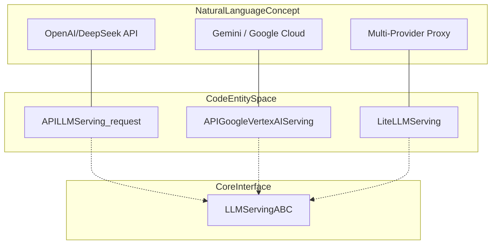
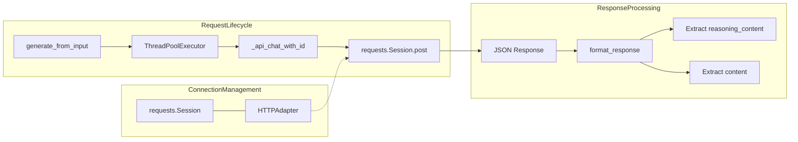

<!-- source: DeepWiki mcp.deepwiki.com · repo OpenDCAI/DataFlow · extra page API-Based Serving · fetched 2026-11-02 -->

# API-Based Serving

<details>
<summary>Relevant source files</summary>

The following files were used as context for generating this wiki page:

- [.github/workflows/test.yml](.github/workflows/test.yml)
- [dataflow/operators/code/filter/code_score_filter.py](dataflow/operators/code/filter/code_score_filter.py)
- [dataflow/operators/core_text/eval/bench_dataset_evaluator_question.py](dataflow/operators/core_text/eval/bench_dataset_evaluator_question.py)
- [dataflow/serving/api_google_vertexai_serving.py](dataflow/serving/api_google_vertexai_serving.py)
- [dataflow/serving/api_llm_serving_request.py](dataflow/serving/api_llm_serving_request.py)
- [dataflow/serving/google_api_serving.py](dataflow/serving/google_api_serving.py)
- [dataflow/serving/lite_llm_serving.py](dataflow/serving/lite_llm_serving.py)
- [dataflow/serving/localhost_llm_api_serving.py](dataflow/serving/localhost_llm_api_serving.py)
- [dataflow/serving/localmodel_lalm_serving.py](dataflow/serving/localmodel_lalm_serving.py)
- [dataflow/statics/playground/playground/prompted_generator/translation_litellm.py](dataflow/statics/playground/playground/prompted_generator/translation_litellm.py)
- [dataflow/statics/playground/playground/prompted_generator/translation_litellm_json_schema.py](dataflow/statics/playground/playground/prompted_generator/translation_litellm_json_schema.py)
- [pyproject.toml](pyproject.toml)
- [requirements.txt](requirements.txt)
- [test/cpu_only/test_undefined_name_crashes.py](test/cpu_only/test_undefined_name_crashes.py)
- [test/test_general_text.py](test/test_general_text.py)
- [test/test_litellm.py](test/test_litellm.py)

</details>


## Purpose and Scope

This document details the API-based LLM serving implementations in DataFlow, which enable operators to interact with cloud-based LLM services. API-based serving provides an abstraction layer for external LLM APIs, handling connection management, request batching, retry logic, and structured output parsing. This contrasts with local GPU serving (covered in 3.4.2) and specialized serving modes like embedding generation (see 3.4.4).

The primary API-based serving implementations are:
- **`APILLMServing_request`**: OpenAI-compatible API client supporting any OpenAI-format endpoint, including DeepSeek [dataflow/serving/api_llm_serving_request.py:16-16]().
- **`APIGoogleVertexAIServing`**: Google Vertex AI/Gemini-specific client with batch processing and multimodal capabilities [dataflow/serving/api_google_vertexai_serving.py:48-50]().
- **`LiteLLMServing`**: A unified interface supporting 100+ LLM providers (Anthropic, Azure, AWS Bedrock, etc.) via the LiteLLM library [dataflow/serving/lite_llm_serving.py:10-20]().

All classes implement the `LLMServingABC` interface, ensuring operators can switch between serving backends without code changes [dataflow/serving/api_llm_serving_request.py:16-16](), [dataflow/serving/lite_llm_serving.py:10-10]().

Sources: [dataflow/serving/api_llm_serving_request.py:16-16](), [dataflow/serving/api_google_vertexai_serving.py:48-50](), [dataflow/serving/lite_llm_serving.py:10-20]()

---

## Architecture Overview

API-based serving classes provide a unified interface for external LLM services while implementing sophisticated features like connection pooling, concurrent request handling, and automatic retry mechanisms.

### Natural Language Space to Code Entity Space Mapping

The following diagram bridges high-level serving concepts to specific code entities within the `dataflow.serving` module.

**Code Entity Association Diagram**

Sources: [dataflow/serving/api_llm_serving_request.py:16-16](), [dataflow/serving/api_google_vertexai_serving.py:48-50](), [dataflow/serving/lite_llm_serving.py:10-20](), [dataflow/core/__init__.py]()

---

## APILLMServing_request: OpenAI-Compatible Serving

The `APILLMServing_request` class provides a production-grade client for any OpenAI-compatible API endpoint. It implements robust connection management and intelligent retry logic.

### Internal Logic and Data Flow

**APILLMServing_request Internal Architecture**

Sources: [dataflow/serving/api_llm_serving_request.py:61-75](), [dataflow/serving/api_llm_serving_request.py:78-103](), [dataflow/serving/api_llm_serving_request.py:133-170]()

### Key Features, Retry, and Timeout Mechanisms

| Feature | Description | Configuration Parameter |
|---------|-------------|------------------------|
| **Connection Pooling** | Reuses HTTP connections via `HTTPAdapter` [dataflow/serving/api_llm_serving_request.py:61-69]() | `max_workers` (default: 10) |
| **Concurrent Requests** | `ThreadPoolExecutor` for parallel API calls [dataflow/serving/api_llm_serving_request.py:8-8]() | `max_workers` |
| **Retry Logic** | Custom retry loop for failed requests [dataflow/serving/api_llm_serving_request.py:39-39]() | `max_retries` (default: 5) |
| **Timeout Handling** | Separate connect/read timeouts tuple `(connect_timeout, read_timeout)` [dataflow/serving/api_llm_serving_request.py:41-45]() | `connect_timeout`, `read_timeout` |
| **Structured Output** | JSON schema support via `response_format` [dataflow/serving/api_llm_serving_request.py:157-165]() | `json_schema` parameter |

Sources: [dataflow/serving/api_llm_serving_request.py:38-69](), [dataflow/serving/api_llm_serving_request.py:157-165]()

### Response Formatting and Reasoning Content

The `format_response()` method handles multiple response formats, including reasoning models (like DeepSeek R1) that provide separate thinking and answer content. It wraps reasoning content in `<think>` tags and the final response in `<answer>` tags if the `reasoning_content` field is present in the API response [dataflow/serving/api_llm_serving_request.py:78-103](). 

Key handling for null content with reasoning:
- If `content` is `None` but `reasoning_content` exists, it returns a formatted string wrapping the reasoning [dataflow/serving/api_llm_serving_request.py:89-101]().
- If the response only contains tool calls without content, it returns `None` to mark a failure in standard chat mode [test/cpu_only/test_undefined_name_crashes.py:83-96]().
- It also supports embedding mode by extracting the vector from the `data` array [dataflow/serving/api_llm_serving_request.py:82-83]().

Sources: [dataflow/serving/api_llm_serving_request.py:78-103](), [test/cpu_only/test_undefined_name_crashes.py:83-108]()

---

## APIGoogleVertexAIServing: Google Vertex AI Integration

The `APIGoogleVertexAIServing` class provides access to Google's Gemini models via Vertex AI, with support for batch processing and multimodal inputs [dataflow/serving/api_google_vertexai_serving.py:48-50]().

### GeminiVertexAIClient and Model Initialization

The internal `GeminiVertexAIClient` class wraps the Vertex AI SDK. A critical detail is that `system_instruction` must be provided during model initialization rather than during the content generation call [dataflow/serving/api_google_vertexai_serving.py:121-127]().

```python
# From dataflow/serving/api_google_vertexai_serving.py:124-127
model_instance = GenerativeModel(
    model_name,
    system_instruction=system_prompt
)
```

### Batch Processing Workflow

The implementation supports Google GenAI batch processing using `google.genai` types like `CreateBatchJobConfig` [dataflow/serving/api_google_vertexai_serving.py:39-40](). This allows for high-throughput processing of data stored in Google Cloud Storage or BigQuery, using `fsspec` for file handling [dataflow/serving/api_google_vertexai_serving.py:15-15]().

Sources: [dataflow/serving/api_google_vertexai_serving.py:39-46](), [dataflow/serving/api_google_vertexai_serving.py:121-170](), [dataflow/serving/api_google_vertexai_serving.py:15-15]()

---

## LiteLLMServing: Unified Provider Interface

The `LiteLLMServing` class acts as a proxy to multiple LLM providers (Anthropic, Azure, etc.) without global state pollution by passing parameters directly to each `completion()` call [dataflow/serving/lite_llm_serving.py:10-20](). It supports both `chat` and `embedding` serving types [dataflow/serving/lite_llm_serving.py:29-29]().

### Dynamic Model Switching

LiteLLMServing supports dynamic model switching via `switch_model()` which updates the instance configuration (API keys, URLs, and versions) and re-validates the setup [dataflow/serving/lite_llm_serving.py:113-156]().

```python
# From dataflow/serving/lite_llm_serving.py:113-118
def switch_model(self, 
                 model_name: str,
                 key_name_of_api_key: Optional[str] = None,
                 api_url: Optional[str] = None,
                 api_version: Optional[str] = None,
                 **kwargs: Any):
```

### Thread Safety and Validation

The implementation avoids global state pollution by passing configuration parameters directly to LiteLLM calls, ensuring thread safety during batch processing via `ThreadPoolExecutor` [dataflow/serving/lite_llm_serving.py:10-17](). It also includes a `_validate_setup()` call during initialization to verify API credentials and model availability [dataflow/serving/lite_llm_serving.py:108-109]().

Sources: [dataflow/serving/lite_llm_serving.py:10-156](), [dataflow/serving/lite_llm_serving.py:29-29]()

---

## Summary Comparison

| Feature | APILLMServing_request | APIGoogleVertexAIServing | LiteLLMServing |
|---------|----------------------|-------------------------|----------------|
| **Backend** | OpenAI/DeepSeek/Custom | Google Vertex AI | 100+ Providers |
| **Concurrency** | `ThreadPoolExecutor` | `ThreadPoolExecutor` | `ThreadPoolExecutor` |
| **Batch Mode** | Threading-based | Native SDK Batch | Threading-based |
| **Multimodal** | Text Only | Text + Images/Files | Provider Dependent |
| **Reasoning** | `reasoning_content` support | Standard Text | Unified `think` format |
| **Dependencies** | `requests`, `openai` | `google-cloud-aiplatform` | `litellm` |

Sources: [dataflow/serving/api_llm_serving_request.py](), [dataflow/serving/api_google_vertexai_serving.py](), [dataflow/serving/lite_llm_serving.py](), [requirements.txt:41-48](), [requirements.txt:81-89](), [pyproject.toml:64-64]()

---

