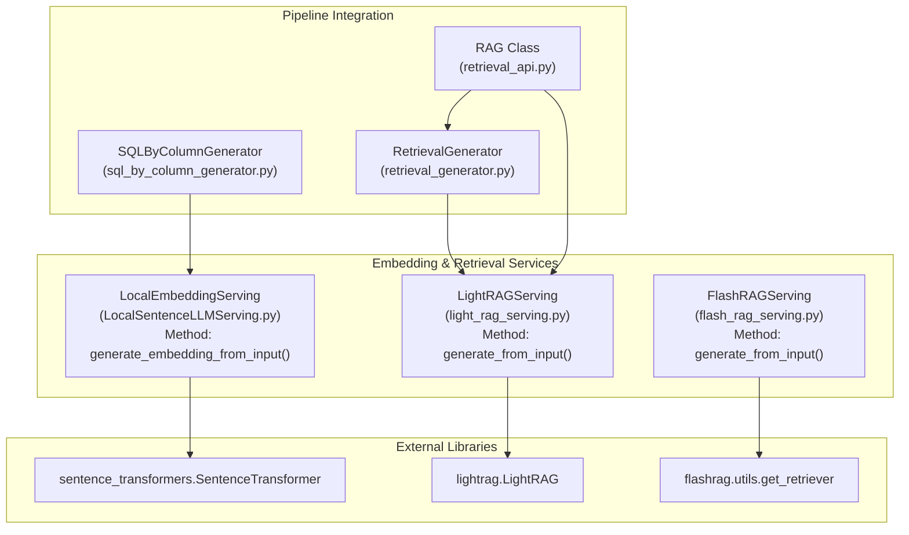
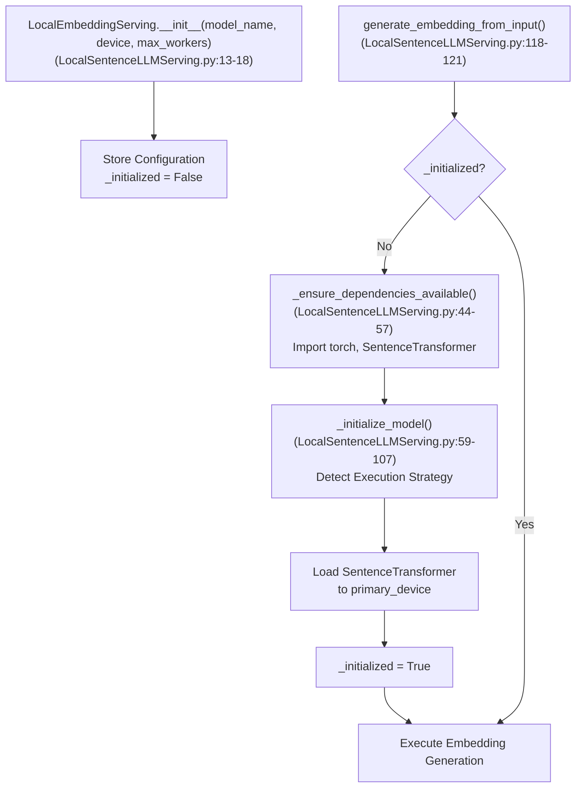
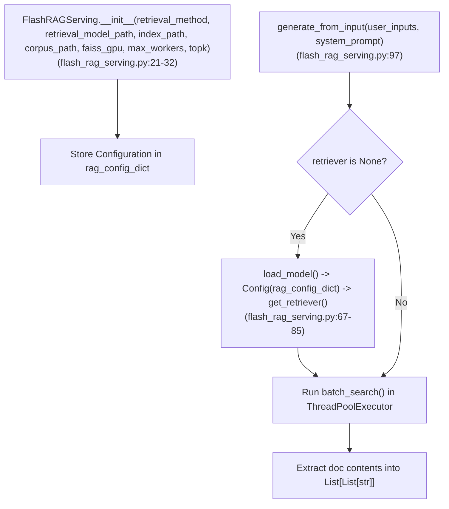

<!-- source: DeepWiki mcp.deepwiki.com · repo OpenDCAI/DataFlow · extra page Embedding and Specialized Services · fetched 2026-11-02 -->

# Embedding and Specialized Services

Relevant source files

The following files were used as context for generating this wiki page:

- [dataflow/example/AgenticRAGPipeline/multihop_pipeline_data.jsonl](dataflow/example/AgenticRAGPipeline/multihop_pipeline_data.jsonl)
- [dataflow/operators/core_text/generate/random_domain_knowledge_row_generator.py](dataflow/operators/core_text/generate/random_domain_knowledge_row_generator.py)
- [dataflow/operators/core_text/generate/retrieval_generator.py](dataflow/operators/core_text/generate/retrieval_generator.py)
- [dataflow/operators/text2sql/__init__.py](dataflow/operators/text2sql/__init__.py)
- [dataflow/operators/text2sql/generate/sql_by_column_generator.py](dataflow/operators/text2sql/generate/sql_by_column_generator.py)
- [dataflow/serving/LocalSentenceLLMServing.py](dataflow/serving/LocalSentenceLLMServing.py)
- [dataflow/serving/flash_rag_serving.py](dataflow/serving/flash_rag_serving.py)
- [dataflow/serving/light_rag_serving.py](dataflow/serving/light_rag_serving.py)
- [dataflow/statics/pipelines/api_pipelines/agentic_rag_multihop_core_pipeline.py](dataflow/statics/pipelines/api_pipelines/agentic_rag_multihop_core_pipeline.py)
- [dataflow/statics/playground/playground/prompted_generator/retrieval_api.py](dataflow/statics/playground/playground/prompted_generator/retrieval_api.py)

## Purpose and Scope

This document details the embedding generation services and specialized RAG (Retrieval-Augmented Generation) serving components in DataFlow's infrastructure layer. These services enable vector-based operations such as semantic search, similarity matching, graph-based knowledge retrieval, and multi-hop retrieval-augmented generation.

**Coverage:**
- `LocalEmbeddingServing`: Local embedding generation with `sentence-transformers` and multi-GPU/CPU parallelization strategies [`dataflow/serving/LocalSentenceLLMServing.py:8-158`]().
- `FlashRAGServing`: Integration with the FlashRAG framework for efficient sparse/dense document retrieval [`dataflow/serving/flash_rag_serving.py:20-126`]().
- `LightRAGServing`: Graph-based RAG integration for complex knowledge extraction and retrieval [`dataflow/serving/light_rag_serving.py:48-146`]().
- `RetrievalGenerator`: Operator integration for RAG-based answer generation [`dataflow/operators/core_text/generate/retrieval_generator.py:11-85`]().

Sources: [`dataflow/serving/LocalSentenceLLMServing.py:8-158`](), [`dataflow/serving/flash_rag_serving.py:20-126`](), [`dataflow/serving/light_rag_serving.py:48-146`](), [`dataflow/operators/core_text/generate/retrieval_generator.py:11-85`]().

---

## Architecture Overview

DataFlow provides specialized serving implementations beyond standard text generation to support vector operations and retrieval-augmented workflows.

### Specialized Serving Components

Sources: [`dataflow/serving/LocalSentenceLLMServing.py:8-12`](), [`dataflow/serving/light_rag_serving.py:48-58`](), [`dataflow/serving/flash_rag_serving.py:20-66`](), [`dataflow/operators/core_text/generate/retrieval_generator.py:11-18`](), [`dataflow/statics/playground/playground/prompted_generator/retrieval_api.py:7-26`]().

---

## LocalEmbeddingServing: Sentence-Transformers Integration

The `LocalEmbeddingServing` class (defined in `LocalSentenceLLMServing.py`) provides local embedding generation using `sentence-transformers` with automatic hardware-based parallelization [`dataflow/serving/LocalSentenceLLMServing.py:8-12`]().

### Class Architecture and Lazy Initialization

The service uses a lazy initialization pattern to defer model loading and dependency imports until the first embedding request is made.

**Key Implementation Details:**
- **Dependency Check**: Imports `torch` and `SentenceTransformer` inside `_ensure_dependencies_available` to prevent mandatory overhead for non-embedding pipelines [`dataflow/serving/LocalSentenceLLMServing.py:44-57`]().
- **Execution Strategies**: Automatically selects between `single_device`, `cpu_parallel`, and `gpu_parallel` based on `max_workers` and available hardware [`dataflow/serving/LocalSentenceLLMServing.py:65-97`]().
- **Retry Logic**: Implements an exponential backoff retry mechanism for embedding generation [`dataflow/serving/LocalSentenceLLMServing.py:129-158`]().

Sources: [`dataflow/serving/LocalSentenceLLMServing.py:8-158`]().

### Parallelization Strategies

`LocalEmbeddingServing` supports three execution modes controlled by the `max_workers` parameter:

| Strategy | Condition | Behavior |
| :--- | :--- | :--- |
| **single_device** | `max_workers=1` or single core/GPU | Uses standard `model.encode()` on the primary device [`dataflow/serving/LocalSentenceLLMServing.py:143-144`](). |
| **cpu_parallel** | `max_workers > 1` on CPU | Starts a multi-process pool using `model.start_multi_process_pool()` [`dataflow/serving/LocalSentenceLLMServing.py:138-141`](). |
| **gpu_parallel** | `max_workers > 1` on multi-GPU | Distributes computation across `min(max_workers, gpu_count)` GPUs using `encode_multi_process` [`dataflow/serving/LocalSentenceLLMServing.py:133-136`](). |

Sources: [`dataflow/serving/LocalSentenceLLMServing.py:72-101`](), [`dataflow/serving/LocalSentenceLLMServing.py:133-144`]().

---

## FlashRAG Serving

The `FlashRAGServing` class integrates FlashRAG document retrieval capabilities into DataFlow's serving abstraction [`dataflow/serving/flash_rag_serving.py:20-21`]().

### Configuration and Execution Flow

**Key Implementation Details:**
- **Lazy Loading**: If the retriever is not loaded explicitly before inference, `generate_from_input` triggers `load_model()` inside an executor thread [`dataflow/serving/flash_rag_serving.py:98-101`]().
- **Batch Search**: Executes synchronous batch retrieval (`retriever.batch_search`) across worker threads and structures results as a nested list of strings [`dataflow/serving/flash_rag_serving.py:106-122`]().

Sources: [`dataflow/serving/flash_rag_serving.py:20-126`]().

---

## LightRAG Serving

The `LightRAGServing` class enables graph-based retrieval and generation by wrapping the `LightRAG` library [`dataflow/serving/light_rag_serving.py:48-49`]().
- **Initialization**: Configures `llm_model_func` and `embedding_func` (typically using `ollama_embed`) to interface with the LightRAG core [`dataflow/serving/light_rag_serving.py:14-42`]().
- **Storage Management**: Calls `rag.initialize_storages()` to prepare the graph and vector indices [`dataflow/serving/light_rag_serving.py:44`]().
- **Async Interface**: Provides an asynchronous `generate_from_input` method to handle retrieval queries [`dataflow/serving/light_rag_serving.py:101-103`]().

Sources: [`dataflow/serving/light_rag_serving.py:14-146`]().

---

## Specialized Operator Integration

### RetrievalGenerator
The `RetrievalGenerator` is a specialized generation operator that utilizes a `LightRAGServing` instance to generate answers based on indexed knowledge [`dataflow/operators/core_text/generate/retrieval_generator.py:11-18`]().
- **Process**: Calls `await self.llm_serving.generate_from_input(llm_inputs, self.system_prompt)` to fetch context-aware responses [`dataflow/operators/core_text/generate/retrieval_generator.py:76`]().
- **Data Flow**: Reads from `storage.read('dataframe')`, processes the `input_key` (e.g., `raw_content`), and writes results to `output_key` (e.g., `generated_content`) [`dataflow/operators/core_text/generate/retrieval_generator.py:64-85`]().

Sources: [`dataflow/operators/core_text/generate/retrieval_generator.py:11-85`](), [`dataflow/statics/playground/playground/prompted_generator/retrieval_api.py:21-31`]().

---

