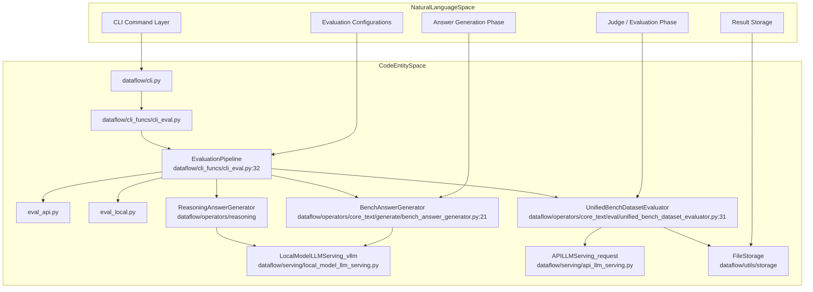
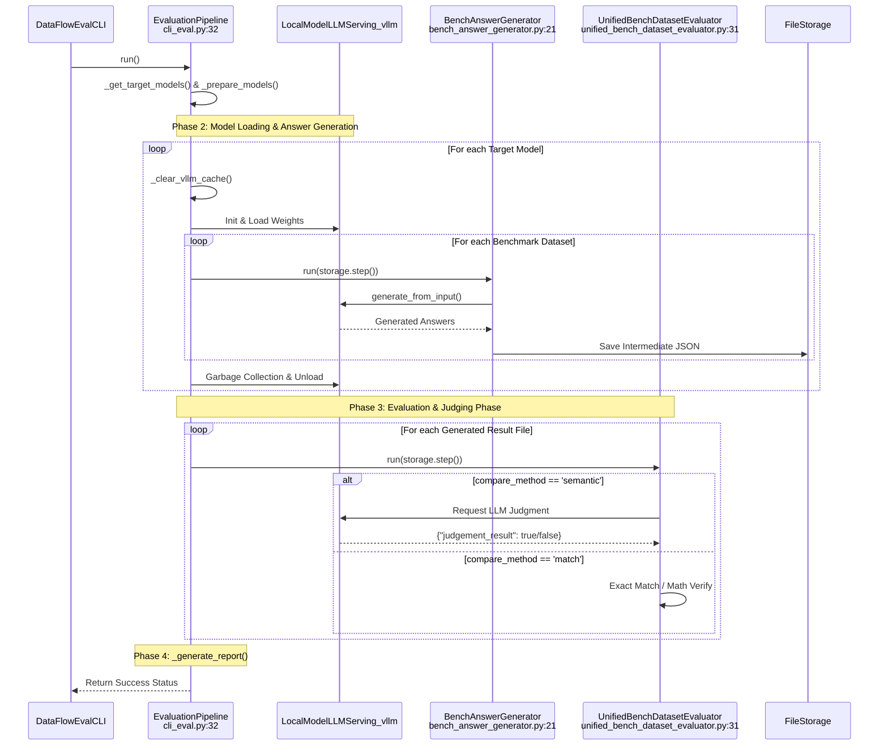

<!-- source: DeepWiki mcp.deepwiki.com · repo OpenDCAI/DataFlow · extra page Evaluation Pipeline · fetched 2026-11-02 -->

# Evaluation Pipeline

Relevant source files

The following files were used as context for generating this wiki page:

- [dataflow/cli.py](dataflow/cli.py)
- [dataflow/cli_funcs/cli_eval.py](dataflow/cli_funcs/cli_eval.py)
- [dataflow/cli_funcs/cli_webui.py](dataflow/cli_funcs/cli_webui.py)
- [dataflow/cli_funcs/eval_pipeline/eval_api.py](dataflow/cli_funcs/eval_pipeline/eval_api.py)
- [dataflow/cli_funcs/eval_pipeline/eval_local.py](dataflow/cli_funcs/eval_pipeline/eval_local.py)
- [dataflow/example/core_text_data/unified_bench_eval_type1.jsonl](dataflow/example/core_text_data/unified_bench_eval_type1.jsonl)
- [dataflow/example/core_text_data/unified_bench_eval_type2.jsonl](dataflow/example/core_text_data/unified_bench_eval_type2.jsonl)
- [dataflow/example/core_text_data/unified_bench_eval_type3.jsonl](dataflow/example/core_text_data/unified_bench_eval_type3.jsonl)
- [dataflow/example/core_text_data/unified_bench_eval_type4.jsonl](dataflow/example/core_text_data/unified_bench_eval_type4.jsonl)
- [dataflow/example/core_text_data/unified_bench_eval_type5.jsonl](dataflow/example/core_text_data/unified_bench_eval_type5.jsonl)
- [dataflow/example/core_text_data/unified_bench_eval_type6.jsonl](dataflow/example/core_text_data/unified_bench_eval_type6.jsonl)
- [dataflow/operators/core_text/eval/unified_bench_dataset_evaluator.py](dataflow/operators/core_text/eval/unified_bench_dataset_evaluator.py)
- [dataflow/operators/core_text/generate/bench_answer_generator.py](dataflow/operators/core_text/generate/bench_answer_generator.py)
- [dataflow/statics/pipelines/gpu_pipelines/benchmark_eval/unified_bench_eval_type1.py](dataflow/statics/pipelines/gpu_pipelines/benchmark_eval/unified_bench_eval_type1.py)
- [dataflow/statics/playground/playground/mathbook_extract.py](dataflow/statics/playground/playground/mathbook_extract.py)
- [dataflow/statics/playground/playground/quick_evaluate.py](dataflow/statics/playground/playground/quick_evaluate.py)
- [dataflow/statics/playground/playground/vqa.py](dataflow/statics/playground/playground/vqa.py)
- [dataflow/statics/scaffold/{{cookiecutter.repo_name}}/{{cookiecutter.package_name}}/operators/core/__init__.py](dataflow/statics/scaffold/{{cookiecutter.repo_name}}/{{cookiecutter.package_name}}/operators/core/__init__.py)
- [test/test_autoop_graph.py](test/test_autoop_graph.py)

## Purpose and Scope

The **Evaluation Pipeline** is a specialized subsystem within the DataFlow framework designed to benchmark and evaluate Large Language Models (LLMs) against reference datasets. It automates the end-to-end evaluation lifecycle: generating model responses for specific benchmarks (`BenchAnswerGenerator`), judging those responses against ground truth using mathematical verification or LLM-based semantic judging (`UnifiedBenchDatasetEvaluator`), and aggregating results into comprehensive accuracy reports.

The pipeline is orchestrated by the `EvaluationPipeline` class [dataflow/cli_funcs/cli_eval.py:32-33]() and is invoked via the `dataflow eval` CLI interface [dataflow/cli.py:186-200](). It supports both standard QA evaluations and unified benchmark evaluation types across multiple model backends.

Sources: [dataflow/cli_funcs/cli_eval.py:1-30](), [dataflow/cli_funcs/cli_eval.py:32-40](), [dataflow/cli.py:186-200]()

---

## System Architecture

The evaluation architecture connects command-line entrypoints with core DataFlow execution primitives including `LLMServingABC`, `OperatorABC`, and `FileStorage`.

### Component Interaction and Code Entity Mapping

The following diagram maps high-level evaluation concepts (Natural Language Space) directly to their implementation classes and modules (Code Entity Space):

Title: "EvaluationPipelineComponentInteraction"

Sources: [dataflow/cli_funcs/cli_eval.py:32-40](), [dataflow/operators/core_text/generate/bench_answer_generator.py:21-49](), [dataflow/operators/core_text/eval/unified_bench_dataset_evaluator.py:31-72](), [dataflow/cli_funcs/eval_pipeline/eval_local.py:5-8]()

---

## Configuration Framework

Evaluation parameters are defined in modular configuration scripts: `eval_api.py` (API-based judging) and `eval_local.py` (local GPU-based judging).

### Core Configuration Structures

| Configuration Key | Purpose | Code Pointer |
|-------------------|---------|--------------|
| `JUDGE_MODEL_CONFIG` | Defines the judge model parameters (e.g., GPT-4o-mini or a local Qwen-7B). | [dataflow/cli_funcs/eval_pipeline/eval_api.py:58-64]() |
| `TARGET_MODELS` | List of target models to evaluate, including path and inference specs. | [dataflow/cli_funcs/eval_pipeline/eval_api.py:68-125]() |
| `BENCH_CONFIG` | Defines benchmark datasets, input files, and schema keys. | [dataflow/cli_funcs/eval_pipeline/eval_api.py:128-143]() |
| `EVAL_CONFIG` | Sets comparison modes such as `semantic` or `match`. | [dataflow/cli_funcs/eval_pipeline/eval_api.py:152-154]() |
| `EVALUATOR_RUN_CONFIG` | Maps internal operator keys to dataframe columns. | [dataflow/cli_funcs/eval_pipeline/eval_local.py:131-135]() |

### Factory Functions
Configuration modules instantiate serving backends and operators via factory methods:
* `create_judge_serving()`: Instantiates `APILLMServing_request` [dataflow/cli_funcs/eval_pipeline/eval_api.py:161-179]() or `LocalModelLLMServing_vllm` [dataflow/cli_funcs/eval_pipeline/eval_local.py:147-184]().
* `create_evaluator()`: Instantiates `UnifiedBenchDatasetEvaluator` or `BenchDatasetEvaluatorQuestion` [dataflow/cli_funcs/eval_pipeline/eval_api.py:182-194]().

Sources: [dataflow/cli_funcs/eval_pipeline/eval_api.py:58-194](), [dataflow/cli_funcs/eval_pipeline/eval_local.py:55-184]()

---

## Data Flow and Execution Phases

The `EvaluationPipeline.run()` method [dataflow/cli_funcs/cli_eval.py:40-63]() executes four sequential phases. 

### Execution Sequence and Code Mapping

The sequence diagram below correlates evaluation phase transitions with underlying class methods:

Title: "EvaluationExecutionSequence"

Sources: [dataflow/cli_funcs/cli_eval.py:40-63](), [dataflow/cli_funcs/cli_eval.py:131-160](), [dataflow/operators/core_text/generate/bench_answer_generator.py:174-187]()

---

## Core Operators and Logic

### BenchAnswerGenerator
The `BenchAnswerGenerator` operator [dataflow/operators/core_text/generate/bench_answer_generator.py:21-49]() handles prompt construction and text generation for benchmark inputs.
*   **Prompt Formatting**: Implements `_build_prompt` to format context, questions, and choice lists based on `eval_type` [dataflow/operators/core_text/generate/bench_answer_generator.py:129-172]().
*   **Supported Types**: Handles `key1_text_score`, `key2_qa`, `key2_q_ma`, `key3_q_choices_a`, `key3_q_choices_as`, and `key3_q_a_rejected` [dataflow/operators/core_text/generate/bench_answer_generator.py:36-43]().

### Unified Benchmark Evaluation
The `UnifiedBenchDatasetEvaluator` operator [dataflow/operators/core_text/eval/unified_bench_dataset_evaluator.py:31-72]() processes multiple benchmark evaluation schemas:
*   `key1_text_score`: Numeric scoring and perplexity evaluation [dataflow/statics/pipelines/gpu_pipelines/benchmark_eval/unified_bench_eval_type1.py:16]().
*   `key2_qa`: Standard Question-Answer evaluation [dataflow/example/core_text_data/unified_bench_eval_type2.jsonl:1-15]().
*   `key2_q_ma`: Multi-answer validation [dataflow/example/core_text_data/unified_bench_eval_type3.jsonl:1-6]().
*   `key3_q_choices_a`: Single-label multiple-choice evaluation [dataflow/example/core_text_data/unified_bench_eval_type4.jsonl:1-10]().
*   `key3_q_choices_as`: Multi-select multiple-choice evaluation [dataflow/example/core_text_data/unified_bench_eval_type5.jsonl:1-10]().
*   `key3_q_a_rejected`: Preference comparison (chosen vs. rejected) [dataflow/example/core_text_data/unified_bench_eval_type6.jsonl:1-10]().

### Prompt Templates
*   `AnswerJudgePrompt`: Used by evaluators to assess factual accuracy, completeness, and relevance [dataflow/operators/core_text/eval/unified_bench_dataset_evaluator.py:19-28]().
*   `FairAnswerJudgePrompt`: Detailed judging instructions defined in configuration files [dataflow/cli_funcs/eval_pipeline/eval_api.py:14-48]().

Sources: [dataflow/operators/core_text/generate/bench_answer_generator.py:34-56](), [dataflow/operators/core_text/eval/unified_bench_dataset_evaluator.py:31-88](), [dataflow/cli_funcs/eval_pipeline/eval_api.py:14-48]()

---

## Resource Management

To prevent VRAM exhaustion and GPU out-of-memory (OOM) errors during large-scale local model benchmarking, `EvaluationPipeline` enforces lifecycle controls:

1.  **Sequential Model Execution**: Models are loaded and evaluated sequentially within `_generate_answers()` [dataflow/cli_funcs/cli_eval.py:141-145]().
2.  **Torch Compile Cache Purging**: The method `_clear_vllm_cache()` deletes cached compilation artifacts under `~/.cache/vllm` prior to instantiating each model [dataflow/cli_funcs/cli_eval.py:118-129]().
3.  **Explicit Memory Reclaiming**: Following benchmark processing, serving instances are explicitly deleted and garbage collected using `torch.cuda.empty_cache()` [dataflow/cli_funcs/cli_eval.py:249-257]().

Sources: [dataflow/cli_funcs/cli_eval.py:118-129](), [dataflow/cli_funcs/cli_eval.py:249-257]()

---

## Result Aggregation and Reporting

Upon completing the evaluation steps, the pipeline aggregates results:
*   **Per-Model Artifacts**: Individual JSON response files are written to the directory specified in `output_dir` [dataflow/cli_funcs/cli_eval.py:210-220]().
*   **Aggregated Summary (`all_results.json`)**: Combines metrics across all evaluated models and benchmark sets, sorted by performance metrics [dataflow/cli_funcs/cli_eval.py:393-408]().
*   **Storage Integration**: Utilizes `FileStorage` to persist intermediate states and cached evaluations [dataflow/utils/storage/__init__.py]() (referenced via [dataflow/cli_funcs/eval_pipeline/eval_api.py:7]()).

Sources: [dataflow/cli_funcs/cli_eval.py:335-408](), [dataflow/cli_funcs/eval_pipeline/eval_api.py:7]()

---

