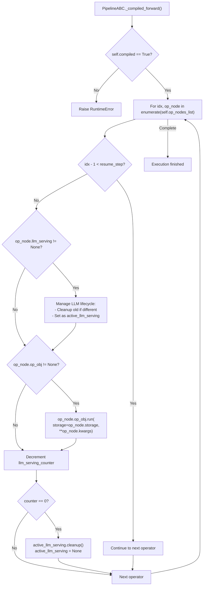
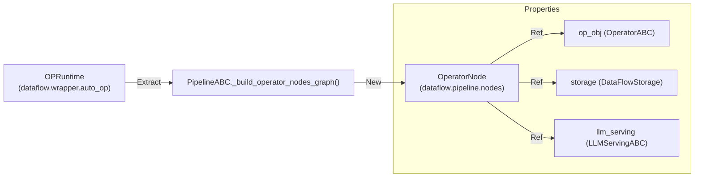
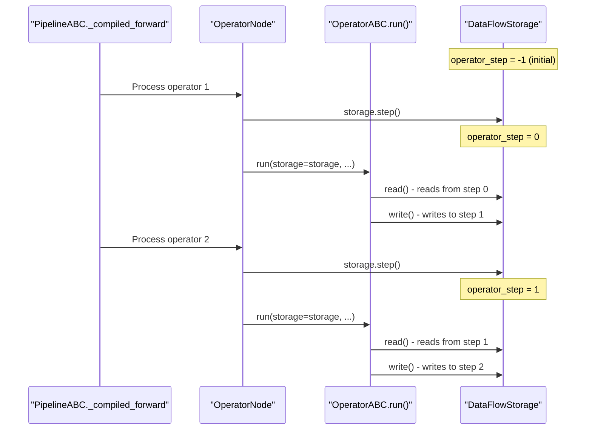
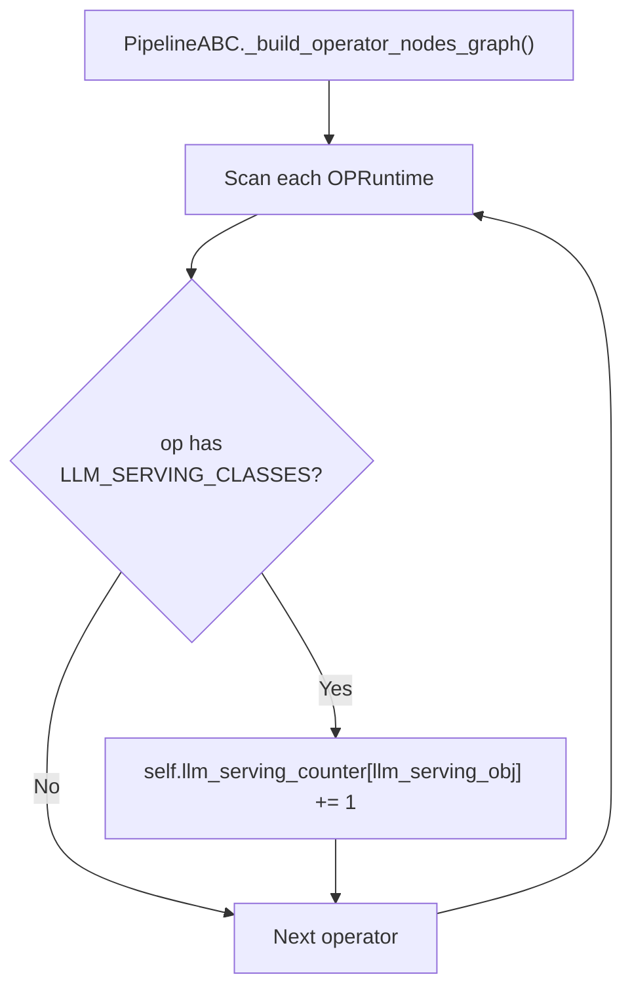

<!-- source: DeepWiki mcp.deepwiki.com · repo OpenDCAI/DataFlow · extra page Execution Phase · fetched 2026-11-02 -->

# Execution Phase

<details>
<summary>Relevant source files</summary>

The following files were used as context for generating this wiki page:

- [dataflow/pipeline/Pipeline.py](dataflow/pipeline/Pipeline.py)
- [dataflow/pipeline/__init__.py](dataflow/pipeline/__init__.py)
- [dataflow/pipeline/nodes.py](dataflow/pipeline/nodes.py)
- [dataflow/statics/playground/playground/mathbook_extract.py](dataflow/statics/playground/playground/mathbook_extract.py)
- [dataflow/statics/playground/playground/quick_evaluate.py](dataflow/statics/playground/playground/quick_evaluate.py)
- [dataflow/statics/playground/playground/vqa.py](dataflow/statics/playground/playground/vqa.py)
- [dataflow/utils/storage.py](dataflow/utils/storage.py)
- [test/cpu_only/test_lazy_file_storage_flush.py](test/cpu_only/test_lazy_file_storage_flush.py)
- [test/cpu_only/test_remote_batch_slicing.py](test/cpu_only/test_remote_batch_slicing.py)
- [test/test_autoop_graph.py](test/test_autoop_graph.py)
- [test/test_batched_pipeline.py](test/test_batched_pipeline.py)
- [test/test_batched_stream_pipeline.py](test/test_batched_stream_pipeline.py)
- [test/test_read_xlsx.py](test/test_read_xlsx.py)

</details>


## Overview

The Execution Phase occurs after the [Compilation Phase](3.2.1) and is responsible for executing operators within a compiled pipeline. During execution, the pipeline iterates sequentially through operator nodes, manages storage state transitions via `storage.step()`, handles the LLM serving lifecycle (loading and cleanup), and coordinates data flow across operators.

This page covers the standard `PipelineABC` execution model. For batch-aware processing over large datasets, see [Batched and Streaming Pipelines](3.2.3). For details on file and database storage backends, see [Storage Systems](3.5).

Sources: [dataflow/pipeline/Pipeline.py:43-59](), [dataflow/pipeline/Pipeline.py:507-535]()

## The `_compiled_forward` Method

Once `pipeline.compile()` is invoked [dataflow/pipeline/Pipeline.py:43-59](), the pipeline instance replaces its `forward` method with `_compiled_forward`, which implements the core runtime loop over `op_nodes_list`.

**Method Signature:**
```python
def _compiled_forward(self, resume_step: int=0):
```

**Parameters:**
- `resume_step` (int): Allows resuming execution from a specified operator step index, supporting recovery after execution failures [dataflow/pipeline/Pipeline.py:507-515]().

The execution flow processes each `OperatorNode` sequentially, handling three main responsibilities:
1. **Storage state management**: advancing the step counter prior to operator execution.
2. **LLM lifecycle management**: instantiating or releasing LLM serving objects via `LLMServingABC` [dataflow/pipeline/Pipeline.py:517-535]().
3. **Operator execution**: calling `OperatorABC.run()` with the appropriate storage and parameters.

Sources: [dataflow/pipeline/Pipeline.py:43-59](), [dataflow/pipeline/Pipeline.py:507-535]()

## Execution Loop Architecture

The runtime loop operates on `op_nodes_list` containing operators wrapped as `OperatorNode` objects [dataflow/pipeline/nodes.py:36-44](). This list includes two special bounds:
- `DATASET-INPUT` at index 0 (representing the initial dataset) [dataflow/pipeline/Pipeline.py:145-153]().
- `DATASET-OUTPUT` at the final index (representing terminal output) [dataflow/pipeline/Pipeline.py:155-162]().

### Pipeline Execution Logic
Title: "Pipeline Execution Logic in PipelineABC._compiled_forward"


**Key Data Structures:**
- `self.op_nodes_list`: List of `OperatorNode` objects containing operator instances, storage, LLM serving objects, and keyword arguments [dataflow/pipeline/Pipeline.py:32]().
- `self.active_llm_serving`: Reference to the currently active LLM serving backend [dataflow/pipeline/Pipeline.py:28]().
- `self.llm_serving_counter`: A `Counter` tracking remaining usage references for each `LLMServingABC` instance [dataflow/pipeline/Pipeline.py:34]().

Sources: [dataflow/pipeline/Pipeline.py:18-35](), [dataflow/pipeline/Pipeline.py:507-535](), [dataflow/pipeline/nodes.py:36-95]()

## Operator Node Structure

Each step's operator is wrapped in an `OperatorNode` instance (`dataflow.pipeline.nodes.OperatorNode`) which encapsulates all runtime requirements:

| Field | Type | Description |
|-------|------|-------------|
| `op_obj` | `OperatorABC` | The underlying operator instance [dataflow/pipeline/nodes.py:45]() |
| `op_name` | `str` | Attribute name defined in the pipeline class [dataflow/pipeline/nodes.py:46]() |
| `storage` | `DataFlowStorage` | Storage backend instance bound to this step [dataflow/pipeline/nodes.py:47]() |
| `llm_serving` | `LLMServingABC` | Associated LLM serving backend (if applicable) [dataflow/pipeline/nodes.py:48]() |
| `kwargs` | `dict` | Execution parameters including `input_key` and `output_key` mappings [dataflow/pipeline/nodes.py:49]() |

### Code Entity Association: Compilation to Execution
Title: "Mapping OPRuntime to OperatorNode"


Sources: [dataflow/pipeline/Pipeline.py:60-89](), [dataflow/pipeline/nodes.py:36-95](), [dataflow/wrapper/auto_op.py:20-37]()

## Storage Step Management

DataFlow storage subclasses (such as `FileStorage` and `LazyFileStorage`) implement a step-based access pattern where each operator reads from step $N$ and writes its output to step $N+1$. The `storage.step()` method increments the internal `operator_step` counter [dataflow/utils/storage.py:156]().

### Step Mechanism Sequence
Title: "Storage Step Advancement in Execution"


**Implementation Details:**
- Storage stepping is driven by the user inside the pipeline's `forward()` implementation when invoking operator `.run()` methods [test/test_batched_pipeline.py:36-37]().
- Each call to `storage.step()` increments `self.operator_step` [dataflow/utils/storage.py:156]().
- This produces a sequential file cache chain (e.g., `step_0.jsonl` → `step_1.jsonl` → `step_2.jsonl`).
- `LazyFileStorage` buffers intermediate DataFrames in memory (`self._buffers`) and defers disk persistence until an explicit `flush()` or process exit via `atexit` hooks [dataflow/utils/storage.py:157-164]().

Sources: [dataflow/utils/storage.py:153-171](), [test/test_batched_pipeline.py:35-50]()

## LLM Lifecycle Management

The execution phase handles LLM serving instances to optimize GPU and API resource usage. LLMs are initialized upon first reference and cleaned up once their reference count drops to zero.

### Reference Counting Strategy
During `PipelineABC.compile()`, the pipeline scans all operator runtimes to build a reference count for each LLM serving instance [dataflow/pipeline/Pipeline.py:64-89]().

Title: "LLM Serving Reference Counting"


### Execution-Time Management
During `_compiled_forward`, LLM serving instances follow these lifecycle rules [dataflow/pipeline/Pipeline.py:517-535]():
1. **Activation Check**: When encountering an operator requiring an LLM serving backend, verify if it differs from `self.active_llm_serving`.
2. **Cleanup Old**: If a different LLM serving instance is currently active, invoke `.cleanup()` on it.
3. **Activate New**: Set the new LLM serving backend as `self.active_llm_serving`.
4. **Reference Decrement**: After the operator finishes execution, decrement its entry in `self.llm_serving_counter`.
5. **Final Cleanup**: When the counter reaches zero, invoke `.cleanup()` on the serving backend and reset `self.active_llm_serving = None`.

Sources: [dataflow/pipeline/Pipeline.py:64-89](), [dataflow/pipeline/Pipeline.py:517-535]()

## Key Validation during Execution

While key integrity is validated statically during the [Compilation Phase](3.2.1) [dataflow/pipeline/Pipeline.py:105-135](), the runtime execution relies on these validated structures:
1. **Input Key Mapping**: Each `OperatorNode` extracts input and output parameter names during initialization [dataflow/pipeline/nodes.py:59-69]().
2. **KeyNode Lineage**: `KeyNode` objects trace data field lineage across operators [dataflow/pipeline/nodes.py:8-17]().
3. **Runtime Safety**: Because compilation guarantees that all required keys exist in `accumulated_keys`, runtime `KeyError` exceptions are prevented before execution begins [dataflow/pipeline/Pipeline.py:103-135]().

Sources: [dataflow/pipeline/Pipeline.py:103-135](), [dataflow/pipeline/nodes.py:8-69]()

## Resume Capabilities

The execution phase supports resuming pipeline execution from a specified operator index via the `resume_step` parameter [dataflow/pipeline/Pipeline.py:507-515]().

**Key Considerations:**
- The check uses `idx - 1 < resume_step` to account for the `DATASET-INPUT` pseudo-operator at index 0 [dataflow/pipeline/Pipeline.py:514]().
- Cached storage files must exist on disk for all skipped steps to ensure subsequent operators receive valid inputs.
- For batch-aware pipelines (`BatchedPipelineABC`), resumption can also be driven automatically via `resume_from_last=True` by tracking state records [test/test_batched_pipeline.py:55-60]().

Sources: [dataflow/pipeline/Pipeline.py:507-535](), [test/test_batched_pipeline.py:52-60]()

## Comparison: Compilation vs Execution

| Aspect | Compilation Phase | Execution Phase |
|--------|------------------|-----------------|
| **Method** | `PipelineABC.compile()` | `PipelineABC._compiled_forward()` |
| **Execution Timing** | Invoked once prior to processing | Invoked each time `forward()` is called |
| **Core Purpose** | Build DAG graph, validate key integrity | Execute operators sequentially, process dataset |
| **Storage Role** | Extract starting keys from initial data source | Perform active read/write cache operations |
| **LLM Serving** | Build reference count map (`llm_serving_counter`) | Manage dynamic load, activation, and cleanup |
| **Output Artifacts** | `op_nodes_list`, `final_keys` | Processed cache files on disk or database records |

Sources: [dataflow/pipeline/Pipeline.py:43-59](), [dataflow/pipeline/Pipeline.py:507-535]()

---

