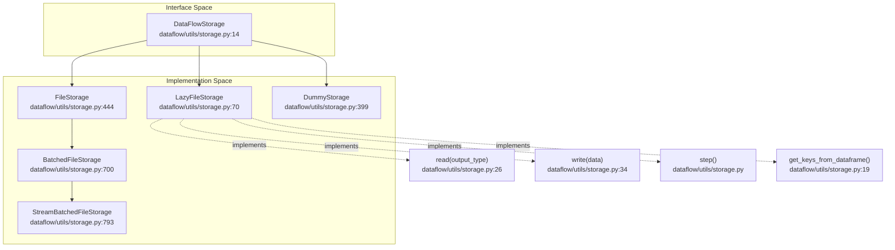
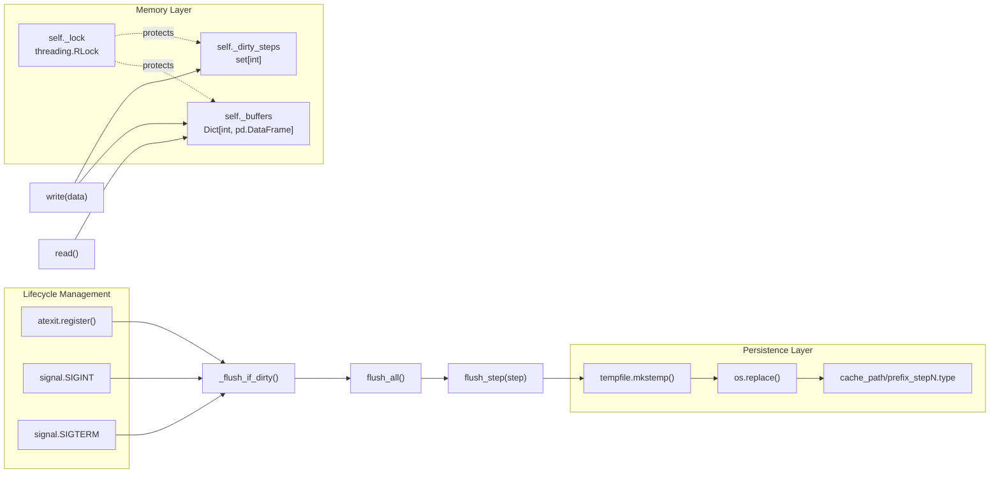
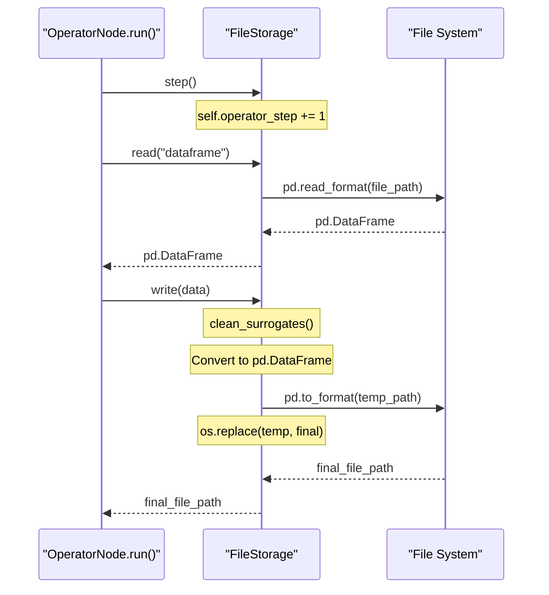
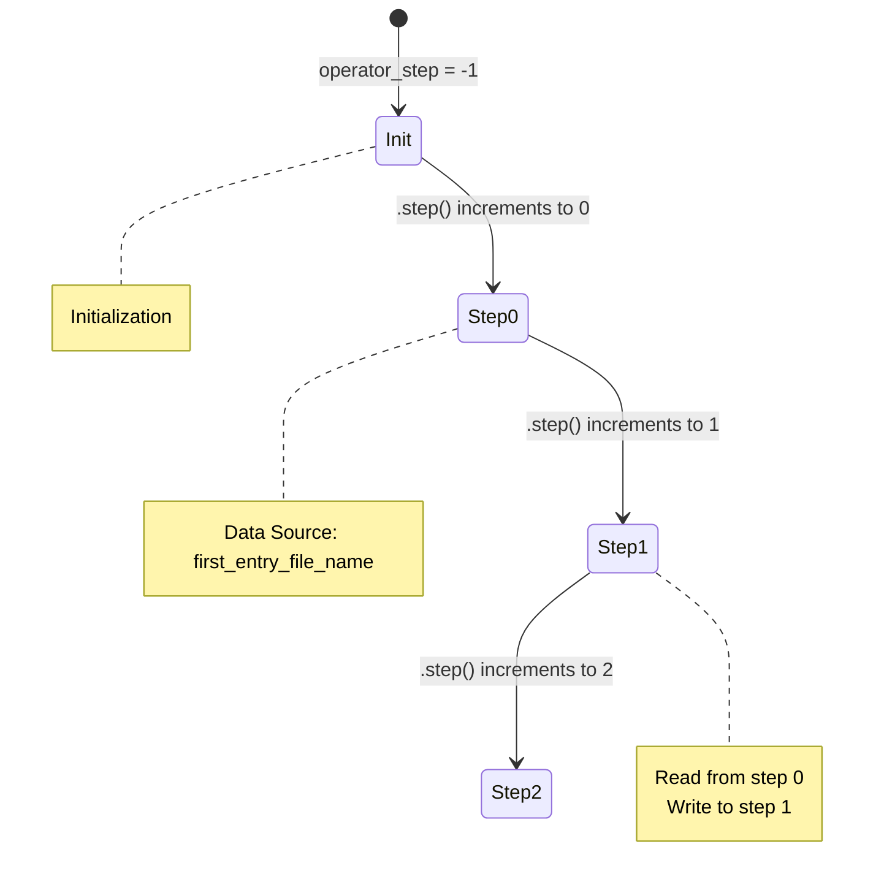

<!-- source: DeepWiki mcp.deepwiki.com · repo OpenDCAI/DataFlow · extra page File-Based Storage · fetched 2026-11-02 -->

# File-Based Storage

Relevant source files

The following files were used as context for generating this wiki page:

- [dataflow/pipeline/Pipeline.py](dataflow/pipeline/Pipeline.py)
- [dataflow/pipeline/__init__.py](dataflow/pipeline/__init__.py)
- [dataflow/pipeline/nodes.py](dataflow/pipeline/nodes.py)
- [dataflow/utils/storage.py](dataflow/utils/storage.py)
- [test/cpu_only/test_lazy_file_storage_flush.py](test/cpu_only/test_lazy_file_storage_flush.py)
- [test/cpu_only/test_remote_batch_slicing.py](test/cpu_only/test_remote_batch_slicing.py)
- [test/test_batched_pipeline.py](test/test_batched_pipeline.py)
- [test/test_batched_stream_pipeline.py](test/test_batched_stream_pipeline.py)
- [test/test_read_xlsx.py](test/test_read_xlsx.py)

## Purpose and Scope

This document details the file-based storage implementations in DataFlow that persist pipeline intermediate results to disk. These implementations allow pipelines to cache operator outputs, resume from failures, and process datasets that exceed available memory. For database-backed storage using ClickHouse/MyScale, see [Database Storage](3.5.2). For the overall storage architecture, see [Core Architecture](3).

All file-based storage classes implement the `DataFlowStorage` abstract interface and support step-based versioning, multiple serialization formats, and integration with remote dataset repositories.

---

## Storage Class Hierarchy

The following diagram shows the inheritance structure of file-based storage implementations and their relationship to the abstract interface, bridging natural language concepts to code entities.

**Sources:** `[dataflow/utils/storage.py:14-36]`, `[dataflow/utils/storage.py:70]`, `[dataflow/utils/storage.py:399]`, `[dataflow/utils/storage.py:444]`, `[dataflow/utils/storage.py:700]`, `[dataflow/utils/storage.py:793]`

---

## DataFlowStorage Abstract Interface

The `DataFlowStorage` class defines the contract that all storage implementations must fulfill:

| Method | Signature | Purpose | Code Pointer |
|--------|-----------|---------|--------------|
| `get_keys_from_dataframe()` | `() -> list[str]` | Extract column names from stored DataFrame | `[dataflow/utils/storage.py:19-24]()` |
| `read(output_type)` | `(output_type: Any) -> Any` | Read data from file/buffer | `[dataflow/utils/storage.py:26-31]()` |
| `write(data)` | `(data: Any) -> Any` | Write data to file/buffer | `[dataflow/utils/storage.py:34-35]()` |
| `__repr__()` | `() -> str` | Return string representation of storage state | `[dataflow/utils/storage.py:38-68]()` |

All storage implementations maintain an internal `operator_step` counter (initialized to `-1`) that tracks the current pipeline step `[dataflow/utils/storage.py:156-156]()`. The `step()` method increments this counter and returns a copy of the storage object, enabling chained method calls in pipeline definitions.

**Sources:** `[dataflow/utils/storage.py:14-68]`, `[dataflow/utils/storage.py:156]`

---

## LazyFileStorage: Buffered Persistence

`LazyFileStorage` optimizes development workflows by maintaining data in memory and deferring disk writes until explicitly flushed or when the process exits.

### Architecture and Data Flow

The following diagram maps natural language concepts (Memory, Lifecycle, Disk) to specific code entities within `LazyFileStorage`.

**Sources:** `[dataflow/utils/storage.py:70-164]`, `[test/cpu_only/test_lazy_file_storage_flush.py:1-168]`

### Key Features

**In-Memory Buffering:** Data written via `write()` is stored in `self._buffers` (a dictionary mapping step index to `pd.DataFrame`) and only persists to disk during explicit `flush_step()` or `flush_all()` calls `[dataflow/utils/storage.py:159-161]()`.

**Atomic Writes:** Disk persistence uses a two-phase commit: data is first written to a temporary file created with `tempfile.mkstemp()`, then atomically moved to the final location using `os.replace()` `[dataflow/utils/storage.py:98-99]()`. This prevents partial file corruption on interruption.

**Thread Safety:** A `threading.RLock` protects concurrent access to `_buffers` and `_dirty_steps`, allowing multiple threads to read/write safely `[dataflow/utils/storage.py:162-162]()`.

**Automatic Flushing:** When `save_on_exit=True` (default), the constructor registers handlers for process exit via `atexit.register()` and interrupt signals (`SIGINT`, `SIGTERM`) via `signal.signal()` `[dataflow/utils/storage.py:124-126]()`. These handlers invoke `_flush_if_dirty()`, which persists any buffered steps before termination.

**Flush Modes:** The `flush_all_steps` parameter controls `flush_all()` behavior:
- `False` (default): Only the most recent buffered step is persisted `[dataflow/utils/storage.py:131-131]()`
- `True`: All buffered steps are persisted `[dataflow/utils/storage.py:130-130]()`

### Remote Dataset Support

The `first_entry_file_name` parameter accepts local file paths as well as remote dataset identifiers prefixed with `"hf:"` (HuggingFace datasets: `dataset[:config][:split]`) or `"ms:"` (ModelScope datasets: `dataset[:split]`) `[dataflow/utils/storage.py:104-107]()`.

**Sources:** `[dataflow/utils/storage.py:70-164]`, `[test/cpu_only/test_remote_batch_slicing.py:11-76]`

---

## FileStorage: Immediate Persistence

`FileStorage` provides a simpler implementation that writes data immediately to disk on every `write()` call, with no in-memory buffering.

### Execution Sequence

**Sources:** `[dataflow/utils/storage.py:444-698]`

### Unicode Handling

Both `FileStorage` and `LazyFileStorage` include a `clean_surrogates()` helper function that recursively sanitizes data by replacing invalid Unicode surrogate characters (e.g., `\udc00`) with valid UTF-8 sequences using `str.encode('utf-8', 'replace').decode('utf-8')` `[dataflow/utils/storage.py:636-654]()`. This prevents serialization errors when writing to JSON/JSONL formats.

**Sources:** `[dataflow/utils/storage.py:444-698]`, `[dataflow/utils/storage.py:636-654]`

---

## Batched and Streaming Storage

### BatchedFileStorage
`BatchedFileStorage` extends `FileStorage` to enable processing large datasets in fixed-size batches. It supports pagination and resumption from failures by tracking `batch_step` and `batch_size` `[dataflow/utils/storage.py:700-705]()`. Resumption support utilizes cache files like `cache_path/file_name_prefix_last_success_step.txt` `[test/test_batched_pipeline.py:55-60]()`.

### StreamBatchedFileStorage
`StreamBatchedFileStorage` provides memory-efficient iteration without loading the entire dataset into memory. It implements chunked reading using pandas for formats like JSONL and CSV `[dataflow/utils/storage.py:793-800]()`.

**Sources:** `[dataflow/utils/storage.py:700-845]`, `[test/test_batched_pipeline.py:7-60]`, `[test/test_batched_stream_pipeline.py:9-59]`

---

## Step Versioning and Cache Organization

All file-based storage implementations use a step-based versioning scheme to track pipeline progress.

### Step Counter Mechanism

**Sources:** `[dataflow/utils/storage.py:153-156]`, `[dataflow/utils/storage.py:203-221]`

### File Path Generation

The path generation logic maps steps to specific filenames under the designated `cache_path` `[dataflow/utils/storage.py:203-221]()`:
- **Step -1**: Invalid / uninitialized.
- **Step 0**: Uses `first_entry_file_name` (local path or remote `hf:` / `ms:` source).
- **Step $\ge 1$**: `{cache_path}/{file_name_prefix}_step{step}.{cache_type}`.

**Sources:** `[dataflow/utils/storage.py:203-221]`, `[dataflow/utils/storage.py:512-528]`

---

## Supported File Formats

All file-based storage implementations support multiple serialization formats via the `cache_type` parameter:

| Format | Extension | Read Method | Write Method | Notes | Code Pointer |
|--------|-----------|-------------|--------------|-------|--------------|
| JSON | `.json` | `pd.read_json()` | `to_json(orient="records", indent=2)` | Full array format | `[dataflow/utils/storage.py:118-118]()` |
| JSONL | `.jsonl` | `pd.read_json(lines=True)` | `to_json(orient="records", lines=True)` | One record per line | `[dataflow/utils/storage.py:119-119]()` |
| CSV | `.csv` | `pd.read_csv()` | `to_csv(index=False)` | Comma-separated values | `[dataflow/utils/storage.py:120-120]()` |
| Parquet | `.parquet` | `pd.read_parquet()` | `to_parquet()` | Columnar binary format | `[dataflow/utils/storage.py:121-121]()` |
| Pickle | `.pickle` | `pd.read_pickle()` | `to_pickle()` | Python-specific binary | `[dataflow/utils/storage.py:122-122]()` |
| Excel | `.xlsx` | `pd.read_excel()` | `to_excel(index=False)` | Supported in `FileStorage` | `[test/test_read_xlsx.py:18-32]()` |

**Sources:** `[dataflow/utils/storage.py:118-122]`, `[dataflow/utils/storage.py:227-244]`, `[test/test_read_xlsx.py:14-52]`

---

## DummyStorage: Testing Utility

`DummyStorage` provides a minimal in-memory storage implementation for unit testing operators without file I/O overhead `[dataflow/utils/storage.py:399-401]()`.

### Interface

| Method | Purpose | Code Pointer |
|--------|---------|--------------|
| `set_data(data)` | Manually inject test data into the internal buffer | `[dataflow/utils/storage.py:416-417]()` |
| `read(output_type)` | Return stored data from memory | `[dataflow/utils/storage.py:419-425]()` |
| `write(data)` | Store data in memory; optionally persist if `cache_type` is set | `[dataflow/utils/storage.py:427-442]()` |

**Sources:** `[dataflow/utils/storage.py:399-442]`

---

