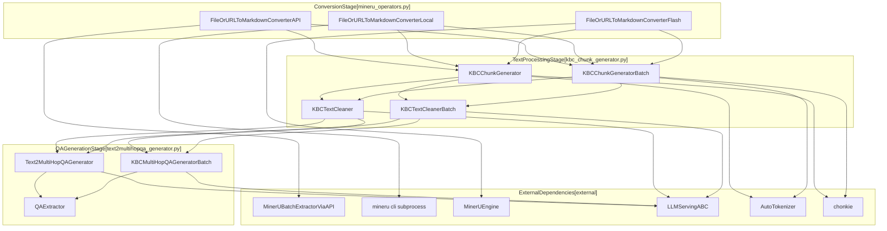
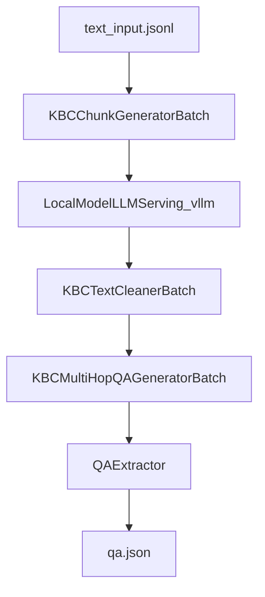

<!-- source: DeepWiki mcp.deepwiki.com · repo OpenDCAI/DataFlow · extra page Knowledge Base Operators · fetched 2026-11-02 -->

# Knowledge Base Operators

Relevant source files

The following files were used as context for generating this wiki page:

- [dataflow/cli_funcs/cli_text.py](dataflow/cli_funcs/cli_text.py)
- [dataflow/cli_funcs/text2model_pipeline/text_to_qa_pipeline.py](dataflow/cli_funcs/text2model_pipeline/text_to_qa_pipeline.py)
- [dataflow/operators/core_text/generate/text2multihopqa_generator.py](dataflow/operators/core_text/generate/text2multihopqa_generator.py)
- [dataflow/operators/knowledge_cleaning/generate/kbc_chunk_generator.py](dataflow/operators/knowledge_cleaning/generate/kbc_chunk_generator.py)
- [dataflow/operators/knowledge_cleaning/generate/kbc_chunk_generator_batch.py](dataflow/operators/knowledge_cleaning/generate/kbc_chunk_generator_batch.py)
- [dataflow/operators/knowledge_cleaning/generate/kbc_multihop_qa_generator_batch.py](dataflow/operators/knowledge_cleaning/generate/kbc_multihop_qa_generator_batch.py)
- [dataflow/operators/knowledge_cleaning/generate/kbc_text_cleaner.py](dataflow/operators/knowledge_cleaning/generate/kbc_text_cleaner.py)
- [dataflow/operators/knowledge_cleaning/generate/kbc_text_cleaner_batch.py](dataflow/operators/knowledge_cleaning/generate/kbc_text_cleaner_batch.py)
- [dataflow/operators/knowledge_cleaning/generate/qa_extract.py](dataflow/operators/knowledge_cleaning/generate/qa_extract.py)
- [dataflow/operators/reasoning/filter/reasoning_answer_groundtruth_filter.py](dataflow/operators/reasoning/filter/reasoning_answer_groundtruth_filter.py)
- [dataflow/operators/text_sft/eval/Superfiltering/data_analysis.py](dataflow/operators/text_sft/eval/Superfiltering/data_analysis.py)
- [dataflow/prompts/kbcleaning.py](dataflow/prompts/kbcleaning.py)

Knowledge Base operators transform raw documents (PDFs, URLs, HTML) into structured text and generate question-answer pairs for training data. These operators form the foundation of the Knowledge Base Cleaning (KBC) pipeline and are designed for sequential processing: conversion → chunking → cleaning → QA generation → extraction.

For complete pipeline examples using these operators, see [Knowledge Base Cleaning Pipeline](). For PDF-specific visual QA extraction, see [PDF VQA Operators]().

---

## Operator Architecture

Knowledge Base operators follow a common pattern where document processing is divided into discrete stages, each implemented as a separate operator. The operators in this category integrate with external tools (MinerU), specialized chunking libraries (`chonkie`), and LLM serving backends to transform unstructured documents into training-ready QA pairs.

### System Data Flow and Code Entities
The following diagram bridges the natural language processing stages with the specific code entities responsible for each transformation.

Title: "KnowledgeBaseProcessingDataFlow"

Sources: [dataflow/operators/knowledge_cleaning/generate/qa_extract.py:14-170](), [dataflow/operators/core_text/generate/text2multihopqa_generator.py:23-159](), [dataflow/operators/knowledge_cleaning/generate/kbc_chunk_generator_batch.py:20-175](), [dataflow/operators/knowledge_cleaning/generate/kbc_text_cleaner_batch.py:20-150]()

---

## File/URL to Markdown Converters

The converter operators inherit from a common base class `MinerUABC` and implement three deployment strategies for document-to-markdown conversion. All variants support PDFs, images (png/jpg/jpeg/webp/gif), HTML, XML, and plain text.

### Base Class: MinerUABC
The abstract base class implements common file classification and routing logic.
- `_classify_raw_files()`: Examines input column, determines file type (PDF, HTML, text), handles URL detection and PDF downloads.
- `_batch_parse_html_or_xml()`: Uses `trafilatura` library for robust HTML/XML content extraction.
- `_batch_parse_pdf_with_mineru()`: Abstract method implemented by subclasses to handle the heavy lifting of PDF layout analysis.

### FileOrURLToMarkdownConverterAPI
Uses the MinerU cloud API service for document conversion. This is the recommended option for users without local GPU resources.

### FileOrURLToMarkdownConverterLocal
Executes MinerU CLI locally via subprocess. Requires local GPU and a full MinerU installation.

### FileOrURLToMarkdownConverterFlash
Uses the `Flash-MinerU` accelerated engine for high-throughput batch processing with Ray-based GPU optimization.

Sources: [dataflow/operators/knowledge_cleaning/generate/kbc_chunk_generator.py:1-155]()

---

## Chunking and Cleaning Operators

### KBCChunkGenerator & KBCChunkGeneratorBatch
These operators split documents into segments optimized for RAG or LLM context windows using the `chonkie` library.
- **Initialization**: Configurable `split_method` (`token`, `sentence`, `semantic`, `recursive`) and `chunk_size` [dataflow/operators/knowledge_cleaning/generate/kbc_chunk_generator_batch.py:21-36]().
- **Tokenization**: Uses `AutoTokenizer` from `transformers` to ensure chunking aligns with the target LLM's vocabulary [dataflow/operators/knowledge_cleaning/generate/kbc_chunk_generator_batch.py:35]().
- **Large Document Handling**: If text exceeds `model_max_length`, it implements an approximate word-based split before applying the chunker to prevent OOM or truncation errors [dataflow/operators/knowledge_cleaning/generate/kbc_chunk_generator_batch.py:130-149]().

Sources: [dataflow/operators/knowledge_cleaning/generate/kbc_chunk_generator_batch.py:20-175](), [dataflow/operators/knowledge_cleaning/generate/kbc_chunk_generator.py:19-155]()

### KBCTextCleaner & KBCTextCleanerBatch
These operators use LLMs to remove noise (redundant HTML, special characters) while preserving semantic structure and factual content.
- **Prompting**: Uses `KnowledgeCleanerPrompt` which includes strict rules for normalization, PII masking (e.g., phone numbers to `138****8000`), and security processing [dataflow/prompts/kbcleaning.py:14-94]().
- **Multi-language Support**: Supports both English and Chinese refinement rules [dataflow/prompts/kbcleaning.py:96-177]().
- **Extraction Logic**: Uses `extract_cleaned_text` with regex patterns like `_CLEANED_BLOCK_RE` to strip prompt leakage and isolate text between `<cleaned_start>` and `<cleaned_end>` tags [dataflow/operators/knowledge_cleaning/generate/kbc_text_cleaner.py:16-81]().
- **Batch Processing**: `KBCTextCleanerBatch` iterates through chunk paths, generates cleaned versions via `llm_serving.generate_from_input`, and updates the JSON files [dataflow/operators/knowledge_cleaning/generate/kbc_text_cleaner_batch.py:124-144]().

Sources: [dataflow/prompts/kbcleaning.py:4-200](), [dataflow/operators/knowledge_cleaning/generate/kbc_text_cleaner.py:60-156](), [dataflow/operators/knowledge_cleaning/generate/kbc_text_cleaner_batch.py:20-150]()

---

## QA Generation and Extraction

### Text2MultiHopQAGenerator
Generates complex question-answer pairs requiring multiple reasoning steps across the provided text.
- **Prompting**: Uses `Text2MultiHopQAGeneratorPrompt` to guide the LLM [dataflow/operators/core_text/generate/text2multihopqa_generator.py:19-21]().
- **Output Format**: Generates a structured dictionary containing `question`, `reasoning_steps`, `answer`, and `supporting_facts` [dataflow/operators/core_text/generate/text2multihopqa_generator.py:106-124]().
- **Implementation**: Employs an `ExampleConstructor` to manage LLM interactions and parse raw text into multi-hop examples [dataflow/operators/core_text/generate/text2multihopqa_generator.py:152-153]().

Sources: [dataflow/operators/core_text/generate/text2multihopqa_generator.py:23-159](), [dataflow/operators/knowledge_cleaning/generate/kbc_multihop_qa_generator_batch.py:22-192]()

### QAExtractor
Extracts and reformats nested QA pairs into instruction-tuning formats (e.g., Stanford Alpaca style).
- **Format Mapping**: Maps generated data to `instruction`, `input`, and `output` keys, specifically optimized for LlamaFactory [dataflow/operators/knowledge_cleaning/generate/qa_extract.py:43-52]().
- **Core Logic**: The `_extract_qa` method parses the `QA_pairs` field, extracting the question and answer while maintaining a specific instruction prefix [dataflow/operators/knowledge_cleaning/generate/qa_extract.py:83-134]().
- **File Integration**: Supports loading data directly from `enhanced_chunk_path`, `cleaned_chunk_path`, or `chunk_path` columns [dataflow/operators/knowledge_cleaning/generate/qa_extract.py:138-140]().

Sources: [dataflow/operators/knowledge_cleaning/generate/qa_extract.py:14-170]()

---

## Mathbook Question Extraction

### MathBookQuestionExtract
A specialized operator for extracting mathematical problems and diagrams from textbook PDFs.
- **PDF Processing**: Uses `mineru` to parse the PDF and `fitz` (PyMuPDF) for image-related tasks [dataflow/prompts/kbcleaning.py:205-225]().
- **VLM Extraction**: Employs a Vision-Language Model via `APIVLMServing_openai` to analyze the pages and extract exercises [dataflow/prompts/kbcleaning.py:205-225]().
- **Prompting**: Uses `MathbookQuestionExtractPrompt` which instructs the model to extract problems in their original language and insert figure tags like `<image>n.jpg</image>` [dataflow/prompts/kbcleaning.py:205-228]().
- **Separation**: Problems are separated by the literal token `<SPACE>` to allow for easy post-parsing [dataflow/prompts/kbcleaning.py:222-223]().

Sources: [dataflow/prompts/kbcleaning.py:205-228]()

---

## Complete Pipeline Integration

The `Text2QAPipeline` demonstrates how these operators are chained to create a full document-to-QA workflow.

Title: "TextToQAPipelineExecutionOrder"

**Implementation Steps**:
1. **Chunking**: `KBCChunkGeneratorBatch` splits text into 512-token chunks using the Qwen tokenizer [dataflow/cli_funcs/text2model_pipeline/text_to_qa_pipeline.py:37-41]().
2. **Cleaning**: `KBCTextCleanerBatch` uses vLLM to refine content based on `KnowledgeCleanerPrompt` [dataflow/cli_funcs/text2model_pipeline/text_to_qa_pipeline.py:63-66]().
3. **QA Generation**: `KBCMultiHopQAGeneratorBatch` creates reasoning-heavy QA pairs [dataflow/cli_funcs/text2model_pipeline/text_to_qa_pipeline.py:68-71]().
4. **Extraction**: `QAExtractor` converts the results into the final training format with `instruction`, `input`, and `output` keys [dataflow/cli_funcs/text2model_pipeline/text_to_qa_pipeline.py:84-90]().

Sources: [dataflow/cli_funcs/text2model_pipeline/text_to_qa_pipeline.py:22-92](), [dataflow/cli_funcs/cli_text.py:41-63]()

---

