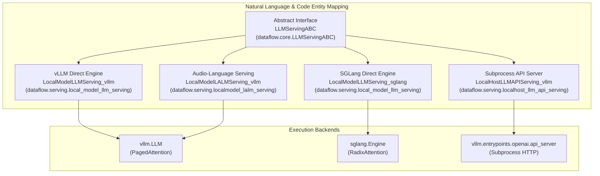
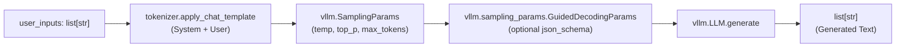
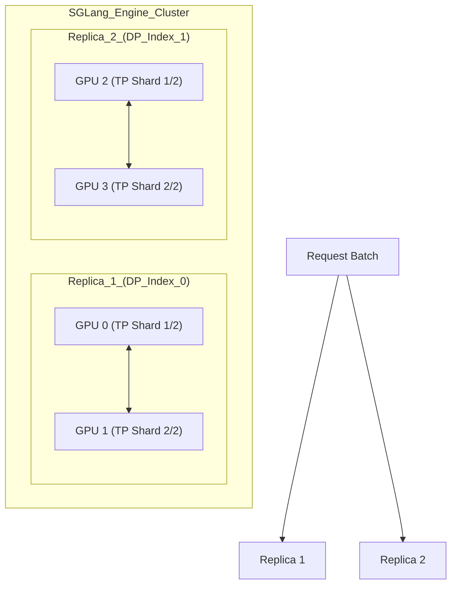

<!-- source: DeepWiki mcp.deepwiki.com · repo OpenDCAI/DataFlow · extra page Local GPU Serving · fetched 2026-11-02 -->

# Local GPU Serving

<details>
<summary>Relevant source files</summary>

The following files were used as context for generating this wiki page:

- [.github/workflows/test.yml](.github/workflows/test.yml)
- [dataflow/operators/code/filter/code_score_filter.py](dataflow/operators/code/filter/code_score_filter.py)
- [dataflow/operators/core_text/eval/bench_dataset_evaluator_question.py](dataflow/operators/core_text/eval/bench_dataset_evaluator_question.py)
- [dataflow/serving/api_llm_serving_request.py](dataflow/serving/api_llm_serving_request.py)
- [dataflow/serving/local_model_llm_serving.py](dataflow/serving/local_model_llm_serving.py)
- [dataflow/serving/localhost_llm_api_serving.py](dataflow/serving/localhost_llm_api_serving.py)
- [dataflow/serving/localmodel_lalm_serving.py](dataflow/serving/localmodel_lalm_serving.py)
- [dataflow/statics/playground/playground/prompted_generator/translation_local_json_schema.py](dataflow/statics/playground/playground/prompted_generator/translation_local_json_schema.py)
- [test/cpu_only/test_undefined_name_crashes.py](test/cpu_only/test_undefined_name_crashes.py)

</details>


## Purpose and Scope

This document details the local GPU inference serving implementations in DataFlow: `LocalModelLLMServing_vllm` and `LocalModelLLMServing_sglang` [dataflow/serving/local_model_llm_serving.py:11-282](). These classes provide high-throughput local inference using vLLM and SGLang engines respectively, implementing the `LLMServingABC` [dataflow/core/llm_serving_abc.py]() interface for seamless integration with DataFlow operators. These backends support advanced features like tensor parallelism, prefix caching, guided decoding, and GPU memory management.

Sources: `[dataflow/serving/local_model_llm_serving.py:11-28]`, `[dataflow/serving/local_model_llm_serving.py:192-210]()`

---

## Architecture Overview

Both local GPU serving implementations inherit from `LLMServingABC` [dataflow/serving/local_model_llm_serving.py:11-15]() and provide optimized inference for language models deployed on local GPUs. They manage the model lifecycle, including downloading from HuggingFace via `snapshot_download` [dataflow/serving/local_model_llm_serving.py:84-88](), engine initialization, and batch generation.

**Comparison of Local GPU Serving Implementations**

| Feature | `LocalModelLLMServing_vllm` | `LocalModelLLMServing_sglang` |
|---------|---------------------------|----------------------------|
| **Engine Class / Module** | `vllm.LLM` [dataflow/serving/local_model_llm_serving.py:122-127]() | `sglang.Engine` [dataflow/serving/local_model_llm_serving.py:236-241]() |
| **Parallelism** | Tensor Parallelism (TP) [dataflow/serving/local_model_llm_serving.py:19-19]() | Data Parallelism (DP) + Tensor Parallelism (TP) [dataflow/serving/local_model_llm_serving.py:192-205]() |
| **Primary Use Case** | Single-node inference with TP | Distributed inference with DP+TP |
| **Memory Management** | `vllm_gpu_memory_utilization` [dataflow/serving/local_model_llm_serving.py:27-27]() | Implicit through parallelism config |
| **Guided Decoding** | JSON Schema via `vllm.sampling_params` | Supported via SGLang engine |

**Local GPU Serving Code Entity Mapping**



Sources: `[dataflow/serving/local_model_llm_serving.py:11-282]`, `[dataflow/serving/localmodel_lalm_serving.py:96-169]`, `[dataflow/serving/localhost_llm_api_serving.py:14-48]()`

---

## LocalModelLLMServing_vllm

The vLLM-based serving implementation uses the vLLM engine for high-throughput inference with tensor parallelism support. It handles model acquisition via `snapshot_download` [dataflow/serving/local_model_llm_serving.py:84-88]() and manages the `vllm.LLM` instance [dataflow/serving/local_model_llm_serving.py:122-127]().

### Initialization and Configuration

The class is initialized with parameters that map directly to vLLM's `SamplingParams` and `LLM` engine configuration.

| Parameter | Default | Description |
|-----------|---------|-------------|
| `hf_model_name_or_path` | `None` | HuggingFace repo ID or local directory path [dataflow/serving/local_model_llm_serving.py:61-61](). |
| `vllm_tensor_parallel_size` | `1` | Number of GPUs to shard the model across [dataflow/serving/local_model_llm_serving.py:64-64](). |
| `vllm_gpu_memory_utilization`| `0.9` | Fraction of GPU VRAM to reserve for the KV cache [dataflow/serving/local_model_llm_serving.py:72-72](). |
| `vllm_max_model_len` | `None` | Overrides the model's default maximum sequence length [dataflow/serving/local_model_llm_serving.py:71-71](). |

### Generation Logic and Data Flow

The `generate_from_input` method [dataflow/serving/local_model_llm_serving.py:131-150]() performs the following steps:
1. **Template Application**: Converts `user_inputs` into chat messages and applies the model's chat template using `tokenizer.apply_chat_template` [dataflow/serving/local_model_llm_serving.py:145-150]().
2. **Guided Decoding**: If `json_schema` is provided, it configures `GuidedDecodingParams` to enforce structured output [dataflow/serving/local_model_llm_serving.py:158-160]().
3. **Inference**: Calls `self.llm.generate` with the formatted prompts and `SamplingParams` [dataflow/serving/local_model_llm_serving.py:186-187]().

**vLLM Internal Data Flow**



Sources: `[dataflow/serving/local_model_llm_serving.py:11-190]()`

---

## LocalModelLLMServing_sglang

The SGLang-based serving implementation provides an alternative inference engine with support for both data parallelism and tensor parallelism. SGLang is particularly efficient for tasks with shared prefixes due to its RadixAttention mechanism.

### Multi-Dimensional Parallelism

SGLang allows configuring two dimensions of parallelism [dataflow/serving/local_model_llm_serving.py:192-205]():
- **Data Parallelism (`sgl_dp_size`)**: Number of model replicas.
- **Tensor Parallelism (`sgl_tp_size`)**: Number of GPUs per replica.

**SGLang DP+TP Parallelism Strategy**



### Initialization and Execution

The class initializes an `sgl.Engine` [dataflow/serving/local_model_llm_serving.py:236-241](). Generation is handled by creating a list of prompt strings and passing them to `self.engine.get_tokenizer().apply_chat_template` before calling `self.engine.generate` [dataflow/serving/local_model_llm_serving.py:254-269]().

Sources: `[dataflow/serving/local_model_llm_serving.py:192-282]()`

---

## LocalHostLLMAPIServing_vllm

In addition to direct library integration, DataFlow supports serving vLLM as a standalone OpenAI-compatible API server via `LocalHostLLMAPIServing_vllm` [dataflow/serving/localhost_llm_api_serving.py:14-14]().

### Subprocess Management
This class launches the `vllm.entrypoints.openai.api_server` module as a subprocess using `subprocess.Popen` [dataflow/serving/localhost_llm_api_serving.py:115-121](). It monitors the server's health by polling the `/v1/models` endpoint [dataflow/serving/localhost_llm_api_serving.py:131-137]() and captures logs in background threads to avoid blocking [dataflow/serving/localhost_llm_api_serving.py:123-125]().

### Request Handling
Once the server is initialized, requests are dispatched using the `requests` library to the local endpoint [dataflow/serving/localhost_llm_api_serving.py:175-180](). This allows for a decoupled architecture where the inference engine runs in a separate process from the DataFlow pipeline.

Sources: `[dataflow/serving/localhost_llm_api_serving.py:14-180]()`

---

## Specialized Local Serving: Audio and LALM

DataFlow provides `LocalModelLALMServing_vllm` [dataflow/serving/localmodel_lalm_serving.py:96-96]() for Large Audio-Language Models (LALMs). This implementation extends the vLLM backend to handle audio inputs by processing them through specialized utilities.

### Audio Input Processing
The utility `process_audio_info` [dataflow/serving/localmodel_lalm_serving.py:37-54]() extracts audio data from conversation messages. It supports:
- **Remote/Local Paths**: Handled via `_read_audio_remote` [dataflow/serving/localmodel_lalm_serving.py:18-24]() and `_read_audio_local` [dataflow/serving/localmodel_lalm_serving.py:26-27]().
- **Base64 Data**: Handled via `_read_audio_base64` [dataflow/serving/localmodel_lalm_serving.py:32-35]().
- **Direct Bytes**: Handled via `_read_audio_bytes` [dataflow/serving/localmodel_lalm_serving.py:29-30]().

Sources: `[dataflow/serving/localmodel_lalm_serving.py:18-94]()`

---

## Pipeline Integration Patterns

Local GPU serving is typically used in high-performance pipelines or complex data synthesis tasks where structured output is required.

### Case Study: JSON Schema Generation

In the example `Qwen_generator` [dataflow/statics/playground/playground/prompted_generator/translation_local_json_schema.py:5-30](), `LocalModelLLMServing_vllm` is used to drive a `PromptedGenerator` with a strict JSON schema.

```python
# Serving instantiation
self.llm_serving = LocalModelLLMServing_vllm(
    hf_model_name_or_path="Qwen2.5-7B-Instruct",
    vllm_tensor_parallel_size=1,
    vllm_max_tokens=8192,
)

# Operator integration
self.prompt_generator = PromptedGenerator(
    llm_serving = self.llm_serving, 
    system_prompt = "Please translate to Chinese.",
    json_schema={
        "type": "object",
        "properties": {
            "original": {"type": "string"},
            "translation": {"type": "string"}
        },
        "required": ["original", "translation"],
    },
)
```

Sources: `[dataflow/statics/playground/playground/prompted_generator/translation_local_json_schema.py:14-30]()`

---

## Memory Management and Performance

### GPU Memory Utilization Strategy

The `vllm_gpu_memory_utilization` parameter [dataflow/serving/local_model_llm_serving.py:72-72]() is critical for local serving. It defines the fraction of GPU memory the vLLM engine is allowed to take.
- **Default (0.9)**: Maximizes throughput by providing a large KV cache.
- **Lower Values**: Useful when running multiple models on the same GPU or when the system requires significant headroom for other operations.

### Multiprocessing and Environment

vLLM requires the multiprocessing start method to be set to `spawn` [dataflow/serving/local_model_llm_serving.py:111-111](). The implementation handles this automatically by setting the `VLLM_WORKER_MULTIPROC_METHOD` environment variable before initializing the engine [dataflow/serving/local_model_llm_serving.py:111-111], [dataflow/serving/local_model_llm_serving.py:122-127]().

Sources: `[dataflow/serving/local_model_llm_serving.py:109-127]()`

---

