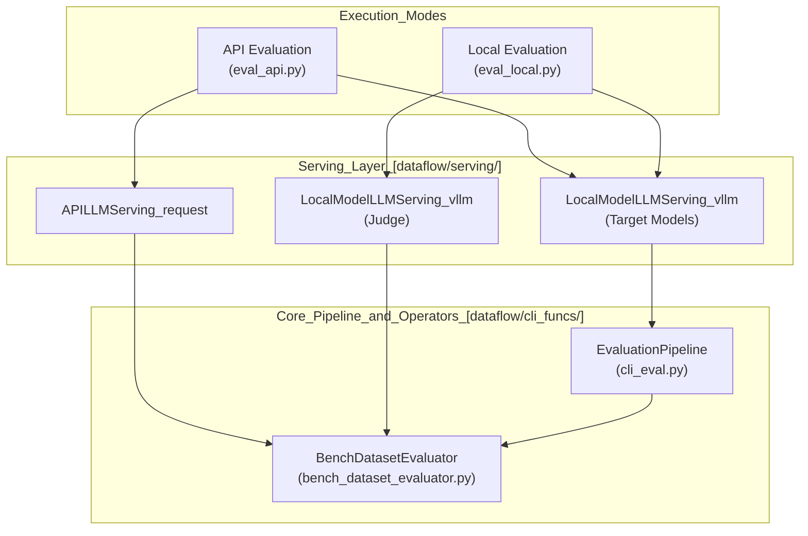
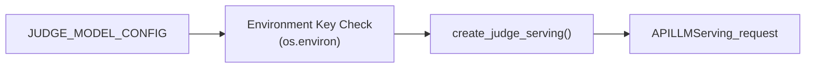
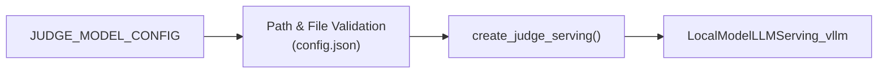
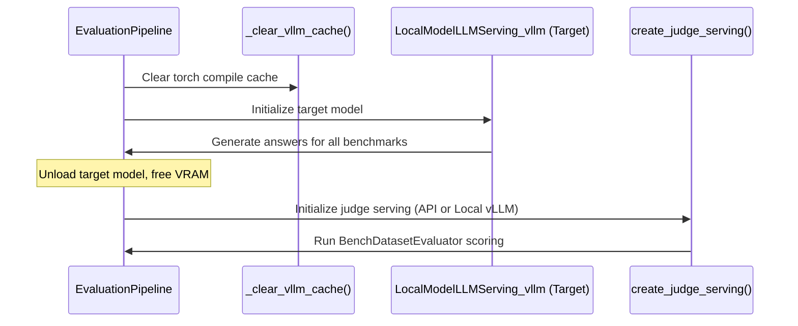

<!-- source: DeepWiki mcp.deepwiki.com · repo OpenDCAI/DataFlow · extra page Local vs API Evaluation · fetched 2026-11-02 -->

# Local vs API Evaluation

<details>
<summary>Relevant source files</summary>

The following files were used as context for generating this wiki page:

- [dataflow/cli.py](dataflow/cli.py)
- [dataflow/cli_funcs/cli_eval.py](dataflow/cli_funcs/cli_eval.py)
- [dataflow/cli_funcs/cli_webui.py](dataflow/cli_funcs/cli_webui.py)
- [dataflow/cli_funcs/eval_pipeline/eval_api.py](dataflow/cli_funcs/eval_pipeline/eval_api.py)
- [dataflow/cli_funcs/eval_pipeline/eval_local.py](dataflow/cli_funcs/eval_pipeline/eval_local.py)
- [dataflow/example/core_text_data/bench_eval_data_2.jsonl](dataflow/example/core_text_data/bench_eval_data_2.jsonl)
- [dataflow/operators/core_text/eval/bench_dataset_evaluator.py](dataflow/operators/core_text/eval/bench_dataset_evaluator.py)
- [dataflow/operators/reasoning/filter/reasoning_answer_model_judge_filter.py](dataflow/operators/reasoning/filter/reasoning_answer_model_judge_filter.py)
- [dataflow/prompts/model_evaluation/general.py](dataflow/prompts/model_evaluation/general.py)
- [dataflow/statics/pipelines/api_pipelines/core_text_bencheval_semantic_pipeline.py](dataflow/statics/pipelines/api_pipelines/core_text_bencheval_semantic_pipeline.py)
- [dataflow/statics/pipelines/api_pipelines/core_text_bencheval_semantic_pipeline_question.py](dataflow/statics/pipelines/api_pipelines/core_text_bencheval_semantic_pipeline_question.py)
- [dataflow/statics/pipelines/api_pipelines/core_text_bencheval_semantic_pipeline_question_single_step.py](dataflow/statics/pipelines/api_pipelines/core_text_bencheval_semantic_pipeline_question_single_step.py)
- [dataflow/statics/pipelines/gpu_pipelines/core_text_bencheval_match_pipeline.py](dataflow/statics/pipelines/gpu_pipelines/core_text_bencheval_match_pipeline.py)
- [dataflow/statics/scaffold/{{cookiecutter.repo_name}}/{{cookiecutter.package_name}}/operators/core/__init__.py](dataflow/statics/scaffold/{{cookiecutter.repo_name}}/{{cookiecutter.package_name}}/operators/core/__init__.py)

</details>


## Purpose and Scope

This document explains the two evaluation configurations available in DataFlow's benchmarking ecosystem: **Local GPU-based evaluation** (`eval_local.py`) and **API-based evaluation** (`eval_api.py`). These configurations differ primarily in how the **judge model** (the model evaluating answer quality) is deployed, while both support local deployment of **target models** via `LocalModelLLMServing_vllm`.

For information regarding the broader evaluation pipeline workflow, see [Evaluation Pipeline](8.1.1).

Sources: [dataflow/cli_funcs/eval_pipeline/eval_api.py:1-173](), [dataflow/cli_funcs/eval_pipeline/eval_local.py:1-177]()

---

## Evaluation Architecture Overview

The evaluation framework decouples target model answer generation from judge model scoring.

| Component Role | Implementation / Class | Purpose |
|----------------|------------------------|---------|
| **Judge Model (API)** | `APILLMServing_request` | Sends judgment prompts to remote APIs (`eval_api.py`) |
| **Judge Model (Local)** | `LocalModelLLMServing_vllm` | Executes scoring locally via vLLM (`eval_local.py`) |
| **Target Models** | `LocalModelLLMServing_vllm` | Generates text answers for benchmark datasets |
| **Evaluator Operator** | `BenchDatasetEvaluator` | Compares generated answers to ground truth (`match` or `semantic`) |

### Evaluation System Class Mapping

Title: "EvaluationSystemArchitectureMapping"


Sources: [dataflow/cli_funcs/eval_pipeline/eval_api.py:58-173](), [dataflow/cli_funcs/eval_pipeline/eval_local.py:55-177](), [dataflow/operators/core_text/eval/bench_dataset_evaluator.py:24-51](), [dataflow/cli_funcs/cli_eval.py:32-160]()

---

## Configuration Structure Comparison

Both configuration files declare shared data structures (`TARGET_MODELS`, `BENCH_CONFIG`, `EVAL_CONFIG`, `EVALUATOR_RUN_CONFIG`), differing only in their `JUDGE_MODEL_CONFIG` dictionary and `create_judge_serving()` implementation.

| Configuration Dictionary | Key Parameters | Scope |
|--------------------------|----------------|-------|
| `JUDGE_MODEL_CONFIG` | `model_name`/`model_path`, `api_url`/`vllm_*` | Judge execution parameters |
| `TARGET_MODELS` | `name`, `path`, vLLM generation overrides | Models under evaluation |
| `BENCH_CONFIG` | `name`, `input_file`, `output_dir`, keys | Dataset mapping |
| `EVAL_CONFIG` | `compare_method` (`match` vs `semantic`) | Metric selection |

Sources: [dataflow/cli_funcs/eval_pipeline/eval_api.py:58-155](), [dataflow/cli_funcs/eval_pipeline/eval_local.py:55-141]()

---

## API Evaluation Mode (`eval_api.py`)

### Configuration and Setup

API evaluation uses an external HTTP endpoint for the judge model, configured via environment variables for API key retrieval [dataflow/cli_funcs/eval_pipeline/eval_api.py:58-64]().

```python
JUDGE_MODEL_CONFIG = {
    "model_name": "gpt-4o-mini",
    "api_url": "API_URL",
    "api_key_env": "DF_API_KEY",
    "max_workers": 3,
    "max_retries": 5,
}
```

### Judge Serving Initialization

The function `create_judge_serving()` validates the presence of `api_key_env` in `os.environ` before initializing `APILLMServing_request` [dataflow/cli_funcs/eval_pipeline/eval_api.py:161-173]().

Title: "ApiJudgeServingInitializationDataFlow"


Sources: [dataflow/cli_funcs/eval_pipeline/eval_api.py:58-64](), [dataflow/cli_funcs/eval_pipeline/eval_api.py:161-173]()

---

## Local Evaluation Mode (`eval_local.py`)

### Configuration and Setup

Local evaluation instantiates a vLLM-backed serving engine for the judge model [dataflow/cli_funcs/eval_pipeline/eval_local.py:55-67]().

```python
JUDGE_MODEL_CONFIG = {
    "model_path": "./Qwen2.5-7B-Instruct",
    "hf_cache_dir": "",
    "vllm_tensor_parallel_size": 1,
    "vllm_temperature": 0.9,
    "vllm_max_tokens": 512,
    "vllm_gpu_memory_utilization": 0.9
}
```

### Judge Serving Initialization

`create_judge_serving()` verifies local path existence and `config.json` presence prior to building `LocalModelLLMServing_vllm` [dataflow/cli_funcs/eval_pipeline/eval_local.py:147-177]().

Title: "LocalJudgeServingInitializationDataFlow"


Sources: [dataflow/cli_funcs/eval_pipeline/eval_local.py:55-67](), [dataflow/cli_funcs/eval_pipeline/eval_local.py:147-177]()

---

## Resource Management

The `EvaluationPipeline` handles sequential memory allocation across target models and judges. It invokes `_clear_vllm_cache()` prior to loading each model instance [dataflow/cli_funcs/cli_eval.py:117-160]().

Title: "EvaluationPipelineExecutionLifecycle"


Sources: [dataflow/cli_funcs/cli_eval.py:117-130](), [dataflow/cli_funcs/cli_eval.py:141-160]()

---

## Prompt Template System

Semantic evaluation modes utilize prompt templates such as `FairAnswerJudgePrompt` to structure grading instructions [dataflow/cli_funcs/eval_pipeline/eval_api.py:14-48](), [dataflow/cli_funcs/eval_pipeline/eval_local.py:14-47]().

```python
class FairAnswerJudgePrompt:
    def build_prompt(self, question, answer, reference_answer):
        # Instructs judge on Factual Accuracy, Completeness, Relevance
        # Enforces JSON output: {"judgement_result": bool}
        return prompt
```

Target models can override default prompt behavior via their `answer_prompt` configuration key [dataflow/cli_funcs/eval_pipeline/eval_api.py:96](), falling back to `DEFAULT_ANSWER_PROMPT` in `cli_eval.py` [dataflow/cli_funcs/cli_eval.py:21-29]().

Sources: [dataflow/cli_funcs/eval_pipeline/eval_api.py:14-48](), [dataflow/cli_funcs/eval_pipeline/eval_local.py:14-47](), [dataflow/cli_funcs/cli_eval.py:21-29]()

---

## Comparison Modes

`BenchDatasetEvaluator` supports two comparison execution branches depending on `compare_method` [dataflow/operators/core_text/eval/bench_dataset_evaluator.py:27-51]():

1. **`match`**: Uses mathematical parsing via `math_verify_compare` (`math_verify` library `parse()` and `verify()`) [dataflow/operators/core_text/eval/bench_dataset_evaluator.py:40-44](), [dataflow/operators/core_text/eval/bench_dataset_evaluator.py:54-61]().
2. **`semantic`**: Sends formatted prompts to `self.llm_serving` and parses boolean JSON responses using `ResolveResponse()` [dataflow/operators/core_text/eval/bench_dataset_evaluator.py:45-51](), [dataflow/operators/core_text/eval/bench_dataset_evaluator.py:63-81]().

Sources: [dataflow/operators/core_text/eval/bench_dataset_evaluator.py:27-81]()

---

