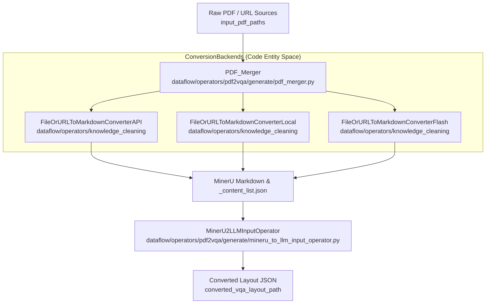

<!-- source: DeepWiki mcp.deepwiki.com · repo OpenDCAI/DataFlow · extra page MinerU Integration and Layout Conversion · fetched 2026-11-02 -->

# MinerU Integration and Layout Conversion

<details>
<summary>Relevant source files</summary>

The following files were used as context for generating this wiki page:

- [dataflow/example/PDF2VQAPipeline/vqa_extract_test.jsonl](dataflow/example/PDF2VQAPipeline/vqa_extract_test.jsonl)
- [dataflow/operators/pdf2vqa/__init__.py](dataflow/operators/pdf2vqa/__init__.py)
- [dataflow/operators/pdf2vqa/generate/llm_output_parser.py](dataflow/operators/pdf2vqa/generate/llm_output_parser.py)
- [dataflow/operators/pdf2vqa/generate/mineru_to_llm_input_operator.py](dataflow/operators/pdf2vqa/generate/mineru_to_llm_input_operator.py)
- [dataflow/operators/pdf2vqa/generate/pdf_merger.py](dataflow/operators/pdf2vqa/generate/pdf_merger.py)
- [dataflow/operators/pdf2vqa/generate/qa_merger.py](dataflow/operators/pdf2vqa/generate/qa_merger.py)
- [dataflow/prompts/pdf2vqa.py](dataflow/prompts/pdf2vqa.py)
- [dataflow/statics/pipelines/api_pipelines/pdf_vqa_extract_pipeline.py](dataflow/statics/pipelines/api_pipelines/pdf_vqa_extract_pipeline.py)
- [dataflow/utils/kbc/mineru_api_caller.py](dataflow/utils/kbc/mineru_api_caller.py)
- [dataflow/utils/pdf2vqa/format_utils.py](dataflow/utils/pdf2vqa/format_utils.py)

</details>


This document details the MinerU integration layer and layout conversion operators within the DataFlow framework. These components parse raw PDF documents, perform high-throughput visual/text extraction via multiple backends (`API`, `Local`, `Flash`), and transform MinerU's native outputs into LLM-ready structures with deterministic ID assignments. This forms the initial processing stage of pipelines such as `PDF_VQA_extract_optimized_pipeline` [dataflow/statics/pipelines/api_pipelines/pdf_vqa_extract_pipeline.py:13-101]().

Sources: [dataflow/statics/pipelines/api_pipelines/pdf_vqa_extract_pipeline.py:13-101]()

## Overview of Conversion Architecture

The conversion suite bridges high-level document processing requirements (Natural Language Space) with specific execution classes and utility modules in the DataFlow codebase (Code Entity Space). 



Sources: [dataflow/statics/pipelines/api_pipelines/pdf_vqa_extract_pipeline.py:32-74](), [dataflow/operators/pdf2vqa/generate/pdf_merger.py:8-82](), [dataflow/operators/pdf2vqa/generate/mineru_to_llm_input_operator.py:9-75]()

## Document Conversion Variants

DataFlow provides three distinct variants of markdown and layout converters to accommodate different hardware constraints, deployment targets, and throughput requirements.

### FileOrURLToMarkdownConverterAPI

`FileOrURLToMarkdownConverterAPI` delegates parsing tasks to the official MinerU cloud infrastructure via HTTP APIs [dataflow/utils/kbc/mineru_api_caller.py:48-72](). It manages asynchronous job submissions, polling, and zip extraction of resulting markdown and content lists [dataflow/utils/kbc/mineru_api_caller.py:91-122]().

- **Target Use Case**: Cloud-based processing without local GPU infrastructure requirements.
- **Implementation**: Utilizes `MinerUBatchExtractorViaAPI` to batch upload PDF URLs, poll extraction statuses, and unpack results into structured directories [dataflow/utils/kbc/mineru_api_caller.py:36-207]().

Sources: [dataflow/operators/knowledge_cleaning/__init__.py:9-9](), [dataflow/utils/kbc/mineru_api_caller.py:36-207]()

### FileOrURLToMarkdownConverterFlash

`FileOrURLToMarkdownConverterFlash` integrates **Flash-MinerU**, a high-performance accelerated inference engine utilizing Ray actors and vLLM worker parallelism [dataflow/statics/pipelines/api_pipelines/pdf_vqa_extract_pipeline.py:37-45]().

**Flash Configuration Parameters:**
- `mineru_model_path`: Path to local weights (e.g., `MinerU2.5-2509-1.2B`) [dataflow/statics/pipelines/api_pipelines/pdf_vqa_extract_pipeline.py:39-39]()
- `batch_size`: Items per vLLM worker batch [dataflow/statics/pipelines/api_pipelines/pdf_vqa_extract_pipeline.py:41-41]()
- `replicas`: Number of concurrent worker replicas [dataflow/statics/pipelines/api_pipelines/pdf_vqa_extract_pipeline.py:42-42]()
- `num_gpus_per_replica`: Fractional GPU allocation per replica (e.g., `0.5`) [dataflow/statics/pipelines/api_pipelines/pdf_vqa_extract_pipeline.py:43-43]()
- `engine_gpu_util_rate_to_ray_cap`: VRAM cap to prevent out-of-memory (OOM) errors during heavy layout parsing [dataflow/statics/pipelines/api_pipelines/pdf_vqa_extract_pipeline.py:44-44]()

Sources: [dataflow/operators/knowledge_cleaning/__init__.py:10-10](), [dataflow/statics/pipelines/api_pipelines/pdf_vqa_extract_pipeline.py:37-45]()

### FileOrURLToMarkdownConverterLocal

`FileOrURLToMarkdownConverterLocal` runs standard MinerU binaries or Python subprocessing locally on the host machine. It serves as a direct fallback when distributed Ray clusters or cloud API credentials are unavailable.

Sources: [dataflow/operators/knowledge_cleaning/__init__.py:8-8](), [dataflow/statics/pipelines/api_pipelines/kbcleaning_pipeline.py:50-55]()

Sources: [dataflow/operators/knowledge_cleaning/__init__.py:8-10](), [dataflow/statics/pipelines/api_pipelines/pdf_vqa_extract_pipeline.py:37-45](), [dataflow/utils/kbc/mineru_api_caller.py:36-207]()

## Layout Format Transformation and ID Assignment

Once MinerU generates output artifacts (`_content_list.json` alongside markdown), raw blocks must be prepared for downstream LLM visual-question-answering extraction [dataflow/operators/pdf2vqa/generate/mineru_to_llm_input_operator.py:28-53]().

### MinerU2LLMInputOperator Implementation

The `MinerU2LLMInputOperator` class processes content JSON files by stripping unneeded positional metadata (`bbox`, `page_idx`), flattening multi-item lists into individual sequential entries, and assigning unique integer IDs (`id`) [dataflow/operators/pdf2vqa/generate/mineru_to_llm_input_operator.py:9-53]().

```mermaid
graph TD
    RawJSON[""MinerUOutput: _content_list.json<br/>dataflow/operators/pdf2vqa/generate/mineru_to_llm_input_operator.py""] --> ReadOp[""MinerU2LLMInputOperator.run()<br/>Reads dataframe & locates files""]
    
    ReadOp --> Convert[""MinerU2LLMInputOperator._convert_json()<br/>Loads raw JSON list""]
    
    Convert --> IterLoop[""Iterate over items<br/>Remove bbox & page_idx""]
    
    IterLoop --> CheckList{""Is item type == 'list' & sub_type == 'text'?""}
    
    CheckList -- Yes --> Flatten[""Unroll list_items into individual text elements<br/>Assign sequential indices""]
    CheckList -- No --> Keep[""Keep item as-is<br/>Increment primary ID counter""]
    
    Flatten --> WriteOut[""Save converted list to file<br/>output_converted_layout_path""]
    Keep --> WriteOut
```

Sources: [dataflow/operators/pdf2vqa/generate/mineru_to_llm_input_operator.py:9-75]()

## PDF Merger Utility

When datasets divide questions and answers across separate PDF files (e.g., `math_question.pdf` and `math_answer.pdf`), the `PDF_Merger` operator combines them sequentially using `pypdf.PdfWriter` [dataflow/operators/pdf2vqa/generate/pdf_merger.py:8-67]().

```mermaid
graph LR
    InputRow[""DataFrame Row<br/>input_pdf_list_key = [pdf1, pdf2]""] --> Writer[""pypdf.PdfWriter()<br/>dataflow/operators/pdf2vqa/generate/pdf_merger.py""]
    
    Writer --> AppendLoop[""Iterate paths & append valid files""]
    
    AppendLoop --> SaveMerged[""Write combined binary stream<br/>output_dir/name/{name}_merged.pdf""]
    
    SaveMerged --> UpdateDF[""Write output path to dataframe<br/>output_pdf_path_key""]
```

Sources: [dataflow/operators/pdf2vqa/generate/pdf_merger.py:8-82](), [dataflow/example/PDF2VQAPipeline/vqa_extract_test.jsonl:1-2]()

Sources: [dataflow/operators/pdf2vqa/generate/pdf_merger.py:8-82](), [dataflow/example/PDF2VQAPipeline/vqa_extract_test.jsonl:1-2]()

---

