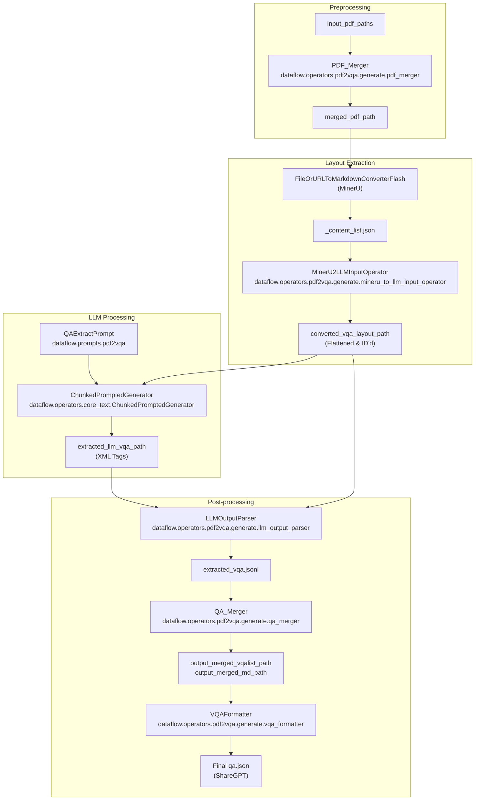
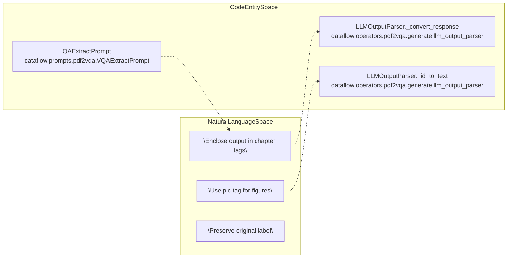
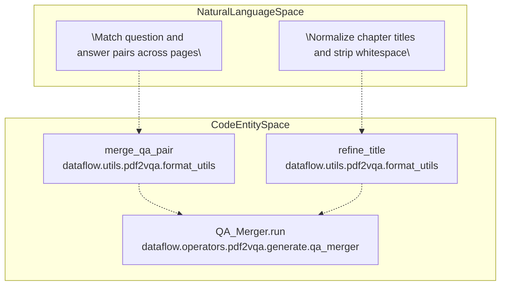

<!-- source: DeepWiki mcp.deepwiki.com · repo OpenDCAI/DataFlow · extra page PDF VQA Operators · fetched 2026-11-02 -->

# PDF VQA Operators

Relevant source files

The following files were used as context for generating this wiki page:

- [dataflow/cli_funcs/cli_pdf.py](dataflow/cli_funcs/cli_pdf.py)
- [dataflow/cli_funcs/pdf2model_pipeline/dataflex_pdf2model_launcher.py](dataflow/cli_funcs/pdf2model_pipeline/dataflex_pdf2model_launcher.py)
- [dataflow/cli_funcs/pdf2model_pipeline/llama_factory_trainer.py](dataflow/cli_funcs/pdf2model_pipeline/llama_factory_trainer.py)
- [dataflow/cli_funcs/pdf2model_pipeline/path_to_jsonl_script.py](dataflow/cli_funcs/pdf2model_pipeline/path_to_jsonl_script.py)
- [dataflow/example/PDF2VQAPipeline/vqa_extract_test.jsonl](dataflow/example/PDF2VQAPipeline/vqa_extract_test.jsonl)
- [dataflow/operators/pdf2vqa/__init__.py](dataflow/operators/pdf2vqa/__init__.py)
- [dataflow/operators/pdf2vqa/generate/llm_output_parser.py](dataflow/operators/pdf2vqa/generate/llm_output_parser.py)
- [dataflow/operators/pdf2vqa/generate/mineru_to_llm_input_operator.py](dataflow/operators/pdf2vqa/generate/mineru_to_llm_input_operator.py)
- [dataflow/operators/pdf2vqa/generate/pdf_merger.py](dataflow/operators/pdf2vqa/generate/pdf_merger.py)
- [dataflow/operators/pdf2vqa/generate/qa_merger.py](dataflow/operators/pdf2vqa/generate/qa_merger.py)
- [dataflow/operators/pdf2vqa/generate/vqa_formatter.py](dataflow/operators/pdf2vqa/generate/vqa_formatter.py)
- [dataflow/prompts/pdf2vqa.py](dataflow/prompts/pdf2vqa.py)
- [dataflow/statics/pipelines/api_pipelines/pdf_vqa_extract_pipeline.py](dataflow/statics/pipelines/api_pipelines/pdf_vqa_extract_pipeline.py)
- [dataflow/utils/pdf2vqa/format_utils.py](dataflow/utils/pdf2vqa/format_utils.py)

## Purpose and Scope

This page documents the specialized operators used in the PDF2VQA (PDF to Visual Question-Answer) pipeline for extracting structured question-answer pairs from PDF documents. These operators process PDF content converted by MinerU, apply LLM-based extraction using ID-referencing, parse structured outputs, merge question-answer pairs, and format them into final datasets.

The operators described here form the backbone of the `PDF_VQA_extract_optimized_pipeline`, which automates the transition from raw PDF files to formatted VQA datasets in ShareGPT format.

**Sources:** [dataflow/statics/pipelines/api_pipelines/pdf_vqa_extract_pipeline.py:13-57](), [dataflow/operators/pdf2vqa/__init__.py:1-21]()

---

## Operator Ecosystem Overview

The PDF VQA ecosystem consists of several specialized operators that handle document merging, layout conversion, LLM-based extraction, parsing, merging, and final formatting.

| Operator | Module | Primary Function | Registry Key |
|----------|--------|------------------|--------------|
| `PDF_Merger` | `dataflow.operators.pdf2vqa` | Merges multiple PDF files into a single document | `PDF_Merger` |
| `MinerU2LLMInputOperator` | `dataflow.operators.pdf2vqa` | Converts MinerU JSON layout to LLM-readable input | `MinerU2LLMInputOperator` |
| `ChunkedPromptedGenerator` | `dataflow.operators.core_text` | Orchestrates LLM extraction with context-aware chunking | `ChunkedPromptedGenerator` |
| `LLMOutputParser` | `dataflow.operators.pdf2vqa` | Parses LLM XML-like responses into structured JSONL | `LLMOutputParser` |
| `QA_Merger` | `dataflow.operators.pdf2vqa` | Matches questions with answers and cleans titles | `QA_Merger` |
| `VQAFormatter` | `dataflow.operators.pdf2vqa` | Converts internal QA pairs to standard ShareGPT format | `VQAFormatter` |

**Sources:** [dataflow/operators/pdf2vqa/__init__.py:4-8](), [dataflow/statics/pipelines/api_pipelines/pdf_vqa_extract_pipeline.py:32-56]()

---

## Data Flow Architecture

The following diagram illustrates the transformation of data from raw PDF inputs to the final VQA format, mapping the pipeline stages to specific code entities.

**Diagram: PDF VQA Extraction Data Flow**

**Sources:** [dataflow/statics/pipelines/api_pipelines/pdf_vqa_extract_pipeline.py:59-100]()

---

## PDF_Merger

### Purpose
The `PDF_Merger` operator takes a list of PDF paths and combines them into a single file. This is critical for datasets where questions are in one PDF and answers/solutions are in another (e.g., textbook vs. solution manual).

### Implementation
- **Class:** `PDF_Merger(OperatorABC)` [dataflow/operators/pdf2vqa/generate/pdf_merger.py:8-9]()
- **Core Logic:** Iterates through `pdf_paths`, verifying existence and using `pypdf.PdfWriter` to append content [dataflow/operators/pdf2vqa/generate/pdf_merger.py:61-68]().
- **Output:** Saves the merged file to `{output_dir}/{name}/{name}_merged.pdf` and updates the `output_pdf_path_key` in the storage dataframe [dataflow/operators/pdf2vqa/generate/pdf_merger.py:55-58](), [dataflow/operators/pdf2vqa/generate/pdf_merger.py:75]().

**Sources:** [dataflow/operators/pdf2vqa/generate/pdf_merger.py:1-83]()

---

## MinerU2LLMInputOperator

### Purpose
Transforms the complex, nested JSON layout produced by MinerU into a flattened structure where every element (text, images, list items) has a unique, sequential ID. This allows the LLM to refer to content by simple integers in its response, significantly reducing token usage compared to sending raw markdown.

### Transformation Logic
1. **Flattening:** Nested list items within MinerU's `list` type are extracted into top-level items to ensure each item has its own ID [dataflow/operators/pdf2vqa/generate/mineru_to_llm_input_operator.py:38-47]().
2. **ID Assignment:** Every element is assigned a zero-indexed `id` [dataflow/operators/pdf2vqa/generate/mineru_to_llm_input_operator.py:33-35]().
3. **Cleaning:** Removes metadata like `bbox` and `page_idx` to minimize prompt noise [dataflow/operators/pdf2vqa/generate/mineru_to_llm_input_operator.py:36-37]().

**Sources:** [dataflow/operators/pdf2vqa/generate/mineru_to_llm_input_operator.py:1-76]()

---

## LLMOutputParser

### Purpose
Parses the LLM's XML-tagged response and maps the returned IDs back to the original content stored in the converted layout JSON.

### Key Method: `_id_to_text()`
This method resolves the comma-separated IDs generated by the LLM:
- **Text/Table Resolution:** Fetches `text` or `table_body` associated with an ID [dataflow/operators/pdf2vqa/generate/llm_output_parser.py:50-53]().
- **Image Resolution:** Converts `img_path` IDs into Markdown image tags ``. It automatically handles image captions and ensures paths are relative to the output directory [dataflow/operators/pdf2vqa/generate/llm_output_parser.py:54-59]().

### Extraction Logic
The `_convert_response` method uses regex to extract structured data from `<chapter>`, `<title>`, `<qa_pair>`, `<question>`, `<answer>`, and `<solution>` tags [dataflow/operators/pdf2vqa/generate/llm_output_parser.py:75-100](). It also handles image replication by copying the `vlm/images` or `images` directory from the MinerU output to the final `vqa_images` folder [dataflow/operators/pdf2vqa/generate/llm_output_parser.py:131-142]().

**Sources:** [dataflow/operators/pdf2vqa/generate/llm_output_parser.py:1-146]()

---

## QA_Merger

### Purpose
Consolidates extracted QA pairs and handles cross-referencing between questions and answers that might have been extracted separately.

### Features
- **Title Refinement:** Uses `refine_title` to normalize chapter headings by stripping whitespace and extracting numeric or Chinese numeral chapter markers (e.g., "Chapter 1.1" -> "1.1") [dataflow/utils/pdf2vqa/format_utils.py:4-19]().
- **Pair Matching:** The `merge_qa_pair` function matches questions and answers based on the refined `chapter_title` and the question `label`. It supports cases where answers appear much later in the document [dataflow/utils/pdf2vqa/format_utils.py:112-122]().
- **Image Path Correction:** Adjusts relative image paths in the final Markdown using regex to include the document `name` prefix, ensuring images render correctly when multiple PDFs are aggregated into one dataset [dataflow/operators/pdf2vqa/generate/qa_merger.py:67-82]().

**Sources:** [dataflow/operators/pdf2vqa/generate/qa_merger.py:11-84](), [dataflow/utils/pdf2vqa/format_utils.py:21-125]()

---

## VQAFormatter

### Purpose
The `VQAFormatter` operator converts the intermediate merged QA pairs into the standardized ShareGPT conversational format required by multi-modal training frameworks (such as LLaMA-Factory).

### Implementation and Data Transformation
- **Role:** Maps internal dictionary representations containing `question`, `answer`, `solution`, and image path references into messages and image arrays compatible with chat templates.
- **Integration:** Typically executed as the final step in `PDF_VQA_extract_optimized_pipeline` to serialize output items into JSON files [dataflow/statics/pipelines/api_pipelines/pdf_vqa_extract_pipeline.py:56]().

**Sources:** [dataflow/statics/pipelines/api_pipelines/pdf_vqa_extract_pipeline.py:56](), [dataflow/operators/pdf2vqa/__init__.py:8]()

---

## VQA Extraction Prompts and Space Mapping

The extraction process relies on `QAExtractPrompt`, which defines the strict XML output format and rules for the LLM.

**Diagram: Prompt-to-Code Mapping (Natural Language to Code Entity Space)**

**Diagram: QA Merging Logic Mapping (Natural Language to Code Entity Space)**

**Sources:** [dataflow/prompts/pdf2vqa.py:5-73](), [dataflow/operators/pdf2vqa/generate/llm_output_parser.py:75-100](), [dataflow/utils/pdf2vqa/format_utils.py:4-125](), [dataflow/operators/pdf2vqa/generate/qa_merger.py:11-84]()

### Prompt Rules
- **Interleaved Support:** Can process pages where questions and answers are mixed [dataflow/prompts/pdf2vqa.py:11-18]().
- **Completeness:** Instructs the LLM to omit incomplete problems that span across pages to ensure high-quality training data [dataflow/prompts/pdf2vqa.py:15-16]().
- **LaTeX Rendering:** Mandates that all mathematical expressions be rendered in LaTeX [dataflow/prompts/pdf2vqa.py:50]().
- **Visual Grounding:** Uses a specialized `<pic>tagA:boxB</pic>` format for referring to specific bounding boxes in the visual layout [dataflow/prompts/pdf2vqa.py:51-52]().

**Sources:** [dataflow/prompts/pdf2vqa.py:1-73]()

---

