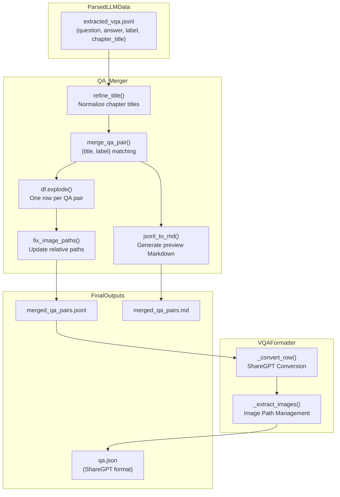
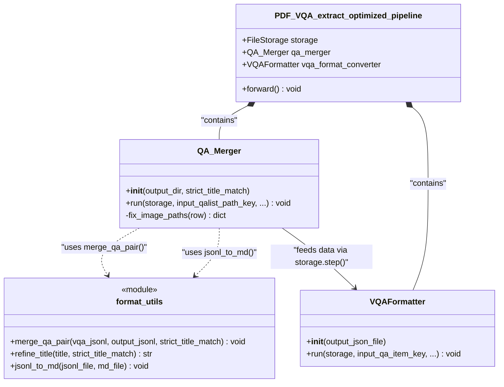

<!-- source: DeepWiki mcp.deepwiki.com · repo OpenDCAI/DataFlow · extra page QA Merging and Output Formatting · fetched 2026-11-02 -->

# QA Merging and Output Formatting

<details>
<summary>Relevant source files</summary>

The following files were used as context for generating this wiki page:

- [dataflow/cli_funcs/cli_pdf.py](dataflow/cli_funcs/cli_pdf.py)
- [dataflow/cli_funcs/pdf2model_pipeline/dataflex_pdf2model_launcher.py](dataflow/cli_funcs/pdf2model_pipeline/dataflex_pdf2model_launcher.py)
- [dataflow/cli_funcs/pdf2model_pipeline/llama_factory_trainer.py](dataflow/cli_funcs/pdf2model_pipeline/llama_factory_trainer.py)
- [dataflow/cli_funcs/pdf2model_pipeline/path_to_jsonl_script.py](dataflow/cli_funcs/pdf2model_pipeline/path_to_jsonl_script.py)
- [dataflow/example/PDF2VQAPipeline/vqa_extract_test.jsonl](dataflow/example/PDF2VQAPipeline/vqa_extract_test.jsonl)
- [dataflow/operators/pdf2vqa/__init__.py](dataflow/operators/pdf2vqa/__init__.py)
- [dataflow/operators/pdf2vqa/generate/llm_output_parser.py](dataflow/operators/pdf2vqa/generate/llm_output_parser.py)
- [dataflow/operators/pdf2vqa/generate/mineru_to_llm_input_operator.py](dataflow/operators/pdf2vqa/generate/mineru_to_llm_input_operator.py)
- [dataflow/operators/pdf2vqa/generate/pdf_merger.py](dataflow/operators/pdf2vqa/generate/pdf_merger.py)
- [dataflow/operators/pdf2vqa/generate/qa_merger.py](dataflow/operators/pdf2vqa/generate/qa_merger.py)
- [dataflow/operators/pdf2vqa/generate/vqa_formatter.py](dataflow/operators/pdf2vqa/generate/vqa_formatter.py)
- [dataflow/prompts/pdf2vqa.py](dataflow/prompts/pdf2vqa.py)
- [dataflow/statics/pipelines/api_pipelines/pdf_vqa_extract_pipeline.py](dataflow/statics/pipelines/api_pipelines/pdf_vqa_extract_pipeline.py)
- [dataflow/utils/pdf2vqa/format_utils.py](dataflow/utils/pdf2vqa/format_utils.py)

</details>


## Purpose and Scope

This document details the final stage of the PDF VQA Extraction Pipeline (`PDF_VQA_extract_optimized_pipeline`), which merges extracted content into complete QA pairs and formats them for downstream LLM training [dataflow/statics/pipelines/api_pipelines/pdf_vqa_extract_pipeline.py:13-100](). This stage involves two primary components:
1. **`QA_Merger`**: Matches questions with their corresponding answers based on chapter structure and problem labels, performing title refinement, data explosion, and relative image path resolution [dataflow/operators/pdf2vqa/generate/qa_merger.py:11-84]().
2. **`VQAFormatter`**: Converts merged QA pairs into the standard ShareGPT format, managing image paths for multimodal dataset compatibility [dataflow/statics/pipelines/api_pipelines/pdf_vqa_extract_pipeline.py:56-100]().

For information about the preceding extraction stages, see **5.6.2 VQA Extraction and Parsing**. For the overall pipeline architecture, see **5.6 PDF VQA Extraction Pipeline**.

Sources: [dataflow/operators/pdf2vqa/generate/qa_merger.py:11-84](), [dataflow/statics/pipelines/api_pipelines/pdf_vqa_extract_pipeline.py:13-100]()

## Overview

The merging and formatting process transforms raw LLM-parsed JSONL output into structured training datasets. The pipeline handles complex document structures where questions and answers might be processed independently or interleaved within textbooks and separate answer booklets [dataflow/statics/pipelines/api_pipelines/pdf_vqa_extract_pipeline.py:87-100]().

Sources: [dataflow/operators/pdf2vqa/generate/qa_merger.py:31-84](), [dataflow/statics/pipelines/api_pipelines/pdf_vqa_extract_pipeline.py:87-100]()

## QA Matching and Formatting Architecture

The following diagram illustrates the flow from parsed LLM outputs to the final formatted dataset, bridging natural language processing concepts to the underlying code entities.

Title: "VQA Post-Processing Data Flow"


Sources: [dataflow/operators/pdf2vqa/generate/qa_merger.py:31-84](), [dataflow/utils/pdf2vqa/format_utils.py:21-135]()

## QA_Merger Operator

The `QA_Merger` class inherits from `OperatorABC` and is registered in `OPERATOR_REGISTRY` [dataflow/operators/pdf2vqa/generate/qa_merger.py:10-11](). It unifies fragmented question and answer data by invoking `merge_qa_pair` from `dataflow.utils.pdf2vqa.format_utils` [dataflow/operators/pdf2vqa/generate/qa_merger.py:6-49]().

### Title Refinement Logic

To ensure robust matching across varying book layouts, the `refine_title` function normalizes chapter titles by removing whitespace and extracting core numerical or chapter identifiers [dataflow/utils/pdf2vqa/format_utils.py:4-19]():

| Strategy | Implementation | Example Transformation |
| :--- | :--- | :--- |
| **Whitespace Removal** | `re.sub(r'\s+', '', title)` | `"Chapter  1"` $\rightarrow$ `"Chapter1"` |
| **Arabic Numeral Extraction** | `re.search(r"\d+\.\d+|\d+", title)` | `"Section 1.2 Overview"` $\rightarrow$ `"1.2"` |
| **Chinese Numeral Extraction** | `re.search(r'[一二三四五六七八九零十百]+', title)` | `"第六章 概率论"` $\rightarrow$ `"六"` |

Sources: [dataflow/utils/pdf2vqa/format_utils.py:4-19]()

### Image Path Resolution

A critical task of `QA_Merger.run()` is fixing relative image references after exploding the dataframe rows into individual QA items [dataflow/operators/pdf2vqa/generate/qa_merger.py:64-82](). Since images are stored in subdirectories named after the source document `name` (e.g., `math1`), the `fix_image_paths` helper prepends the document name to markdown image tags [dataflow/operators/pdf2vqa/generate/qa_merger.py:66-82]():

```python
# Example of path fixing within QA_Merger.run() [dataflow/operators/pdf2vqa/generate/qa_merger.py:75-79]()
qa_item[key] = re.sub(
    r'!\[(.*?)\]\((.*?)\)',
    lambda m: f")})",
    qa_item[key]
)
```

Sources: [dataflow/operators/pdf2vqa/generate/qa_merger.py:64-82]()

## VQA Formatting for LLM Training

The `VQAFormatter` operator consumes the merged storage dataframe and serializes the records into the ShareGPT format expected by SFT frameworks like LlamaFactory [dataflow/statics/pipelines/api_pipelines/pdf_vqa_extract_pipeline.py:56-100]().

### ShareGPT Conversion

The operator transforms each internal `qa_pair` dictionary into structured conversation turns (`messages`) and collects associated asset paths (`images`).

**Structure Mapping**:
- **User Message**: Contains the prompt question text with embedded image references.
- **Assistant Message**: Contains the combined answer and solution content.
- **Images**: A list of paths extracted from markdown image tokens.

Sources: [dataflow/statics/pipelines/api_pipelines/pdf_vqa_extract_pipeline.py:95-100]()

## Code Entity and Data Flow

The following class diagram associates system components with exact code entities in the codebase.

Title: "QA Merging and Formatting Class Relations"


Sources: [dataflow/statics/pipelines/api_pipelines/pdf_vqa_extract_pipeline.py:13-57](), [dataflow/operators/pdf2vqa/generate/qa_merger.py:11-37](), [dataflow/utils/pdf2vqa/format_utils.py:4-135]()

## Key Functions Reference

### `merge_qa_pair`
Iterates through extracted question and answer lists, performing matching based on refined chapter titles and numerical problem labels [dataflow/utils/pdf2vqa/format_utils.py:21-125](). It handles split documents where questions and answers appear in separate files by buffering unmatched items in dictionaries.

### `jsonl_to_md`
A utility function that converts serialized JSONL records into a structured Markdown document (`merged_qa_pairs.md`) for human inspection and visual validation [dataflow/utils/pdf2vqa/format_utils.py:126-135]().

### `fix_image_paths`
A regex-based post-processing helper inside `QA_Merger` that updates markdown image paths to include the document identifier prefix (e.g., ``), ensuring downstream formatters correctly resolve asset locations [dataflow/operators/pdf2vqa/generate/qa_merger.py:66-82]().

Sources: [dataflow/utils/pdf2vqa/format_utils.py:21-135](), [dataflow/operators/pdf2vqa/generate/qa_merger.py:66-82]()

---

