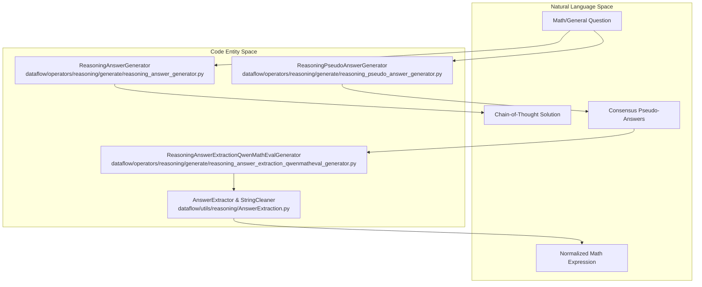
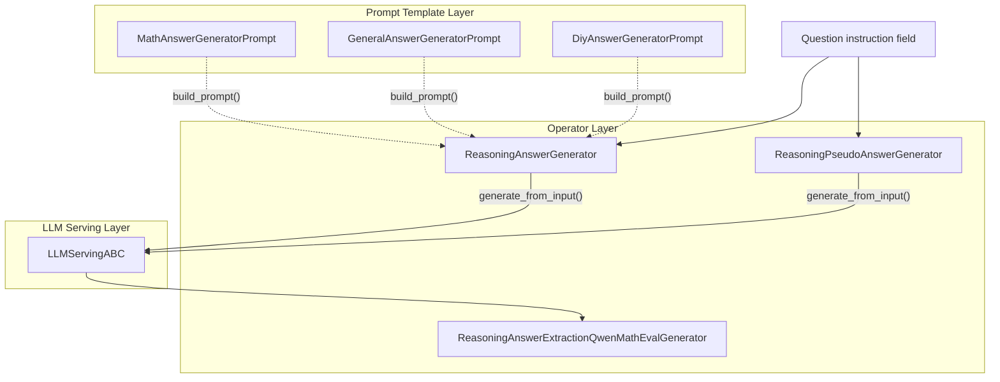
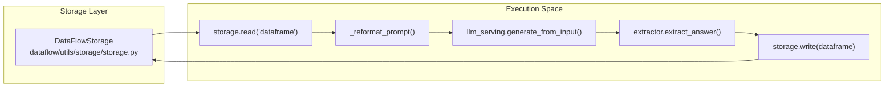

<!-- source: DeepWiki mcp.deepwiki.com · repo OpenDCAI/DataFlow · extra page Answer Generation with CoT · fetched 2026-11-02 -->

# Answer Generation with CoT

<details>
<summary>Relevant source files</summary>

The following files were used as context for generating this wiki page:

- [dataflow/operators/reasoning/eval/reasoning_question_category_sample_evaluator.py](dataflow/operators/reasoning/eval/reasoning_question_category_sample_evaluator.py)
- [dataflow/operators/reasoning/eval/reasoning_question_difficulty_sample_evaluator.py](dataflow/operators/reasoning/eval/reasoning_question_difficulty_sample_evaluator.py)
- [dataflow/operators/reasoning/generate/reasoning_answer_extraction_qwenmatheval_generator.py](dataflow/operators/reasoning/generate/reasoning_answer_extraction_qwenmatheval_generator.py)
- [dataflow/operators/reasoning/generate/reasoning_answer_generator.py](dataflow/operators/reasoning/generate/reasoning_answer_generator.py)
- [dataflow/operators/reasoning/generate/reasoning_pseudo_answer_generator.py](dataflow/operators/reasoning/generate/reasoning_pseudo_answer_generator.py)
- [dataflow/operators/reasoning/generate/reasoning_question_generator.py](dataflow/operators/reasoning/generate/reasoning_question_generator.py)
- [dataflow/utils/reasoning/AnswerExtraction.py](dataflow/utils/reasoning/AnswerExtraction.py)
- [dataflow/utils/reasoning/CategoryFuzz.py](dataflow/utils/reasoning/CategoryFuzz.py)

</details>


## Purpose and Scope

This page documents the answer generation system for reasoning tasks using Chain-of-Thought (CoT) prompting in DataFlow. It covers operator implementations, prompt templates, structured output formats, pseudo-answer consensus generation, QwenMathEval extraction, and pretrain format conversion used to generate step-by-step solutions for mathematical and general reasoning problems.

The answer generation system supports three primary domains:
- **Mathematical reasoning**: Rigorous LaTeX-formatted solutions with `\boxed{}` final answers [dataflow/prompts/reasoning/math.py:7-58]().
- **General reasoning**: Logical, algorithmic, and analytical problems across diverse fields [dataflow/prompts/reasoning/general.py:8-54]().
- **DIY (custom)**: User-defined reasoning prompts for specialized domains [dataflow/prompts/reasoning/diy.py:8-18]().

Sources: [dataflow/prompts/reasoning/general.py:8-54](), [dataflow/prompts/reasoning/math.py:7-58](), [dataflow/prompts/reasoning/diy.py:8-18]()

## Chain-of-Thought Answer Format

All answer generation operators produce structured solutions following a strict four-stage progressive format:

| Stage | Purpose | Format Requirement |
|-------|---------|-------------------|
| 1. Identify Components | Extract key elements, premises, and constraints | Each step prefixed with "→" |
| 2. Apply Principles | Show theorem/formula application with derivation | Step-by-step with "→" prefix |
| 3. Perform Calculations | Execute calculations with intermediate verification | Show work with "→" prefix |
| 4. Present Final Answer | State conclusion in unambiguous notation | Math: `\boxed{}`, General: clear statement |

**Format Constraints**:
- **Prefix**: Every logical step must start with the arrow symbol "→" [dataflow/prompts/reasoning/math.py:28-29]().
- **Notation**: Mathematical symbols must use LaTeX commands (e.g., `\geq`, `\div`) [dataflow/prompts/reasoning/math.py:29-30]().
- **Preamble**: Responses must start with "Solution:" and contain no conversational filler [dataflow/prompts/reasoning/general.py:54-54]().
- **Termination**: The generation must finish immediately after the solution/boxed answer [dataflow/prompts/reasoning/math.py:58-58]().
- **Thinking Tags**: For reasoning-heavy models (like DeepSeek-R1), the system supports parsing `<answer>...</answer>` blocks via `_parse_response` [dataflow/operators/reasoning/generate/reasoning_question_generator.py:125-132]().

Sources: [dataflow/prompts/reasoning/general.py:19-54](), [dataflow/prompts/reasoning/math.py:18-58](), [dataflow/prompts/reasoning/diy.py:15-15](), [dataflow/operators/reasoning/generate/reasoning_question_generator.py:125-132]()

## Natural Language Space to Code Entity Space Mapping



**Diagram: Natural Language to Code Entity Bridge for Answer Generation** - Relates high-level reasoning concepts and outputs to their corresponding classes across operators and utilities.

Sources: [dataflow/operators/reasoning/generate/reasoning_answer_generator.py:21-28](), [dataflow/operators/reasoning/generate/reasoning_pseudo_answer_generator.py:18-26](), [dataflow/operators/reasoning/generate/reasoning_answer_extraction_qwenmatheval_generator.py:15-29](), [dataflow/utils/reasoning/AnswerExtraction.py:103-157]()

## Answer Generation Architecture



**Diagram: Answer Generation Data Flow** - Illustrates the transformation from raw questions to structured CoT answers via serving backends.

Sources: [dataflow/prompts/reasoning/math.py:7-15](), [dataflow/operators/reasoning/generate/reasoning_answer_generator.py:21-28](), [dataflow/operators/reasoning/generate/reasoning_pseudo_answer_generator.py:18-26](), [dataflow/operators/reasoning/generate/reasoning_answer_extraction_qwenmatheval_generator.py:15-29]()

## Core Operators

### ReasoningAnswerGenerator
The primary operator for generating CoT responses. It uses the `@prompt_restrict` decorator to ensure only valid reasoning prompts are used [dataflow/operators/reasoning/generate/reasoning_answer_generator.py:15-20](). It reformats dataframe inputs into LLM prompts using `_reformat_prompt` which calls `build_prompt()` on the selected template [dataflow/operators/reasoning/generate/reasoning_answer_generator.py:72-79](). Results are stored in the `generated_cot` field [dataflow/operators/reasoning/generate/reasoning_answer_generator.py:85-85]().

Sources: [dataflow/operators/reasoning/generate/reasoning_answer_generator.py:15-20](), [dataflow/operators/reasoning/generate/reasoning_answer_generator.py:72-79](), [dataflow/operators/reasoning/generate/reasoning_answer_generator.py:85-85]()

### ReasoningPseudoAnswerGenerator
Implements a "self-consistency" approach by generating multiple solutions (defined by `max_times`) for the same question [dataflow/operators/reasoning/generate/reasoning_pseudo_answer_generator.py:22-26](). It uses an `AnswerExtractor` to parse the final answer from each CoT path [dataflow/operators/reasoning/generate/reasoning_pseudo_answer_generator.py:119-119]() and selects the most frequent one using `Counter.most_common(1)` [dataflow/operators/reasoning/generate/reasoning_pseudo_answer_generator.py:128-129](). It outputs the selected `pseudo_answer_value` and a `pseudo_correct_solution_example` [dataflow/operators/reasoning/generate/reasoning_pseudo_answer_generator.py:134-136]().

Sources: [dataflow/operators/reasoning/generate/reasoning_pseudo_answer_generator.py:22-26](), [dataflow/operators/reasoning/generate/reasoning_pseudo_answer_generator.py:119-119](), [dataflow/operators/reasoning/generate/reasoning_pseudo_answer_generator.py:128-129](), [dataflow/operators/reasoning/generate/reasoning_pseudo_answer_generator.py:134-136]()

### ReasoningAnswerExtractionQwenMathEvalGenerator
A specialized post-processor that utilizes `AnswerExtractor` to normalize mathematical expressions from model outputs [dataflow/operators/reasoning/generate/reasoning_answer_extraction_qwenmatheval_generator.py:15-29](). It performs string cleaning and unit processing via `UnitTextManager` and `StringCleaner` to ensure mathematical consistency [dataflow/operators/reasoning/generate/reasoning_answer_extraction_qwenmatheval_generator.py:27-30](). The `run` method reads the input dataframe, applies `answer_extractor.extract_answer` to the specified `input_key` column, and stores results in the `output_key` column [dataflow/operators/reasoning/generate/reasoning_answer_extraction_qwenmatheval_generator.py:59-79]().

Sources: [dataflow/operators/reasoning/generate/reasoning_answer_extraction_qwenmatheval_generator.py:15-29](), [dataflow/operators/reasoning/generate/reasoning_answer_extraction_qwenmatheval_generator.py:27-30](), [dataflow/operators/reasoning/generate/reasoning_answer_extraction_qwenmatheval_generator.py:59-79](), [dataflow/utils/reasoning/AnswerExtraction.py:142-157]()

## Metadata and Classification Operators

After answer generation, classification and metadata evaluation operators enrich the dataset:

| Operator | Function | Key Code Entities |
|----------|----------|-------------------|
| **Category Classifier** | Hierarchical classification into primary/secondary categories | `ReasoningQuestionCategorySampleEvaluator` [dataflow/operators/reasoning/eval/reasoning_question_category_sample_evaluator.py:19-19]() |
| **Difficulty Classifier** | Assigns a complexity score (1-10) via LLM analysis | `ReasoningQuestionDifficultySampleEvaluator` [dataflow/operators/reasoning/eval/reasoning_question_difficulty_sample_evaluator.py:17-17]() |

The `ReasoningQuestionCategorySampleEvaluator` uses `MathQuestionCategoryPrompt` to output a JSON object containing `primary_category` and `secondary_category` [dataflow/operators/reasoning/eval/reasoning_question_category_sample_evaluator.py:19-26](). It leverages `CategoryUtils().normalize_categories` to standardize extracted categories against known taxonomies [dataflow/operators/reasoning/eval/reasoning_question_category_sample_evaluator.py:105-106](). The `ReasoningQuestionDifficultySampleEvaluator` uses `MathQuestionDifficultyPrompt` to extract a numerical rating from model responses via regular expressions [dataflow/operators/reasoning/eval/reasoning_question_difficulty_sample_evaluator.py:93-104]().

Sources: [dataflow/operators/reasoning/eval/reasoning_question_category_sample_evaluator.py:19-26](), [dataflow/operators/reasoning/eval/reasoning_question_category_sample_evaluator.py:105-106](), [dataflow/operators/reasoning/eval/reasoning_question_difficulty_sample_evaluator.py:17-24](), [dataflow/operators/reasoning/eval/reasoning_question_difficulty_sample_evaluator.py:93-104]()

## Operator Execution and Storage Integration



**Diagram: Execution Flow Bridge** - Associates runtime pipeline operations with storage interfaces and generation methods.

Sources: [dataflow/operators/reasoning/generate/reasoning_answer_generator.py:81-100](), [dataflow/operators/reasoning/generate/reasoning_pseudo_answer_generator.py:95-144]()

## CoT Output Examples

### Mathematical Problem Format
**Prompt Logic**: Defined in `MathAnswerGeneratorPrompt.build_prompt`.
**Format Requirement**: Must use `\boxed{}` for the final answer and "→" for steps [dataflow/prompts/reasoning/math.py:21-30]().
**Example Structure**:
```text
Solution:
1. Find critical points:
→ f'(x) = 3x² - 6x
→ 3x(x-2) = 0 ⇒ x=0, x=2
...
\boxed{0}
```

Sources: [dataflow/prompts/reasoning/math.py:31-58](), [dataflow/prompts/reasoning/math.py:21-30]()

### DIY (Custom) Format
The `DiyAnswerGeneratorPrompt` allows users to inject custom string templates into the generation process [dataflow/prompts/reasoning/diy.py:8-18](). It appends the question to the provided template and ensures the response starts with "Solution:" [dataflow/prompts/reasoning/diy.py:15-15]().

Sources: [dataflow/prompts/reasoning/diy.py:8-18](), [dataflow/prompts/reasoning/diy.py:15-15]()

---

