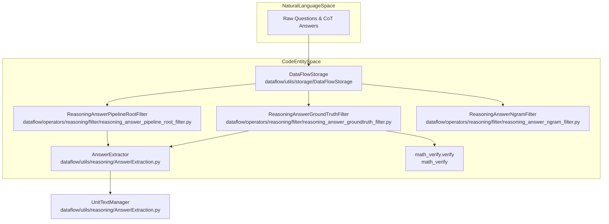
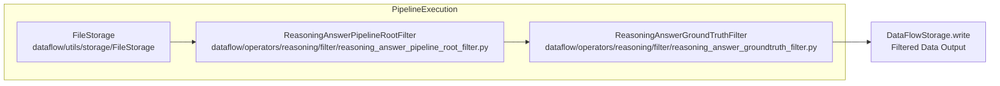

<!-- source: DeepWiki mcp.deepwiki.com · repo OpenDCAI/DataFlow · extra page Quality Filtering · fetched 2026-11-02 -->

# Quality Filtering

Relevant source files

The following files were used as context for generating this wiki page:

- [dataflow/cli_funcs/cli_text.py](dataflow/cli_funcs/cli_text.py)
- [dataflow/cli_funcs/text2model_pipeline/text_to_qa_pipeline.py](dataflow/cli_funcs/text2model_pipeline/text_to_qa_pipeline.py)
- [dataflow/operators/knowledge_cleaning/generate/qa_extract.py](dataflow/operators/knowledge_cleaning/generate/qa_extract.py)
- [dataflow/operators/reasoning/filter/reasoning_answer_groundtruth_filter.py](dataflow/operators/reasoning/filter/reasoning_answer_groundtruth_filter.py)
- [dataflow/operators/reasoning/filter/reasoning_answer_ngram_filter.py](dataflow/operators/reasoning/filter/reasoning_answer_ngram_filter.py)
- [dataflow/operators/reasoning/filter/reasoning_answer_pipeline_root_filter.py](dataflow/operators/reasoning/filter/reasoning_answer_pipeline_root_filter.py)
- [dataflow/operators/text_sft/eval/Superfiltering/data_analysis.py](dataflow/operators/text_sft/eval/Superfiltering/data_analysis.py)
- [test/cpu_only/test_reasoning_answer_pipeline_root_filter.py](test/cpu_only/test_reasoning_answer_pipeline_root_filter.py)

## Purpose and Scope

This document details the quality filtering operators used in the Reasoning and Core Text pipelines to ensure high-quality training and evaluation data [dataflow/operators/reasoning/filter/reasoning_answer_pipeline_root_filter.py:10](), [dataflow/operators/reasoning/filter/reasoning_answer_ngram_filter.py:13](), [dataflow/operators/reasoning/filter/reasoning_answer_groundtruth_filter.py:11-37](). Quality filtering removes low-quality questions and answers based on token length, n-gram overlap, ground truth matching, model judging, and math verification. These operators are critical for refining synthesized data before it is used for Supervised Fine-Tuning (SFT) or Reinforcement Learning (RL) training, and for validating model performance in evaluation pipelines.

For information about generation, see [5.2.1 Question Generation and Classification]() and [5.2.2 Answer Generation with CoT](). For a broader overview, see [5.2 Reasoning Pipeline]().

Sources: [dataflow/operators/reasoning/filter/reasoning_answer_pipeline_root_filter.py:10](), [dataflow/operators/reasoning/filter/reasoning_answer_ngram_filter.py:13](), [dataflow/operators/reasoning/filter/reasoning_answer_groundtruth_filter.py:11-37]().

---

## Overview

Quality filtering is the final validation stage in reasoning workflows. After questions have been generated and paired with chain-of-thought (CoT) answers, the filtering operators remove entries that fail semantic, structural, or mathematical correctness checks [dataflow/operators/reasoning/filter/reasoning_answer_pipeline_root_filter.py:10](), [dataflow/operators/reasoning/filter/reasoning_answer_ngram_filter.py:13](), [dataflow/operators/reasoning/filter/reasoning_answer_groundtruth_filter.py:11-37](). 

The system utilizes a variety of specialized filters and evaluators:
- **Routing and Extraction**: `ReasoningAnswerPipelineRootFilter` [dataflow/operators/reasoning/filter/reasoning_answer_pipeline_root_filter.py:10]() for identifying ground truth availability.
- **Structural Filters**: `ReasoningAnswerNgramFilter` [dataflow/operators/reasoning/filter/reasoning_answer_ngram_filter.py:13]() for repetition detection.
- **Ground Truth & Math Verification**: `ReasoningAnswerGroundTruthFilter` [dataflow/operators/reasoning/filter/reasoning_answer_groundtruth_filter.py:11]() supporting `exact` and `math_verify` comparisons [dataflow/operators/reasoning/filter/reasoning_answer_groundtruth_filter.py:12-37]().

Sources: [dataflow/operators/reasoning/filter/reasoning_answer_pipeline_root_filter.py:10](), [dataflow/operators/reasoning/filter/reasoning_answer_ngram_filter.py:13](), [dataflow/operators/reasoning/filter/reasoning_answer_groundtruth_filter.py:11-37]().

---

## Filter Operators Architecture

### System Components and Data Flow

The following diagram bridges the "Natural Language Space" (questions/answers) to the "Code Entity Space" (specific filter and evaluation classes) using concrete codebase identifiers.

Title: "Quality Filtering Component Bridge"

Sources: [dataflow/operators/reasoning/filter/reasoning_answer_pipeline_root_filter.py:10](), [dataflow/operators/reasoning/filter/reasoning_answer_ngram_filter.py:13](), [dataflow/operators/reasoning/filter/reasoning_answer_groundtruth_filter.py:11-37]().

---

## Ground Truth Management and Routing

### ReasoningAnswerPipelineRootFilter
The `ReasoningAnswerPipelineRootFilter` acts as a routing and extraction gateway for reasoning pipelines [dataflow/operators/reasoning/filter/reasoning_answer_pipeline_root_filter.py:10]().

- **Ground Truth Extraction**: If a ground truth (GT) value is missing in the provided `input_gt_key`, the operator uses `AnswerExtractor` to attempt to parse a GT value directly from the `input_answer_key` (the model output) [dataflow/operators/reasoning/filter/reasoning_answer_pipeline_root_filter.py:75-102]().
- **Branch Labeling**: It does not drop samples but instead labels them in an `output_branch_key` (defaulting to `answer_branch`) as either `with_gt` or `without_gt` [dataflow/operators/reasoning/filter/reasoning_answer_pipeline_root_filter.py:110-116]().
- **Linear Storage Pattern**: It follows the DataFlow linear storage contract, performing exactly one storage write for all samples while recording the routing metadata in the dataframe [dataflow/operators/reasoning/filter/reasoning_answer_pipeline_root_filter.py:54-59, 118]().

Sources: [dataflow/operators/reasoning/filter/reasoning_answer_pipeline_root_filter.py:10-130](), [test/cpu_only/test_reasoning_answer_pipeline_root_filter.py:32-139]().

---

## Ground Truth Matching and Math Verification

### ReasoningAnswerGroundTruthFilter
The `ReasoningAnswerGroundTruthFilter` compares predicted answers against ground truth using exact string matching or mathematical verification [dataflow/operators/reasoning/filter/reasoning_answer_groundtruth_filter.py:11-59]().

- **Comparison Methods (`compare_method`)**:
    - `exact`: Performs strict string equality check via `str(answer) == str(ground_truth)` [dataflow/operators/reasoning/filter/reasoning_answer_groundtruth_filter.py:26-27]().
    - `math_verify`: Uses the `math_verify` library (`parse` and `verify`) to handle symbolic mathematical expressions and equivalent forms [dataflow/operators/reasoning/filter/reasoning_answer_groundtruth_filter.py:29-37]().
- **Extraction & Filtering**: Utilizes `AnswerExtractor` to isolate the answer from generated CoT texts before applying the comparison function, appending matching samples to the filtered output [dataflow/operators/reasoning/filter/reasoning_answer_groundtruth_filter.py:20-22, 77-81]().

Sources: [dataflow/operators/reasoning/filter/reasoning_answer_groundtruth_filter.py:11-86]().

---

## Structural and Repetition Filtering

### ReasoningAnswerNgramFilter
This operator detects and filters out repetitive content (e.g., decoding loops) that degrades data quality [dataflow/operators/reasoning/filter/reasoning_answer_ngram_filter.py:13-20]().

- **Multi-lingual Logic**:
    - **Chinese**: Detects Chinese characters via regex `[\u4e00-\u9fff]` and applies character-level n-grams [dataflow/operators/reasoning/filter/reasoning_answer_ngram_filter.py:94-98, 100-125]().
    - **English**: Applies word-level n-grams by splitting text into tokens [dataflow/operators/reasoning/filter/reasoning_answer_ngram_filter.py:127-152]().
- **Scoring**: Computes a `repetition_score = unique_ngrams_count / total_ngrams`. Samples outside the user-defined `[min_score, max_score]` (default 0.1 to 1.0) are discarded [dataflow/operators/reasoning/filter/reasoning_answer_ngram_filter.py:24-26, 174-176]().

Sources: [dataflow/operators/reasoning/filter/reasoning_answer_ngram_filter.py:13-176]().

---

## Integration in Evaluation Pipelines

Quality filtering steps integrate into evaluation and execution pipelines as demonstrated below.

Title: "Pipeline Execution Storage Flow"

- **Execution Flow**: Data is read via `DataFlowStorage`, routed by `ReasoningAnswerPipelineRootFilter`, and validated by `ReasoningAnswerGroundTruthFilter` before writing out the final filtered dataset [dataflow/operators/reasoning/filter/reasoning_answer_pipeline_root_filter.py:47-59](), [dataflow/operators/reasoning/filter/reasoning_answer_groundtruth_filter.py:63-86]().

Sources: [dataflow/operators/reasoning/filter/reasoning_answer_pipeline_root_filter.py:47-59](), [dataflow/operators/reasoning/filter/reasoning_answer_groundtruth_filter.py:63-86]().

---

