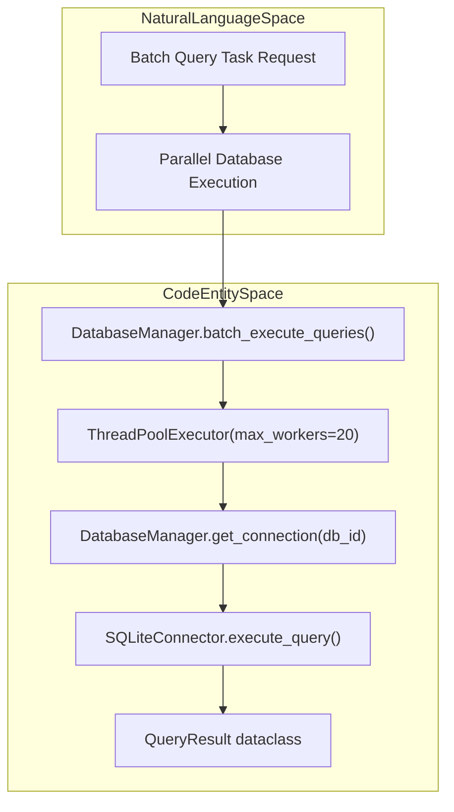
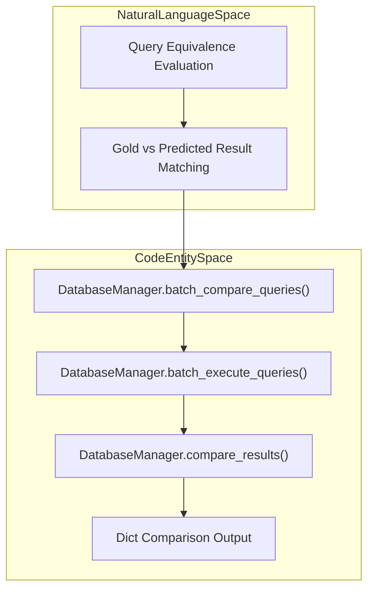
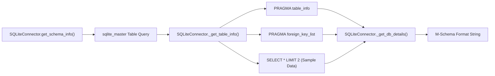

<!-- source: DeepWiki mcp.deepwiki.com · repo OpenDCAI/DataFlow · extra page Query Execution and Comparison · fetched 2026-11-02 -->

# Query Execution and Comparison

<details>
<summary>Relevant source files</summary>

The following files were used as context for generating this wiki page:

- [dataflow/operators/text2sql/eval/sql_execution_classifier.py](dataflow/operators/text2sql/eval/sql_execution_classifier.py)
- [dataflow/operators/text2sql/filter/sql_execution_filter.py](dataflow/operators/text2sql/filter/sql_execution_filter.py)
- [dataflow/operators/text2sql/generate/sql_generator.py](dataflow/operators/text2sql/generate/sql_generator.py)
- [dataflow/operators/text2sql/generate/sql_variation_generator.py](dataflow/operators/text2sql/generate/sql_variation_generator.py)
- [dataflow/operators/text2sql/generate/text2sql_cot_generator.py](dataflow/operators/text2sql/generate/text2sql_cot_generator.py)
- [dataflow/operators/text2sql/generate/text2sql_prompt_generator.py](dataflow/operators/text2sql/generate/text2sql_prompt_generator.py)
- [dataflow/operators/text2sql/generate/text2sql_question_generator.py](dataflow/operators/text2sql/generate/text2sql_question_generator.py)
- [dataflow/prompts/text2sql.py](dataflow/prompts/text2sql.py)
- [dataflow/statics/pipelines/api_pipelines/text2vecsql_pipeline_gen.py](dataflow/statics/pipelines/api_pipelines/text2vecsql_pipeline_gen.py)
- [dataflow/utils/text2sql/base.py](dataflow/utils/text2sql/base.py)
- [dataflow/utils/text2sql/database_connector/mysql_connector.py](dataflow/utils/text2sql/database_connector/mysql_connector.py)
- [dataflow/utils/text2sql/database_connector/sqlite_connector.py](dataflow/utils/text2sql/database_connector/sqlite_connector.py)
- [dataflow/utils/text2sql/database_connector/sqlite_vec_connector.py](dataflow/utils/text2sql/database_connector/sqlite_vec_connector.py)
- [dataflow/utils/text2sql/database_manager.py](dataflow/utils/text2sql/database_manager.py)

</details>


This page provides full technical details on query execution, result comparison, database schema extraction, M-Schema format generation, and TTL caching within DataFlow's database management layer. These mechanisms power downstream Text2SQL operators by enabling efficient, parallelized interaction with heterogeneous database backends.

For related database architecture and connection handling, see [Database Management]() and [Database Connectors]().

---

## Overview

Database interactions in DataFlow are centrally coordinated by the `DatabaseManager` class defined in `dataflow/utils/text2sql/database_manager.py` [dataflow/utils/text2sql/database_manager.py:84](). Its primary responsibilities include:

1. **Batch Query Execution**: Executing concurrent SQL queries across multiple database instances using thread pools and per-database connection semaphores [dataflow/utils/text2sql/database_manager.py:181-215]().
2. **Query Result Comparison**: Comparing gold-standard and predicted SQL query execution outputs for semantic correctness validation [dataflow/utils/text2sql/database_manager.py:152-179]().
3. **Schema Extraction**: Extracting structural database metadata via `DatabaseConnectorABC` implementations [dataflow/utils/text2sql/database_connector/sqlite_connector.py:93-113]() and serializing it into standardized formats.
4. **M-Schema Generation**: Converting extracted schema dictionaries into compact text blocks (`_get_db_details`) tailored for LLM prompt context [dataflow/utils/text2sql/database_connector/sqlite_connector.py:189-254]().
5. **TTL Caching**: Managing query results, schema details, and embedding lookups through the thread-safe `CacheManager` class [dataflow/utils/text2sql/database_manager.py:19-81]().

Sources: [dataflow/utils/text2sql/database_manager.py:84-121](), [dataflow/utils/text2sql/database_connector/sqlite_connector.py:93-113]()

---

## Batch Query Execution

### Execution Architecture and Concurrency

The `DatabaseManager.batch_execute_queries()` method handles parallel processing of multiple `(db_id, sql)` pairs [dataflow/utils/text2sql/database_manager.py:181](). To prevent resource exhaustion when handling large datasets, execution is governed by a thread pool executor (`ThreadPoolExecutor`) [dataflow/utils/text2sql/database_manager.py:184]() combined with thread synchronization safeguards.

**Diagram: Natural Language to Code Entity Space: Parallel Query Execution**

Sources: [dataflow/utils/text2sql/database_manager.py:181-215]()

The execution flow enforces robust error handling, query timeouts (`query_timeout = 5`) [dataflow/utils/text2sql/database_manager.py:111](), and preprocessing for vector extensions [dataflow/utils/text2sql/database_manager.py:376-400]().

| Feature | Code Entity / Implementation | Purpose |
|---------|------------------------------|---------|
| **Thread Pool** | `ThreadPoolExecutor(max_workers=20)` [dataflow/utils/text2sql/database_manager.py:184]() | Concurrently dispatches SQL execution tasks |
| **Connection Limits** | `self.max_connections_per_db = 3` [dataflow/utils/text2sql/database_manager.py:109]() | Prevents flooding individual database files/servers |
| **Timeout Handling** | `as_completed(futures, timeout=...)` [dataflow/utils/text2sql/database_manager.py:211]() | Guards against hanging queries or deadlocks |
| **Error Isolation** | Per-task `try...except` blocks [dataflow/utils/text2sql/database_manager.py:190-198]() | Ensures individual failing queries do not abort the batch |

Sources: [dataflow/utils/text2sql/database_manager.py:108-111](), [dataflow/utils/text2sql/database_manager.py:181-215]()

### QueryResult Specification

Each execution returns a standardized `QueryResult` dataclass defined in `dataflow/utils/text2sql/base.py` [dataflow/utils/text2sql/base.py:17]():

```python
@dataclass
class QueryResult:
    success: bool
    data: List[Dict[str, Any]] = field(default_factory=list)
    columns: List[str] = field(default_factory=list)
    error: Optional[str] = None
    row_count: int = 0
```
Sources: [dataflow/utils/text2sql/base.py:17-23]()

---

## Query Result Comparison

### Comparison Pipeline

Validation pipelines frequently require checking whether a generated (predicted) SQL query yields identical results to a gold-standard query. The `DatabaseManager.batch_compare_queries()` method accepts query triples `(db_id, gold_sql, pred_sql)` and evaluates them [dataflow/utils/text2sql/database_manager.py:152-179]().

**Diagram: Natural Language to Code Entity Space: Query Comparison Flow**

Sources: [dataflow/utils/text2sql/database_manager.py:152-179]()

The comparison workflow flattens input triples into individual execution tasks, invokes batch execution, and delegates result evaluation to `compare_results()` [dataflow/utils/text2sql/database_manager.py:170-177]().

Sources: [dataflow/utils/text2sql/database_manager.py:152-179]()

### Result Comparison Logic

The `compare_results` function performs verification through sequential validation stages:
1. **Execution Success Validation**: Both `QueryResult` objects must have `success == True` [dataflow/utils/text2sql/database_manager.py:265-271]().
2. **Row Count Check**: The number of returned rows (`row_count`) must match [dataflow/utils/text2sql/database_manager.py:273-277]().
3. **Column Matching**: Column sets must be identical regardless of retrieval order [dataflow/utils/text2sql/database_manager.py:279-283]().
4. **Data Normalization & Sorting**: Rows are sorted and null values are normalized to ensure deterministic comparison despite unordered database returns [dataflow/utils/text2sql/database_manager.py:285-307]().

Sources: [dataflow/utils/text2sql/database_manager.py:259-312]()

---

## Schema Extraction and M-Schema Format Generation

### Schema Information Structure

Connectors such as `SQLiteConnector` implement schema extraction via `get_schema_info()` [dataflow/utils/text2sql/database_connector/sqlite_connector.py:93]() to introspect tables, columns, primary keys, foreign keys, and sample rows [dataflow/utils/text2sql/database_connector/sqlite_connector.py:115-176]().

**Diagram: Schema Introspection and Serialization**

Sources: [dataflow/utils/text2sql/database_connector/sqlite_connector.py:93-180]()

### M-Schema Format Generation

To provide LLMs with concise, token-efficient database contexts, `_get_db_details()` formats structural metadata into **M-Schema format** [dataflow/utils/text2sql/database_connector/sqlite_connector.py:189-254]().

An example of the generated M-Schema layout:
```text
【DB_ID】 sample_db
【Schema】
# Table: users
[
(user_id:INTEGER, Primary Key),
(username:TEXT, Examples: [alice, bob]),
(status:TEXT, Nullable)
]
【Foreign keys】
orders.user_id=users.user_id
```
Sources: [dataflow/utils/text2sql/database_connector/sqlite_connector.py:189-254]()

---

## Vector SQL Query Preprocessing

When operating on vector-enhanced SQLite databases (`sqlite-vec`), SQL queries may include custom embedding functions such as `lembed('model_name', 'text')`. The method `_preprocess_sql_for_execution()` resolves these expressions prior to database execution [dataflow/utils/text2sql/database_manager.py:376-400]().

The preprocessing routine uses the compiled regex pattern `_LEMBED_PATTERN` [dataflow/utils/text2sql/database_manager.py:85-88]() to locate `lembed()` clauses, computes or retrieves embeddings via the configured `embedding_serving` backend, and substitutes the vector literal into the SQL statement [dataflow/utils/text2sql/database_manager.py:104]().

Sources: [dataflow/utils/text2sql/database_manager.py:85-88](), [dataflow/utils/text2sql/database_manager.py:376-400]()

---

## Cache Management with TTL

The `CacheManager` class provides a thread-safe caching mechanism for database queries, schema lookups, and embedding operations [dataflow/utils/text2sql/database_manager.py:19-81]().

| Attribute / Method | Implementation Detail | Purpose |
|--------------------|-----------------------|---------|
| **Storage Structure** | `self._cache` and `self._timestamps` [dataflow/utils/text2sql/database_manager.py:24-25]() | Tracks cached payloads and insertion timestamps |
| **Thread Synchronization** | `threading.RLock()` [dataflow/utils/text2sql/database_manager.py:26]() | Ensures thread safety across concurrent worker threads |
| **Time-To-Live (TTL)** | Default `ttl = 1800` seconds [dataflow/utils/text2sql/database_manager.py:21]() | Automatically invalidates stale query and schema entries |
| **Periodic Cleanup** | `_cleanup_expired()` triggered every 300s [dataflow/utils/text2sql/database_manager.py:39-41]() | Reclaims memory by pruning expired cache keys |
| **Size Eviction** | LRU-style eviction on `max_size` limit [dataflow/utils/text2sql/database_manager.py:55-60]() | Prevents unbounded memory consumption |

Sources: [dataflow/utils/text2sql/database_manager.py:19-81]()

---

