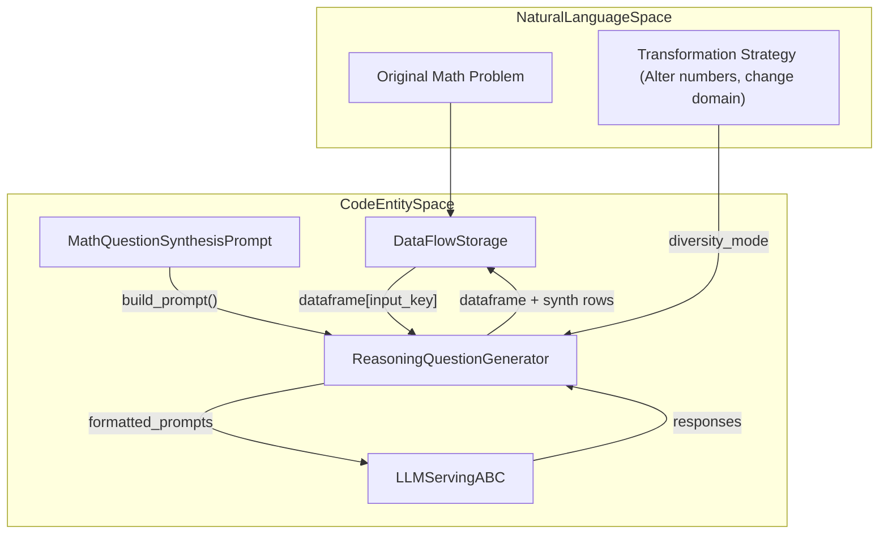
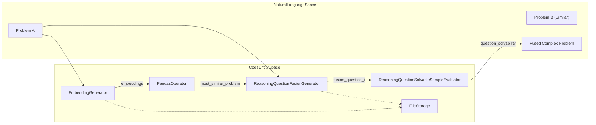

<!-- source: DeepWiki mcp.deepwiki.com · repo OpenDCAI/DataFlow · extra page Question Generation and Classification · fetched 2026-11-02 -->

# Question Generation and Classification

Relevant source files

The following files were used as context for generating this wiki page:

- [dataflow/operators/core_text/generate/embedding_generator.py](dataflow/operators/core_text/generate/embedding_generator.py)
- [dataflow/operators/reasoning/__init__.py](dataflow/operators/reasoning/__init__.py)
- [dataflow/operators/reasoning/eval/reasoning_question_category_sample_evaluator.py](dataflow/operators/reasoning/eval/reasoning_question_category_sample_evaluator.py)
- [dataflow/operators/reasoning/eval/reasoning_question_difficulty_sample_evaluator.py](dataflow/operators/reasoning/eval/reasoning_question_difficulty_sample_evaluator.py)
- [dataflow/operators/reasoning/eval/reasoning_question_solvable_sample_evaluator.py](dataflow/operators/reasoning/eval/reasoning_question_solvable_sample_evaluator.py)
- [dataflow/operators/reasoning/eval/reasoning_token_dataset_evaluator.py](dataflow/operators/reasoning/eval/reasoning_token_dataset_evaluator.py)
- [dataflow/operators/reasoning/generate/reasoning_answer_extraction_qwenmatheval_generator.py](dataflow/operators/reasoning/generate/reasoning_answer_extraction_qwenmatheval_generator.py)
- [dataflow/operators/reasoning/generate/reasoning_answer_generator.py](dataflow/operators/reasoning/generate/reasoning_answer_generator.py)
- [dataflow/operators/reasoning/generate/reasoning_pseudo_answer_generator.py](dataflow/operators/reasoning/generate/reasoning_pseudo_answer_generator.py)
- [dataflow/operators/reasoning/generate/reasoning_question_fusion_generator.py](dataflow/operators/reasoning/generate/reasoning_question_fusion_generator.py)
- [dataflow/operators/reasoning/generate/reasoning_question_generator.py](dataflow/operators/reasoning/generate/reasoning_question_generator.py)
- [dataflow/statics/pipelines/api_pipelines/reasoning_math_pipeline_mathfusion.py](dataflow/statics/pipelines/api_pipelines/reasoning_math_pipeline_mathfusion.py)

## Purpose and Scope

This page documents the operators responsible for question generation, category classification, and difficulty assessment within the Reasoning Pipeline. These operators are primarily located under the `dataflow/operators/reasoning/` module and are designed to transform raw data into high-quality, annotated reasoning tasks. These components are critical for creating datasets for Supervised Fine-Tuning (SFT) and Reinforcement Learning (RL) by providing domain labels, complexity metrics, and synthetic variations.

For information about answer generation with chain-of-thought reasoning, see [Answer Generation with CoT](). For quality filtering mechanisms, see [Quality Filtering]().

Sources: [dataflow/operators/reasoning/generate/reasoning_question_generator.py:44-77](), [dataflow/operators/reasoning/__init__.py:1-36]()

---

## Overview

The reasoning subsystem utilizes a specialized set of operators to evolve data from simple seeds or existing problems into complex, categorized reasoning tasks. The core workflow involves:

1.  **`ReasoningQuestionGenerator`**: Synthesizes new questions from existing ones using various transformation strategies [dataflow/operators/reasoning/generate/reasoning_question_generator.py:23]().
2.  **`ReasoningQuestionFusionGenerator`**: Fuses multiple existing problems into a single complex problem using parallel, sequential, or condition-based fusion strategies [dataflow/operators/reasoning/generate/reasoning_question_fusion_generator.py:20]().
3.  **`ReasoningPseudoAnswerGenerator`**: Generates multiple candidate answers and selects the optimal solution through statistical analysis (e.g., majority voting) [dataflow/operators/reasoning/generate/reasoning_pseudo_answer_generator.py:18]().
4.  **`ReasoningQuestionCategorySampleEvaluator`**: Classifies questions into a hierarchical taxonomy (e.g., Algebra, Calculus, Logic) [dataflow/operators/reasoning/eval/reasoning_question_category_sample_evaluator.py:19]().
5.  **`ReasoningQuestionDifficultySampleEvaluator`**: Estimates the cognitive load and complexity on a scale of 1-10 [dataflow/operators/reasoning/eval/reasoning_question_difficulty_sample_evaluator.py:17]().
6.  **`ReasoningAnswerExtractionQwenMathEvalGenerator`**: Extracts and normalizes mathematical expressions from raw LLM responses for standardized evaluation [dataflow/operators/reasoning/generate/reasoning_answer_extraction_qwenmatheval_generator.py:15]().
7.  **`ReasoningTokenDatasetEvaluator`**: Analyzes the token length distribution of questions and answers using `AutoTokenizer` to ensure dataset balance [dataflow/operators/reasoning/eval/reasoning_token_dataset_evaluator.py:9-15]().
8.  **`ReasoningAnswerGenerator`**: Generates reasoning-based answers (CoT) for input questions using specified LLM serving and prompt templates [dataflow/operators/reasoning/generate/reasoning_answer_generator.py:21]().

Sources: [dataflow/operators/reasoning/generate/reasoning_question_generator.py:23-28](), [dataflow/operators/reasoning/eval/reasoning_token_dataset_evaluator.py:48-82](), [dataflow/operators/reasoning/generate/reasoning_question_fusion_generator.py:20-25](), [dataflow/operators/reasoning/generate/reasoning_answer_generator.py:21-35]()

---

## Reasoning Question Generation and Fusion

### `ReasoningQuestionGenerator`
The `ReasoningQuestionGenerator` creates 1-5 new questions based on a single input question [dataflow/operators/reasoning/generate/reasoning_question_generator.py:40-55](). It supports different prompt templates for Math, General Reasoning, and DIY (custom) tasks [dataflow/operators/reasoning/generate/reasoning_question_generator.py:16-20]().

**Implementation Details:**
- **Diversity Modes**: The operator uses a set of transformation indices (e.g., `"1, 2, 3"`, `"1, 2, 5"`) to vary the style of generated questions [dataflow/operators/reasoning/generate/reasoning_question_generator.py:96-102]().
- **Response Parsing**: Includes a specialized `_parse_response` method for reasoning LLMs (like DeepSeek) that extracts content from `<answer>` tags while stripping `<think>` blocks [dataflow/operators/reasoning/generate/reasoning_question_generator.py:125-132]().
- **Output Schema**: Adds a `Synth_or_Input` flag to distinguish original questions (`input`) from generated ones (`synth`) [dataflow/operators/reasoning/generate/reasoning_question_generator.py:153-154]().

### `ReasoningQuestionFusionGenerator`
The `ReasoningQuestionFusionGenerator` is designed to increase problem complexity by merging two existing problems [dataflow/operators/reasoning/generate/reasoning_question_fusion_generator.py:90-93](). It supports three specialized prompt templates:
- `MathQuestionParallelFusionGeneratorPrompt`: Merges problems that can be solved in parallel.
- `MathQuestionSequentialFusionGeneratorPrompt`: Merges problems where the output of one is the input of another.
- `MathQuestionConditionFusionGeneratorPrompt`: Merges problems by adding conditional constraints.

The operator processes pairs of problems (`input_problem_1` and `input_problem_2`) and generates multiple fused variations based on `num_prompts` [dataflow/operators/reasoning/generate/reasoning_question_fusion_generator.py:97-108]().

Sources: [dataflow/operators/reasoning/generate/reasoning_question_generator.py:23-163](), [dataflow/operators/reasoning/generate/reasoning_question_fusion_generator.py:6-25](), [dataflow/operators/reasoning/generate/reasoning_question_fusion_generator.py:97-111]()

---

## Category and Difficulty Classification

### Hierarchical Classification
The system uses LLM-based evaluators to map questions to a detailed taxonomy. The `ReasoningQuestionCategorySampleEvaluator` utilizes specialized reasoning prompts to output structured classification results [dataflow/operators/reasoning/eval/reasoning_question_category_sample_evaluator.py:19](). It processes responses to extract `primary_category` and `secondary_category` and normalizes them using `CategoryUtils().normalize_categories` [dataflow/operators/reasoning/eval/reasoning_question_category_sample_evaluator.py:100-108]().

### Difficulty Assessment
The `ReasoningQuestionDifficultySampleEvaluator` assesses difficulty using LLM semantic analysis [dataflow/operators/reasoning/eval/reasoning_question_difficulty_sample_evaluator.py:17-43](). It parses LLM responses using regex to extract a numerical `difficulty_score` from a `"Rating: X"` format [dataflow/operators/reasoning/eval/reasoning_question_difficulty_sample_evaluator.py:94-105]().

### Solvability Evaluation
The `ReasoningQuestionSolvableSampleEvaluator` uses `MathQuestionEvaluatorPrompt` to determine if a generated or fused question is logically sound and solvable before proceeding to answer generation [dataflow/operators/reasoning/eval/reasoning_question_solvable_sample_evaluator.py:19-28](). It takes an `input_key` (question) and writes the LLM's assessment to the `output_key` [dataflow/operators/reasoning/eval/reasoning_question_solvable_sample_evaluator.py:76-90]().

### Token Statistics
The `ReasoningTokenDatasetEvaluator` provides dataset-level analysis by calculating token counts for both questions and answers [dataflow/operators/reasoning/eval/reasoning_token_dataset_evaluator.py:48-54](). It returns metrics including zero-count, min, max, mean, and median [dataflow/operators/reasoning/eval/reasoning_token_dataset_evaluator.py:69-80](). It uses `AutoTokenizer.from_pretrained` to load the tokenizer specified by `model_name_or_path` [dataflow/operators/reasoning/eval/reasoning_token_dataset_evaluator.py:49]().

Sources: [dataflow/operators/reasoning/eval/reasoning_question_solvable_sample_evaluator.py:14-28](), [dataflow/operators/reasoning/eval/reasoning_question_category_sample_evaluator.py:100-119](), [dataflow/operators/reasoning/eval/reasoning_question_difficulty_sample_evaluator.py:94-110](), [dataflow/operators/reasoning/eval/reasoning_token_dataset_evaluator.py:48-82]()

---

## Answer Extraction and Pseudo-Answers

### `ReasoningAnswerExtractionQwenMathEvalGenerator`
This operator is designed to extract standardized mathematical expressions from free-form LLM responses [dataflow/operators/reasoning/generate/reasoning_answer_extraction_qwenmatheval_generator.py:15-30](). It uses internal utilities `StringCleaner`, `UnitTextManager`, and `AnswerExtractor` to perform normalization, unit processing, and format standardization [dataflow/operators/reasoning/generate/reasoning_answer_extraction_qwenmatheval_generator.py:27-29]().

### `ReasoningPseudoAnswerGenerator`
The `ReasoningPseudoAnswerGenerator` generates multiple candidate answers for a single question (defined by `max_times`) and selects the most frequent answer as the "pseudo-correct" solution [dataflow/operators/reasoning/generate/reasoning_pseudo_answer_generator.py:18-26](). 
- It uses `AnswerExtractor` to parse each candidate [dataflow/operators/reasoning/generate/reasoning_pseudo_answer_generator.py:119]().
- It tracks both the final answer and a list of correct solution examples that lead to that answer [dataflow/operators/reasoning/generate/reasoning_pseudo_answer_generator.py:127-136]().

Sources: [dataflow/operators/reasoning/generate/reasoning_answer_extraction_qwenmatheval_generator.py:15-79](), [dataflow/operators/reasoning/generate/reasoning_pseudo_answer_generator.py:18-144]()

---

## Operator Architecture and Data Flow

The following diagrams illustrate the transition from Natural Language concepts to the specific Code Entities used in the Reasoning module.

### Diagram: Question Generation Flow

Sources: [dataflow/operators/reasoning/generate/reasoning_question_generator.py:22-38]()

### Diagram: Fusion Pipeline Code Architecture

Sources: [dataflow/statics/pipelines/api_pipelines/reasoning_math_pipeline_mathfusion.py:26-184](), [dataflow/operators/core_text/generate/embedding_generator.py:9-15]()

---

## Prompt Template System

The reasoning operators utilize a specialized prompt registry to manage complex multi-step instructions.

| Prompt Class | Purpose | Key Method |
| :--- | :--- | :--- |
| `MathQuestionSynthesisPrompt` | Logic for math problem variation | `build_prompt(items, question)` |
| `MathQuestionParallelFusionGeneratorPrompt` | Parallel logic fusion | `build_prompt(p1, p2)` |
| `MathQuestionSequentialFusionGeneratorPrompt` | Sequential logic fusion | `build_prompt(p1, p2)` |
| `MathQuestionConditionFusionGeneratorPrompt` | Conditional constraint fusion | `build_prompt(p1, p2)` |
| `DiyQuestionSynthesisPrompt` | User-defined custom reasoning prompts | `build_prompt(question)` |
| `MathQuestionEvaluatorPrompt` | Solvability and logic check | `build_prompt(question)` |
| `MathAnswerGeneratorPrompt` | Standardized CoT answer generation | `build_prompt(question)` |
| `MathQuestionCategoryPrompt` | Hierarchical math categorization | `build_prompt(text)` |
| `MathQuestionDifficultyPrompt` | Numerical difficulty rating | `build_prompt(text)` |

Sources: [dataflow/operators/reasoning/generate/reasoning_question_generator.py:16-20](), [dataflow/operators/reasoning/generate/reasoning_question_fusion_generator.py:13-17](), [dataflow/operators/reasoning/eval/reasoning_question_solvable_sample_evaluator.py:14-16](), [dataflow/statics/pipelines/api_pipelines/reasoning_math_pipeline_mathfusion.py:10-15](), [dataflow/operators/reasoning/generate/reasoning_answer_generator.py:15-19](), [dataflow/operators/reasoning/eval/reasoning_question_category_sample_evaluator.py:14-16](), [dataflow/operators/reasoning/eval/reasoning_question_difficulty_sample_evaluator.py:12-14]()

---

