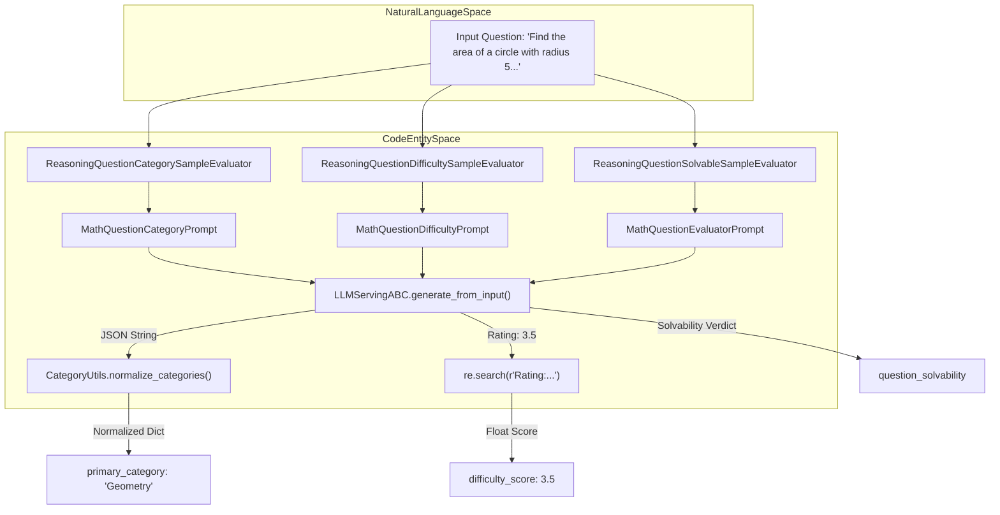
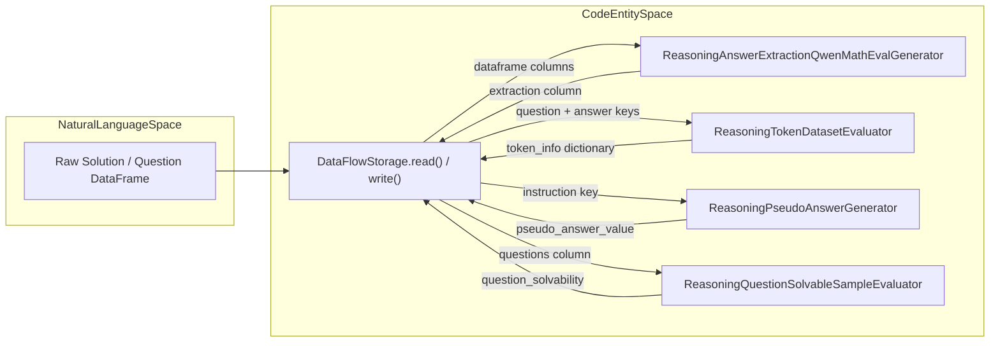

<!-- source: DeepWiki mcp.deepwiki.com · repo OpenDCAI/DataFlow · extra page Reasoning Classification Operators · fetched 2026-11-02 -->

# Reasoning Classification Operators

<details>
<summary>Relevant source files</summary>

The following files were used as context for generating this wiki page:

- [dataflow/operators/core_text/generate/embedding_generator.py](dataflow/operators/core_text/generate/embedding_generator.py)
- [dataflow/operators/reasoning/__init__.py](dataflow/operators/reasoning/__init__.py)
- [dataflow/operators/reasoning/eval/reasoning_question_category_sample_evaluator.py](dataflow/operators/reasoning/eval/reasoning_question_category_sample_evaluator.py)
- [dataflow/operators/reasoning/eval/reasoning_question_difficulty_sample_evaluator.py](dataflow/operators/reasoning/eval/reasoning_question_difficulty_sample_evaluator.py)
- [dataflow/operators/reasoning/eval/reasoning_question_solvable_sample_evaluator.py](dataflow/operators/reasoning/eval/reasoning_question_solvable_sample_evaluator.py)
- [dataflow/operators/reasoning/eval/reasoning_token_dataset_evaluator.py](dataflow/operators/reasoning/eval/reasoning_token_dataset_evaluator.py)
- [dataflow/operators/reasoning/generate/reasoning_answer_extraction_qwenmatheval_generator.py](dataflow/operators/reasoning/generate/reasoning_answer_extraction_qwenmatheval_generator.py)
- [dataflow/operators/reasoning/generate/reasoning_answer_generator.py](dataflow/operators/reasoning/generate/reasoning_answer_generator.py)
- [dataflow/operators/reasoning/generate/reasoning_pseudo_answer_generator.py](dataflow/operators/reasoning/generate/reasoning_pseudo_answer_generator.py)
- [dataflow/operators/reasoning/generate/reasoning_question_fusion_generator.py](dataflow/operators/reasoning/generate/reasoning_question_fusion_generator.py)
- [dataflow/operators/reasoning/generate/reasoning_question_generator.py](dataflow/operators/reasoning/generate/reasoning_question_generator.py)
- [dataflow/statics/pipelines/api_pipelines/reasoning_math_pipeline_mathfusion.py](dataflow/statics/pipelines/api_pipelines/reasoning_math_pipeline_mathfusion.py)

</details>


## Purpose and Scope

This page details the classification and evaluation operators used within reasoning pipelines. These operators assess the difficulty level of reasoning problems, categorize them by topic or type, evaluate answer quality using rule-based and LLM-based methodologies, and analyze dataset-wide token statistics. They are critical components for constructing balanced datasets for mathematical reasoning and logical problem-solving.

Key operator classes covered:
*   `ReasoningQuestionCategorySampleEvaluator`: Hierarchical categorization of questions using LLMs.
*   `ReasoningQuestionDifficultySampleEvaluator`: Numerical difficulty scoring from 1 to 10.
*   `ReasoningQuestionSolvableSampleEvaluator`: Solvability assessment for generated or raw problems.
*   `ReasoningTokenDatasetEvaluator`: Token length statistics distribution analysis using transformers tokenizers.
*   `ReasoningAnswerExtractionQwenMathEvalGenerator`: Mathematical answer normalization and extraction.
*   `ReasoningPseudoAnswerGenerator`: Multi-round pseudo-answer generation and frequency voting.

Sources: [dataflow/operators/reasoning/eval/reasoning_question_category_sample_evaluator.py:19-53](), [dataflow/operators/reasoning/eval/reasoning_question_difficulty_sample_evaluator.py:17-50](), [dataflow/operators/reasoning/eval/reasoning_question_solvable_sample_evaluator.py:19-29](), [dataflow/operators/reasoning/eval/reasoning_token_dataset_evaluator.py:9-16](), [dataflow/operators/reasoning/generate/reasoning_answer_extraction_qwenmatheval_generator.py:15-30](), [dataflow/operators/reasoning/generate/reasoning_pseudo_answer_generator.py:18-26]()

---

## Core Classification and Evaluation Operators

Reasoning classification operators implement evaluation logic for mathematical and logical tasks, operating on dataframe rows through `DataFlowStorage`.

### ReasoningQuestionCategorySampleEvaluator
Performs hierarchical classification (primary and secondary categories) on user questions by prompting an LLM and normalizing the resulting taxonomy.

*   **Implementation**: Inherits from `OperatorABC` [dataflow/operators/reasoning/eval/reasoning_question_category_sample_evaluator.py:19]().
*   **Prompting & Parsing**: Uses `MathQuestionCategoryPrompt` [dataflow/operators/reasoning/eval/reasoning_question_category_sample_evaluator.py:25]() to build prompts, strips Markdown code blocks (````json`) [dataflow/operators/reasoning/eval/reasoning_question_category_sample_evaluator.py:95](), parses the JSON string [dataflow/operators/reasoning/eval/reasoning_question_category_sample_evaluator.py:100](), and normalizes categories via `CategoryUtils().normalize_categories()` [dataflow/operators/reasoning/eval/reasoning_question_category_sample_evaluator.py:105]().
*   **Outputs**: Assigns `primary_category` and `secondary_category` columns [dataflow/operators/reasoning/eval/reasoning_question_category_sample_evaluator.py:107-108]().

### ReasoningQuestionDifficultySampleEvaluator
Evaluates the complexity of a question on a numerical scale from 1 to 10 using few-shot prompt examples.

*   **Implementation**: Inherits from `OperatorABC` [dataflow/operators/reasoning/eval/reasoning_question_difficulty_sample_evaluator.py:17]().
*   **Parsing**: Employs `MathQuestionDifficultyPrompt` [dataflow/operators/reasoning/eval/reasoning_question_difficulty_sample_evaluator.py:23]() and uses regex `r'Rating:\s*((\d+\.\d+)|\d+)'` to extract the numerical score from the LLM response [dataflow/operators/reasoning/eval/reasoning_question_difficulty_sample_evaluator.py:95]().
*   **Outputs**: Populates `difficulty_score` [dataflow/operators/reasoning/eval/reasoning_question_difficulty_sample_evaluator.py:105]().

### ReasoningQuestionSolvableSampleEvaluator
Assesses whether a generated or existing question is solvable to filter out nonsensical problems.

*   **Implementation**: Inherits from `OperatorABC` [dataflow/operators/reasoning/eval/reasoning_question_solvable_sample_evaluator.py:19]().
*   **Execution**: Uses `MathQuestionEvaluatorPrompt` [dataflow/operators/reasoning/eval/reasoning_question_solvable_sample_evaluator.py:26]() and invokes `llm_serving.generate_from_input()` [dataflow/operators/reasoning/eval/reasoning_question_solvable_sample_evaluator.py:85]().

### Data Flow: Natural Language Space to Classification Code Entity Space

Title: "ClassificationLogicFlow"


Sources: [dataflow/operators/reasoning/eval/reasoning_question_category_sample_evaluator.py:79-119](), [dataflow/operators/reasoning/eval/reasoning_question_difficulty_sample_evaluator.py:79-110](), [dataflow/operators/reasoning/eval/reasoning_question_solvable_sample_evaluator.py:76-90]()

---

## Reasoning Token and Answer Evaluators

### ReasoningTokenDatasetEvaluator
Calculates token length statistics for questions and answers using a specified transformer tokenizer.

*   **Implementation**: Inherits from `OperatorABC` [dataflow/operators/reasoning/eval/reasoning_token_dataset_evaluator.py:9]().
*   **Functionality**: Uses `AutoTokenizer.from_pretrained(model_name_or_path)` [dataflow/operators/reasoning/eval/reasoning_token_dataset_evaluator.py:49]() to encode texts, computing zero-counts, minimums, maximums, means, and medians [dataflow/operators/reasoning/eval/reasoning_token_dataset_evaluator.py:57-80]().

### ReasoningAnswerExtractionQwenMathEvalGenerator
Extracts and normalizes mathematical expressions from raw LLM responses.

*   **Implementation**: Inherits from `OperatorABC` [dataflow/operators/reasoning/generate/reasoning_answer_extraction_qwenmatheval_generator.py:15]().
*   **Components**: Integrates `AnswerExtractor`, `StringCleaner`, and `UnitTextManager` [dataflow/operators/reasoning/generate/reasoning_answer_extraction_qwenmatheval_generator.py:27-29]().

### ReasoningPseudoAnswerGenerator
Implements a frequency-based voting mechanism across multiple generation rounds to establish a pseudo-ground truth.

*   **Implementation**: Inherits from `OperatorABC` [dataflow/operators/reasoning/generate/reasoning_pseudo_answer_generator.py:18]().
*   **Workflow**: Iterates `max_times` through `llm_serving.generate_from_input()` [dataflow/operators/reasoning/generate/reasoning_pseudo_answer_generator.py:116-118](), extracts answers, and uses `collections.Counter` to find the most common answer (`most_common(1)`) [dataflow/operators/reasoning/generate/reasoning_pseudo_answer_generator.py:128-129]().

### Data Flow: Dataset Storage to Reasoning Operators

Title: "ReasoningOperatorIntegrationFlow"


Sources: [dataflow/operators/reasoning/generate/reasoning_answer_extraction_qwenmatheval_generator.py:59-79](), [dataflow/operators/reasoning/eval/reasoning_token_dataset_evaluator.py:48-95](), [dataflow/operators/reasoning/generate/reasoning_pseudo_answer_generator.py:95-145](), [dataflow/operators/reasoning/eval/reasoning_question_solvable_sample_evaluator.py:76-90]()

---

## Implementation Details

### Hierarchical Category Normalization
```python
# [dataflow/operators/reasoning/eval/reasoning_question_category_sample_evaluator.py:102-108]
primary_raw = classification.get("primary_category", "")
secondary_raw = classification.get("secondary_category", "")
category_info = CategoryUtils().normalize_categories(raw_primary=primary_raw, raw_secondary=secondary_raw)
dataframe.at[idx, "primary_category"] = category_info["primary_category"]
dataframe.at[idx, "secondary_category"] = category_info["secondary_category"]
```

### Token Length Computation
```python
# [dataflow/operators/reasoning/eval/reasoning_token_dataset_evaluator.py:53-54]
questions_tokens_length = [len(tokenizer.encode(question, add_special_tokens=False)) for question in questions]
answers_tokens_length = [len(tokenizer.encode(answer, add_special_tokens=False)) for answer in answers]
```

### Answer Extraction Pipeline Initialization
```python
# [dataflow/operators/reasoning/generate/reasoning_answer_extraction_qwenmatheval_generator.py:27-29]
unit_manager = UnitTextManager()
string_cleaner = StringCleaner(unit_manager)
self.answer_extractor = AnswerExtractor(string_cleaner)
```

Sources: [dataflow/operators/reasoning/eval/reasoning_question_category_sample_evaluator.py:89-115](), [dataflow/operators/reasoning/eval/reasoning_token_dataset_evaluator.py:48-82](), [dataflow/operators/reasoning/generate/reasoning_answer_extraction_qwenmatheval_generator.py:20-30]()

---

