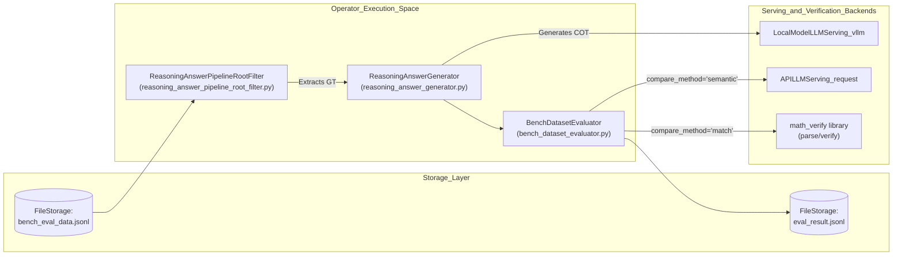

<!-- source: DeepWiki mcp.deepwiki.com · repo OpenDCAI/DataFlow · extra page Reasoning Filter Operators · fetched 2026-11-02 -->

# Reasoning Filter Operators

Relevant source files

The following files were used as context for generating this wiki page:

- [dataflow/core/prompt.py](dataflow/core/prompt.py)
- [dataflow/operators/reasoning/filter/reasoning_answer_ngram_filter.py](dataflow/operators/reasoning/filter/reasoning_answer_ngram_filter.py)
- [dataflow/operators/reasoning/filter/reasoning_answer_pipeline_root_filter.py](dataflow/operators/reasoning/filter/reasoning_answer_pipeline_root_filter.py)
- [dataflow/operators/reasoning/filter/reasoning_question_filter.py](dataflow/operators/reasoning/filter/reasoning_question_filter.py)
- [test/cpu_only/test_reasoning_answer_pipeline_root_filter.py](test/cpu_only/test_reasoning_answer_pipeline_root_filter.py)

## Purpose and Scope

This page documents the filter and validation operators specifically designed for reasoning tasks within the DataFlow system. Reasoning Filter Operators validate, clean, and refine data generated by reasoning pipelines, ensuring that mathematical problems, logical questions, and their solutions meet high quality standards. This includes rule-based formatting checks, n-gram repetition detection, ground truth matching, token length constraints, and LLM-based semantic judging.

The specific operators detailed here include `ReasoningQuestionFilter` (QuestionFilter), `ReasoningAnswerNgramFilter` (AnswerNgramFilter), `ReasoningAnswerPipelineRootFilter` (AnswerGroundTruthFilter), `ReasoningAnswerModelJudgeFilter` (AnswerModelJudgeFilter), and `BenchDatasetEvaluator` (covering AnswerMathVerifyFilter and semantic evaluation).

For general information about the filter operator framework, see [Filter Operators](). For reasoning generation operators that create questions and answers, see [Reasoning Generation Operators](). For reasoning classification and evaluation, see [Reasoning Classification Operator Reference]().

Sources: [dataflow/operators/reasoning/filter/reasoning_answer_pipeline_root_filter.py:10-45](), [dataflow/operators/reasoning/filter/reasoning_answer_ngram_filter.py:12-33](), [dataflow/operators/reasoning/filter/reasoning_question_filter.py:21-32]()

---

## Overview

Reasoning Filter Operators process data through validation and quality checks specific to mathematical and logical reasoning tasks. Unlike general text filters, these operators understand the structure of reasoning problems, solutions, and the relationships between questions and answers. They typically operate on fields such as `question` (the problem), `answer` or `generated_cot` (the generated solution), and `golden_answer` (ground truth).

### Core Reasoning Filter Operators

| Operator | Purpose | Requires LLM | Key Parameters |
|----------|---------|--------------|----------------|
| `ReasoningAnswerPipelineRootFilter` | Labels rows by GT availability and extracts missing GT | No | `input_answer_key`, `input_gt_key` |
| `ReasoningAnswerNgramFilter` | Detects repetitive patterns in Q&A via n-gram uniqueness | No | `min_score`, `max_score`, `ngrams` |
| `ReasoningAnswerModelJudgeFilter` | LLM-based answer semantic assessment and correctness judging | Yes | `prompt_template`, `keep_all_samples` |
| `BenchDatasetEvaluator` | Unified benchmark answer verification (math match or semantic) | No/Yes | `compare_method` (`match`/`semantic`) |
| `ReasoningQuestionFilter` | Validates question quality, solvability, and constraints | Yes | `prompt_template`, `llm_serving` |

Sources: [dataflow/operators/reasoning/filter/reasoning_answer_pipeline_root_filter.py:10-45](), [dataflow/operators/reasoning/filter/reasoning_answer_ngram_filter.py:22-33](), [dataflow/operators/reasoning/filter/reasoning_question_filter.py:21-66]()

---

## Operator Class Architecture

The following diagram bridges the **Natural Language Space** (concepts like "Ground Truth Routing" or "N-gram Analysis") to the **Code Entity Space** (specific classes and files).

### Reasoning Filter Entity Mapping

```mermaid
graph TB
    subgraph "Natural_Language_Space"
        GT_Routing["Ground Truth Routing & Extraction"]
        QA_Quality["Q&A Quality & Solvability Control"]
        Math_Logic["Mathematical Correctness Verification"]
        Similarity["Similarity & Repetition Detection"]
    end

    subgraph "Code_Entity_Space"
        OperatorABC["OperatorABC<br/>(dataflow.core.operator)"]
        
        RootFilter["ReasoningAnswerPipelineRootFilter<br/>(reasoning_answer_pipeline_root_filter.py)"]
        QFilter["ReasoningQuestionFilter<br/>(reasoning_question_filter.py)"]
        JudgeFilter["ReasoningAnswerModelJudgeFilter<br/>(reasoning_answer_model_judge_filter.py)"]
        NgramFilter["ReasoningAnswerNgramFilter<br/>(reasoning_answer_ngram_filter.py)"]
        BenchEval["BenchDatasetEvaluator<br/>(bench_dataset_evaluator.py)"]
    end

    GT_Routing --- RootFilter
    QA_Quality --- QFilter
    QA_Quality --- JudgeFilter
    Math_Logic --- BenchEval
    Similarity --- NgramFilter

    OperatorABC --> RootFilter
    OperatorABC --> QFilter
    OperatorABC --> JudgeFilter
    OperatorABC --> NgramFilter
    OperatorABC --> BenchEval
```

Sources: [dataflow/operators/reasoning/filter/reasoning_answer_pipeline_root_filter.py:10-11](), [dataflow/operators/reasoning/filter/reasoning_answer_model_judge_filter.py:20-26](), [dataflow/operators/reasoning/filter/reasoning_answer_ngram_filter.py:12-13](), [dataflow/operators/reasoning/filter/reasoning_question_filter.py:20-21]()

---

## ReasoningQuestionFilter (QuestionFilter)

The `ReasoningQuestionFilter` operator checks the correctness of questions, including formatting, semantic validity, logical consistency, and whether the problem is solvable [dataflow/operators/reasoning/filter/reasoning_question_filter.py:36-40](). It performs a multi-stage evaluation using an LLM serving backend and retains qualified samples [dataflow/operators/reasoning/filter/reasoning_question_filter.py:50-54]().

### Implementation & Prompt Restriction
- **Prompt Restriction**: Decorated with `@prompt_restrict` allowing `MathQuestionFilterPrompt`, `GeneralQuestionFilterPrompt`, and `DiyQuestionFilterPrompt` [dataflow/operators/reasoning/filter/reasoning_question_filter.py:15-19]().
- **Execution (`run`)**: Reads the dataframe from `storage`, builds user prompts using `prompt_template.build_prompt()`, calls `llm_serving.generate_from_input()`, and resolves responses via `ResolveResponse()` [dataflow/operators/reasoning/filter/reasoning_question_filter.py:92-98]().
- **Response Parsing**: Uses regular expressions to search for `"judgement_test": true/false` in the LLM output [dataflow/operators/reasoning/filter/reasoning_question_filter.py:73-87]().

Sources: [dataflow/operators/reasoning/filter/reasoning_question_filter.py:21-110]()

---

## ReasoningAnswerPipelineRootFilter (AnswerGroundTruthFilter)

The `ReasoningAnswerPipelineRootFilter` acts as a routing and extraction gateway for reasoning pipelines. It determines if a sample has a Ground Truth (GT) and attempts to extract it if missing [dataflow/operators/reasoning/filter/reasoning_answer_pipeline_root_filter.py:15-43]().

### Implementation Logic
1. **GT Extraction**: If the `input_gt_key` is empty or missing, the operator uses `AnswerExtractor` to pull a potential ground truth from the `input_answer_key` field [dataflow/operators/reasoning/filter/reasoning_answer_pipeline_root_filter.py:75-97]().
2. **Branch Labeling**: It labels every row in a new column (default `answer_branch`) as either `with_gt` or `without_gt` [dataflow/operators/reasoning/filter/reasoning_answer_pipeline_root_filter.py:110-116]().
3. **Linear Pass-through**: Unlike a hard filter, it preserves all rows and performs a single storage write, allowing downstream operators to branch logic based on the label [dataflow/operators/reasoning/filter/reasoning_answer_pipeline_root_filter.py:54-59]().

Sources: [dataflow/operators/reasoning/filter/reasoning_answer_pipeline_root_filter.py:47-130](), [test/cpu_only/test_reasoning_answer_pipeline_root_filter.py:32-56]()

---

## ReasoningAnswerNgramFilter (AnswerNgramFilter)

`ReasoningAnswerNgramFilter` computes repetition scores based on n-gram uniqueness to identify "looping" or overly repetitive model outputs. It supports both Chinese (character-level) and English (word-level) content [dataflow/operators/reasoning/filter/reasoning_answer_ngram_filter.py:12-20]().

### Implementation Logic
The operator computes a `repetition_score = unique_ngrams_count / total_ngrams`. A score of 1.0 indicates no repetition within the window, while lower scores indicate redundant content [dataflow/operators/reasoning/filter/reasoning_answer_ngram_filter.py:154-176]().

- **Chinese Detection**: If text contains `[\u4e00-\u9fff]`, it uses character-level n-grams [dataflow/operators/reasoning/filter/reasoning_answer_ngram_filter.py:93-125]().
- **English Processing**: Uses word-level splitting and n-gram construction [dataflow/operators/reasoning/filter/reasoning_answer_ngram_filter.py:127-152]().

### Configuration

| Parameter | Type | Default | Description |
|-----------|------|---------|-------------|
| `min_score` | float | 0.1 | Minimum acceptable uniqueness (lower means more repetition) [dataflow/operators/reasoning/filter/reasoning_answer_ngram_filter.py:24](). |
| `max_score` | float | 1.0 | Maximum acceptable uniqueness [dataflow/operators/reasoning/filter/reasoning_answer_ngram_filter.py:25](). |
| `ngrams` | int | 5 | Size of the n-gram sliding window [dataflow/operators/reasoning/filter/reasoning_answer_ngram_filter.py:26](). |

Sources: [dataflow/operators/reasoning/filter/reasoning_answer_ngram_filter.py:12-195]()

---

## BenchDatasetEvaluator (AnswerMathVerifyFilter & AnswerModelJudgeFilter)

`BenchDatasetEvaluator` is a specialized operator used in benchmark pipelines to compare model-generated answers against ground truth. It supports two primary comparison modes: `match` and `semantic` [dataflow/operators/core_text/eval/bench_dataset_evaluator.py:27]().

### 1. Match Mode (AnswerMathVerifyFilter)
In `match` mode, the operator uses the `math_verify` library to parse and compare mathematical expressions [dataflow/operators/core_text/eval/bench_dataset_evaluator.py:10-56]().
- **Extraction**: It uses `AnswerExtractor` with a `StringCleaner` to isolate the final answer from a CoT response [dataflow/operators/core_text/eval/bench_dataset_evaluator.py:42-44]().
- **Verification**: The `math_verify_compare` function calls `verify(parse(gt), parse(ans))` to handle symbolic and numerical equivalence [dataflow/operators/core_text/eval/bench_dataset_evaluator.py:54-61]().

### 2. Semantic Mode (AnswerModelJudgeFilter)
In `semantic` mode, the operator uses an LLM to judge if the predicted answer is semantically consistent with the ground truth [dataflow/operators/core_text/eval/bench_dataset_evaluator.py:89-102]().
- **Prompting**: It uses `AnswerJudgePrompt` by default [dataflow/operators/core_text/eval/bench_dataset_evaluator.py:30]().
- **Parsing**: The `ResolveResponse` method uses regex to extract `"judgement_result": true/false` from the LLM's JSON-like output [dataflow/operators/core_text/eval/bench_dataset_evaluator.py:63-81]().

Sources: [dataflow/operators/core_text/eval/bench_dataset_evaluator.py:1-165](), [dataflow/prompts/model_evaluation/general.py:9-35]()

---

## Data Flow in Reasoning Evaluation

The following diagram bridges natural language evaluation concepts to underlying code entities within pipeline execution and serving layers.

### Benchmark Evaluation Execution Flow

Sources: [dataflow/operators/reasoning/filter/reasoning_answer_pipeline_root_filter.py:47-60](), [dataflow/operators/core_text/eval/bench_dataset_evaluator.py:142-165]()

---

