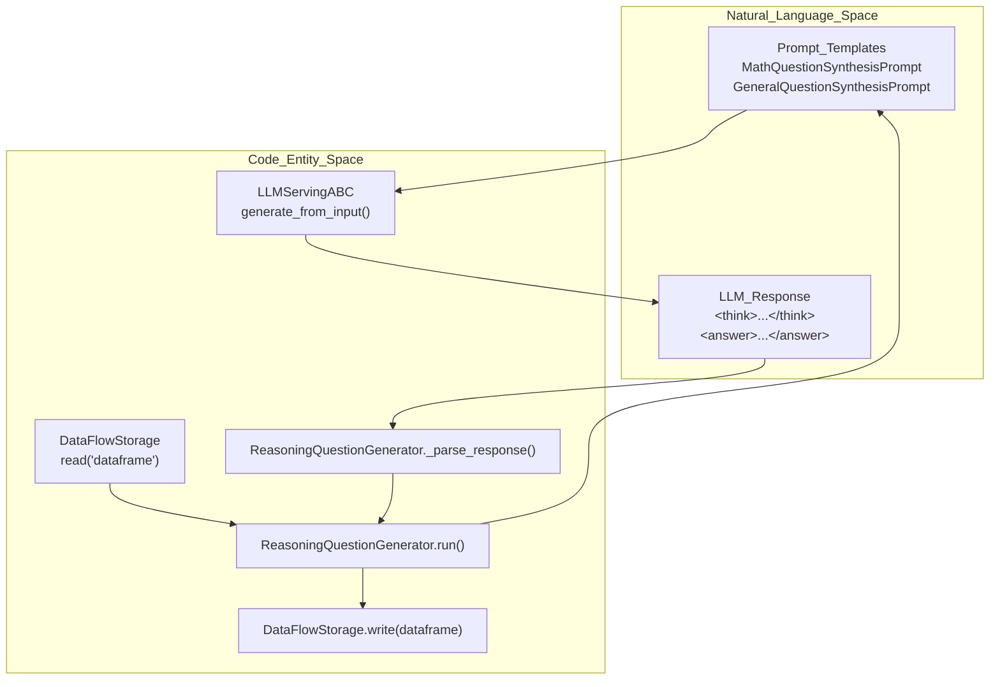
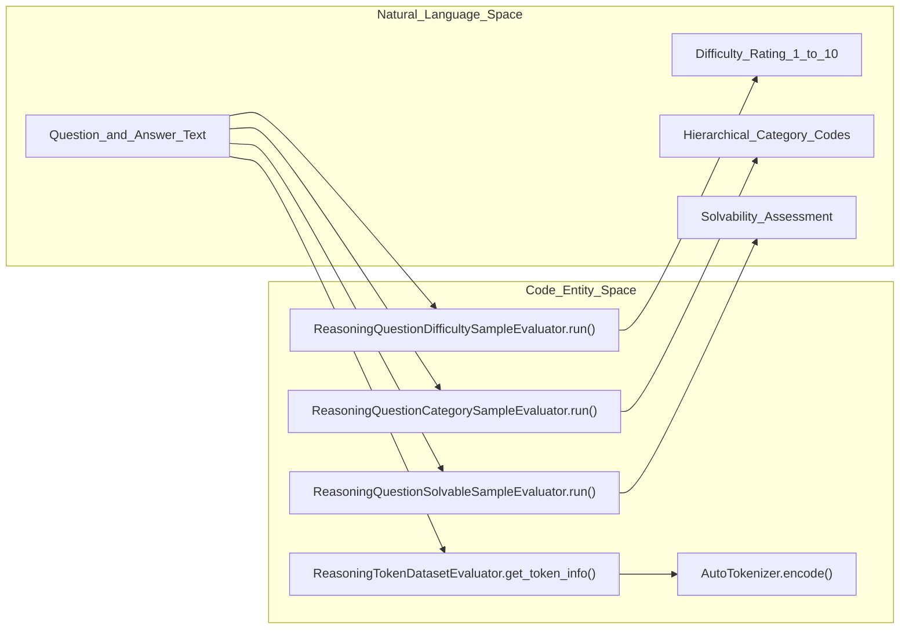

<!-- source: DeepWiki mcp.deepwiki.com · repo OpenDCAI/DataFlow · extra page Reasoning Generation Operators · fetched 2026-11-02 -->

# Reasoning Generation Operators

Relevant source files

The following files were used as context for generating this wiki page:

- [dataflow/operators/core_text/generate/embedding_generator.py](dataflow/operators/core_text/generate/embedding_generator.py)
- [dataflow/operators/reasoning/__init__.py](dataflow/operators/reasoning/__init__.py)
- [dataflow/operators/reasoning/eval/reasoning_question_category_sample_evaluator.py](dataflow/operators/reasoning/eval/reasoning_question_category_sample_evaluator.py)
- [dataflow/operators/reasoning/eval/reasoning_question_difficulty_sample_evaluator.py](dataflow/operators/reasoning/eval/reasoning_question_difficulty_sample_evaluator.py)
- [dataflow/operators/reasoning/eval/reasoning_question_solvable_sample_evaluator.py](dataflow/operators/reasoning/eval/reasoning_question_solvable_sample_evaluator.py)
- [dataflow/operators/reasoning/eval/reasoning_token_dataset_evaluator.py](dataflow/operators/reasoning/eval/reasoning_token_dataset_evaluator.py)
- [dataflow/operators/reasoning/generate/reasoning_answer_extraction_qwenmatheval_generator.py](dataflow/operators/reasoning/generate/reasoning_answer_extraction_qwenmatheval_generator.py)
- [dataflow/operators/reasoning/generate/reasoning_answer_generator.py](dataflow/operators/reasoning/generate/reasoning_answer_generator.py)
- [dataflow/operators/reasoning/generate/reasoning_pseudo_answer_generator.py](dataflow/operators/reasoning/generate/reasoning_pseudo_answer_generator.py)
- [dataflow/operators/reasoning/generate/reasoning_question_fusion_generator.py](dataflow/operators/reasoning/generate/reasoning_question_fusion_generator.py)
- [dataflow/operators/reasoning/generate/reasoning_question_generator.py](dataflow/operators/reasoning/generate/reasoning_question_generator.py)
- [dataflow/statics/pipelines/api_pipelines/reasoning_math_pipeline_mathfusion.py](dataflow/statics/pipelines/api_pipelines/reasoning_math_pipeline_mathfusion.py)

## Purpose and Scope

This document provides a technical reference for the **Reasoning Generation Operators** within the DataFlow framework. These operators are specialized for synthesizing mathematical problems, generating step-by-step solutions (Chain-of-Thought), creating multi-hop reasoning tasks, performing self-consistency pseudo-answer generation, extracting normalized answers, and formatting pre-training data. They form the core of the reasoning data preparation pipeline, transforming raw text or seed questions into high-quality training data for LLMs.

**Key Files:**
- `dataflow/operators/reasoning/generate/reasoning_question_generator.py` [dataflow/operators/reasoning/generate/reasoning_question_generator.py:1-163]()
- `dataflow/operators/reasoning/generate/reasoning_answer_generator.py` [dataflow/operators/reasoning/generate/reasoning_answer_generator.py:1-100]()
- `dataflow/operators/reasoning/generate/reasoning_pseudo_answer_generator.py` [dataflow/operators/reasoning/generate/reasoning_pseudo_answer_generator.py:1-145]()
- `dataflow/operators/reasoning/generate/reasoning_answer_extraction_qwenmatheval_generator.py` [dataflow/operators/reasoning/generate/reasoning_answer_extraction_qwenmatheval_generator.py:1-79]()
- `dataflow/operators/reasoning/generate/reasoning_question_fusion_generator.py` [dataflow/operators/reasoning/generate/reasoning_question_fusion_generator.py:1-111]()
- `dataflow/operators/reasoning/generate/reasoning_pretrain_format_convert_generator.py` [dataflow/operators/reasoning/__init__.py:9-9]()
- `dataflow/operators/reasoning/eval/reasoning_question_difficulty_sample_evaluator.py` [dataflow/operators/reasoning/eval/reasoning_question_difficulty_sample_evaluator.py:1-110]()
- `dataflow/operators/reasoning/eval/reasoning_token_dataset_evaluator.py` [dataflow/operators/reasoning/eval/reasoning_token_dataset_evaluator.py:1-95]()

Sources: [dataflow/operators/reasoning/generate/reasoning_question_generator.py:1-163](), [dataflow/operators/reasoning/generate/reasoning_answer_generator.py:1-100](), [dataflow/operators/reasoning/generate/reasoning_pseudo_answer_generator.py:1-145](), [dataflow/operators/reasoning/generate/reasoning_answer_extraction_qwenmatheval_generator.py:1-79](), [dataflow/operators/reasoning/generate/reasoning_question_fusion_generator.py:1-111](), [dataflow/operators/reasoning/__init__.py:9-9]()

---

## Overview

Reasoning generation operators leverage LLM serving backends to perform complex synthesis tasks. Unlike simple text generation, these operators often involve multi-step prompting strategies, specialized parsing for reasoning models (e.g., DeepSeek internal thoughts), and statistical consistency checks to ensure logical accuracy.

### Core Reasoning Operators

| Operator | Class Name | Primary Function |
| :--- | :--- | :--- |
| **Question Generator** | `ReasoningQuestionGenerator` | Synthesizes new reasoning problems from seed questions using diversity modes. [dataflow/operators/reasoning/generate/reasoning_question_generator.py:23-23]() |
| **Answer Generator** | `ReasoningAnswerGenerator` | Generates CoT answers for given questions using LLMs. [dataflow/operators/reasoning/generate/reasoning_answer_generator.py:21-21]() |
| **Pseudo Answer Generator** | `ReasoningPseudoAnswerGenerator` | Generates multiple candidate answers and selects the most frequent one (Self-Consistency). [dataflow/operators/reasoning/generate/reasoning_pseudo_answer_generator.py:18-18]() |
| **Question Fusion** | `ReasoningQuestionFusionGenerator` | Combines multiple existing questions into a new, more complex problem. [dataflow/operators/reasoning/generate/reasoning_question_fusion_generator.py:20-20]() |
| **Answer Extractor** | `ReasoningAnswerExtractionQwenMathEvalGenerator` | Extracts and normalizes mathematical expressions from raw LLM outputs. [dataflow/operators/reasoning/generate/reasoning_answer_extraction_qwenmatheval_generator.py:15-15]() |
| **Pretrain Format Converter** | `ReasoningPretrainFormatConvertGenerator` | Formats reasoning data for pre-training objectives. [dataflow/operators/reasoning/__init__.py:9-9]() |
| **Difficulty Evaluator** | `ReasoningQuestionDifficultySampleEvaluator` | Assigns a numerical difficulty score (1-10) to a question. [dataflow/operators/reasoning/eval/reasoning_question_difficulty_sample_evaluator.py:17-17]() |
| **Token Evaluator** | `ReasoningTokenDatasetEvaluator` | Calculates token statistics for questions and answers. [dataflow/operators/reasoning/eval/reasoning_token_dataset_evaluator.py:9-9]() |

Sources: [dataflow/operators/reasoning/generate/reasoning_question_generator.py:23-23](), [dataflow/operators/reasoning/generate/reasoning_answer_generator.py:21-21](), [dataflow/operators/reasoning/generate/reasoning_pseudo_answer_generator.py:18-18](), [dataflow/operators/reasoning/generate/reasoning_question_fusion_generator.py:20-20](), [dataflow/operators/reasoning/generate/reasoning_answer_extraction_qwenmatheval_generator.py:15-15](), [dataflow/operators/reasoning/__init__.py:9-9](), [dataflow/operators/reasoning/eval/reasoning_question_difficulty_sample_evaluator.py:17-17](), [dataflow/operators/reasoning/eval/reasoning_token_dataset_evaluator.py:9-9]()

---

## Architecture and Data Flow

The reasoning operators bridge the gap between "Natural Language Space" (prompts, raw text, and model responses) and "Code Entity Space" (`DataFlowStorage`, `pd.DataFrame`, and Python operators).

### Reasoning Synthesis Data Flow

This diagram illustrates how `ReasoningQuestionGenerator` interacts with the serving and storage layers to synthesize data, mapping natural language artifacts to code constructs.

Title: "Reasoning Synthesis Data Flow"

Sources: [dataflow/operators/reasoning/generate/reasoning_question_generator.py:134-163](), [dataflow/operators/reasoning/generate/reasoning_question_generator.py:125-132]()

---

## Detailed Generator Operators Reference

### ReasoningQuestionGenerator
The `ReasoningQuestionGenerator` is designed to expand a small set of seed questions into a larger, diverse dataset [dataflow/operators/reasoning/generate/reasoning_question_generator.py:23-23]().
- **Diversity Modes:** It uses transformation instructions (e.g., `"1, 2, 3"`, `"1, 2, 5"`) via `random.sample()` to guide the LLM in varying generated questions [dataflow/operators/reasoning/generate/reasoning_question_generator.py:96-102]().
- **Reasoning Model Support:** Includes a `_parse_response` method using regular expressions (`r"<answer>(.*?)</answer>"`) to handle models that output internal thought chains, isolating the final answer text [dataflow/operators/reasoning/generate/reasoning_question_generator.py:125-132]().
- **Output:** Adds a `Synth_or_Input` flag column to differentiate original rows (`input`) from newly synthesized ones (`synth`) [dataflow/operators/reasoning/generate/reasoning_question_generator.py:153-154]().

Sources: [dataflow/operators/reasoning/generate/reasoning_question_generator.py:23-163]()

### ReasoningAnswerGenerator
A straightforward operator for generating chain-of-thought solutions [dataflow/operators/reasoning/generate/reasoning_answer_generator.py:21-21](). It supports `MathAnswerGeneratorPrompt`, `GeneralAnswerGeneratorPrompt`, and `DiyAnswerGeneratorPrompt` [dataflow/operators/reasoning/generate/reasoning_answer_generator.py:15-19]().
- **Logic:** Reformats questions using `build_prompt`, queries the LLM via `generate_from_input`, and stores the result in a configurable column (`generated_cot` by default) [dataflow/operators/reasoning/generate/reasoning_answer_generator.py:85-96]().

Sources: [dataflow/operators/reasoning/generate/reasoning_answer_generator.py:21-100]()

### ReasoningPseudoAnswerGenerator
This operator implements a Self-Consistency voting mechanism to improve answer robustness [dataflow/operators/reasoning/generate/reasoning_pseudo_answer_generator.py:18-18]().
1. **Multi-Round Generation:** Calls the LLM `max_times` (default 3) for each input question [dataflow/operators/reasoning/generate/reasoning_pseudo_answer_generator.py:22-26]().
2. **Extraction:** Uses `AnswerExtractor` to pull structured results from each generated solution [dataflow/operators/reasoning/generate/reasoning_pseudo_answer_generator.py:119-119]().
3. **Voting:** Uses `collections.Counter` to find the most frequent normalized answer value [dataflow/operators/reasoning/generate/reasoning_pseudo_answer_generator.py:128-129]().
4. **Output:** Stores candidate lists, chosen answer values, and corresponding solution examples in columns such as `pseudo_answers`, `pseudo_answer_value`, and `pseudo_correct_solution_example` [dataflow/operators/reasoning/generate/reasoning_pseudo_answer_generator.py:131-136]().

Sources: [dataflow/operators/reasoning/generate/reasoning_pseudo_answer_generator.py:18-145]()

### ReasoningQuestionFusionGenerator
This operator merges two separate problems into one combined reasoning task [dataflow/operators/reasoning/generate/reasoning_question_fusion_generator.py:20-20]().
- **Fusion Strategies:** Supports Parallel, Sequential, and Condition-based fusion via specific prompt templates (`MathQuestionParallelFusionGeneratorPrompt`, `MathQuestionSequentialFusionGeneratorPrompt`, `MathQuestionConditionFusionGeneratorPrompt`) [dataflow/operators/reasoning/generate/reasoning_question_fusion_generator.py:13-17]().
- **Execution:** Iterates through pairs of problem columns (`input_problem_1` and `input_problem_2`) and generates `num_prompts` fused variants per row [dataflow/operators/reasoning/generate/reasoning_question_fusion_generator.py:97-111]().

Sources: [dataflow/operators/reasoning/generate/reasoning_question_fusion_generator.py:20-111]()

### ReasoningAnswerExtractionQwenMathEvalGenerator
Specialized in cleaning and standardizing math expressions using logic adapted from the Qwen Math evaluation suite [dataflow/operators/reasoning/generate/reasoning_answer_extraction_qwenmatheval_generator.py:15-15]().
- **Components:** Utilizes `StringCleaner`, `UnitTextManager`, and `AnswerExtractor` helper utilities [dataflow/operators/reasoning/generate/reasoning_answer_extraction_qwenmatheval_generator.py:27-29]().
- **Logic:** Iterates through the input dataframe column and applies `extract_answer` to normalize LaTeX, units, and numeric formatting [dataflow/operators/reasoning/generate/reasoning_answer_extraction_qwenmatheval_generator.py:59-74]().

Sources: [dataflow/operators/reasoning/generate/reasoning_answer_extraction_qwenmatheval_generator.py:15-79]()

### PretrainFormatConverter (`ReasoningPretrainFormatConvertGenerator`)
Formats generated reasoning and chain-of-thought text into structured pre-training formats compatible with specific LLM training targets [dataflow/operators/reasoning/__init__.py:9-9](). It standardizes text fields for continuous pretraining or domain-specific pretraining corpora.

Sources: [dataflow/operators/reasoning/__init__.py:9-9]()

---

## Classification and Evaluation Operators

These operators utilize LLMs or tokenizers to annotate reasoning datasets with metadata and quality metrics.

### ReasoningTokenDatasetEvaluator
Analyzes token length distributions for questions and answers [dataflow/operators/reasoning/eval/reasoning_token_dataset_evaluator.py:9-9]().
- **Implementation:** Uses `transformers.AutoTokenizer` to encode text without special tokens and computes metrics including zero counts, minimum, maximum, mean, and median lengths [dataflow/operators/reasoning/eval/reasoning_token_dataset_evaluator.py:48-82]().

Sources: [dataflow/operators/reasoning/eval/reasoning_token_dataset_evaluator.py:9-95]()

### ReasoningQuestionDifficultySampleEvaluator
Evaluates question complexity and outputs a numerical rating score from 1 to 10 [dataflow/operators/reasoning/eval/reasoning_question_difficulty_sample_evaluator.py:17-17]().
- **Logic:** Uses `MathQuestionDifficultyPrompt` to query the LLM and parses responses for `Rating: X` patterns using regular expressions [dataflow/operators/reasoning/eval/reasoning_question_difficulty_sample_evaluator.py:93-104]().

Sources: [dataflow/operators/reasoning/eval/reasoning_question_difficulty_sample_evaluator.py:17-110]()

### ReasoningQuestionCategorySampleEvaluator
Performs hierarchical classification of questions [dataflow/operators/reasoning/eval/reasoning_question_category_sample_evaluator.py:19-19]().
- **Normalization:** Uses `MathQuestionCategoryPrompt` to obtain JSON structured responses containing `primary_category` and `secondary_category`, then applies `CategoryUtils().normalize_categories` [dataflow/operators/reasoning/eval/reasoning_question_category_sample_evaluator.py:25-108]().

Sources: [dataflow/operators/reasoning/eval/reasoning_question_category_sample_evaluator.py:19-119]()

### ReasoningQuestionSolvableSampleEvaluator
Assesses if a generated math question is solvable by an LLM [dataflow/operators/reasoning/eval/reasoning_question_solvable_sample_evaluator.py:19-19]().
- **Execution:** Uses `MathQuestionEvaluatorPrompt` to query the model and store solvability determinations in dataframe columns [dataflow/operators/reasoning/eval/reasoning_question_solvable_sample_evaluator.py:20-86]().

Sources: [dataflow/operators/reasoning/eval/reasoning_question_solvable_sample_evaluator.py:19-90]()

### Evaluation and Metadata Generation Data Flow

Title: "Reasoning Evaluation and Metadata Generation Flow"

Sources: [dataflow/operators/reasoning/eval/reasoning_token_dataset_evaluator.py:8-95](), [dataflow/operators/reasoning/eval/reasoning_question_difficulty_sample_evaluator.py:17-110](), [dataflow/operators/reasoning/eval/reasoning_question_category_sample_evaluator.py:19-119](), [dataflow/operators/reasoning/eval/reasoning_question_solvable_sample_evaluator.py:19-90]()

---

## Summary of Prompt Integration

Reasoning operators are bound to specialized prompt templates registered within the `PROMPT_REGISTRY`.

| Operator | Associated Prompt Classes |
| :--- | :--- |
| `ReasoningQuestionGenerator` | `MathQuestionSynthesisPrompt`, `GeneralQuestionSynthesisPrompt`, `DiyQuestionSynthesisPrompt` [dataflow/operators/reasoning/generate/reasoning_question_generator.py:16-20]() |
| `ReasoningAnswerGenerator` | `MathAnswerGeneratorPrompt`, `GeneralAnswerGeneratorPrompt`, `DiyAnswerGeneratorPrompt` [dataflow/operators/reasoning/generate/reasoning_answer_generator.py:15-19]() |
| `ReasoningPseudoAnswerGenerator` | `MathAnswerGeneratorPrompt` [dataflow/operators/reasoning/generate/reasoning_pseudo_answer_generator.py:13-15]() |
| `ReasoningQuestionFusionGenerator` | `MathQuestionParallelFusionGeneratorPrompt`, `MathQuestionSequentialFusionGeneratorPrompt`, `MathQuestionConditionFusionGeneratorPrompt` [dataflow/operators/reasoning/generate/reasoning_question_fusion_generator.py:13-17]() |
| `ReasoningQuestionDifficultySampleEvaluator` | `MathQuestionDifficultyPrompt` [dataflow/operators/reasoning/eval/reasoning_question_difficulty_sample_evaluator.py:12-14]() |
| `ReasoningQuestionCategorySampleEvaluator` | `MathQuestionCategoryPrompt` [dataflow/operators/reasoning/eval/reasoning_question_category_sample_evaluator.py:14-16]() |
| `ReasoningQuestionSolvableSampleEvaluator` | `MathQuestionEvaluatorPrompt` [dataflow/operators/reasoning/eval/reasoning_question_solvable_sample_evaluator.py:14-16]() |

Sources: [dataflow/operators/reasoning/generate/reasoning_question_generator.py:16-20](), [dataflow/operators/reasoning/generate/reasoning_answer_generator.py:15-19](), [dataflow/operators/reasoning/generate/reasoning_pseudo_answer_generator.py:13-15](), [dataflow/operators/reasoning/generate/reasoning_question_fusion_generator.py:13-17](), [dataflow/operators/reasoning/eval/reasoning_question_difficulty_sample_evaluator.py:12-14](), [dataflow/operators/reasoning/eval/reasoning_question_category_sample_evaluator.py:14-16](), [dataflow/operators/reasoning/eval/reasoning_question_solvable_sample_evaluator.py:14-16]()

---

