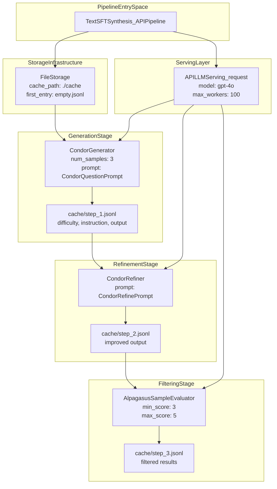
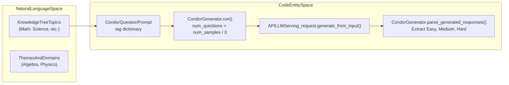
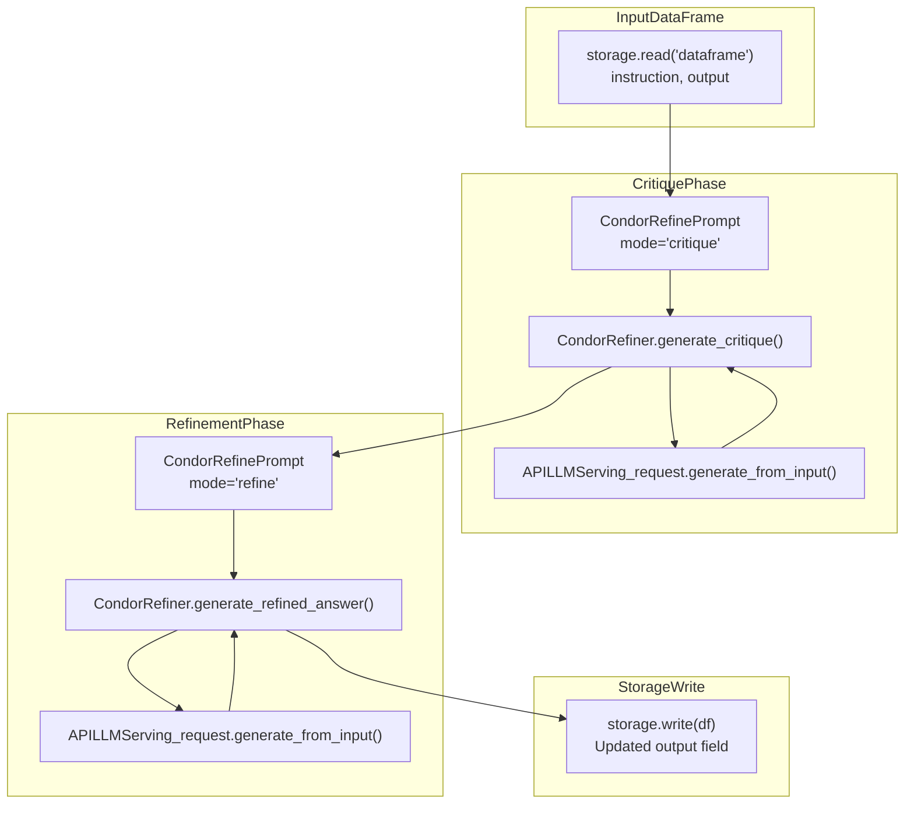
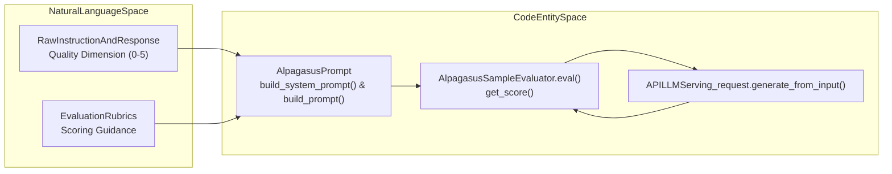

<!-- source: DeepWiki mcp.deepwiki.com · repo OpenDCAI/DataFlow · extra page SFT Data Synthesis · fetched 2026-11-02 -->

# SFT Data Synthesis

<details>
<summary>Relevant source files</summary>

The following files were used as context for generating this wiki page:

- [dataflow/example/GeneralTextPipeline/empty.jsonl](dataflow/example/GeneralTextPipeline/empty.jsonl)
- [dataflow/example/GeneralTextPipeline/pt_input.jsonl](dataflow/example/GeneralTextPipeline/pt_input.jsonl)
- [dataflow/example/GeneralTextPipeline/sft_input.jsonl](dataflow/example/GeneralTextPipeline/sft_input.jsonl)
- [dataflow/operators/conversations/generate/consistent_chat_generator.py](dataflow/operators/conversations/generate/consistent_chat_generator.py)
- [dataflow/operators/general_text/filter/llm_language_filter.py](dataflow/operators/general_text/filter/llm_language_filter.py)
- [dataflow/operators/text_pt/eval/meta_sample_evaluator.py](dataflow/operators/text_pt/eval/meta_sample_evaluator.py)
- [dataflow/operators/text_pt/generate/phi4qa_generator.py](dataflow/operators/text_pt/generate/phi4qa_generator.py)
- [dataflow/operators/text_sft/eval/alpagasus_sample_evaluator.py](dataflow/operators/text_sft/eval/alpagasus_sample_evaluator.py)
- [dataflow/operators/text_sft/eval/treeinstruct_sample_evaluator.py](dataflow/operators/text_sft/eval/treeinstruct_sample_evaluator.py)
- [dataflow/operators/text_sft/generate/condor_generator.py](dataflow/operators/text_sft/generate/condor_generator.py)
- [dataflow/operators/text_sft/generate/sft_generator_from_seed.py](dataflow/operators/text_sft/generate/sft_generator_from_seed.py)
- [dataflow/operators/text_sft/refine/condor_refiner.py](dataflow/operators/text_sft/refine/condor_refiner.py)
- [dataflow/prompts/general_text.py](dataflow/prompts/general_text.py)
- [dataflow/statics/pipelines/api_pipelines/text_conversation_synthesis_pipeline.py](dataflow/statics/pipelines/api_pipelines/text_conversation_synthesis_pipeline.py)
- [dataflow/statics/pipelines/api_pipelines/text_sft_synthesis_pipeline.py](dataflow/statics/pipelines/api_pipelines/text_sft_synthesis_pipeline.py)
- [dataflow/statics/playground/playground/text_conversation_synthesis_pipeline.py](dataflow/statics/playground/playground/text_conversation_synthesis_pipeline.py)
- [dataflow/statics/playground/playground/text_sft_synthesis_from_scratch.py](dataflow/statics/playground/playground/text_sft_synthesis_from_scratch.py)
- [dataflow/statics/playground/playground/text_sft_synthesis_from_seed.py](dataflow/statics/playground/playground/text_sft_synthesis_from_seed.py)

</details>


This page documents the SFT (Supervised Fine-Tuning) Data Synthesis pipeline, which generates instruction-output pairs from scratch for training language models or builds fine-tuning sets from seed texts. The pipeline uses a multi-stage architecture comprising generation, refinement, and evaluation filtering. For multi-turn conversation synthesis, see [Conversation Synthesis](5.1.2). For general text quality filtering techniques, see [Text Quality Filtering](5.1.3).

Sources: `[dataflow/statics/pipelines/api_pipelines/text_sft_synthesis_pipeline.py:1-46]()`

## Overview

The SFT Data Synthesis pipeline creates high-quality question-answer pairs without requiring extensive human-annotated seed data. It implements a zero-shot synthesis approach via `TextSFTSynthesis_APIPipeline` that leverages structured knowledge trees, critique-based iterative refinement, and model-graded quality control filters.

Sources: `[dataflow/statics/pipelines/api_pipelines/text_sft_synthesis_pipeline.py:9-42]()`

## Pipeline Architecture

### TextSFTSynthesis_APIPipeline

The `TextSFTSynthesis_APIPipeline` class (`[dataflow/statics/pipelines/api_pipelines/text_sft_synthesis_pipeline.py:9]()`) orchestrates the end-to-end synthesis workflow. It links `FileStorage` (`[dataflow/utils/storage/file_storage.py]()`), `APILLMServing_request` (`[dataflow/serving/api_llm_serving.py]()`), `CondorGenerator`, `CondorRefiner`, and `AlpagasusSampleEvaluator`.



**Diagram: SFT Data Synthesis Pipeline Architecture with Storage and LLM Serving Components**

Sources: `[dataflow/statics/pipelines/api_pipelines/text_sft_synthesis_pipeline.py:9-42]()`

### Execution Flow

The `forward()` method steps through each transformation using `storage.step()`, ensuring intermediate states are checkpointed to disk `[dataflow/statics/pipelines/api_pipelines/text_sft_synthesis_pipeline.py:28-42]`.

```python
def forward(self):
    self.generator.run(storage=self.storage.step())
    self.refiner.run(
        storage=self.storage.step(),
        input_instruction_key='instruction',
        input_output_key='output'
    )
    self.alpagasus_filter.run(
        storage=self.storage.step(),
        input_instruction_key='instruction',
        input_input_key="input",
        input_output_key='output'
    )
```

Sources: `[dataflow/statics/pipelines/api_pipelines/text_sft_synthesis_pipeline.py:28-42]()`

## Stage 1: Generation with CondorGenerator

### Architecture and Mapping

`CondorGenerator` (`[dataflow/operators/text_sft/generate/condor_generator.py:18]()`) maps natural language themes to structured SFT records via a two-phase generation pipeline.



**Diagram: Bridging Natural Language Knowledge Trees to CondorGenerator Code Entities**

Sources: `[dataflow/operators/text_sft/generate/condor_generator.py:18-150]()`, `[dataflow/prompts/general_text.py:1-40]()`

### Two-Phase Generation Logic

1. **Phase 1 (Question Generation)**: Randomly samples topics, domains, and themes from `CondorQuestionPrompt`. Constructs prompts specifying task scenarios (`use_task_diversity`) and invokes `llm_serving.generate_from_input()` to generate questions across `[Easy]`, `[Medium]`, and `[Hard]` tiers `[dataflow/operators/text_sft/generate/condor_generator.py:88-126]`.
2. **Phase 2 (Answer Generation)**: Parses responses via `parse_generated_responses()` `[dataflow/operators/text_sft/generate/condor_generator.py:60-85]`, builds truthful answer prompts for each difficulty tier, and executes batch generation `[dataflow/operators/text_sft/generate/condor_generator.py:131-150]`.

Sources: `[dataflow/operators/text_sft/generate/condor_generator.py:60-150]()`

## Stage 2: Refinement with CondorRefiner

### Architecture

`CondorRefiner` (`[dataflow/operators/text_sft/refine/condor_refiner.py:18]()`) executes a critique-and-rewrite workflow to enhance output quality.



**Diagram: CondorRefiner Two-Phase Critique and Refinement Workflow**

Sources: `[dataflow/operators/text_sft/refine/condor_refiner.py:18-87]()`

### Execution Methods

* `generate_critique()`: Builds prompts using `CondorRefinePrompt` in critique mode and invokes LLM serving `[dataflow/operators/text_sft/refine/condor_refiner.py:58-62]`.
* `generate_refined_answer()`: Appends critiques to the prompt context, cleans tag delimiters (`[Improved Answer Start]`), and updates the DataFrame `[dataflow/operators/text_sft/refine/condor_refiner.py:64-87]`.

Sources: `[dataflow/operators/text_sft/refine/condor_refiner.py:58-87]()`

## Stage 3: Quality Control with AlpagasusFilter

### Evaluation and Filtering

`AlpagasusSampleEvaluator` (`[dataflow/operators/text_sft/eval/alpagasus_sample_evaluator.py:14()`, aliased in pipelines as `alpagasus_filter`) assesses instruction-output pairs on a 0–5 scale using `AlpagasusPrompt` (`[dataflow/prompts/general_text.py:141-167]()`).



**Diagram: Bridging Natural Language Quality Criteria to AlpagasusSampleEvaluator Code Entities**

Sources: `[dataflow/operators/text_sft/eval/alpagasus_sample_evaluator.py:14-90]()`, `[dataflow/prompts/general_text.py:141-167]()`

## Seed-Based SFT Generation

### SFTGeneratorFromSeed

When raw text or unstructured pretraining data (`pt_input.jsonl`, `[dataflow/example/GeneralTextPipeline/pt_input.jsonl:1-10]()`) is available, `SFTGeneratorSeed` (`[dataflow/operators/text_sft/generate/sft_generator_from_seed.py]()`) transforms raw text into instruction-output pairs using `SFTGeneratorSeedPrompt` (`[dataflow/prompts/general_text.py:33-75]()`).

```python
from dataflow.operators.text_sft import SFTGeneratorSeed
from dataflow.utils.storage import FileStorage
from dataflow.serving import APILLMServing_request

generator = SFTGeneratorSeed(
    llm_serving=llm_serving,
    custom_prompt="Try to make the question suitable for middle school students."
)
generator.run(storage=storage.step())
```

Sources: `[dataflow/statics/playground/playground/text_sft_synthesis_from_seed.py:1-28]()`, `[dataflow/prompts/general_text.py:33-75]()`, `[dataflow/example/GeneralTextPipeline/pt_input.jsonl:1-10]()`

---

