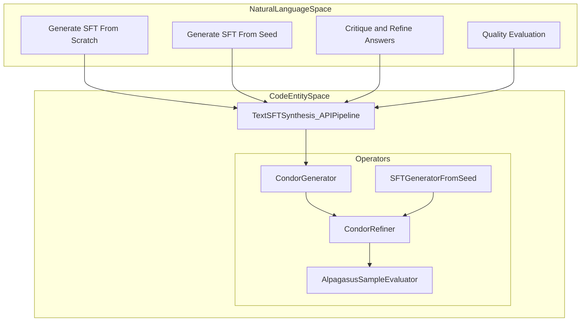
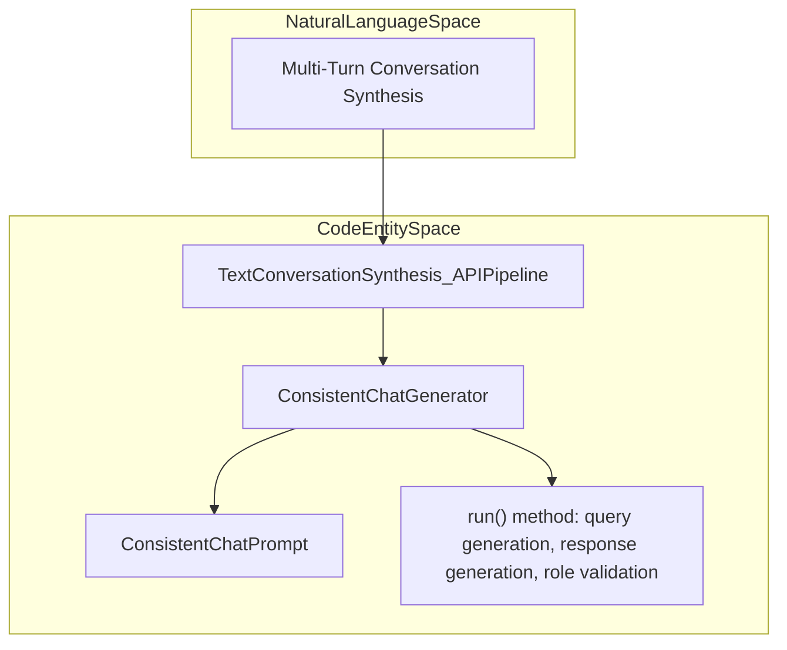

<!-- source: DeepWiki mcp.deepwiki.com · repo OpenDCAI/DataFlow · extra page SFT and Conversation Operators · fetched 2026-11-02 -->

# SFT and Conversation Operators

<details>
<summary>Relevant source files</summary>

The following files were used as context for generating this wiki page:

- [dataflow/example/GeneralTextPipeline/empty.jsonl](dataflow/example/GeneralTextPipeline/empty.jsonl)
- [dataflow/example/GeneralTextPipeline/pt_input.jsonl](dataflow/example/GeneralTextPipeline/pt_input.jsonl)
- [dataflow/example/GeneralTextPipeline/sft_input.jsonl](dataflow/example/GeneralTextPipeline/sft_input.jsonl)
- [dataflow/operators/conversations/generate/consistent_chat_generator.py](dataflow/operators/conversations/generate/consistent_chat_generator.py)
- [dataflow/operators/general_text/filter/llm_language_filter.py](dataflow/operators/general_text/filter/llm_language_filter.py)
- [dataflow/operators/text_pt/eval/meta_sample_evaluator.py](dataflow/operators/text_pt/eval/meta_sample_evaluator.py)
- [dataflow/operators/text_pt/generate/phi4qa_generator.py](dataflow/operators/text_pt/generate/phi4qa_generator.py)
- [dataflow/operators/text_sft/__init__.py](dataflow/operators/text_sft/__init__.py)
- [dataflow/operators/text_sft/eval/alpagasus_sample_evaluator.py](dataflow/operators/text_sft/eval/alpagasus_sample_evaluator.py)
- [dataflow/operators/text_sft/eval/mmd_dataset_evaluator.py](dataflow/operators/text_sft/eval/mmd_dataset_evaluator.py)
- [dataflow/operators/text_sft/eval/treeinstruct_sample_evaluator.py](dataflow/operators/text_sft/eval/treeinstruct_sample_evaluator.py)
- [dataflow/operators/text_sft/generate/condor_generator.py](dataflow/operators/text_sft/generate/condor_generator.py)
- [dataflow/operators/text_sft/generate/sft_generator_from_seed.py](dataflow/operators/text_sft/generate/sft_generator_from_seed.py)
- [dataflow/operators/text_sft/refine/condor_refiner.py](dataflow/operators/text_sft/refine/condor_refiner.py)
- [dataflow/prompts/general_text.py](dataflow/prompts/general_text.py)
- [dataflow/statics/pipelines/api_pipelines/text_conversation_synthesis_pipeline.py](dataflow/statics/pipelines/api_pipelines/text_conversation_synthesis_pipeline.py)
- [dataflow/statics/pipelines/api_pipelines/text_sft_synthesis_pipeline.py](dataflow/statics/pipelines/api_pipelines/text_sft_synthesis_pipeline.py)
- [dataflow/statics/playground/playground/text_conversation_synthesis_pipeline.py](dataflow/statics/playground/playground/text_conversation_synthesis_pipeline.py)

</details>


## Purpose and Scope

This page documents the operators specialized for generating Supervised Fine-Tuning (SFT) instruction-response pairs and multi-turn conversation data. These operators enable synthetic data creation from scratch or from seed content, quality refinement through critique-based iteration, and multi-turn dialogue generation with intent-based topic selection.

For quality filtering of generated SFT data, see [Text Quality Filtering](). For the complete SFT synthesis pipeline, see [SFT Data Synthesis](). For conversation synthesis pipelines, see [Conversation Synthesis]().

Sources: `[dataflow/operators/text_sft/generate/condor_generator.py:17-57]()`, `[dataflow/operators/text_sft/refine/condor_refiner.py:17-56]()`, `[dataflow/operators/conversations/generate/consistent_chat_generator.py:17-56]()`, `[dataflow/operators/text_sft/eval/alpagasus_sample_evaluator.py:13-53]()`, `[dataflow/operators/text_sft/generate/sft_generator_from_seed.py:32-69]()`, `[dataflow/operators/text_pt/generate/phi4qa_generator.py:16-52]()`

---

## Operator Overview

The SFT and conversation generation operators implement two primary workflows:

**SFT Data Synthesis**: Creating instruction-response pairs through either knowledge-tree-based generation from scratch or seed-content-based generation, followed by critique-based refinement.

**Conversation Synthesis**: Generating multi-turn dialogues through a two-stage process of query generation (user turns) followed by response generation (assistant turns), with intent-based topic selection.

### Operator Categories

| Operator Class | Type | Purpose | Input Requirement | Output Format |
|----------------|------|---------|-------------------|---------------|
| `CondorGenerator` | Generation | Two-stage SFT generation from scratch | Empty or minimal data | `instruction`, `output`, `difficulty` |
| `SFTGeneratorFromSeed` | Generation | SFT generation from seed content | Text/content field | `instruction`, `output` |
| `CondorRefiner` | Refinement | Critique-based answer improvement | `instruction`, `output` fields | Refined `output` field |
| `ConsistentChatGenerator` | Generation | Multi-turn conversation synthesis | Empty data | `category`, `conversation` list |
| `AlpagasusSampleEvaluator` | Evaluation | Quality scoring for filtering | `instruction`, `input`, `output` | DataFrame with `AlpagasusScore` |
| `Phi4QAGenerator` | Generation | Document to multi-turn dialogue | `raw_content` field | `generated_content` |

Sources: `[dataflow/operators/text_sft/generate/condor_generator.py:17-57]()`, `[dataflow/operators/text_sft/refine/condor_refiner.py:17-56]()`, `[dataflow/operators/conversations/generate/consistent_chat_generator.py:17-56]()`, `[dataflow/operators/text_sft/eval/alpagasus_sample_evaluator.py:13-53]()`, `[dataflow/operators/text_sft/generate/sft_generator_from_seed.py:32-69]()`, `[dataflow/operators/text_pt/generate/phi4qa_generator.py:16-52]()`

---

## Operator Architecture and Data Flow

### SFT Generation Workflow (Natural Language to Code Entities)



**Diagram: SFT Generation and Refinement Code Mapping**

This diagram associates natural language SFT synthesis concepts with their concrete implementations across pipelines (`TextSFTSynthesis_APIPipeline`) and operator classes (`CondorGenerator`, `SFTGeneratorFromSeed`, `CondorRefiner`, `AlpagasusSampleEvaluator`).

Sources: `[dataflow/statics/pipelines/api_pipelines/text_sft_synthesis_pipeline.py:9-46]()`, `[dataflow/operators/text_sft/generate/condor_generator.py:18-165]()`, `[dataflow/operators/text_sft/refine/condor_refiner.py:18-87]()`, `[dataflow/operators/text_sft/eval/alpagasus_sample_evaluator.py:14-80]()`

---

### Conversation Generation Workflow (Natural Language to Code Entities)



**Diagram: Multi-turn Conversation Synthesis Code Mapping**

This diagram bridges natural language multi-turn dialogue generation to `TextConversationSynthesis_APIPipeline` and `ConsistentChatGenerator`.

Sources: `[dataflow/statics/pipelines/api_pipelines/text_conversation_synthesis_pipeline.py:6-33]()`, `[dataflow/operators/conversations/generate/consistent_chat_generator.py:18-143]()`, `[dataflow/prompts/general_text.py:239-703]()`

---

## CondorGenerator

### Class Definition

The `CondorGenerator` operator synthesizes SFT instruction-response pairs from scratch using a two-stage generation process. Stage one generates questions at three difficulty levels (Easy, Medium, Hard) based on a knowledge tree taxonomy. Stage two generates answers for each question in parallel.

**Class Location**: `[dataflow/operators/text_sft/generate/condor_generator.py:18-165]()`

**Registry Decorator**: `@OPERATOR_REGISTRY.register()`

**Prompt Restriction**: `@prompt_restrict(CondorQuestionPrompt)`

### Constructor Parameters

| Parameter | Type | Default | Description |
|-----------|------|---------|-------------|
| `llm_serving` | `LLMServingABC` | `None` | LLM serving instance for generation |
| `num_samples` | `int` | `15` | Total number of samples to generate (recommended < 5000) |
| `use_task_diversity` | `bool` | `True` | Whether to use task scenario diversity |
| `prompt_template` | `CondorQuestionPrompt` or `DIYPromptABC` | `None` | Prompt template for question generation |

Implementation: `[dataflow/operators/text_sft/generate/condor_generator.py:19-27]()`

Sources: `[dataflow/operators/text_sft/generate/condor_generator.py:18-27]()`

---

## SFTGeneratorFromSeed

### Class Definition

The `SFTGeneratorFromSeed` operator generates SFT instruction-response pairs from seed content (e.g., raw paragraphs). It uses the LLM to transform raw text into structured question-answer pairs with optional custom instructions.

**Class Location**: `[dataflow/operators/text_sft/generate/sft_generator_from_seed.py:32-109]()`

**Registry Decorator**: `@OPERATOR_REGISTRY.register()`

### Prompt Structure

The operator uses `SFTGeneratorSeedPrompt` which includes:

1. **Base Prompt**: Standard instructions for creating high-quality SFT data. `[dataflow/prompts/general_text.py:44-49]()`
2. **Requirements**: JSON format specification (instruction/output). `[dataflow/prompts/general_text.py:50-54]()`
3. **Examples**: Sample instruction-output pairs demonstrating diversity. `[dataflow/prompts/general_text.py:56-64]()`
4. **Custom Section**: Optional user-provided instructions via `custom_prompt`. `[dataflow/prompts/general_text.py:71-72]()`

Prompt Template: `[dataflow/prompts/general_text.py:33-74]()`

Sources: `[dataflow/operators/text_sft/generate/sft_generator_from_seed.py:32-109]()`, `[dataflow/prompts/general_text.py:33-74]()`

---

## CondorRefiner

### Class Definition

The `CondorRefiner` operator improves instruction-response quality through a two-stage critique-refinement process. Stage one generates detailed critiques of existing answers. Stage two uses those critiques to generate improved answers.

**Class Location**: `[dataflow/operators/text_sft/refine/condor_refiner.py:18-87]()`

**Registry Decorator**: `@OPERATOR_REGISTRY.register()`

**Prompt Restriction**: `@prompt_restrict(CondorRefinePrompt)`

Sources: `[dataflow/operators/text_sft/refine/condor_refiner.py:18-87]()`

---

## ConsistentChatGenerator

### Class Definition

The `ConsistentChatGenerator` operator synthesizes multi-turn conversations from scratch using intent-based topic selection. It generates dialogues in two stages: query generation (user turns) followed by response generation (assistant turns).

**Class Location**: `[dataflow/operators/conversations/generate/consistent_chat_generator.py:18-143]()`

**Registry Decorator**: `@OPERATOR_REGISTRY.register()`

**Prompt Restriction**: `@prompt_restrict(ConsistentChatPrompt)`

### Validation Rules
1. Number of user turns must not exceed number of assistant responses `[dataflow/operators/conversations/generate/consistent_chat_generator.py:115-116]()`.
2. Conversation must not end with a user message (trailing user turn is removed) `[dataflow/operators/conversations/generate/consistent_chat_generator.py:125-126]()`.
3. Conversation must not be empty after validation `[dataflow/operators/conversations/generate/consistent_chat_generator.py:128-129]()`.

Sources: `[dataflow/operators/conversations/generate/consistent_chat_generator.py:18-143]()`, `[dataflow/prompts/general_text.py:239-703]()`

---

## AlpagasusSampleEvaluator

### Class Definition

The `AlpagasusSampleEvaluator` operator evaluates SFT instruction-response pairs based on quality dimensions. It uses LLM-based scoring to assess data quality on a 0-5 scale.

**Class Location**: `[dataflow/operators/text_sft/eval/alpagasus_sample_evaluator.py:14-80]()`

**Registry Decorator**: `@OPERATOR_REGISTRY.register()`

**Prompt Restriction**: `@prompt_restrict(AlpagasusPrompt)`

Sources: `[dataflow/operators/text_sft/eval/alpagasus_sample_evaluator.py:14-80]()`

---

## Phi4QAGenerator

### Class Definition

The `Phi4QAGenerator` operator converts raw document content into a conversational format with multiple Question/Answer pairs.

**Class Location**: `[dataflow/operators/text_pt/generate/phi4qa_generator.py:16-87]()`

**Prompt Template**: `Phi4QAGeneratorPrompt` `[dataflow/prompts/general_text.py:12-30]()`

Sources: `[dataflow/operators/text_pt/generate/phi4qa_generator.py:16-87]()`, `[dataflow/prompts/general_text.py:12-30]()`

---

## Storage and Execution Patterns

### Complete SFT Synthesis Pipeline

The following pattern combines generation, refinement, and filtering:

```python
class TextSFTSynthesis_APIPipeline():
    def __init__(self):
        # ... initialization ...
        self.generator = CondorGenerator(llm_serving=self.llm_serving, num_samples=self.num_generated_samples, prompt_template=CondorQuestionPrompt())
        self.refiner = CondorRefiner(llm_serving=self.llm_serving, prompt_template=CondorRefinePrompt())
        self.alpagasus_filter = AlpagasusFilter(min_score=3,max_score=5,llm_serving=self.llm_serving)

    def forward(self):
        self.generator.run(storage=self.storage.step())
        self.refiner.run(
            storage=self.storage.step(),
            input_instruction_key='instruction',
            input_output_key='output'
        )
        self.alpagasus_filter.run(
            storage=self.storage.step(),
            input_instruction_key='instruction',
            input_input_key="input",
            input_output_key='output'
        )
```

Implementation: `[dataflow/statics/pipelines/api_pipelines/text_sft_synthesis_pipeline.py:9-42]()`

Sources: `[dataflow/statics/pipelines/api_pipelines/text_sft_synthesis_pipeline.py:9-46]()`, `[dataflow/operators/text_sft/generate/condor_generator.py:160-165]()`

---

