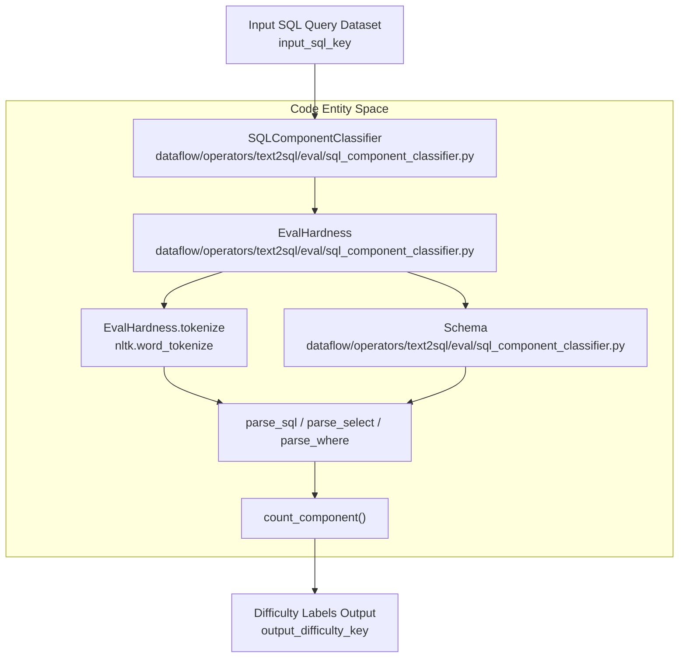
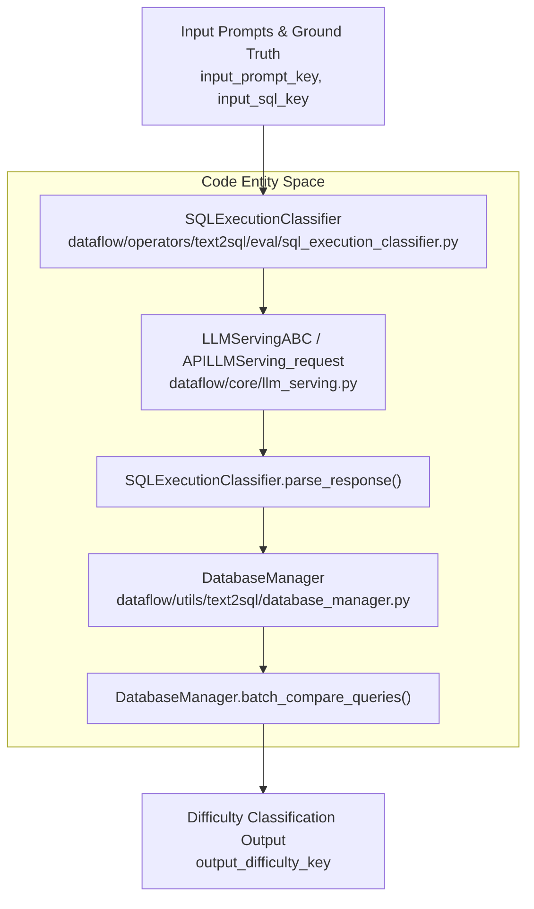
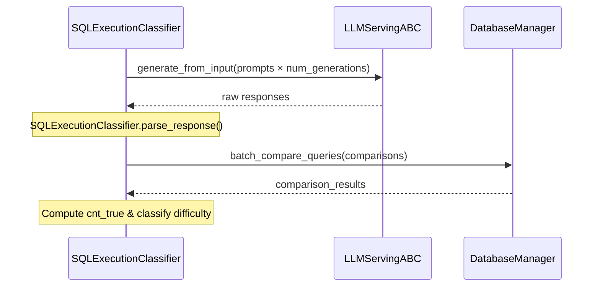

<!-- source: DeepWiki mcp.deepwiki.com · repo OpenDCAI/DataFlow · extra page SQL Classification Operators · fetched 2026-11-02 -->

# SQL Classification Operators

<details>
<summary>Relevant source files</summary>

The following files were used as context for generating this wiki page:

- [dataflow/example/Text2SQLPipeline/empty.jsonl](dataflow/example/Text2SQLPipeline/empty.jsonl)
- [dataflow/operators/text2sql/eval/sql_component_classifier.py](dataflow/operators/text2sql/eval/sql_component_classifier.py)
- [dataflow/operators/text2sql/eval/sql_execution_classifier.py](dataflow/operators/text2sql/eval/sql_execution_classifier.py)
- [dataflow/operators/text2sql/filter/sql_execution_filter.py](dataflow/operators/text2sql/filter/sql_execution_filter.py)
- [dataflow/statics/pipelines/api_pipelines/text2sql_pipeline_gen.py](dataflow/statics/pipelines/api_pipelines/text2sql_pipeline_gen.py)
- [dataflow/statics/pipelines/api_pipelines/text2sql_pipeline_refine.py](dataflow/statics/pipelines/api_pipelines/text2sql_pipeline_refine.py)
- [dataflow/statics/pipelines/api_pipelines/text2vecsql_pipeline_gen.py](dataflow/statics/pipelines/api_pipelines/text2vecsql_pipeline_gen.py)
- [dataflow/statics/pipelines/cpu_pipelines/text2sql_pipeline.py](dataflow/statics/pipelines/cpu_pipelines/text2sql_pipeline.py)
- [dataflow/statics/pipelines/gpu_pipelines/text2sql_pipeline_gen.py](dataflow/statics/pipelines/gpu_pipelines/text2sql_pipeline_gen.py)
- [dataflow/statics/pipelines/gpu_pipelines/text2sql_pipeline_refine.py](dataflow/statics/pipelines/gpu_pipelines/text2sql_pipeline_refine.py)
- [dataflow/utils/text2sql/database_connector/sqlite_vec_connector.py](dataflow/utils/text2sql/database_connector/sqlite_vec_connector.py)

</details>


This page details the SQL difficulty classification operators available in DataFlow: `SQLComponentClassifier` (featuring `EvalHardness` / `EvalHardnessLite`), `SQLExecutionClassifier`, and their integration with vector-enhanced SQL (`VecSQL`) tasks [dataflow/operators/text2sql/eval/sql_component_classifier.py:11-610](), [dataflow/operators/text2sql/eval/sql_execution_classifier.py:15-318](), [dataflow/utils/text2sql/database_connector/sqlite_vec_connector.py:14-101](). These operators assess the syntactic complexity and execution difficulty of SQL queries for Text2SQL training data preparation using static rule-based analysis and empirical LLM-based evaluation.

For information about SQL generation operators, see [6.1.1](). For filtering operators, see [6.2.1]().

---

## Overview

Both classification operators output a difficulty label (e.g., `easy`, `medium`, `hard`, `extra`) for each SQL query in the dataset. The key difference lies in their methodology and dependency profile:

| Operator | Class Name | LLM Required | Execution Required | Analysis Type |
|----------|------------|--------------|-------------------|---------------|
| Component Classifier | `SQLComponentClassifier` | No | No | Static rule-based |
| Execution Classifier | `SQLExecutionClassifier` | Yes | Yes | Empirical execution |

Sources: [dataflow/operators/text2sql/eval/sql_component_classifier.py:11-610](), [dataflow/operators/text2sql/eval/sql_execution_classifier.py:15-318]()

---

## SQLComponentClassifier

### Purpose and Design

`SQLComponentClassifier` performs static analysis of SQL queries by parsing their syntactic structure and counting complexity features via internal parser classes (`EvalHardness` and `EvalHardnessLite`) [dataflow/operators/text2sql/eval/sql_component_classifier.py:11-610](). It does not require LLM inference or database execution, making it the fastest classification method suitable for CPU-only environments [dataflow/statics/pipelines/cpu_pipelines/text2sql_pipeline.py:113-142]().

The classifier analyzes components such as clause keywords (`select`, `from`, `where`, `group`, `order`, `limit`, `intersect`, `union`, `except`), join operations, aggregate functions, and set operations [dataflow/operators/text2sql/eval/sql_component_classifier.py:43-55]().

Sources: [dataflow/operators/text2sql/eval/sql_component_classifier.py:11-610](), [dataflow/statics/pipelines/cpu_pipelines/text2sql_pipeline.py:113-142]()

### Architecture (Natural Language to Code Entity Space)


Sources: [dataflow/operators/text2sql/eval/sql_component_classifier.py:11-447]()

### Configuration Parameters

The operator accepts configuration parameters to set difficulty thresholds and category labels [dataflow/operators/text2sql/eval/sql_component_classifier.py:571-589]().

```python
SQLComponentClassifier(
    difficulty_thresholds=[2, 4, 6],
    difficulty_labels=['easy', 'medium', 'hard', 'extra']
)
```

| Parameter | Type | Default | Description |
|-----------|------|---------|-------------|
| `difficulty_thresholds` | `list[int]` | `[2, 4, 6]` | Score thresholds separating difficulty levels [dataflow/operators/text2sql/eval/sql_component_classifier.py:575-575]() |
| `difficulty_labels` | `list[str]` | `['easy', 'medium', 'hard', 'extra']` | Labels for each difficulty range [dataflow/operators/text2sql/eval/sql_component_classifier.py:576-576]() |

Sources: [dataflow/operators/text2sql/eval/sql_component_classifier.py:571-589]()

---

## SQLExecutionClassifier

### Purpose and Design

`SQLExecutionClassifier` performs empirical difficulty assessment by using an LLM serving backend (`LLMServingABC`) to generate multiple SQL attempts from natural language prompts, then executing them against the database via `DatabaseManager` to measure the success rate [dataflow/operators/text2sql/eval/sql_execution_classifier.py:15-40]().

Sources: [dataflow/operators/text2sql/eval/sql_execution_classifier.py:15-40](), [dataflow/operators/text2sql/eval/sql_execution_classifier.py:84-146]()

### Architecture (Natural Language to Code Entity Space)


Sources: [dataflow/operators/text2sql/eval/sql_execution_classifier.py:15-146]()

### Configuration Parameters

```python
SQLExecutionClassifier(
    llm_serving=llm_serving,
    database_manager=database_manager,
    num_generations=10,
    difficulty_thresholds=[2, 5, 9],
    difficulty_labels=['extra', 'hard', 'medium', 'easy']
)
```

| Parameter | Type | Required | Description |
|-----------|------|----------|-------------|
| `llm_serving` | `LLMServingABC` | Yes | LLM serving instance for SQL generation [dataflow/operators/text2sql/eval/sql_execution_classifier.py:17-17]() |
| `database_manager` | `DatabaseManager` | Yes | Database manager for query execution [dataflow/operators/text2sql/eval/sql_execution_classifier.py:18-18]() |
| `num_generations` | `int` | No (default: 10) | Number of SQL attempts to generate per prompt [dataflow/operators/text2sql/eval/sql_execution_classifier.py:19-19]() |
| `difficulty_thresholds` | `list[int]` | No (default: `[2, 5, 9]`) | Success count thresholds [dataflow/operators/text2sql/eval/sql_execution_classifier.py:20-20]() |

Sources: [dataflow/operators/text2sql/eval/sql_execution_classifier.py:16-38]()

### Difficulty Classification Logic

The classification maps success count to difficulty labels inversely compared to static classifiers, as higher success rates indicate easier queries [dataflow/operators/text2sql/eval/sql_execution_classifier.py:232-241]().

| Success Count (out of 10) | Difficulty Label |
|---------------------------|------------------|
| $\le 2$ | `extra` |
| $3 - 5$ | `hard` |
| $6 - 9$ | `medium` |
| $> 9$ | `easy` |
| $-1$ | `gold error` |

Sources: [dataflow/operators/text2sql/eval/sql_execution_classifier.py:232-241]()

---

## Vector SQL (VecSQL) Classification

For Vector SQL tasks, classification operators handle databases configured with vector extension search capabilities.

- `SQLComponentClassifier` processes queries containing vector functions and schema metadata by utilizing the `Schema` normalization class [dataflow/operators/text2sql/eval/sql_component_classifier.py:11-39]().
- `SQLExecutionClassifier` executes vector queries against databases initialized with `sqlite-vec` extensions using `SQLiteVecConnector`, leveraging `DatabaseManager` and embedding serving components [dataflow/utils/text2sql/database_connector/sqlite_vec_connector.py:14-101](), [dataflow/utils/text2sql/database_manager.py:1-50]().

Sources: [dataflow/operators/text2sql/eval/sql_component_classifier.py:11-39](), [dataflow/utils/text2sql/database_connector/sqlite_vec_connector.py:14-101]()

---

## Usage in Pipelines

### CPU Pipeline Integration
CPU-only pipelines invoke `SQLComponentClassifier` without database execution or LLM dependencies [dataflow/statics/pipelines/cpu_pipelines/text2sql_pipeline.py:113-116]().

```python
self.sql_component_classifier_step3 = SQLComponentClassifier(
    difficulty_thresholds=[2, 4, 6],
    difficulty_labels=['easy', 'medium', 'hard', 'extra']
)
```
Sources: [dataflow/statics/pipelines/cpu_pipelines/text2sql_pipeline.py:113-116]()

### API and GPU Pipeline Integration
API and GPU pipelines compose both `SQLComponentClassifier` and `SQLExecutionClassifier` sequentially [dataflow/statics/pipelines/api_pipelines/text2sql_pipeline_gen.py:167-178](), [dataflow/statics/pipelines/gpu_pipelines/text2sql_pipeline_gen.py:168-179]().

```python
self.sql_component_classifier_step8 = SQLComponentClassifier(
    difficulty_thresholds=[2, 4, 6],
    difficulty_labels=['easy', 'medium', 'hard', 'extra']
)

self.sql_execution_classifier_step9 = SQLExecutionClassifier(
    llm_serving=self.llm_serving,
    database_manager=database_manager,
    num_generations=10,
    difficulty_thresholds=[2, 5, 9],
    difficulty_labels=['extra', 'hard', 'medium', 'easy']
)
```
Sources: [dataflow/statics/pipelines/api_pipelines/text2sql_pipeline_gen.py:167-178](), [dataflow/statics/pipelines/gpu_pipelines/text2sql_pipeline_gen.py:168-179]()

---

## Performance and Scalability

### Batch Execution Sequence


Sources: [dataflow/operators/text2sql/eval/sql_execution_classifier.py:83-213]()

### Database Resource Management
`DatabaseManager` manages connection pools and thread workers (via `max_connections_per_db` and `max_workers`) to support concurrent execution during `SQLExecutionClassifier` evaluations [dataflow/statics/pipelines/gpu_pipelines/text2sql_pipeline_gen.py:132-134]().

Sources: [dataflow/statics/pipelines/gpu_pipelines/text2sql_pipeline_gen.py:132-134]()

---

