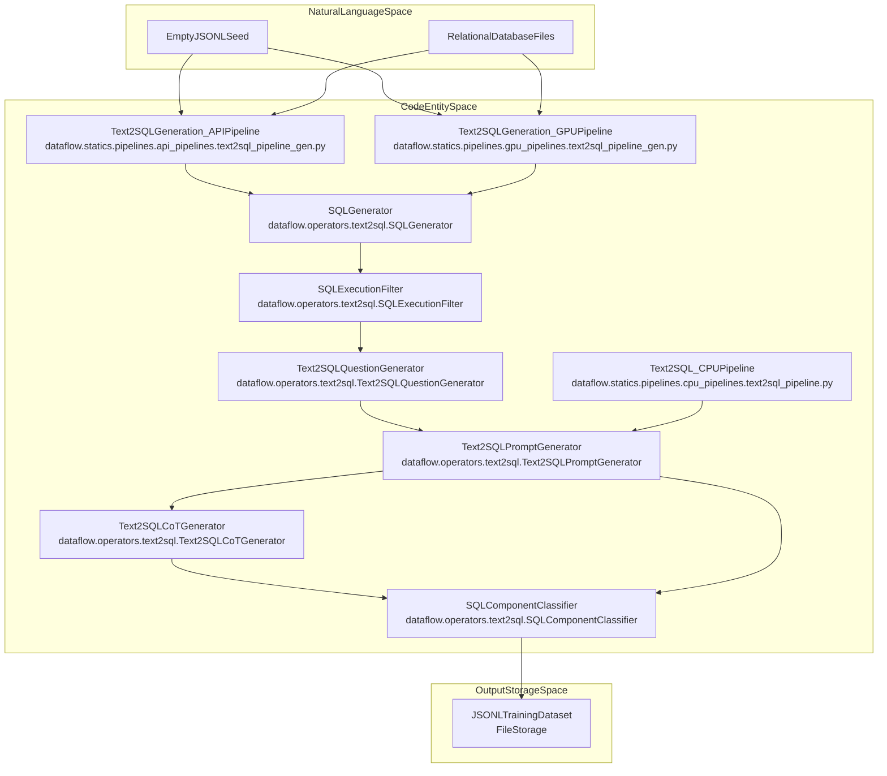
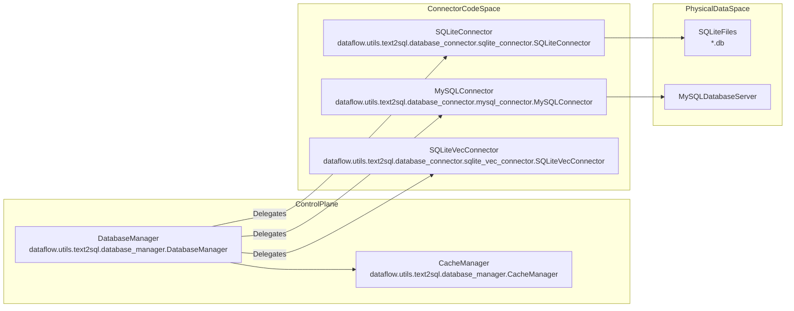

<!-- source: DeepWiki mcp.deepwiki.com · repo OpenDCAI/DataFlow · extra page SQL Generation Pipeline · fetched 2026-11-02 -->

# SQL Generation Pipeline

Relevant source files

The following files were used as context for generating this wiki page:

- [dataflow/example/Text2SQLPipeline/empty.jsonl](dataflow/example/Text2SQLPipeline/empty.jsonl)
- [dataflow/operators/text2sql/eval/sql_component_classifier.py](dataflow/operators/text2sql/eval/sql_component_classifier.py)
- [dataflow/operators/text2sql/generate/sql_generator.py](dataflow/operators/text2sql/generate/sql_generator.py)
- [dataflow/operators/text2sql/generate/sql_variation_generator.py](dataflow/operators/text2sql/generate/sql_variation_generator.py)
- [dataflow/operators/text2sql/generate/text2sql_cot_generator.py](dataflow/operators/text2sql/generate/text2sql_cot_generator.py)
- [dataflow/operators/text2sql/generate/text2sql_prompt_generator.py](dataflow/operators/text2sql/generate/text2sql_prompt_generator.py)
- [dataflow/operators/text2sql/generate/text2sql_question_generator.py](dataflow/operators/text2sql/generate/text2sql_question_generator.py)
- [dataflow/prompts/text2sql.py](dataflow/prompts/text2sql.py)
- [dataflow/statics/pipelines/api_pipelines/text2sql_pipeline_gen.py](dataflow/statics/pipelines/api_pipelines/text2sql_pipeline_gen.py)
- [dataflow/statics/pipelines/api_pipelines/text2sql_pipeline_refine.py](dataflow/statics/pipelines/api_pipelines/text2sql_pipeline_refine.py)
- [dataflow/statics/pipelines/cpu_pipelines/text2sql_pipeline.py](dataflow/statics/pipelines/cpu_pipelines/text2sql_pipeline.py)
- [dataflow/statics/pipelines/gpu_pipelines/text2sql_pipeline_gen.py](dataflow/statics/pipelines/gpu_pipelines/text2sql_pipeline_gen.py)
- [dataflow/statics/pipelines/gpu_pipelines/text2sql_pipeline_refine.py](dataflow/statics/pipelines/gpu_pipelines/text2sql_pipeline_refine.py)
- [dataflow/utils/text2sql/base.py](dataflow/utils/text2sql/base.py)
- [dataflow/utils/text2sql/database_connector/mysql_connector.py](dataflow/utils/text2sql/database_connector/mysql_connector.py)
- [dataflow/utils/text2sql/database_connector/sqlite_connector.py](dataflow/utils/text2sql/database_connector/sqlite_connector.py)
- [dataflow/utils/text2sql/database_manager.py](dataflow/utils/text2sql/database_manager.py)

## Purpose and Scope

The SQL Generation Pipeline creates Text2SQL training datasets from relational databases by synthesizing SQL queries, generating corresponding natural language questions, building rich model prompts, producing Chain-of-Thought (CoT) reasoning paths, voting on valid trajectories, and classifying query difficulty. This pipeline operates from an empty dataset seed and leverages LLMs and database introspection.

For refining existing SQL queries with variations and quality improvements, see [SQL Refinement Pipeline](5.3.2) `[dataflow/statics/pipelines/api_pipelines/text2sql_pipeline_refine.py:68-271]()`. For vector database integration with `sqlite-vec`, see [Vector SQL (Text2VecSQL)](5.3.3).

Sources: `[dataflow/statics/pipelines/api_pipelines/text2sql_pipeline_gen.py:68-180]()`

## Pipeline Variants

DataFlow provides three primary variants of the SQL Generation Pipeline optimized for different deployment hardware and operational models:

| Variant | File Path | Operators | LLM Requirement | Use Case |
|---------|-----------|-----------|-----------------|----------|
| **API Pipeline** | `[dataflow/statics/pipelines/api_pipelines/text2sql_pipeline_gen.py:68-261]()` | 9 | External API (OpenAI, etc.) | Cloud-based generation with high-quality proprietary models |
| **GPU Pipeline** | `[dataflow/statics/pipelines/gpu_pipelines/text2sql_pipeline_gen.py:59-242]()` | 7 | Local GPU (vLLM/SGLang) | On-premise generation with local open-weights models |
| **CPU Pipeline** | `[dataflow/statics/pipelines/cpu_pipelines/text2sql_pipeline.py:53-150]()` | 3 | None (filtering/classification only) | Post-processing, validation, and classification without inference |

All variants share a common core architecture but differ in operator chaining and backend LLM serving configurations.

Sources: `[dataflow/statics/pipelines/api_pipelines/text2sql_pipeline_gen.py:68-98]()`, `[dataflow/statics/pipelines/gpu_pipelines/text2sql_pipeline_gen.py:59-89]()`, `[dataflow/statics/pipelines/cpu_pipelines/text2sql_pipeline.py:53-76]()`

## Architecture Overview

### System Data Flow and Code Entity Mapping

This diagram illustrates the transition from Natural Language requirements and Database schemas into Code-ready SQL entities and training data across the API, GPU, and CPU execution pipelines, bridging the conceptual space to concrete code symbols.

Sources: `[dataflow/statics/pipelines/api_pipelines/text2sql_pipeline_gen.py:127-178]()`, `[dataflow/statics/pipelines/gpu_pipelines/text2sql_pipeline_gen.py:136-179]()`, `[dataflow/statics/pipelines/cpu_pipelines/text2sql_pipeline.py:104-142]()`

## Core Components

### Database Management and Caching

All pipeline variants employ the `DatabaseManager` abstraction (`[dataflow/utils/text2sql/database_manager.py:84]()`) to interface with database instances. The manager handles SQLite and MySQL engines, connection pooling, schema extraction (`get_create_statements_and_insert_statements`), and query execution caching via `CacheManager` (`[dataflow/utils/text2sql/database_manager.py:19]()`).

### Code-to-Entity Mapping: Database Connectors

Sources: `[dataflow/utils/text2sql/database_manager.py:19-121]()`, `[dataflow/utils/text2sql/database_connector/sqlite_connector.py:12-19]()`, `[dataflow/statics/pipelines/api_pipelines/text2sql_pipeline_gen.py:120-125]()`

### LLM Serving Configuration

#### API Pipeline Serving
The API pipeline utilizes `APILLMServing_request` (`[dataflow/serving/__init__.py]()`) configured with endpoint URLs and API keys for both text generation (`gpt-4o`) and embedding generation (`text-embedding-ada-002`) `[dataflow/statics/pipelines/api_pipelines/text2sql_pipeline_gen.py:93-103]()`.

Sources: `[dataflow/statics/pipelines/api_pipelines/text2sql_pipeline_gen.py:93-103]()`

#### GPU Pipeline Serving
The GPU pipeline relies on `LocalModelLLMServing_vllm` or `LocalModelLLMServing_sglang` for high-throughput tensor-parallel inference on local GPUs `[dataflow/statics/pipelines/gpu_pipelines/text2sql_pipeline_gen.py:84-109]()`. Advanced steps like Chain-of-Thought generation often target larger or specialized instruct models.

Sources: `[dataflow/statics/pipelines/gpu_pipelines/text2sql_pipeline_gen.py:84-109]()`

### Storage System

Pipelines manage execution step artifacts using `FileStorage` with JSONL serialization (`[dataflow/utils/storage/file_storage.py]()`).

| Pipeline Variant | Initial Entry File | Purpose |
|------------------|--------------------|---------|
| API / GPU Pipeline | `empty.jsonl` `[dataflow/statics/pipelines/api_pipelines/text2sql_pipeline_gen.py:87]()` | Bootstrap generation from scratch |
| CPU Pipeline | `pipeline_refine.jsonl` `[dataflow/statics/pipelines/cpu_pipelines/text2sql_pipeline.py:72]()` | Process pre-existing dataset entries |

Sources: `[dataflow/statics/pipelines/api_pipelines/text2sql_pipeline_gen.py:86-91]()`, `[dataflow/statics/pipelines/gpu_pipelines/text2sql_pipeline_gen.py:77-82]()`, `[dataflow/statics/pipelines/cpu_pipelines/text2sql_pipeline.py:71-76]()`

## Pipeline Stages and Operators

### SQL Generation
The generation stage synthesizes raw SQL statements using database schema introspection.

* **`SQLGenerator`** (`[dataflow/operators/text2sql/generate/sql_generator.py:19]()`): Introspects DDL create and insert statements via `DatabaseManager` and prompts the LLM to generate diverse SQL statements covering different complexities and functions `[dataflow/operators/text2sql/generate/sql_generator.py:81-90]()`.
* **`SQLByColumnGenerator`** (`[dataflow/operators/text2sql/generate/sql_by_column_generator.py:20]()`): Generates SQL focused on special columns or specific schema attributes.
* **`SQLVariationGenerator`** (`[dataflow/operators/text2sql/generate/sql_variation_generator.py:20]()`): Mutates existing queries into semantic variations through data replacement and function transformation `[dataflow/operators/text2sql/generate/sql_variation_generator.py:96-103]()`.

Sources: `[dataflow/operators/text2sql/generate/sql_generator.py:19-117]()`, `[dataflow/operators/text2sql/generate/sql_by_column_generator.py:20-118]()`, `[dataflow/operators/text2sql/generate/sql_variation_generator.py:20-143]()`

### Question and Prompt Generation
This stage establishes the natural language problem statement corresponding to generated queries.

* **`Text2SQLQuestionGenerator`** (`[dataflow/operators/text2sql/generate/text2sql_question_generator.py:19]()`): Synthesizes natural language questions from database schemas and SQL. It generates multiple candidates (`question_candidates_num`) and computes embedding distances via `scipy.spatial.distance.cdist` to select the most representative candidate `[dataflow/operators/text2sql/generate/text2sql_question_generator.py:101-114]()`.
* **`Text2SQLPromptGenerator`** (`[dataflow/operators/text2sql/generate/text2sql_prompt_generator.py:17]()`): Formats the final training prompt by unifying the generated question, schema definitions, and evidence `[dataflow/operators/text2sql/generate/text2sql_prompt_generator.py:87-94]()`.

Sources: `[dataflow/operators/text2sql/generate/text2sql_question_generator.py:19-153]()`, `[dataflow/operators/text2sql/generate/text2sql_prompt_generator.py:17-111]()`

### Reasoning and CoT Generation
Produces multi-step reasoning traces and validates consistency.

* **`Text2SQLCoTGenerator`** (`[dataflow/operators/text2sql/generate/text2sql_cot_generator.py:17]()`): Generates long-chain Chain-of-Thought (CoT) reasoning trajectories explaining how to derive the SQL from the question and database schema.
* **`Text2SQLCoTVotingGenerator`** (`[dataflow/operators/text2sql/text2sql_cot_voting_generator.py]()`): Executes and votes across multiple generated CoT reasoning paths to retain the most robust execution trace.

Sources: `[dataflow/operators/text2sql/generate/text2sql_cot_generator.py:17-141]()`, `[dataflow/statics/pipelines/api_pipelines/text2sql_pipeline_gen.py:163-165]()`

### Difficulty Classification
Assigns complexity labels to enable curriculum learning strategies.

* **`SQLComponentClassifier`** (`[dataflow/operators/text2sql/eval/sql_component_classifier.py]()`): Evaluates structural SQL components (JOINs, aggregations, nesting depth) using `EvalHardness` to categorize queries into labels such as `easy`, `medium`, `hard`, and `extra` `[dataflow/statics/pipelines/api_pipelines/text2sql_pipeline_gen.py:167-170]()`.
* **`SQLExecutionClassifier`** (`[dataflow/operators/text2sql/eval/sql_execution_classifier.py]()`): Empirically measures execution success rate over multiple trial generations to establish empirical difficulty.

Sources: `[dataflow/statics/pipelines/api_pipelines/text2sql_pipeline_gen.py:167-178]()`

## Database Download and Setup

Pipelines incorporate automated downloading and extraction helpers (`download_and_extract_database`) that retrieve example databases (e.g., `Open-Dataflow/dataflow-Text2SQL-database-example`) via Hugging Face `snapshot_download` when a local root path is omitted.

Sources: `[dataflow/statics/pipelines/api_pipelines/text2sql_pipeline_gen.py:34-66]()`, `[dataflow/statics/pipelines/gpu_pipelines/text2sql_pipeline_gen.py:30-57]()`

## Performance Characteristics

### Pipeline Comparison

| Aspect | API Pipeline | GPU Pipeline | CPU Pipeline |
|--------|--------------|--------------|--------------|
| **Operator Count** | 9 Steps | 7 Steps | 3 Steps |
| **Quality Control** | High (Correspondence filter + Voting) | Medium (Execution filter) | Low (Syntax/Execution check only) |
| **Throughput & Speed** | Limited by API rate limits | High with local vLLM/SGLang acceleration | Fast (no generation phase) |

Sources: `[dataflow/statics/pipelines/api_pipelines/text2sql_pipeline_gen.py:127-178]()`, `[dataflow/statics/pipelines/gpu_pipelines/text2sql_pipeline_gen.py:136-179]()`, `[dataflow/statics/pipelines/cpu_pipelines/text2sql_pipeline.py:104-142]()`

---

