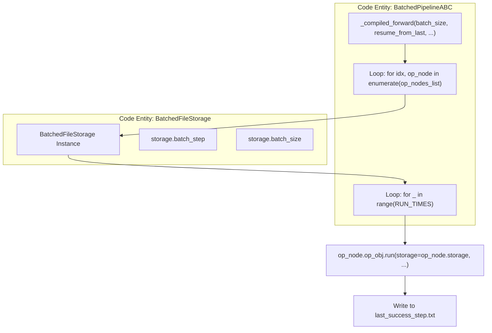
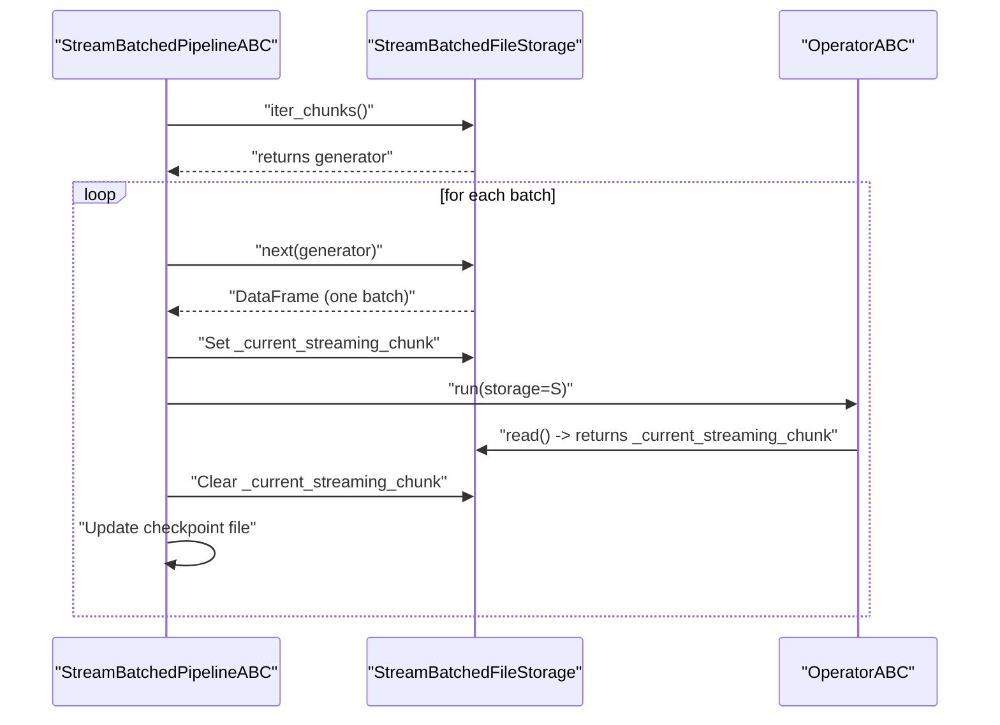
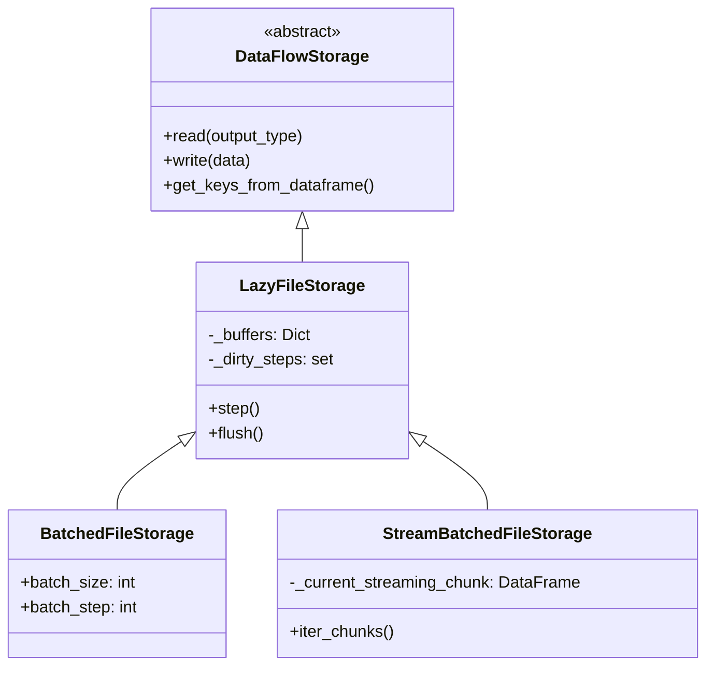
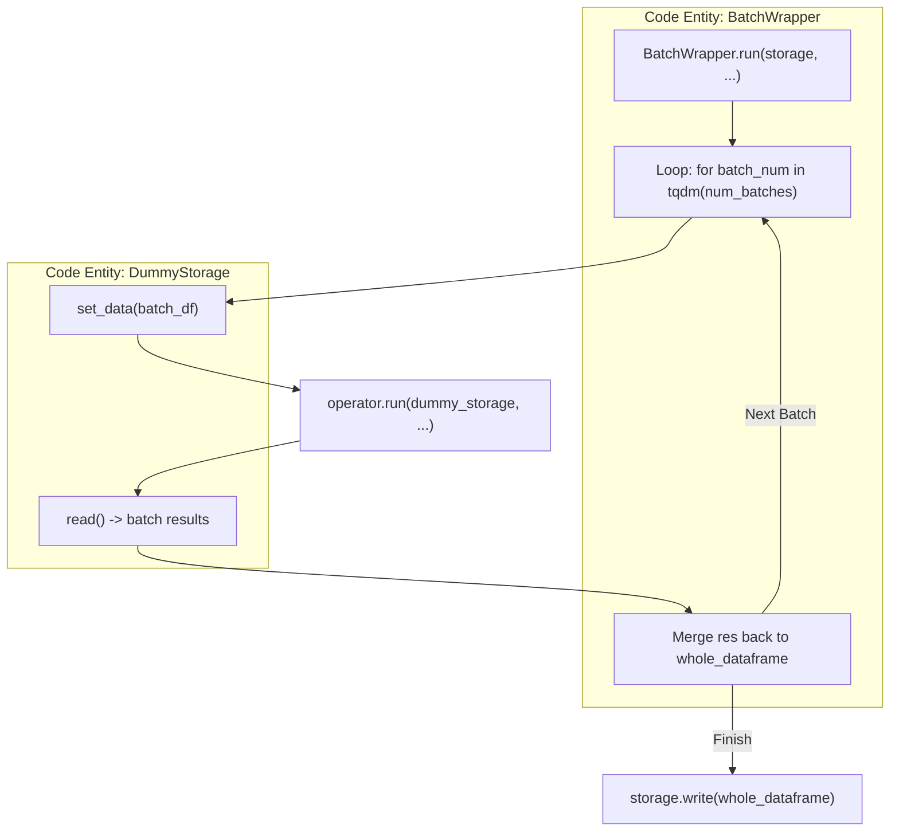

<!-- source: DeepWiki mcp.deepwiki.com · repo OpenDCAI/DataFlow · extra page Batched and Streaming Pipelines · fetched 2026-11-02 -->

# Batched and Streaming Pipelines

Relevant source files

The following files were used as context for generating this wiki page:

- [dataflow/operators/knowledge_cleaning/generate/kbc_chunk_generator.py](dataflow/operators/knowledge_cleaning/generate/kbc_chunk_generator.py)
- [dataflow/operators/knowledge_cleaning/generate/kbc_chunk_generator_batch.py](dataflow/operators/knowledge_cleaning/generate/kbc_chunk_generator_batch.py)
- [dataflow/pipeline/Pipeline.py](dataflow/pipeline/Pipeline.py)
- [dataflow/pipeline/__init__.py](dataflow/pipeline/__init__.py)
- [dataflow/pipeline/nodes.py](dataflow/pipeline/nodes.py)
- [dataflow/utils/storage.py](dataflow/utils/storage.py)
- [dataflow/wrapper/__init__.py](dataflow/wrapper/__init__.py)
- [dataflow/wrapper/batch_wrapper.py](dataflow/wrapper/batch_wrapper.py)
- [test/cpu_only/test_lazy_file_storage_flush.py](test/cpu_only/test_lazy_file_storage_flush.py)
- [test/cpu_only/test_remote_batch_slicing.py](test/cpu_only/test_remote_batch_slicing.py)
- [test/test_batched_pipeline.py](test/test_batched_pipeline.py)
- [test/test_batched_stream_pipeline.py](test/test_batched_stream_pipeline.py)
- [test/test_batchify.py](test/test_batchify.py)
- [test/test_read_xlsx.py](test/test_read_xlsx.py)

## Purpose and Scope

This document describes the batch processing and streaming capabilities of the DataFlow system, focusing on `BatchedPipelineABC` and `StreamBatchedPipelineABC` [dataflow/pipeline/Pipeline.py:1](). These classes leverage specialized storage implementations—`BatchedFileStorage` and `StreamBatchedFileStorage` [dataflow/utils/storage.py:14]()—to enable large-scale data processing with automatic checkpointing and resume mechanisms. For core pipeline architecture, refer to [3.2. Pipeline System]().

Sources: [dataflow/pipeline/Pipeline.py:1](), [dataflow/utils/storage.py:14-164]()

---

## Overview of Batching Architectures

DataFlow provides two primary abstractions for handling datasets that exceed typical memory limits or require resilient execution over long durations.

| Pipeline Class | Associated Storage | Data Handling Strategy |
| :--- | :--- | :--- |
| `BatchedPipelineABC` | `BatchedFileStorage` | Loads full dataset into memory, then slices it into batches for operator processing. |
| `StreamBatchedPipelineABC` | `StreamBatchedFileStorage` | Uses a generator-based streaming approach to load only one batch into memory at a time. |

Sources: [dataflow/pipeline/Pipeline.py:1](), [dataflow/pipeline/__init__.py:1-7]()

---

## BatchedPipelineABC and BatchedFileStorage

`BatchedPipelineABC` inherits from `PipelineABC` [dataflow/pipeline/Pipeline.py:1]() and overrides the `_compiled_forward` method to implement a nested loop: the outer loop iterates through operator nodes, while the inner loop iterates through data batches.

### Data Flow and Checkpointing

The pipeline tracks progress using a local checkpoint file (typically named with the suffix `_last_success_step.txt`). This file stores the current operator index and the current batch index.

Title: Batched Pipeline Execution Flow

Sources: [dataflow/pipeline/Pipeline.py:1](), [test/test_batched_pipeline.py:7-16]()

### Key Functions and Logic

1. **Resume Logic**: Upon calling `forward()`, the pipeline checks `resume_from_last`. If true, it reads the checkpoint file to initialize `resume_step` and `resume_batch` [dataflow/pipeline/Pipeline.py:1]().
2. **Batch Calculation**: The number of iterations (`RUN_TIMES`) is calculated by dividing the total record count by the `batch_size` [dataflow/pipeline/Pipeline.py:1]().
3. **Operator Execution**: For each batch, the pipeline calls the operator's `run` method. The `BatchedFileStorage` ensures that when the operator calls `storage.read()`, it only receives the slice corresponding to the current `batch_step` [dataflow/pipeline/Pipeline.py:1](), [dataflow/utils/storage.py:14-35]().

Sources: [dataflow/pipeline/Pipeline.py:1](), [dataflow/utils/storage.py:14-35](), [test/test_batched_pipeline.py:1-60]()

---

## StreamBatchedPipelineABC and Streaming Logic

`StreamBatchedPipelineABC` is designed for datasets where even the initial full load into a pandas DataFrame is impossible due to memory constraints.

### The Streaming Mechanism

Instead of slicing an in-memory DataFrame, `StreamBatchedPipelineABC` utilizes `StreamBatchedFileStorage.iter_chunks()`, which returns a generator.

Title: Streaming Pipeline Sequence

Sources: [dataflow/pipeline/Pipeline.py:1](), [test/test_batched_stream_pipeline.py:11-20]()

### Implementation Details

* **Memory Efficiency**: The pipeline explicitly sets `op_node.storage._current_streaming_chunk` before calling the operator [dataflow/pipeline/Pipeline.py:1]().
* **Storage Interception**: The `StreamBatchedFileStorage.read()` method is implemented to return this temporary chunk rather than reading from a global buffer, ensuring O(batch_size) memory complexity [dataflow/pipeline/Pipeline.py:1](), [dataflow/utils/storage.py:70-123]().
* **Skipping Batches**: During a resume operation, the pipeline calls `next(data_stream)` repeatedly to advance the generator to the correct `batch_step` without processing the data [dataflow/pipeline/Pipeline.py:1]().

Sources: [dataflow/pipeline/Pipeline.py:1](), [dataflow/utils/storage.py:70-123]()

---

## Resume Mechanisms and Checkpoints

DataFlow implements a robust resume system to handle process interruptions (e.g., OOM, network failure, or manual stop).

### Checkpoint File Format
The checkpoint is a simple text file located in the `cache_path`. It contains a single line with two integers:
`{operator_index},{batch_index}`

### Resume Modes

| Mode | Trigger | Behavior |
| :--- | :--- | :--- |
| **Manual Step** | `resume_step > 0` | Skips all operators before the specified index. Reprocesses all batches for the starting operator [dataflow/pipeline/Pipeline.py:1](). |
| **Auto Resume** | `resume_from_last=True` | Reads the checkpoint file. Skips completed operators and skips completed batches within the current operator [dataflow/pipeline/Pipeline.py:1](). |

Sources: [dataflow/pipeline/Pipeline.py:1](), [test/test_batched_pipeline.py:55-60]()

---

## Storage Class Summary

### LazyFileStorage
While not strictly a batching class, `LazyFileStorage` provides the foundation for persistence [dataflow/utils/storage.py:70-78](). It buffers data in memory and only flushes to disk on process exit (`atexit`) or when `flush()` is called [dataflow/utils/storage.py:74-78](). It supports multiple formats including `json`, `jsonl`, `csv`, `parquet`, and `pickle` [dataflow/utils/storage.py:80-123](). It uses atomic `os.replace` via a temporary file to prevent file corruption [dataflow/utils/storage.py:98-99]().

### Batched and Stream Variants
These classes extend the base storage to manage `batch_size` and `batch_step` state. They are typically initialized within the pipeline's `__init__` method [test/test_batched_pipeline.py:11-16]().

Title: Storage Class Hierarchy and Lifecycle

Sources: [dataflow/utils/storage.py:14-162](), [dataflow/pipeline/Pipeline.py:1-15](), [test/test_batched_stream_pipeline.py:9-15]()

---

## BatchWrapper Utility

For granular control over specific operators within a standard pipeline, DataFlow provides `BatchWrapper` [dataflow/wrapper/batch_wrapper.py:1]().

* **Functionality**: It wraps an operator's `run` method to split input data into smaller chunks before execution [dataflow/wrapper/batch_wrapper.py:1]().
* **Caching**: If `batch_cache` is enabled, it uses `DummyStorage` to cache intermediate batch results [dataflow/wrapper/batch_wrapper.py:1]().
* **Data Reintegration**: After processing a batch, it merges new columns or updated values back into the primary `whole_dataframe` [dataflow/wrapper/batch_wrapper.py:1]().

Title: BatchWrapper Logic Flow

Sources: [dataflow/wrapper/batch_wrapper.py:1](), [dataflow/utils/storage.py:14-35]()

---

