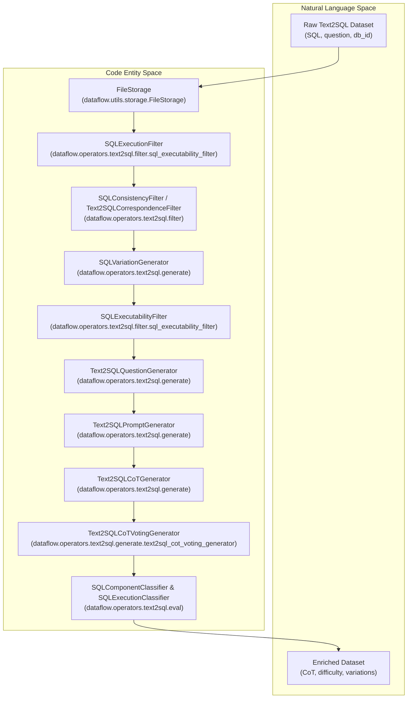
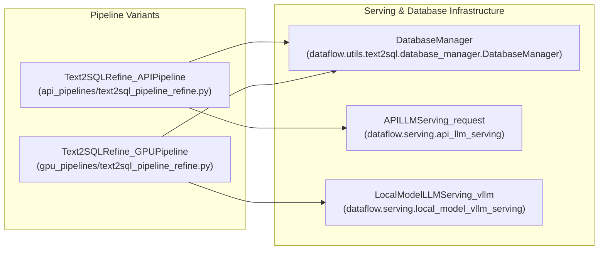

<!-- source: DeepWiki mcp.deepwiki.com · repo OpenDCAI/DataFlow · extra page SQL Refinement Pipeline · fetched 2026-11-02 -->

# SQL Refinement Pipeline

Relevant source files

The following files were used as context for generating this wiki page:

- [dataflow/example/Text2SQLPipeline/empty.jsonl](dataflow/example/Text2SQLPipeline/empty.jsonl)
- [dataflow/example/Text2SQLPipeline/pipeline_refine.jsonl](dataflow/example/Text2SQLPipeline/pipeline_refine.jsonl)
- [dataflow/operators/text2sql/eval/sql_component_classifier.py](dataflow/operators/text2sql/eval/sql_component_classifier.py)
- [dataflow/operators/text2sql/filter/sql_executability_filter.py](dataflow/operators/text2sql/filter/sql_executability_filter.py)
- [dataflow/operators/text2sql/filter/text2sql_correspondence_filter.py](dataflow/operators/text2sql/filter/text2sql_correspondence_filter.py)
- [dataflow/operators/text2sql/generate/text2sql_cot_voting_generator.py](dataflow/operators/text2sql/generate/text2sql_cot_voting_generator.py)
- [dataflow/statics/pipelines/api_pipelines/text2sql_pipeline_gen.py](dataflow/statics/pipelines/api_pipelines/text2sql_pipeline_gen.py)
- [dataflow/statics/pipelines/api_pipelines/text2sql_pipeline_refine.py](dataflow/statics/pipelines/api_pipelines/text2sql_pipeline_refine.py)
- [dataflow/statics/pipelines/cpu_pipelines/text2sql_pipeline.py](dataflow/statics/pipelines/cpu_pipelines/text2sql_pipeline.py)
- [dataflow/statics/pipelines/gpu_pipelines/text2sql_pipeline_gen.py](dataflow/statics/pipelines/gpu_pipelines/text2sql_pipeline_gen.py)
- [dataflow/statics/pipelines/gpu_pipelines/text2sql_pipeline_refine.py](dataflow/statics/pipelines/gpu_pipelines/text2sql_pipeline_refine.py)

## Purpose and Scope

The SQL Refinement Pipeline improves existing Text2SQL datasets by validating, augmenting, and enriching SQL-question pairs. Unlike the SQL Generation Pipeline ([5.3.1]()), which synthesizes new SQL queries from database schemas, the refinement pipeline (`Text2SQLRefine_APIPipeline` and `Text2SQLRefine_GPUPipeline`) takes existing SQL-question pairs and performs rigorous quality checks, generates SQL variations for data augmentation, checks consistency and correspondence, and adds chain-of-thought (CoT) reasoning annotations and difficulty classifiers.

This pipeline is designed for scenarios where you have:
- Existing Text2SQL datasets requiring quality validation and execution filtering.
- SQL queries that need natural language question regeneration and alignment checking.
- Training data requiring augmentation through LLM-guided SQL variations.
- Datasets missing chain-of-thought (CoT) reasoning traces or difficulty classifications.

For vector-enhanced SQL operations, see [5.3.3]().

Sources: `[dataflow/statics/pipelines/api_pipelines/text2sql_pipeline_refine.py:68-183]()`, `[dataflow/statics/pipelines/gpu_pipelines/text2sql_pipeline_refine.py:60-181]()`

## Pipeline Overview and Workflow

The refinement pipeline implements a sequence of operators that filter invalid data, generate semantic variations, validate executability, regenerate questions, and enrich the dataset with reasoning traces.

### Pipeline Architecture & Code Entity Mapping

Sources: `[dataflow/statics/pipelines/api_pipelines/text2sql_pipeline_refine.py:127-182]()`, `[dataflow/statics/pipelines/gpu_pipelines/text2sql_pipeline_refine.py:129-181]()`

## Input Requirements and Storage Setup

The refinement pipeline initializes data persistence using `FileStorage` with `.jsonl` cache support and connects to SQLite or MySQL instances via `DatabaseManager` `[dataflow/statics/pipelines/api_pipelines/text2sql_pipeline_refine.py:86-125]()`.

| Field Name | Data Type | Description | Required |
|------------|-----------|-------------|----------|
| `SQL` | `str` | The target SQL query string to refine | Yes |
| `db_id` | `str` | Database identifier mapping to the schema | Yes |
| `question` | `str` | Natural language question describing the query | Yes |
| `evidence` | `str` | Optional external knowledge context | No |

Sources: `[dataflow/statics/pipelines/api_pipelines/text2sql_pipeline_refine.py:86-125]()`, `[dataflow/statics/pipelines/gpu_pipelines/text2sql_pipeline_refine.py:78-127]()`

## Deployment Variants & Serving Architecture

The refinement pipeline supports both API-based models (`APILLMServing_request`) and local GPU models (`LocalModelLLMServing_vllm`, `LocalModelLLMServing_sglang`).

Sources: `[dataflow/statics/pipelines/api_pipelines/text2sql_pipeline_refine.py:93-125]()`, `[dataflow/statics/pipelines/gpu_pipelines/text2sql_pipeline_refine.py:85-127]()`

## Detailed Operator Walkthrough

### Step 1: Initial Executability & Execution Filtering
Input SQL queries are filtered to verify syntax and execution validity against target database schemas.
- `SQLExecutionFilter`: Executes queries directly using `database_manager.batch_execute_queries`.
- `SQLExecutabilityFilter`: Performs quick `EXPLAIN` analysis via `database_manager.batch_explain_queries` `[dataflow/operators/text2sql/filter/sql_executability_filter.py:74]()`. Both restrict operations to `SELECT` or `WITH` blocks `[dataflow/operators/text2sql/filter/sql_executability_filter.py:27-30]()`.

Sources: `[dataflow/operators/text2sql/filter/sql_executability_filter.py:14-84]()`, `[dataflow/statics/pipelines/api_pipelines/text2sql_pipeline_refine.py:127-129]()`

### Step 2: Consistency & Correspondence Checking
- `Text2SQLCorrespondenceFilter`: Evaluates semantic correspondence between natural language questions and SQL statements using LLM-as-judge prompts (`Text2SQLCorrespondenceFilterPrompt`) `[dataflow/operators/text2sql/filter/text2sql_correspondence_filter.py:17-100]()`. Responses are parsed for confirmation blocks `[dataflow/operators/text2sql/filter/text2sql_correspondence_filter.py:51-61]()`.
- `SQLConsistencyFilter`: Validates logical consistency across generated variations `[dataflow/statics/pipelines/gpu_pipelines/text2sql_pipeline_refine.py:133-137]()`.

Sources: `[dataflow/operators/text2sql/filter/text2sql_correspondence_filter.py:1-123]()`, `[dataflow/statics/pipelines/gpu_pipelines/text2sql_pipeline_refine.py:133-137]()`

### Step 3: SQL Variation Generator
- `SQLVariationGenerator`: Generates syntactic and semantic variations (e.g., `num_variations=3` or `5`) for each SQL entry using `SQLVariationGeneratorPrompt` to augment training data diversity `[dataflow/statics/pipelines/api_pipelines/text2sql_pipeline_refine.py:131-136]()`, `[dataflow/statics/pipelines/gpu_pipelines/text2sql_pipeline_refine.py:139-144]()`.

Sources: `[dataflow/statics/pipelines/api_pipelines/text2sql_pipeline_refine.py:131-136]()`, `[dataflow/statics/pipelines/gpu_pipelines/text2sql_pipeline_refine.py:139-144]()`

### Step 4: Variation Validation
- Secondary execution filtering ensures newly generated SQL variations remain executable before downstream prompt generation `[dataflow/statics/pipelines/api_pipelines/text2sql_pipeline_refine.py:138-140]()`, `[dataflow/statics/pipelines/gpu_pipelines/text2sql_pipeline_refine.py:146-148]()`.

Sources: `[dataflow/statics/pipelines/api_pipelines/text2sql_pipeline_refine.py:138-140]()`, `[dataflow/statics/pipelines/gpu_pipelines/text2sql_pipeline_refine.py:146-148]()`

### Steps 5-6: Question and Prompt Generation
- `Text2SQLQuestionGenerator`: Synthesizes or aligns natural language questions with the refined SQL structures, optionally leveraging `embedding_serving` `[dataflow/statics/pipelines/api_pipelines/text2sql_pipeline_refine.py:142-148]()`.
- `Text2SQLPromptGenerator`: Assembles final model prompts combining database DDL schemas and questions `[dataflow/statics/pipelines/api_pipelines/text2sql_pipeline_refine.py:156-159]()`.

Sources: `[dataflow/statics/pipelines/api_pipelines/text2sql_pipeline_refine.py:142-159]()`, `[dataflow/statics/pipelines/gpu_pipelines/text2sql_pipeline_refine.py:150-161]()`

### Steps 7-8: CoT Generation and Execution-Consistency Voting
- `Text2SQLCoTGenerator`: Produces chain-of-thought reasoning steps for queries `[dataflow/statics/pipelines/api_pipelines/text2sql_pipeline_refine.py:161-165]()`.
- `Text2SQLCoTVotingGenerator`: Executes candidate CoT responses against databases, hashes execution outputs into `frozenset` signatures (`_result_to_signature`), and performs majority voting (`_vote_select`) with tie-breaking (`shortest_sql`) `[dataflow/operators/text2sql/generate/text2sql_cot_voting_generator.py:37-82]()`, `[dataflow/operators/text2sql/generate/text2sql_cot_voting_generator.py:86-91]()`.

Sources: `[dataflow/operators/text2sql/generate/text2sql_cot_voting_generator.py:1-194]()`, `[dataflow/statics/pipelines/api_pipelines/text2sql_pipeline_refine.py:161-169]()`

### Step 9: Difficulty Classification
- `SQLComponentClassifier`: Evaluates query complexity statically via `EvalHardness` parsing keyword counts, joins, and aggregations `[dataflow/operators/text2sql/eval/sql_component_classifier.py:42-57]()`.
- `SQLExecutionClassifier`: Evaluates empirical execution hardness using repeated LLM trials `[dataflow/statics/pipelines/api_pipelines/text2sql_pipeline_refine.py:176-182]()`.

Sources: `[dataflow/operators/text2sql/eval/sql_component_classifier.py:1-210]()`, `[dataflow/statics/pipelines/api_pipelines/text2sql_pipeline_refine.py:171-182]()`

---

