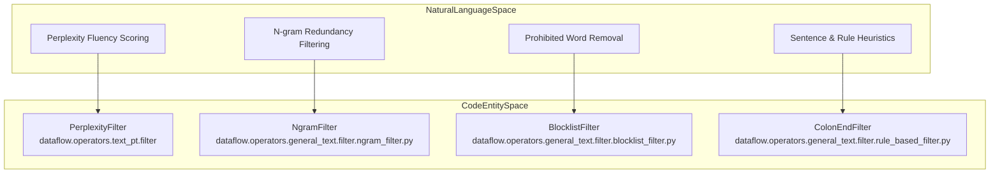
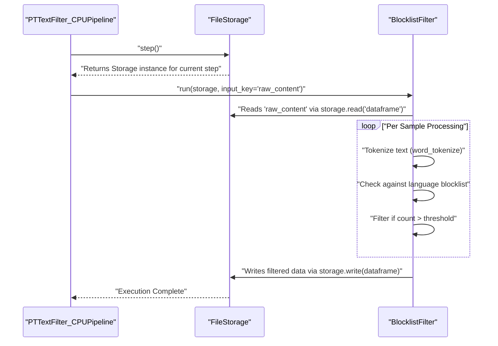

<!-- source: DeepWiki mcp.deepwiki.com · repo OpenDCAI/DataFlow · extra page Text Quality Filtering · fetched 2026-11-02 -->

# Text Quality Filtering

<details>
<summary>Relevant source files</summary>

The following files were used as context for generating this wiki page:

- [dataflow/__init__.py](dataflow/__init__.py)
- [dataflow/operators/general_text/eval/ngram_sample_evaluator.py](dataflow/operators/general_text/eval/ngram_sample_evaluator.py)
- [dataflow/operators/general_text/filter/blocklist_filter.py](dataflow/operators/general_text/filter/blocklist_filter.py)
- [dataflow/operators/general_text/filter/ngram_filter.py](dataflow/operators/general_text/filter/ngram_filter.py)
- [dataflow/operators/general_text/filter/rule_based_filter.py](dataflow/operators/general_text/filter/rule_based_filter.py)
- [dataflow/operators/general_text/refine/remove_stopwords_refiner.py](dataflow/operators/general_text/refine/remove_stopwords_refiner.py)
- [dataflow/operators/text_pt/eval/perplexity_sample_evaluator.py](dataflow/operators/text_pt/eval/perplexity_sample_evaluator.py)
- [dataflow/operators/text_pt/filter/perplexity_filter.py](dataflow/operators/text_pt/filter/perplexity_filter.py)
- [dataflow/operators/text_sft/filter/superfiltering_filter.py](dataflow/operators/text_sft/filter/superfiltering_filter.py)
- [dataflow/statics/pipelines/cpu_pipelines/text_pt_filter.py](dataflow/statics/pipelines/cpu_pipelines/text_pt_filter.py)
- [dataflow/statics/pipelines/cpu_pipelines/text_sft_filter.py](dataflow/statics/pipelines/cpu_pipelines/text_sft_filter.py)
- [dataflow/statics/pipelines/gpu_pipelines/text_pt_filter.py](dataflow/statics/pipelines/gpu_pipelines/text_pt_filter.py)
- [dataflow/statics/pipelines/gpu_pipelines/text_pt_synthetic.py](dataflow/statics/pipelines/gpu_pipelines/text_pt_synthetic.py)
- [dataflow/statics/pipelines/gpu_pipelines/text_sft_filter.py](dataflow/statics/pipelines/gpu_pipelines/text_sft_filter.py)
- [dataflow/statics/pipelines/gpu_pipelines/text_sft_synthetic.py](dataflow/statics/pipelines/gpu_pipelines/text_sft_synthetic.py)
- [dataflow/utils/__init__.py](dataflow/utils/__init__.py)
- [dataflow/utils/utils.py](dataflow/utils/utils.py)
- [test/cpu_only/test_ngram_sample_evaluator.py](test/cpu_only/test_ngram_sample_evaluator.py)

</details>


## Purpose and Scope

This page documents the text quality filtering operators in `dataflow`, which assess and filter text data based on various quality metrics. Text quality filtering removes low-quality samples from datasets to ensure only high-quality text is used for Supervised Fine-Tuning (SFT) or Pre-Training (PT) data preparation.

The framework provides specialized text quality filtering operators:
- **PerplexityFilter**: Language model-based fluency scoring for pre-training data [dataflow/operators/text_pt/filter/perplexity_filter.py:1-1]().
- **AlpagasusFilter**: LLM-based quality scoring using critique models for SFT data, implemented via `AlpagasusSampleEvaluator` [dataflow/operators/text_sft/eval/alpagasus_sample_evaluator.py:14-15]().
- **SuperfilteringFilter**: Cross-entropy based filtering for instruction data, implemented in `SuperfilteringFilter` [dataflow/operators/text_sft/filter/superfiltering_filter.py:5-6]().
- **DeitaQualityFilter**: Scoring based on the DEITA framework for data selection [dataflow/statics/pipelines/gpu_pipelines/text_sft_filter.py:32-37]().
- **NgramFilter**: Evaluates text redundancy via n-gram repetition ratios using `NgramSampleEvaluator` [dataflow/operators/general_text/filter/ngram_filter.py:9-17](), [dataflow/operators/general_text/eval/ngram_sample_evaluator.py:16-16]().
- **Rule-based Filters**: A suite of heuristic filters (e.g., `ColonEndFilter`, `SentenceNumberFilter`, `BlocklistFilter`) for structural and content quality [dataflow/operators/general_text/filter/rule_based_filter.py:12-66](), [dataflow/operators/general_text/filter/blocklist_filter.py:13-13]().

Sources: [dataflow/operators/general_text/filter/rule_based_filter.py:12-66](), [dataflow/statics/pipelines/gpu_pipelines/text_sft_filter.py:32-37](), [dataflow/operators/text_sft/eval/alpagasus_sample_evaluator.py:14-15](), [dataflow/operators/general_text/filter/blocklist_filter.py:13-13](), [dataflow/operators/general_text/filter/ngram_filter.py:9-17](), [dataflow/operators/general_text/eval/ngram_sample_evaluator.py:16-16]()

---

## Overview

Text quality filtering in DataFlow uses operators inheriting from `OperatorABC` [dataflow/core/operator_abc.py:1-1] (referenced via [dataflow/operators/general_text/filter/rule_based_filter.py:1-1]()). Each operator computes quality metrics and filters samples below configurable thresholds. The filtering system integrates with storage via `storage.step()`, enabling incremental processing and automatic caching [dataflow/statics/pipelines/gpu_pipelines/text_sft_synthetic.py:106-118]().

### Natural Language Space to Code Entity Mapping: Quality Filtering Suite



**Diagram: Bridging Natural Language Filtering Concepts to Code Entities**

Sources: [dataflow/operators/general_text/filter/ngram_filter.py:9-17](), [dataflow/operators/general_text/filter/blocklist_filter.py:13-20](), [dataflow/operators/general_text/filter/rule_based_filter.py:12-47]()

---

## Common Filtering Patterns

Filtering operators follow consistent execution patterns. The standard approach initializes a storage backend and an operator, then invokes `run()` inside a pipeline's `forward()` method [dataflow/statics/pipelines/cpu_pipelines/text_pt_filter.py:32-68](), [dataflow/statics/pipelines/gpu_pipelines/text_pt_filter.py:1-1]().

### Natural Language Space to Code Entity Mapping: Evaluation Execution

```mermaid
graph TB
    subgraph "NaturalLanguageSpace"
        NL_Pipeline[""Pipeline Execution Step""]
        NL_Evaluation[""Sample Scoring & Filtering""]
        NL_Persistence[""Cache Storage Write""]
    end

    subgraph "CodeEntitySpace"
        PipelineClass[""PTTextFilter_CPUPipeline.forward()<br/>dataflow.statics.pipelines.cpu_pipelines.text_pt_filter""]
        EvaluatorClass[""NgramSampleEvaluator._score_func()<br/>dataflow.operators.general_text.eval.ngram_sample_evaluator.py""]
        StorageClass[""FileStorage.write()<br/>dataflow.utils.storage""]
    end

    NL_Pipeline --> PipelineClass
    NL_Evaluation --> EvaluatorClass
    NL_Persistence --> StorageClass
```

**Diagram: Pipeline Execution Mapping to Code Entities**

Sources: [dataflow/statics/pipelines/cpu_pipelines/text_pt_filter.py:64-160](), [dataflow/operators/general_text/eval/ngram_sample_evaluator.py:52-85]()

### Storage-Based Execution Flow



**Diagram: Data Flow from Storage to Model Evaluation**

Sources: [dataflow/statics/pipelines/cpu_pipelines/text_pt_filter.py:32-40](), [dataflow/operators/general_text/filter/blocklist_filter.py:76-97]()

Sources: [dataflow/statics/pipelines/cpu_pipelines/text_pt_filter.py:32-160](), [dataflow/operators/general_text/filter/blocklist_filter.py:76-97]()

---

## PerplexityFilter

The `PerplexityFilter` evaluates text fluency using language model perplexity via `PerplexitySampleEvaluator` [dataflow/operators/text_pt/filter/perplexity_filter.py:1-1](), [dataflow/operators/text_pt/eval/perplexity_sample_evaluator.py:1-1](). It is primarily used for filtering Pre-Training (PT) data to remove noisy or non-linguistic content.

Sources: [dataflow/operators/text_pt/filter/perplexity_filter.py:1-1](), [dataflow/operators/text_pt/eval/perplexity_sample_evaluator.py:1-1]()

---

## SFT Quality Filters

SFT data requires instruction-specific quality evaluation beyond simple fluency.

### AlpagasusFilter
The `AlpagasusSampleEvaluator` uses an `LLMServingABC` instance to score the quality of instruction-response pairs [dataflow/operators/text_sft/eval/alpagasus_sample_evaluator.py:14-22](). It constructs system prompts using `AlpagasusPrompt` to evaluate dimensions like response quality via LLM critique.

### SuperfilteringFilter
The `SuperfilteringFilter` selects informative instruction-tuning data based on cross-entropy metrics [dataflow/operators/text_sft/filter/superfiltering_filter.py:5-6](). In pipelines, it processes instruction and output keys [dataflow/statics/pipelines/gpu_pipelines/text_sft_filter.py:46-51]().

### DeitaQualityFilter
This filter scores data based on the DEITA framework, evaluating instruction-following quality [dataflow/statics/pipelines/gpu_pipelines/text_sft_filter.py:32-37](). It is configured with parameters such as `min_score`, `max_score`, and `max_length` [dataflow/statics/pipelines/gpu_pipelines/text_sft_filter.py:32-37]().

Sources: [dataflow/operators/text_sft/eval/alpagasus_sample_evaluator.py:14-22](), [dataflow/statics/pipelines/gpu_pipelines/text_sft_filter.py:27-57](), [dataflow/operators/text_sft/filter/superfiltering_filter.py:5-6]()

---

## Ngram Redundancy Filtering

The `NgramFilter` evaluates text redundancy and repetition ratios by leveraging `NgramSampleEvaluator` [dataflow/operators/general_text/filter/ngram_filter.py:9-17](). It calculates n-gram repetition scores ranging from 0 to 1 (where higher scores represent less repetition and lower redundancy) and filters out samples falling outside the specified `min_score` and `max_score` bounds [dataflow/operators/general_text/filter/ngram_filter.py:11-54]().

Key configuration options in `NgramSampleEvaluator`:
- `ngrams`: Integer specifying the n-gram window size (default is `5`) [dataflow/operators/general_text/eval/ngram_sample_evaluator.py:18-18]().
- `language`: Mode selection (`'zh'` for character-level splitting, `'en'` for whitespace word-level splitting, or `'auto'` for automatic Han character detection via `_HAN_CHARACTER_PATTERN`) [dataflow/operators/general_text/eval/ngram_sample_evaluator.py:10-24]().

Sources: [dataflow/operators/general_text/filter/ngram_filter.py:9-57](), [dataflow/operators/general_text/eval/ngram_sample_evaluator.py:10-91]()

---

## Rule-Based Heuristic Filters

DataFlow includes a comprehensive set of rule-based filters in `dataflow.operators.general_text.filter` for initial text cleaning:

- **ColonEndFilter**: Checks if text ends with a colon, identifying incomplete segments [dataflow/operators/general_text/filter/rule_based_filter.py:12-45]().
- **SentenceNumberFilter**: Filters based on sentence counts identified using regular expression matching `\b[^.!?\n]+[.!?]*` [dataflow/operators/general_text/filter/rule_based_filter.py:66-116]().
- **BlocklistFilter**: Removes samples containing forbidden words loaded from language-specific blocklist files (e.g., `en.txt`) [dataflow/operators/general_text/filter/blocklist_filter.py:13-74](). It supports `word_tokenize` or simple space splitting [dataflow/operators/general_text/filter/blocklist_filter.py:84-87]().
- **WordNumberFilter**: Ensures text length falls within a specific word count range [dataflow/statics/pipelines/cpu_pipelines/text_pt_filter.py:45-45]().
- **QuratingFilter**: Used in PT pipelines to filter based on dimensions like `writing_style`, `required_expertise`, `facts_and_trivia`, or `educational_value` [dataflow/statics/pipelines/gpu_pipelines/text_pt_synthetic.py:92-92]().
- **LanguageFilter**: Filters text based on language detection, allowing specific labels like `__label__eng_Latn` [dataflow/statics/pipelines/gpu_pipelines/text_sft_synthetic.py:62-62]().

Sources: [dataflow/operators/general_text/filter/rule_based_filter.py:12-128](), [dataflow/operators/general_text/filter/blocklist_filter.py:13-97](), [dataflow/statics/pipelines/gpu_pipelines/text_pt_synthetic.py:92-92](), [dataflow/statics/pipelines/gpu_pipelines/text_sft_synthetic.py:62-62]()

---

## Refiners for Quality Improvement

In addition to filtering, DataFlow provides Refiners that modify text to improve its quality before or during the filtering process.

| Refiner Class | Purpose | Code Reference |
|---------------|---------|----------------|
| `RemoveEmojiRefiner` | Removes emoji characters from the text. | [dataflow/statics/pipelines/cpu_pipelines/text_pt_filter.py:23-23]() |
| `HtmlUrlRemoverRefiner` | Strips HTML tags and URLs from the content. | [dataflow/statics/pipelines/cpu_pipelines/text_pt_filter.py:22-22]() |
| `RemoveExtraSpacesRefiner` | Normalizes whitespace by removing redundant spaces. | [dataflow/statics/pipelines/cpu_pipelines/text_pt_filter.py:24-24]() |
| `RemoveStopwordsRefiner` | Removes high-frequency English stopwords using NLTK's `stopwords` corpus. | [dataflow/operators/general_text/refine/remove_stopwords_refiner.py:11-30]() |

Sources: [dataflow/statics/pipelines/cpu_pipelines/text_pt_filter.py:22-24](), [dataflow/operators/general_text/refine/remove_stopwords_refiner.py:11-30]()

---

## Usage in Pipelines

Filtering tasks are organized into CPU-intensive (rule-based) and GPU-intensive (model-based) stages.

### Pipeline Initialization

The `FileStorage` object manages the lifecycle of data as it moves through various filters, using `step()` to increment the cache file index [dataflow/statics/pipelines/cpu_pipelines/text_pt_filter.py:34-39](), [dataflow/statics/pipelines/gpu_pipelines/text_sft_synthetic.py:40-45]().

```python
# From dataflow/statics/pipelines/cpu_pipelines/text_pt_filter.py
self.storage = FileStorage(
    first_entry_file_name="../example_data/GeneralTextPipeline/pt_input.jsonl",
    cache_path="./cache",
    file_name_prefix="dataflow_cache_step",
    cache_type="jsonl",
)
```

### Execution Flow

When `run()` is invoked, the operator reads from the current storage step and writes filtered results to a new cache file [dataflow/statics/pipelines/cpu_pipelines/text_pt_filter.py:64-156]().

1. **Refiners**: Remove emojis, HTML tags, and extra spaces via refiner classes [dataflow/statics/pipelines/cpu_pipelines/text_pt_filter.py:65-76]().
2. **Heuristic Filters**: Apply rule-based filters such as `BlocklistFilter`, `WordNumberFilter`, and `SentenceNumberFilter` [dataflow/statics/pipelines/cpu_pipelines/text_pt_filter.py:77-96]().
3. **Model Filters (GPU)**: Execute deep semantic quality checks via `SuperfilteringFilter` or `DeitaQualityFilter` in GPU pipelines [dataflow/statics/pipelines/gpu_pipelines/text_sft_filter.py:46-57]().

Sources: [dataflow/statics/pipelines/cpu_pipelines/text_pt_filter.py:32-160](), [dataflow/statics/pipelines/gpu_pipelines/text_sft_filter.py:11-62](), [dataflow/statics/pipelines/gpu_pipelines/text_sft_synthetic.py:106-190]()

---

