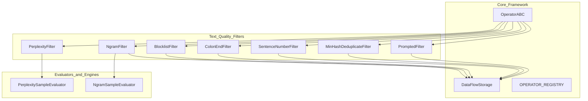
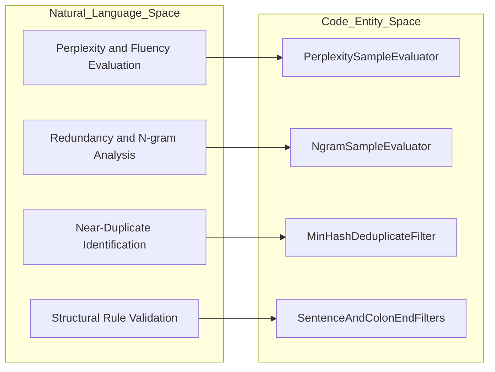
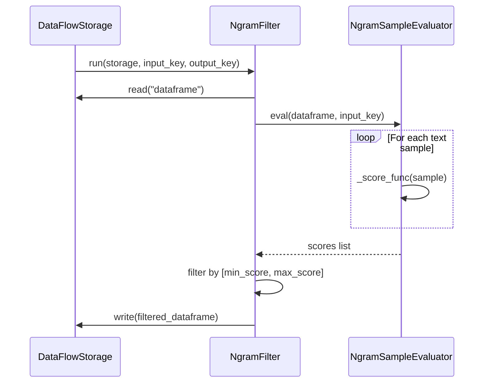

<!-- source: DeepWiki mcp.deepwiki.com · repo OpenDCAI/DataFlow · extra page Text Quality Filters · fetched 2026-11-02 -->

# Text Quality Filters

Relevant source files

The following files were used as context for generating this wiki page:

- [dataflow/__init__.py](dataflow/__init__.py)
- [dataflow/operators/general_text/eval/ngram_sample_evaluator.py](dataflow/operators/general_text/eval/ngram_sample_evaluator.py)
- [dataflow/operators/general_text/filter/blocklist_filter.py](dataflow/operators/general_text/filter/blocklist_filter.py)
- [dataflow/operators/general_text/filter/minhash_deduplicate_filter.py](dataflow/operators/general_text/filter/minhash_deduplicate_filter.py)
- [dataflow/operators/general_text/filter/ngram_filter.py](dataflow/operators/general_text/filter/ngram_filter.py)
- [dataflow/operators/general_text/filter/rule_based_filter.py](dataflow/operators/general_text/filter/rule_based_filter.py)
- [dataflow/operators/general_text/refine/remove_stopwords_refiner.py](dataflow/operators/general_text/refine/remove_stopwords_refiner.py)
- [dataflow/operators/text_pt/eval/perplexity_sample_evaluator.py](dataflow/operators/text_pt/eval/perplexity_sample_evaluator.py)
- [dataflow/operators/text_pt/filter/perplexity_filter.py](dataflow/operators/text_pt/filter/perplexity_filter.py)
- [dataflow/utils/__init__.py](dataflow/utils/__init__.py)
- [dataflow/utils/utils.py](dataflow/utils/utils.py)
- [test/cpu_only/test_minhash_short_texts.py](test/cpu_only/test_minhash_short_texts.py)
- [test/cpu_only/test_ngram_sample_evaluator.py](test/cpu_only/test_ngram_sample_evaluator.py)

## Purpose and Scope

This page documents the text quality filter operators in DataFlow that evaluate and filter text content based on quality metrics, complexity, and redundancy [dataflow/operators/text_pt/filter/perplexity_filter.py:9-42](). These operators are essential for preparing high-quality Pre-training (PT) and Supervised Fine-Tuning (SFT) datasets.

Text quality filters serve three primary purposes:
1. **Filtering**: Removing low-quality samples (e.g., noisy, toxic, or non-fluent text) based on specific thresholds [dataflow/operators/text_pt/filter/perplexity_filter.py:53-56]().
2. **Deduplication**: Eliminating redundant information to improve training efficiency using algorithms like MinHash or N-gram ratios [dataflow/operators/general_text/eval/ngram_sample_evaluator.py:37-45](), [dataflow/operators/general_text/filter/minhash_deduplicate_filter.py:9-43]().
3. **Complexity and Quality Assessment**: Identifying high-value instructions for SFT using model-based scoring, Instruction-Following Difficulty (IFD), or diversity metrics [dataflow/operators/core_text/filter/prompted_filter.py:11-78]().

Sources: [dataflow/operators/text_pt/filter/perplexity_filter.py:9-42](), [dataflow/operators/general_text/eval/ngram_sample_evaluator.py:37-45](), [dataflow/operators/general_text/filter/minhash_deduplicate_filter.py:9-43](), [dataflow/operators/core_text/filter/prompted_filter.py:11-78]()

## Overview of Quality Filters

DataFlow provides a comprehensive suite of filters categorized by their underlying logic.

| Filter Category | Key Operators | Logic / Implementation | Primary Use Case |
|:---|:---|:---|:---|
| **Statistical** | `PerplexityFilter` | Causal LM perplexity (e.g., GPT-2) via `PerplexitySampleEvaluator` | Fluency assessment [dataflow/operators/text_pt/filter/perplexity_filter.py:10-15]() |
| **Model-Based** | `SuperfilteringFilter`, `DeitaQualityFilter`, `RMFilter`, `AlpagasusFilter`, `PromptedFilter` | Model-based scoring for instruction quality, reward values, and complexity | SFT data selection [dataflow/operators/core_text/filter/prompted_filter.py:11-78]() |
| **Rule-Based** | `ColonEndFilter`, `SentenceNumberFilter`, `WordNumberFilter` | Regex and string heuristics | Filtering incomplete or sensitive text [dataflow/operators/general_text/filter/rule_based_filter.py:12-103]() |
| **Heuristic** | `BlocklistFilter`, `NgramFilter` | Word lists, N-gram repetition ratios, and fasttext detection | Toxic content removal and redundancy cleaning [dataflow/operators/general_text/filter/blocklist_filter.py:13-65](), [dataflow/operators/general_text/filter/ngram_filter.py:9-18]() |
| **Deduplication** | `MinHashDeduplicateFilter` | LSH-based similarity filtering | Removing near-duplicate documents [dataflow/operators/general_text/filter/minhash_deduplicate_filter.py:9-43]() |
| **Refiners** | `RemoveStopwordsRefiner` | In-place text cleaning | Pre-filtering noise reduction [dataflow/operators/general_text/refine/remove_stopwords_refiner.py:11-30]() |

Sources: [dataflow/operators/text_pt/filter/perplexity_filter.py:10-15](), [dataflow/operators/core_text/filter/prompted_filter.py:11-78](), [dataflow/operators/general_text/filter/rule_based_filter.py:12-103](), [dataflow/operators/general_text/filter/blocklist_filter.py:13-65](), [dataflow/operators/general_text/filter/ngram_filter.py:9-18](), [dataflow/operators/general_text/filter/minhash_deduplicate_filter.py:9-43](), [dataflow/operators/general_text/refine/remove_stopwords_refiner.py:11-30]()

## Filter System Architecture

The following diagram maps natural language filtering requirements to concrete code entities in the DataFlow framework.

### Filter Entity Mapping

Sources: [dataflow/operators/text_pt/filter/perplexity_filter.py:9-14](), [dataflow/operators/general_text/filter/ngram_filter.py:9-17](), [dataflow/operators/general_text/eval/ngram_sample_evaluator.py:11-21](), [dataflow/operators/core_text/filter/prompted_filter.py:10-21](), [dataflow/operators/general_text/filter/rule_based_filter.py:11-125](), [dataflow/operators/general_text/filter/minhash_deduplicate_filter.py:8-16]()

### Natural Language Space to Code Entity Association

Sources: [dataflow/operators/text_pt/eval/perplexity_sample_evaluator.py:10-72](), [dataflow/operators/general_text/eval/ngram_sample_evaluator.py:16-86](), [dataflow/operators/general_text/filter/minhash_deduplicate_filter.py:9-57](), [dataflow/operators/general_text/filter/rule_based_filter.py:12-117]()

## Detailed Quality Filters

### SuperfilteringFilter and AlpagasusFilter
`SuperfilteringFilter` and `AlpagasusFilter` are utilized for SFT data selection. They compute instruction-following difficulty or model-based quality metrics to isolate high-value samples.
- **Parameters**: `min_score` and `max_score` define the score threshold range.
- **Usage**: Applied in pipelines following initial length or format checks to prioritize informative instruction tuning data.

Sources: [dataflow/operators/core_text/filter/prompted_filter.py:11-78]()

### DeitaQualityFilter and RMFilter
These filters assess instruction-output pair quality or reward scores via reward models (`RMFilter`) or DEITA framework evaluators (`DeitaQualityFilter`).
- **Implementation**: They assign scalar quality or reward values to samples to measure instruction-response alignment.

Sources: [dataflow/operators/core_text/filter/prompted_filter.py:11-78]()

### PerplexityFilter
The `PerplexityFilter` utilizes `PerplexitySampleEvaluator` to measure text fluency via causal language models (such as `gpt2`) [dataflow/operators/text_pt/filter/perplexity_filter.py:10-15](), [dataflow/operators/text_pt/eval/perplexity_sample_evaluator.py:11-20]().
- **Logic**: Computes the exponential of average negative log-likelihood across sequence tokens [dataflow/operators/text_pt/eval/perplexity_sample_evaluator.py:61-72]().
- **Parameters**: `model_name`, `device`, `min_score`, and `max_score` configure model execution and filtering range [dataflow/operators/text_pt/eval/perplexity_sample_evaluator.py:11-16]().

Sources: [dataflow/operators/text_pt/filter/perplexity_filter.py:10-15](), [dataflow/operators/text_pt/eval/perplexity_sample_evaluator.py:11-72]()

### NgramFilter and Evaluator
The `NgramFilter` invokes `NgramSampleEvaluator` to compute repetition scores ranging from `0.0` to `1.0` [dataflow/operators/general_text/eval/ngram_sample_evaluator.py:37-45](). Higher scores indicate reduced repetition and greater originality.
- **Logic**: Generates n-grams (default 5) and computes the ratio of unique n-grams to total n-grams [dataflow/operators/general_text/eval/ngram_sample_evaluator.py:72-84]().
- **Language Support**: Supports character-level splitting for Chinese (`zh`), whitespace splitting for English (`en`), and `auto` mode which detects Han characters via `_HAN_CHARACTER_PATTERN` [dataflow/operators/general_text/eval/ngram_sample_evaluator.py:10-64](), [test/cpu_only/test_ngram_sample_evaluator.py:9-12]().

Sources: [dataflow/operators/general_text/eval/ngram_sample_evaluator.py:10-84](), [test/cpu_only/test_ngram_sample_evaluator.py:9-12](), [dataflow/operators/general_text/filter/ngram_filter.py:9-57]()

### PromptedFilter
`PromptedFilter` leverages `PromptedEvaluator` to assign numeric scores to input text via LLM serving, filtering items whose scores fall outside `[min_score, max_score]` [dataflow/operators/core_text/filter/prompted_filter.py:11-78]().
- **Runtime**: Validates non-empty content, executes scoring, and writes filtered data to storage [dataflow/operators/core_text/filter/prompted_filter.py:81-102]().

Sources: [dataflow/operators/core_text/filter/prompted_filter.py:11-102]()

## Implementation Details: Blocklist, Rule Filters, and MinHash

### BlocklistFilter
This operator loads language-specific text files containing forbidden terms from the directory specified by `DataFlowPath.get_dataflow_dir()` [dataflow/operators/general_text/filter/blocklist_filter.py:67-74]().
- **Tokenization**: Optional NLTK word tokenization (`nltk.word_tokenize`) when `use_tokenizer` is enabled [dataflow/operators/general_text/filter/blocklist_filter.py:84-85]().
- **Matching**: Counts occurrences and retains rows where `blocklist_count <= threshold` [dataflow/operators/general_text/filter/blocklist_filter.py:88-89]().

Sources: [dataflow/operators/general_text/filter/blocklist_filter.py:13-97]()

### SentenceNumberFilter
Uses a pre-compiled regular expression `SENT_PATTERN = re.compile(r'\b[^.!?\n]+[.!?]*', flags=re.UNICODE)` to segment text into sentences and verify that sentence counts fall within `[min_sentences, max_sentences]` [dataflow/operators/general_text/filter/rule_based_filter.py:112-117]().

Sources: [dataflow/operators/general_text/filter/rule_based_filter.py:66-128]()

### ColonEndFilter
Inspects whether text strings terminate with a colon (`:`), commonly used to filter out truncated or incomplete prompt questions [dataflow/operators/general_text/filter/rule_based_filter.py:12-63]().

Sources: [dataflow/operators/general_text/filter/rule_based_filter.py:12-63]()

### MinHashDeduplicateFilter
Performs efficient near-duplicate detection using `MinHash` and `MinHashLSH` from `datasketch` [dataflow/operators/general_text/filter/minhash_deduplicate_filter.py:9-43]().
- **Signature Generation**: `create_minhash` builds shingles from n-grams (`use_n_gram=True`) or raw character sequences and updates MinHash permutations [dataflow/operators/general_text/filter/minhash_deduplicate_filter.py:45-57]().
- **LSH Session**: Queries the LSH index inside an `insertion_session()`, retaining items with no matching neighbors (`len(result) == 0`) [dataflow/operators/general_text/filter/minhash_deduplicate_filter.py:76-88]().

Sources: [dataflow/operators/general_text/filter/minhash_deduplicate_filter.py:9-93]()

### RemoveStopwordsRefiner
Modifies text in place by eliminating English stopwords utilizing the NLTK `stopwords` corpus [dataflow/operators/general_text/refine/remove_stopwords_refiner.py:26-30](). It updates the DataFrame column and returns the modified key list [dataflow/operators/general_text/refine/remove_stopwords_refiner.py:81-84]().

Sources: [dataflow/operators/general_text/refine/remove_stopwords_refiner.py:11-84]()

## Data Flow: Pipeline Execution

The following sequence diagram illustrates how filter operators interact with evaluators and the storage layer during execution.

### Filter Execution Sequence

Sources: [dataflow/operators/general_text/filter/ngram_filter.py:47-56](), [dataflow/operators/general_text/eval/ngram_sample_evaluator.py:87-99]()

---

