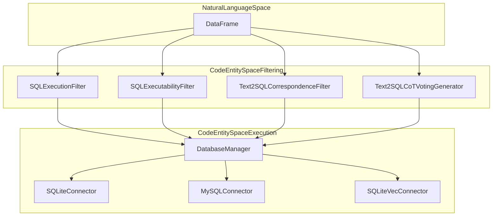
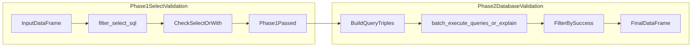
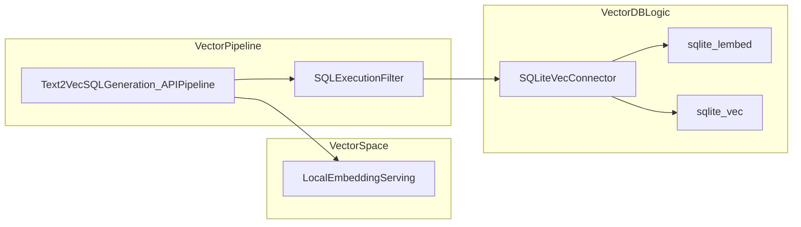

<!-- source: DeepWiki mcp.deepwiki.com · repo OpenDCAI/DataFlow · extra page Text2SQL Filter Operators · fetched 2026-11-02 -->

# Text2SQL Filter Operators

Relevant source files

The following files were used as context for generating this wiki page:

- [dataflow/operators/text2sql/eval/sql_execution_classifier.py](dataflow/operators/text2sql/eval/sql_execution_classifier.py)
- [dataflow/operators/text2sql/filter/sql_executability_filter.py](dataflow/operators/text2sql/filter/sql_executability_filter.py)
- [dataflow/operators/text2sql/filter/sql_execution_filter.py](dataflow/operators/text2sql/filter/sql_execution_filter.py)
- [dataflow/operators/text2sql/filter/text2sql_correspondence_filter.py](dataflow/operators/text2sql/filter/text2sql_correspondence_filter.py)
- [dataflow/operators/text2sql/generate/text2sql_cot_voting_generator.py](dataflow/operators/text2sql/generate/text2sql_cot_voting_generator.py)
- [dataflow/statics/pipelines/api_pipelines/text2vecsql_pipeline_gen.py](dataflow/statics/pipelines/api_pipelines/text2vecsql_pipeline_gen.py)
- [dataflow/utils/text2sql/database_connector/sqlite_vec_connector.py](dataflow/utils/text2sql/database_connector/sqlite_vec_connector.py)

Text2SQL filter operators validate and refine SQL queries generated for Text-to-SQL tasks. These operators remove invalid, non-executable, or semantically incorrect SQL statements from the data pipeline, ensuring only high-quality training data progresses through the workflow.

For information about Text2SQL generation operators, see [6.1.1 Text2SQL Generation Operators](). For evaluation operators that classify SQL difficulty, see [6.3.1 SQL Classification Operators]().

## Overview

Filter operators in the Text2SQL pipeline serve three primary validation functions:

| Filter Type | Purpose | LLM Required | Database Required |
|-------------|---------|--------------|-------------------|
| **Execution Filters** | Verify SQL syntactic correctness and executability | No | Yes |
| **Correspondence Filters** | Validate semantic alignment between question and SQL | Yes | Yes |
| **Consistency Filters** | Check result consistency across SQL variations or voting | No/Yes | Yes |

All Text2SQL filter operators integrate with `DatabaseManager` to execute queries and compare results. LLM-based filters additionally use `LLMServingABC` implementations to perform semantic evaluation.

Sources: [dataflow/operators/text2sql/filter/sql_execution_filter.py:13-15](), [dataflow/operators/text2sql/filter/text2sql_correspondence_filter.py:17-21]()

---

## Filter Operator Architecture

The following diagram illustrates the flow from natural language questions and generated SQL into the filtering logic, highlighting the interaction between the operator classes and the database management layer, bridging Natural Language Space to Code Entity Space.

**Diagram: Text2SQL Filtering Logic to Database Engine Mapping**

Sources: [dataflow/operators/text2sql/filter/sql_execution_filter.py:84-84](), [dataflow/operators/text2sql/filter/sql_executability_filter.py:74-74](), [dataflow/operators/text2sql/filter/text2sql_correspondence_filter.py:95-97](), [dataflow/operators/text2sql/generate/text2sql_cot_voting_generator.py:160-160]()

---

## SQLExecutionFilter and SQLExecutabilityFilter

`SQLExecutionFilter` and `SQLExecutabilityFilter` validate SQL queries by attempting execution or explanation against the target database. They remove queries that fail due to syntax errors or invalid references.

### Implementation Logic

**Diagram: SQL Filtering Multi-Phase Logic**

- **SQLExecutionFilter`: Actually runs the query against the database using `batch_execute_queries` and requires `exec_result.success` to be true for the item to pass [dataflow/operators/text2sql/filter/sql_execution_filter.py:84-89]().
- **SQLExecutabilityFilter**: Uses `batch_explain_queries` which is often faster as it only checks if the query plan can be generated (syntax and schema check) via SQLite explain plans without full execution [dataflow/operators/text2sql/filter/sql_executability_filter.py:74-76]().

Both filters include a `filter_select_sql` method that uses regex to strip comments (`/\*...\*/` and `--`) and verifies that the remaining query begins with `SELECT` or `WITH` [dataflow/operators/text2sql/filter/sql_execution_filter.py:37-48](), [dataflow/operators/text2sql/filter/sql_executability_filter.py:19-30]().

Sources: [dataflow/operators/text2sql/filter/sql_execution_filter.py:37-48](), [dataflow/operators/text2sql/filter/sql_executability_filter.py:19-30](), [dataflow/operators/text2sql/filter/sql_execution_filter.py:84-89]()

---

## Text2SQLCorrespondenceFilter

This operator uses an LLM via `LLMServingABC` to verify if a generated SQL query semantically matches the natural language question, given the database schema.

### Workflow
1. **Schema Retrieval**: It fetches `CREATE TABLE` statements for the specific `db_id` via `DatabaseManager.get_create_statements_and_insert_statements()` [dataflow/operators/text2sql/filter/text2sql_correspondence_filter.py:95-97]().
2. **Prompt Construction**: It builds a prompt using `Text2SQLCorrespondenceFilterPrompt` including the question, SQL, and schema details [dataflow/operators/text2sql/filter/text2sql_correspondence_filter.py:100-101]().
3. **LLM Inference**: The LLM evaluates whether the SQL corresponds to the question [dataflow/operators/text2sql/filter/text2sql_correspondence_filter.py:103-103]().
4. **Response Parsing**: The `_parse_consistency_response` method looks for a "yes" indicator within code blocks in the LLM response [dataflow/operators/text2sql/filter/text2sql_correspondence_filter.py:51-61]().

Sources: [dataflow/operators/text2sql/filter/text2sql_correspondence_filter.py:83-103](), [dataflow/operators/text2sql/filter/text2sql_correspondence_filter.py:51-61]()

---

## Vector SQL (VecSQL) Execution Filters

For pipelines involving vector search (e.g., `Text2VecSQLGeneration_APIPipeline`), filtering requires specialized connectors that support vector extensions.

**Diagram: Vector SQL Pipeline Data Flow**

- **SQLiteVecConnector**: Handles loading of `sqlite_vec` and `sqlite_lembed` extensions to enable vector similarity search within SQL queries [dataflow/utils/text2sql/database_connector/sqlite_vec_connector.py:95-101]().
- **Model Registration**: It ensures the embedding model (e.g., `all-MiniLM-L6-v2`) is registered in the database's `lembed_models` table before execution [dataflow/utils/text2sql/database_connector/sqlite_vec_connector.py:103-118]().
- **Pipeline Integration**: The `Text2VecSQLGeneration_APIPipeline` uses `SQLExecutionFilter` configured with a `DatabaseManager` that specifies `db_type="sqlite-vec"` to validate generated vector SQL queries [dataflow/statics/pipelines/api_pipelines/text2vecsql_pipeline_gen.py:118-138]().

Sources: [dataflow/utils/text2sql/database_connector/sqlite_vec_connector.py:95-118](), [dataflow/statics/pipelines/api_pipelines/text2vecsql_pipeline_gen.py:118-138]()

---

## SQLConsistencyFilter and CoT Voting

Consistency filtering is often implemented through voting mechanisms when multiple reasoning paths (Chain-of-Thought) are generated.

### Text2SQLCoTVotingGenerator
This operator acts as a consistency filter by executing multiple candidate SQLs (from `cot_responses`) and selecting the one with the most common execution result (signature).

- **Signature Generation**: The `_result_to_signature` function converts `QueryResult` data into a `frozenset` of tuples, allowing for reliable comparison of query results regardless of row order [dataflow/operators/text2sql/generate/text2sql_cot_voting_generator.py:37-45]().
- **Voting Logic**: The `_vote_select` function groups candidates by their result signatures. The signature with the most "votes" is selected. If there's a tie, it uses a `tie_breaker` (defaulting to `shortest_sql`) [dataflow/operators/text2sql/generate/text2sql_cot_voting_generator.py:56-82]().

Sources: [dataflow/operators/text2sql/generate/text2sql_cot_voting_generator.py:86-94](), [dataflow/operators/text2sql/generate/text2sql_cot_voting_generator.py:37-45](), [dataflow/operators/text2sql/generate/text2sql_cot_voting_generator.py:56-82]()

---

## SQLExecutionClassifier (Difficulty Filter)

While categorized as a classifier, `SQLExecutionClassifier` functions as a quality filter by evaluating how many times an LLM can successfully generate the correct SQL out of `num_generations` (Pass@N logic).

- **Batch Comparison**: It uses `database_manager.batch_compare_queries` to compare multiple generated SQLs against a ground truth query [dataflow/operators/text2sql/eval/sql_execution_classifier.py:102-102]().
- **Difficulty Mapping**: It assigns difficulty labels (e.g., `easy`, `medium`, `hard`, `extra`) based on the success count (`cnt_true`) against configurable `difficulty_thresholds` [dataflow/operators/text2sql/eval/sql_execution_classifier.py:20-28]().

Sources: [dataflow/operators/text2sql/eval/sql_execution_classifier.py:15-21](), [dataflow/operators/text2sql/eval/sql_execution_classifier.py:102-102]()

---

