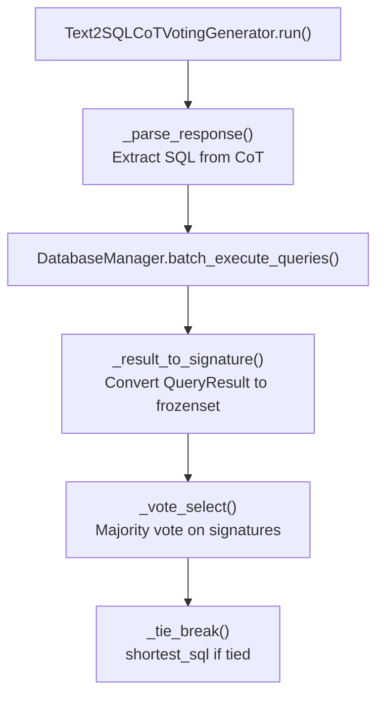
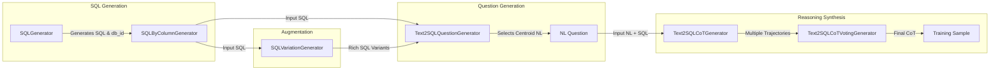

<!-- source: DeepWiki mcp.deepwiki.com · repo OpenDCAI/DataFlow · extra page Text2SQL Generation Operators · fetched 2026-11-02 -->

# Text2SQL Generation Operators

<details>
<summary>Relevant source files</summary>

The following files were used as context for generating this wiki page:

- [dataflow/operators/text2sql/__init__.py](dataflow/operators/text2sql/__init__.py)
- [dataflow/operators/text2sql/generate/sql_by_column_generator.py](dataflow/operators/text2sql/generate/sql_by_column_generator.py)
- [dataflow/operators/text2sql/generate/sql_generator.py](dataflow/operators/text2sql/generate/sql_generator.py)
- [dataflow/operators/text2sql/generate/sql_variation_generator.py](dataflow/operators/text2sql/generate/sql_variation_generator.py)
- [dataflow/operators/text2sql/generate/text2sql_cot_generator.py](dataflow/operators/text2sql/generate/text2sql_cot_generator.py)
- [dataflow/operators/text2sql/generate/text2sql_prompt_generator.py](dataflow/operators/text2sql/generate/text2sql_prompt_generator.py)
- [dataflow/operators/text2sql/generate/text2sql_question_generator.py](dataflow/operators/text2sql/generate/text2sql_question_generator.py)
- [dataflow/prompts/text2sql.py](dataflow/prompts/text2sql.py)
- [dataflow/serving/LocalSentenceLLMServing.py](dataflow/serving/LocalSentenceLLMServing.py)
- [dataflow/utils/text2sql/base.py](dataflow/utils/text2sql/base.py)
- [dataflow/utils/text2sql/database_connector/mysql_connector.py](dataflow/utils/text2sql/database_connector/mysql_connector.py)
- [dataflow/utils/text2sql/database_connector/sqlite_connector.py](dataflow/utils/text2sql/database_connector/sqlite_connector.py)
- [dataflow/utils/text2sql/database_manager.py](dataflow/utils/text2sql/database_manager.py)

</details>


## Purpose and Scope

This document provides a technical reference for the generation operators within the Text2SQL domain. These operators synthesize training data by generating SQL queries, natural language questions, task prompts, reasoning traces, and SQL variations. They integrate deeply with the `DatabaseManager` [dataflow/utils/text2sql/database_manager.py:84-121]() for schema extraction and connection handling, and the `LLMServingABC` interface for model inference.

For filter operators that validate this generated data, see [Text2SQL Filter Operators](). For difficulty classification, see [SQL Classification Operators]().

---

## Architecture Overview

The generation operators form a coordinated pipeline for synthesizing high-quality Text2SQL training data. The diagram below illustrates the association between Natural Language Space (questions/reasoning) and Code Entity Space (SQL/Python classes).

### Text2SQL Generation Flow and Code Entities

```mermaid
graph TB
    subgraph "Code Entity Space: Infrastructure"
        DBMgr["DatabaseManager [dataflow/utils/text2sql/database_manager.py]<br/>batch_execute_queries()<br/>get_create_statements_and_insert_statements()"]
        
        LLMServ["LLMServingABC [dataflow/core/llm_serving.py]<br/>generate_from_input()"]
        
        Storage["DataFlowStorage [dataflow/utils/storage.py]<br/>read()<br/>write()"]
    end
    
    subgraph "Code Entity Space: Prompts [dataflow/prompts/text2sql.py]"
        SelectPrompt["SelectSQLGeneratorPrompt"]
        VecPrompt["SelectVecSQLGeneratorPrompt"]
        QPrompt["Text2SQLQuestionGeneratorPrompt"]
        VarPrompt["SQLVariationGeneratorPrompt"]
        CoTPrompt["Text2SQLCotGeneratorPrompt"]
        PromptGenPrompt["Text2SQLPromptGeneratorPrompt"]
    end
    
    subgraph "Code Entity Space: Operators [dataflow/operators/text2sql/generate/]"
        SQLGen["SQLGenerator<br/>generate_num SQL queries"]
        SQLByCol["SQLByColumnGenerator<br/>Special column scaling"]
        QGen["Text2SQLQuestionGenerator<br/>select_best_question()"]
        VarGen["SQLVariationGenerator<br/>num_variations"]
        CoTGen["Text2SQLCoTGenerator<br/>sampling_num trajectories"]
        PromptGen["Text2SQLPromptGenerator<br/>build_prompt()"]
    end

    subgraph "Natural Language Space"
        Schema["Database Schema / DDL"]
        NLQuestion["Natural Language Question"]
        Reasoning["CoT Reasoning Trace"]
    end
    
    SQLGen --> SelectPrompt & DBMgr & LLMServ
    SQLByCol --> VecPrompt & DBMgr
    QGen --> QPrompt & LLMServ
    VarGen --> VarPrompt & LLMServ
    CoTGen --> CoTPrompt & LLMServ
    PromptGen --> PromptGenPrompt & DBMgr
    
    Schema --> SQLGen
    SQLGen --> NLQuestion
    NLQuestion --> CoTGen
    CoTGen --> Reasoning
```



**Sources**: [dataflow/operators/text2sql/generate/sql_generator.py:18-34](), [dataflow/operators/text2sql/generate/text2sql_question_generator.py:18-37](), [dataflow/operators/text2sql/generate/sql_variation_generator.py:19-33](), [dataflow/operators/text2sql/generate/text2sql_cot_generator.py:16-32](), [dataflow/operators/text2sql/generate/text2sql_prompt_generator.py:17-29]()

---

## SQLGenerator

### Overview
`SQLGenerator` synthesizes SQL queries from database schemas. It iterates through all databases registered in the `DatabaseManager` [dataflow/utils/text2sql/database_manager.py:84-121]() and generates a specified number of queries per database, distributed across complexity tiers.

**File**: [dataflow/operators/text2sql/generate/sql_generator.py:19-117]()

### Key Implementation Details
- **Response Parsing**: Uses regex `r"```sql\s*(.*?)\s*```"` to extract SQL blocks from LLM responses [dataflow/operators/text2sql/generate/sql_generator.py:54-65]().
- **Batching**: Collects prompts for all databases and calls `llm_serving.generate_from_input()` in a single batch for efficiency [dataflow/operators/text2sql/generate/sql_generator.py:97-102]().
- **Complexity Tracking**: Records the `sql_complexity_type` returned by the prompt template [dataflow/operators/text2sql/generate/sql_generator.py:86-91]().

**Sources**: [dataflow/operators/text2sql/generate/sql_generator.py:77-117]()

---

## SQLByColumnGenerator

### Overview
A variant of the SQL generator designed to scale generation volume based on the presence of "special" (e.g., vector embedding) columns within a database.

**File**: [dataflow/operators/text2sql/generate/sql_by_column_generator.py:20-118]()

### Scaling Logic
The operator queries the `DatabaseManager` [dataflow/utils/text2sql/database_manager.py:84-121]() to count special columns and adjusts the generation target accordingly [dataflow/operators/text2sql/generate/sql_by_column_generator.py:81-84]():
```python
special_col_count = self.database_manager.get_number_of_special_column(db_name)
sum_generate_num = special_col_count * self.generate_num
```

**Sources**: [dataflow/operators/text2sql/generate/sql_by_column_generator.py:81-84]()

---

## Text2SQLQuestionGenerator

### Overview
Generates natural language questions corresponding to provided SQL queries. It employs a candidate-generation and selection strategy to maximize question quality and accuracy.

**File**: [dataflow/operators/text2sql/generate/text2sql_question_generator.py:19-153]()

### Selection Strategy
The operator generates `question_candidates_num` questions [dataflow/operators/text2sql/generate/text2sql_question_generator.py:20-37](). It then uses the `embedding_serving` to select the most representative candidate via a centroid-based approach:
1. Compute embeddings for all candidates.
2. Calculate the cosine distance matrix using `scipy.spatial.distance.cdist` [dataflow/operators/text2sql/generate/text2sql_question_generator.py:111-111]().
3. Select the candidate with the minimum sum of distances to all other candidates (the "centroid") [dataflow/operators/text2sql/generate/text2sql_question_generator.py:112-114]().

**Sources**: [dataflow/operators/text2sql/generate/text2sql_question_generator.py:101-114]()

---

## Text2SQLPromptGenerator

### Overview
Extracts schema information from databases and combines it with natural language questions to generate final prompts for Text2SQL tasks.

**File**: [dataflow/operators/text2sql/generate/text2sql_prompt_generator.py:17-111]()

### Data Flow
- **Schema Retrieval**: Uses `database_manager.get_db_details(db_id)` to fetch formatted M-Schema [dataflow/operators/text2sql/generate/text2sql_prompt_generator.py:87-87]().
- **Prompt Construction**: Calls `prompt_template.build_prompt()` with schema, question, and evidence [dataflow/operators/text2sql/generate/text2sql_prompt_generator.py:89-94]().

**Sources**: [dataflow/operators/text2sql/generate/text2sql_prompt_generator.py:80-100]()

---

### SQLVariationGenerator

### Overview
Generates variations of existing SQL queries to increase dataset diversity. Transformations include data replacement, function swapping, and difficulty adjustments.

**File**: [dataflow/operators/text2sql/generate/sql_variation_generator.py:20-143]()

### Post-Processing
The operator maintains metadata from the original row while updating the SQL and variation type [dataflow/operators/text2sql/generate/sql_variation_generator.py:122-131]():
```python
new_row[self.input_db_id_key] = db_id
new_row[self.input_sql_key] = sql
new_row[output_sql_variation_type_key] = variation_type
```

**Sources**: [dataflow/operators/text2sql/generate/sql_variation_generator.py:122-131]()

---

## Text2SQLCoTGenerator

### Overview
Generates Chain-of-Thought (CoT) reasoning traces that explain the derivation of a SQL query from a question and schema.

**File**: [dataflow/operators/text2sql/generate/text2sql_cot_generator.py:17-141]()

### Multi-Trajectory Generation
The operator generates `sampling_num` trajectories per item. These are grouped by their original index and stored in a `cot_responses` column [dataflow/operators/text2sql/generate/text2sql_cot_generator.py:90-105]().

**Sources**: [dataflow/operators/text2sql/generate/text2sql_cot_generator.py:85-105]()

---

## Text2SQLCoTVotingGenerator

### Overview
Refines the output of `Text2SQLCoTGenerator` by selecting the most consistent reasoning trace through execution-based majority voting.

### Voting Algorithm
The operator determines the best CoT by checking the execution results of the SQL embedded within each reasoning trace using the underlying database execution methods [dataflow/utils/text2sql/database_manager.py:181-185]().



- **Signature**: Converts the `QueryResult.data` into a `frozenset` of tuples to represent the result set uniquely.
- **Selection**: The signature with the highest frequency wins. Ties are broken by selecting the shortest SQL query.

**Sources**: [dataflow/utils/text2sql/database_manager.py:181-185]()

---

## Data Transformation Mapping

The following diagram maps how these operators transition data between different stages of the generation pipeline.



**Sources**: [dataflow/operators/text2sql/generate/sql_generator.py:67-71](), [dataflow/operators/text2sql/generate/text2sql_question_generator.py:116-121](), [dataflow/operators/text2sql/generate/text2sql_cot_generator.py:107-115]()

---

