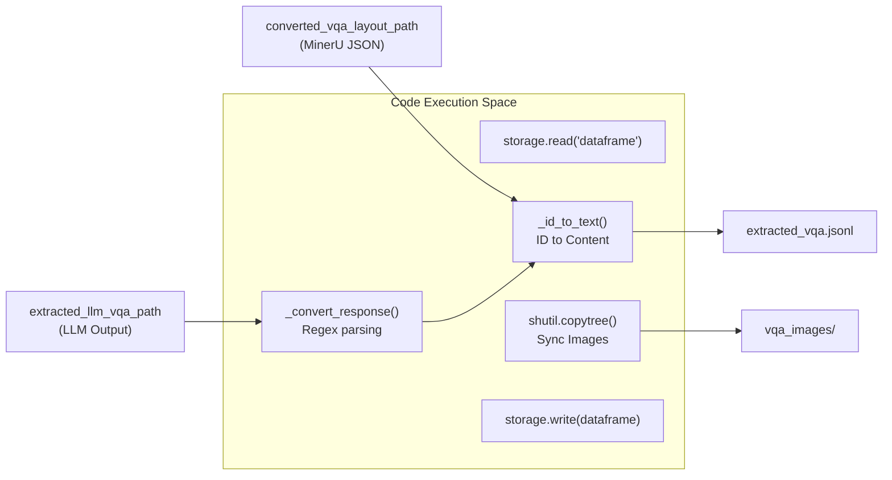

<!-- source: DeepWiki mcp.deepwiki.com · repo OpenDCAI/DataFlow · extra page VQA Extraction and Parsing · fetched 2026-11-02 -->

# VQA Extraction and Parsing

<details>
<summary>Relevant source files</summary>

The following files were used as context for generating this wiki page:

- [dataflow/example/PDF2VQAPipeline/vqa_extract_test.jsonl](dataflow/example/PDF2VQAPipeline/vqa_extract_test.jsonl)
- [dataflow/operators/core_text/__init__.py](dataflow/operators/core_text/__init__.py)
- [dataflow/operators/core_text/generate/chunked_prompted_generator.py](dataflow/operators/core_text/generate/chunked_prompted_generator.py)
- [dataflow/operators/core_text/generate/prompted_generator.py](dataflow/operators/core_text/generate/prompted_generator.py)
- [dataflow/operators/pdf2vqa/__init__.py](dataflow/operators/pdf2vqa/__init__.py)
- [dataflow/operators/pdf2vqa/generate/llm_output_parser.py](dataflow/operators/pdf2vqa/generate/llm_output_parser.py)
- [dataflow/operators/pdf2vqa/generate/mineru_to_llm_input_operator.py](dataflow/operators/pdf2vqa/generate/mineru_to_llm_input_operator.py)
- [dataflow/operators/pdf2vqa/generate/pdf_merger.py](dataflow/operators/pdf2vqa/generate/pdf_merger.py)
- [dataflow/operators/pdf2vqa/generate/qa_merger.py](dataflow/operators/pdf2vqa/generate/qa_merger.py)
- [dataflow/prompts/pdf2vqa.py](dataflow/prompts/pdf2vqa.py)
- [dataflow/statics/pipelines/api_pipelines/pdf_vqa_extract_pipeline.py](dataflow/statics/pipelines/api_pipelines/pdf_vqa_extract_pipeline.py)
- [dataflow/utils/pdf2vqa/format_utils.py](dataflow/utils/pdf2vqa/format_utils.py)
- [test/cpu_only/test_chunked_output_paths.py](test/cpu_only/test_chunked_output_paths.py)

</details>


This page documents the extraction and parsing stages of the PDF2VQA pipeline (`PDF_VQA_extract_optimized_pipeline`), which transform formatted MinerU JSON content lists into structured question-answer pairs using LLM-based extraction. These stages bridge the gap between raw document layout and structured data suitable for model training [dataflow/statics/pipelines/api_pipelines/pdf_vqa_extract_pipeline.py:13-101]().

## Purpose and Scope

After MinerU converts PDFs to structured markdown and JSON content lists via `FileOrURLToMarkdownConverterFlash` or similar converters [dataflow/statics/pipelines/api_pipelines/pdf_vqa_extract_pipeline.py:37-45](), and `MinerU2LLMInputOperator` formats them [dataflow/operators/pdf2vqa/generate/mineru_to_llm_input_operator.py:28-54](), the extraction and parsing stages use LLMs to:

1.  **Extract** QA pairs from the structured content using `ChunkedPromptedGenerator` and `QAExtractPrompt`, identifying questions, answers, solutions, and chapter titles [dataflow/statics/pipelines/api_pipelines/pdf_vqa_extract_pipeline.py:48-52](), [dataflow/prompts/pdf2vqa.py:4-52]().
2.  **Parse** the LLM's structured output into clean JSONL files using `LLMOutputParser`, performing ID resolution and image asset management [dataflow/operators/pdf2vqa/generate/llm_output_parser.py:13-35]().
3.  **Handle** arbitrarily long documents by chunking inputs via recursive bisection (`_split_recursive`) to fit within LLM context windows [dataflow/operators/core_text/generate/chunked_prompted_generator.py:78-86]().

Sources: `[dataflow/statics/pipelines/api_pipelines/pdf_vqa_extract_pipeline.py:13-101]()`, `[dataflow/operators/pdf2vqa/generate/llm_output_parser.py:13-35]()`, `[dataflow/operators/core_text/generate/chunked_prompted_generator.py:78-86]()`

---

## Extraction and Parsing Architecture

### Component Interaction Diagram

The following diagram bridges the natural language space to code entity space, illustrating how `PDF_VQA_extract_optimized_pipeline` orchestrates `ChunkedPromptedGenerator`, `QAExtractPrompt`, and `LLMOutputParser`.

Title: "PDF VQA Extraction Data Flow"
```mermaid
graph TB
    subgraph "Code Entity Space"
        InputJSON["MinerU2LLMInputOperator<br/>converted_vqa_layout_path"]
        CPG["ChunkedPromptedGenerator<br/>vqa_extractor"]
        Prompt["QAExtractPrompt<br/>vqa_extract_prompt"]
        Parser["LLMOutputParser<br/>llm_output_parser"]
        Serving["APILLMServing_request<br/>llm_serving"]
    end

    subgraph "Data Flow Space"
        InputJSON -->|Read JSON| CPG
        Prompt -->|build_prompt()| CPG
        CPG -->|_split_recursive() & generate_from_input()| Serving
        Serving -->|XML-like Response| CPG
        CPG -->|extracted_llm_vqa_path| Parser
        Parser -->|_convert_response() & _id_to_text()| Output["extracted_vqa.jsonl"]
    end
```

Sources: `[dataflow/statics/pipelines/api_pipelines/pdf_vqa_extract_pipeline.py:13-100]()`, `[dataflow/operators/pdf2vqa/generate/llm_output_parser.py:12-146]()`, `[dataflow/prompts/pdf2vqa.py:4-10]()`, `[dataflow/operators/pdf2vqa/generate/mineru_to_llm_input_operator.py:9-26]()`

---

## ChunkedPromptedGenerator: Handling Long Documents

The `ChunkedPromptedGenerator` class addresses the challenge of processing documents that exceed LLM context windows by implementing recursive bisection chunking (`_split_recursive`) and token counting (`_count_tokens`) [dataflow/operators/core_text/generate/chunked_prompted_generator.py:12-86]().

### Chunking Mechanism and Implementation
*   **Token Counting**: Utilizes an encoder (`enc`), defaulting to `tiktoken`'s `cl100k_base` or HuggingFace `AutoTokenizer`, via `_count_tokens(text)` [dataflow/operators/core_text/generate/chunked_prompted_generator.py:27-75]().
*   **Recursive Bisection**: If `token_len <= self.max_chunk_len`, returns `[text]`. Otherwise, bisects the text at `mid = len(text) // 2` and recursively merges chunks [dataflow/operators/core_text/generate/chunked_prompted_generator.py:78-86]().
*   **Integration**: In `PDF_VQA_extract_optimized_pipeline`, `ChunkedPromptedGenerator` is initialized with `max_chunk_len=128000` and `QAExtractPrompt` [dataflow/statics/pipelines/api_pipelines/pdf_vqa_extract_pipeline.py:48-52]().

Sources: `[dataflow/operators/core_text/generate/chunked_prompted_generator.py:12-86]()`, `[dataflow/statics/pipelines/api_pipelines/pdf_vqa_extract_pipeline.py:48-52]()`

---

## QAExtractPrompt: Guiding LLM Extraction

The `QAExtractPrompt` class inherits from `PromptABC` and provides the `build_prompt(self, example_title, subject="math", interleaved=True)` method [dataflow/prompts/pdf2vqa.py:4-9](). It instructs the LLM to reference content using IDs rather than duplicating long text, saving context tokens.

### Extraction Rules and XML-like Format
*   **Chapter Information**: Enclosed in `<chapter><title>MAIN_TITLE</title>...</chapter>` blocks [dataflow/prompts/pdf2vqa.py:41-48]().
*   **QA Pairs**: Wrapped in `<qa_pair>` tags containing `<label>`, `<question>`, `<answer>`, and `<solution>` [dataflow/prompts/pdf2vqa.py:34-38]().
*   **Image Referencing**: Figures are recorded using `<pic>tagA:boxB</pic>` syntax at the exact position referenced in text [dataflow/prompts/pdf2vqa.py:51-52]().
*   **Mathematical Expressions**: Rendered strictly in LaTeX [dataflow/prompts/pdf2vqa.py:50-50]().

Sources: `[dataflow/prompts/pdf2vqa.py:4-73]()`

---

## LLMOutputParser: Converting to Structured Data

The `LLMOutputParser` operator transforms the LLM's XML-like response into structured JSONL files and manages image asset synchronization (`shutil.copytree`) [dataflow/operators/pdf2vqa/generate/llm_output_parser.py:13-35, 131-142]().

### ID Resolution Logic (`_id_to_text`)
The `_id_to_text` method resolves comma-separated integer IDs generated by the LLM back into the original text, table bodies, or image markdown from the MinerU JSON layout file [dataflow/operators/pdf2vqa/generate/llm_output_parser.py:37-68]().

| Data Type | Resolution Logic & Code Pointer |
| :--- | :--- |
| **Text** | Appends `item['text']` directly `[dataflow/operators/pdf2vqa/generate/llm_output_parser.py:50-51]()`. |
| **Table** | Appends `item['table_body']` `[dataflow/operators/pdf2vqa/generate/llm_output_parser.py:52-53]()`. |
| **Images** | Converts `img_path` to markdown: `` `[dataflow/operators/pdf2vqa/generate/llm_output_parser.py:54-61]()`. |
| **Lists** | Flattens list items sequentially `[dataflow/operators/pdf2vqa/generate/llm_output_parser.py:62-67]()`. |

### Execution Flow (`LLMOutputParser.run`)
1.  **Response Parsing**: Uses regular expressions (`re.findall`) to parse `<chapter>` and `<qa_pair>` structures `[dataflow/operators/pdf2vqa/generate/llm_output_parser.py:70-101]()`.
2.  **JSONL Generation**: Writes parsed dictionaries to `extracted_vqa.jsonl` under `output_dir/name/` `[dataflow/operators/pdf2vqa/generate/llm_output_parser.py:123-128]()`.
3.  **Image Synchronization**: Copies images from `vlm/images` or `images` in the intermediate directory to the target output directory `[dataflow/operators/pdf2vqa/generate/llm_output_parser.py:130-142]()`.

Title: "LLMOutputParser Internal Logic"


Sources: `[dataflow/operators/pdf2vqa/generate/llm_output_parser.py:70-146]()`

---

## QA Merging and Path Refinement

After parsing, the `QA_Merger` operator combines questions and answers, normalizes titles, and fixes image paths across datasets [dataflow/operators/pdf2vqa/generate/qa_merger.py:11-37]().

*   **`refine_title`**: Normalizes chapter titles by removing whitespace and extracting numeric or Chinese numeral components `[dataflow/utils/pdf2vqa/format_utils.py:4-19]()`.
*   **`merge_qa_pair`**: Matches questions and answers based on chapter titles and numeric labels `[dataflow/utils/pdf2vqa/format_utils.py:21-124]()`.
*   **`fix_image_paths`**: Updates image markdown references inside `question`, `answer`, and `solution` fields to prepend the document name prefix `name_val` for aggregated datasets `[dataflow/operators/pdf2vqa/generate/qa_merger.py:67-82]()`.

Sources: `[dataflow/operators/pdf2vqa/generate/qa_merger.py:44-84]()`, `[dataflow/utils/pdf2vqa/format_utils.py:4-124]()`

---

