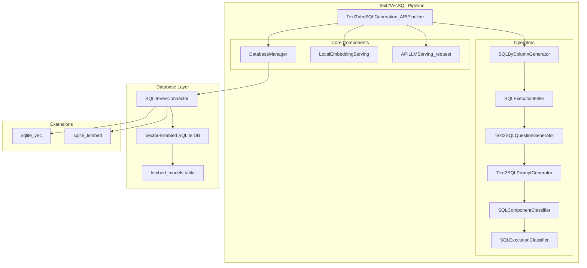
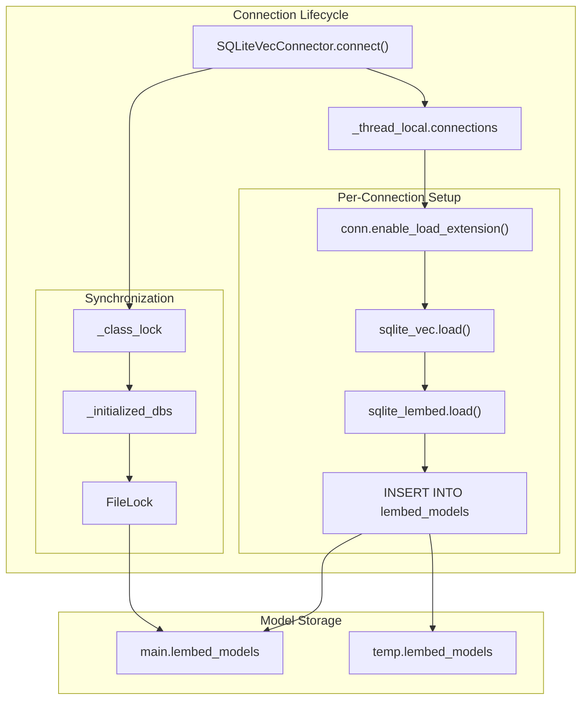
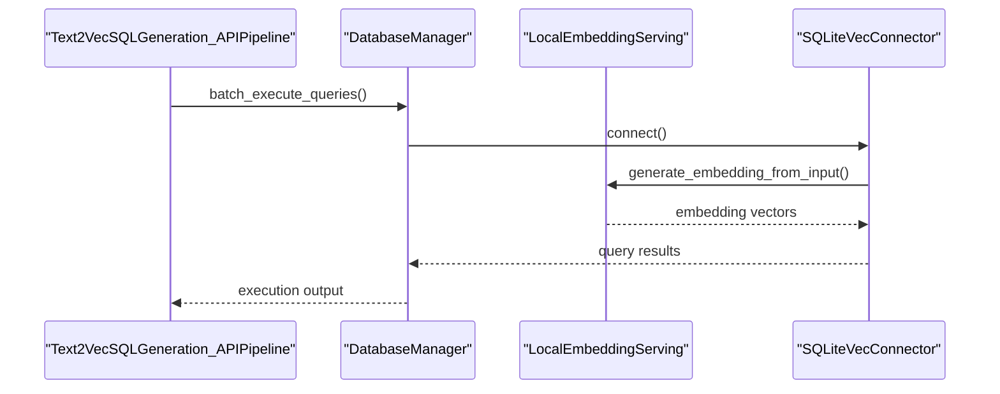
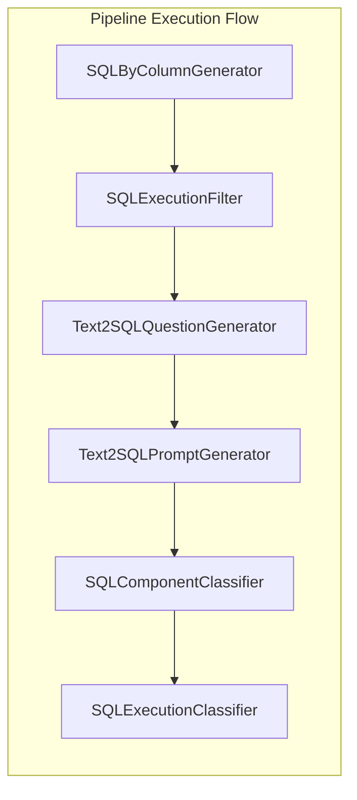

<!-- source: DeepWiki mcp.deepwiki.com · repo OpenDCAI/DataFlow · extra page Vector SQL (Text2VecSQL) · fetched 2026-11-02 -->

# Vector SQL (Text2VecSQL)

Relevant source files

The following files were used as context for generating this wiki page:

- [dataflow/operators/text2sql/__init__.py](dataflow/operators/text2sql/__init__.py)
- [dataflow/operators/text2sql/eval/sql_execution_classifier.py](dataflow/operators/text2sql/eval/sql_execution_classifier.py)
- [dataflow/operators/text2sql/filter/sql_execution_filter.py](dataflow/operators/text2sql/filter/sql_execution_filter.py)
- [dataflow/operators/text2sql/generate/sql_by_column_generator.py](dataflow/operators/text2sql/generate/sql_by_column_generator.py)
- [dataflow/serving/LocalSentenceLLMServing.py](dataflow/serving/LocalSentenceLLMServing.py)
- [dataflow/statics/pipelines/api_pipelines/text2vecsql_pipeline_gen.py](dataflow/statics/pipelines/api_pipelines/text2vecsql_pipeline_gen.py)
- [dataflow/utils/text2sql/database_connector/sqlite_vec_connector.py](dataflow/utils/text2sql/database_connector/sqlite_vec_connector.py)

The Vector SQL (`Text2VecSQL`) pipeline extends the standard Text2SQL system to support vector embeddings and similarity search operations within SQL queries. This specialized pipeline uses SQLite with the `sqlite-vec` and `sqlite_lembed` extensions to enable semantic search capabilities in generated SQL training data.

For standard Text2SQL without vector operations, see [SQL Generation Pipeline]() and [SQL Refinement Pipeline](). For general database management concepts, see [Database Management]().

## Architecture Overview

The `Text2VecSQL` system adds a vector embedding layer on top of the standard Text2SQL pipeline, enabling SQL queries to perform semantic similarity searches using embedding vectors stored in database columns.

Title: Text2VecSQL Pipeline Architecture

Sources: [dataflow/statics/pipelines/api_pipelines/text2vecsql_pipeline_gen.py:61-165](), [dataflow/utils/text2sql/database_connector/sqlite_vec_connector.py:14-23]()

## SQLite-Vec Connector

The `SQLiteVecConnector` class [dataflow/utils/text2sql/database_connector/sqlite_vec_connector.py:14-23]() manages connections to SQLite databases with vector extensions enabled. It implements thread-safe model loading and connection pooling to support concurrent vector operations.

### Connection Management

Title: SQLiteVecConnector Lifecycle and Synchronization

The connector uses a multi-tiered synchronization strategy:

| Synchronization Level | Mechanism | Purpose |
|----------------------|-----------|---------|
| **Class-level** | `_class_lock` + `_initialized_dbs` set | Ensures one-time disk initialization per database per process [dataflow/utils/text2sql/database_connector/sqlite_vec_connector.py:15-18](), [dataflow/utils/text2sql/database_connector/sqlite_vec_connector.py:68-73]() |
| **File-level** | `FileLock` with `.lock` files | Prevents concurrent writes across processes [dataflow/utils/text2sql/database_connector/sqlite_vec_connector.py:90-93]() |
| **Thread-level** | `_thread_local.connections` dict | Isolates connections per thread [dataflow/utils/text2sql/database_connector/sqlite_vec_connector.py:21](), [dataflow/utils/text2sql/database_connector/sqlite_vec_connector.py:60-63]() |

Sources: [dataflow/utils/text2sql/database_connector/sqlite_vec_connector.py:14-156]()

### Model Registration

The connector attempts to register embedding models in two phases:

1. **Persistent Registration**: Insert into `main.lembed_models` table for permanent storage [dataflow/utils/text2sql/database_connector/sqlite_vec_connector.py:105-108]().
2. **Runtime Registration**: Insert into `temp.lembed_models` if persistent storage fails [dataflow/utils/text2sql/database_connector/sqlite_vec_connector.py:109-112]().

The registration includes retry logic with exponential backoff (3 attempts) to handle transient filesystem or locking issues [dataflow/utils/text2sql/database_connector/sqlite_vec_connector.py:113-149]().

Sources: [dataflow/utils/text2sql/database_connector/sqlite_vec_connector.py:103-156]()

## Vector SQL Execution

The system executes queries via `DatabaseManager` backed by `SQLiteVecConnector`, leveraging `LocalEmbeddingServing` for local inference and vector representations [dataflow/statics/pipelines/api_pipelines/text2vecsql_pipeline_gen.py:99-127]().

### Preprocessing and Embedding Serving

Title: Vector Embedding Integration via LocalEmbeddingServing

Sources: [dataflow/statics/pipelines/api_pipelines/text2vecsql_pipeline_gen.py:99-127](), [dataflow/serving/LocalSentenceLLMServing.py:8-121]()

## Pipeline Components

### Text2VecSQLGeneration_APIPipeline

The main pipeline class orchestrates vector SQL generation through sequential operator steps [dataflow/statics/pipelines/api_pipelines/text2vecsql_pipeline_gen.py:61-165]().

Title: Text2VecSQLGeneration_APIPipeline Execution Flow

Sources: [dataflow/statics/pipelines/api_pipelines/text2vecsql_pipeline_gen.py:61-165]()

### Configuration Parameters

The pipeline initialization requires specific configuration for vector operations [dataflow/statics/pipelines/api_pipelines/text2vecsql_pipeline_gen.py:118-127]().

| Parameter | Type | Purpose |
|-----------|------|---------|
| `db_type` | str | Must be `"sqlite-vec"` to use vector connector [dataflow/statics/pipelines/api_pipelines/text2vecsql_pipeline_gen.py:119]() |
| `model_name` | str | Identifier for embedding model in database [dataflow/statics/pipelines/api_pipelines/text2vecsql_pipeline_gen.py:122]() |
| `model_path` | str | Path to `.gguf` model file for `sqlite_lembed` [dataflow/statics/pipelines/api_pipelines/text2vecsql_pipeline_gen.py:123]() |
| `enable_lembed` | bool | Whether to use `sqlite_lembed` extension [dataflow/utils/text2sql/database_connector/sqlite_vec_connector.py:86](), [dataflow/statics/pipelines/api_pipelines/text2vecsql_pipeline_gen.py:124]() |
| `embedding_serving` | `LocalEmbeddingServing` | Embedding service for local vector tasks [dataflow/statics/pipelines/api_pipelines/text2vecsql_pipeline_gen.py:99-126]() |

Sources: [dataflow/statics/pipelines/api_pipelines/text2vecsql_pipeline_gen.py:99-127](), [dataflow/utils/text2sql/database_connector/sqlite_vec_connector.py:86]()

## Storage and Caching

The pipeline uses `FileStorage` for persistence [dataflow/statics/pipelines/api_pipelines/text2vecsql_pipeline_gen.py:79-84](). Each operator step creates a cache file enabling pipeline resumption.

Sources: [dataflow/statics/pipelines/api_pipelines/text2vecsql_pipeline_gen.py:79-84]()

## Limitations and Considerations

1. **Extension Dependencies**: Requires `sqlite-vec` and `sqlite_lembed` packages [dataflow/utils/text2sql/database_connector/sqlite_vec_connector.py:24-46]().
2. **Model File Format**: Embedding models must be in `.gguf` format for `sqlite_lembed` extension [dataflow/utils/text2sql/database_connector/sqlite_vec_connector.py:84-88]().
3. **Trusted Schema Requirement**: The `sqlite_lembed` extension requires `PRAGMA trusted_schema=ON` [dataflow/utils/text2sql/database_connector/sqlite_vec_connector.py:101]().

Sources: [dataflow/utils/text2sql/database_connector/sqlite_vec_connector.py:24-101]()

---

