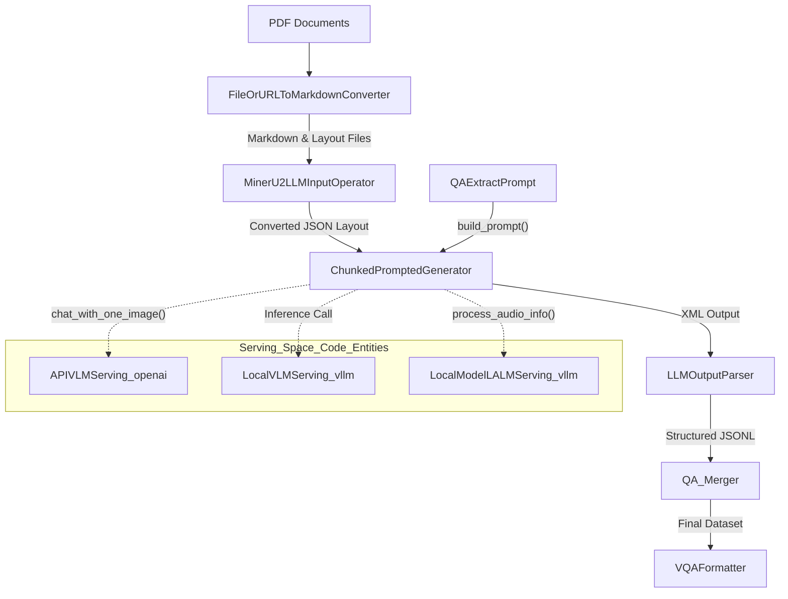
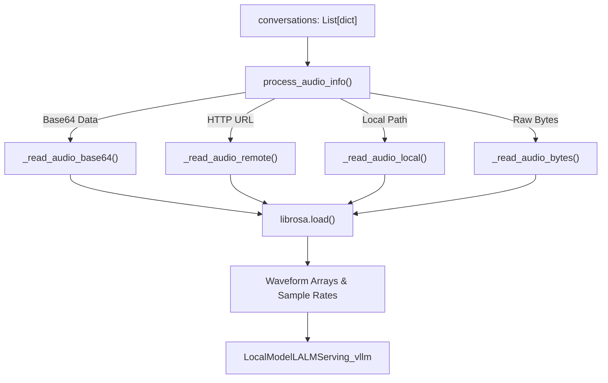
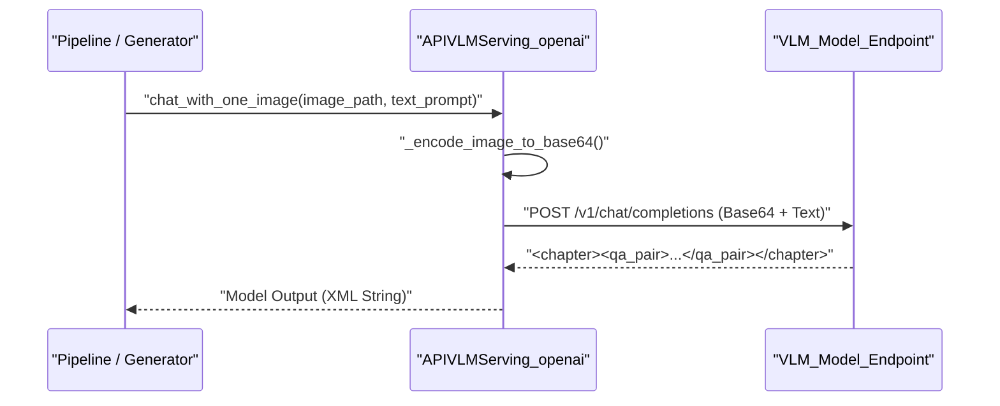

<!-- source: DeepWiki mcp.deepwiki.com · repo OpenDCAI/DataFlow · extra page Vision-Language and Audio Model Serving · fetched 2026-11-02 -->

# Vision-Language and Audio Model Serving

Relevant source files

The following files were used as context for generating this wiki page:

- [dataflow/example/SpeechTranscription/audio/test.wav](dataflow/example/SpeechTranscription/audio/test.wav)
- [dataflow/example/SpeechTranscription/pipeline_speechtranscription.jsonl](dataflow/example/SpeechTranscription/pipeline_speechtranscription.jsonl)
- [dataflow/serving/__init__.py](dataflow/serving/__init__.py)
- [dataflow/serving/api_vlm_serving_openai.py](dataflow/serving/api_vlm_serving_openai.py)
- [dataflow/serving/local_model_vlm_serving.py](dataflow/serving/local_model_vlm_serving.py)
- [dataflow/statics/pipelines/gpu_pipelines/speechtranscription_pipeline.py](dataflow/statics/pipelines/gpu_pipelines/speechtranscription_pipeline.py)

This page describes Vision-Language Model (VLM) and Large Audio-Language Model (LALM) serving capabilities in DataFlow, focusing on multimodal inference for document parsing, visual question-answering (VQA), and audio processing tasks. Multimodal serving enables the framework to process complex visual and auditory assets alongside text, converting unstructured media into structured data.

For general LLM serving concepts, see [3.4](). For text-only API and local GPU serving, see [3.4.1]() and [3.4.2]() respectively.

---

## 1. Overview

DataFlow implements multimodal serving through specialized client abstractions and backend integrations:

1. **MinerU Backends & Document Converters**: Integrated via parsing tools to handle document layout conversion, markdown transformation, and ID mapping [dataflow/serving/__init__.py:4-15]().
2. **Multimodal API Serving (`APIVLMServing_openai`)**: Cloud-based VLM inference through OpenAI and compatible endpoints [dataflow/serving/api_vlm_serving_openai.py:13-29]().
3. **Local VLM Serving (`LocalVLMServing_vllm`)**: High-throughput local inference using vLLM, optimized for multimodal engines like Qwen-VL [dataflow/serving/local_model_vlm_serving.py:13-47]().
4. **Local LALM Serving (`LocalModelLALMServing_vllm`)**: Audio-language model inference handling diverse audio representations (base64, remote URLs, bytes, local paths) via `librosa` and vLLM [dataflow/serving/localmodel_lalm_serving.py:18-96]().

Sources: [dataflow/serving/__init__.py:1-29](), [dataflow/serving/api_vlm_serving_openai.py:13-29](), [dataflow/serving/local_model_vlm_serving.py:13-47](), [dataflow/serving/localmodel_lalm_serving.py:18-96]()

---

## 2. VLM Serving Implementation

### 2.1 API-Based VLM Serving (`APIVLMServing_openai`)

The `APIVLMServing_openai` class acts as a client for remote VLM endpoints [dataflow/serving/api_vlm_serving_openai.py:13-19](). It manages base64 image encoding, structured JSON schema outputs, and concurrent thread-pool dispatching.

* **Base64 Conversion**: Converts input images (JPG, JPEG, PNG) into base64 payloads with explicit MIME format detection via `_encode_image_to_base64()` [dataflow/serving/api_vlm_serving_openai.py:56-78]().
* **Structured Output**: Forces adherence to custom schemas via `response_format` JSON schemas in `_send_chat_request()` [dataflow/serving/api_vlm_serving_openai.py:114-122]().
* **Concurrency**: Utilizes `ThreadPoolExecutor` to handle batch image queries concurrently via `generate_from_input_one_image()` [dataflow/serving/api_vlm_serving_openai.py:186-210]().

Sources: [dataflow/serving/api_vlm_serving_openai.py:13-152](), [dataflow/serving/api_vlm_serving_openai.py:186-210]()

### 2.2 Local VLM Serving (`LocalVLMServing_vllm`)

For localized high-performance inference, `LocalVLMServing_vllm` integrates directly with the `vllm` engine [dataflow/serving/local_model_vlm_serving.py:13-17]().

* **Multi-Modal Limits**: Sets prompt-level constraints using `limit_mm_per_prompt` within the engine initialization [dataflow/serving/local_model_vlm_serving.py:144]().
* **Chat Templating**: Applies model-specific formatting using `AutoTokenizer` configured with appropriate remote code and thinking modes [dataflow/serving/local_model_vlm_serving.py:149-154]().
* **Image Loading**: Directly processes `PIL.Image` objects through `_load_image()` to match vLLM input expectations [dataflow/serving/local_model_vlm_serving.py:157-164]().

Sources: [dataflow/serving/local_model_vlm_serving.py:13-164]()

---

## 3. Large Audio-Language Model (LALM) Serving Implementation

### 3.1 Local LALM Serving (`LocalModelLALMServing_vllm`) and Audio Processing

The `LocalModelLALMServing_vllm` class provides inference support for audio-language models [dataflow/serving/localmodel_lalm_serving.py:96-129](). It is paired with audio extraction utilities that parse conversation lists for audio tokens.

* **Audio Resolvers**: Supports remote URLs, local file paths, raw `bytes`, and `base64` data URIs via `_read_audio_remote()`, `_read_audio_local()`, `_read_audio_bytes()`, and `_read_audio_base64()` [dataflow/serving/localmodel_lalm_serving.py:18-36]().
* **Audio Information Extraction**: The `process_audio_info()` helper scans message arrays, decodes audio files using `librosa.load`, and aggregates waveforms and sample rates [dataflow/serving/localmodel_lalm_serving.py:37-94]().

Sources: [dataflow/serving/localmodel_lalm_serving.py:18-129]()

---

## 4. Multimodal Inference & MinerU Integration Data Flow

The following diagram bridges the **Natural Language Space** and **Code Entity Space** by mapping system components to actual operators and serving classes involved in multimodal pipelines (such as PDF VQA extraction).

**Multimodal Extraction and Code Entity Mapping**

Sources: [dataflow/serving/api_vlm_serving_openai.py:127-152](), [dataflow/serving/local_model_vlm_serving.py:13-47](), [dataflow/serving/localmodel_lalm_serving.py:37-94](), [dataflow/serving/__init__.py:1-29]()

The following diagram details the internal audio decoding flow for LALM inputs:

**Audio Processing Pipeline Code Entities**

Sources: [dataflow/serving/localmodel_lalm_serving.py:18-94]()

---

## 5. VLM Inference Sequence

The interaction sequence between generator pipelines and VLM serving clients is illustrated below:

**VLM Inference Request Sequence**

Sources: [dataflow/serving/api_vlm_serving_openai.py:127-152](), [dataflow/serving/local_model_vlm_serving.py:18-35]()

---

## 6. Summary of Serving Backends

| Class | Backend | Primary Use Case |
| :--- | :--- | :--- |
| `APIVLMServing_openai` | OpenAI API | Cloud-based VQA and image analysis using models like GPT-4o [dataflow/serving/api_vlm_serving_openai.py:13]() |
| `LocalVLMServing_vllm` | vLLM (Local) | High-performance local VLM inference, optimized for Qwen-VL [dataflow/serving/local_model_vlm_serving.py:13]() |
| `LocalModelLALMServing_vllm` | vLLM (Local) | Local serving for Large Audio-Language Models with audio decoding [dataflow/serving/localmodel_lalm_serving.py:96]() |
| `APIGoogleVertexAIServing` | Google Vertex AI | Enterprise-grade multimodal serving for Gemini models [dataflow/serving/__init__.py:13]() |

Sources: [dataflow/serving/__init__.py:1-29](), [dataflow/serving/api_vlm_serving_openai.py:13-32](), [dataflow/serving/local_model_vlm_serving.py:13-35](), [dataflow/serving/localmodel_lalm_serving.py:96-129]()

---

