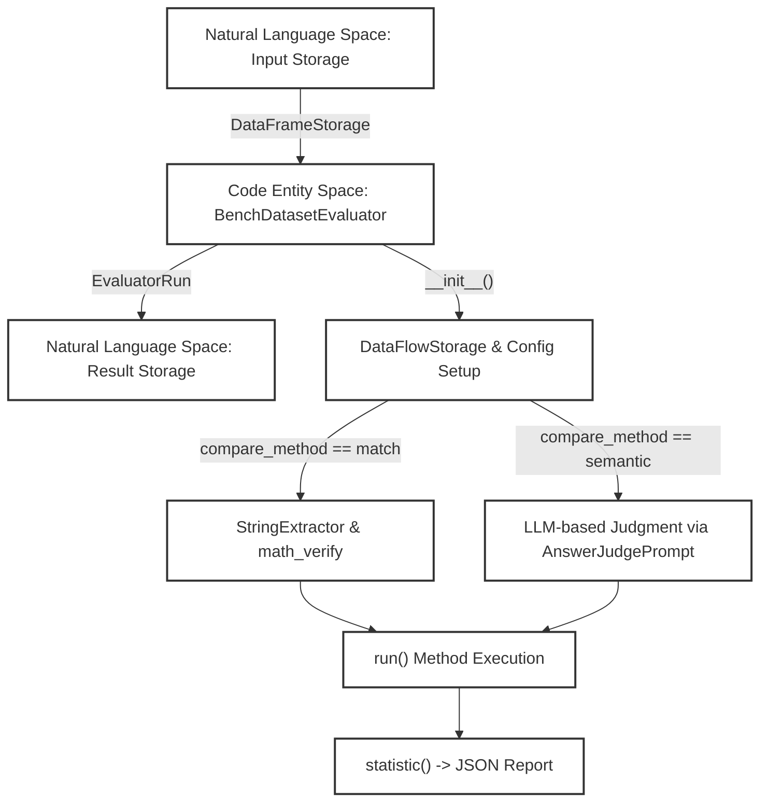
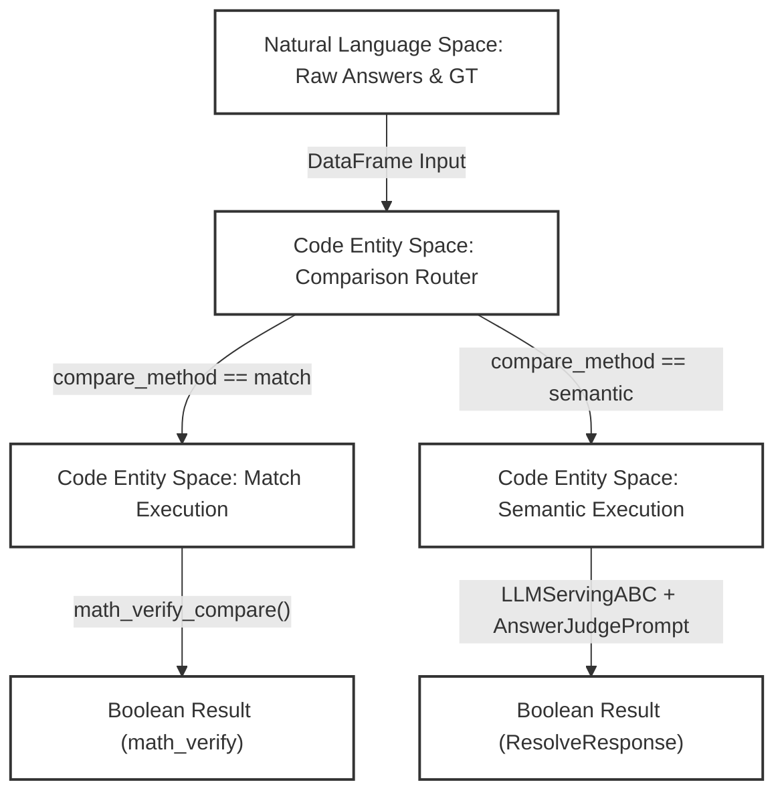

<!-- source: DeepWiki mcp.deepwiki.com · repo OpenDCAI/DataFlow · extra page Benchmark Dataset Evaluators · fetched 2026-11-02 -->

# Benchmark Dataset Evaluators

<details>
<summary>Relevant source files</summary>

The following files were used as context for generating this wiki page:

- [.github/workflows/test.yml](.github/workflows/test.yml)
- [dataflow/example/core_text_data/bench_eval_data_2.jsonl](dataflow/example/core_text_data/bench_eval_data_2.jsonl)
- [dataflow/example/core_text_data/unified_bench_eval_type1.jsonl](dataflow/example/core_text_data/unified_bench_eval_type1.jsonl)
- [dataflow/example/core_text_data/unified_bench_eval_type2.jsonl](dataflow/example/core_text_data/unified_bench_eval_type2.jsonl)
- [dataflow/example/core_text_data/unified_bench_eval_type3.jsonl](dataflow/example/core_text_data/unified_bench_eval_type3.jsonl)
- [dataflow/example/core_text_data/unified_bench_eval_type4.jsonl](dataflow/example/core_text_data/unified_bench_eval_type4.jsonl)
- [dataflow/example/core_text_data/unified_bench_eval_type5.jsonl](dataflow/example/core_text_data/unified_bench_eval_type5.jsonl)
- [dataflow/example/core_text_data/unified_bench_eval_type6.jsonl](dataflow/example/core_text_data/unified_bench_eval_type6.jsonl)
- [dataflow/operators/code/filter/code_score_filter.py](dataflow/operators/code/filter/code_score_filter.py)
- [dataflow/operators/core_text/eval/bench_dataset_evaluator.py](dataflow/operators/core_text/eval/bench_dataset_evaluator.py)
- [dataflow/operators/core_text/eval/bench_dataset_evaluator_question.py](dataflow/operators/core_text/eval/bench_dataset_evaluator_question.py)
- [dataflow/operators/core_text/eval/unified_bench_dataset_evaluator.py](dataflow/operators/core_text/eval/unified_bench_dataset_evaluator.py)
- [dataflow/operators/core_text/generate/bench_answer_generator.py](dataflow/operators/core_text/generate/bench_answer_generator.py)
- [dataflow/operators/reasoning/filter/reasoning_answer_model_judge_filter.py](dataflow/operators/reasoning/filter/reasoning_answer_model_judge_filter.py)
- [dataflow/prompts/model_evaluation/general.py](dataflow/prompts/model_evaluation/general.py)
- [dataflow/serving/api_llm_serving_request.py](dataflow/serving/api_llm_serving_request.py)
- [dataflow/serving/localhost_llm_api_serving.py](dataflow/serving/localhost_llm_api_serving.py)
- [dataflow/serving/localmodel_lalm_serving.py](dataflow/serving/localmodel_lalm_serving.py)
- [dataflow/statics/pipelines/api_pipelines/core_text_bencheval_semantic_pipeline.py](dataflow/statics/pipelines/api_pipelines/core_text_bencheval_semantic_pipeline.py)
- [dataflow/statics/pipelines/api_pipelines/core_text_bencheval_semantic_pipeline_question.py](dataflow/statics/pipelines/api_pipelines/core_text_bencheval_semantic_pipeline_question.py)
- [dataflow/statics/pipelines/api_pipelines/core_text_bencheval_semantic_pipeline_question_single_step.py](dataflow/statics/pipelines/api_pipelines/core_text_bencheval_semantic_pipeline_question_single_step.py)
- [dataflow/statics/pipelines/gpu_pipelines/benchmark_eval/unified_bench_eval_type1.py](dataflow/statics/pipelines/gpu_pipelines/benchmark_eval/unified_bench_eval_type1.py)
- [dataflow/statics/pipelines/gpu_pipelines/core_text_bencheval_match_pipeline.py](dataflow/statics/pipelines/gpu_pipelines/core_text_bencheval_match_pipeline.py)
- [test/cpu_only/test_undefined_name_crashes.py](test/cpu_only/test_undefined_name_crashes.py)

</details>


This page details the benchmark dataset evaluation framework in DataFlow, covering `BenchDatasetEvaluator`, `BenchDatasetEvaluatorQuestion`, `UnifiedBenchDatasetEvaluator`, their operational modes (`match` vs. `semantic`), and the unified benchmark evaluation pipelines.

---

## 1. Overview of `BenchDatasetEvaluator` and `BenchDatasetEvaluatorQuestion`

`BenchDatasetEvaluator` and `BenchDatasetEvaluatorQuestion` are core evaluation operators designed to compare predicted model answers against golden ground-truth labels. They calculate statistical metrics such as exact accuracy and invalid response counts, persisting evaluation reports to disk.

Both operators are registered in the operator registry (`[dataflow/utils/registry.py]()`) and accept configuration parameters for storage paths, comparison methods, system prompts, and prompt templates `[dataflow/operators/core_text/eval/bench_dataset_evaluator.py:24-30]()`, `[dataflow/operators/core_text/eval/bench_dataset_evaluator_question.py:24-34]()`.


*Figure 1: `BenchDatasetEvaluator` Architecture bridging configuration and execution spaces.*

**Sources:** `[dataflow/operators/core_text/eval/bench_dataset_evaluator.py:24-53]()`, `[dataflow/operators/core_text/eval/bench_dataset_evaluator_question.py:24-34]()`, `[dataflow/utils/registry.py:1-1]()`

---

## 2. Match vs. Semantic Evaluation Modes

The evaluators support two distinct comparison strategies configured via the `compare_method` parameter `[dataflow/operators/core_text/eval/bench_dataset_evaluator.py:27-51]`:

### 2.1. String Matching (`match` mode)
* **Mechanism:** Utilizes mathematical parsing and verification libraries (`math_verify`) alongside custom answer extraction utilities `[dataflow/operators/core_text/eval/bench_dataset_evaluator.py:40-44]()`.
* **Functions:** 
  * `math_verify_compare(answer, ground_truth)`: Parses both strings using `parse()` and asserts equality via `verify()` `[dataflow/operators/core_text/eval/bench_dataset_evaluator.py:54-61]()`.
  * `AnswerExtractor`: Strips units and formats raw text before comparison `[dataflow/operators/core_text/eval/bench_dataset_evaluator.py:41-44]()`.

### 2.2. Semantic Matching (`semantic` mode)
* **Mechanism:** Delegates judgment to an LLM serving backend using prompt templates (such as `AnswerJudgePrompt` or `AnswerJudgePromptQuestion`) `[dataflow/operators/core_text/eval/bench_dataset_evaluator.py:46-50]()`, `[dataflow/operators/core_text/eval/bench_dataset_evaluator_question.py:52-56]()`.
* **Prompt Definition:** The judge prompt instructs the LLM to assess semantic consistency between the reference answer and the current answer, requiring JSON formatting like `{"judgement_result": true}` `[dataflow/prompts/model_evaluation/general.py:9-35]()`.
* **Response Parsing:** `ResolveResponse(response)` parses regex patterns or substring matches to extract boolean verdicts `[dataflow/operators/core_text/eval/bench_dataset_evaluator.py:63-82]()`, `[dataflow/operators/core_text/eval/bench_dataset_evaluator_question.py:69-93]()`.


*Figure 2: Match vs. Semantic execution routing.*

**Sources:** `[dataflow/operators/core_text/eval/bench_dataset_evaluator.py:40-82]()`, `[dataflow/operators/core_text/eval/bench_dataset_evaluator_question.py:46-93]()`, `[dataflow/prompts/model_evaluation/general.py:9-35]()`

---

## 3. `UnifiedBenchDatasetEvaluator` and Unified Pipelines

The `UnifiedBenchDatasetEvaluator` generalizes benchmark evaluation across six primary benchmark dataset types `[dataflow/operators/core_text/eval/unified_bench_dataset_evaluator.py:31-66]`:
1. `key1_text_score`
2. `key2_qa`
3. `key2_q_ma`
4. `key3_q_choices_a`
5. `key3_q_choices_as`
6. `key3_q_a_rejected`

### 3.1. Companion Generator: `BenchAnswerGenerator`
To generate answers conforming to the expected keys prior to evaluation, DataFlow provides `BenchAnswerGenerator` `[dataflow/operators/core_text/generate/bench_answer_generator.py:21-49]()`. It formats prompts based on the active `eval_type` and invokes `LLMServingABC` `[dataflow/operators/core_text/generate/bench_answer_generator.py:104-184]()`.

### 3.2. Unified Benchmark Pipeline Implementation
Pipelines combine `FileStorage`, `LocalModelLLMServing_vllm`, `BenchAnswerGenerator`, and `UnifiedBenchDatasetEvaluator` to execute end-to-end evaluations `[dataflow/statics/pipelines/gpu_pipelines/benchmark_eval/unified_bench_eval_type1.py:18-65]()`.

```mermaid
graph TD
    sub0["Natural Language Space: Benchmark JSONL Dataset"]
    sub1["Code Entity Space: FileStorage"]
    sub2["Code Entity Space: BenchAnswerGenerator"]
    sub3["Code Entity Space: UnifiedBenchDatasetEvaluator"]

    sub0 -->|Input File| sub1
    sub1 -->|storage.step()| sub2
    sub2 -->|LocalModelLLMServing_vllm| GenOutput["Generated Answers Column"]
    GenOutput --> sub3
    sub3 -->|Metric Calculation & Statistics| FinalOutput["Result JSON Report"]

    classDef default fill:#fff,stroke:#333,stroke-width:2px;
    class sub0,sub1,sub2,sub3 default;
```
*Figure 3: Data flow architecture for Unified Benchmark Evaluation pipelines.*

**Sources:** `[dataflow/operators/core_text/eval/unified_bench_dataset_evaluator.py:31-90]()`, `[dataflow/operators/core_text/generate/bench_answer_generator.py:21-57]()`, `[dataflow/statics/pipelines/gpu_pipelines/benchmark_eval/unified_bench_eval_type1.py:18-65]()`

---

