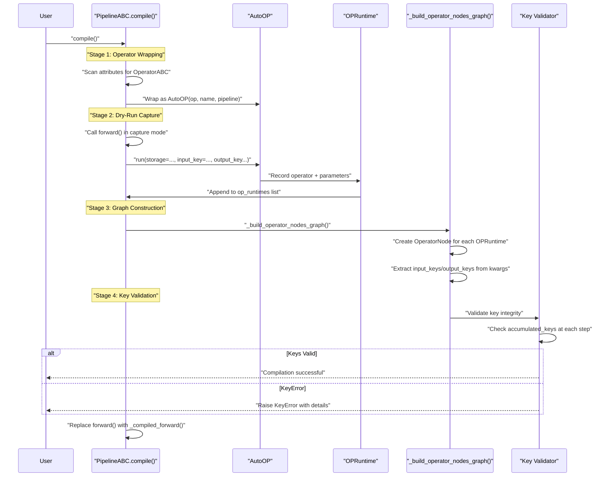
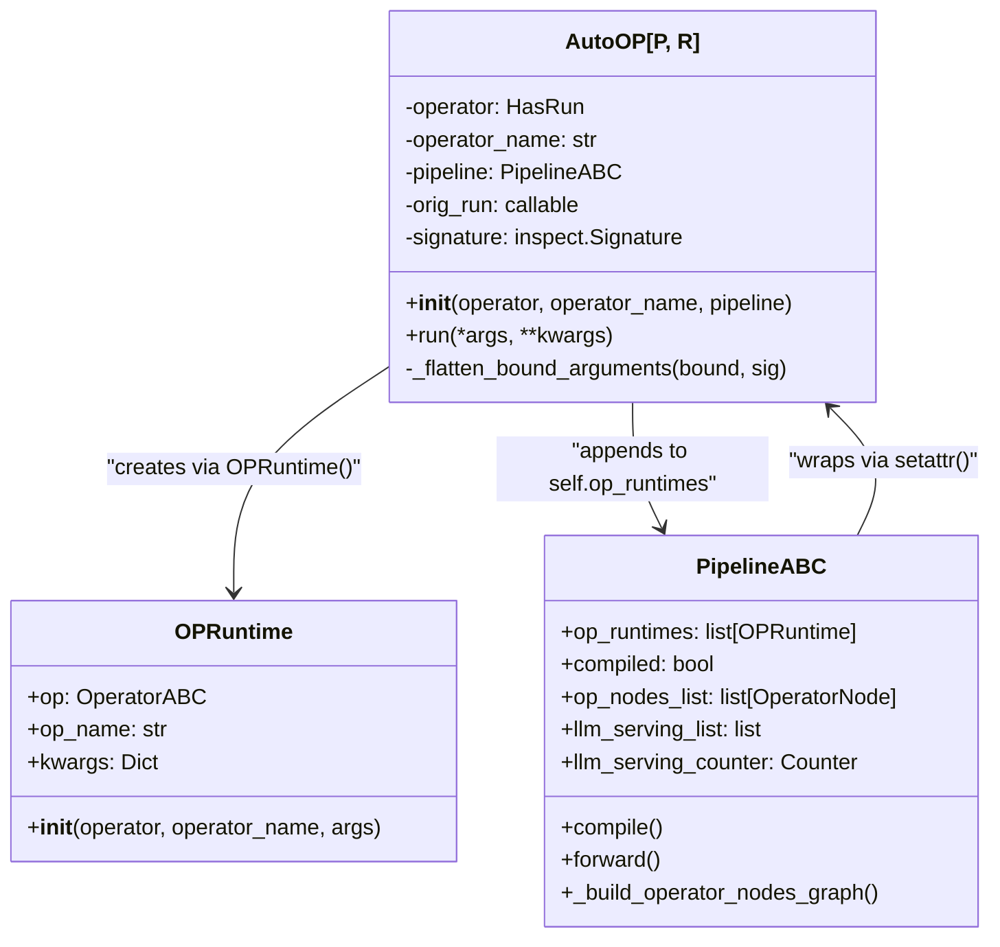
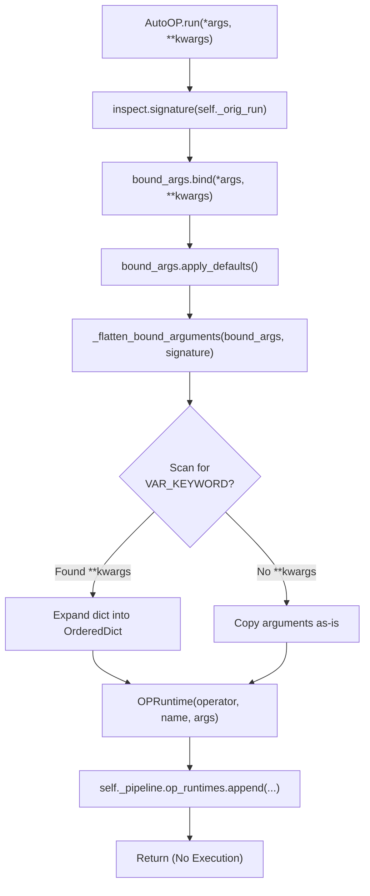
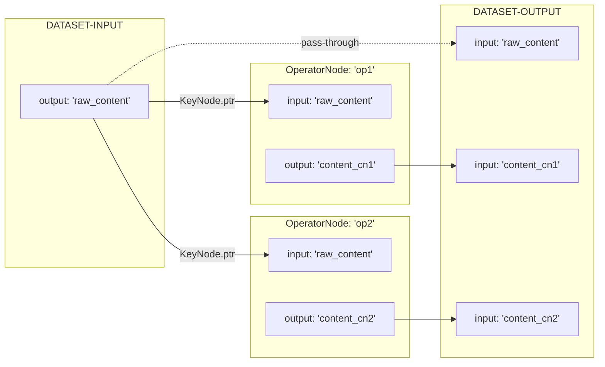

<!-- source: DeepWiki mcp.deepwiki.com · repo OpenDCAI/DataFlow · extra page Compilation Phase · fetched 2026-11-02 -->

# Compilation Phase

Relevant source files

The following files were used as context for generating this wiki page:

- [dataflow/core/__init__.py](dataflow/core/__init__.py)
- [dataflow/pipeline/Pipeline.py](dataflow/pipeline/Pipeline.py)
- [dataflow/pipeline/__init__.py](dataflow/pipeline/__init__.py)
- [dataflow/pipeline/nodes.py](dataflow/pipeline/nodes.py)
- [dataflow/utils/storage.py](dataflow/utils/storage.py)
- [dataflow/wrapper/auto_op.py](dataflow/wrapper/auto_op.py)
- [test/cpu_only/test_lazy_file_storage_flush.py](test/cpu_only/test_lazy_file_storage_flush.py)
- [test/cpu_only/test_remote_batch_slicing.py](test/cpu_only/test_remote_batch_slicing.py)
- [test/test_autoop.py](test/test_autoop.py)
- [test/test_batched_pipeline.py](test/test_batched_pipeline.py)
- [test/test_batched_stream_pipeline.py](test/test_batched_stream_pipeline.py)
- [test/test_copy.py](test/test_copy.py)
- [test/test_copy_weak_ref.py](test/test_copy_weak_ref.py)
- [test/test_dataframe_col.py](test/test_dataframe_col.py)
- [test/test_read_xlsx.py](test/test_read_xlsx.py)

## Purpose and Scope

The **Compilation Phase** is the first stage of DataFlow's two-phase execution model, occurring when `pipeline.compile()` is called [dataflow/pipeline/Pipeline.py:43-59](). During compilation, the pipeline captures the structure and configuration of all operators without executing them, builds a directed acyclic graph (DAG) representing data dependencies, and validates that all data keys are correctly aligned across operator boundaries [dataflow/pipeline/Pipeline.py:105-135]().

Sources: [dataflow/pipeline/Pipeline.py:43-135]()

---

## Compilation Workflow Overview

The compilation process transforms a pipeline from a collection of operator attributes into an executable graph with validated data flows. This happens through four distinct stages.

### Pipeline Compilation Sequence

Sources: [dataflow/pipeline/Pipeline.py:43-59](), [dataflow/wrapper/auto_op.py:38-105]()

---

## Stage 1: Operator Wrapping with AutoOP

The compilation begins by scanning all pipeline attributes and wrapping any `OperatorABC` instances with the `AutoOP` wrapper class [dataflow/pipeline/Pipeline.py:45-47](). This wrapper intercepts `run()` calls during the dry-run phase.

### AutoOP Wrapper Mechanism

The `AutoOP` class ([dataflow/wrapper/auto_op.py:38-105]()) is a generic wrapper that preserves the type signature of the wrapped operator's `run()` method while adding capture functionality. It dynamically copies the `__doc__` and `inspect.signature` from the original operator's `run` method [dataflow/wrapper/auto_op.py:53-56]().

### Compilation Entity Relationships

**Wrapping Process Details** ([dataflow/pipeline/Pipeline.py:43-48]()):

| Step | Code Entity | Action | Line Reference |
|------|-------------|--------|----------------|
| 1 | `self.compiled` | Set to `True` | [dataflow/pipeline/Pipeline.py:44]() |
| 2 | `vars(self)` | Iterate over instance attributes | [dataflow/pipeline/Pipeline.py:45]() |
| 3 | `OperatorABC` | Check if attribute is an operator | [dataflow/pipeline/Pipeline.py:46]() |
| 4 | `AutoOP` | Wrap and replace attribute | [dataflow/pipeline/Pipeline.py:47]() |
| 5 | `self.forward()` | Trigger recording pass | [dataflow/pipeline/Pipeline.py:48]() |

Sources: [dataflow/pipeline/Pipeline.py:43-48](), [dataflow/wrapper/auto_op.py:20-56]()

---

## Stage 2: Dry-Run Capture

After wrapping operators, the pipeline calls `self.forward()` in capture mode [dataflow/pipeline/Pipeline.py:48](). Since operators are now `AutoOP` instances, their `run()` calls are intercepted and recorded without executing the actual operator logic.

### Parameter Capture Process

When `AutoOP.run()` is invoked ([dataflow/wrapper/auto_op.py:84-105]()), it uses Python's `inspect.signature()` to bind arguments and capture the complete parameter set.

### Argument Binding Flow

The `_flatten_bound_arguments()` method ([dataflow/wrapper/auto_op.py:58-82]()) ensures that all parameters, including those passed as `**kwargs`, are captured in their original call order and flattened into a single `OrderedDict` [dataflow/wrapper/auto_op.py:71-82]().

Sources: [dataflow/wrapper/auto_op.py:20-105]()

---

## Stage 3: Graph Construction

The `_build_operator_nodes_graph()` method ([dataflow/pipeline/Pipeline.py:60-197]()) transforms the linear `op_runtimes` list into a structured graph of `OperatorNode` and `KeyNode` objects.

### OperatorNode Creation

For each `OPRuntime`, the builder creates an `OperatorNode` ([dataflow/pipeline/nodes.py:36-78]()) that encapsulates the operator instance, its storage, and its serving backend.

**Key Extraction Algorithm** ([dataflow/pipeline/nodes.py:59-68]()):

| Parameter Pattern | Action | Example |
|------------------|--------|---------|
| `input_*` (str) | Add to `input_keys`, create `KeyNode` | `input_key='raw_content'` |
| `output_*` (str) | Add to `output_keys`, create `KeyNode` | `output_key='content_cn1'` |
| Other | Log warning if string | `max_workers=100` |

### Storage and LLM Serving Extraction

During node creation ([dataflow/pipeline/Pipeline.py:64-88]()), the builder extracts special objects from the captured parameters:

1. **LLM Serving**: Scans the operator instance's attributes (`vars(op_runtime.op)`) for objects of type `LLM_SERVING_CLASSES` ([dataflow/pipeline/Pipeline.py:67-69]()).
2. **Storage**: Pops the `storage` argument from the captured `kwargs` ([dataflow/pipeline/Pipeline.py:71]()) and validates it against `DataFlowStorage` ([dataflow/pipeline/Pipeline.py:73]()).

Sources: [dataflow/pipeline/Pipeline.py:60-89](), [dataflow/pipeline/nodes.py:36-78](), [dataflow/core/__init__.py:8-9]()

### KeyNode Linking and DAG Construction

The builder establishes bidirectional pointer relationships between `KeyNode` objects to form the data flow graph ([dataflow/pipeline/Pipeline.py:164-191]()).

### Data Flow Graph Visualization

Sources: [dataflow/pipeline/Pipeline.py:164-191](), [dataflow/pipeline/nodes.py:8-33]()

---

## Stage 4: Key Validation

The final compilation stage validates that all operator input keys can be satisfied by previous operators or the initial dataset [dataflow/pipeline/Pipeline.py:105-135]().

### Accumulated Keys Tracking

The validator maintains `accumulated_keys`, a list of lists where `accumulated_keys[i]` contains all available keys before operator `i` ([dataflow/pipeline/Pipeline.py:24]()).

**Validation Algorithm** ([dataflow/pipeline/Pipeline.py:98-135]()):

1. **Initial Keys**: Fetches keys from the first operator's storage via `storage.get_keys_from_dataframe()` ([dataflow/pipeline/Pipeline.py:94]()).
2. **Key Check**: For each operator, it verifies every `input_key` exists in the `accumulated_keys[-1]` list ([dataflow/pipeline/Pipeline.py:108-117]()).
3. **Key Propagation**: Adds `output_keys` to the running set of available keys for the next operator ([dataflow/pipeline/Pipeline.py:120-123]()).
4. **Error Reporting**: If a key is missing, it raises a `KeyError` with detailed context including the parameter name in the `run()` function ([dataflow/pipeline/Pipeline.py:124-135]()).

Sources: [dataflow/pipeline/Pipeline.py:24-135](), [dataflow/utils/storage.py:18-24]()

---

## Compilation Completion

After successful validation, the compilation phase finalizes by swapping the `forward` method to point to `_compiled_forward` [dataflow/pipeline/Pipeline.py:51]().

### Summary of Compiled Structures

| Attribute | File:Line | Description |
|-----------|-----------|-------------|
| `op_runtimes` | [dataflow/pipeline/Pipeline.py:21]() | Sequential record of `OPRuntime` objects captured during the symbolic pass. |
| `op_nodes_list` | [dataflow/pipeline/Pipeline.py:32]() | The ordered list of `OperatorNode` objects (the DAG). |
| `llm_serving_counter` | [dataflow/pipeline/Pipeline.py:34]() | Reference count for managing `LLMServing` lifecycles. |
| `accumulated_keys` | [dataflow/pipeline/Pipeline.py:24]() | Snapshot of available data keys at every operator step. |

Sources: [dataflow/pipeline/Pipeline.py:20-59]()

---

